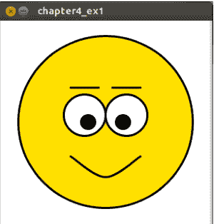
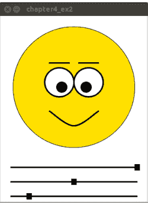
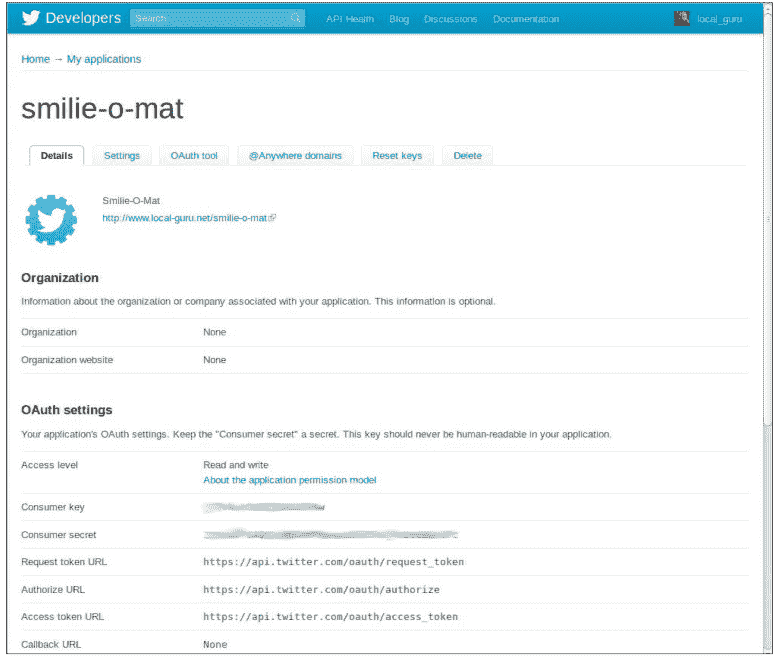
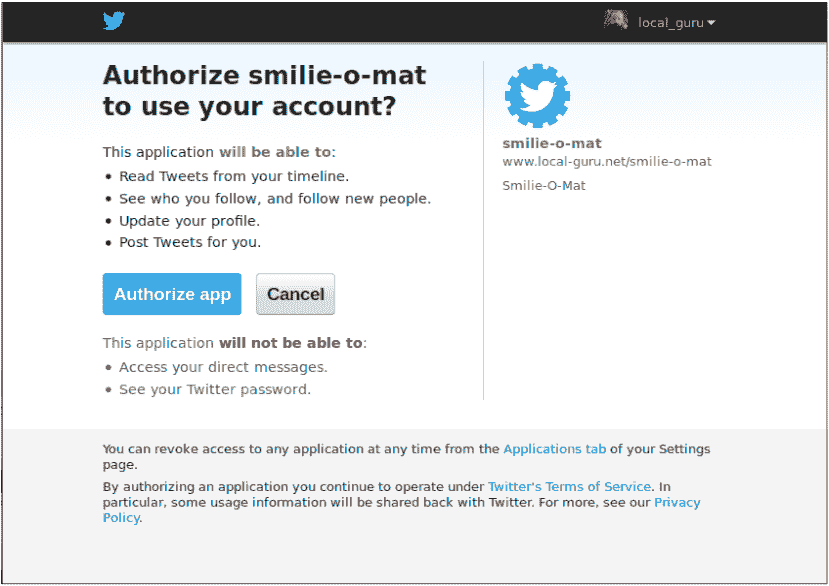
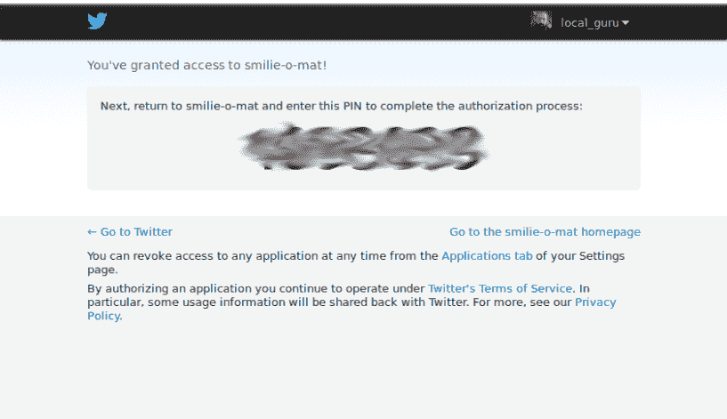
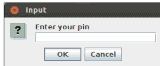
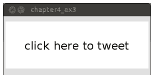
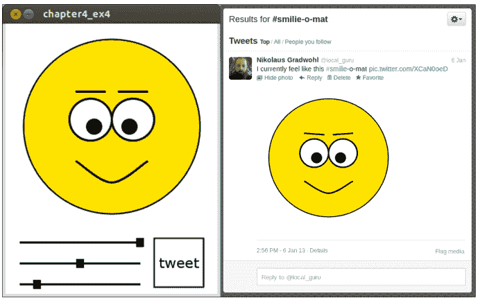

# 项目 4

## 笑脸制造机（Smilie-O-Mat）

当我们通过 SMS、Twitter 或聊天等基于文本的媒介进行交流时，很难准确传达当前的感受。使用图片代替 140 个字符的描述会容易且准确得多。人类终生都在训练读取面部表情中的情感，因此我们的下一个任务是创建一个笑脸制造机。这个小程序允许我们调整笑脸的某些面部参数，然后将图片发布到 Twitter。

## 任务简报

我们的任务是创建 Smile-O-Mat；一个允许用户创建反映其情绪状态的笑脸并将其发布到 Twitter 的程序。我们将使三个参数可调节：眉毛的角度、脸部的颜色以及嘴巴的位置（可变，从皱眉到微笑，反之亦然）。

要在 Twitter 上发布图片，我们将使用名为 Twitter4J 的 Java 库；我们还将学习如何使用 OAuth 身份验证框架授权 Processing 草图来更改 Twitter 用户的状态。

## 这有什么酷的？

你今天感觉有点偏绿偏黄，带着一丝微笑和中性的眉毛。不知道如何用 140 个字符表达这种感觉？没问题；调整笑脸制造机的脸然后发推。当你拥有合适的工具时，生活可以如此轻松。

除此之外，访问 Twitter 数据流并将其发布出去，是可视化项目或交互式 Processing 草图非常丰富的数据源。

## 你的高手目标

要完成这次任务，我们需要完成四个任务。它们是：

- 绘制你的脸
- 让我来改变它
- Hello Twitter
- 发推表达你的心情

## 任务清单

对于这次任务，我们不需要任何额外的硬件；但是，在第 3 和第 4 任务中，我们将向 Twitter 发布状态更新，因此你需要一个可用的 Internet 连接和一个 Twitter 账号来完成这两项任务。

## 绘制你的脸

我们当前任务的第一个任务是使用 Processing 绘制一张脸。我们将使用椭圆和曲线等绘图原语，并学习如何更改填充和描边样式。我们希望在下一个任务中使三个参数可更改，因此我们为这些参数定义变量，并使用它们的值来绘制我们的脸。

## 启动推进器

让我们来画一张脸：

1. 打开一个新草图，添加 `setup()` 和 `draw()` 方法：

   ```
   void setup() {
   }
   void draw() {
   }
   ```

2. 在 `setup()` 方法中，我们将窗口大小设置为 300 x 300 像素并打开线条平滑。我们还将颜色模式更改为 HSB（代表色调、饱和度和亮度），而不是 RGB，以便更轻松地更改脸部颜色。

   ```
   void setup() {
     size(300, 300);
     smooth();
     colorMode(HSB);
   }
   ```

3. 我们将绘制的第一个东西是一个彩色圆圈。为了使颜色可更改，我们将在草图中添加一个名为 col 的整数变量，位于 setup() 方法上方。

   ```
   int col = 150;

   void setup() {
   ```

4. 我们的控制变量 col 将存储 0 到 1023 之间的值，以控制笑脸的色相值。color() 命令期望一个 0 到 255 之间的值，因此我们需要使用 map 命令重新映射该值。

   ```
   void draw() {
     background(255);
     strokeWeight(3);

     color c = color(map(col, 0, 1024, 0, 255), 255, 255);
     fill(c);
     ellipse(150,150,250,250);
   }
   ```

5. 要创建眼睛，我们将添加两个白色圆圈和两个较小的黑色圆圈作为瞳孔。

   ```
   void draw() {
     background(255);
     strokeWeight(3);

     color c = color(map(col, 0, 1024, 0, 255), 255, 255);
     fill(c);
     ellipse(150,150,250,250);

     fill(255);
     ellipse( 120, 140, 60, 60);
     ellipse( 180, 140, 60, 60);
     fill(0);
     ellipse( 125, 150, 20, 20);
     ellipse( 175, 150, 20, 20);
   }
   ```

6. 为了使眼睛更有表现力，我们将添加眉毛。添加一个新变量来控制眉毛的角度。

   ```
   int eye = 512;
   int col = 150;
   void setup() {
   ```

7. 现在，对于眉毛，通过将以下代码添加到 draw() 方法中，为你的脸部代码添加两条线：

   ```
   void draw() {
     background(255);
     strokeWeight(3);

     color c = color(map(col, 0, 1024, 0, 255), 255, 255);
     fill(c);
     ellipse(150,150,250,250);

     fill(255);
     ellipse( 120, 140, 60, 60);
     ellipse( 180, 140, 60, 60);
     fill(0);
     ellipse( 125, 150, 20, 20);
     ellipse( 175, 150, 20, 20);

     line( 100, 100 + map( eye, 0, 1024, -10, 10 ),
           140, 100 - map( eye, 0, 1024, -10, 10 ) );
     line( 160, 100 - map( eye, 0, 1024, -10, 10 ),
           200, 100 + map( eye, 0, 1024, -10, 10 ) );
   }
   ```

8. 我们将添加第三个控制变量，将嘴巴从微笑改为皱眉。

   ```
   int mouth = 1024;
   int eye = 512;
   int col = 150;

   void setup() {
   ```

9. 要绘制嘴巴，我们将使用曲线形状。曲线定义以 beginShape() 方法开始，以 endShape() 方法结束。在这些命令之间，我们将使用 curveVertex() 命令定义曲线的控制点。

   ```
   void draw() {
     background(255);
     strokeWeight(3);

     color c = color(map(col, 0, 1024, 0, 255), 255, 255);
     fill(c);
     ellipse(150,150,250,250);

     fill(255);
     ellipse( 120, 140, 60, 60);
     ellipse( 180, 140, 60, 60);
     fill(0);
     ellipse( 125, 150, 20, 20);
     ellipse( 175, 150, 20, 20);

     line( 100, 100 + map( eye, 0, 1024, -10, 10 ), 140,
           100 - map( eye, 0, 1024, -10, 10 ) );
     line( 160, 100 - map( eye, 0, 1024, -10, 10 ),
           200, 100 + map( eye, 0, 1024, -10, 10 ) );

     noFill();
     beginShape();
     curveVertex(100, 200);
     curveVertex(100, 200);
     curveVertex(150, 180 + map( mouth, 0, 1024, 0, 50));
     curveVertex(200, 200);
     curveVertex(200, 200);
     endShape();
   }
   ```

10. 现在运行草图并更改我们的控制变量值，以查看它们如何影响生成的脸。我们迄今在示例中使用的参数会产生你在以下截图中看到的笑脸：

    


## 任务完成 - 小型简报

对于当前任务的第一个任务，我们创建了一个 Processing 草图来绘制我们的基本面部。我们添加了三个变量来控制用户可以更改的面部特征。我们将颜色模式更改为 HSB，以便用户更容易选择所需的颜色色调。与 RGB 类似，HSB 颜色模式也有三个参数，但不是混合红、绿、蓝，而是选择基本颜色（色相）、亮度和饱和度。为了简单起见，我们固定了亮度和饱和度值，并让用户更改色相值。

所有控制变量都存储 0 到 1023 之间的值，然后使用 map() 命令将其映射到绘制所需的值范围。

## 让我来改变它

没有人总是想微笑，但目前更改我们笑脸的面部参数有些麻烦，这可能会影响您当前的情绪状态。为了防止 Smillie-O-Mat 增加用户的挫败感或烦恼感，本次任务的第二项任务是在笑脸下方添加三个滑块，使用鼠标来调节面部参数。

## 启动推进器

现在让我们改变一下我们的脸：

- 1. 打开 Smillie-O-Mat 草图，并在 `setup()` 方法中更改草图窗口的大小，为笑脸下方的滑块腾出更多空间。

```java
void setup() {
  size(300, 390);
  smooth();
  background(255);
  colorMode(HSB);
}
```

- 2. 现在添加一个名为 `drawSliders()` 的新方法，并绘制三个黑色矩形作为滑块的基础。

```java
void drawSliders() {
  fill(0);
  strokeWeight(1);
  rect( 20,315,width-40,2 ) ;
  rect( 20,345,width-40,2 ) ;
  rect( 20,375,width-40,2 ) ;
}
```

- 3. 第一个滑块将改变嘴巴的位置，因此我们添加一个较小的矩形，并将嘴巴变量的值映射到矩形的 x 坐标。

```
void drawSliders() {
    fill(0);
    strokeWeight(1);
    rect( 20,315,width-40,2 );
    rect( 15 + map( mouth, 0, 1024, 0, width-40 ), 310, 10, 12 );
    rect( 20,345,width-40,2 );
    rect( 20,375,width-40,2 );
}
```

- 4. 添加一个用于眉毛角度的滑块和一个用于面部颜色的滑块，操作方式与处理嘴巴变量相同。

```
void drawSliders() {
    fill(0);
    strokeWeight(1);
    rect( 20,315,width-40,2 );
    rect( 15 + map( mouth, 0, 1024, 0, width-40 ), 310, 10, 12 );
    rect( 20,345,width-40,2 );
    rect( 15 + map( eye, 0, 1024, 0, width-40 ), 340, 10, 12 );
    rect( 20,375,width-40,2 );
    rect( 15 + map( col, 0, 1024, 0, width-40 ), 370, 10, 12 );
}
```

- 5. 现在我们从 draw() 方法中调用 drawSliders() 方法。

```
void draw() {
    background(255);
    drawSliders();
    color c = color(map(col, 0, 1024, 0, 255), 255, 255 );
    fill(c);
    ellipse(150,150,250,250);
    strokeWeight(3);
}
```

- 6. 运行您的草图，然后更改控制变量，检查滑块的位置是否发生变化。

- 7. 为了使滑块对鼠标做出反应，我们添加了一个名为 `mousePressed()` 的新方法和一个名为 `mclick` 的布尔变量。每次按下鼠标按钮时都会调用此方法；我们现在将测试鼠标单击是否发生在我们的嘴巴滑块上。

```
boolean mclick = false;
void mousePressed() {
 if ( mouseY > 310 && mouseY < 322 ) {
 mclick = true;
 mouth = constrain( int( map( mouseX, 20, width - 20, 0, 1024
 ) ), 0, 1024 );
 }
}
```

- 8. 我们需要添加另一个回调方法，当用户拖动鼠标时会调用该方法。只有当 `mclick` 变量由 `mousePressed()` 方法设置为 `true` 时，我们才更改滑块的位置。

```
void mouseDragged() {
 if ( mclick ) mouth = constrain( int( map( mouseX, 20, width - 20,
 0, 1024 ) ), 0, 1024 );
}
```

- 9. 当单击滑块时，我们将 `mclick` 变量设置为 `true`。当释放鼠标按钮时，我们需要将变量重新设置为 `false`。向我们的草图添加 `mouseReleased()` 方法。

```
void mouseReleased() {
 mclick = false;
}
```

- 10. 运行草图，拖动第一个滑块，并检查嘴巴的位置是否相应变化。

- 11. 为了使我们的眼睛和颜色滑块工作，我们需要两个更多的布尔变量，并且需要将以下代码添加到我们的 `mousePressed()` 方法中：

```
boolean mclick = false;
boolean eclick = false;
boolean cclick = false;

void mousePressed() {
 if ( mouseY > 310 && mouseY < 322 ) {
 mclick = true;
 mouth = constrain( int( map( mouseX, 20, width - 20, 0, 1024
 ) ), 0, 1024 );
 }

 if ( mouseY > 340 && mouseY < 352 ) {
 eclick = true;
 eye = constrain( int( map( mouseX, 20, width - 20, 0, 1024 ) ),
 0, 1024 );
 }

 if ( mouseY > 370 && mouseY < 382 ) {
 cclick = true;
 col = constrain( int( map( mouseX, 20, width - 20, 0, 1024 ) ),
 0, 1024 );
 }
}
```

- 12. 我们还需要通过向 mouseDragged() 和 mouseReleased() 方法添加以下代码来处理鼠标按钮的拖动和释放：

```
void mouseDragged() {
if ( mclick ) mouth = constrain( int( map( mouseX, 20, width - 20,
0, 1024 ) ), 0, 1024 );
if ( eclick ) eye = constrain( int( map( mouseX, 20, width - 20,
0, 1024 ) ), 0, 1024 );
if ( cclick ) col = constrain( int( map( mouseX, 20, width - 20,
0, 1024 ) ), 0, 1024 );
}
```

```
void mouseReleased() {
mclick = false;
eclick = false;
cclick = false;
}
```

- 13. 现在运行我们的草图，并使用滑块调整面部参数以匹配您当前的心情。在这张截图中，您可以看到可以生成的笑脸之一：



## 任务完成 - 小型简报

对于本次任务，我们添加了三个滑块来更改控制变量的值。我们没有使用任何现有的 GUI 库；我们从头开始创建了滑块，将落在 0 到 1024 区间内的变量值映射到滑块的长度，并绘制两个矩形。

我们还实现了三个回调函数来使滑块对鼠标事件做出反应。在 mousePressed() 方法中，我们测试鼠标指针是否位于我们的某个滑块上，如果是，则将该滑块的布尔变量设置为 true。在 mouseDragged() 方法中，如果该参数的布尔变量为 true，则更改控制变量的值。当释放鼠标按钮时，我们在 mouseReleased() 方法中将所有布尔变量设置为 false。

## Hello Twitter

我们任务中的第三项任务是创建一个能够更改我们当前 Twitter 状态的 Processing 草图。我们将使用 twitter4j.org 上的 Java 库 Twitter4J，它将所有 Twitter API 调用封装为方便的 Java 对象来设置状态。我们还将使用 Twitter 开发者网站来创建必要的应用程序密钥，并学习如何请求用户允许发布状态更新。

## 准备起飞

为了完成当前任务中的此项及后续任务，您需要一个用于发布推文的 Twitter 账户以及访问 Twitter 开发者网站的权限。如果您已经在使用 Twitter，那么您已满足此项任务的先决条件，因为 Twitter 不区分普通账户和开发者账户；每个 Twitter 用户都有权创建和注册应用程序。如果您还没有 Twitter 账户，请访问 twitter.com 并注册一个。

## 启动推进器

让我们发推文吧：

- 1. 访问 https://dev.twitter.com/ 上的 Twitter 开发者页面，并使用您的 Twitter 账户登录。

- 2. 现在单击您的账户，并从右上角的弹出式菜单中选择“我的应用程序”，如下图所示：


- 3. 现在单击 **创建新应用程序** 并填写注册表单来注册新应用程序。

- 4. 切换到 **设置** 标签页，并将 **应用程序类型** 更改为 **读写权限**，以允许我们的应用程序发布推文。

- 5. 现在切换回 **详情** 标签页，在 **消费者密钥** 中创建消费者密钥，并通过单击 **重新生成我的访问令牌** 创建 **消费者密钥** 密钥。下图显示了我的 Smilie-O-Mat 应用程序的 **详情** 页面：




- 6. 将两个密钥复制到名为 keys.txt 的文本文件中；将每个密钥放在单独一行，并确保每行末尾没有空白空格。

- 7. 对于此任务，我们需要 Twitter4J 库。转到 http://twitter4j.org，下载 twitter4j-3.0.3.zip 文件并解压。我们需要 ZIP 包的 lib 文件夹中的 twitter4j-core.jar 文件。

- 8. 创建一个新的 Processing 草稿，并通过将刚刚从 ZIP 文件中提取的 jar 文件拖到草稿窗口，或使用草稿菜单下的 Add File ... 选项将其添加进去。

- 9. 将步骤 6 中创建的 keys.txt 文件拖到草稿窗口，或使用草稿菜单下的 Add File ... 选项将其添加进去。

- 10. 现在向我们的草稿添加 draw() 和 setup() 方法。

```
void setup() {

}

void draw() {
}
```

- 11. 要使用 Twitter4J 库，我们需要导入它并定义一个 twitter 对象。我们还需要定义一个字符串数组，其中将包含我们想要发送的一些 Twitter 消息。

```
import twitter4j.*;

Twitter twitter;
String[] tweets = {
  "tweet tweet #test",
  "test 1 2 3 #test",
  "microphone test #test"
};
```

- 12. 在我们的 setup() 方法中，我们需要初始化 twitter 对象并提供存储在 keys.txt 文件中的消费者密钥和消费者密钥秘密。我们还需要一个访问令牌和一个访问令牌秘密才能获得向用户动态发布的权限。要获取这两个访问密钥，我们需要触发打开浏览器窗口以请求用户授权。

```
void setup() {
  size(300, 100);
  noLoop();
  textFont( createFont( "Georgia", 24 ) );

  String[] keys = loadStrings( "keys.txt" );

  try {
  twitter = TwitterFactory.getSingleton();
  twitter.setOAuthConsumer( keys[0], keys[1] );
  RequestToken requestToken =
  twitter.getOAuthRequestToken();
  AccessToken at = null;
  if ( System.getProperty("os.name").toLowerCase().
  indexOf("win")>=0) {
  link(requestToken.getAuthorizationURL());
  } else {
  open(requestToken.getAuthorizationURL());
  }
  } catch ( Exception e ) {
  e.printStackTrace();
  }
  }
```

当我们的草稿找不到密钥时，会打开这个页面：



- 13. 当用户点击 **授权应用** 时，Twitter 会生成一个像截图中所示的 pin：



- 14. 现在我们需要用户从网站输入 pin，并使用此 pin 从 Twitter 获取我们的访问令牌密钥。

```
void setup() {
  size(300, 100);
  noLoop();
  textFont( createFont( "Georgia", 24 ) );

  String[] keys = loadStrings( "keys.txt" );

  try {
    twitter = TwitterFactory.getSingleton();
    twitter.setOAuthConsumer( keys[0], keys[1] );
    RequestToken requestToken =
      twitter.getOAuthRequestToken();
    AccessToken at = null;
    if ( System.getProperty("os.name").toLowerCase().
        indexOf("win")>=0) {
      link(requestToken.getAuthorizationURL());
    }
    else {
      open(requestToken.getAuthorizationURL() );
    }

    String preset="";
    String pin=javax.swing.JOptionPane.showInputDialog(frame,
            "Enter your pin",preset);
    at = twitter.getOAuthAccessToken(requestToken, pin);

  } catch ( Exception e ) {
      e.printStackTrace();
  }

  }
```

- 15. 这里可以看到我们在上一步中创建的对话框的截图：



- 16. 我们只需要请求用户授权一次。如果我们已经拥有密钥的访问权限，可以重复使用它们。我们将消费者密钥和访问令牌密钥存储在 keys.txt 文件中，并在下次运行草稿时使用它们。

```
void setup() {
    size(300,100);
    noLoop();
    textFont( createFont( "Georgia", 24 ) );

    String[] keys = loadStrings( "keys.txt" );
    try {
        twitter = TwitterFactory.getSingleton();
        twitter.setOAuthConsumer( keys[0], keys[1] );
        RequestToken requestToken= twitter.getOAuthRequestToken();
        AccessToken at = null;
        if ( System.getProperty("os.name").toLowerCase().
        indexOf("win")>=0 ) {
            link(requestToken.getAuthorizationURL());
        }
        else {
            open(requestToken.getAuthorizationURL());
        }
        String preset="";
        String pin=javax.swing.JOptionPane.showInputDialog(frame,
        "Enter your pin",preset);
        at = twitter.getOAuthAccessToken(requestToken, pin);
        String[] newKeys = new String[4];
        newKeys[0] = keys[0];
        newKeys[1] = keys[1];
        newKeys[2] = at.getToken();
        newKeys[3] = at.getTokenSecret();
        saveStrings( "data/keys.txt", newKeys );
    } catch ( Exception e ) {
        e.printStackTrace();
    }
}
```

- 17. 如果 keys.txt 文件已经包含四个密钥，因为我们已经获得用户发推文的权限，我们可以使用配置构建器来创建 Twitter 对象。

```
void setup() {
size(300,100);
noLoop();
textFont( createFont( "Georgia", 24 ) );
String[] keys = loadStrings( "keys.txt" );
if (keys.length <= 2) {
try {
twitter = TwitterFactory.getSingleton();
twitter.setOAuthConsumer( keys[0], keys[1] );
RequestToken requestToken = twitter.getOAuthRequestToken();
AccessToken at = null;
if ( System.getProperty("os.name").toLowerCase() .
indexOf("win")>=0) {
link(requestToken.getAuthorizationURL());
} else {
open(requestToken.getAuthorizationURL());
}

String preset="";
String pin=javax.swing.JOptionPane.showInputDialog(frame,
"Enter your pin",preset);
at = twitter.getOAuthAccessToken(requestToken, pin);

String[] newKeys = new String[4];
newKeys[0] = keys[0];
newKeys[1] = keys[1];
newKeys[2] = at.getToken();
newKeys[3] = at.getTokenSecret();

saveStrings( "data/keys.txt", newKeys );
} catch ( Exception e ) {
e.printStackTrace();
}
} else {
ConfigurationBuilder cb = new ConfigurationBuilder();
cb.setOAuthConsumerKey( keys[0] );
cb.setOAuthConsumerSecret( keys[1] );
cb.setOAuthAccessToken( keys[2] );
cb.setOAuthAccessTokenSecret( keys[3] );

twitter = new TwitterFactory( cb.build() ).getInstance();
}
}
```

- 18. 在我们的 draw() 方法中，我们设置背景色和填充颜色，并显示一条文本消息，以确保用户知道该做什么。

```
void draw() {
background(255);
fill(0);
text( "click here to tweet", 40, 60 );
}
```

- 19. 现在我们向草稿添加 mouseClicked() 方法并创建一个 StatusUpdate 对象。我们从创建的消息列表中随机选择一条推文，并使用 Twitter 对象的 updateStatus() 方法将其发送出去。

```
void mouseClicked() {
try {
StatusUpdate status = new StatusUpdate(
tweets[ int(random( tweets.length )) ] );
twitter.updateStatus( status );
} catch ( Exception e ) {
e.printStackTrace();
}
}
```

- 20. 运行草稿并单击窗口来生成一些推文。应用程序窗口如下所示：



## 任务完成 - 小型简报

我们当前任务的第 3 项是实现一个推特草稿。在步骤 1 到 5 中，我们在 Twitter 开发者网站上注册了应用程序并生成了所需的消费者密钥和消费者密钥秘密。要实际代表 Twitter 用户发布内容，我们还需要两个密钥：访问令牌和访问令牌秘密。为了获取这些密钥，我们在步骤 12 中打开了一个浏览器窗口。

用户向我们的应用程序授予所需权限后，我们需要浏览器窗口中显示的 pin 来完成授权过程。因此，我们打开一个 Swing 输入对话框，要求用户输入 pin。

访问令牌密钥是可重复使用的，因此我们只需要获取一次，然后将其存储到存放消费者密钥的同一文本文件中。如果此文件已经包含四个密钥，我们可以直接创建 Twitter 对象并立即开始推文。

我们使用 Twitter4J 来访问 Twitter API，并且要实际发推文，我们实现了一个 mouseClicked() 方法，它将一条随机推文发送到世界。我们定义了一个字符串数组来存储这些推文，并且每次都随机选择一条，因为 Twitter 不允许通过 API 发布完全相同的文本两次（防止垃圾邮件）。

## 推特心情

本任务的最后一项是将推特与我们之前创建的表情面孔相结合，向世界展示我们当前的感受。我们为 Smilie-O-Mat 的 GUI 部分添加一个按钮，并实现一个状态更新方法，它不仅发布文本消息，还上传我们当前的笑脸。


## 启动推进器

让我们推特一下我们的心情：

- 1. 打开任务 2 中的 Smilie-O-Mat 草图，让我来修改它。

- 2. 我们要添加的第一件事是一个用于推特表情的按钮，所以让我们减小滑块的大小以腾出空间。像这样更改 drawSliders() 方法：

```
void drawSliders() {
fill(0);
strokeWeight(1);
rect( 20,315,width-130,2 );
rect( 15 + map( mouth, 0, 1024, 0, width-130 ), 310, 10, 12 );

rect( 20,345,width-130,2 );
rect( 15 + map( eye, 0, 1024, 0, width-130 ), 340, 10, 12 );
rect( 20,375,width-130,2 );
rect( 15 + map( col, 0, 1024, 0, width-130 ), 370, 10, 12 );
}
```

- 3. 我们还需要调整 mousePressed() 和 mouseDragged() 方法，以使鼠标坐标的映射能与更短的滑块配合工作。

```
void mousePressed() {
if ( mouseY > 310 && mouseY < 322 ) {
mclick = true;
mouth = constrain( int(
map( mouseX, 20, width - 110, 0, 1024 )), 0, 1024 );
}

if ( mouseY > 340 && mouseY < 352 ) {
eclick = true;
eye = constrain( int(
map( mouseX, 20, width - 110, 0, 1024 )), 0, 1024 );
}

if ( mouseY > 370 && mouseY < 382 ) {
cclick = true;
col = constrain( int(
map( mouseX, 20, width - 110, 0, 1024 )), 0, 1024 );
}
}
```

```
void mouseDragged() {
if (mclick) mouth = constrain(
int( map( mouseX, 20, width - 110, 0, 1024 )), 0, 1024 );
if (eclick) eye = constrain(
    int( map( mouseX, 20, width - 110, 0, 1024 ) ), 0, 1024 );
if (cclick) col = constrain(
    int( map( mouseX, 20, width - 110, 0, 1024 ) ), 0, 1024 );
}
```

- 4. 现在添加一个 drawButton() 方法和一个布尔变量，用于指示按钮当前是否被按下。

```
boolean bclick = false;
void drawButton() {
    fill( bclick ? 128 : 255);
    stroke( 0 );
    strokeWeight(2);
    rect( width - 90, 310, 70, 70 );
    fill(0);
    text( "tweet", width-83, 353 );
}
```

- 5. 从 draw() 方法中调用 drawButton() 方法，使我们的按钮显示出来。

```
void draw() {
    background(255);
    color c = color(map(col, 0, 1024, 0, 255), 255, 255 );
    fill(c);
    ellipse(150,150,250,250);
    strokeWeight(3);

    fill(255);
    ellipse( 120, 140, 60, 60);
    ellipse( 180, 140, 60, 60);
    fill(0);
    ellipse( 125, 150, 20, 20);
    ellipse( 175, 150, 20, 20);

    line( 100, 100 + map( eye, 0, 1024, -10, 10), 140, 100 - map( eye, 0, 1024, -10, 10) );
    line( 160, 100 - map( eye, 0, 1024, -10, 10), 200, 100 + map( eye, 0, 1024, -10, 10) );

    noFill();
    beginShape();
    curveVertex(100, 200);
    curveVertex(100, 200);
    curveVertex(150, 180 + map( mouth, 0, 1024, 0, 50) );
curveVertex(200, 200);
curveVertex(200, 200);
endShape();

drawSliders();
drawButton();
}
```

- 6. 为了使按钮可点击，我们需要处理鼠标事件；所以将以下代码添加到我们的 mousePressed() 方法中：

```
void mousePressed() {
  if ( mouseY > 310 && mouseY < 380
    && mouseX > width - 90 && mouseX < width - 20 ) {
    bclick = true;
    return;
  }

  if ( mouseY > 310 && mouseY < 322 ) {
    mclick = true;
    mouth = constrain( int(
      map( mouseX, 20, width - 110, 0, 1024 )), 0, 1024 );
  }

  if ( mouseY > 340 && mouseY < 352 ) {
    eclick = true;
    eye = constrain( int(
      map( mouseX, 20, width - 110, 0, 1024 )), 0, 1024 );
  }

  if ( mouseY > 370 && mouseY < 382 ) {
    cclick = true;
    col = constrain( int(
      map( mouseX, 20, width - 110, 0, 1024 )), 0, 1024 );
  }
}
```

- 7. 当鼠标按钮再次释放时会生成点击事件。所以，将以下代码添加到 mouseReleased() 方法中：

```
void mouseReleased() {
  if (bclick) {
    println( "button clicked" );
  }

  bclick = false;
  mclick = false;
  eclick = false;
  cclick = false;
}
```

- 8. 现在将 twitter4j-core.jar 文件和我们在上一个任务中为 Smilie-O-Mat 生成的 keys.txt 文件拖入。

- 9. 我们需要导入 Twitter4J 库；我们还需要一个要发送的推文数组。将导入语句和变量定义添加到草图的开头。

```
import twitter4j.*;

Twitter twitter;
String[] tweets = {
    "I feel so #SmilieOMat",
    "I currently feel like this #SmilieOMat",
    "This is how I feel #SmilieOMat"
};
```

- 10. 添加一个 initTwitter() 方法，并从我们的 Twitter 测试应用程序中复制初始化代码。

```
void initTwitter() {
String[] keys = loadStrings( "keys.txt" );

if (keys.length <= 2) {
try {
twitter = TwitterFactory.getSingleton();
twitter.setOAuthConsumer( keys[0], keys[1] );
RequestToken requestToken = twitter.getOAuthRequestToken();
AccessToken at = null;
if ( System.getProperty("os.name").toLowerCase().
indexOf("win")>=0) {
link(requestToken.getAuthorizationURL());
}
else {
open(requestToken.getAuthorizationURL());
}

String preset="";
String pin=javax.swing.JOptionPane.
showInputDialog(frame,"Enter your pin",preset);
at = twitter.getOAuthAccessToken(requestToken, pin);

String[] newKeys = new String[4];
newKeys[0] = keys[0];
newKeys[1] = keys[1];
newKeys[2] = at.getToken();
newKeys[3] = at.getTokenSecret();

saveStrings( "data/keys.txt", newKeys  );

} catch ( Exception e ) {
    e.printStackTrace();
}

} else {
ConfigurationBuilder cb = new ConfigurationBuilder();
cb.setOAuthConsumerKey( keys[0] );
cb.setOAuthConsumerSecret( keys[1] );
cb.setOAuthAccessToken( keys[2] );
cb.setOAuthAccessTokenSecret( keys[3] );

twitter = new TwitterFactory( cb.build() ).getInstance();
}
}
```

- 11. 现在我们从 setup() 方法中调用 initTwitter() 方法。

```
void setup() {
size(300,390);
smooth();
background(255);
colorMode(HSB);
textFont( createFont( "Georgia", 20 ) );

initTwitter();
}
```

- 12. 要推特当前的表情，我们添加一个名为 tweet() 的新方法。由于我们只想推特表情的图像而不想推特 GUI 元素，因此我们需要将想要的窗口部分复制到 PImage 对象中，然后将其保存到文件。我们将使用此文件作为上传到 Twitter 的状态更新的媒体对象。

```
void tweet() {

PImage image = get( 0, 0, 300,300 );
image.save( "smilie.png" );

java.io.File f = new java.io.File( sketchPath( "smilie.png" ) );
StatusUpdate status = new StatusUpdate( tweets[int(random(
tweets.length ))]);
status.setMedia(f);

try {
twitter.updateStatus(status);
}
catch ( Exception e ) {
    e.printStackTrace();
}
}
```

- 13. 现在更改 mouseReleased() 方法，使其调用新的 tweet() 方法，而不是打印消息。

```
void mouseReleased() {
if ( bclick ) {
    tweet();
}
bclick = false;
mclick = false;
eclick = false;
cclick = false;
}
```

- 14. 运行你的草图，创建一个微笑的快乐表情，并使用我们的 tweet 按钮推特它。在以下截图中，你可以看到我们的 Smilie-O-Mat 和生成的推文：



## 任务完成 - 小型简报

在任务 4 中，我们合并了为本次任务编写的所有草图，并向我们的 Smilie-O-Mat 添加了 Twitter 功能。我们添加了一个按钮来触发推特，并添加了在任务 3 中实现的密钥设置机制。

我们还学习了如何将媒体文件添加到 Twitter 状态更新中。在这个草图中，媒体文件是我们创建的表情图像。

## 任务完成

我们的任务是实现一个草图，使用户能更轻松地传达当前的情绪状态。我们通过创建一个具有多种可控面部参数的表情来实现这一点。在任务 1 中，我们实现了生成表情的绘制例程，但更改参数意味着更改变量并重新运行草图。

为了解决这个问题，我们在任务 2 中向草图添加了一些 GUI 元素，以简化用户与草图的交互。我们没有使用任何现有的 GUI 库，而是通过实现鼠标事件回调函数并绘制一些矩形从头开始创建了滑块。

在任务 3 中，我们创建了用于向 twitter.com 验证我们应用的必要代码，并创建了一个允许我们的应用为 Twitter 用户发布状态更新的方法。我们在 Twitter 开发者网站上创建了消费者密钥和消费者密钥密文，并通过请求 URL 和 PIN 码请求用户授权推特。

最后，我们在任务 4 中合并了两个草图，在 GUI 中添加了一个按钮，该按钮在 Twitter 上推特一条状态消息并添加用户调整的表情。我们通过省略 GUI 元素并仅将草图窗口的一部分复制到新的 PImage 对象来创建包含表情的图像；然后我们保存了该文件，并将其作为媒体对象添加到状态更新中。

## 准备好大干一场了吗？一个火热的挑战

Smilie-O-Mat 已完成，但这并不意味着你必须在此停止。为什么不尝试将其提升到一个新水平，并实现以下建议之一呢：

- - 解析 Twitter 流中你关注的人的 #SmilieOMat 消息
- 使更多面部特征可更改
- 创建移动版本
- 在其他社交网络上发布你的表情


