# 项目 5 笑脸制造器控制器

在 Xerox PARC 发明鼠标和图形用户界面是计算机历史上的一件里程碑事件。鼠标是一种与计算机交互的非常多功能的机制，它使得数据输入和控制程序流程出现了一整套全新的方法。但是，如果一种工具适用于非常广泛的问题范围，通常意味着它没有针对任何一种问题进行优化。有些程序使用专用控制器会更容易、更快速或更符合人体工学。在本任务中，我们将为在 _第4项目 笑脸制造器_ 中创建的笑脸制造器草图创建一个自定义控制器。

## 任务简报

我们当前的任务是为在上一个项目中编写的笑脸制造器草图构建一个自定义控制器。我们将使用 Arduino 板（一种使用 AVR 微控制器的低成本开发板）、一个按钮和一些可变电阻。我们将通过 USB 将 Arduino 板连接到计算机，并创建一个简单的协议来控制笑脸的面部参数。

## 这有什么了不起的？

如前所述，鼠标是一个出色且多功能的输入设备，但有时它并不是最佳选择。使用压感平板绘图要有趣得多，使用方向盘和踏板玩赛车游戏更有趣，使用键盘控制器制作音乐也更容易，仅举几例。有时我们需要一个专用控制器，以更快速或更自然的方式与我们的数据或流程进行交互。

了解如何将滑块、按钮和旋钮与计算机接口，使我们能够完全按照我们需要和想要的方式优化工作空间和工作流程。

## 你的高手目标

我们当前的任务包含四个任务。我们将从一个简单的“你好，世界”电路开始，并不断扩展它，直到为我们的笑脸制造器草图制作出一个可用的控制器板，然后为其制作一个外壳。我们当前任务的任务列表如下：

- 连接你的 Arduino
- 构建你的控制器
- 改变你的表情
- 把它放进盒子里

## 任务检查清单

要构建控制器，我们需要一个 Arduino 板、一个免焊面包板和一些电子元件，如下所示：

- Arduino
- 面包板
- 导线
- 一个按钮
- 一个电阻（10 kOhm）
- 三个可变电阻（100 kOhm）

在本任务的最后一个任务中，我们将使用一个盒子和一些花哨的旋钮为控制器创建一个永久外壳。我还将提供本节中使用过的材料清单，但就像 _第1项目 罗密欧与朱丽叶_ 中的机器人一样，外壳很大程度上是个人品味的问题。

## 连接你的 Arduino

向你的 Arduino 打个招呼。我们当前任务的第一个任务是编写一个在 Arduino 上运行并读取可变电阻值的草图。由于这是一本关于 Processing 的书，我们将编写一个 Processing 草图，用于从 Arduino 板接收电阻值并打印该值。

## 准备起飞

在这个任务中，我们将编写在 Arduino 上运行的代码，因此需要安装 Arduino IDE。你可以从 www.arduino.cc 下载它，并通过解压与操作系统匹配的包来安装。

## 启动推进器

让我们连接 Arduino：

1. 为本任务需要做的第一件事是搭建一个小电路，因此请拿一个可变电阻，像下图所示一样将其连接到免焊面包板上：

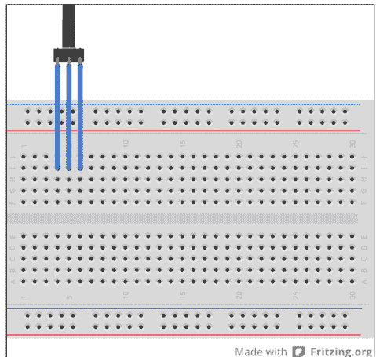

2. 现在将一根红色导线从 Arduino 板的 5V 引脚连接到电阻的一外侧引线上。

3. 电阻的中间引脚连接到 Arduino 板上标记为 ANALOG IN 0 的引脚。

4. 将一根黑色导线从 Arduino 的 Gnd 引脚连接到电阻的剩余引脚。你的连接应如下图所示：

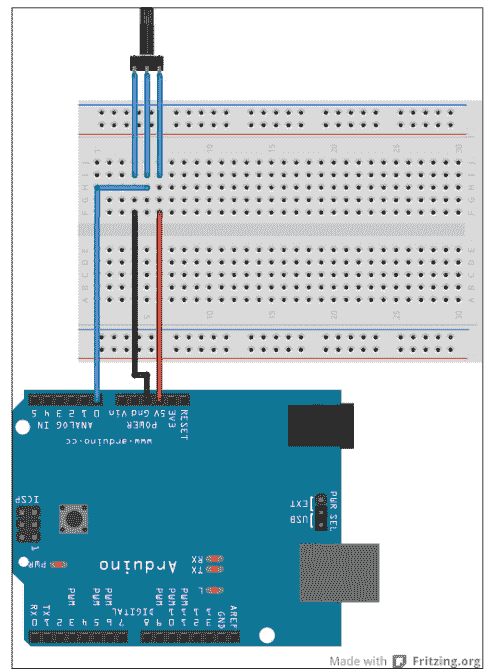

5. 现在将 Arduino 板连接到计算机的 USB 端口并启动 Arduino IDE。

6. 确保通过检查 工具 | 串行端口 菜单选择了正确的串行端口，并通过检查 工具 | 开发板 菜单选择了正确的 Arduino 板类型。

7. 我们的第一个 Arduino 草图将使用 Arduino 的内置 LED。我们将使用刚刚添加的可变电阻来控制 LED 的闪烁速度。现在，我们将以下代码添加到 Arduino 草图并保存它：

```
int del = 5;
boolean state = true;
```

8. 单击验证图标验证代码，如果一切编译正常，单击上传按钮将代码安装到你的 Arduino 上。

9. 旋转可变电阻的旋钮并检查 LED 的闪烁速度。

10. 现在我们希望 Arduino 通过串行端口将可变电阻的值发送到计算机。将以下代码行添加到 Arduino 草图的 setup() 方法中，以初始化串行端口并设置其速度，如下所示：

```
void setup() {
  pinMode( 13, OUTPUT );
  Serial.begin( 9600 );
}
```

11. 在我们的 loop() 方法中，我们使用 Serial 对象的 println() 方法打印电阻值。我们还从草图中删除了 LED 闪烁代码和延迟：

```
void loop() {
  del = analogRead( 0 );
  Serial.println( del );
}
```

12. 单击验证和上传图标，在 Arduino 上编译并安装草图。

13. 现在我们需要打开串行监视器来查看 Arduino 发送的值。使用 工具 | 串行监视器 菜单查看串行监视器，旋转电阻的旋钮，然后观察控制台上的值的变化。

14. 目前，每次 Arduino 运行主循环时都会发送电阻值，但大多数时候值没有改变。因此，让我们仅在值发生变化时发送值，方法是存储我们发送的上一个值并将其与当前值进行比较。

```
int del = 5;
int lastDel = 0;

void loop() {
  del = analogRead( 0 );
  if (abs( del - lastDel ) > 10 ) {
    Serial.println( del );
    lastDel = del;
  }
}
```

15. 将代码编译并上传到 Arduino 并打开串行监视器。如果你现在旋转旋钮，你会看到改变后的值，但如果保持原样，则不会发送任何值。

16. 现在我们完成了第一个任务的 Arduino 部分，让我们切换到它的 Processing 部分。打开 Processing，创建一个新草图，并添加 setup() 和 draw() 方法：

```
void setup() {
}
```

```
void draw() {
}
```

17. 为了与 Arduino 通信，我们需要导入串行库，这使我们能够在 Processing 草图中使用串行端口。因此，使用 草图 | 导入库 ... | 串行 菜单导入库。

我们创建串行端口对象的实例，并定义一个字符串，用于存储从串行端口读取的文本行：

```
import processing.serial.*;

Serial port;
String str = "";
```

18. 然后，我们将以下代码添加到 setup() 方法中以初始化串行端口并定义字体。请确保使用与第 6 步在 Arduino IDE 中使用的串行板相同的名称。在此情况下，它是 /dev/ttyUSB0。

```
void setup() {
  size( 300,300 );
  port = new Serial( this, "/dev/ttyUSB0", 9600 );
  textFont( createFont( "Sans", 64 ) );
}
```

19. 在 draw() 方法中，我们只需输出字符串变量的内容：

```
void draw() {
  background( 255 );
  fill(0);
  text( str, 20, 100 );
}
```

20. 现在，我们添加一个名为 serialEvent() 的回调方法，每次串行端口检测到活动时都会调用它。我们从当前缓冲区读取字符串，直到找到换行符，然后将其存储在我们的字符串变量中：

```
void serialEvent( Serial p ) {
  String in = p.readStringUntil( '\n' );
  if ( in != null ) {
    str = in;
  }
}
```

21. 现在，连接你的 Arduino 并启动你的 Processing 草图。旋转旋钮并观察值的变化。你的草图窗口应如下屏幕截图所示：

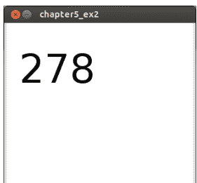

## 目标完成 - 简要总结

在本任务的第一个任务中，我们创建了一个在微控制器上运行并读取可变电阻值的 Arduino 草图。我们创建了一个简单电路来将电阻连接到 Arduino。然后，从第 1 步到第 9 步，我们让草图读取电阻值，并使用该值来改变内置 LED 的闪烁速度。
一旦该代码安装到微控制器上，它将独立于任何计算机运行，并仅将 USB 电缆用作电源。如果你断开 USB 电缆并使用交流适配器或电池为 Arduino 板供电，你的草图仍将运行。


从第 10 步开始，我们删除了闪烁代码，并用调用 `Serial` 对象的 `println()` 方法来替代它，该方法使用内置串口将电阻值发送到计算机。要读取这些值，我们使用了 Arduino IDE 提供的串行监视器。

在第 16 步，我们开始编写一个 Processing 应用程序，它监听串行端口而不是串行监视器，并使用 Processing 的 `serial` 库显示其在串行端口上读取的值。

## 机密情报

Arduino 从可变电阻发送的值范围是 0 到 1,023。通常，我们期望旋钮左侧的值为零，右侧为最大值。如果您的控制器发送的值正好相反，您有两种方法来修复此问题。在硬件方面，您可以切换连接到 Arduino 开发板上 **Gnd** 和 **5V** 的导线。在软件方面，您可以通过用最大值减去该值来计算值：

```
val = 1023 - val;
```

如果您已经焊接了电路，软件方面尤其有帮助。

## 构建您的控制器

在本次任务的第一个任务中，我们学习了如何将可变电阻连接到 Arduino 并使用串行端口将其值发送到计算机。我们的下一个任务是扩展这个基本电路并再添加两个电阻，因为我们想在下一个任务中使用它们来控制 Smilie-O-Mat 草图的所有面部参数。

我们还将向电路中添加一个按钮，并学习如何检测点击事件并将其发送到我们的草图。我们将稍微扩展通信协议，并编写一个新的 Processing 草图，该草图将解析我们的 Arduino 生成的消息并显示我们发送的值。

## 启动推进器

让我们构建我们的控制器：

- 1. 对于此任务，我们需要扩展电路并再添加两个可变电阻。所以让我们先将 5V 引脚连接到面包板的一个外部电源轨，将 Gnd 引脚连接到另一个外部电源轨。如下图所示，将三个电阻连接到面包板：

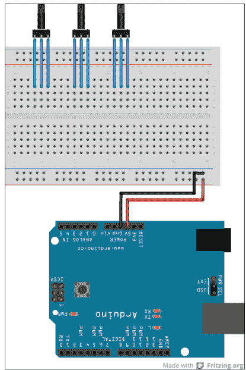

- 2. 将每个电阻的左外侧引线连接到 5V 电源轨，将另一侧连接到 Gnd，如下图所示：

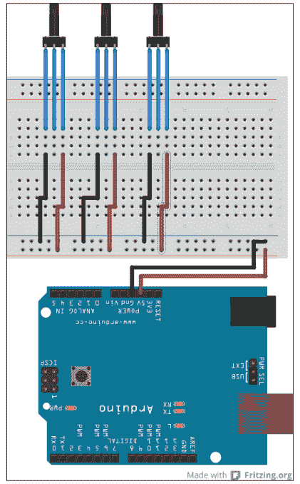

- 3. 现在将 Arduino 引脚（模拟输入 0、1 和 2）连接到电阻的中间引脚。您的布线应如下图所示：

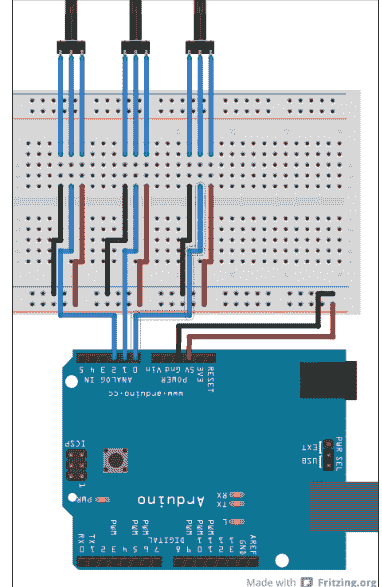

- 4. 在我们的 loop() 方法中，我们需要复制读取值并将其发送到串行端口的代码，以读取另外两个端口：

```
int a = 0;
int lastA = a;

int b = 0;
int lastB = b;

int c = 0;
int lastC = c;

void setup() {
  Serial.begin( 9600 );
}

void loop() {
    a = analogRead( 0 );
    if ( abs( a - lastA ) > 10 ) {
        Serial.println( a );
        lastA = a;
    }
    b = analogRead( 1 );
    if ( abs( b - lastB ) > 10 ) {
        Serial.println( b );
        lastB = b;
    }
    c = analogRead( 2 );
    if ( abs( c - lastC ) > 10 ) {
        Serial.println( c );
        lastC = c;
    }
}
```

- 5. 编译代码并将其上传到 Arduino。

- 6. 现在运行我们为第一个任务“连接您的 Arduino”创建的 Processing 草图，并转动电阻的旋钮。我们看到值在变化，但我们的 Processing 草图无法识别是哪个电阻发送了该值。所以，切换回 Arduino IDE，让我们在值前面添加字母 A、B 或 C：

```
void loop() {
    a = analogRead( 0 );
    if ( abs( a - lastA ) > 10 ) {
        Serial.print( "A" );
        Serial.println( a );
        lastA = a;
    }
    b = analogRead( 1 );
    if ( abs( b - lastB ) > 10 ) {
        Serial.print( "B" );
        Serial.println( b );
        lastB = b;
    }
    c = analogRead( 2 );
    if ( abs( c - lastC ) > 10 ) {
        Serial.print( "C" );
        Serial.println( c );
        lastC = c;
    }
}
```

- 7. 编译并上传代码到 Arduino。

- 8. 现在运行 Processing 草图并转动旋钮。每个旋钮控制我们 Processing 草图中的一个对应变量。这里可以看到输入 B 的值已更改：

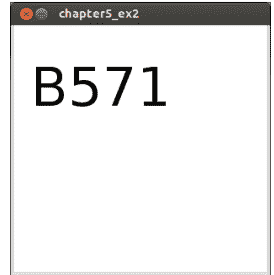

- 9. 要完成控制器的电路，我们需要添加一个按钮。将按钮的两个引线连接到面包板，并添加 10 kOhm 电阻，如下图所示：

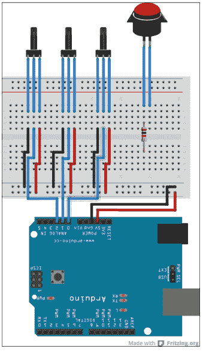

- 10. 现在从 Gnd 线到您刚刚添加的电阻建立一个连接，并从 5V 线到按钮的第二个触点建立一个连接。

- 11. 将 Arduino 开发板的数字 2 引脚连接到电阻和按钮之间，如下图所示：

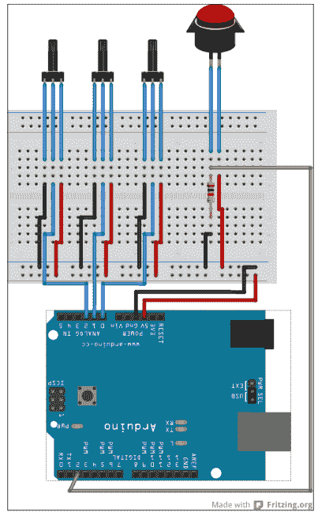

- 12. 您 Arduino 的数字引脚可以配置为输入和输出，因此将以下高亮代码行添加到 Arduino 草图的 setup() 方法中，以将引脚 2 配置为用作输入：

```
void setup() {
  pinMode( 2, INPUT );
  Serial.begin( 9600 );
}
```

- 13. 现在添加一个变量来存储按钮的上一个状态，并将其初始化为 LOW：

```
int button = LOW;
int buttonLast = LOW;
```

- 14. 在我们的 `loop()` 方法中，我们将读取按钮的当前状态并将其与我们保存的上一个值进行比较。如果按钮状态从 *pressed* 变为 *released*，我们将向串行总线发送一条消息：

```
void loop() {
  a = analogRead( 0 );
  if ( abs( a - lastA ) > 10 ) {
    Serial.print( "A" );
    Serial.println( a );
    lastA = a;
  }

  b = analogRead( 1 );
  if ( abs( b - lastB ) > 10 ) {
    Serial.print( "B" );
    Serial.println( b );
    lastB = b;
  }

  c = analogRead( 2 );
  if ( abs( c - lastC ) > 10 ) {
    Serial.print( "C" );
    Serial.println( c );
    lastC = c;
  }

  button = digitalRead( 2 );
  if ( buttonLast == HIGH && button == LOW ) {
    Serial.println( "click" );
  }

  buttonLast = button;
}
```

- 15. 编译并上传代码到 Arduino，然后切换到 Processing。

- 16. 运行我们的 Processing 草图，转动旋钮，并按下按钮。每个旋钮现在发送自己的消息，当按钮被按下时，我们在 Processing 端收到一条消息。按下按钮时，我们的 Processing 草图看起来如下：

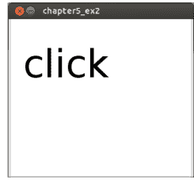

- 17. 您当前的布线看起来应该如下图所示：

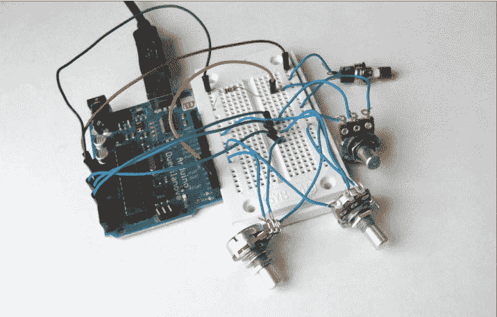

## 任务完成 - 小型简报

在我们当前任务的这个任务中，我们创建了 Smile-O-Mat 控制器所需硬件的原型版本。我们添加了三个可变电阻，并在第 8 步中定义了一个协议，通过串行端口将这些输入的值发送到计算机。该协议还允许我们检测哪个输入旋钮已被转动。

从第 11 步开始，我们扩展了电路并添加了一个按钮。我们还扩展了发送到计算机的消息，添加了点击消息。当按钮值从 pressed 变为 released 时，将传输此消息，我们将在下一个任务中使用它来触发我们的 tweet () 方法。

## 改变您的面容

我们当前任务的任务是将我们刚刚创建的原型硬件控制器集成到 Smile-O-Mat 控制器中。我们将扩展程序以解析基于 Arduino 的控制器通过串行端口发送的消息，并调整滑块以匹配硬件旋钮的值。当我们的控制器的用户按下开发板上的按钮时，我们将调用 tweet () 方法。

## 启动推进器

让我们使用控制器更改我们的笑脸：

- 1. 打开我们上一个任务中的 Smile-O-Mat 草图。

- 2. 要访问串行端口，我们需要导入串行库，因此请使用 草图 | 导入库 ... | 串行 菜单来导入它。

- 3. 现在向您的草图添加一个 Serial 对象：

```
import twitter4j.*;
import processing.serial.*;

Serial port;

Twitter twitter;
String[] tweets = {
"I feel like so #SmilieOMat",
"I currently feel like this #SmilieOMat",
"This is how I feel #SmilieOMat"
}
...
```

- 4. 在 setup() 方法中，我们需要初始化串行端口。请务必更改串行端口的端口名称，就像在本次任务的第一个任务中所做的那样：

```
void setup() {
size( 300,390 );
smooth();
background( 255 );
colorMode( HSB );
textFont( createFont( "Georgia", 20 ) );
initTwitter();
port = new Serial( this, "/dev/ttyUSB1", 9600 );
}
```

- 5. 我们需要解析来自串行端口的消息；因此让我们添加 serialEvent() 方法，以便在每次有消息可用时收到通知。我们正在检查获取的字符串的首字母，如果它以大写字母 A、B 或 C 开头，那么我们将解析字符串的其余部分并将其存储在面部参数的控制变量中：

```
void serialEvent( Serial p ) {
String in = p.readStringUntil( '\n' );
if ( in != null ) {
if ( in.charAt( 0 ) == 'A' ) {
eye = int(in.substring( 1,in.length() - 2 ) );
```


```} else if ( in.charAt( 0 ) == 'B' ) {
  mouth = int(in.substring( 1,in.length()-2 ));
} else if ( in.charAt( 0 ) == 'C' ) {
  col = int(in.substring( 1,in.length()-2 ));
}
}
```

- 6. 将 Arduino 开发板连接到 USB 端口并启动 Smilie-O-Mat 示例。每个可变电阻控制一个面部参数。

- 7. 现在我们将为按钮添加支持，因此请将以下代码添加到 serialEvent() 方法中，以便它能响应我们从 Arduino 发送的点击消息：

```
void serialEvent( Serial p ) {
  String in = p.readStringUntil( '\n' );
  if ( in != null ) {
    if ( in.charAt(0) == 'A' ) {
      eye = int(in.substring(1,in.length()-2));
    } else if ( in.charAt(0) == 'B' ) {
      mouth = int(in.substring(1,in.length()-2));
    } else if ( in.charAt(0) == 'C' ) {
      col = int(in.substring(1,in.length()-2));
    } else if ( "click".equals( in.trim() ) ) {
      tweet();
    }
  }
}
```

- 8. 如果我们现在运行代码，Arduino 会不时快速连续发送两三条点击消息，因为当按钮闭合或断开时，会有一个短暂阶段，此时接触不良且在闭合和断开状态之间快速切换。这种行为称为 **bouncing**。为防止向 Twitter 发送多条消息，我们将在 Arduino 示例中实现一种名为 **debouncing** 的小应对措施。打开 Arduino 示例并添加以下两个变量：

```
int a = 0;
int lasta = a;

int b = 0;
int lastb = b;

int c = 0;
int lastc = c;
```

```
int button = LOW;
int buttonLast = LOW;

long buttonTime = 0;
long debounceDelay = 50;
```

- 9. 在我们的 loop() 方法中，我们将保存发送点击事件所用的时间，并且只有在经过一段时间后才检查按钮的状态。在我们的例子中，我们将 debounceDelay 变量设置为 50 毫秒：

```
void loop() {
  a = analogRead(0);
  if (abs( a - lasta ) > 10 ) {
    Serial.print("A");
    Serial.println( a );
    lasta = a;
  }
  b = analogRead(1);
  if (abs( b - lastb ) > 10 ) {
    Serial.print("B");
    Serial.println( b );
    lastb = b;
  }
  c = analogRead(2);
  if (abs( c - lastc ) > 10 ) {
    Serial.print("C");
    Serial.println( c );
    lastc = c;
  }
  if ( millis() > buttonTime + debounceDelay ) {
    button = digitalRead( 2 );
    if ( buttonLast == HIGH && button == LOW ) {
      Serial.println("click");
    }
    buttonLast = button;
    buttonTime = millis();
  }
}
```

- 10. 编译并上传 Arduino 代码，然后切换回我们的 Processing 示例。

- 11. 现在启动 Smilie-O-Mat 示例，使用控制器上的旋钮更改面部参数，并使用按钮发送一些推文。按照以下截图创建一个微笑的脸并将其发布到 Twitter：

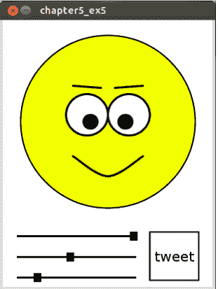

## 目标完成 - 小结

我们当前任务的第三项工作是将我们的原型控制器连接到 Smilie-O-Mat 示例，并扩展该示例以解析来自串口的消息。在第 5 步中，我们添加了 serialEvent() 回调方法，以便在串口收到消息时收到通知，并检查消息的第一个字母以查看哪个旋钮被转动了。然后，我们将字符串的其余部分转换为数字，并使用它来控制我们微笑表情的面部参数。

从第 7 步开始，我们添加了对 Arduino 示例在按钮按下时发送的点击消息的支持。由于我们的按钮有时会触发多条点击消息，我们在 Arduino 示例中添加了一点延迟来对按钮进行防抖处理，以便控制器不会意外触发消息。

## 装盒

现在我们已经对控制器进行了原型设计，修改了 Smilie-O-Mat 示例以支持它，并对其进行了测试，但它仍然有点脆弱且难以使用。当前的任务是创建一个比鼠标（我们目前没有）更容易、更快速使用的定制控制器。

我们需要做的是将控制器放入更稳定的外壳中，并在可变电阻上添加一些旋钮。我们将使用铝制盒子来容纳我们的控制器，为电阻钻一些孔，然后重新接线并焊接连接以防止接触不良。我们还将添加一张纸，以防止 Arduino 直接接触金属并造成短路。

与项目 1 中的机器人罗密欧与朱丽叶一样，本任务中展示的控制器版本是我解决问题的方式，这绝不是唯一的有效解决方案。你想用粉色便当盒或小型塑料恐龙代替铝制盒子吗？没问题！这是你的控制器——随意发挥！

## 启动推进器

让我们为控制器制作一个外壳：

- 1. 取下盒子的盖子，并标记您想要放置输入元件的位置。

- 2. 钻四个孔；三个用于可变电阻，一个用于按压按钮，如下图所示：

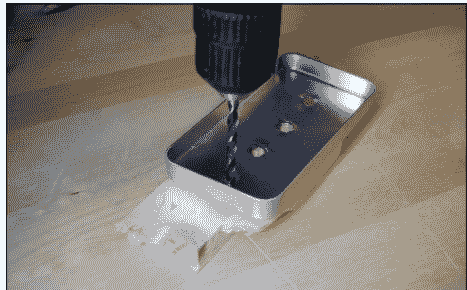

- 3. 旋下电阻的螺母，将它们穿过您刚刚制作的孔，然后用螺母再次固定。

- 4. 翻转盖子，将电线焊接到中间连接器上。

- 5. 现在，准备三根电线，并将它们焊接到电阻的所有左侧引脚上。

- 6. 将第二个电阻的电线焊接到第一个电阻的左侧引脚上，将第三个电阻的电线焊接到第二个电阻的左侧引脚上。

- 7. 现在，再取三根电线，并将它们焊接到电阻的右侧引脚上。

- 8. 将第二个电阻的电线焊接到第一个电阻的右侧引脚上，将第三个电阻的电线焊接到第二个电阻的右侧引脚上。您的电路应如下图所示：

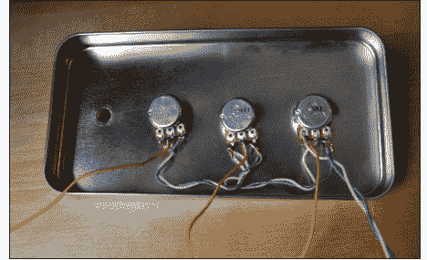

- 9. 现在旋下按压按钮的螺母，并将其放入剩余的孔中。

- 10. 用螺母固定它，然后将固定电阻焊接到其中一条腿上，并将一根电线焊接到第二条腿上。

- 11. 现在将电阻剩余的腿焊接到最近可变电阻的右腿上，并将电线焊接到左腿上。

- 12. 我们需要将最后一根电线焊接到焊有电阻的按压按钮腿上。您的布线应如下图所示：

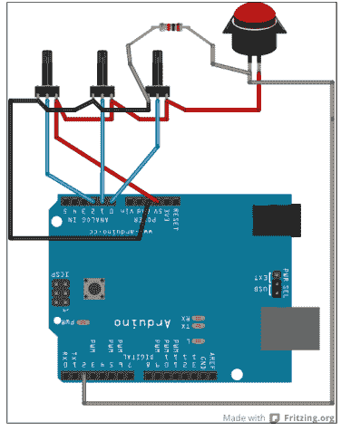

- 13. 取一把金属切割器，在盒子下半部分为 USB 电线切割一个开口。确保您的缺口足够深，即使在盖子关闭时（如本图所示）也能支撑电线：


- 14. 将 Arduino 放入盒子中，并将悬挂在第一个电阻左腿上的电线连接到 Arduino 开发板的 5V 引脚。

- 15. 现在将右腿上的电线连接到 Gnd 引脚。

- 16. 将电阻的中间电线连接到模拟输入 0、1 和 2，并将我们焊接到按压按钮的电线连接到数字 2。下图展示了我如何将盖子连接到 Arduino：

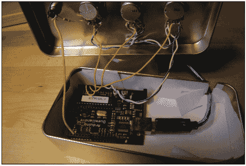

- 17. 关闭盒子的盖子，并将一些旋钮粘贴到可变电阻的可转动轴上。

- 18. 如果您愿意，可以使用马克笔为旋钮和按钮贴上标签。下图展示了我完成的控制器面板：

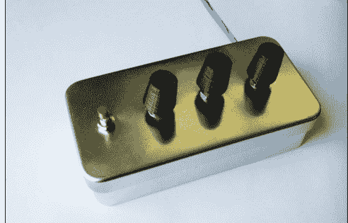

## 目标完成 - 小结

在本次任务的最后一项工作中，我们从电路中移除了免焊面包板，并将元件一起焊接。我们没有使用电路板，但由于我们的电路非常简单，我们直接使用一种有时称为 **乱线布线** 的技术将零件连接在一起。我们还通过将输入元件安装到盒子上，为控制器制作了一个外壳。

正如我在本任务介绍中所说，控制器外壳的外观以及输入元件的布局主要取决于个人喜好。请随意将此控制器设计得尽可能个性或古怪。

## 任务完成

我们当前的任务是为 Smilie-O-Mat 构建一个定制输入控制器。我们从一个可变电阻开始，将其连接到 Arduino——一块 AVR 微控制器开发板。Arduino 使用 C++ 编程，但 API 与 Processing 语言非常相似，并且 Arduino IDE 使用与 Processing IDE 相同的框架。我们在 Arduino IDE 中创建了一个程序，用于读取电阻值并通过串口将其发送到计算机。在 Processing 端，我们使用串行库读取消息并显示它们。

在第二个任务，*构建您的控制器*中，我们通过将三个可变电阻和一个按钮连接到免焊面包板来创建控制器原型。我们为发送到计算机的消息创建了一个简单的协议，这使我们能够发送输入值以及哪个控制器发生了变化。按钮在按压按钮的状态从按下变为释放时，每次都会向计算机发送一条 **click** 消息。


在第三个任务“更换你的面孔”中，我们扩展了在项目 4 中创建的 Smile-O-Mat 草图，以解析来自控制器的消息。我们实现了一个 serialEvent() 回调方法，每当消息到达串行端口时都会调用该方法。在此方法中，我们检查消息的第一个字母，如果它以 A、B 或 C 开头，则将字符串的其余部分解析为整数。这些整数用于控制我们笑脸的面部参数。如果消息是 click，则我们触发 tweet() 方法，该方法将当前笑脸发送到 tweeter。

当按钮被按下或释放时，存在一段短暂的时间，此时触点非常接近但尚未完全闭合。在这段时间内，按钮的短暂接触可能会意外触发多个点击事件。为了防止这种情况发生，我们创建了一个 50 毫秒的时间槽，在此期间不发送第二个点击消息。这种技术称为 debouncing，在处理开关或按钮时非常常见。

在最终任务“将其装入盒子”中，我们为控制器创建了外壳，并通过将元件焊接在一起使元件之间的连接永久化。我们没有使用电路板，而是直接将元件焊接在一起。我们使用铝制盒子作为外壳，并将旋钮排列成一条直线，但元件的布局和盒子的材质取决于个人喜好。这个控制器应该反映你的工作流程和个人偏好。按你喜欢的方式，让它尽可能传统或疯狂。

## 准备好大干一场了吗？一项热血挑战

Arduino 是一个极其酷炫的电子原型平台，适合初学者和专业人士。在这个项目中，我们当然只是触及了其可能性的表面。如果你喜欢钻研电子，尝试用以下任一方式扩展你的 Smile-O-Mat 草图：

- 添加更多旋钮以控制更多面部参数
- 添加电位器或旋转编码器以选择要推文的文本消息
- 添加 LCD 显示屏以显示最后一条推文
- 将一些舵机和 RGB LED 连接到 Arduino，创建面部的机械动画版本
