# 项目 6

## 飞向月球

自从人们接触到计算机以来，他们就一直用它来玩游戏。最早的游戏之一是一款名为 Lunar Lander 的模拟游戏，玩家需要将月球登陆舱降落在月球上。第一个版本编写于 1969 年，是基于文本的。这款游戏的第一个图形版本是在四年后为 DEC 终端编写的。此后，月球登陆模拟游戏已被移植到几乎每一种计算机系统上，这使得它成为我们当前任务的完美游戏，因为我们将使用 Processing 模式，通过 Processing.js 让游戏在浏览器中运行，并在 Android 设备上运行。

## 任务简报

我们当前的任务是创建一款月球着陆器游戏。游戏的第一个版本将是一个在您的计算机上运行的 Processing 草图，类似于我们在之前任务中创建的草图。然后，我们将使用各种 Processing 模式，通过 JavaScript 模式让游戏在浏览器中运行，并通过 Android 模式在 Android 设备上运行。

对于这些模式中的每一个，如果有必要，我们将调整游戏控制以适应平台。

## 为什么这很棒？

这个项目很棒有两个原因：首先，我们正在编写游戏，自计算机发明以来，这一直是官方令人惊叹的计算机项目列表上的项目；其次，我们编写的游戏可以在您的计算机、Android 移动设备和浏览器中运行。这使我们能够涵盖当前几乎每个可上网的平台，从台式机和笔记本电脑到手机、平板电脑和智能电视。当 Java 问世时，它提出了“一次编写，到处运行”的承诺。Processing 正在将这一承诺提升到一个新水平。

## 你的高手目标

此任务分为四个子任务。我们将在前两个子任务中编写月球着陆器模拟游戏，并在剩下的两个子任务中让其在浏览器和 Android 设备上运行。以下是当前任务的目标列表：

- 绘制精灵图
- 启动着陆序列
- 在浏览器中运行你的草图
- 在 Android 手机上运行游戏

## 任务检查清单

此任务的前两个子任务仅使用 Processing 实现。在第三个子任务中，您需要一个支持 canvas 元素的浏览器，例如 Firefox、Chrome、Safari 或 Internet Explorer 8 及更高版本。

对于最后一个子任务，我们需要下载并安装 Android SDK，稍后将详细介绍。

## 绘制精灵图

当前任务的第一个子任务是创建一个显示飞船的精灵图，并使其在屏幕上移动和旋转。我们将使用 Processing 提供的 translate() 和 rotate() 方法。我们还将为游戏生成关卡设计，并为飞船生成一个着陆平台。

为了使游戏更有趣，这些关卡将在每次重新启动游戏时重新生成。

## 启动推进器

让我们开始创建关卡设计：

1. 创建一个新的 Processing 草图，并添加 setup() 和 draw() 方法，如下面的代码片段所示：

```
void setup() {
}

void draw() {
}
```

2. 现在我们将窗口大小设置为 300 乘以 300，并定义一个整数数组，我们将使用它来绘制月球。

```
int[] moon;

void setup() {
  size( 300, 300 );
  moon = new int[width/10+1];
  for ( int i=0; i < moon.length; i++ ) {
    moon[i] = int( random( 10 ) );
  }
}
```

3. 在我们的 draw() 方法中，我们添加一个浅蓝色网格，填满白色页面，以使其看起来像我们在数学笔记本的一页上制作了关卡。

```
void draw() {
  background(255);
  stroke(200, 200, 255);
  for ( int i=0; i<height/10; i++ ) {
    line( 0, i*10, width, i*10 );
  }

  for ( int i=0; i<width/10; i++ ) {
    line( i*10, 0, i*10, height );
  }
}
```

4. 要绘制月球，我们遍历在 setup() 方法中初始化的数组，并用透明黄色填充它。我们将向 draw() 方法添加一个 drawMoon() 方法，并使用 beginShape() 和 endShape() 创建我们的黄色多边形。

```
void draw() {
  background(255);
  stroke(200, 200, 255);
  for ( int i=0; i<height/10; i++ ) {
    line( 0, i*10, width, i*10 );
  }

  for ( int i=0; i<width/10; i++ ) {
    line( i*10, 0, i*10, height );
  }

drawMoon();

}

void drawMoon() {
stroke(0);
fill(255, 200, 0, 60);
beginShape();
vertex(0, height);
for ( int i=0; i < moon.length; i++) {
vertex( i * 10, height - 20 - moon[i] );
}
vertex(width, height);
endShape(CLOSE);
}
```

5. 运行你的草图；它应该看起来像下面的截图：

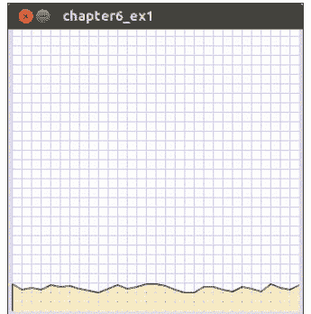

6. 在这个游戏中，玩家应该将火箭降落在着陆平台上。我们将把平台与步骤 3 中创建的网格对齐，以使其看起来像是我们给网格中的一些方框上了颜色。添加一个变量来存储着陆平台的 x 坐标，并在 setup() 方法中对其进行初始化。

```
int[] moon;
int landingX = 0;

void setup() {
size( 300, 300 );
moon = new int[width/10+1];
for ( int i=0; i < moon.length; i++) {
moon[i] = int( random( 10 ));
}
landingX = int( random(3, moon.length-4) )*10;
}
```

7. 现在，我们将一个 `drawLandingZone()` 方法添加到我们的 `draw()` 方法中，并通过绘制一个矩形和两条表示起落架的线来实现它。我们将使用 moon 数组来计算我们的起落架将接触地面的位置。

```
void draw() {
background(255);
stroke(200, 200, 255);
for ( int i=0; i<height/10; i++) {
line( 0, i*10, width, i*10);
}
for ( int i=0; i<width/10; i++) {
line( i*10, 0, i*10, height );
}
drawMoon();
drawLandingZone();
}
```

```
void drawLandingZone() {
fill(128, 200);
rect( landingX - 30, height - 50, 60, 10);
line( landingX - 30, height - 20 - moon[landingX/10-3], landingX
- 20, height - 40 );
line( landingX + 30, height - 20 - moon[landingX/10 +3],
landingX + 20, height - 40 );
}
```

8. 我们有了月球和着陆区，但还没有一艘可以降落的飞船。因此，绘制一张火箭图片，或从书籍的支持材料中下载图片，并通过将其拖放到草图窗口或使用“草图 | 添加文件...”菜单将其添加到你的草图中。

9. 现在我们将添加一个 PImage 变量，并在 setup() 方法中加载图片。

```
int[] moon;
int landingX = 0;
PImage ship;
void setup() {
size( 300, 300 );
moon = new int[width/10+1];
for ( int i=0; i < moon.length; i++) {
moon[i] = int(random(10));
}
landingX = int( random(3, moon.length-4) )*10;
ship = loadImage( "ship.png" );
}
```


- 10. 在我们的 draw() 方法中，添加对名为 drawShip() 的方法的调用，并实现此方法。

```java
void draw() {
  background(255);
  stroke(200, 200, 255);
  for ( int i=0; i<height/10; i++) {
    line( 0, i*10, width, i*10 );
  }
  for ( int i=0; i<width/10; i++) {
    line( i*10, 0, i*10, height );
  }

  drawMoon();
  drawLandingZone();
  drawShip();
}
```

```java
void drawShip() {
  image(ship, 150, 100);
}
```

- 11. 目前，我们可以通过更改 x 和 y 坐标将飞船放置在想要的位置，但我们还需要能够旋转飞船，因为在我们的游戏中，玩家必须转动飞船并点燃推进器，以便将其引导至平台并尽可能平稳地着陆。为了解决这个问题，我们将使用 rotate() 和 translate() 命令。我们还将使用 pushMatrix() 和 popMatrix()，以确保我们的 rotate() 方法仅影响图像，而不影响整个窗口。

```java
void drawShip() {
  pushMatrix();
  translate(150, 100);
  rotate(PI/6);
  image( ship, -ship.width/2, -ship.height/2, ship.width, ship.height );
  popMatrix();
}
```

- 12. 如果您现在运行草图，火箭将以 30 度的角度悬停在月球上方，但月球、着陆平台和我们的网格保持不变。

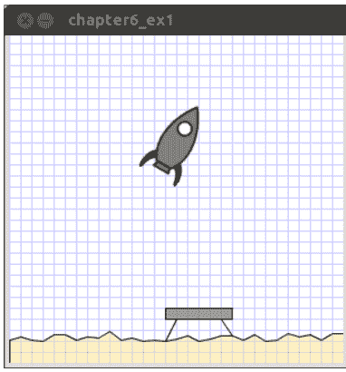

## 任务完成 - 简要总结

在当前任务的第一个任务中，我们创建了游戏所需的所有图形元素。在步骤 1 到 3 中，我们创建了一个看起来像数学笔记本的网格，使游戏看起来像是在课堂上画出来的（当然是课间休息时！）。

在步骤 4 中，我们添加了随机生成的月球地貌。我们在 `setup()` 方法中随机生成了月球地面高度的偏移量，并将其存储在一个数组中。这样，我们可以确保月球在一局游戏中保持不变，但在玩家完成关卡并重新启动时可以轻松重新生成。要绘制月球，我们使用 `beginShape()` 和 `endShape()` 方法创建了一个复杂的多边形，并使用 `vertex()` 命令定义了多边形的顶点。

着陆平台由一个与网格对齐的矩形组成，使其看起来像是我们给其中一些方格上了色。我们还为平台添加了支架，并使用前一节中的数组使它们接触月球的地面高度。

最后，我们使用了飞船图像并创建了一个变换上下文，以便能够旋转它。我们需要这个新上下文，以确保我们对 `translate()` 和 `rotate()` 的调用仅影响用于飞船的绘制操作，而不影响屏幕上的所有其他部分。新上下文通过 `pushMatrix()` 开始，通过 `popMatrix()` 结束。我们在此上下文中使用的每个缩放、平移或旋转操作都只影响其自身的绘制操作。我们的网格、月球和着陆平台不受其影响。

## 启动着陆程序

当前任务的第二个任务是实现我们月球登陆者游戏的物理模拟和游戏控制。在此任务中，游戏应能够在运行 Java 的台式计算机和笔记本电脑上运行。我们将添加键盘控制，使玩家能够将火箭向左和向右转动，并且当玩家按下向上光标键时，推进器将点火并将火箭在其转向的方向加速一点。

## 点火推进器

让我们先通过添加月球重力来开始实现物理效果：

- 1. 我们需要为月球物理模拟实现的第一件事是用于存储飞船位置、方向、当前速度和月球重力强度的变量。

```java
int[] moon;
int landingX = 0;
PImage ship;

PVector pos = new PVector( 150, 20 );
PVector speed = new PVector( 0, 0 );
PVector g = new PVector( 0, 1.622 );
```

- 2. 现在我们需要在每一帧更新飞船的位置，因此我们在草图中添加一个 update() 方法，并从 draw() 方法中调用它。

```java
void draw() {
    background(255);
    stroke(200, 200, 255);
    for ( int i=0; i<height/10; i++ ) {
        line( 0, i*10, width, i*10 );
    }
    for ( int i=0; i<width/10; i++ ) {
        line( i*10, 0, i*10, height );
    }

    drawMoon();
    drawLandingZone();
    drawShip();

    update();
}

void update() {
}
```

- 3. 我们还需要更改 `drawShip()` 方法中对 `translate()` 命令的调用，以使用新的 `pos` 变量。

```java
void drawShip() {
  pushMatrix();
  translate(pos.x, pos.y);
  rotate(PI/6);
  image( ship, -ship.width/2, -ship.height/2, ship.width, ship.height );

  popMatrix();
}
```

- 4. 在这个 `update()` 方法中，我们将实现所有物理计算。那么，让我们先实现重力对飞船的影响。

```java
void update() {
  PVector gDelta = new PVector( g.x / frameRate, g.y / frameRate);
  speed.add( gDelta );
  pos.add( speed );
}
```

- 5. 由于月球表面非常坚固，我们还添加了一个测试，一旦飞船到达表面就停止它。

```java
void update() {
  PVector gDelta = new PVector( g.x / frameRate, g.y / frameRate);

  speed.add( gDelta );
  pos.add( speed );

  if ( pos.x > landingX - 40 && pos.x < landingX + 40 && pos.y >
  height-50 - ship.height/2 ) {
    pos.y = height - 50 - ship.height/2;
  } else if (pos.y > height - 20 - ship.height/2 ) {
    pos.y = height - 20 - ship.height/2;
  }
}
```

- 6. 现在运行您的草图。火箭应该从窗口顶部开始，掉到底部并停在那里，如下面的屏幕截图所示：

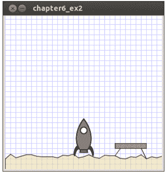

- 7. 由于游戏的目标不是将火箭撞向月球，而是将其着陆，因此我们需要实现一个减速火箭的方法。游戏将使用键盘控制，因此让我们添加加速度和旋转角度变量。

```java
int[] moon;
int landingX = 0;
PImage ship;

PVector pos = new PVector( 150, 20 );
PVector speed = new PVector( 0, 0 );
PVector g = new PVector( 0, 1.622 );

float a = 0;
float acc = 0;
```

- 8. 此外，添加一个 keyPressed() 方法，使玩家能够更改火箭的旋转和加速度。

```java
void keyPressed() {
  if ( keyCode == LEFT ) {
    a -= 0.1;
  }

  if ( keyCode == RIGHT ) {
    a += 0.1;
  }

  if ( keyCode == UP ) {
    acc += 0.04;
  }

  acc = max( acc, 1/frameRate);
}
```

- 9. 现在，我们需要调整 drawShip() 方法，并使用旋转变量来改变飞船的旋转。

```java
void drawShip() {
  pushMatrix();
  translate(pos.x, pos.y);
  rotate(a);
  image( ship, -20, -40, 40, 75 );
  popMatrix();
}
```

- 10. 我们还需要调整 update() 方法，以使加速度和旋转角度影响飞船的速度和位置。

```java
void update() {
  PVector f = new PVector( cos( a+PI/2 ) * -acc,
  sin( a+PI/2 ) * -acc );
  if ( acc > 0 ) {
    acc *= 0.95;
  }

  PVector gDelta = new PVector( g.x / frameRate, g.y / frameRate);

  speed.add( gDelta );
  speed.add( f );
  pos.add( speed );

  if ( pos.x > landingX - 40 && pos.x < landingX + 40
  && pos.y > height-50 - ship.height/2 ) {
    pos.y = height - 50 - ship.height/2;
  } else if (pos.y > height - 20 - ship.height/2 ) {
    pos.y = height - 20 - ship.height/2;
  }
}
```

- 11. 我们的飞船现在可以转动，并对加速命令做出反应。现在，我们向 drawShip() 方法添加一些代码，以便在用户加速飞船时从推进器喷出火焰。

```java
void drawShip() {
  pushMatrix();
  translate(pos.x, pos.y);
  rotate(a);
  noFill();
  for ( int i=4; i >= 0; i--) {
    stroke(255, i*50, 0);
    fill(255, i*50, 20);
    ellipse( 0, 30, min(1, acc*10) *i*4, min(1, acc*10)* i*10);
  }

  image( ship, -ship.width/2, -ship.height/2, ship.width, ship.height );
  popMatrix();
}
```

- 12. 飞船在平台上着陆或撞到月球表面后，游戏只能通过重新启动草图才能再次进行。我们现在将通过向草图添加游戏状态来修复这一点。添加一个名为 state 的变量来存储当前状态，并定义三个名为 WAITING、RUNNING 和 FINISHED 的常量。我们将 state 变量初始化为 WAITING，并将 setup() 方法中的关卡生成代码提取到名为 reset() 的方法中。

```java
int[] moon;
int landingX = 0;
```

```java
PVector pos = new PVector( 150, 20 );
PVector speed = new PVector( 0, 0 );
PVector g = new PVector( 0, 1.622 );
```

```java
float a = 0;
float acc = 0;
```

```java
PImage ship;
```

```java
int WAITING = 1;
int RUNNING = 2;
int FINISHED = 3;
```

```java
int state = WAITING;
```

```java
void setup() {
  size(300, 300);
  ship = loadImage( "ship.png" );
  reset();
}
```

```java
void reset() {
```


```
moon = new int[width/10+1];
for ( int i=0; i < moon.length; i++ ) {
  moon[i] = int(random(10));
}
landingX = int( random(3, moon.length-4) )*10;

pos = new PVector( 150, 20 );
a = 0;
acc = 0;
speed = new PVector(0,0);
}
```

- 13. 在我们的 draw() 方法中，我们将检查状态变量，并且仅在状态为 RUNNING 时才调用 update() 方法。我们还将添加 drawWaiting() 和 drawFinished() 方法，它们将在相应的状态中被调用。

```
void draw() {
  background(255);
  stroke(200, 200, 255);
  for ( int i=0; i<height/10; i++ ) {
    line( 0, i*10, width, i*10 );
  }
  for ( int i=0; i<width/10; i++ ) {
    line( i*10, 0, i*10, height );
  }
  drawMoon();
  drawLandingZone();
  drawShip();

  if ( state == WAITING ) {
    drawWaiting();
  }
  else if ( state == RUNNING ) {
    update();
  }
  else if ( state == FINISHED ) {
    drawFinished();
  }
}
```

```
void drawWaiting() {
  textAlign( CENTER );
  fill(0);
  text( "Click mouse to start", width/2, height/2 );
}
void drawFinished() {
  textAlign( CENTER );
  fill( 0 );
  if ( pos.x > landingX - 40 && pos.x < landingX + 40 ) {
    text( "you landed the ship!", width/2, height/2);
  } else {
    text( "you missed the platform!", width/2, height/2);
  }
  text( "click to restart", width/2, height/2 + 20 );
}
```

- 14. 现在我们添加一个 mouseClicked() 方法，如果状态为 WAITING 或 FINISHED，则将状态更改为 RUNNING。在后一种情况下，我们还会调用在第 12 步中创建的 reset() 方法以生成一个新关卡。

```
void mousePressed() {
  if ( state == WAITING ) {
    state = RUNNING;
  } else if ( state == FINISHED ) {
    reset();
    state = RUNNING;
  }
}
```

- 15. 在我们的 update() 方法中，如果火箭在平台上着陆或撞上月球表面，我们将游戏状态更改为 FINISHED。

```
void update() {
  PVector f = new PVector( cos( a+PI/2 ) * -acc,
    sin( a+PI/2 ) * -acc );
  if ( acc > 0 ) {
    acc *= 0.95;
  }
  PVector gDelta = new PVector( g.x / frameRate, g.y / frameRate );
  speed.add( gDelta );
  speed.add( f );
  pos.add( speed );
  if ( pos.x > landingX - 40 && pos.x < landingX + 40 && pos.y >
    height-50 - ship.height/2 ) {
    pos.y = height - 50 - ship.height/2;
    state = FINISHED;
    acc = 0;
  } else if (pos.y > height - 20 - ship.height/2 ) {
    pos.y = height - 20 - ship.height/2;
    state = FINISHED;
    acc = 0;
  }
}
```

- 16. 现在运行你的草图，尝试使用方向键将火箭降落在平台上。当火箭加速时，你的游戏窗口应如下截图所示：

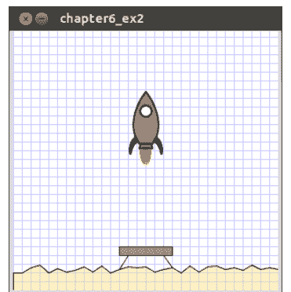

## 目标完成 - 小结

在本次任务的此项工作中，我们已完成适用于运行 Mac OS X、Linux 或 Windows 的台式机和笔记本电脑的游戏。从第 1 步到第 5 步，我们将月球重力实现到草图中，并让火箭落向地面。我们使用了一种非常简单的物理模拟，在每一帧将月球引力的一小部分添加到速度变量中，然后将更新后的速度添加到当前位置。

从第 6 步到第 10 步，我们通过实现一些键盘控制，实现了影响飞船的另一种力，允许玩家转动飞船并点火推进器。我们还在第 11 步让火焰从推进器喷出，以向玩家提供关于火箭加速强度的视觉线索。

从第 12 步开始，我们实现了一个游戏状态系统，以防止火箭在游戏一启动就掉到地板上。它还使玩家在火箭降落在平台上或坠毁到月球后，可以通过单击程序窗口来重新开始游戏。

## 在浏览器中运行你的草图

本次任务的下一项工作是将我们在之前任务中创建的游戏移植到浏览器中运行，使用 JavaScript。我们将使用 Processing.js 模式来运行脚本，并为我们的游戏创建一个自定义 HTML 模板。Processing.js 模式允许我们在现代浏览器中几乎无需修改即可运行不使用任何外部库的草图。

## 点燃推进器

让我们将游戏转换为浏览器应用程序：

- 1. 打开我们的草图，通过单击新建标签页图标上方的图标并选择 JavaScript，将处理模式切换为 JavaScript 模式，如下截图所示：

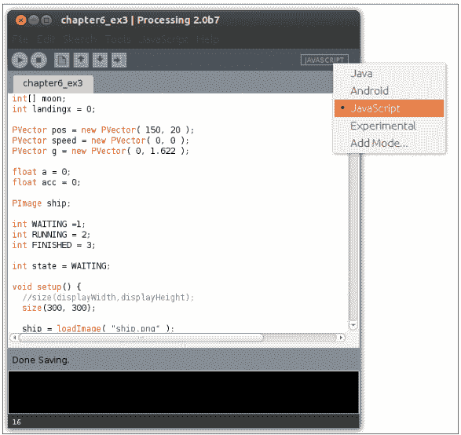

- 2. 现在运行草图。Processing 在后台启动一个小型 Web 服务器，并用运行我们游戏的 HTML 页面打开默认浏览器。下图显示了游戏在 Firefox 浏览器中运行：

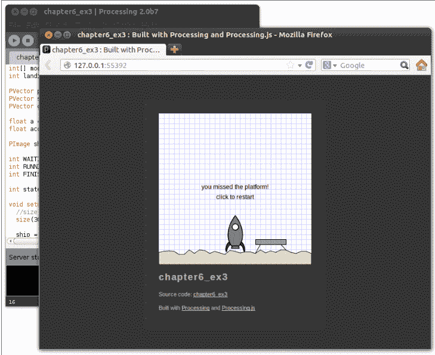

- 3. Processing.js 正在实施一个小变通方法以使图像加载正常工作。如果我们按原样运行代码，它在本地机器或非常快速的网络连接上都能完美运行，但我们可以通过激活我们需要的图像的预加载，让 Processing 的工作更轻松。单击 JavaScript | 播放设置（指令）菜单，然后在打开的对话框中单击 "preload": 图像旁边的扫描按钮，如下截图所示：

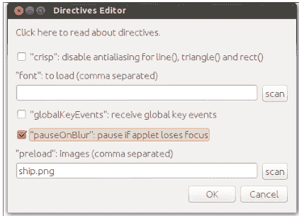

- 4. 我们还勾选 "pauseOnBlur" 复选框，以便在浏览器窗口切换到后台并失去焦点时暂停草图，因为我们不希望玩家的火箭仅仅因为另一个应用程序窗口弹出对话框就坠毁到月球上。

- 5. 单击确定后，Processing 会在我们的草图开头插入一条注释，并为 Processing.js 定义一些指令，其他 Processing 模式会忽略这些指令。

- 6. 当我们在 Processing.js 模式下运行草图时，Processing 会生成一个 HTML 页面并在画布元素上绘制程序输出。该 HTML 页面是从默认模板生成的。我们现在将编辑此模板，并添加一个带有星星图案的小 PNG 图形作为背景图像。因此，单击 JavaScript | 启动自定义模板 菜单为我们的程序生成模板副本。

- 7. 现在，单击 JavaScript | 显示自定义模板 菜单以打开包含 Processing 用于 HTML 页面的模板的文件夹。

- 8. 我们需要一张可用作背景的图片，因此可以创建一张带有白点的黑色图片，或者从本书支持文件 www.packtpub.com/support 下载我的版本，并将其放入模板文件夹中，与 template.html 和 processing.js 文件相邻。

- 9. 使用你选择的文本编辑器打开 template.html 文件。template.html 文件是一个普通 HTML 文件，包含一些特殊的占位符变量，Processing 会在启动草图时将其替换。找到文件开头的 CSS 部分，并将背景指令添加到 body 元素的样式定义中。

```
body {
    background-color: #333; color: #bbb; line-height: normal;
    font-family: Lucida Grande, Lucida Sans, Arial,
    Helvetica Neue, Verdana, Geneva, sans-serif;
    font-size: 11px; font-weight: normal; text-decoration: none;
    line-height: 1.5em;
    background-image:url('stars.png');
}
```

- 10. 保存模板并再次运行草图。我们的 HTML 页面背景现在布满了星星，如同无云之夜，如下截图所示——非常适合飞往月球：

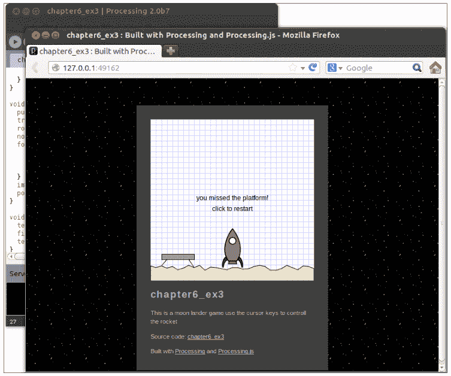

- 11. 目前，HTML 页面显示程序名称和指向我们草图源代码的链接。现在我们在程序开头添加一条特殊注释，该注释将插入到模板中的这两项之间。在 Processing.js 指令之后向草图添加类似这样的注释：

```
/* @pjs pauseOnBlur=true;
preload="ship.png";
*/

/**
This is a moon lander game use the cursor keys to control the rocket
*/

int[] moon;
int landingX = 0;
...
```

- 12. 当我们测试完 JavaScript 版本并确定一切按预期工作后，我们希望导出草图以便部署到 Web 服务器上。
保存草图并单击文件 | 导出菜单。Processing 会生成一个名为 web-export 的文件夹，包含所有需要安装到 Web 服务器上的文件，如果你想将草图分享给全世界。

## 目标完成 - 小结

本次任务的当前工作是使用 Processing 的 JavaScript 模式在浏览器中运行月球着陆器游戏，这在第 1 步和第 2 步中已完成。对于某些任务，例如加载图像，Processing.js 必须依赖浏览器的网络处理，这可能会在我们首次加载图像时导致草图出现延迟。幸运的是，Processing.js 提供了一种在草图启动前预加载图像的方法，我们从第 3 步到第 5 步激活了该方法。

从第 6 步开始，我们更改了 Processing 在运行或导出草图时嵌入草图的 HTML 模板。我们为游戏激活了自定义模板，并向模板 CSS 部分的样式定义中添加了背景图像。

最后，我们导出了草图和所有所需文件，以便在真实 Web 服务器上安装。

## 在 Android 手机上运行游戏

本次任务的最终工作是让我们的月球着陆器游戏在 Android 设备上运行。
我们将安装 Android SDK 并使用 Processing 的 Android 模式将我们的游戏转换为 Android 应用。我们将使用 Android 模拟器，并让草图在通过 USB 连接的设备上运行。由于大多数 Android 设备没有键盘但具有触摸屏，我们将调整游戏控件，然后全屏运行。


## 启动推进器

让我们将游戏转换为 Android 应用：

- 1. 访问 http://developer.android.com/sdk/index.html 并为您的计算机下载 Android SDK。我们不需要随 Eclipse 捆绑的版本。由于我们已有 IDE（Processing），需要向下滚动到 SDK Tools Only 部分，并为我们的操作系统下载 SDK 包。

- 2. 解压下载的文件，并从 tools 文件夹中运行 Android 命令。

- 3. Processing 创建的应用可运行于 Android 2.3.3 及更高版本，因为这是首个支持硬件加速 OpenGL 的 Android 版本。因此，让我们为该平台选择 SDK 包和 Google API。如果您使用 Windows，还需要从 Extras 文件夹中获取 Google USB 驱动程序包。Linux 和 Mac OS X 无需特殊驱动程序。如下图所示选择包，然后点击安装：

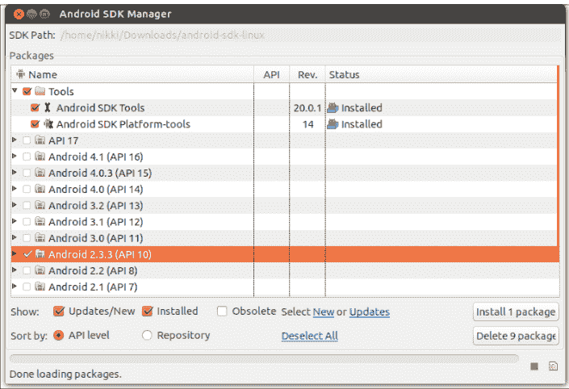

- 4. 现在我们需要告诉 Processing 在哪里可以找到 Android SDK。打开我们的 Processing 游戏，并在右侧切换至 Android 模式。初次执行此操作时，Processing 会询问 Android SDK 的位置，因此请将其指向步骤 2 中解压的文件夹。有关详细安装说明，可在 Processing Wiki 上找到：http://wiki.processing.org/w/Android。

- 5. 我们现在将在模拟器中运行草图。点击 **草图 | 在模拟器中运行** 菜单项。Processing 现在会将草图编译为 Android 应用，为 Android 模拟器创建虚拟设备并启动它。由于启动 Android 模拟器可能需要一段时间，尤其是首次运行时，您可能会遇到超时错误。这种情况下，只需重复此步骤。稍等片刻，您应该会看到我们的草图在模拟器窗口中运行，如下所示：

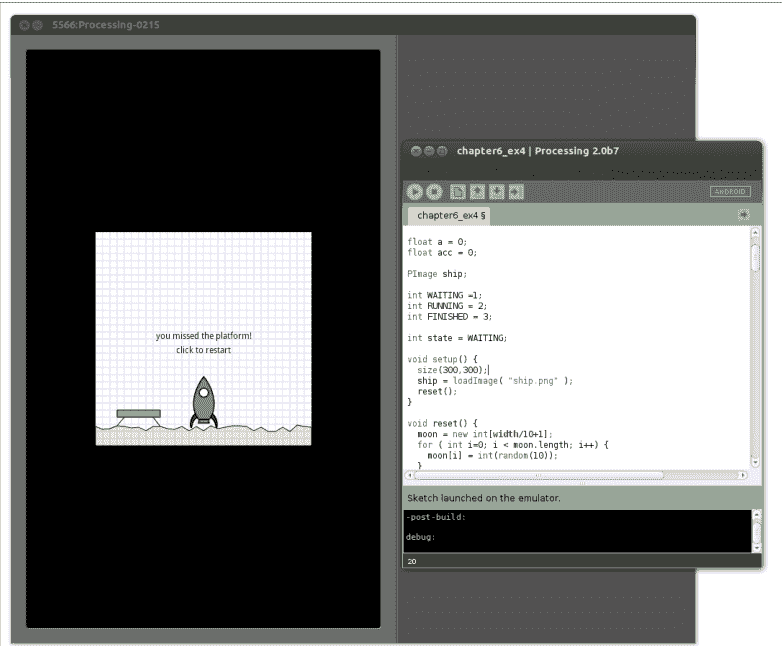

- 6. 在移动设备上，应用程序通常以全屏模式运行，因为没有窗口系统。我们现在将告诉草图使用整个屏幕。我们还通过使用 `orientation()` 方法告诉草图以横向模式运行。

```
void setup() {
  size(displayWidth,displayHeight);
  orientation(LANDSCAPE);
  ship = loadImage( "ship.png" );
  reset();
}
```

- 7. 现在草图以全屏模式运行，但在大多数 Android 设备上仍然无法游玩，因为极少数设备配备硬件键盘。为修复此问题，我们需要实现可与触摸屏一起使用的控件。**Android** 模式将触摸事件映射到鼠标处理回调，因此我们只需向 `mousePressed()` 方法添加一些代码来控制飞船。如果玩家触摸屏幕底部三分之一区域，我们将点火推进器。如果触摸屏幕上部，我们将向左或向右转动飞船。

```
void mousePressed() {
  if ( state == WAITING ) {
    state = RUNNING;
  } else if ( state == RUNNING ) {
    if ( mouseY > height * 2 / 3 ) {
      acc += 0.04;
      acc = max( acc, 1/frameRate);
    }
    else if ( mouseX < width / 2 ) {
      a -= 0.1;
    }
    else {
      a += 0.1;
    }
  } else if ( state == FINISHED ) {
    reset();
    state = RUNNING;
  }
}
```

- 8. 通过点击 **草图 | 在模拟器中运行** 菜单再次在模拟器中运行草图，然后通过点击窗口来玩游戏。

- 9. 当 Processing 处于 **Android** 模式时，我们也可以在硬件设备上运行草图。因此，如果您有一台运行 Android 的手机或平板电脑，可以使用 USB 线将其连接到计算机，并在手机设置的 **开发者** 选项部分中启用 USB 调试。现在，您可以通过点击 **草图 | 在设备上运行** 菜单在设备上运行草图。以下是我的手机运行月球着陆游戏的照片：

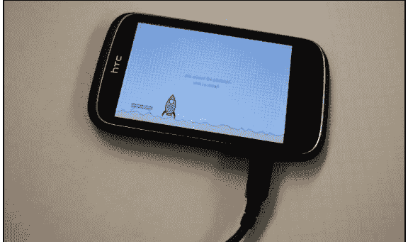

## 目标完成 - 小型简报

在本次任务的这个环节中，我们让月球着陆游戏在 Android 设备上运行。从步骤 1 到步骤 4，我们下载并安装了 Processing 编译 Android 应用所需的 Android SDK。随后，我们让游戏在模拟器中运行。

在步骤 6 中，我们稍微调整了代码，使游戏以全屏模式运行并将设备方向固定为横向模式。由于大多数 Android 设备不自带键盘，我们还添加了触摸屏输入支持。

最后，我们让应用在真实设备上运行。

## 机密情报

Android 模式还允许您将草图导出为 Android 项目，以便创建签名的 APK 文件，然后可用于将应用上传到 Google Play，或者如果您想自行分发。有关如何执行此操作的详细说明，可在 Processing Wiki 中找到：`http://wiki.processing.org/w/Android#Distributing_Apps`。

## 任务完成

在本次任务中，我们创建了一个月球着陆模拟游戏，并使用 Processing 的 JavaScript 模式使其在浏览器中运行，使用 Android 模式使其在 Android 设备上运行。

在第一个任务“绘制精灵”中，我们从背景网格开始创建了游戏图形，使游戏看起来像是画在数学笔记本上。随后，我们添加了月球地貌和着陆平台。火箭需要能够移动和旋转，因此我们使用 pushMatrix() 和 popMatrix() 方法，将我们想要对图像执行的平移和旋转操作与其余绘图代码分开。

在第二个任务“启动着陆序列”中，我们实现了游戏的物理效果和控制。我们首先为月球重力和火箭速度各添加了一个向量。每帧中，重力影响飞船的速度，进而影响火箭的位置。

然后我们实现了 keyPressed() 方法，使玩家能够旋转并加速火箭。加速度也会被添加到火箭的速度向量中。

最后，我们实现了游戏循环，并在火箭撞击月球或降落在平台上时停止游戏。

在第三个任务“在浏览器中运行您的草图”中，我们使用 Processing 的 JavaScript 模式创建了一个可在浏览器中运行的 JavaScript 版本。我们激活了图像预加载，以确保火箭图像在游戏启动时即可用，并学习了如何更改嵌入草图的 HTML 模板。

在最终任务“在 Android 手机上运行游戏”中，我们使用 Processing 的 Android 模式从游戏创建了一个 Android 应用。我们安装了 Android SDK 和必要的 API。我们稍微调整了代码，使应用以全屏模式运行，并将旋转固定为横向模式。

为了使游戏在没有键盘的设备上可玩，我们不得不更改游戏控制以支持触摸屏。

## 你准备好全力以赴了吗？一个高手挑战

为本示例创建了一个不错的小型休闲游戏，可游玩，但可以通过多种方式进行扩展和完善，例如：

- 使用速度和着陆角度计算着陆得分
- 创建最高得分列表
- 使用 Android 设备的倾斜传感器控制火箭
- 限制玩家可用于着陆的燃料
- 尝试使月球表面呈圆形，并使用极坐标计算着陆平台的位置
- 使用 Android 设备作为游戏桌面版本的控制器
