# 项目 7

## 霓虹地球仪

80 年代电影中几乎每个英雄、电脑黑客或反派，在其总部的电脑屏幕上都会放一个旋转的霓虹地球仪——嗯，呃——大概是为了强调他们的全球影响力。但谁在乎呢！这些旋转的线框地球绘图绝对非常酷，因此我们的当前任务是重现这些视觉效果，并为我们的任务控制室创建一个旋转的霓虹地球仪。

## 任务简报

在本次任务中，我们将从球体网格开始创建一个旋转的霓虹地球仪。然后我们将添加一些灯光来使球体平滑。随后，我们将向球体添加世界地图贴图，将其变成一个旋转的地球仪。最后，我们将使用 Processing 2 中添加的着色器框架的一些滤镜，添加类似早期街机机柜矢量显示器或旧詹姆斯·邦德电影中显示器的发光效果。

而且由于我们不再生活在 80 年代，我们还将添加将地球仪切换到现代卫星图像显示的功能。

## 为什么这很酷？

本次任务让我们有机会探索 Processing 强大的 3D 功能。我们从一个简单的球体线框模型开始，然后学习如何为场景添加灯光并为网格添加贴图。对于最终任务，我们将学习如何创建在显卡上并行运行的代码，而不会进一步加重 CPU 负担或降低草图的帧率。


## 你的高手目标

我们当前的任务目标如下：

- 旋转球体
- 让光芒乍现
- 从球体到地球仪
- 从地球仪到霓虹地球仪

## 任务清单

执行此任务，除了 Processing 之外，我们不需要任何库、SDK 或其他附加软件。我们将创建 3D 图形，因此你的计算机必须配备一块能够加速 3D 渲染并支持 OpenGL 2.0 或更高版本的显卡。如果你的计算机或显卡是在 2005 年之后制造的，那你肯定没问题。

## 旋转球体

我们当前任务的第一项任务是创建球体网格并使其在屏幕上旋转。我们将创建类似于地球仪上经纬圈的网格。为了简化创建这些环所需的数学计算，我们将使用极坐标，并在创建球体时将其转换为笛卡尔 XYZ 坐标。Processing 在存储模型数据时可以利用显卡内存，如果对象本身是静态的，这将大大提高在屏幕上绘制对象的速度。由于我们的球体在草图运行过程中不会改变，我们将使用 PShape 对象来存储模型数据。

## 启动推进器

让我们从创建球体网格开始：

- 1. 打开一个新的草图并添加 `setup()` 和 `draw()` 方法。

```
void setup() {
}

void draw() {
}
```

- 2. 在 `setup()` 方法中，我们定义草图窗口大小并将渲染模式设置为 P3D。我们还创建一个名为 `sphere` 的 `PShape` 对象来存储网格数据。`PShape sphere;`

```
void setup() {
  size(400, 400, P3D);
}
```

- 3. 接下来，我们创建一个名为 `makeSphere()` 的新方法，它以半径和步长（以度为单位）作为参数。我们函数的返回值是包含球体顶点的新 `PShape` 对象。

`PShape makeSphere( int r, int step ) {`

- 4. 极坐标使用两个角度和一个半径来定义球面上的一点；每个点到原点的距离相同，因此我们的半径保持固定，但角度会变化。我们将定义两个嵌套循环来遍历所有可能的角度位置。

```
PShape makeSphere( int r, int step ) {
  PShape s = createShape();

  s.noFill();
  s.stroke(255);
  s.strokeWeight(2);

  for (int i = 0; i < 180; i += step) {
    for (int j = 0; j <= 360; j += step) {
    }
  }

  return s;
}
```

- 5. 现在我们将使用极坐标通过四边形条在球体上生成环。我们需要定义点对（如下图所示），并使用 `vertex()` 方法将转换后的笛卡尔坐标传递给我们的 `PShape` 对象：

![img/5cb67baa7bc7778de360b14c00d1ab81_177_0.png]

- 6. 要将极坐标转换为笛卡尔坐标，我们需要计算角度的正弦和余弦值。Processing 期望角度（我们将其用作三角函数或 rotate 语句的输入）以弧度表示，即完整圆周为 0 到 2π 而不是 0 到 360。我们将在将角度传递给这些函数之前使用 radians() 方法将其转换。

```
PShape makeSphere( int R, int step ) {
  PShape s = createShape();
  s.beginShape(QUAD_STRIP);
  s.noFill();
  s.stroke(255);
  s.strokeWeight(2);
  for (int i = 0; i < 180; i += step) {
    float sini = sin(radians(i));
    float cosi = cos(radians(i));
    float sinip = sin(radians(i + step));
    float cosip = cos(radians(i + step));
    for (int j = 0; j <= 360; j += step) {
      float sinj = sin(radians(j));
      float cosj = cos(radians(j));
      s.vertex(R * cosj * sini, R * -cosi, R * sinj * sini);
      s.vertex(R * cosj * sinip, R * -cosip, R * sinj * sinip);
    }
  }
  s.endShape();
  return s;
}
```

- 7. 在我们的 `setup()` 方法中，我们添加对 `makeSphere()` 方法的调用。

```
void setup() {
  size(400, 400, P3D);
  sphere = makeSphere(150, 5);
}
```

- 8. 为了使球体可见，我们需要在 `draw()` 方法中使用 `shape()` 方法来使用我们的 sphere 对象。

```
void draw() {
  background(0);
  translate(width/2, height/2);
  shape(sphere);
}
```

- 9. 现在运行你的草图。球体应该看起来像这样：

![img/5cb67baa7bc7778de360b14c00d1ab81_179_0.png]

- 10. 现在我们将使球体旋转。在我们的 `setup()` 方法中，我们使用 `frameRate()` 方法将帧率固定为每秒 25 帧。

```
void setup() {
  size(400, 400, P3D);
  frameRate(25);
  sphere = makeSphere(150, 5);
}
```

- 11. 接下来，我们定义一个旋转角度变量，并在 `draw()` 方法中每帧增加它。我们还添加对 `rotateX()` 的调用以略微倾斜球体，以及对 `rotateY()` 的调用以使其绕 y 轴旋转。

```
float a = 0;

void draw() {
  background(0);
  translate(width/2, height/2);
  pushMatrix();
  rotateX(radians(-30));
  rotateY(a);
  a += 0.01;
  shape(sphere);
  popMatrix();
}
```

- 12. 运行你的草图。我们现在有一个旋转的球体线框模型了。

## 任务完成 - 简要总结

对于本次任务的第一项任务，我们创建了球体的 3D 网格。在步骤 1 到 5 中，我们创建了一个名为 `makeSphere()` 的方法，它使用两个 `for` 循环在球面上以极坐标生成点。然后我们将这些点转换为笛卡尔坐标并生成四边形条以形成我们的网格。我们使用 `PShape` 对象来存储网格数据，因为网格数据在运行时不会改变，Processing 只需在创建网格时将顶点数据传输到显卡内存一次，而不是每帧都传输。

在我们的 `draw()` 方法中，我们使用了 `PShape` 对象；我们将其在 x 轴上倾斜 30 度，并通过将帧率限制为每秒 25 帧并在每帧向旋转角度添加少量值来使其绕 y 轴旋转。

## 让光芒乍现

我们当前任务的第二项任务是将我们在第一项任务中创建的网格转换为具有平滑表面的实心球体。我们将使用不同的光源来照亮球体，并为每个顶点定义所谓的法线矢量，以使球体表面看起来平滑，而无需非常密集的网格。

## 启动推进器

让我们打开一些灯光：

- 1. 打开我们为上一项任务创建的草图。
- 2. 我们的网格目前是中空的，我们可以看到球体的正面线条以及背面。要改变这一点，我们可以为面定义填充颜色。

```
PShape makeSphere(int r, int step) {
  PShape s = createShape();

  s.beginShape(QUAD_STRIP);
  s.fill(200);
  s.stroke(255);
  s.strokeWeight(2);
  for (int i = 0; i < 180; i += step) {
    float sini = sin(radians(i));
    float cosi = cos(radians(i));
    float sinip = sin(radians(i + step));
    float cosip = cos(radians(i + step));

    for (int j = 0; j <= 360; j += step) {
      float sinj = sin(radians(j));
      float cosj = cos(radians(j));
      s.vertex(r * cosj * sini, r * -cosi, r * sinj * sini);
      s.vertex(r * cosj * sinip, r * -cosip, r * sinj * sinip);
    }
  }
  s.endShape();
  return s;
}
```

- 3. 运行你的草图。球体应该看起来像下面的屏幕截图中的那样：

![img/5cb67baa7bc7778de360b14c00d1ab81_181_0.png]

- 4. 现在我们将通过调用 `noStroke()` 函数来移除网格上的线条。

```
PShape makeSphere(int R, int step) {
  PShape s = createShape();

  s.beginShape(QUAD_STRIP);
  s.fill(255);
  s.noStroke();
  for (int i = 0; i < 180; i += step) {
    float sini = sin(radians(i));
    float cosi = cos(radians(i));
```

- 5. 现在我们的球体不再有网格线了；它被完全平铺渲染，看起来像个白色圆圈（因为默认情况下，Processing 中只允许环境光保持活动）。要解决这个问题，我们需要添加一个光源。我们要添加的第一个光源是点光源。我们需要在前三个参数中定义光源的颜色，然后是其位置的 x、y 和 z 坐标。点光源像一个非常小但非常亮的灯泡。将以下行添加到 `draw()` 方法中：

```
void draw() {
  background(0);
  translate(width/2, height/2);
  pointLight(255, 255, 255, -250, -250, 500);
  pushMatrix();
  rotateX(radians(-30));
  rotateY(a);
  a += 0.01;
  shape(sphere);
  popMatrix();
}
```

- 6. 运行你的草图。球体现在有阴影了，但看起来不像我们希望的那样平滑。正如你在下面的屏幕截图中所见，我们定义的四边形条围绕球体呈环形运行；在它们相互接触的地方可见明显的尖锐弯曲：

![img/5cb67baa7bc7778de360b14c00d1ab81_182_0.png]


- 7. 为修复此问题，我们需要为每个顶点定义法线向量，使其指向球体表面的外方，如图所示：

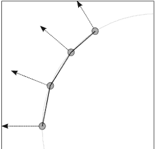

- 8. 我们已经计算了法线向量所需的正弦和余弦值。我们将使用 normal() 方法将法线向量添加到我们的网格中。每个法线向量必须在 makeSphere() 方法中的 vertex() 方法之前定义。

```
PShape makeSphere( int r, int step) {
PShape s = createShape();

s.beginShape(QUAD_STRIP);
s.fill(255);
s.noStroke();
for( int i = 0; i < 180; i+=step ) {
float sini = sin( radians( i ));
float cosi = cos( radians( i ));
float sinip = sin( radians( i + step ) );
float cosip = cos( radians( i + step ) );

for( int j = 0; j <= 360; j+=step ) {
float sinj = sin( radians( j ));
float cosj = cos( radians( j ));

s.normal( cosj * sini, -cosi, sinj * sini);
s.vertex( r * cosj * sini, r * -cosi, r * sinj * sini);

s.normal( cosj * sinip, -cosip, sinj * sinip);
s.vertex( r * cosj * sinip, r * -cosip, r * sinj * sinip);
}
}

s.endShape();
return s;
}
```

- 9. 运行你的草图。球体应该看起来平滑，如下面的屏幕截图所示：

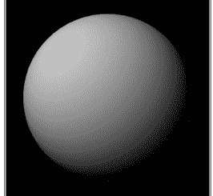

- 10. 目前，我们球体的一半有黑暗的阴影，因此我们需要一种方法来使光照更均匀。幸运的是，Processing 具有一个名为 `lights()` 的快捷方法，它设置了一个从相机指向原点的光源。因此，我们现在将更改我们的 `draw()` 方法，并用对 `lights()` 方法的调用替换点光源。

```
void draw() {
  background(0);
  translate( width/2, height/2 );
  lights();
  pushMatrix();
  rotateX( radians( -30 ) );
  rotateY( a );
  a+= 0.01;
  shape( sphere );

  popMatrix();
}
```

- 11. 运行你的草图。球体应该看起来像这样：

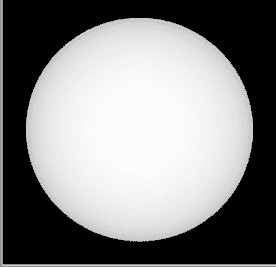

## 任务完成 - 小型简报

在当前任务的第二个任务中，我们将球体的线框网格变成了实心平滑球体，并激活了一些灯光。在步骤 1 到 5 中，我们关闭了线条描边并激活了面的填充。我们还激活了一个点光源，以防止球体被渲染得完全平面。

我们的球体有了阴影和填充，但在我们使用 makeSphere() 方法中的循环创建的四边形带环上，存在尖锐弯曲。要修复此问题，我们为每个顶点添加了法线向量。这些向量与表面垂直，用于使球体表面平滑着色。

最后，我们学习了如何更均匀地照亮球体，以便可以看到它的每个部分；这是因为在第三个任务中，我们将把球体变成地球仪，并且希望世界的每个部分都可见。

## 从球体到地球仪

我们当前任务的第三个任务是通过使用纹理图像将球体转换为地球仪。我们需要定义每个顶点到纹理图像一部分的映射，以使其适配。我们将使用黑白纹理，其中所有陆地都是黑色，海洋是白色。该图像基于 STUDIO7DESIGNS 按 Creative Commons 许可授权的矢量地图创建，可以在 `http://vector4free.com/vectors/id/75` 处找到。我添加了南极洲并将其转换为 PNG 文件。

之后，我们将添加由 NASA 的 Visible Earth 项目 (`http://visibleearth.nasa.gov/`) 提供的卫星图像。我们还将添加键盘事件的回调处理程序，并使纹理可切换。

## 点火推进器

让我们开始为地球仪添加纹理：

- 1. 首先，我们需要将地球仪的图像添加到草图中。从 www.packtpub.com/support 的下载部分下载图像。地图如下所示：

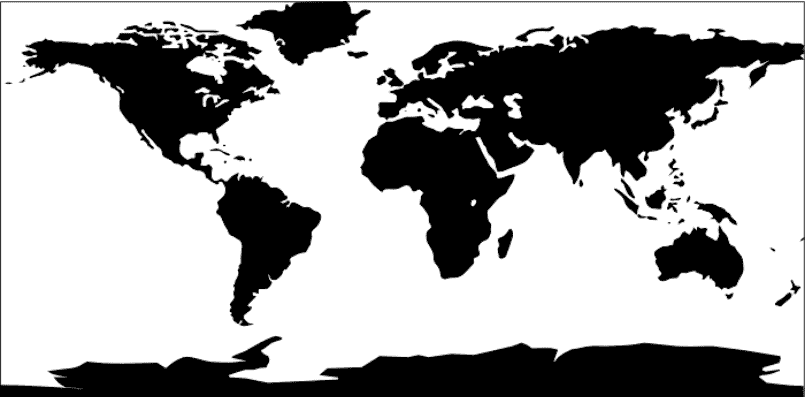

- 2. 将图像拖动到草图窗口，或使用草图菜单下的“添加文件...”选项添加它。

- 3. 现在我们需要定义一个 PImage 变量来保存纹理图像，并在 setup() 方法中加载它。

```
PShape sphere;
PImage world;
void setup() {
 size(400, 400, P3D);
 frameRate(25);
 world = loadImage( "world.png" );
 sphere = makeSphere( 150, 5, world);
}
```

- 4. 我们扩展 makeSphere() 方法以将纹理作为参数，并调整 setup() 方法中对 makeSphere() 的调用。

```
void setup() {
 size(400, 400, P3D);
 frameRate(25);
 world = loadImage( "world.png" );
 sphere = makeSphere( 150, 5, world);
}
```

```
PShape makeSphere( int r, int step, PImage tex ) {
```

- 5. 现在让我们在网格中激活纹理。

```
PShape makeSphere( int r, int step, PImage tex ) {
PShape s = createShape();

s.beginShape(QUAD_STRIP);
s.texture( tex );
s.noStroke();
```

- 6. 如果我们现在运行草图，将无法看到任何东西，因为只会使用纹理的一小部分（颜色为黑色）。要修复此问题，我们需要为每个顶点添加 u 和 v 坐标，以定义应该使用纹理的哪一部分。由于我们使用两个循环（用于遍历极坐标的角度）定义了球体网格，因此可以简单地将它们映射到 u 和 v 坐标。

```
PShape makeSphere( int r, int step, PImage tex ) {
PShape s = createShape();

s.beginShape(QUAD_STRIP);

s.texture( tex );
s.noStroke();
for( int i = 0; i < 180; i+=step ) {
    float sini = sin( radians( i ) );
    float cosi = cos( radians( i ) );
    float sinip = sin( radians( i + step ) );
    float cosip = cos( radians( i + step ) );

for( int j = 0; j <= 360; j+=step ) {
    float sinj = sin( radians( j ) );
    float cosj = cos( radians( j ) );
    float sinjp = sin( radians( j + step ) );
    float cosjp = cos( radians( j + step ) );

s.normal( cosj * sini, -cosi, sinj * sini);
s.vertex( r * cosj * sini, r * -cosi, r * sinj * sini,
tex.width-j * tex.width / 360, i * tex.height / 180);

s.normal( cosj * sinip, -cosip, sinj * sinip);
s.vertex( r * cosj * sinip, r * -cosip, r * sinj * sinip,
tex.width-j * tex.width / 360, (i + step ) * tex.height /
180);
            }
        }
        s.endShape( );
        return s;
    }
```

- 7. 运行你的草图。球体应该看起来像这个屏幕截图中的那样：

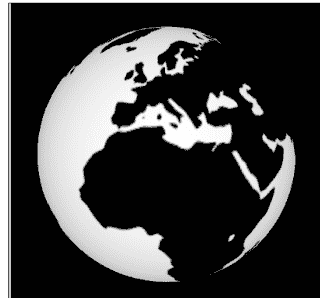

- 8. 现在我们将添加两个更多纹理并使它们可切换。
首先，从 www.packtpub.com/support 下载图像文件 bluemarble.jpg 和 night.jpg。这些图像使用 NASA 的 Landsat 2、Terra 和 Aqua 卫星的图像创建，可在 http://visibleearth.nasa.gov/ 下载。我减小了尺寸，因为原始图像对于我们的小地球仪来说太详细了。蓝色大理石纹理如下所示：

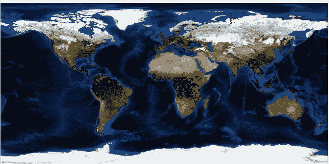

这是地球之夜纹理：

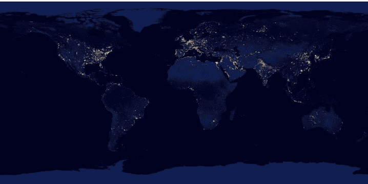

- 9. 我们通过将图像拖放到草图窗口，或通过“草图 | 添加文件...”将图像添加到我们的草图中。

- 10. 现在我们将在草图中添加两个更多的 PImage 变量，并在 setup() 方法中加载图像。

```
PShape sphere;
PImage world;
PImage bluemarble;
PImage night;

void setup() {
size(400,400,P3D);
frameRate(25);
world = loadImage( "world.png" );
bluemarble = loadImage( "bluemarble.jpg" );
night = loadImage( "night.jpg" );
sphere = makeSphere( 150, 5, world);
}
```

- 11. 现在我们需要在 keyPressed() 方法中替换球体对象的纹理。我们可以通过使用 PShape 类的 setTexture() 方法来做到这一点，该方法替换默认纹理。由于我们一次只在球体上使用一个纹理图像，这对我们来说工作正常。

```
void keyPressed() {
if ( key == 'l' ) {
sphere.setTexture( world );
} else if ( key == '2' ) {
  sphere.setTexture( bluemarble ) ;
} else if ( key == '3' ) {
  sphere.setTexture( night ) ;
}
}
```

- 12. 现在，运行我们的草图并使用数字键切换纹理。当使用蓝色大理石纹理时，地球仪看起来像这样：

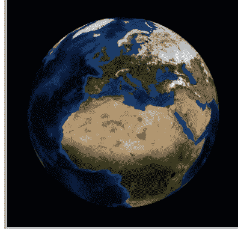

- 13. 当地球之夜纹理处于活动状态时，地球仪看起来像这样：

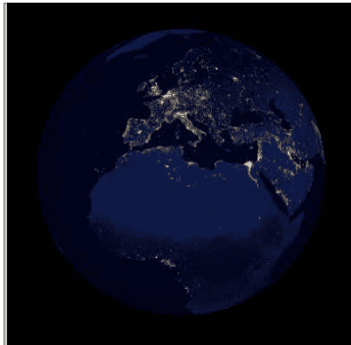


## 目标完成 - 小型简报

在第三个任务中，我们使用纹理将第二个任务中平滑处理并点亮的球体变成了地球仪。在第 2 步中，我们添加了一个纹理图像并创建了一个 `PImage` 对象来存储它。我们扩展了 `makeSphere()` 方法，使其接受纹理图像作为参数，然后将该图像用作球体的纹理。为了确保纹理被映射到我们的网格上，我们需要使用 `vertex()` 方法的扩展版本，该版本还允许我们指定每个顶点要使用纹理的哪个部分。

由于我们已经使用了两个循环来遍历极坐标的角度，因此我们使用相同的坐标作为纹理坐标的基础。我们只需将它们映射到纹理图像的高度和宽度上。

最后，我们添加了一个处理按键事件的回调函数，并用它来在纹理图像之间切换。我们添加了来自 NASA Visible Earth 项目的两张卫星图像。蓝色大理石图像是一张经过处理的卫星图像，显示行星上没有云层，而地球夜景图像展示了夜晚的地球仪。我们使用 `PShape` 类的 `setTexture()` 方法切换了形状的纹理，该方法会替换当前纹理。

## 从地球仪到霓虹地球仪

作为本次任务的最后一项任务，我们将把刚刚创建的地球仪转换成发光的霓虹地球仪。我们将创建一个适合出现在《战争游戏》或《电子世界争霸战》等 80 年代电影中的地球仪。我们将通过对地球仪应用两个滤镜来创建这种发光效果。第一个是边缘检测滤镜，它会去除图像的所有填充区域，只保留大陆的轮廓。第二个滤镜将为我们的线条添加发光效果。我们将使用 OpenGL 着色语言 (GLSL) 实现这些滤镜。这些 GLSL 滤镜将由我们的显卡执行；它们不需要 CPU 资源。

只有在显示大陆的简单纹理处于活动状态时，我们才会应用我们的滤镜，而当 NASA Visible Earth 项目的卫星图像处于活动状态时，我们将禁用它们。

## 启动推进器

让我们来创建我们的滤镜：

- 1. 首先，我们需要更改世界地图纹理的颜色，使海洋呈现黑色、大陆呈现绿色。打开我们在第三个任务中创建的草图，并将以下代码添加到我们的 `setup()` 方法中：

```
void setup() {
    size(400, 400, P3D);
    frameRate(25);
PGraphics g = createGraphics( 700,349 );
g.beginDraw();
PImage tmp = loadImage( "world.png" );
tmp.filter(INVERT);
g.tint(100,255,0);
g.image( tmp,0,0 );
g.endDraw();

world = createGraphics( 700, 349 );
world = g.get(0,0,700,349);

bluemarble = loadImage( "bluemarble.jpg" );
night = loadImage( "night.jpg" );
sphere = makeSphere( 150, 5, world );
}
```

- 2. 我们希望地球仪的海洋部分用蓝色网格绘制，因此我们将在 `makeSphere()` 方法中将描边颜色设置为蓝色，描边粗细设置为 2。

```
PShape makeSphere( int r, int step, PImage tex ) {
PShape s = createShape();

s.beginShape( QUAD_STRIP );
s.texture( tex );
s.stroke( 0,0,255 );
s.strokeWeight( 2 );
for( int i = 0; i < 180; i+=step ) {
float sini = sin( radians( i ) );
float cosi = cos( radians( i ) );
float sinip = sin( radians( i + step ) );
float cosip = cos( radians( i + step ) );
```

- 3. 现在运行草图。地球仪应该如下面的截图所示：

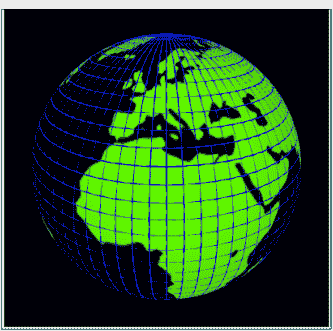

- 4. 现在我们将添加边缘检测滤镜。在草图中添加一个 PShape 变量；在 setup() 方法中，加载一个名为 edge.glsl 的文件（我们将稍后创建它）。

```
PShape sphere;
PImage world;

PShader edge;

void setup() {
    size(400, 400, P3D);
    frameRate(25);

    PGraphics g = createGraphics( 700, 349 );
    g.beginDraw();
    PImage tmp = loadImage( "world.png" );
    tmp.filter(INVERT);
    g.tint(100,255,0);
    g.image( tmp,0,0 );
    g.endDraw();

    world = createGraphics( 700, 349 );
    world = g.get(0,0,700,349);

    sphere = makeSphere( 150, 5, world);

    edge = loadShader("edge.glsl");
}
```

- 5. 现在打开文本编辑器，创建一个名为 edge.glsl 的文件，并输入以下代码：

```
#ifdef GL_ES
precision mediump float;
precision mediump int;
#endif

#define PROCESSING_TEXTURE_SHADER

uniform sampler2D texture;
uniform vec2 texOffset;

varying vec4 vertColor;
varying vec4 vertTexCoord;

void main(void) {
vec2 tc0 = vertTexCoord.st + vec2(-texOffset.s, -texOffset.t);
vec2 tc1 = vertTexCoord.st + vec2( 0.0, -texOffset.t);
vec2 tc2 = vertTexCoord.st + vec2(+texOffset.s, -texOffset.t);
vec2 tc3 = vertTexCoord.st + vec2(-texOffset.s, 0.0 );
vec2 tc4 = vertTexCoord.st + vec2( 0.0, 0.0 );
vec2 tc5 = vertTexCoord.st + vec2(+texOffset.s, 0.0 );
vec2 tc6 = vertTexCoord.st + vec2(-texOffset.s, +texOffset.t);
vec2 tc7 = vertTexCoord.st + vec2( 0.0, +texOffset.t);
vec2 tc8 = vertTexCoord.st + vec2(+texOffset.s, +texOffset.t);
// get the color values from the image for each coordinate
vec4 col0 = texture2D(texture, tc0);
vec4 col1 = texture2D(texture, tc1);
vec4 col2 = texture2D(texture, tc2);
vec4 col3 = texture2D(texture, tc3);
vec4 col4 = texture2D(texture, tc4);
vec4 col5 = texture2D(texture, tc5);
vec4 col6 = texture2D(texture, tc6);
vec4 col7 = texture2D(texture, tc7);
vec4 col8 = texture2D(texture, tc8);

vec4 sum = 8.0 * col4 - (col0 + col1 + col2 + col3 + col5 + col6
+ col7 + col8);
float f = sum.r + sum.g + sum.b;
gl_FragColor = vec4(f,f,f,1.0)*col4;
}
```

- 6. 我们需要将刚刚创建的 edge.glsl 文件添加到我们的草图中，方法是将文件拖动到草图窗口，或者转到 草图 | 添加文件....

- 7. 要将我们刚刚创建的着色器用作滤镜，我们需要在地球仪绘制完成后在 draw() 方法中添加对 filter() 方法的调用，并将我们在 setup() 方法中初始化的着色器变量作为参数添加进去。

```
void draw() {
  background(0);
  translate( width/2, height/2 );

  lights();
  pushMatrix();
  rotateX( radians(-30) );
  rotateY( a );
  a+= 0.01;
  shape( sphere );
  popMatrix();
  filter(edge);
}
```

- 8. 现在运行草图。地球仪应该如下面的截图所示：

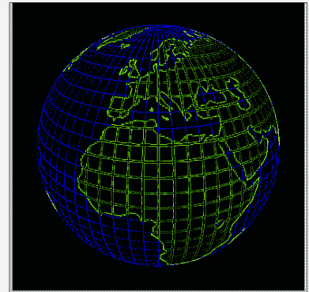

- 9. 我们的第二个滤镜将为边缘检测滤镜创建的线条添加发光效果，使其看起来像旧式 CRT 显示器的图像。使用文本编辑器创建一个名为 blur.glsl 的文件，并插入以下代码：

```
#ifdef GL_ES
precision mediump float;
precision mediump int;
#endif

#define PROCESSING_TEXTURE_SHADER

uniform sampler2D texture;
uniform vec2 texOffset;
varying vec4 vertTexCoord;

void main(void) {
int i = 0;
int j = 0;
vec4 sum = vec4( 0.0 );

for( i=-5;i<5;i++) {
for( j=-5;j<5;j++) {
sum += texture2D( texture, vertTexCoord.st +
vec2( j,i )*texOffset.st)*0.025;
}
}
}

gl_FragColor = sum*sum+ vec4(texture2D( texture, vertTexCoord.st).rgb, 1.0 );
}
```

- 10. 我们将通过将文件拖动到草图窗口或转到 草图 | 添加文件.... 来将文件添加到我们的草图中。

- 11. 现在添加另一个 PShader 变量，并将着色器加载到我们的 setup() 方法中。

```
PShape sphere;
PImage world;

PShader blur;
PShader edge;

void setup() {
size(400,400,P3D);
frameRate(25);

PGraphics g = createGraphics( 700,349 );
g.beginDraw();
PImage tmp = loadImage( "world.png" );
tmp.filter(INVERT);
g.tint(100,255,0);
g.image( tmp,0,0 );
g.endDraw();

world = createGraphics( 700, 349 );
world = g.get(0,0,700,349);

sphere = makeSphere( 150, 5, world );

edge = loadShader("edge.glsl");
blur = loadShader("blur.glsl");
}
```

- 12. 在我们的 draw() 方法中，我们将使用 blur 着色器作为参数再次调用 filter()。

```
void draw() {
background(0);
translate( width/2, height/2 );

lights();
pushMatrix();
rotateX( radians(-30) );
rotateY( a );
a+= 0.01;
shape(sphere);

popMatrix();

filter(edge);
filter(blur);
}
```

- 13. 现在运行草图。地球仪应该如下面的截图所示：

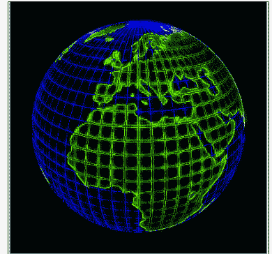

- 14. 目前，滤镜和网格线与卫星图像同时处于活动状态，这看起来很奇怪。因此，我们将添加一个名为 `satellite` 的布尔变量，并在我们的 `keyPressed()` 方法中选择卫星图像时将其设置为 `true`。

```
boolean satellite = false;
void keyPressed() {
if( key == '1' ) {
sphere.setTexture( world );
satellite = false;
} else if ( key == '2' ) {
```


```
sphere.setTexture( bluemarble );
satellite = true;

} else if ( key == '3' ) {
    sphere.setTexture( night );
    satellite = true;
}
}
```

- 15. 在我们的 draw() 方法中，当选择卫星图像时，我们现在将停用滤镜。

```
void draw() {
    background(0);
    translate( width/2, height/2 );

    lights();
    pushMatrix();
    rotateX( radians(-30) );
    rotateY( a );
    a+= 0.01;

    shape( sphere );

    popMatrix();
    if ( !satellite ) {
        filter(edge);
        filter(blur);
    }
}
```

- 16. 滤镜现在已停用，但我们在卫星图像上仍然有蓝色网格线，看起来有点奇怪。因此，当卫星图像激活时，我们现在将描边设置为 false。不幸的是，当霓虹地图激活时，您无法重新激活描边线条，因此我们将使用 makeSphere() 命令重新创建原始形状。

## 目标完成 - 小型简报

本次任务的最后一项工作是将我们的地球仪变成霓虹地球仪，模仿 80 年代 CRT 显示器的风格。首先，我们反转了纹理并将其着色为绿色，使大陆呈现绿色，大海呈现黑色。我们在加载纹理时即时完成此操作，在 `setup()` 方法中，通过创建 `PGraphics` 对象并在加载图像时对其进行滤镜处理。在第 2 步中，我们激活了球体上线条的绘制，并将其变为蓝色。

从第 4 步开始，我们使用 OpenGL 着色器语言创建了一个边缘检测滤镜。我们用于滤镜的是所谓的片段着色器，这意味着我们提供的函数会针对每个像素调用一次，或者正如 OpenGL 规范委员会所称的那样——片段。这些着色器在显卡上执行，并且针对每个像素调用一次。显卡上的处理器通常能够并行执行许多此类函数；因此，它们不仅释放了 CPU 资源，而且取决于您的显卡，这些滤镜运行速度非常快。具体有多快取决于您的 CPU 和显卡；例如，我的电脑在 CPU 上运行带有模糊滤镜的草图时为每秒 10 帧，而在使用 GLSL 滤镜时则为每秒 60 帧。在第 6 步和第 7 步中，我们将着色器添加到我们的草图中，并在 `draw()` 方法中激活了它。

从第 9 步开始，我们创建了第二个着色器，它在边缘检测后执行并添加发光效果，看起来类似于霓虹灯牌或旧式 CRT 显示器的余晖。

滤镜效果在简单的大陆地图上看起来很棒，但我们希望来自 Visible Earth 项目的卫星图像保持不变。因此，从第 13 步起，我们添加了一个布尔变量，使我们只能为第一张纹理图像激活滤镜。

## 任务完成

我们的任务是构建一个旋转的 3D 地球仪，其视觉风格类似于 80 年代电影中英雄和反派总部电脑显示器上看到的世界地图。我们首先在第一个任务中创建了一个球形网格。该网格由围绕我们的球体变形的四边形带组成。最后，我们通过使用极坐标遍历球体表面并将其转换为笛卡尔坐标来创建坐标。

在第二个任务中，我们填充了球体的面，并向我们的世界添加了点光源。然后，我们为每个顶点添加了法线向量以平滑网格的阴影。为了使光照更均匀，我们从点光源切换到了 Processing 中的默认光源。

在第三个任务中，我们使用世界地图作为纹理，将球体变成了地球仪。我们通过纹理坐标扩展了网格的顶点，以确保纹理适合我们的球体。我们还添加了来自 NASA Visible Earth 项目的卫星图像，并添加了一个处理按键事件的回调方法，以使纹理可切换。

在第四个任务中，我们最终通过将两个基于 GLSL 着色器的滤镜添加到 draw() 方法中，创建了我们想要的视觉效果。在 setup() 方法中，我们反转了纹理图像并通过添加色调将其变为绿色。我们通过在 makeSphere() 方法中重新激活描边颜色来创建蓝色网格线。然后，我们添加了一个边缘检测 GLSL 着色器并在 draw() 方法中使用它。为了生成发光效果，我们创建了第二个着色器，并用它来滤镜第一个滤镜的结果。

我们还添加了一个布尔变量，使我们只在选择第一个纹理时激活滤镜，并在卫星图像可见时停用它们。

## 你准备好大干一场了？一项热血挑战

在本次任务中，我们学习了如何创建地球仪，以及如何在 Processing 中将 GLSL 着色器用作滤镜。使用现代显卡的着色器所能实现的功能，我们才刚刚触及表面；除了让地球仪旋转并看起来很棒之外，还有更多可以做的事情。为什么不尝试以下一个想法来扩展我们刚刚创建的草图呢：

- 创建一个"太阳"，根据一天中的时间正确照亮地球仪，并使用一个 GLSL 滤镜，该滤镜使用昼夜纹理图像并在昼夜交界处进行混合。
- NASA 为我们太阳系中的各种行星和卫星提供可免费下载的卫星图像。为什么不制作一个完整的太阳系呢？
- 创建一组不同的 GLSL 滤镜，以重现 50 年代电影院每周新闻片中的手绘黑白地球仪。
