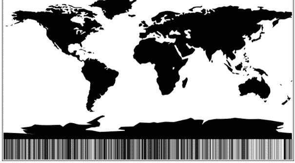
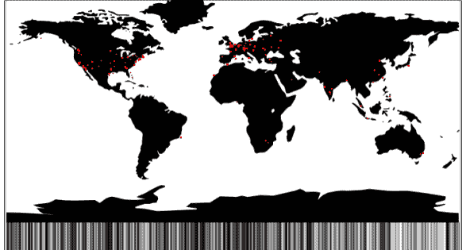
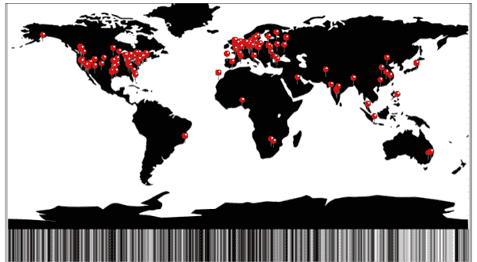
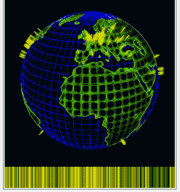

# 项目 8

## 日志地理可视化器

19 世纪中叶，伦敦发生了一次霍乱爆发。一位名叫约翰·斯诺的医生在地图上他听说的每个病例位置画了一个点。使用这张地图，他能够在街道水泵处定位爆发源。然后，他拆除了水泵的把手来终止霍乱爆发。这是最早已知的地理信息系统（GIS）之一。如今，这些系统是使用矢量地图或卫星图像以及地理编码数据创建的。

## 任务简报

我们当前的任务是创建一个地理信息系统，它读取 Web 服务器日志文件并显示读者请求的来源。我们将解析日志文件，然后提取请求的 IP 地址和时间戳。然后，我们将使用 IP 范围数据库获取一对地理坐标，并在世界地图上显示一个小图钉。最后，我们将用上一个任务中创建的 3D 霓虹地球仪替换地图，并在其表面上可视化地理编码的日志条目。

## 为什么这很棒？

长期以来，创建地图或在地图上可视化数据一直是非常昂贵的工具和高薪专家的领域。幸运的是，近年来情况已发生变化。越来越多的工具、数据、地图和卫星图像可以免费或以非常低的成本提供给普通人。因此，知道如何创建在地球仪或地图上显示数据的可视化效果，肯定是你工具箱中一个非常有用的工具。

## 你的高手目标

对于我们当前的任务，我们首先从 Web 服务器日志文件中提取要可视化的数据。然后，我们为每个数据记录获取地理坐标，并将数据可视化到我们来自项目 7《霓虹地球仪》的霓虹地球仪上。我们任务的任务如下：

- 读取日志文件
- 对 IP 地址进行地理编码
- 红点热
- 交互式红点热

## 任务检查清单

对于本次任务，我们需要在上一个任务中创建的霓虹地球仪。如果您没有按照本教程操作，可以从 www.packtpub.com/support 下载示例。我们还需要一个 IP 地址及其地理坐标的数据库，但我将在本次任务的第二个任务中指导您下载和安装这些内容。如果您没有可视化的 Web 服务器日志文件，可以使用书籍下载页面 www.packtpub.com/support 上提供的匿名示例文件。

## 读取日志文件

我们当前任务的第一个任务是读取 Apache Web 服务器的日志文件并提取有趣的部分。我们将使用正则表达式拆分日志文件的行，并获取 IP 地址和时间戳。我们还将创建一个新类来存储提取的数据。

## 启动推进器

让我们开始解析日志文件：

- 1. 创建一个新草图并添加 `setup()` 和 `draw()` 方法。

```
void setup() {
}
   
void draw() {
}
```

- 2. 现在我们通过将要可视化的日志文件拖放到草图窗口，或使用"草图 | 添加文件..."菜单来添加它。


3. 在 setup() 方法中，我们将文件读入字符串数组。

```java
void setup() {
    size(700, 350);
    String[] log = loadStrings("access.log");
}
```

4. 点击小箭头图标并选择 新标签页 来添加新标签页。我们将其命名为 LogRow，并创建一个新类来存储每条记录的 IP 地址和时间戳。

```java
class LogRow {
    String ip;
    String timestamp;

    public LogRow(String ip, String timestamp) {
        this.ip = ip;
        this.timestamp = timestamp;
    }
}
```

5. 切换回主草图并添加一个名为 parseLogfile() 的方法，该方法将字符串数组作为参数并返回 LogRow 类的数组。

```java
void draw() {
}

LogRow[] parseLogfile(String[] rows) {
}
```

6. 在 parseLogfile() 方法中，我们遍历字符串并使用 match() 方法提取 IP 地址和日期部分。该函数使用正则表达式过滤文本并返回字符串数组。该数组包含正则表达式中每一对括号对应的字符串。我们的正则表达式提取形如 xxx.xxx.xxx.xxx 的 IP 地址，后跟两个破折号和方括号内的日期。关于如何编写正则表达式的详细说明，请参阅 Processing 参考文档。

```java
LogRow[] parseLogfile(String[] rows) {
    for (int i = 0; i < rows.length; i++) {
        String[] m = match(
            rows[i], "(\\d+\\.\\d+\\.\\d+\\.\\d+) - - \\[(.*)\\]");
        if (m != null) {
            println(m[1] + " " + m[2]);
        }
    }
}
```

7. 现在我们定义一个 LogRow 对象数组来存储解析器的结果，而不是将其打印到控制台。

```java
LogRow[] parseLogfile(String[] rows) {
    LogRow[] res = new LogRow[rows.length];
    for (int i = 0; i < rows.length; i++) {
        String[] m = match(
            rows[i], "(\\d\\d\\d\\.\\d\\d\\d\\.\\d\\d\\d\\.\\d\\d+) - - \\[(.*)\\]");
        if (m != null) {
            res[i] = new LogRow(m[1], m[2]);
        }
    }
    return res;
}
```

8. 在 setup() 方法中，我们添加对 parseLogfile() 方法的调用，并向草图中添加一个 LogRow 对象数组。

```java
LogRow[] data;
```

```java
void setup() {
    size(700, 350);
    String[] log = loadStrings("access.log");
    data = parseLogfile(log);
}
```

9. 目前，我们提取的时间戳是字符串，这使得它们在草图中难以使用。因此，让我们使用 SimpleDateFormat() 类来解析日期，以改变这一情况。这个 Java 类允许我们将其转换为 Unix 时间戳——即自 1970-01-01 午夜以来的秒数。我们需要在草图开头添加 import 语句才能使用 SimpleDateFormat 类。

```java
import java.text.SimpleDateFormat;
```

10. 现在我们可以将日期解析功能添加到 parseLogfile() 方法中。我们的 SimpleDateFormat 类的 parse() 方法需要用 try/catch 块括起来，因为如果解析失败，这个 Java 方法可能会抛出异常。

```java
LogRow[] parseLogfile(String[] rows) {
    SimpleDateFormat sdf = new SimpleDateFormat("dd/MMM/yyyy:HH:mm:ss Z");
    LogRow[] res = new LogRow[rows.length];
    for (int i = 0; i < rows.length; i++) {
        String[] m = match(
            rows[i], "(\\d\\d\\d\\.\\d\\d\\d\\.\\d\\d\\d\\.\\d\\d+) - - \\[(.*)\\]");
        if (m != null) {
            try {
                long time = sdf.parse(m[2]).getTime();
                res[i] = new LogRow(m[1], time);
            } catch (Exception e) {
                e.printStackTrace();
            }
        }
    }
    return res;
}
```

11. 我们还需要更改 LogRow 类以接受新的日期类型。

```java
class LogRow {
    String ip;
    long timestamp;

    public LogRow(String ip, long timestamp) {
        this.ip = ip;
        this.timestamp = timestamp;
    }
}
```

12. 现在我们将在时间轴上为每个时间戳绘制一个标记。由于日志文件按时间戳排序，我们可以取数组的第一个和最后一个元素来获取时间轴的开始和结束时间。切换回主草图，并将以下代码添加到 draw() 方法中：

```java
void draw() {
    background(0);
    fill(255);
    noStroke();
    rect(0, 150, width, 50);
    stroke(0, 10);
    long mints = data[0].timestamp;
    long maxts = data[data.length - 1].timestamp;
    for (int i = 0; i < data.length; i++) {
        float pos = map(data[i].timestamp, mints, maxts, 0, width);
        line(pos, 150, pos, 200);
    }
}
```

13. 运行我们的草图。草图的时间轴应类似于以下截图：


## 目标完成 - 小结简报

我们当前任务的第一项是读取 Web 服务器的日志文件，并提取每条日志条目的 IP 地址和时间戳。我们创建了一个存储日志行信息的类。然后我们使用 `loadStrings()` 方法将日志文件读入字符串数组。在第 6 步中，我们使用了一个正则表达式，匹配并提取我们感兴趣的日志文件部分，并将其作为字符串返回。

日期作为字符串的表示方式数不胜数，因为世界各地似乎都急需使用一种非常特殊的格式。为了让我们的草图更容易处理时间戳，我们将它们转换为 Unix 时间戳格式，该格式存储自 1970-01-01 以来经过的秒数。

在我们的 `draw()` 方法中，我们提取日志文件中的时间戳并在时间轴上对其进行可视化。

## IP 地址地理编码

到目前为止，我们一直专注于日志文件的时间戳，因此我们任务的这一部分是将 IP 地址转换为可用于地理可视化的一对坐标。我们将下载并安装 hostIP 数据库——一个免费数据库，存储 IP 地址来源的地理坐标和城市名称。hostIP 数据库由志愿者创建，因此在那里时，请添加您自己的 IP 地址和城市以改进服务。我们从该数据库获得的准确性是城市级别，因此您不应根据获得的地理坐标设计披萨配送服务，但它对于大多数可视化项目来说已足够。

我们将在内存中保留 hostIP 数据库，用于地理编码我们的 IP 地址并转换在前面任务中提取的 IP 地址。

## 启动推进器

让我们开始转换地址：

- 1. 要转换 IP 地址，我们首先需要 hostIP 数据库。因此，打开浏览器并访问 `http://www.hostip.info/`。点击 **数据** ，然后在 **数据库每日更新？** 部分中选择一个 HTTP 镜像。

- 2. 从 csv 文件夹下载 hip_ip4_city_lat_lng.csv 文件。

- 3. 现在，打开我们为前面任务创建的草图，并通过将文件拖动到草图窗口或使用 草图 | 添加文件... 菜单来添加该文件。

- 4. 创建一个新标签页并将其命名为 IPdb。我们添加一个新类来存储 IP 地址块及其纬度/经度对。

```java
public class IPdb {
    long ipblock;
    String lat;
    String lon;

    public IPdb(long ipblock, String lat, String lon) {
        this.ipblock = ipblock;
        this.lat = lat;
        this.lon = lon;
    }
}
```

- 5. 要加载数据库，我们创建一个新方法来解析 .csv 文件并将记录存储在我们的 IPdb 类中。我们创建一个以 IP 块为索引的 HashMap 数据结构，以便在地理编码日志文件行时可以更快地访问它。HashMap 是一个 Java 数据结构，它将唯一键映射到不同的对象，并允许我们使用键检索存储的对象。

```java
HashMap<Long, IPdb> parseIpDatabase(String filename) {
    String[] raw = loadStrings(filename);

    HashMap<Long, IPdb> map = new HashMap<Long, IPdb>(raw.length);
    for (int i = 0; i < raw.length; i++) {
        String[] parts = raw[i].split(",");
        int ipblock = int(parts[0]);
        map.put(new Long(ipblock), new IPdb(ipblock, parts[2], parts[3]));
    }
    return map;
}
```

- 6. 在 setup() 方法中，我们添加对 parseIpDatabase() 方法和用于数据库的 HashMap 的调用。

```java
import java.text.SimpleDateFormat;

LogRow[] data;
HashMap<Long, IPdb> ipdatabase;

void setup() {
```


size(700,350);

ipdatabase = parseIPDatabase( "hip_ip4_city_lat_lng.csv" );
String[] log = loadStrings( "access.log" );
data = parseLogfile( log );
}

- 7. 现在，我们可以通过搜索表来查找任何给定 IP 地址的地理坐标，但首先我们需要扩展 LogRow 类来存储坐标。切换到我们草图的 LogRow 选项卡并添加以下属性：

```
class LogRow {
String ip;
long timestamp;
String lat;
String lon;

public LogRow( String ip, long timestamp ) {
this.ip = ip;
this.timestamp = timestamp;
}

void setLatLon( String lat, String lon ) {
this.lat = lat;
this.lon = lon;
}
}
```

- 8. 现在，回到主草图，我们添加另一个名为 geoCode() 的方法，它将记录数组作为参数。

```
void geoCode( LogRow[] data ) {
}
```

- 9. 在我们的方法中，我们遍历所有行并尝试查找 IP 地址的地理坐标。如果无法找到纬度和经度，我们将它们设置为 null。数据库不使用实际 IP 地址作为键，而是使用 IP 块的数字表示。要将 IP 地址转换为这个搜索键，我们需要通过在点号处拆分 IP 地址并将数字乘以 256 的幂来将其转换为数值。

```
void geoCode( LogRow[] data ) {
for ( int i=0; i < data.length; i++ ) {
String[] block = data[i].ip.split( "\\." );
int ip = int( block[0] ) * 256 * 256 * 256 + int( block[1] ) * 256 * 256 + int( block[2] ) * 256;
IPdb r = ipdatabase.get(ip);
if ( r != null ) {
data[i].setLatLon( r.lat, r.lon );
}
}
}
```

- 10. 我们的草图在 setup() 方法中解析日志文件并对 IP 地址进行地理编码，根据日志文件的大小，这可能需要一段时间。为了告知用户启动为什么异常缓慢，我们现在将解析移到后台线程中运行。

```
void setup() {
size(700,350);

Thread t = new Thread() {
public void run() {
ipdatabase = parseIPDatabase( "hip_ipv4_city_lat_lng.csv" );
String[] log = loadStrings( "access.log" );
data = parseLogfile( log );
geoCode( data );
}
};

t.start();
}
```

- 11. 现在，setup() 方法会立即返回，但在解析完成之前，draw() 方法中将没有可用的行。因此，我们需要修改 draw() 方法并为用户打印一条消息，以告知他们正在发生什么。

```
void draw() {
background(0);

if ( data == null ) {
text( "Loading ...", 35, 190 );
}
else {
noStroke();
fill(255);
rect(0, 150, 700, 50);
stroke(0, 10);
long mints = data[0].timestamp;
long maxts = data[ data.length-1].timestamp;

for ( int i=0; i<data.length; i++) {
float pos = map( data[i].timestamp, mints, maxts, 0, 700 );
line( pos, 150, pos, 200 );
}
}
}
```

- 12. 这好多了，但用户仍然不知道解析过程需要多长时间，因此让我们添加一个进度条，指示解析或地理编码已经完成了多少。我们需要添加两个变量来保存总行数和已处理记录数。我们还添加一个状态变量，存储当前所处的解析阶段。

```
int LOADING = 0;
int LOGFILE = 1;
int GEOCODING = 2;
int DONE = 3;

int state = LOADING;

int count = 0;
int total = 0;

HashMap<Long, IPdb> ipdatabase;
LogRow data[];

void setup() {
    size(700, 350);

    Thread t = new Thread() {
        public void run() {
            state = LOADING;
            ipdatabase = parseIpDatabase( "hip_ip4_city_lat_lng.csv" );
            state = LOGFILE;
            String[] log = loadStrings( "access.log" );
            data = parseLogfile( log );
            state = GEOCODING;
            geoCode( data );
            state = DONE;
        }
    };
    t.start();
}
```

- 13. 在我们的 parseIpDatabase() 方法中，我们将 total 变量设置为数据库中的行数，并在 for 循环中更新 count 变量。

```
HashMap<Long, IPdb> parseIpDatabase( String filename ) {
    String[] raw = loadStrings( filename );
    total = raw.length;
    HashMap<Long, IPdb> map= new HashMap<Long, IPdb>(total);
    for ( int i=0; i<raw.length; i++ ) {
        count = i;
        String[] parts = raw[i].split( "," );
        int ipblock = int( parts[0] );
        map.put( new Long(ipblock), new IPdb( ipblock, parts[2],
                parts[3] ) );
    }
    return map;
}
```

- 14. 在我们的 parseLogfile() 方法中，我们需要将 total 变量设置为日志文件中的行数，并在循环中更新 count 变量。

```
LogRow[] parseLogfile( String[] rows ) {
    total = rows.length;
    SimpleDateFormat sdf = new SimpleDateFormat( "dd/MMM/YYYY:HH:mm:ss Z" );
    LogRow[] res = new LogRow[ rows.length ];
    for ( int i=0; i<rows.length; i++ ) {
        count = i;
        String[] m = match(
            rows[i], "\\\\(\\d+\\.\\d+\\.\\d+\\.\\d+\\\\) - \\\\[(.*)\\\]" );
        if ( m != null ) {
            try {
                long time = sdf.parse( m[2] ).getTime();
                res[i] = new LogRow( m[1], time );
            }
            catch( Exception e ) {
                e.printStackTrace();
            }
        }
    }
    return res;
}
```

- 15. 最后，我们需要更新 geoCode() 方法，将 total 变量设置为已解析的行数，并将 count 变量设置为循环计数。

```
void geoCode( LogRow[] data ) {
    total = data.length;
    for ( int i=0; i < data.length; i++ ) {
        count = i;
        String[] block = data[i].ip.split( "\\." );
        int ip = int( block[0] ) * 256 * 256 * 256 + int( block[1] ) * 256 * 256 + int( block[2] ) * 256;
        IPdb r = ipdatabase.get(ip);
        if ( r != null ) {
            data[i].setLatLon( r.lat, r.lon);
        }
    }
}
```

- 16. 现在我们可以在 draw() 方法中绘制进度条并显示阶段名称。

```
void draw() {
    background(0);

    if ( state < DONE ) {
        stroke( 0, 200 );
        strokeWeight(2);
        fill( 200, 200 );
        rect( 25, 150, 650, 50 );
        noStroke();
        fill( 255 );
        rect( 30, 155, map( count, 0, total, 0, 640 ), 40 );
    }
    else if (state == DONE) {
        noStroke();
        fill(255);
        rect(0, 150, 700, 50);
        stroke(0, 10);
        long mints = data[0].timestamp;
        long maxts = data[data.length-1].timestamp;
        for (int i=0; i<data.length; i++) {
            float pos = map(data[i].timestamp, mints, maxts, 0, 700);
            line(pos, 150, pos, 200);
        }
    }

    fill( 0 );
    String msg="";
    if ( state == LOADING ) {
        msg = "loading database ...";
    }
    else if ( state == LOGFILE ) {
        msg = "parsing logfile ...";
    }
    else if ( state == GEOCODING ) {
        msg = "geocoding ip adresses ...";
    }

    text( msg, 35, 190 );
}
```

- 17. 当草图启动时，将显示如下屏幕截图中的进度条：


## 目标完成 - 小结

我们当前任务的目标是确定每个 IP 地址的地理坐标，并将其存储在 IpDB 类中。我们下载并安装了 hostIP 数据库的 .csv 版本，并将其添加到我们的草图中。我们创建了一个类来存储 IP 地址块的地理坐标，并创建了 parseIpDatabase() 命令来创建一个包含 hostIP 数据库的 HashMap。然后，我们编写了一个名为 geocodeIp() 的新方法，它接受一组 RowLine 对象，如果可以找到 IP 地址，则用纬度和经度丰富它们，否则设置为 null。

由于 setup() 方法中的加载和解析会减慢草图的启动速度，我们将日志文件处理和地理编码移至单独的线程并在后台运行。我们还在 draw() 方法中添加了一个进度条，以向用户显示已加载多少数据库或已处理多少日志文件。

## 红点热

每个 GIS 开发者做的首批应用之一就是在地图上绘制红点。这是地理信息系统的“Hello World”等价物，也是我们当前任务要做的。我们将使用作为霓虹地球贴图的世界地图，并为每个日志文件条目在地图上显示红点。


纬度是从北极到南极的坐标，范围从-90度到90度，赤道为0度。经度绕地球一周，范围从-180度到180度。经度零位于所谓的“本初子午线”，它穿过伦敦格林尼治皇家天文台——我猜这回答了谁发明了这个坐标系统的问题。

当我们想到一张地图时，通常北美和南美在左边，欧洲和非洲在中间，亚洲在右边。在这样的地图上，我们使用的地理坐标系的原点位于地图中心。

## 启动推进器

让我们在地图上画一些点：

- 1. 首先我们需要一张可以绘图的地图，因此要么使用我们上一个任务中用作纹理的世界地图，要么从 www.packtpub.com/support 下载。
- 2. 现在，我们打开草图，通过将纹理拖到草图窗口上，或使用 Sketch | Add File... 菜单来添加纹理。
- 3. 然后，我们添加一个 PImage 变量来存储地图，并在 setup() 方法中加载它。

```
PImage world;

void setup() {
  size(700,400);

  world = loadImage( "world.png" );

  Thread t = new Thread() {
    public void run() {
      state = LOADING;
      ipdatabase = parseIpDatabase( "hip_ip4_city_lat_lng.csv" );
      state = LOGFILE;
      String[] log = loadStrings( "access.log" );
      data = parseLogfile( log );
      state = GEOCODING;
      geoCode = data;
      state = DONE;
    }
  };

  t.start();
}
```

- 4. 在我们的 draw() 方法中，我们将时间轴移到窗口底部，并在其上方显示地图。

```
void draw() {
background(255);
image( world, 0, 0, width, 350 );

if ( state < DONE ) {
stroke( 0, 200 );
strokeWeight(2);
fill( 200, 200 );
rect( 25, 150, 650, 50 );
noStroke();
fill( 255 );
rect( 30, 155, map( count, 0, total, 0, 640 ), 40 );

fill( 0 );
String msg="";
if ( state == LOADING ) {
msg = "loading database ...";
} else if ( state == LOGFILE ) {
msg = "parsing logfile ...";
} else if ( state == GEOCODING ) {
msg = "geocoding ip adresses ...";
}

text( msg, 35, 190 );
} else if (state == DONE) {
noStroke();
fill(255);
rect(0,350,700,50);
stroke(0, 10);
long mints = data[0].timestamp;
long maxts = data[data.length-1].timestamp;
for ( int i=0; i<data.length; i++ ) {
float pos = map( data[i].timestamp, mints , maxts , 0, 700 );
line( pos, 350, pos,400 );
}
}
}
```

- 5. 运行草图。我们的地图应该如下面的截图所示：



- 6. 当我们的加载线程将状态设置为 DONE 时，我们将遍历日志文件行，并在地图上为每一对地理坐标绘制一个红点。

```
void draw() {
	background(255);
	image( world, 0, 0, width, 350 );

	if ( state < DONE ) {
		stroke( 0, 200 );
		strokeWeight(2);
		fill( 200, 200 );
		rect( 25, 150, 650, 50 );
		noStroke();
		fill( 255 );
		rect( 30, 155, map( count, 0, total, 0, 640 ), 40 );
	}

	fill( 0 );
	String msg="";
	if ( state == LOADING ) {
		msg = "loading database ...";
	}
	else if ( state == LOGFILE ) {
		msg = "parsing logfile ...";
	}
	else if ( state == GEOCODING ) {
		msg = "geocoding ip adresses ...";
	}

	text( msg, 35, 190 );
} else if (state == DONE) {
noStroke();
fill(255);
rect(0, 350, 700, 50);
stroke(0, 10);
long mins = data[0].timestamp;
long maxts = data[data.length-1].timestamp;
for ( int i=0; i<data.length; i++) {
float pos = map( data[i].timestamp, mins, maxts, 0, 700 );
line( pos, 350, pos, 400 );
}

stroke(255, 0, 0);
for ( int i=0; i < data.length; i++) {
if ( data[i].lat != null && data[i].lon != null ) {
float x = map( float( data[i].lon ), -180, 180, 0, width );
```

- 7. 运行草图。我们的地图现在应该布满红点，如下面的截图所示：



- 8. 为了让地图看起来更花哨，我们现在要用一个小图钉的矢量图形来替换红点。从 www.packtpub.com/support 下载 pin.svg 文件。

- 9. 通过将 .svg 文件拖到草图窗口上，或使用 **草图 | 添加文件...** 菜单将其添加到我们的草图中。

- 10. 现在，我们需要为图钉定义一个 PShape 变量，并在 setup() 方法中加载形状。

```
import java.text.SimpleDateFormat;

PImage world;
PShape pin;

void setup() {
size(700, 400);
pin = loadShape( "pin.svg" );
world = loadImage( "world.png" );

Thread t = new Thread() {
public void run() {
state = LOADING;
ipdatabase = parseIpDatabase( "hip_ip4_city_lat_lng.csv" );
state = LOGFILE;
String[] log = loadStrings( "access.log" );
data = parseLogfile( log );
state = GEOCODING;
geoCode( data );
state = DONE;
}
};
t.start();
}
```

- 11. 在我们的 draw() 方法中，我们用对 shape() 的调用来替换 point()。

```
void draw() {
...

stroke(255, 0, 0);

for ( int i=0; i < data.length; i++ ) {
if ( data[i].lat != null && data[i].lon != null ) {
float x = map( float( data[i].lon ), -180, 180, 0, width );
float y = map( float( data[i].lat), 90, -90, 0, height -50
);

shape( pin, int(x)-5, int(y) -15 );
}
}
}
}
```

- 12. 运行草图，在加载数据库并编码所有 IP 地址后，我们的地图现在如下面的截图所示：



## 任务完成 - 小型简报

我们当前任务的目标是使用上一个任务中创建的已地理编码的日志文件行来创建“红点热”。我们向草图中添加了一个世界示意图，其中大陆被绘制为黑色，海洋为白色。这张地图被用作我们上一个项目中创建的地球仪的纹理。

然后，我们在 draw() 方法中添加了一个循环来遍历 LogRow。对于每一行，我们检查数据库中是否找到了某些地理坐标，如果找到了就绘制一个红点。

为了让地图看起来更花哨，并且（至少有一点点）告别地图制作的“红点热”阶段，我们用一个小红图钉的矢量图形替换了红点。我们为它添加了一个 PShape 变量，并在 setup() 方法中加载了一个 SVG 图形。然后，图钉在 draw() 方法中使用 shape() 命令绘制。

## 交互式红点热

对于当前项目的这个最终任务，我们将使用为上一个项目创建的旋转霓虹地球仪。我们将用从地球仪伸出的黄色线条来替换我们的红图钉。这些黄色图钉也与我们基于着色器的滤镜配合得很好，该滤镜创建霓虹效果。

## 启动推进器

让我们将图钉添加到地球仪上：

- 1. 打开我们在本任务之前的任务中创建的草图以及上一个任务的最终草图。如果你没有跟上上一个任务，也可以从 www.packtpub.com/support 下载草图。

- 2. 在霓虹地球仪草图中，选择 Sketch | Add File... 菜单并打开 data 文件夹。

- 3. 将两个 GLSL 文件和图片添加到我们的红点热草图中。

- 4. 现在，为任务纹理添加一个 PImage 变量，为我们的地球仪添加一个 PShape 变量，并为模糊和边缘检测滤镜添加两个 PShader 变量。

```
PImage world;
PImage blue;
PImage night;
PShape pin;
PShape sphere;
PShader blur;
PShader edge;
LogRow[] data;
```

```
int LOADING = 0;
int LOGFILE = 1;
int GEOCODING = 2;
int DONE = 3;
int state = LOADING;
```

```
int count = 0;
int total = 0;
float a =0;
```

- 5. 我们现在创建一个名为 initGlobe() 的新方法，并从 setup() 方法中调用它。我们还将草图的大小更改为 400 x 450 像素，并启用 P3D 渲染模式。

```
void setup() {
size(400, 450, P3D);
pin = loadShape( "pin.svg" );
world = loadImage( "world.png" );

frameRate(25);
initGlobe();

Thread t = new Thread() {
    public void run() {
        state = LOADING;
        ipdatabase = parseIpDatabase( "hip_ip4_city_lat_lng.csv" );
        state = LOGFILE;
        String[] log = loadStrings( "access.log" );
        data = parseLogfile( log );
        state = GEOCODING;
        geoCode( data );
        state = DONE;
    }
};
t.start();
}
```

- 6. 将霓虹地球仪草图 setup() 方法中的初始化代码复制到新的 initGlobe() 方法中。

```
void initGlobe() {
    PGraphics g = createGraphics( 700, 349 );
    g.beginDraw();
    PImage tmp = loadImage( "world.png" );
    tmp.filter(INVERT);
    g.tint(100, 255, 0);
    g.image( tmp, 0, 0 );
    g.endDraw();

    world = createGraphics( 700, 349 );
    world = g.get(0, 0, 700, 349);

    bluemarble = loadImage( "bluemarble.jpg" );
    night = loadImage( "night.jpg" );

    sphere = makeSphere( 150, 5, world);

    edge = loadShader("edges.glsl");
    blur = loadShader("blur.glsl");
}
```


- 7. 现在我们需要将 makeSphere() 和 keyPressed() 方法复制到新的草图中。

```
PShape makeSphere( int R, int step, PImage tex ) {
PShape s = createShape();
s.beginShape( QUAD_STRIP );
s.texture( tex );
s.stroke( 0, 255 );
s.strokeWeight( 2 );
for ( int i = 0; i < 180; i+=step ) {
float sini = sin( radians( i ) );
float cosi = cos( radians( i ) );
float sinip = sin( radians( i + step ) );
float cosip = cos( radians( i + step ) );
for ( int j = 0; j <= 360; j+=step ) {
float sinj = sin( radians( j ) );
float cosj = cos( radians( j ) );
float sinjp = sin( radians( j + step ) );
float cosjp = cos( radians( j + step ) );
s.normal( cosj * sini, -cosi, sinj * sini );
s.vertex( R * cosj * sini, R * -cosi, R * sinj * sini,
tex.width-j * tex.width / 360, i * tex.height / 180 );
s.normal( cosj * sinip, -cosip, sinj * sinip );
s.vertex( R * cosj * sinip, R * -cosip, R * sinj * sinip,
tex.width-j * tex.width / 360, (i + step) * tex.height /
180 );
}
}
s.endShape();
return s;
}
boolean satellite = false;
void keyPressed() {
if ( key == '1' ) {
satellite = false;
sphere = makeSphere( 150, 5, world );
}
else if ( key == '2' ) {
sphere.setTexture( bluemarble );
sphere.setStroke(false);
satellite = true;
}
else if ( key == '3' ) {
sphere.setTexture( night );
sphere.setStroke(false);
satellite = true;
}
}
```

- 8. 在我们的 draw() 方法中，需要在 2D 和 3D 绘制之间切换，因为我们希望进度条和时间线绘制在旋转地球仪的顶层。为实现此功能，需要在地球仪绘制前禁用 3D 深度排序，并在绘制后再次禁用。

```
void draw() {
background(0);
hint(ENABLE_DEPTH_TEST);
drawGlobe();
hint(DISABLE_DEPTH_TEST);
noLights();
if ( state < DONE ) {
stroke( 0, 200 );
strokeWeight(2);
fill( 200, 200 );
rect( 25, 150, 350, 50 );
noStroke();
fill( 255 );
rect( 30, 155, map( count, 0, total, 0, 340 ), 40 );
fill( 0 );
String msg="";
if ( state == LOADING ) {
msg = "loading database ...";
}
else if ( state == LOGFILE ) {
msg = "parsing logfile ...";
}
else if ( state == GEOCODING ) {
msg = "geocoding IP addresses ...";
}
text( msg, 35, 190 );
}
fill(255, 0, 0);
if (state == DONE) {
noStroke();
fill(0);
rect(0, 400, width, 50);
stroke(255, 255, 0, 5);
long mints = data[0].timestamp;
long maxts = data[data.length-1].timestamp;
for ( int i=0; i<data.length; i++) {
float pos = map( data[i].timestamp, mints, maxts, 0, width );
line( pos, 400, pos, 450 );
}
}
```

- 9. 现在添加一个名为 drawGlobe() 的新方法，并添加用于旋转和绘制地球仪的代码。

```
void drawGlobe() {
pushMatrix();
translate( width/2, (height-50)/2 );

lights();
pushMatrix();
rotateX( radians(-30) );
rotateY( a );
a+= 0.01;

drawPins();
shape( sphere );

popMatrix();
popMatrix();
if ( !satellite ) {
    filter(edge);
    filter(blur);
}
}

void drawPins() {
}
```

- 10. 目前为止，地球仪和进度条已经绘制完成，但仍需添加地理编码数据。我们将为地球仪创建短小的黄色霓虹图钉。添加一个 drawPin() 方法，并从 drawGlobe() 方法中调用它。

- 11. 在 drawPin() 方法中，需要将纬度和经度坐标转换为与创建球体时使用的角度相匹配。然后，从球体原点绘制一条线到略高于表面的一点。

```
void drawPins() {
    float R = 160;
    if ( state == DONE ) {
        strokeWeight(2);
        stroke(255, 250, 0);
    }

    for ( int i=0; i<data.length; i++ ) {
        beginShape(LINES);

        if ( data[i].lat != null && data[i].lon != null ) {
            float la = map(float(data[i].lat), 90, -90, 0, 180);
            float lo = map(float(data[i].lon), 180, -180, 0, 360);

            float sini = sin( radians( la ) );
            float cosi = cos( radians( la ) );
            float sinj = sin( radians( lo ) );
            float cosj = cos( radians( lo ) );
            vertex(0, 0, 0);
            vertex( R * cosj * sini, R * -cosi, R * sinj * sini );
        }
        endShape();
    }
}
```

- 12. 运行草图，加载数据库并对所有 IP 地址进行编码后，地图如下面的截图所示：



## 任务完成 - 小型简报

对于当前任务的最后一项，我们结合了“红点狂热”和来自项目 7《霓虹地球》的霓虹地球。我们将纹理和 GLSL 滤镜代码添加到草图中，并将地球的设置代码复制到名为 initGlobe() 的方法中。

然后，我们将 makeSphere() 和 keyPressed() 方法添加到草图中。在 draw() 方法中，需要在绘制地球之前启用深度排序，并在绘制加载进度条和时间线之前将其禁用。我们将绘制和旋转地球的代码移动到名为 drawGlobe() 的单独方法中。

最后，我们添加了一个名为 drawPins() 的方法，它将日志行的地理坐标转换为创建球体时使用的极坐标，然后为每条线绘制一条从球体原点开始、在略高于地球表面的地方结束的线。

## 任务完成

我们当前的任务是使用上一个项目中创建的霓虹地球，将其转变为一个地理信息系统，以显示网站请求的来源地。我们首先使用正则表达式解析日志文件，并从每一行中提取 IP 地址和时间戳。为使时间戳更易于处理，我们使用 `SimpleDateFormatter` 将 `string` 表示形式转换为 `long`。在 `draw()` 方法中，我们创建了一个显示日志文件时间戳的时间线。

在第二项任务中，我们添加了 hostIP 项目的数据库，它允许我们将 IP 地址块映射到城市级别的地理坐标。为加快地理编码速度，我们创建了一个以 IP 地址块为键的 `HashMap`。由于加载 hostIP 数据库需要一些时间，我们将初始化代码移至单独的线程，并向 `draw()` 方法中添加了进度条。

在第三项任务中，我们使用地理编码数据在地图上为每个请求绘制一个小红点。我们使用的地图是上一个项目中用于霓虹地球的纹理图像。为让地图看起来更精美，我们用图钉的矢量图形替换了红点。

本次任务的最后一项是使用上一个项目中创建的地球仪，并将我们的可视化添加到其中。我们将地球仪的初始化代码移至新草图。然后，我们调整了 `draw()` 方法，以确保进度条等二维元素绘制在地球仪之上。我们没有使用红点，而是使用从地球表面伸出的黄色线条。如果 GLSL 滤镜处于激活状态，这些线条也会绘制为霓虹线条。

## 准备好大干一场了？一个高手挑战

在本次任务中，我们在 2D 地图和 3D 地球仪上创建了地理可视化，但地理信息系统是一个非常广泛且有趣的领域，我们肯定只是初涉而已。你不妨尝试升级到下一级，试试以下其中一个想法：

- 允许用户使用鼠标旋转地球仪
- 为请求的文件类型使用不同颜色的图钉
- 使用服务器进程实时解析日志文件，并向地球仪发送实时更新
- 可视化垃圾邮件的来源地
- 为可视化使用可缩放的矢量地图
