# 项目 9

## 从虚拟到现实

几年前，如果你有一个花瓶或笔筒的创意，并希望将其变成可以放在桌上的实物，你会开始绘制蓝图。根据材质，你可能会开始雕刻木材、制作模具、制作陶瓷制品，或付钱让别人为你制作。但在本世纪初，另一个机会出现了——在电脑上设计你喜欢的物体，并将其送入 3D 打印机。

## 任务简报

我们的任务是从数学表达式生成一个小花瓶。我们将从简单的公式开始，创建 2D 形状；我们将使用 GUI 使形状可更改。然后，我们将 2D 形状扩展到第三维，并添加更多可更改的参数。我们将向草图添加相机控件，以便在决定是否希望将其放在桌子、窗台或碗柜上之前，从各个角度检查我们的物体。

然后，我们将添加一个导出函数，允许我们创建可用作 3D 桌面打印机输入的 STL 文件，或从在线 3D 打印服务订购花瓶。

## 这有什么酷？

小时候，我喜欢玩乐高套装。每当我搭建一座大楼时，总是缺少完成杰作所需的那个特殊方块。一块屋顶石、一扇窗户、一扇门（绿色的），等等。后来当我开始观看《星际迷航》并第一次看到复制机时，我知道这就是解决我所有乐高问题的方法。你需要一个乐高零件？需要一匹马去从巨龙手中救出公主？需要一艘飞船来抵御邪恶的外星人？只需告诉你的复制机。


桌面3D打印仍远未像《星际迷航》中的复制器那样易于使用或功能全面，但我认为这是朝着正确方向迈出的非常有希望的一步。

## 你的高手目标

要完成当前任务，我们需要承担以下任务：

- 优美的函数
- 生成对象
- 导出对象
- 让它成为现实

## 任务清单

我们的当前任务是创建并导出一种可在3D打印机上打印的格式的3D对象。所有示例在无需任何额外要求的情况下即可运行，但如果你想跟进最后一项任务，则需要能够使用3D打印机或在线3D打印服务。

## 优美的函数

当前任务的第一项是创建一个可作为花瓶横截面的二维形状。我们将使用极坐标创建圆形，并使用一个根据旋转角度改变半径的函数，使其看起来更有趣。

我们还将使用Andreas Schlegel的controlP5库添加一个GUI，使用户能够修改我们草图中的曲线。

## 点燃推进器

让我们开始绘制曲线：

- 1. 启动一个新的Processing草图并添加`setup()`和`draw()`方法。
  ```
  void setup() {
  }
  void draw() {
  }
  ```

- 2. 现在添加两个float数组，用于保存我们形状的顶点坐标。同时在`setup()`方法中添加初始化代码。我们将每5度使用一个顶点，因此我们的形状需要72个顶点。
  ```
  float vertx[];
  float verty[];
  ```

```
void setup() {
    size(400,400);
    vertx = new float[72];
    verty = new float[72];
}
```

3. 要创建坐标值，我们添加两个方法；一个用于计算给定角度的极坐标半径，另一个使用此半径计算顶点的笛卡尔坐标并将其存储在我们的数组中。

```
float getR( float a ) {
    return 100;
}
```

```
void initPoints() {
    for( int a = 0; a < 72; a++) {
        vertx[a] = cos( radians( a * 5.0 ) ) * getR( a * 5.0 );
        verty[a] = sin( radians( a * 5.0 ) ) * getR( a * 5.0 );
    }
}
```

4. 在我们的`draw()`方法中，我们需要添加对`initPoints()`方法的调用。然后我们可以遍历数组并创建一个形状。

```
void draw() {
    pushMatrix();
    background(255);
    translate( width/2, height/2 );
    noFill();
    initPoints();
    beginShape();
    for( int a = 0; a < 72; a++) {
        vertex( vertx[a], verty[a] );
    }
    vertex( vertx[0], verty[0] );
    endShape();
    popMatrix();
}
```

5. 目前，我们的`getR()`函数对每个角度返回相同的半径，如果我们想绘制圆形，这没问题。但因为我们想创建更有趣的形状，所以我们将以下代码添加到我们的`getR()`函数中：

```
float getR( float a ) {
    return sin( radians(a)*6 ) * 20 + 100;
}
```

6. 运行你的草图。我们创建的形状应该与这个截图中的一样：

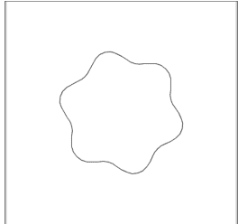

7. 现在我们需要一种简单的方法让用户更改我们刚刚创建的函数的参数。我们将使用controlP5库创建GUI，所以让我们使用库管理器安装它。转到Sketch | Import Library... | Add Library...打开库管理器，然后在搜索字段中输入controlP5。

8. 点击这个截图中对话框中的Install按钮：

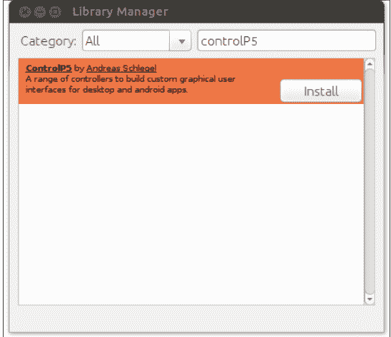

9. 现在让我们在Sketch | Import Library...中选择ControlP5，将库导入到我们的草图。

10. 我们将添加一个组框，作为我们的控制面板，以及一个按钮，允许用户切换菜单的可见性。

```
import controlP5.*;

ControlGroup box;
ControlP5 cp5;
Button toggleButton;

float vertx[];
float verty[];
```

11. 为了将GUI设置代码与形状初始化分开，我们添加一个名为setupGUI()的方法，并从setup()方法中调用它。

```
void setup() {
size(400,400);
setupGUI();
vertx = new float[72];
verty = new float[72];
}

void setupGUI() {
}
```

12. 在我们的setupGUI()方法中，我们创建切换按钮和菜单框。

```
void setupGUI() {
cp5 = new ControlP5(this);
toggleButton = cp5.addButton("toggleBox", 1, 0, 0, 100, 20);
toggleButton.setLabel("Hide Menu");

box = cp5.addGroup( "box", 0, 0, 150);
box.setBackgroundHeight(120);
box.setBackgroundColor(color(0, 100));
}
```

13. ControlP5为每个GUI元素使用回调函数。函数名称是我们在setupGUI()函数中使用的addButton()方法的第一个参数。因此，当有人点击我们的按钮时会收到通知的回调方法必须命名为toggleBox()。

```
void toggleBox(int theValue) {
if (box.isVisible()) {
toggleButton.setLabel("Show Menu");
box.hide();
} else {
toggleButton.setLabel("Hide Menu");
box.show();
}
}
```

14. 目前，我们的菜单框完全是空的。让我们添加两个滑块来改变这一情况，一个用于控制曲线的振荡次数，另一个用于控制振荡大小。我们将振荡次数限制为整数，因为我们不希望函数中出现任何难看的跳跃。

```
void setupGUI() {
    cp5 = new ControlP5(this);
    toggleButton = cp5.addButton("toggleBox", 1, 0, 0, 100, 20);
    toggleButton.setLabel("Hide Menu");

    box = cp5.addGroup( "box", 0, 0, 150);
    box.setBackgroundHeight(120);
    box.setBackgroundColor(color(0, 100));

    Slider slider = cp5.addSlider("slider");
    slider.setPosition(10, 50);
    slider.setSize(80, 10);
    slider.setRange(1, 8);
    slider.setValue(6);
    slider.setNumberOfTickMarks(8);
    slider.setLabel( "count" );
    slider.moveTo( box );

    Slider slider2 = cp5.addSlider("slider2");
    slider2.setPosition(10, 80);
    slider2.setSize(80, 10);
    slider2.setRange(-20, 20);
    slider2.setValue(10);
    slider2.setLabel( "radius" );
    slider2.moveTo( box );
}
```

15. 现在我们需要添加两个float变量来存储我们的参数，以及两个在用户移动滑块时被调用的回调函数。

```
float v1 = 0;
float v2 = 0;

void slider( float val ) { v1 = val; }
void slider2( float val ) { v2 = val; }
```

16. 然后我们将使用这两个float变量来影响`getR()`方法中的半径。

```
float getR( float a ) {
   return sin( radians(a)*v1 ) * v2 + 100;
}
```

17. 现在运行你的草图并更改滑块值。在下面的截图中，你可以看到编辑形状后GUI的外观：

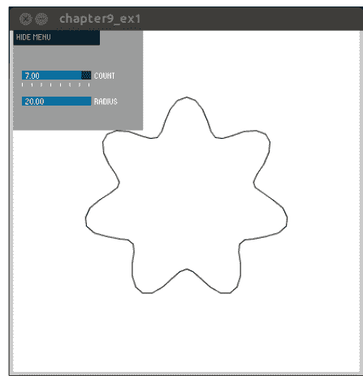

## 目标完成 - 简要汇报

在当前任务的第一项中，我们创建了一个可作为花瓶横截面的二维闭合形状。我们使用极坐标，通过根据角度改变半径来创建形状的顶点。

为了让用户能够在不更改源代码的情况下更改曲线的参数，我们添加了一个GUI。从第6步开始，我们安装了controlP5库并添加了一个按钮和一个菜单框。该按钮通过在回调函数中调用`show()`和`hide()`方法来切换菜单框的可见性。

从第14步开始，我们向菜单框添加了两个滑块，允许我们控制曲线上振荡的数量和大小。

## 生成对象

当前任务的第二项是生成一个可用作小笔筒或花瓶的3D对象。我们将使用任务1中创建的二维形状作为对象的横截面，并沿z轴将其拉伸。我们将扩展getR()方法并添加一堆额外的控制变量，允许我们根据对象的高度改变圆形形状。

为了使用户更容易查看对象，我们将添加mousePressed()和mouseDragged()函数，这些函数可以将对象朝任何方向旋转。我们将使用名为quaternion的数学结构来实现这些旋转。

## 点燃推进器

让我们将形状带入第三维：

- 1. 要将我们的形状转换为3D对象，我们需要扩展vertx和verty数组。

```
import controlP5.*;
ControlGroup box;
ControlP5 cp5;
Button toggleButton;
float[][] vertx;
float[][] verty;
```

- 2. 在我们的setup()方法中，我们将显示模式更改为P3D并定义数组初始化。我们的形状将由20个三角形条组成，每个包含72个顶点。

```
void setup() {
    size(400, 400, P3D);
    setupGUI();
    vertx = new float[20][72];
    verty = new float[20][72];
}
```

- 3. 因为我们更改了顶点数组，所以也需要更改initPoints()方法。我们将添加一个第二个for循环来遍历高度。

```
void initPoints() {
    for ( int h = 0; h < 20; h++) {
        for ( int a = 0; a<72; a++) {
            float r = getR( a*5.0 );
            vertx[h][a] = cos( radians( a*5.0 ) ) * r;
```

vertx[h][a] = sin( radians( a*5.0 ) ) * r;
}
}
}

- 4. 现在我们可以在 `draw()` 方法中将形状替换为一组三角形条。在开始绘制形状之前，我们需要启用深度测试，并在绘制完成后禁用它，以确保 GUI 元素能够正确绘制。我们还将启用一些光源，以防止对象被完全平面着色。

```
void draw() {
  hint( ENABLE_DEPTH_TEST );
  pushMatrix();
  background(255);
  fill(200);
  noStroke();

  translate( width/2, height/2);
  scale( 1.5 );
  ambientLight( 50, 50, 50);
  directionalLight( 100, 95, 55, 0, 0, -10 );
  pointLight( 150, 150, 200, 100, -100, 200 );

  translate(0, -50, 0);
  initPoints();

  beginShape(TRIANGLE_STRIP );
  for ( int h = 1; h < 20; h++) {
    for ( int a = 0; a<73; a++ ) {
      int aa = a % 72;
      normal( vertx[h][aa], 0, verty[h][aa] );
      vertex( vertx[h][aa], h*5.0, verty[h][aa] );
      normal( vertx[h-1][aa], 0, verty[h-1][aa] );
      vertex( vertx[h-1][aa], (h-1)*5.0, verty[h-1][aa] );
    }
  }
  endShape();

  popMatrix();
  hint(DISABLE_DEPTH_TEST );
}
```

- 5. 目前，我们的对象只能从侧面看到，且无法旋转。要修复此问题，我们需要计算一个旋转轴和一个旋转角度。为了简化这些计算，我们需要添加一个名为 Quaternion 的类。四元数是类似于复数的数学构造，只是它们是四维的。点击右侧的“新选项卡”菜单，输入名称为 Quaternion。然后，添加以下代码：

```
class Quaternion {
  float w = 1.0;
  float x = 0.0;
  float y = 0.0;
  float z = 0.0;

  void mult( Quaternion b ) {
    Quaternion res = new Quaternion();
    res.w = this.w * b.w - this.x * b.x - this.y * b.y - this.z * b.z;
    res.x = this.w * b.x + this.x * b.w + this.y * b.z - this.z * b.y;
    res.y = this.w * b.y - this.x * b.z + this.y * b.w + this.z * b.x;
    res.z = this.w * b.z + this.x * b.y - this.y * b.x + this.z * b.w;
    set( res );
  }

  void set( PVector cross, float dot ) {
    this.x = cross.x;
    this.y = cross.y;
    this.z = cross.z;
    this.w = dot;
  }

  void set( Quaternion in ) {
    this.w = in.w;
    this.x = in.x;
    this.y = in.y;
    this.z = in.z;
  }

  float[] matrix() {
    float[] res = new float[4];
    float sa = (float) Math.sqrt(1.0f - w * w);

    if (sa < EPSILON) { sa = 1.0f; }

    res[0] = (float) Math.acos(w) * 2.0f;
    res[1] = x / sa;
    res[2] = y / sa;
    res[3] = z / sa;

    return res;
  }
}
```

- 6. 我们需要在主选项卡中定义三个 `Quaternion` 对象，当用户拖动鼠标时，我们将使用它们来计算当前的旋转矩阵。我们还需要一个 `radius` 变量和两个 `PVector` 对象来跟踪当前的鼠标位置和状态。

```
import controlP5.*;

ControlGroup box;
ControlP5 cp5;
Button toggleButton;

Quaternion qdown = new Quaternion();
Quaternion qnow = new Quaternion();
Quaternion qdrag = new Quaternion();

float radius = 200;
PVector down = new PVector();
PVector drag = new PVector();

float[][] vertx;
float[][] verty;
```

- 7. 现在我们需要添加 `mousePressed()` 和 `mouseDragged()` 方法，当鼠标移动时它们会更改我们的变量。我们还添加一个名为 `mouseToSphere()` 的辅助函数，用于将鼠标指针的坐标转换为对象周围虚拟球体上的一个点，以便计算我们的四元数。

```
PVector mouseToSphere(float x, float y) {
  PVector v = new PVector();
  v.x = (x - width/2) / radius;
  v.y = (y - height/2) / radius;

  float mag = v.x * v.x + v.y * v.y;
  if (mag > 1.0f) {
    v.normalize();
  } else {
    v.z = sqrt( 1.0f - mag );
  }
  return v;
}
```

```
void mousePressed() {
  if ( !box.isVisible() || ( mouseX > box.getWidth()
    || mouseY > box.getBackgroundHeight() ) ) {
    down = mouseToSphere( mouseX, mouseY );
    qdown.set( qnow );
    qdrag = new Quaternion();
  }
}
```

```
void mouseDragged() {
  if ( !box.isVisible() || ( mouseX > box.getWidth()
    || mouseY > box.getBackgroundHeight() ) ) {
    drag = mouseToSphere( mouseX, mouseY );
    qdrag.set( down.cross( drag ), down.dot( drag ) );
  }
}
```

### 8. 要使用我们的旋转矩阵，我们需要将以下代码添加到 `draw()` 方法中：

```
void draw() {
  hint( ENABLE_DEPTH_TEST );
  pushMatrix();
  background(255);
  fill(200);
  noStroke();

  translate( width/2, height/2);
  scale( 1.5 );
  ambientLight( 50, 50, 50 );
  directionalLight( 100, 95, 55, 0, 0, -10 );
  pointLight( 150, 150, 200, 100, -100, 200 );

  qnow.set( qdrag );
  qnow.mult( qdown );

  float[] matrix = qnow.matrix();
  rotate( matrix[0], matrix[1], matrix[2], matrix[3] );
  translate(0, -50, 0);
  initPoints();
}
```

- 9. 现在我们可以通过拖动鼠标旋转对象，但旋转几次后，很难区分对象的顶部和底部。因此，我们将通过在 `draw()` 方法中添加一个三角形扇形来封闭底部。

```
void draw() {
  beginShape(TRIANGLE_STRIP);
  for ( int h = 1; h < 20; h++) {
    for ( int a = 0; a<73; a++ ) {
      int aa = a % 72;
      normal( vertx[h][aa], 0, verty[h][aa]);
      vertex( vertx[h][aa], h*5.0, verty[h][aa] );
      normal( vertx[h-1][aa], 0, verty[h-1][aa] );
      vertex( vertx[h-1][aa], (h-1)*5.0, verty[h-1][aa] );
    }
  }
  endShape();
  beginShape(TRIANGLE_FAN);
  int h = 19;
  vertex( 0, h*5, 0 );
  for ( int a = 0; a<73; a++ ) {
    int aa = a % 72;
    vertex( vertx[h][aa], h*5, verty[h][aa] );
  }
  endShape();
  popMatrix();
  hint(DISABLE_DEPTH_TEST);
}
```

- 10. 迄今为止，我们的对象是第一个任务中形状的圆柱体拉伸。目前，我们只将角度作为 `getR()` 函数的输入参数。现在让我们添加高度作为额外输入，并创建一些新的控制变量。

```
float getR( float a, float h ) {
  float r = v2 * sin( radians(a) * v1 + ( h/15 )*v3 ) +
    sin(radians(3.6*h) * v4 + v5)*v6 + 40;
  return r;
}
```

```
void initPoints() {
    for ( int h = 0; h < 20; h++) {
        for ( int a = 0; a<72; a++) {
            float r = getR( a*5.0, h*5.0 );
            vertx[h][a] = cos( radians( a*5.0 ) ) * r;
            verty[h][a] = sin( radians( a*5.0 ) ) * r;
        }
    }
}
```

- 11. 在我们的 `setupGUI()` 方法中，我们需要添加四个新的滑块来输入新的控制值。为了简化滑块的创建，我们将添加一个名为 `addSlider()` 的方法。

```
float v1;
float v2;
float v3;
float v4;
float v5;
float v6;
```

```
void setupGUI() {
    cp5 = new ControlP5(this);
    toggleButton = cp5.addButton("toggleBox", 1, 0, 0, 100, 20);
    toggleButton.setLabel("Hide Menu");

    box = cp5.addGroup( "box", 0, 0, 150);
    box.setBackgroundHeight(170);
    box.setBackgroundColor(color(0, 100));

    Slider slider = addSlider( "slider", 40, 1, 8, 5, "count" );
    slider.setNumberOfTickMarks(8);
    Slider slider2 = addSlider( "slider2", 60, -10, 10, 5, "radius" );
    Slider slider3 = addSlider( "slider3", 80, -2, 2, 2, "twist" );
    Slider slider4 = addSlider( "slider4", 100, 0, 2, 1.5, "hcount" );
    Slider slider5 = addSlider( "slider5", 120, -2, 2, 2, "phase" );
    Slider slider6 = addSlider( "slider6", 140, 0, 5, 5, "hradius" );
}
```

```
Slider addSlider( String callback, int pos, float start, float end, float value, String label ) {
  Slider slider = cp5.addSlider(callback);
  slider.setPosition(10, pos);
  slider.setSize(80, 10);
  slider.setRange(start, end);
  slider.setValue(value);
  slider.setLabel( label );
  slider.moveTo( box );
  return slider;
}
```

- 12. 我们还需要为每个滑块添加一个新的回调变量。

```
void slider( float val ) { v1 = val; }
void slider2( float val ) { v2 = val;}
void slider3( float val ) { v3 = val; }
void slider4( float val ) { v4 = val; }
void slider5( float val ) { v5 = val; }
void slider6( float val ) { v6 = val;}
```

- 13. 现在运行你的草图并更改滑块，以创建如下截图所示的形状：

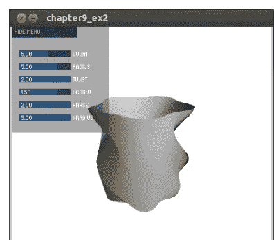

## 任务完成 - 小型简报

在本次任务中，我们拉伸了第一个任务中的二维形状并从中创建了一个圆柱体形式。我们添加了一个 Quaternion 类和两个接收鼠标按下和鼠标拖动事件的回调函数，并计算出一个旋转矩阵，使用户能够从所有方向查看我们草图中的对象。


为了让我们的对象更有趣，我们向 GUI 添加了四个额外的控制参数，并扩展了 getR() 函数，以便在计算半径时考虑圆柱的高度。

## 导出对象

我们在之前的任务中创建了一个可以通过一些滑块更改的 3D 对象，但要在 3D 打印机上打印该对象，我们必须将其保存为 3D 打印机能理解的格式。当前的任务是添加一个导出函数，将对象保存为 STL（STereo Lithography）文件。这种文件格式最初是为立体光刻机（因此得名）而作为输入格式发明的，但几乎所有当前可用的 3D 软件都可以导入这些文件。该文件存储三角形的坐标以及每个三角形的法线向量。这就是该格式绰号为 Triangle Soup 的原因。

STL 文件有一个 80 字节的头部，所有已知的 3D 程序都会忽略它，因此我们将其设置为 0。然后，我们需要将三角形数量写为一个四字节无符号长整型。随后是每个三角形的 12 个浮点数值，包含法线向量和顶点坐标。每个三角形以两个字节的零结束。

## 启动推进器

让我们导出一些三角形：

- 1. 首先，我们添加一个类，用于存储网格由其构成的三角形。
- 单击右侧的图标并选择“新建选项卡...”菜单来添加新选项卡。
- 将其命名为 Triangle，并添加以下代码：

```
public class Triangle {
  PVector a;
  PVector b;
  PVector c;
  PVector n;

  public Triangle( PVector a, PVector b, PVector c, PVector n ) {
    this.a = a;
    this.b = b;
    this.c = c;
    this.n = n;
  }
}
```

- 2. 现在我们添加另一个选项卡并创建一个名为 TriangleSoup 的类。该类存储三角形，并以 STL 格式将它们写入文件。

```
import java.io.FileOutputStream;
import java.nio.ByteBuffer;
import java.nio.ByteOrder;
import java.util.Arrays;
import java.io.FileOutputStream;
import java.io.IOException;
import java.util.List;

public class TriangleSoup {

	List<Triangle> triangles = new ArrayList<Triangle>();
	float scale = 1;

	void scale( float scale ) {
		this.scale = scale;
	}

	void add( PVector a, PVector b, PVector c, PVector n ) {
		triangles.add( new Triangle( a, b, c, n ) );
	}
}
```

- 3. 当我们的网格的所有三角形对象都已添加到 Triangle Soup 后，我们需要将其保存为 STL 文件。向我们的类添加以下方法：

```
void save( String filename ) {
try {
	byte[] header = new byte[80];
	byte[] count = new byte[4];
	byte[] tri = new byte[50];

	FileOutputStream out = new FileOutputStream( filename );
	ByteBuffer buffer = ByteBuffer.allocate( 80 );
	buffer.order( ByteOrder.LITTLE_ENDIAN );

	Arrays.fill(header, 0, 80, (byte)0);
	out.write( header, 0, 80 );
	buffer.putInt( triangles.size() );
	buffer.rewind();
	buffer.get( count, 0, 4 );
	out.write( count, 0, 4 );

	for( int i=0; i<triangles.size(); i++) {
		buffer.rewind();
		buffer.putFloat( triangles.get(i).n.x * scale );
		buffer.putFloat( triangles.get(i).n.z * scale );
		buffer.putFloat( triangles.get(i).n.y * scale );
		buffer.putFloat( triangles.get(i).a.x * scale );
		buffer.putFloat( triangles.get(i).a.z * scale );
		buffer.putFloat( triangles.get(i).a.y * scale );
		buffer.putFloat( triangles.get(i).b.x * scale );
		buffer.putFloat( triangles.get(i).b.z * scale );
		buffer.putFloat( triangles.get(i).b.y * scale );
		buffer.putFloat( triangles.get(i).c.x * scale );
		buffer.putFloat( triangles.get(i).c.z * scale );
		buffer.putFloat( triangles.get(i).c.y * scale );
		buffer.putShort( (short)0 );
		buffer.rewind();
		buffer.get( tri, 0, 50 );
		out.write( tri, 0, 50 );
	}
	out.flush();
	out.close();
} catch ( IOException ioe ) {
	ioe.printStackTrace();
}
}
```

- 4. 回到主选项卡，我们需要在菜单中添加一个新按钮，该按钮打开文件选择框并允许用户输入导出文件的文件名。因此，我们现在将向 setupGUI() 方法添加一个新按钮定义。

```
void setupGUI() {
    Button exportButton = cp5.addButton( "export", 1, 10, 165, 120, 15 );
    exportButton.setLabel( "export" );
    exportButton.moveTo( box );
}
```

- 5. 现在为导出按钮添加回调函数，并使用 `selectOutput()` 方法创建文件对话框。第一个参数是对话框标题，第二个参数是当用户选择文件名并单击确定时被激活的回调方法名称。

```
void export() {
    selectOutput( "Export to STL", "exportCallback" );
}
```

- 6. 对话框的回调方法将用户选择的文件名作为字符串参数获取。如果用户取消对话框，文件名字符串将设置为 null。如果获得有效文件名，我们将其转换为绝对路径并创建 TriangleSoup 对象。为了使我们的对象可打印，我们需要确保它是封闭体积，而不是单面墙。我们添加 `exportOuter()` 和 `exportInner()` 方法来创建墙壁，以及 `exportBottom()` 和 `exportTop()` 方法来关闭我们的对象。

```
void exportCallback(File exportFile) {
    if ( exportFile != null ) {
    String filename = exportFile.getAbsolutePath();
    TriangleSoup export = new TriangleSoup();
    export.scale( .5 );

    exportOuter( export );
    exportInner( export );
    exportBottom( export );
    exportTop( export );
    export.save(filename);
    }
}
```

- 7. 现在我们需要为每个网格添加导出函数。`exportOuter()` 方法为外墙创建三角形，然后计算三角形的法线向量。

```
void exportOuter( TriangleSoup export ) {
    for ( int h = 1; h < 20; h++ ) {
    for ( int a = 0; a<72; a++ ) {
    int ab = (a+1) % 72;
    PVector p1 = new PVector( vertx[h][a], 95-h*5.0, verty[h][a] );

    PVector p2 = new PVector( vertx[h-1][a], 95-(h-1)*5.0, verty[h-1][a] );
    PVector p3 = new PVector( vertx[h][ab], 95-h*5.0, verty[h][ab] );
    PVector p4 = new PVector( vertx[h-1][ab], 95-(h-1)*5.0, verty[h-1][ab] );

    PVector n1 = new PVector( - (p1.x+p2.x+p3.x)/3, 0, - (p1.y+p2.y+y+p3.y)/3 );
    n1.normalize();
    PVector n2 = new PVector( - (p2.x+p3.x+p4.x)/3, 0, - (p2.y+p3.y+y+p4.y)/3 );
    n2.normalize();
    export.add( p1, p2, p3, n1 );
    export.add( p3, p2, p4, n2 );
    }
    }
}
```

- 8. 我们的 exportInner() 方法与 exportOuter() 方法类似，但法线指向与 exportOuter() 方法中使用的相反方向，并且半径减小了 0.8。

```
void exportInner( TriangleSoup export ) {
for ( int h = 1; h < 19; h++ ) {
for ( int a = 0; a<72; a++ ) {
int ab = (a+1) % 72;
PVector p1 = new PVector( vertx[h][a] * 0.8, 95-h*5.0, verty[h][a] * 0.8 );
PVector p2 = new PVector( vertx[h-1][a] * 0.8, 95 - (h-1)*5.0, verty[h-1][a] * 0.8 );
PVector p3 = new PVector( vertx[h][ab] * 0.8, 95-h*5.0, verty[h][ab] * 0.8 );
PVector p4 = new PVector( vertx[h-1][ab] * 0.8, 95 - (h-1)*5.0, verty[h-1][ab] * 0.8 );
PVector n1 = new PVector( - (p1.x+p2.x+p3.x)/3, 0, - (p1.y+p2.y+y+p3.y)/3 );
n1.normalize();
PVector n2 = new PVector( - (p2.x+p3.x+p4.x)/3, 0, - (p2.y+p3.y+y+p4.y)/3 );
n2.normalize();
export.add( p1, p2, p3, n1 );
export.add( p3, p2, p4, n2 );
}
}
}
```

- 9. exportBottom() 方法创建两个三角形扇面以关闭网格底部。我们需要一个用于外墙的底部网格，以及一个略小且位于其上方的用于内墙的网格。

```
void exportBottom(TriangleSoup export) {
PVector n = new PVector( 0, -1, 0 );
PVector p1 = new PVector( 0, 5, 0 );
for ( int a = 0; a < 72; a++ ) {
int ab = (a+1) % 72;
PVector p2 = new PVector( vertx[18][a]*0.8, 5, verty[18][a]*0.8 );
PVector p3 = new PVector( vertx[18][ab]*0.8, 5, verty[18][ab]*0.8 );
export.add( p1, p2, p3, n );
}
n = new PVector( 0, 1, 0 );
p1 = new PVector( 0, 0, 0 );
for ( int a = 0; a < 72; a++ ) {
int ab = (a+1) % 72;
PVector p2 = new PVector( vertx[19][a], 0, verty[19][a] );
PVector p3 = new PVector( vertx[19][ab], 0, verty[19][ab] );
export.add( p1, p2, p3, n );
}
}
```

- 10. 最后，我们需要一个 exportTop() 方法，它创建连接内网格和外网格的顶部环。

```
void exportTop(TriangleSoup export) {
PVector n = new PVector( 0, 1, 0 );
for ( int a = 0; a < 72; a++ ) {
int ab = (a+1) % 72;
PVector p1 = new PVector( vertx[0][a], 95, verty[0][a] );
PVector p2 = new PVector( vertx[0][a]*0.8, 95, verty[0][a]*0.8 );
PVector p3 = new PVector( vertx[0][ab], 95, verty[0][ab] );
PVector p4 = new PVector( vertx[0][ab]*0.8, 95, verty[0][ab]*0.8 );
export.add( p1, p2, p3, n );
export.add( p3, p2, p4, n );
}
}
```


- 11. 现在运行草图并调整参数，直至创建出令你满意的花瓶。将网格导出为 STL 文件。我创建的网格之一看起来如下：

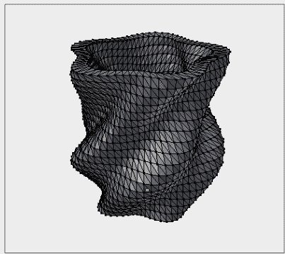

## 目标完成 - 小结简报

本次任务的第三项任务是将花瓶的网格导出为 STL 文件。我们添加了 Triangle 类和 TriangleSoup 类，使我们能够将网格的三角形存储在列表中，然后导出该列表。TriangleSoup 类负责以正确的二进制格式创建头部和顶点数据。

我们在 GUI 中添加了一个按钮，用于打开文件选择框，并在用户选择文件名时调用回调函数。我们向草图中添加了一个 TriangleSoup 对象，并创建了导出方法，用于生成内外壁、底部三角扇形以及连接内外壁的顶部环。

所有三角形创建并添加到我们的列表后，会调用 save() 方法，从而创建出带有所选文件名的 STL 文件。

## 将其变为现实

当前任务的最后一项工作是获取第三项任务中导出的文件，并将其变为实物。我将展示如何在桌面3D打印机上打印这些STL文件，以及如何通过在线3D打印服务订购它们。本示例中使用的3D打印机是 Makerbot CupCake CNC (2009)。其他打印机使用不同的控制软件，但将STL文件转换为实物所需的步骤在各种打印机上非常相似。

如果你家里没有3D打印机，可以尝试寻找附近的黑客空间或创客实验室。这些是制造者和黑客定期聚会的团体，用于分享项目并提供完成项目所需的工具和信息。如今，其中许多地方都拥有3D打印机。

从第9步开始，我还将展示如何使用在线3D打印服务订购你的物体。本示例中我使用了 http://www.shapeways.com，因为他们提供多种材料可供选择，并可配送到大多数国家。

## 启动推进器

让我们打印我们的物体：

- 1. 控制 Makerbot Cupcake 所需的软件称为 ReplicatorG，可从 http://replicat.org 下载。本示例中，我使用了 0037 版本，因为最新版本不支持我的打印机。为你的平台下载 ReplicatorG。

- 2. 打开上一步下载的文件并启动 ReplicatorG。

- 3. 为生成正确的控制命令，你需要通过 机器 | 机器类型 (驱动程序) 选择要使用的打印机类型。

- 4. 现在我们可以打开在上一项任务中从草图导出的 STL 文件。网格将作为预览呈现，并应看起来像此截图所示：

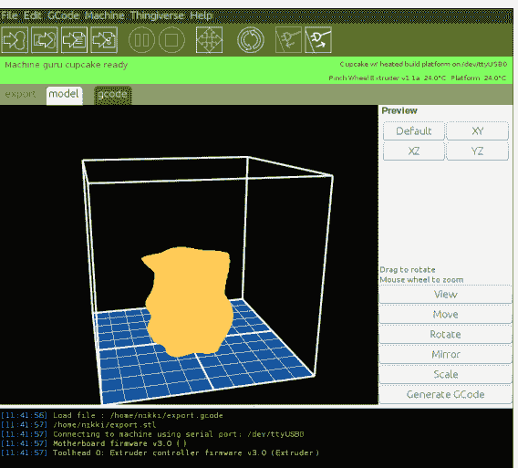

- 5. 确保要打印的物体适合构建平台。如果需要，使用预览图像右侧的菜单对其进行移动和缩放。

- 6. 当物体的尺寸和位置正确后，我们需要为你的机器生成 GCode。此步骤将物体切片为可打印的图层，并生成打印机用于定位打印头和控制挤出的控制命令。单击 **生成 GCode** 按钮，然后选择要使用的打印配置文件。

- 7. GCode 生成完成后，可通过 **GCode | 构建** 开始构建。下图显示了我的花瓶正在打印的情形：

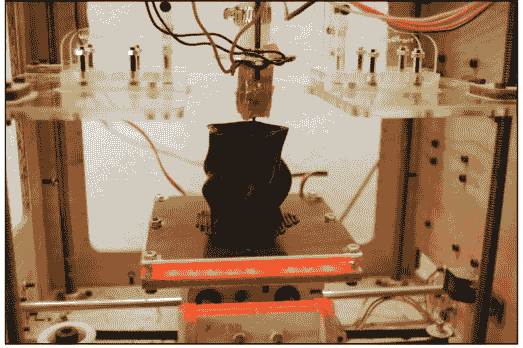

- 8. 打印完成后，取一朵花，将其放入不久前还只是你电脑上几行代码的东西中。


- 9. 如果你无法使用桌面3D打印机，可以使用在线打印服务，例如 [http://www.shapeways.com](http://www.shapeways.com)。

- 10. 注册用户帐户，并通过单击 **创建** 然后单击 **新产品** 开始订购流程。

- 11. 然后，单击 **选择3D文件** 并上传我们在第三项任务中从草图导出的 STL 文件。

- 12. 现在为你的物体选择材料。Shapeways 提供一系列材料，从塑料到陶瓷，甚至不锈钢。

- 13. 对材料满意后，将其添加到购物车并下单。

- 14. 当使用 **白色坚固且柔韧** 材料时，花瓶（由草图创建）的外观如下：

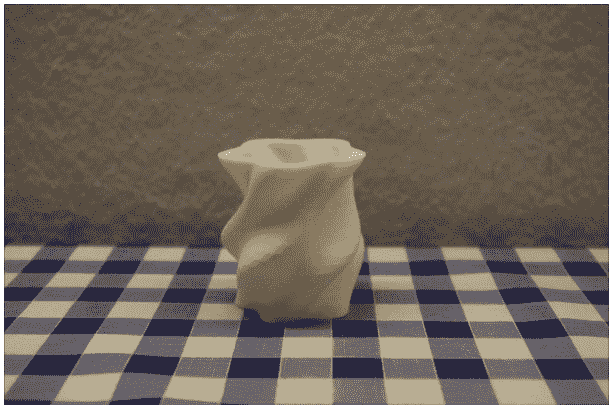

## 目标完成 - 小结简报

对于当前任务的最后一项工作，我们将虚拟3D物体变成了实物。
我们使用 ReplicatorG 对模型进行切片并将其转换为 GCode 指令。这些代码
随后由打印机解释，用于定位打印头并控制塑料丝的挤出。

从第9步开始，我们学习了如何使用在线打印服务订购我们创建的物体。
本示例中我选择了 Shapeways，因为他们使用一种不同的3D打印机，支持非常广泛的材料范围，从塑料到陶瓷，甚至金属。
根据你需要物体用于什么目的，即使你可以使用桌面3D打印机，在线服务也是一个有趣的选择。

## 任务完成

在本次任务中，我们使用在圆柱坐标系中生成顶点的数学函数创建了一个虚拟3D物体，然后使用桌面3D打印机或在线打印服务将其变为实物。

在第一项任务中，我们使用将角度作为输入并为该角度计算半径的函数，创建了一个封闭的圆形2D形状。我们将此点从极坐标系转换为笛卡尔坐标系，并将其用作形状的顶点。然后，我们使用 controlP5 框架添加了一个 GUI，以便让草图的用户能够更改我们函数的参数。

在第二项任务中，我们沿 Z 轴拉伸了创建的形状，形成了一个三维圆柱体。我们切换到所谓的圆柱坐标系，它使用角度、半径和高度来定义其点。我们扩展了函数，使其将高度作为第二个参数，并向 GUI 中添加了四个滑块来影响创建的形状。我们还通过为鼠标事件添加两个回调函数，实现了使用鼠标旋转物体的支持。我们使用四元数计算了旋转轴和角度。这是一种类似于复数的数学构造。

在第三项任务中，我们添加了将网格导出为 STL 文件的支持。这种文件格式存储 3D 网格，并可用作大多数3D打印机或3D建模工具的输入。我们添加了 `Triangle` 类和 `TriangleSoup` 类，用于处理文件创建。为了使我们的物体可打印，我们需要确保物体封闭了一个可打印的体积，因此我们添加了一个稍小的第二个内壁，并在底部添加了两个三角扇形以及一个连接外壁和内壁的顶部网格来封闭网格。

最后，我们将导出的 STL 文件作为桌面3D打印机的输入。控制软件使用此文件为3D打印机创建 GCode 指令，以定位打印头并控制塑料丝的挤出。我们还使用 STL 文件从在线3D打印服务订购了我们的物体。

## 你准备好大干一场了吗？一个高手挑战

我们学习了如何创建一个最初只是一个数学函数和几行代码的实物，但当然，这不仅限于为你喜欢的花朵创建小花瓶。为什么不尝试一下以下想法之一：

- 生成3D打印首饰。
- 从各种部分创建物体，这些部分可以组合成更大的物体。
- 为你的函数使用额外的输入源，例如汇率甚至音频文件！
- 使用 Kinect 扫描物体并从中创建可打印的形状。


# Symbols
- 3D 扫描 29

# A
- addButton() 方法 221
- Android 手机
  - 月球着陆者游戏，在 156-160 页运行
- Arduino 112, 135
- Arduino 开发板
  - 连接，至计算机 112-118
- Arduino IDE
  - URL，用于安装 113
- ASUS Xtion 34
- AudioPlayer 对象 55
- AVR 微控制器 111

# B
- BarHorizontal 可视化器 64
- BeatVisualizer 类 67
- beginShape() 方法 46, 88, 139, 143
- Blender 46
- 弹跳 128
- 浏览器应用程序
  - 月球着陆者游戏，转换为 152-156

# C
- checkSongEnd() 方法 75, 80
- color() 命令 87
- 计算机
  - Kinect，连接至 31-34
- 计算机视觉 29
- 控制器
  - 创建，用于 Smile-O-Mat 草图 118-126
- ControlP5 221
- Creative Commons 许可证 173
- curveVertex() 命令 88

# D
- 消抖 128, 135
- 桌面 3D 打印 218
- 迪斯科舞池
  - 添加，至 Processing 草图 76-81
  - 检查清单 54
  - 创建 53, 70-75
  - 热点目标 54
  - 改进想法 83
  - 为 MP3 文件编写 Processing 草图 54-57
  - 创建可视化器 58-70
- 点
  - 在地图上绘制 202-207
- 剧情线程
  - 关于 8
  - 创建 11-17
  - 添加 TTS 对象至 17-23
- drawButton() 方法 104
- drawDancefloor() 方法 45
- drawDancer() 方法 42, 46
- drawDancers() 方法 51
- drawFinished() 方法 149
- drawFloor() 方法 81
- drawGlobe() 方法 212
- drawHUD() 方法 41
- drawLandingZone() 方法 141
- drawLimb() 方法 49
- drawMeta() 方法 81
- draw() 方法 139, 190
- drawMoon() 方法 139
- drawPin() 方法 212
- drawShip() 方法 142
- drawSliders() 方法 90, 103
- drawWaiting() 方法 149

# E
- enableDepth() 方法 35
- endShape() 方法 46, 88, 139, 143

# F
- 脸
  - 绘制，使用 Processing 86-90
- 面部参数
  - 控制，用于笑脸 127-130
  - 修改，笑脸的 90-94
- fill() 方法 21
- frameRate() 方法 167
- FreeTTS 库 9, 22

# G
- geoCode() 方法 196, 200
- 地理信息系统 (GIS)
  - 关于 189
  - 检查清单 190
  - 创建 189
  - 在地图上绘制点 202-207
  - 扩展 215
  - 特性 189
  - 热点目标 190
  - IP 地址，地理编码 194-201
  - 读取日志文件 190-194
  - 向地球仪添加图钉 208-214
- getR() 函数 219
- getUsersPixel() 方法 41
- getUsersPixels() 方法 38
- 地球仪
  - 转换为霓虹地球仪 179-187
  - 添加图钉至 208-214
  - 转换为 173-179
- 图形用户界面 111

# H
- HashMap 195
- 抬头显示 (HUD) 38
- 外壳
  - 为 Smile-O-Mat 控制器构建外壳 130-134

# I
- initGlobe() 方法 208, 209
- initPoints() 方法 219
- 安装检查
  - 为安装检查创建 Processing 草图 9-11
- 接口 59
- IP 地址
  - 地理编码 194-201

# J
- jointPositionSkeleton() 方法 46

# K
- keyPressed() 方法 146, 210
- keys.txt 文件 96
- Kinect
  - 关于 30
  - 连接至计算机 31-34

# L
- 月球着陆者游戏，着陆序列
  - 启动 144-151
- libfreenect 38
- 光源
  - 用于照亮球体 168-173
- line() 方法 46
- list() 方法 17
- loadPlaylist() 函数 72
- loadStrings() 方法 194
- logAverages() 方法 56
- 日志文件
  - 解析 190-194
- LogRow 类 193
- 月球着陆者游戏 137

# M
- makeSphere() 方法 165, 168, 210
- 地图
  - 在地图上绘制点 202-207
- map() 命令 90
- match() 方法 191
- MBROLA 23

# N
- 网格
  - 为球体创建 164-168
- Minim 53, 58
- 情绪面孔
  - 在 Twitter 上发布 102-109
- 月球着陆者游戏
  - 关于 137
  - 检查清单 138
  - 转换为浏览器应用程序 152-156
  - 扩展 162
  - 特性 137
  - 热点目标 138
  - 启动着陆序列 144-151
  - 在 Android 手机上运行 156-160
  - 绘制精灵 138-143
- 鼠标 111
- mouseClicked() 方法 101, 150
- mouseDragged() 方法 93, 103, 224
- mousePressed() 方法 11, 55, 92, 103, 224
- mouseReleased() 方法 93
- mouseRelease() 方法 92
- MP3 文件
  - 为 MP3 文件编写 Processing 草图 54-57

# O
- 霓虹地球仪
  - 转换为霓虹地球仪 179-187
- 霓虹地球仪项目
  - 关于 163
  - 检查清单 164
  - 特性 163
  - 将地球仪转换为霓虹地球仪 179-187
  - 热点目标 164
  - 使用光源进行照明 168-173
  - 为球体创建网格 164-168
  - 将球体转换为地球仪 173-179
- onEndCalibration() 函数 40
- onLostUser() 方法 38
- onNewUser() 方法 38, 40
- onStartPose() 函数 41
- onUserLost() 函数 40
- OpenGL 着色语言 (GLSL) 179
- orientation() 方法 159

# P
- parseIPDatabase() 方法 195, 199
- parseLogFile() 方法 191, 192, 199
- PFont 类 17
- 图钉
  - 添加至地球仪 208-214
- 普通旧式 Java 对象 (POJO) 17
- popMatrix() 方法 142, 143
- PrimeSense 传感器 34
- println() 方法 118
- Processing
  - 关于 53
  - 创建剧情线程 11-17
  - 阅读莎士比亚脚本 11-17
  - 添加语音功能至 9-11
  - 用于绘制脸部 86-90
- Processing.js 模式 152, 153
- Processing 草图
  - 为安装检查创建 9-11
  - 添加迪斯科舞池至 76-81
  - 为 MP3 文件编写 54-57
- PShape 对象 168
- pushMatrix() 方法 142, 143

# R
- radians() 方法 166
- randomize() 方法 49
- 鼠窝布线 134
- 红点热
  - 创建 201-207
- ReplicatorG
  - 关于 239
  - URL 239
- reset() 方法 148
- 机器人演员
  - 扩展 27
- 机器人
  - 关于 7
  - 构建 23-26
- 机器人项目
  - 关于 7
  - 特性 8
  - 热点目标 8
  - 为 Processing 草图创建
    - 安装检查 9-11
- 构建机器人 23-26
- 添加 TTS 对象至剧情线程 17-23
- rotate() 函数 138, 142, 143
- rotateX() 方法 167
- rotateY() 方法 167

# S
- serialEvent() 方法 127-130
- 串行库 118
- Serial 对象 118
- setMirror() 方法 35
- setTexture() 方法 179
- setupGUI() 函数 221
- setup() 方法 139, 191
- 莎士比亚脚本
  - 阅读 11-17
- shape() 方法 166
- SimpleDateFormat 类 192
- SimpleOpenNI 库 29, 35
- 骨骼追踪 38
- 笑脸
  - 控制面部参数，用于 127-130
  - 修改面部参数 90-94
- Smile-O-Mat 控制器
  - 关于 111
  - 将 Arduino 开发板连接至计算机 112-118
  - 构建 118-126
  - 检查清单 112
  - 控制笑脸的面部参数 127-130
  - 特性 111
  - 热点目标 112
  - 为...构建外壳 130-134
- Smile-O-Mat 程序
  - 检查清单 86
  - 创建 85
  - 修改面部参数 90-94
  - 特性 85
  - 热点目标 86
  - 改进想法 109
  - 在 Twitter 上发布情绪面孔 102-109
  - 使用 Processing 绘制脸部 86-90
  - 在 Twitter 上发布状态更新 94-102
- Smile-O-Mat 草图
  - 为控制器创建 118-126
  - 扩展方式 135
- 语音功能
  - 添加至 Processing 9-11
- speak() 方法 11
- 球体
  - 转换为地球仪 173-179
  - 为球体创建网格 164-167
  - 旋转 164-168
- 月球着陆者游戏，精灵
  - 绘制 138-143
- 状态更新
  - 在 Twitter 上发布 94-102
- 棒人舞蹈团项目
  - 关于 29
  - 检查清单 31
  - 添加舞者 46-52
  - 创建舞者 38-46
  - 将 Kinect 连接至计算机 31-34
  - 目标 31
  - 在 Processing 中查看 35-38
  - 执行骨骼追踪 38-46
- STL (立体光刻) 232
- STUDIO7DESIGNS 173

# T
- tick() 方法 62, 66
- toggleBox() 方法 221
- translate() 函数 138, 142, 143
- 三角汤 232
- ttslib 包 9, 22
- TTS 对象
  - 添加至剧情线程 17-23
- tweet() 方法 126
- Twitter
  - 在 Twitter 上发布状态更新 94-102
  - URL 94
- Twitter4J
  - 关于 85
  - URL 94

# U
- update() 方法 147
- updateStatus() 方法 101

# V
- 花瓶项目
  - 创建 2D 形状 218-223
  - 生成 3D 对象 224-231
  - 关于 217
  - 检查清单 218
  - 绘制曲线 218-223
  - 特性 218
  - 导出对象 232-238
  - 打印对象 238-241
- vector() 命令 143, 165
- 可视化器
  - 创建 58-70

# X
- Xbox 360 31
- Xerox PARC 111

# 感谢购买
Processing 2：创意编程高手

# 关于 Packt 出版社
Packt 发音类似 'packed'，于 2004 年 4 月出版了其第一本书《Mastering phpMyAdmin for Effective MySQL Management》，随后继续专注于出版关于特定技术和解决方案的高度聚焦图书。

我们的图书和出版物分享了您的 IT 专业同行在调整和定制当今系统、应用程序和框架方面的经验。我们的解决方案导向图书为您提供定制您正在使用的软件和技术以完成工作所需的知识和能力。Packt 图书比您过去见过的 IT 图书更具体、更不笼统。我们独特的商业模式使我们能够为您提供更聚焦的信息，让您了解更多需要知道的内容，而减少不需要知道的内容。

Packt 是一家现代且独特的出版公司，致力于为开发者、管理员和初学者社区制作高质量、前沿的图书。如需更多信息，请访问我们的网站：www.packtpub.com。

# 关于 Packt 开源
2010 年，Packt 推出了两个新品牌，Packt Open Source 和 Packt Enterprise，以继续其专业化专注。本书属于 Packt Open Source 品牌，该品牌出版围绕开源许可构建的软件图书，并为从高级开发人员到初学者网页设计师的任何人提供信息。开源品牌还运营 Packt 的开源版税计划，通过该计划，Packt 为每本关于其软件出售图书的开源项目提供版税。

# 为 Packt 撰写
我们欢迎所有有兴趣撰写书籍的人士的咨询。书籍提案应发送至 author@packtpub.com。如果您的书籍创意仍处于早期阶段，并在撰写正式书籍提案之前希望先与我们讨论，请联系我们；我们的一位责任编辑将与您联系。

我们不仅寻找已出版的作者；如果您拥有强大的技术技能但没有写作经验，我们经验丰富的编辑可以帮助您发展写作事业，或者仅仅为您的专业知识获得一些额外回报。


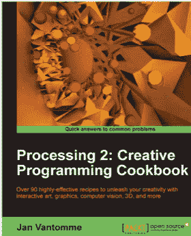

# Processing 2: 创意编程食谱

ISBN: 978-1-84951-794-2 平装: 306 页

超过 90 个高效技巧，助您通过交互艺术、图形、计算机视觉、3D 等释放创造力

- 1. 使用 Processing 语言，借助大量适用于计算艺术和图形的实用技巧进行探索
- 2. 涵盖交互艺术、计算机视觉、可视化、3D 绘图以及使用 Processing 的更多内容等广泛主题
- 3. 创建交互式艺术装置，并学习将您的作品导出用于印刷、屏幕、互联网和移动设备

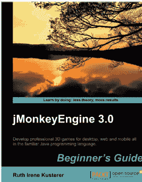

# jMonkeyEngine 3.0 初学者指南

ISBN: 978-1-84951-646-4 平装: 314 页

使用熟悉的 Java 编程语言，为桌面、Web 和移动端开发专业 3D 游戏

- 1. 创建可在 Android 设备、Windows、Mac OS、Linux 桌面电脑及 Web 浏览器中运行的 3D 游戏，适用于商业、爱好者或教育用途。
- 2. 跟随端到端示例，学习游戏开发的基本概念和流程，从场景的基本布局到交互式游戏角色。
- 3. 让您的作品栩栩如生，并从一个统一的开发环境中将游戏发布到多个平台。

请访问 www.PacktPub.com 了解我们的图书信息

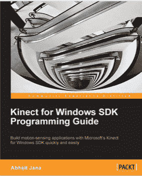

# Kinect for Windows SDK 编程指南

ISBN: 978-1-84969-238-0 平装: 392 页

快速轻松地使用 Microsoft 的 Kinect for Windows SDK 构建运动感知应用程序

- 1. 使用 Kinect for Windows SDK 构建应用程序。
- 2. 涵盖 Kinect for Windows SDK v1.6
- 3. 一个实用的逐步教程，让初学者轻松上手。
- 4. 对所有涉及的 API 及其详细用法的详细讨论和说明

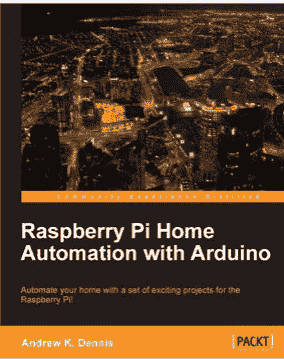

# Raspberry Pi 家庭自动化与 Arduino

ISBN: 978-1-84969-586-2 平装: 176 页

使用一组适用于 Raspberry Pi 的激动人心的项目来实现家庭自动化！

- 1. 学习如何通过详细的逐步示例动态调整您的居住环境
- 2. 了解如何将 Raspberry Pi 和 Arduino 的结合力量应用于您自己的项目
- 3. 颠覆您日常与家互动的方式

