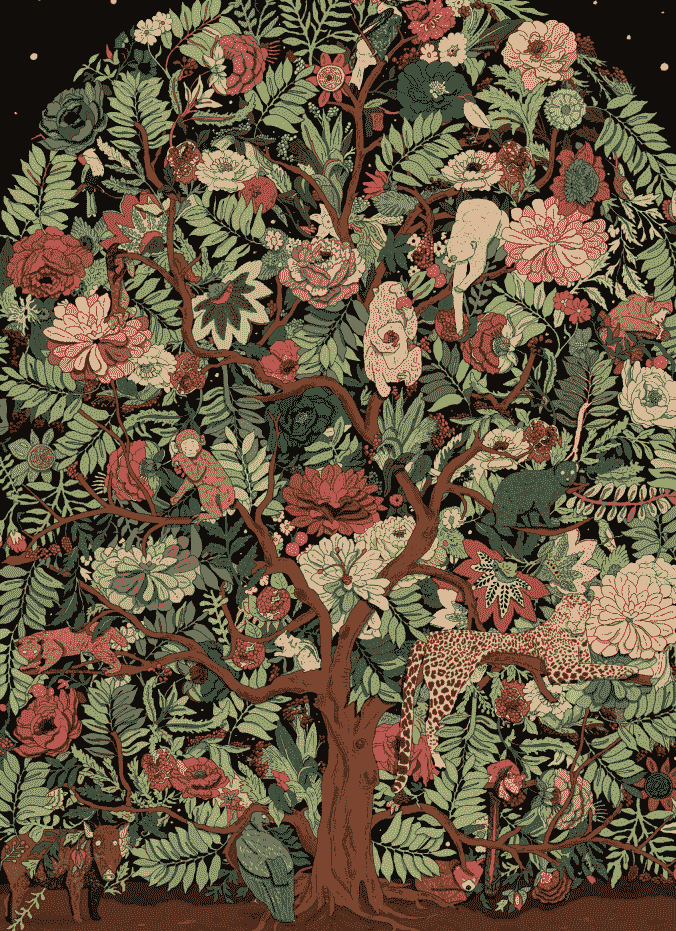

# 数字艺术家的 Procreate

> 致热爱自己手艺的 aspiring 艺术家和梦想家，请继续相信自己
> 让你的热情在你的艺术之旅中激励他人。
> 
> - Mellisa Aning

## 贡献者

## 关于作者

**Mellisa Aning**，也被称为 *Gummy* 和 *Happyyu*，是一位来自马来西亚的自学插画师。她于2019年开始作为自由职业者从事艺术之旅，此后与世界各地的众多客户和公司合作，包括 TOi Puzzles、CASETiFY、QUALIA 和 Youtooz。她也是一个受欢迎的角色创作在线教程的创作者，*From Coloring Technique to Creating Your Own Unique Character*。拥有超过五年的 Procreate 专业使用经验，Mellisa 喜欢创作温暖、欢乐、安全的艺术作品——为看到它的人带来温暖和微笑。

如何找到 Mellisa 的作品
Instagram: https://www.instagram.com/gummyy.y/?hl=en
Website: https://happyyu.carrd.co/

> 感谢我 amazing 的家人和朋友在我整个艺术之旅中陪伴在我身边。
> 你们的支持让我的旅程充满温暖、勇气和快乐！

– Mellisa Aning

由 Surabhi Banerjee 创建
标题：Kalamkari Katha

## 关于审阅者

**Surabhi Banerjee** 是一位居住在班加罗尔的建筑师/插画师，热衷于通过清晰线条的绘画讲故事。她的作品以 ligne claire 风格为标志，以强有力的线条和极简的阴影展现个人叙事。她曾与 KFC、Hershey’s、Facebook、Yash Raj Films、Vidhu Vinod Chopra Films、Coca-Cola、Budweiser、Naturals Ice Cream、Lamborghini、Titan、MUBI、Jaquar、Chicago Botanical Garden、St+art India、Sony Music India 和 Antiquity 等领先品牌合作，获得丰富的多元专业经验。

**Vivian Wong** 是一位居住在伦敦和香港的插画师，自五岁起就热爱绘画。她创作了一个充满原创角色的迷人世界，包括 *Gu* 和 *Bu* 以及 *Bread Family*。*Bread Family* 的每个成员都以不同类型的面包为灵感，其中 *Gu* 和 *Bu* 代表油炸和蒸制的 *mantou*，一种流行的中国馒头。Vivian 的作品经常让她的角色踏上奇幻多彩的冒险之旅，充满美味的食物和受吉卜力启发的魔幻景观。通过她的艺术，她希望为观众带来欢乐和微笑，以她可爱的角色留下持久而难忘的印象！

## 前言

Procreate 是一款功能强大且易于使用的 iPad 绘图应用。艺术家们喜爱它自然的画笔、流畅的图层系统以及有用的工具，如透视指南和色彩功能。你可以用它自由地进行素描、绘画、动画制作并探索你的想法——只需一个应用。无需订阅——只需一次性购买。它与 Apple Pencil 配合完美，因此你的线条感觉就像传统绘画一样。

以 Procreate 为主要创作工具，我们将逐步讲解有助于背景绘画的技巧。本书中的逐步讲解旨在兼具实用性，并提供指导，帮助你在保持独特创作风格的同时增强自信。本书将指导插画师创作富有意义且沉浸感的背景。你会找到简单易懂的步骤、贴心的建议和有用的工具，在每一步都支持你的创作旅程。

## 本书适合谁

本书专为希望将背景绘画技能提升到更高水平的插画师而创作。由于场景在动画、艺术书籍和游戏行业中扮演重要角色，学习如何创作背景可以成为你创作旅程中的重要第一步。无论你是在为专业工作做准备，还是仅仅探索新的艺术道路，本书都提供指导，帮助你充满自信和喜悦地开始。

Procreate for Digital Artists 专为熟悉 Procreate 基础操作的进阶用户设计。但如果你是新手也不用担心。每个章节都包含友好的提示，帮助你轻松访问和使用工具。

## 本书涵盖内容

第 1 章《利用高级技巧打造惊艳背景》将帮助你学习如何使用 Procreate 创作背景场景。你将探索基础知识，如画笔、纹理和色彩，同时获得使用参考资料、构建简单构图以及通过深思熟虑的色彩选择营造氛围的有用提示。

第 2 章《精准绘制精细细节》将展示如何绘制受自然启发的背景元素，如蓬松的云朵、精致的树木、柔软的草地、花田和温馨的小房子。这些细节有助于营造场景，使你的插画充满生机。我们还将探讨如何使用对比度、色彩明度以及 Procreate 工具如曲线和色相、饱和度、亮度来为背景场景带来平衡。

第 3 章《掌握透视打造动感场景》将帮助你探索如何使用自然透视和线性透视为背景增添深度和真实感。你将学习简单的方法来应用大气透视、大小透视和细节透视，并配合使用 Procreate 内置的一点透视、两点透视和三点透视工具的有用分步指南。

第 4 章《增强光影提升艺术作品》将指导你使用光线和阴影让作品栩栩如生。你将发现光线如何影响不同表面，以及如何用合适的色彩和情绪创作清晨、午后、傍晚和夜晚场景。通过简单易懂的逐步讲解和 Procreate 中的实用工具，你将学会以自然的方式添加高光、阴影和反射光。

第 5 章《探索色彩理论打造鲜艳插画》将帮助你学习如何通过色彩让艺术作品闪耀。你将发现如何选择互补的颜色、利用暖色和冷色营造情绪，以及如何使用对比度和色彩明度增添深度。通过包含色彩和谐、制作调色板以及使用渐变映射提示的友好 Procreate 逐步讲解，你将在每一次笔触中感到更加自信和富有创造力。

第 6 章《利用实用技巧营造氛围与情绪》将帮助你探索色彩如何塑造插画的感觉。你将学习不同的色调，如温暖的黄色或清凉的蓝色，如何帮助你表达快乐、悲伤、神秘、强烈或舒适等情绪。通过简单的 Procreate 逐步讲解和易于理解的提示，你将构建与想要讲述的故事相匹配的色彩调色板。通过理解色彩与构图如何协同工作，你将发现如何引导观众视线并为艺术作品带来情感深度。

第 7 章《通过艺术讲故事：创造视觉叙事》将指导你创作使作品更具意义和难忘性的视觉故事。你将学习如何头脑风暴想法、绘制场景和角色草图，并逐步构建叙事——从情绪板到完成插画。通过简单易懂的技巧和支持性的提示，你将探索色彩、场景和情绪如何汇聚在一起讲述观众能够真正感受到的故事。

第 8 章《设计与背景无缝融合的角色》将帮助你探索如何创作与所处背景自然相连的角色。逐步地，我们将探索如何头脑风暴性格特征、绘制想法草图并完成角色设计。你还将学习如何从不同角度绘制角色并展现多样化的表情。最后，你将发现如何将它们放置在场景中并将一切融合在一起，讲述一个发人深省的故事。

第 9 章《完善构图打造视觉冲击力强的艺术作品》将帮助你学习如何安排插画中的元素，创作出美丽、平衡且引人注目的背景。通过逐步讲解，你将探索 C 形、V 形、圆形和黄金螺旋等构图技巧。你将学习如何引导观众注意力、增添深度并打造富有意义、故事性强且充满魅力的场景。

*第10章《逐步绘制引人注目的背景指南》将指导你创作美观的背景，以衬托角色并讲述故事。我们将探讨如何营造氛围、通过深度和透视表现距离，以及使用分层技巧让你的艺术作品感觉自然且引人入胜。逐步地，你将绘制清晨、下午、傍晚和夜晚的风景——在温柔的引导下，有充足的空间探索和发挥。到最后，你在设计能够为作品增添情感、氛围和意义的背景时将更有信心。*

## 要充分利用本书

*要跟随本书中的逐步指导，你需要一台运行 iPadOS 16.3 或更高版本的 iPad，以及 Procreate 应用（版本 5.3.15）或更新版本。为获得最佳效果，请确保你的设备已更新并能够支持最新版本的 Procreate。*

在本书中，逐步指导旨在温柔地引导你在创作第一个背景场景或探索艺术新想法时进行创作。请随意以自己的方式作画，使用独特的风格。如果你使用的是不同的绘图程序也完全没问题——这些技巧旨在支持你，无论使用什么工具。

## 下载图像

我们还提供一份 PDF 文件，其中包含本书中使用的屏幕截图和图像的彩色图片。你可以在此处下载：https://packt.link/gbp/9781835082980。

## 使用约定

**粗体**：表示新术语、重要词语或你在屏幕上看到的词语。示例：“**大气透视**是艺术中用来营造深度和距离的幻觉的技术，通过描绘物体退入背景时颜色和对比度的变化来实现。”

**提示或重要说明**
以此形式出现。

## 本书附带独家福利——解锁方法如下

## 立即解锁本书的独家权益

扫描此二维码或前往 packtpub.com/unlock，然后按书名搜索本书。确保选择的是正确版本。

*注意：在开始之前请准备好购买发票。*

使用我们的下一代阅读器提升阅读体验：

- **多设备进度同步**：从任何设备学习，进度无缝同步。
- **高亮和笔记**：将阅读转化为持久的知识。
- **书签**：随时重温最重要的学习内容。
- **深色模式**：通过切换到深色或棕褐色模式，减少眼部疲劳，专注阅读。

使用我们的 AI 助手（Beta 版）更智能地学习：

- **总结**：总结关键章节或整章内容。
- **AI 代码解释器**：在下一代 Packt Reader 中，点击每个代码块上方 **解释** 按钮获取 AI 驱动的代码解释。

> 注意：
> *AI 助手是下一代 Packt Reader 的一部分，目前仍处于 Beta 测试阶段。*

随时随地学习：

- 使用无 DRM 的 PDF 和 ePub 版本离线访问你的内容——兼容你喜爱的电子阅读器。

## 解锁本书的独家权益

本书的副本附带以下独家权益：

- 下一代 Packt Reader
- AI 助手（beta）
- 无 DRM 的 PDF/ePub 下载

如果你尚未解锁，请使用以下指南进行解锁。整个过程只需几分钟，且只需执行一次。

## 三个简单步骤解锁这些权益

### 第一步

请准备好本书的购买发票，因为在第三步时会用到。如果你收到的是纸质发票，请用手机扫描并以 PDF、JPG 或 PNG 格式保存。

如需查找发票的更多帮助，请访问 https://www.packtpub.com/unlock-benefits/help。

注意：你是否直接从 Packt 购买了本书？如果是，则不需要发票。完成第二步后，你可以直接跳转到独家内容。

| 第 2 步 | 二维码 |
|---|---|
| 扫描此二维码或前往 `packtpub.com/unlock`。 | |

打开的页面（如果你使用的是桌面端，将类似于图 X.1），按书名搜索本书。确保选择正确的版本。

图 X.1：桌面端的 Packt 解锁登陆页面

### 第三步

登录你的 Packt 账户或免费创建一个新账户。登录后，上传你的发票。发票可以是 PDF、PNG 或 JPG 格式，且大小不得超过 10 MB。按照屏幕上的剩余说明完成流程。

**需要帮助？**
如果遇到困难需要帮助，请访问 https://www.packtpub.com/unlock-benefits/help 查看有关如何查找发票等的详细常见问题解答。以下二维码将直接带你到帮助页面：

**注意：**
如果仍遇到问题，请联系 customercare@packt.com。

下一代 Packt Reader 已随本书购买免费提供。扫描二维码或前往 packtpub.com/unlock，然后使用搜索栏按书名查找本书。再次核对显示的版本，以确保获取正确版本。

## 联系我们

我们始终欢迎读者的反馈。

**一般反馈：** 如果你对本书的任何方面有疑问，请发送邮件至 `customercare@packt.com`，并在邮件主题中提及书名。

**勘误：** 虽然我们已尽最大努力确保内容的准确性，但错误难免。如果你发现本书中的错误，我们将不胜感激你向我们报告。请访问 `www.packtpub.com/support/errata` 并填写表单。

**盗版：** 如果你在互联网上发现我们作品的任何形式的非法拷贝，我们将不胜感激你提供位置地址或网站名称。请通过 `copyright@packt.com` 联系我们，并附上材料的链接。

**如果你有兴趣成为作者：** 如果你擅长某个主题并有兴趣撰写或为一本书做出贡献，请访问 `authors.packtpub.com`。

## 解锁奖励资源

扫描二维码或访问链接以获取为你精心策划的独家资源。

https://packt.link/xHrUM

## 分享你的想法

在阅读完 *Procreate for Digital Artists* 后，我们很想听听你的想法！请点击此处直接前往本书在亚马逊的评论页面并分享你的反馈。

你的评论对我们和技术社区都很重要，有助于确保我们提供优质内容。
