## 使用高级技巧打造惊艳背景

欢迎来到第一章！Procreate 是一款功能强大且多功能的数字绘画应用，深受专业和业余艺术家的喜爱。它由 Savage Interactive 专门为 iPad 和 Apple Pencil 开发，提供丰富的工具和画笔，使其成为数字插画最受欢迎的选择之一。

就像许多数字艺术家一样，我在个人和专业项目中都使用 Procreate。它开启了许多创意可能性，在本书中，我将分享我在旅途中积累的技巧和发现。

本指南专为希望将背景插画技能提升到下一个水平的数字艺术家设计。我们将探索实用的技巧和创意策略，这些不仅能完善你的艺术作品，还能帮助你从零开始构建惊艳且富含故事性的场景。无论你旨在掌握光影、加深对色彩理论的理解，还是学习如何创造引人入胜的氛围和角色设计，本书都能满足你的需求。

无论你是准备提升水平的进阶艺术家，还是正在精进技能的高级插画师，本指南都充满了技巧、提示和有趣练习，帮助提升你的背景艺术。我们将逐步介绍易于上手的方法，让绘制场景变得更简单、更有趣。本书涵盖从选择合适的画笔和使用真实参考，到掌握构图、色彩和纹理等一切内容，帮助你创作出自己的杰作。最重要的是，本书不要求你遵循僵化的规则。相反，你将发现灵活的工具和创意点子，可以根据自己的工作流程和风格进行调整。

本章将指导你掌握一些基本技巧，帮助你开始绘制自己的背景风景插画。

本章我们将探讨以下内容：

- 了解你的画笔和材料
- 使用参考图像获取灵感
- 从简单的构图开始进行背景绘制
- 添加纹理以增加深度和个性
- 使用背景色彩营造氛围

现在让我们开始第一章，帮助你的背景栩栩如生。在接下来的实操中，我们将探讨你在整本书中会使用的画笔和材料，以及一些调整它们的技巧，让它们更符合你的风格。

## 技术要求

为了跟随本书中的实操，你需要一台运行 iPadOS 16.3 或更高版本的 iPad，以及 Procreate 应用（版本 5.3.15）或更新版本。为获得最佳效果，请确保你的设备已更新并能够支持最新版本的 Procreate。

## 了解你的画笔和材料

选择合适的画笔是获得插画中想要的视觉效果和手感的重要部分。选择很多，但最重要的是使用让你感觉舒适的画笔。如果你不确定该选择哪支画笔，可以在空白画布上做几个测试涂鸦或笔触。看看每支画笔的流畅度以及其纹理是否适合你正在创作的场景类型。

例如，在图 1.1 中，我使用水彩画笔创作了一幅快速绘画，只是为了在深入插画过程之前探索画笔的流畅度和纹理。这个简单的测试帮助我了解画笔在分层、纹理化和色彩混合方面的表现——这三点真正决定了使用画笔时的自然感。

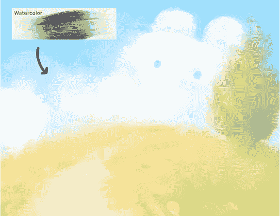

图 1.1 – 使用水彩画笔的示例

如果你对画笔的流畅度和纹理不满意，可以调整设置。这将帮助你打造自己喜欢的画笔。在创建画笔时，我们可以考虑画笔的纹理、渲染效果和流畅度。下面将举例说明如何为 Procreate 的画笔创建良好的渲染和纹理效果。

要创建良好的渲染效果，可以更改 Rendering 模式和 Wet mix 部分的设置。

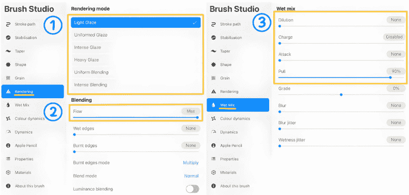

图 1.2 – 如何更改画笔渲染效果的示例

要创建良好的纹理，可以更改 Grain 和 Apple Pencil | Bleed 部分的设置。

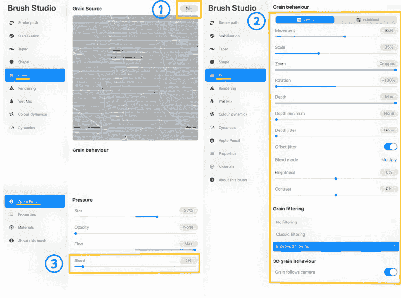

图 1.3 – 如何更改画笔纹理的示例

## 提示

**快速提示：** 需要查看此图像的高分辨率版本吗？在新一代 Packt Reader 中打开本书，或在 PDF/ePub 副本中查看。

**新一代 Packt Reader** 和本书的 **免费 PDF/ePub 副本** 已包含在你的购买中。扫描二维码或前往 packtpub.com/unlock，然后使用搜索栏按名称查找本书。仔细核对所示的版本，以确保获取正确的版本。

要创建良好的画笔流畅度和笔触，可以在 Stabilisation | Motion filtering 部分进行更改。

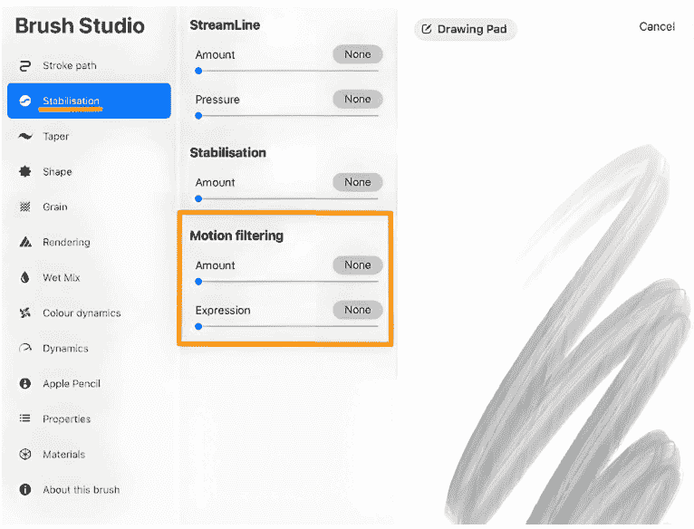

图 1.4 – 如何更改画笔笔触的示例

## 纹理画笔

使用某些画笔，例如纹理画笔，可以通过增加更多细节和层次感极大地提升你的背景插画。纹理画笔有助于打破单调平坦的区域，创造出更具动感和视觉吸引力的表面。例如，模仿纸张、织物或粗糙石头的纹理的画笔可以添加微妙的图案，使背景看起来更自然、更逼真。增加的纹理在营造深度方面也起着重要作用。通过改变纹理的密度、大小或强度，你可以在插画中暗示层次。纹理还可以营造氛围或传达特定的故事。例如，柔和的颗粒纹理可能唤起怀旧或梦幻的氛围，而大胆锋利的纹理则可以增加能量或戏剧性。通过尝试纹理画笔，你可以发现为作品增添个性和独特性 的新方法。

## 提示

如果你仍在探索最适合自己的画笔，这些画笔是很好的起点，因为它们易于使用，并且适用于各种绘画风格：

- **6B 铅笔（素描）**：非常适合粗略草图和线稿。
- **Studio Pen（上墨）**：线条干净流畅。非常适合轮廓。
- **Round Brush（绘画）**：用于柔和阴影和色彩混合的首选。
- **Soft Brush（喷枪）**：非常适合平滑渐变和两种颜色之间的微妙过渡。

## 画笔信息

在本书中，我将使用 Happyyu Brush Pack 来创建背景插画，如图 1.5 所示。这是一个付费画笔包，提供多种多样的仿油画画笔和效果。然而，需要注意的是，使用这个画笔包完全是可选的。它不是跟进学习的必要条件。你可以自由使用任何你熟悉或偏好的画笔，无论是软件内置的、你下载的免费画笔包，甚至是你自己定制的画笔。关键是使用你感到自信和舒适的工具，这样过程会更顺畅、更有乐趣。

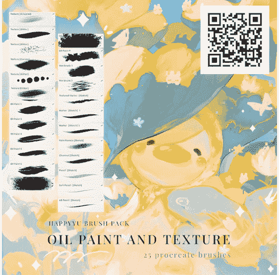

图 1.5 – 画笔包信息

图 1.5 中的画笔主要用于本书中的教程和逐步绘制过程。如果你决定使用这个画笔包，可以参考图 1.6，以确保你能毫无问题地跟随本书中的逐步实操。

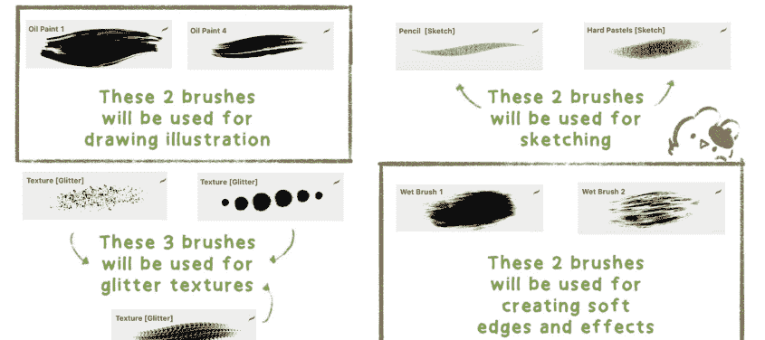

图 1.6 – 本书将使用的 Happyyu Brush Pack 的主要画笔

## 了解更多...

如果你想探索新风格并为插画增添多样性，尝试其他画笔包是个好主意。这些免费画笔包包含多种画笔类型，让你尝试不同的纹理、笔触和效果。它们可以帮助你实现独特的完成效果，例如柔和的水彩渲染、蜡笔般的画笔和粗糙纹理。以下是免费和付费画笔包的二维码和链接：

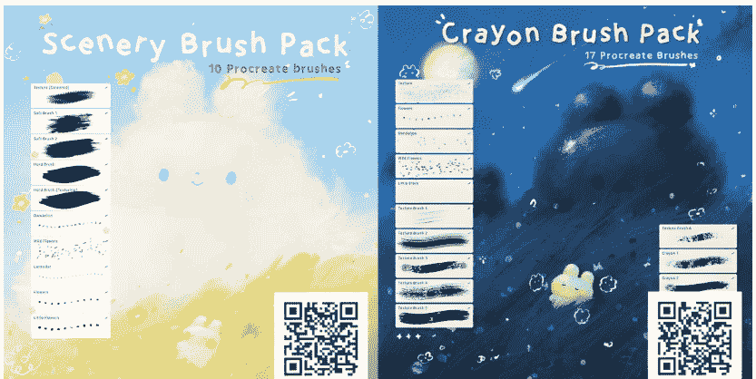

图 1.7 – 提供的免费画笔包图像

## 链接

- 风景画笔包：https://ko-fi.com/s/cfb60fa5c9
- 蜡笔画笔包：https://ko-fi.com/s/45c6b97dd0
- Happyuu 画笔包：https://ko-fi.com/s/95fcf32bb9

现在你已经熟悉我们将使用的画笔和材料，让我们探索如何从真实参考中汲取灵感，为你的背景插画奠定基础。

## 使用参考图像获取灵感

要创作逼真的风景，使用参考图像可以极大地帮助将你的想法在画布上呈现。不要因为依赖参考而感到沮丧——它们是插画师提高绘画技巧的优秀学习工具。观察真实物体和周围环境有助于我们更好地理解细节和技巧。参考资料对于掌握光线、以及改善背景插画的构图和氛围也特别有用。在本次实操中，我们将重点使用参考图像来指导背景作品的草图和底色创作。

## 你需要什么

选择一张参考图像来帮助你勾勒出第一个想法。你可以使用我准备的 *图 1.8* 来进行以下逐步实操。

## 按照步骤进行

例如，让我们先看看参考图像：

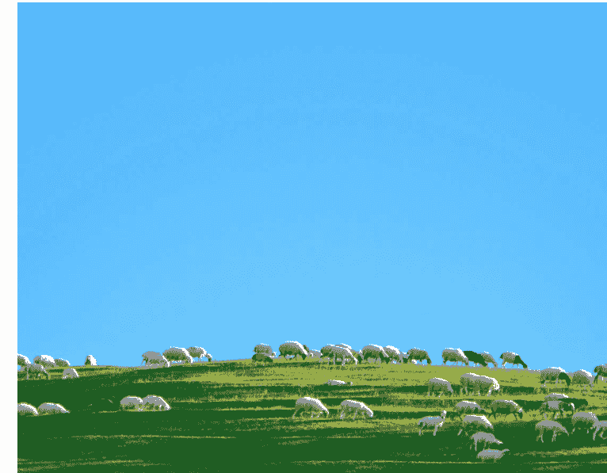

图 1.8 – 参考图像；来源：https://unsplash.com/photos/grass-field-DNnxRx9Vkb4

从图 1.8 中找出最先突出且映入眼帘的几个物体并按顺序列出。从我的角度来看，我注意到蓝天、绿色的田野和一群绵羊。

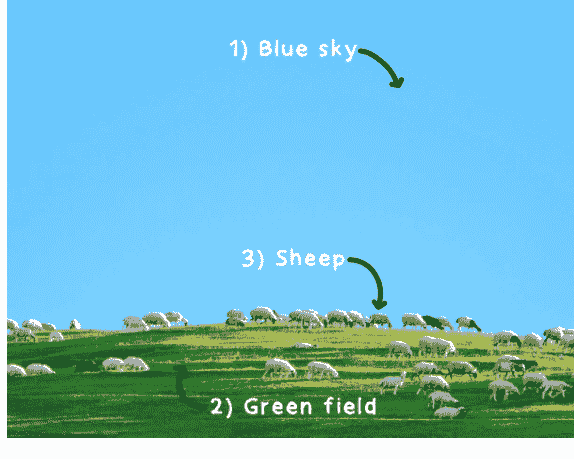

图 1.9 – 从图 1.8 中识别物体的示例；来源：
https://unsplash.com/photos/grass-field-DNnxRx9Vkb4

一旦我们从图 1.8 中识别出前几个物体，我们就将它们记录下来，然后在图 1.9 中参考它们进行描绘。

创建草图可以通过以下步骤完成：

- 1. 首先，画出绿色田野和蓝天。在 Procreate 中，你可以轻松地在绘图旁边添加参考图像，这样可以同时查看两者。只需点击顶部的 **扳手图标**，进入 **画布**，然后打开 **参考**。一个小窗口会弹出。点击 **图像**，然后选择你想要使用的照片。你可以移动此窗口并放大，以便更好地查看细节。你也可以在上面使用取色器来获取用于艺术创作的颜色。
- 2. 接下来，勾勒出一些绵羊。没有必要画每一只；只需包含几只即可捕捉场景的精髓。复制和粘贴可以节省大量时间，尤其是在多次绘制相同事物，例如绵羊时。你可以通过旋转、改变大小或翻转使其看起来略有不同。在 Procreate 中，**复制** 和 **变换** 工具可以轻松帮助你完成此操作。
- 3. *可选：* 画一个角色以增加插图的故事情节。例如，我将画一个牧羊人。

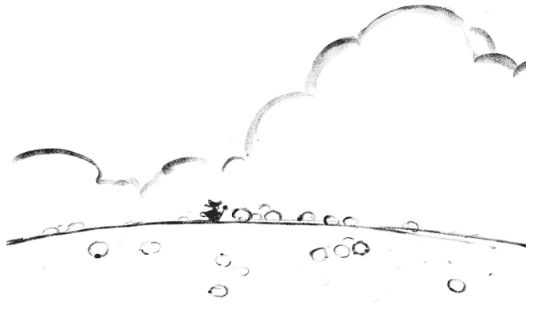

图 1.10 – 基于参考图像的草图

已通过参考真实的绿色田野图像创建了草图。现在，让我们继续准备底色。

## 基于参考图像准备调色板

我们将继续进行底色，在此我们将基于图 1.8 创建调色板。

添加底色可以通过以下步骤完成：

- 1. 首先识别参考图像中的主导颜色，并使用 **取色工具** 保存它们。如果你想从画布上选取颜色，只需长按手指在颜色区域上。片刻后，颜色会出现在你的活动颜色圆圈中。在从参考调色板中选择颜色时，始终选择相互补充的色调以保持整体色彩和谐至关重要。你可以在 *第 5 章《探索色彩理论以打造生动插画》* 中了解更多关于此技术的知识。
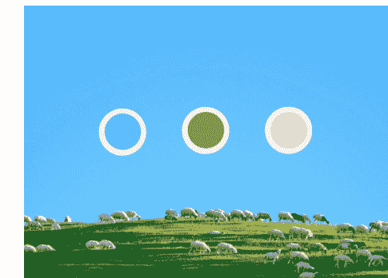

图 1.11 – 基于参考图像准备调色板的示例；来源：https://unsplash.com/photos/grass-field-DNnxRx9Vkb4

- 2. 基于图 1.4，将这些颜色应用到图 1.10 中创建的环境草图上。接下来，我们将使用 Happyyu 画笔包中的 Wet Brush 1 来渲染颜色，以实现绘画效果。然而，此画笔并非必需——请随意使用最适合你风格和工作流程的任何画笔。

图 1.12 显示了从图 1.8 应用底色并渲染后的结果：

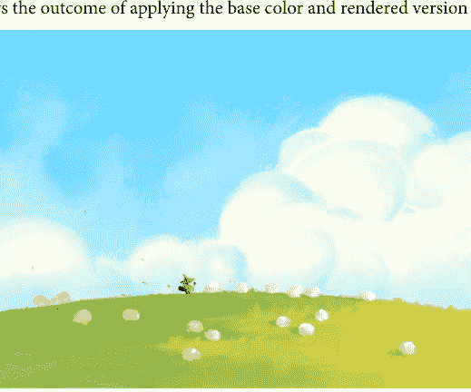

图 1.12 – 底色已应用且插图已渲染后的结果

至此，我们已成功创建了受真实图像启发的背景场景。现在，让我们更仔细地看看它是如何组合在一起的。

## 理解技巧

至此，我们已成功完成了受参考图像启发的背景场景。请记住，你不必完全按照参考图像进行；它旨在指导和启发你，而不是限制你的创造力。虽然使用参考有助于理解光照、构图和氛围等关键元素，但你可以自由地以自己的方式重新诠释它。随意为场景增添个人风格，无论是调整颜色、改变布局，还是加入反映你独特风格的额外细节。艺术表达就是将启发你的事物化为己有，因此请拥抱你的创造力，以一种感觉正确的方式探索和增强场景。这种参考的指导与个人投入的结合将使你的背景既视觉上吸引人又独一无二。

> **提示**
> 你不必画出每一个细节。保持简单使得在完善绘图时更容易进行更改和调整。使用参考图像是获取调色板灵感的好方法，但你不必完全遵循它们。相反，将它们用作指南，帮助塑造你下一幅插图的颜色。

一旦你从参考中收集了灵感，下一步就是学习如何将其简化为易于管理的构图。这使绘图过程更顺畅，并有助于保持对最重要的内容的关注。

## 从简单的构图开始背景绘制

为了使背景绘制更容易、更快，最好专注于保持简单。不要添加太多细节，尝试只突出使背景有趣的关键部分。例如，专注于形状、结构或引人注目的特征等重要元素。使用更少的颜色也有助于简化过程。你可以从仅使用几种与你所创建的情绪或场景相匹配的颜色开始。当你使用参考图像时，密切关注定义场景的三个到六个主要细节或颜色，例如光照、物体或纹理。这样，你就不会因试图包含所有内容而感到不知所措。在本教程中，我们将学习如何使用简单构图绘制背景。

## 你需要什么

在本教程中，我们将使用一张新的参考图像来帮助你更好地理解如何使用简单构图创建背景。这也将向你展示如何为你的艺术作品充分利用参考图像。

## 按照步骤进行

让我们看看参考图像。识别出我们从中获得的前三个主要细节和几种颜色。

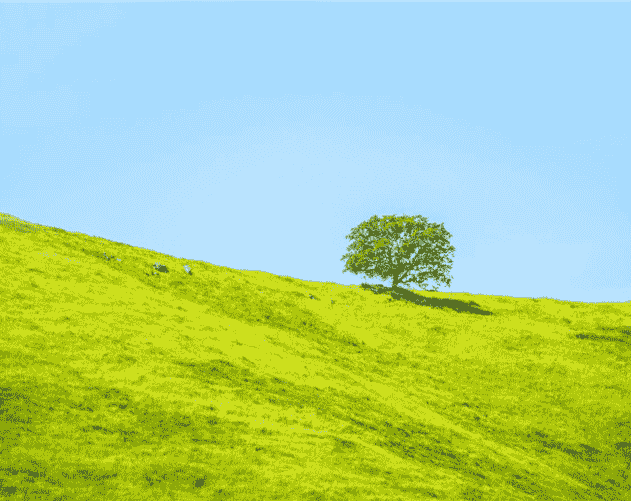

图 1.13 – 一片广阔绿色田野的图像；来源：https://unsplash.com/photos/tree-on-body-of-mountain-cX4TIF3I_U8

从图 1.13 中，我们可以注意到三个主要细节——树、广阔的绿色田野和天空。这里的三个主要颜色是浅绿色、较深的绿色和浅蓝色。

现在，让我们按照本教程创建简单的背景构图：

- 1. 列出我们从图 1.13 中识别出的三个主要细节和颜色。
- 2. 基于图 1.13 创建草图以创建背景绘画。
- 3. 首先将三个主要颜色应用到你绘图的背景上。我添加了一些额外的颜色，以帮助在整体插图中营造更平衡和谐的氛围。

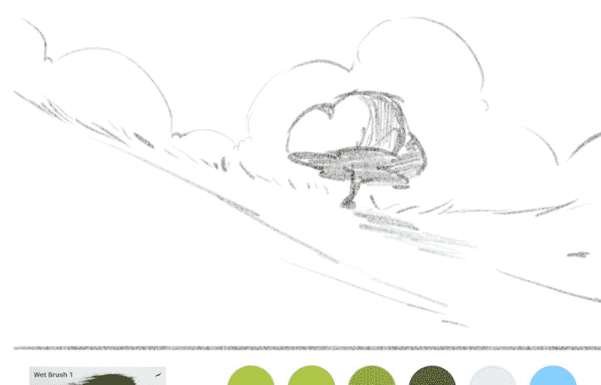

图 1.14 – 基于图 1.13 的草图和调色板示例

- 4. 基于我们收集的信息，以你自己的风格创建场景。

图 1.8 展示了通过逐步绘制过程创建简单构图所取得的结果。

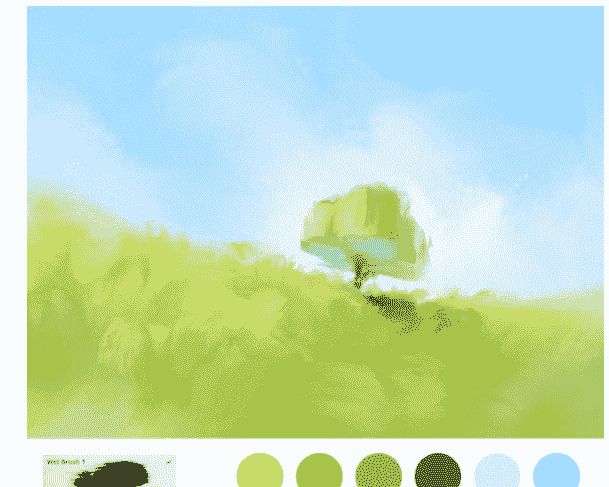

图 1.15 – 使用图 1.13 作为参考的插图示例

至此，我们已成功设计出基于真实图像的简单背景场景。让我们继续进入理解技术的部分，了解更多关于它是如何组合在一起的。

## 理解技巧

当你从简单开始时，更容易看到背景的整体构图并识别可能需要调整或改进的区域。这种清晰度使你在添加细节或重新制作某些元素时更容易逐步完善作品。此外，由于构图已经很直接，你会发现更容易在过程中加入任何你想到的创意点子或更改。

一旦背景的基础就位，你可以逐渐添加更多细节，并专注于通过细节刻画和渲染等技术来增强它。这种逐步的方法不仅使你的作品保持有序，而且允许你在不感到不知所措的情况下做出深思熟虑的调整。总的来说，从简单开始为你提供了灵活性和控制力，可以在整个过程中保持对创造力的开放，同时创作视觉上吸引人的艺术作品。

插画准备好后，就该通过叠加纹理让背景绘画焕发生机。这将有助于让场景更自然、更吸引人且富有深度。接下来，我们将学习如何为插画应用纹理。

## 为增加深度和个性添加纹理
为插画背景添加纹理能让画面更自然、更不平面。纹理可以包括粗糙的图案、柔和的渐变，甚至模仿真实表面如木材、织物或石头的细节。这些元素能让作品更生动、更易产生共鸣，仿佛带有个人[content]
插画准备好后，就该通过叠加纹理让背景绘画焕发生机。这将有助于让场景更自然、更吸引人且富有深度。接下来，我们将学习如何为插画应用纹理。

## 为增加深度和个性添加纹理
为插画背景添加纹理能让画面更自然、更不平面。纹理可以包括粗糙的图案、柔和的渐变，甚至模仿真实表面如木材、织物或石头的细节。这些元素能让作品更生动、更易产生共鸣，仿佛带有个人触感。尝试不同的纹理也有助于整体提升插画的观感。它可以吸引视线聚焦到画面的特定部分，让画面更具视觉趣味，并赋予其深度感。此外，纹理还能为你的作品增添独特性，使其脱颖而出。在本教程中，我们将学习如何使用纹理材质为插画添加纹理。

### 你需要准备的材料
收集并准备一张纹理材质图像。本教程中将使用这些纹理材质为插画添加纹理。

### 按照步骤操作
例如，让我们先来看一下以下纹理材质：

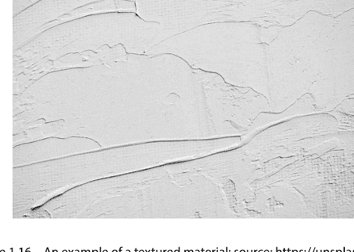

Figure 1.16 – 一个纹理材质的示例；来源：https://unsplash.com/photos/a-close-up-of-a-white-wall-with-peeling-paint-mjC9apK53a8

让我们学习如何有效地将纹理应用到我们的艺术作品中：
- 1. 我们可以先准备一幅插画作为底图层，Base Layer (illustration)。
- 2. 然后，在其上方添加一个额外的图层作为纹理材质。可以向该图层添加纸张、画布、织物或你偏好的材质等纹理材质。
- 3. 添加后，根据喜好更改混合模式。关于纹理图层的放置，你可以参考 Figure 1.17。
- 4. 常用于纹理的混合模式有 Overlay、Multiply、Soft Light 和 Color Burn。混合使用这些混合模式也能在你的插画中创造出惊艳的效果。

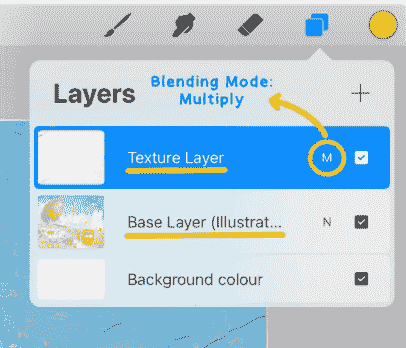

Figure 1.17 – 纹理图层的示例

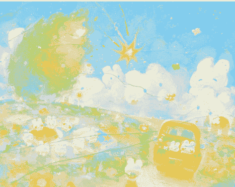

Figure 1.18 – 纹理应用于插画的示例

### 小贴士
对于纹理材质，建议使用黑白纹理以获得更好的效果。为了增强纹理细节，你可以使用 Procreate 内置的 **Sharpen** 设置来增加和调整锐度。点击屏幕顶部的 **magic wand icon**。这将打开 **Adjustments** 菜单。然后选择 **Sharpen** 使你的作品看起来更清晰一些。你可以向左或向右滑动来改变锐化效果的强度。

### 了解更多...
除了将纹理材质添加到插画中，使用纹理画笔也能创造出美妙的效果，如 Figure 1.19 所示：

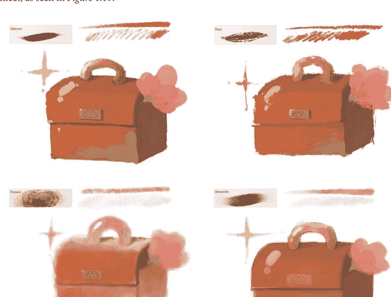

Figure 1.19 – 使用纹理画笔的示例

Procreate 中有许多纹理画笔可供使用，例如 *Oberon, Styx, Fresco, Gouache*，如 *Figure 1.19* 所示。通过使用纹理画笔，你可以为插画增添自己的艺术[content]
插画准备好后，就该通过叠加纹理让背景绘画焕发生机。这将有助于让场景更自然、更吸引人且富有深度。接下来，我们将学习如何为插画应用纹理。

## 为增加深度和个性添加纹理
为插画背景添加纹理能让画面更自然、更不平面。纹理可以包括粗糙的图案、柔和的渐变，甚至模仿真实表面如木材、织物或石头的细节。这些元素能让作品更生动、更易产生共鸣，仿佛带有个人触感。尝试不同的纹理也有助于整体提升插画的观感。它可以吸引视线聚焦到画面的特定部分，让画面更具视觉趣味，并赋予其深度感。此外，纹理还能为你的作品增添独特性，使其脱颖而出。在本教程中，我们将学习如何使用纹理材质为插画添加纹理。

### 你需要准备的材料
收集并准备一张纹理材质图像。本教程中将使用这些纹理材质为插画添加纹理。

### 按照步骤操作
例如，让我们先来看一下以下纹理材质：

Figure 1.16 – 一个纹理材质的示例；来源：https://unsplash.com/photos/a-close-up-of-a-white-wall-with-peeling-paint-mjC9apK53a8

让我们学习如何有效地将纹理应用到我们的艺术作品中：
- 1. 我们可以先准备一幅插画作为底图层，Base Layer (illustration)。
- 2. 然后，在其上方添加一个额外的图层作为纹理材质。可以向该图层添加纸张、画布、织物或你偏好的材质等纹理材质。
- 3. 添加后，根据喜好更改混合模式。关于纹理图层的放置，你可以参考 Figure 1.17。
- 4. 常用于纹理的混合模式有 Overlay、Multiply、Soft Light 和 Color Burn。混合使用这些混合模式也能在你的插画中创造出惊艳的效果。

Figure 1.17 – 纹理图层的示例

Figure 1.18 – 纹理应用于插画的示例

### 小贴士
对于纹理材质，建议使用黑白纹理以获得更好的效果。为了增强纹理细节，你可以使用 Procreate 内置的 **Sharpen** 设置来增加和调整锐度。点击屏幕顶部的 **magic wand icon**。这将打开 **Adjustments** 菜单。然后选择 **Sharpen** 使你的作品看起来更清晰一些。你可以向左或向右滑动来改变锐化效果的强度。

### 了解更多...
除了将纹理材质添加到插画中，使用纹理画笔也能创造出美妙的效果，如 Figure 1.19 所示：

Figure 1.19 – 使用纹理画笔的示例

Procreate 中有许多纹理画笔可供使用，例如 *Oberon, Styx, Fresco, Gouache*，如 *Figure 1.19* 所示。通过使用纹理画笔，你可以为插画增添自己的艺术触感。请不要害怕添加一些不完美或独特性来使背景更具美感。不完美之处可以是特定的笔触或渲染风格。你可以参考 *Figure 1.19* 作为示例。正如你所见，我没有将所有东西都画得完美，以避免看起来过于僵硬。如果你想将特定纹理应用到你的插画中，你也可以创建自己的纹理材质和画笔。这将使你的插画更具独特性。我将分享一个关于如何在画笔设置中更改纹理的示例。

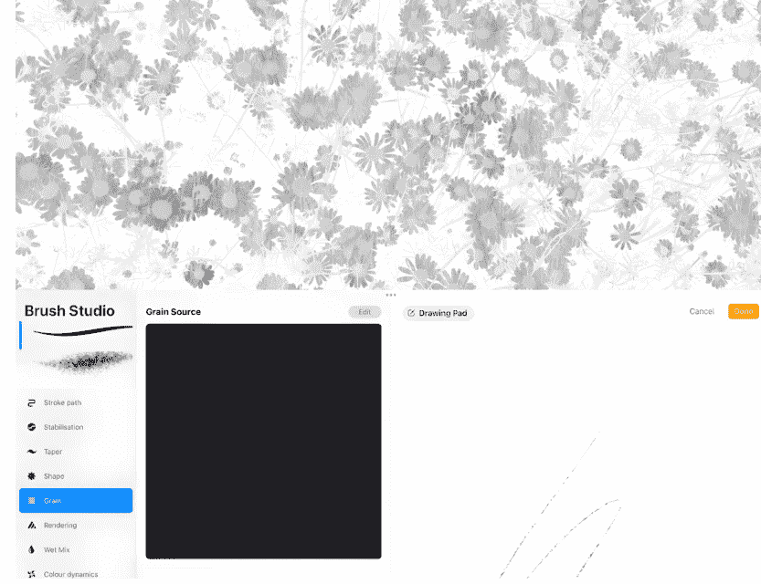

Figure 1.20 – 使用纹理材质和画笔设置的示例

### 小贴士
你可以在画笔设置中更改纹理时参考 *Figure 1.20*。你可以在 **Grain** 部分找到纹理设置。只需点击 **Grain Source** 旁边的 **Edit**，然后你就可以在那里上传自己的纹理图像。另一种方法是合并 Procreate 中的画笔。这是一种创建具有独特纹理和效果的自定义工具的有趣方式。以下是如何在 Procreate 中合并两个画笔的方法：
- 1. 首先，复制你想要合并的每个画笔，以免更改原版。将两个画笔放在同一个文件夹中。你可以从其他画笔集文件夹中拖放画笔。只需触摸并按住画笔，然后将其拖到目标画笔集文件夹中。放置后它就会移动过去。
- 2. 点击一个画笔进行选择，然后在第二个画笔上向右滑动以同时选择两者。
- 3. 点击顶部的 **Combine**。这会创建一个具有两种纹理的新画笔。
- 4. 点击新画笔打开其设置，在那里你可以更改两种画笔的混合方式。

如果以后想将它们分开，点击画笔，然后选择 **Uncombine**。

添加纹理后，增强背景的最后一步是色彩。让我们看看深思熟虑的色彩选择如何影响场景的氛围和和谐。

## 使用背景色彩营造氛围
色彩是创作美丽且引人注目的艺术插画的关键部分。为了使你的作品看起来平衡且令人愉悦，选择相互搭配的色彩非常重要。不同的色彩可以带来不同的感受和想法。因此，色彩调色板可以分为两种不同的色调，即暖色调和冷色调。

### 色调：暖色与冷色
使用橙色、黄色、红色和棕色等暖色调可以营造出宜人而温馨的环境。

例如，让我们来看一个参考图像：

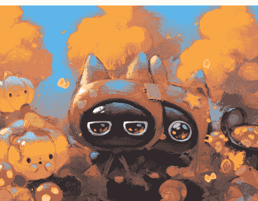

Figure 1.21 – 一个具有暖色调的插画示例

接下来，我们将看看冷色调是什么样的。使用蓝色、绿色和紫色等冷色调可以唤起放松和宁静的感觉。如果你注意一下，在 Figure 1.22 中，我也使用了黄色暖色，但由于冷色调占主导，使插画看起来更偏冷而不是暖。

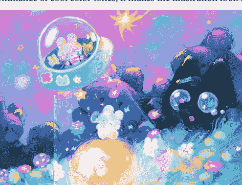

Figure 1.22 – 一个冷色调插画的示例

### 理解技巧
在为背景插画选择色调时，思考你想要传达的情绪和氛围至关重要。这一选择在塑造作品的整体感觉和向观众传达清晰信息方面发挥着关键作用。让我们探索一个关于如何有效使用暖色和冷色调的示例：

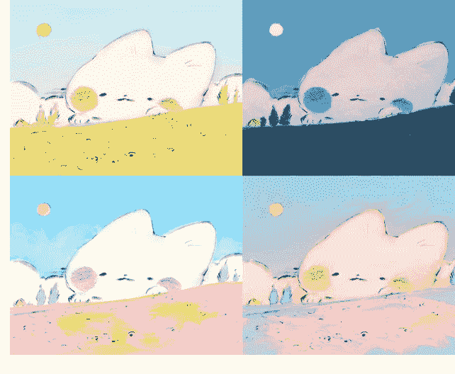

Figure 1.23 – 暖色和冷色调的示例

暖色调，如红色、橙色和黄色，通常会营造出舒适、能量或温暖的感觉。它们非常适合想要显得 inviting、生动甚至怀旧的背景。例如，日落场景可能会使用丰富的暖色调来传达宁静和美丽。另一方面，冷色调，如蓝色、绿色和紫色，往往会唤起宁静、祥和甚至神秘的感觉。这些色调非常适合宁静、清新或戏剧化的背景。考虑到色彩与情绪之间的情感联系，可以让你根据想要传达的信息来定制插画。理解这些方面将指导你在色调上的选择，并帮助你的作品与观众产生共鸣。

### 小贴士
浅色调可以营造舒缓而温柔的氛围，而深色调则可用于营造神秘而强烈的氛围。这可以归类为色彩情绪。关于色彩情绪的细节和解释可在 *Chapter 6, Crafting Mood and Atmosphere with Expert Techniques* 中找到。

### 了解更多...
更改插画的色相是快速轻松地生成新调色板的一种方式。例如，你可以使用 Procreate 内置的 **Hue**、**Saturation** 和 **Brightness** 设置来调整色彩色相。在 Figure 1.24 中，我们可以看到，通过更改 **Hue** 设置的百分比，我们可以轻松创建新的调色板：

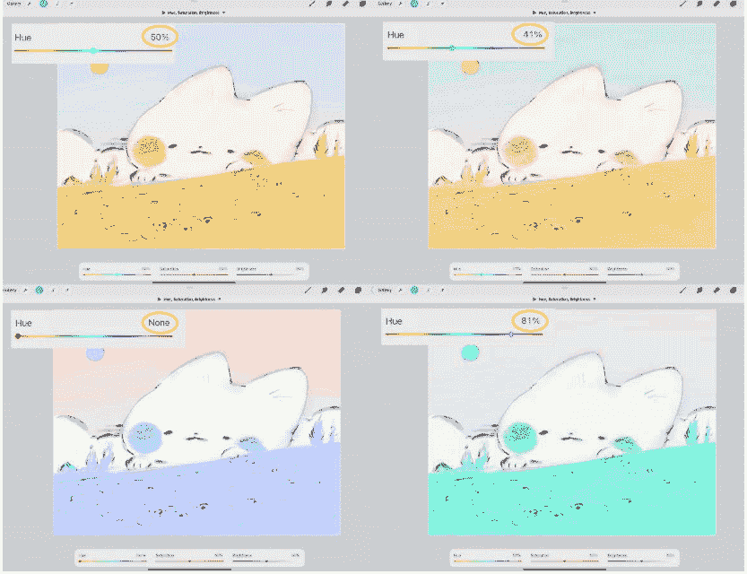

Figure 1.24 – 使用 Procreate 色相工具的示例

我们还需要考虑的一个因素是色彩饱和度。我将展示一个高饱和度插图和一个低饱和度色彩插图的示例。

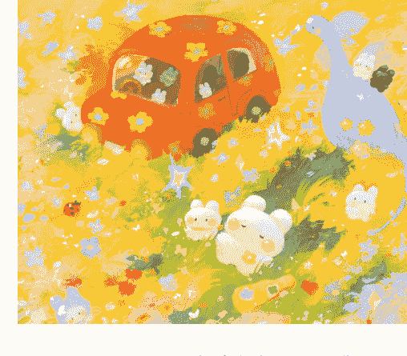

图 1.25 – 高饱和度插图的示例

图 1.25 显示了高饱和度插图的示例。高饱和度的色彩插图会营造出鲜艳引人注目的景致，因此非常适合用于广告目的。让我们来看一下以下低饱和度插图的示例。

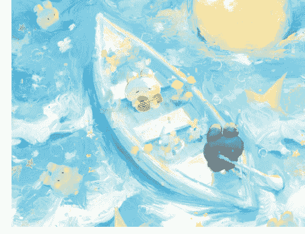

图 1.26 – 低饱和度色彩插图的示例

接下来，图 1.26 显示了低饱和度色彩插图的示例。低饱和度色彩可以营造出柔和舒缓的效果，使其适合用于治愈系插图。要实现这种效果，可使用柔和的色彩，如柔和的蓝色、朦胧的黄色和灰色。最好避免明亮或鲜艳的色调，因为它们会分散插图氛围的注意力。你也可以加入暖色调，但要保持低调，例如使用图 1.26 中所示的低饱和度黄色。这是为了保持平衡的氛围，而不压倒其他细节。

在插图中调整色彩饱和度在塑造观众体验作品的方式上起着关键作用。通过微调饱和度水平，你可以引导观众的注意力，营造氛围，并在不压倒构图的情况下强调某些元素。较高的饱和度可以唤起能量、兴奋或温暖的感觉，非常适合生动的场景，而较低的饱和度则往往显得更柔和、更平静或更内省。仔细选择饱和度有助于你的作品保持平衡，同时表达你想要传达的情绪或故事。

## 摘要

在本章中，我们探讨了如何让背景插图栩栩如生，使其感觉有趣且易于接近。我们学习了如何选择适合自己风格的画笔，以及如何调整画笔使绘画感觉流畅自然。而且，在本章中我们还学习了如何将参考图像用作激发新想法并使艺术作品更具真实感的工具。

我们还发现了在构建场景时保持简洁的力量，这给了我们修改空间并添加个人风格。添加纹理使背景具有深度和有趣的外观，而深思熟虑的色彩选择则有助于设定氛围，无论是明亮大胆还是柔和舒缓。

在下一章中，我们将继续学习如何绘制树木、草地和碎石等重要的背景细节，以使你的插图更具深度和细节。

## 立即解锁本书的专属福利

扫描此二维码或访问 packtpub.com/unlock，然后按书名搜索本书。

