## 精准绘制精细细节

艺术中的背景景致有助于提升整体构图，有助于构建故事并为主题增添深度。艺术家使用背景景致来传达情绪并确立主题，以营造场所和时间的感觉。向背景添加透视、色彩明度以及细节可以衬托主题，从而有助于在插图中创造对比。例如，用去饱和的背景搭配鲜艳的角色作为焦点会产生对比并吸引观众的视线。在 Procreate 中，我们可以使用曲线和色相、饱和度、亮度工具来增强作品中的色彩对比。在第 5 章中，我们将更深入地探讨色彩对比的概念并进行更全面的探索。

绘制背景包括绘制我们周围环境中看到的事物，如云朵、树木、河流、草地、花朵、房屋等等。在本章中，我们将学习如何绘制通常在背景中绘制的重要细节，如云朵、树木、草地和自然相关元素。完成本章后，通过提供的逐步讲解，你将提高绘制背景插图细节的技能。

在逐步讲解示例的帮助下，我们将涵盖以下主题：

- 学习如何绘制蓬松的云朵
- 学习如何绘制精致的树木
- 学习如何绘制舒缓的草地
- 学习如何绘制花田场景
- 学习如何绘制碎石
- 学习如何绘制栅栏
- 学习如何绘制小房子
- 学习如何绘制绿地
- 学习如何绘制湖泊
- 学习如何绘制雪景

### 学习如何绘制蓬松的云朵

云朵通常在背景景致插图中绘制，以基于我们周围看到的事物营造逼真的景象。云朵形状和大小各异，在绘画中复制这种多样性可能具有挑战性。要真实地捕捉云朵蓬松柔软的外观，我们需要很好地理解阴影和融合技巧。我们可以通过观察周围的云朵来提高绘制云朵的技巧。这可以通过拍摄云朵照片并在画布上重新绘制来实现。我们在绘制云朵时遇到的主要问题是难以找到合适的颜色以及如何将它们融合以重现云朵蓬松的形状。此外，确定在云朵上添加阴影和光照的位置也具有挑战性。重要的是避免绘制过于均匀或重复的云朵，因为这会影响整个背景景致。在本讲解中，我们将学习一种简单、逐步的方法来轻松绘制蓬松的云朵，确保你能美丽地捕捉其精髓。

### 按照步骤进行

在进入逐步流程之前，请参阅图 2.1，它将指导你并帮助你有效地跟进讲解。

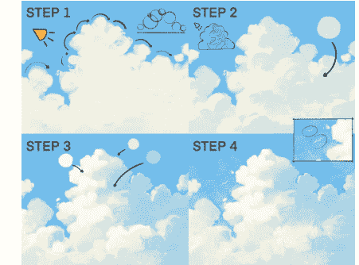

图 2.1 – 绘制蓬松的云朵

你可以使用以下步骤绘制蓬松的云朵：

- 1. 首先，在蓝色底色上使用白色绘制云朵的基础（*图 2.1 中的 STEP 1*）。
- 2. 决定光源放置位置并在被光源遮挡的区域绘制阴影，如 *STEP 2* 所示。
- 3. 使用白色添加高光并用淡黄色和蓝色调添加反射光（*STEP 3*）。
- 4. 最后，在天空的底色上添加一些额外的细节，如光点和柔和的云朵以完成它（*STEP 4*）。

### 理解技巧

绘制云朵的关键在于捕捉其奇幻蓬松的精髓。要实现这一点，了解云朵的形状以及放置光照和阴影的位置非常重要。首先确定光源。例如，如 *图 2.1* 所示，如果光源来自左侧，阴影将落在云朵的右侧。请记住，阴影总是形成在光源的相反一侧。

在添加阴影时，将云朵想象成三维的并相应地绘制阴影以反映其形态。为了使过程更轻松，你可以使用参考图像作为指导。在 *图 2.1* 中，我使用了淡黄色和蓝色调来表现反射光，增强了云朵的外观并使其更柔和、更具动感。

为了确保云朵看起来自然，请在整体插图中保持平衡的色彩明度。例如，如果云朵阴影绘制得太暗，云朵可能会显得僵硬，无法与背景无缝融合。力求和谐的构图以让你的作品栩栩如生。

> **提示**
> 继续观察你周围的云朵（光照如何影响它们、它们如何与天空无缝融合、以及天空上形成的云朵形状），这将帮助你更轻松地提高绘画云朵的能力。你也可以使用云朵照片作为参考来绘制云朵。

### 学习如何绘制精致的树木

绘制树木需要对树的形态和形状有深入的理解。练习绘制不同类型的树可以帮助我们变得更擅长绘制树木。由于树叶的复杂细节以及难以把握比例，树木可能具有挑战性。树木形状和大小各异，因此要变得更擅长绘制它们，我们可以观察周围的树木并尝试重现它们。此外，我们还可以使用互联网上提供的现成树叶画笔来轻松重现树木，并在必要时添加细节。这可以节省时间并使过程更轻松。缺点是如果我们不知道如何绘制树木，即使有画笔的帮助，我们也无法重现看起来自然的树木。

图 2.2 显示了将两种不同概念结合起来创建独特树的几个示例。

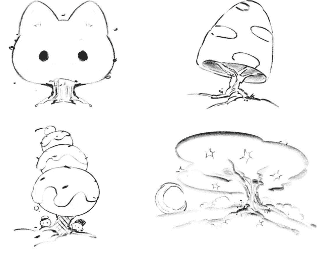

图 2.2 – 不同概念中的树

## 创建独特的树
要创建独特的树，你可以混合两种不同的概念，例如猫树、蘑菇树、冰淇淋树和奇思妙想的树，如图 2.2 所示。通过这样做，我们可以创造一个有趣的概念并吸引观众的注意力。

现在我们已经看到了独特树的外观示例，让我们继续学习画树。在本教程中，我们将学习如何轻松地画树，而无需绘制复杂的细节。

### 按照步骤进行
在继续逐步过程之前，请参考图 2.3 作为指导，以便有效地遵循本教程。

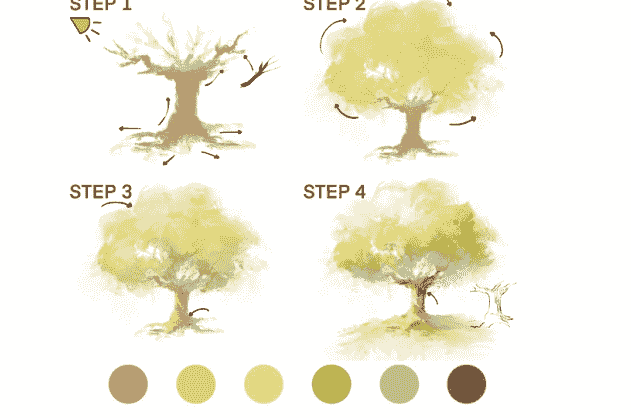

图 2.3 – 画树

你可以使用以下步骤绘制一棵温柔的树：

- 1. 首先，画出树干和一些枝条作为树叶的基础。
- 2. 确定光源来自何处，并在被光源遮挡的区域绘制形成的阴影。
- 3. 使用明亮的黄色添加高光，使用较深的绿色添加阴影。
- 4. 最后，为树添加最终细节和反射光以完成它。

### 理解技巧
画树时，我们首先画出树干。从树干顶部画出几根向外延伸的枝条。枝条的长度和厚度应有所不同，随着远离树干而变细。确保在主枝上添加一些较小的枝条，以营造更自然的外观（图 2.3 中的步骤 1）。要创建树叶，请在枝条周围绘制一系列重叠的不规则形状。这些形状可以是云状的，也可以更详细，具体取决于你要绘制的树类型。确保改变树叶的大小和形状，以使树看起来更逼真（步骤 2）。这种变化可以通过调整 Procreate 的压力灵敏度设置或在画布上用 Apple Pencil 轻触来实现。这使你能更有效地控制枝条和树叶的大小。然后，为树叶添加一些阴影以赋予其深度和立体感。对于树干和枝条，添加更多纹理和阴影以增强整体外观（步骤 3）。最后，使用 Smudge 或 Sharpen 工具细化边缘并添加任何最终细节。你可以在树基部周围添加一些草或其他元素来完成场景（步骤 4）。

## 学习如何绘制舒缓的草
草具有独特的纹理，很难复制。我们必须使用不同的笔触和绿色调来模仿草的自然外观。我们可以使用短而快速的笔触来重现草的尖锐外观。通过改变笔触的压力，我们可以创建不同的厚度和形状。我们可以使用定制的草刷轻松绘制草。这是一种节省时间的好方法，但也有局限性，因为我们无法根据自己的喜好重现草的外观。了解如何画草可以帮助我们突破限制并能够绘制无限的草景。在本教程中，我们将学习如何通过简单的逐步绘画过程手动绘制草，而不使用现成的画笔。

### 按照步骤进行
在继续逐步过程之前，请参考图 2.4 作为指导，以便有效地遵循本教程。

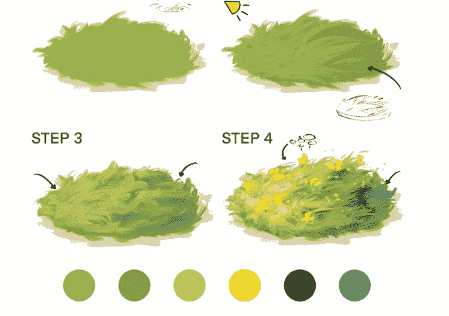

图 2.4 – 画草

你可以使用以下步骤绘制舒缓的草：

- 1. 首先，使用绿色在浅棕色底座上为草绘制一个底座。
- 2. 确定光源位置，并在被光源遮挡的区域绘制阴影。
- 3. 使用浅绿色添加高光，使用较深的颜色调添加阴影。
- 4. 最后，添加一些额外的细节，例如小花和反射光。

### 理解技巧
从底座开始；使用绿色在浅棕色底座上为草绘制底座。这将为你提供一个绘画基础，并为你提供绘制草的方向（图 2.4 中的步骤 1）。然后，确定光源放置的位置，因为这将帮助你确定在哪里添加阴影。阴影可以添加到被光源遮挡的区域（步骤 2）。适当的阴影可以使你的草看起来更具三维感并为颜色增添魅力。使用浅绿色进行高光，使用较深的颜色调增强阴影（步骤 3）。如果你发现混合颜色有困难，可以使用 Soft Light 等混合模式进行高光，使用 Multiply 进行阴影，以获得更顺畅的工作流程。这种对比有助于使草看起来更逼真和鲜艳。最后，添加一些细节，例如小花、用于高光的明亮黄色、用于阴影的深绿色，以及草上反射光的青绿色（步骤 4）。草有时会出现蓝色或青绿色调，因为它反射了天空的颜色。将这些颜色添加到你的绘画中可以使草看起来更逼真和自然。这些小细节可以在草画的整体外观上产生显著差异。为了在细节处理过程中更轻松地添加小细节，你可以根据需要调整画笔大小。

## 学习如何绘制花田场景
花具有精致的纹理，很难绘制。绘制花田景色需要深入了解花瓣纹理以及它们从不同视角的外观。这是为了确保我们能够创建逼真的花卉绘画。重要的是要记住，逼真并不意味着完美；它意味着我们绘制的对象看起来几乎与真实生活中的对象相同。为了更好地绘制花朵，我们可以拍摄花的照片并观察它们。尝试不同的光线并发现天气等外部情况如何创造花的不同纹理和外观。这种方法肯定有助于我们绘制花朵，但掌握它可能需要时间。在本教程中，我将分享使用 Procreate 中特定工具绘制花朵的最快方法。

### 按照步骤进行
在继续逐步过程之前，请参考图 2.5 作为指导，以便有效地遵循本教程。

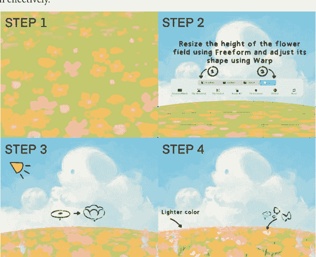

图 2.5 – 画花田

你可以使用以下步骤绘制一片花田：

- 1. 首先，使用绿色为绿色的田野绘制一个底座，并在其上绘制一些花朵。
- 2. 在花田图层下方创建明亮的蓝色天空和柔和的白色云朵，按照步骤 2 中的布局进行。如果需要，请参考之前的云朵教程以获取指导。
- 3. 使用 Procreate 中的 Warp 工具重塑绿色背景颜色，如图 2.5 中的步骤 2 所示。
- 4. 为花朵添加细节并以 3D 形式重新绘制，使其更逼真。
- 5. 最后，添加高光和额外的细节，例如蝴蝶和花田上的较小的花朵以完成它。

### 理解技巧
要绘制花田场景，首先用绿色涂满整个画布。然后，在绿色图层顶部绘制不同形状和不同颜色的花朵，如步骤 1 所示。我们绘制不同的花朵以增加花田的变化。然后，使用 Warp 工具重塑花田。要做到这一点，点击工具栏中的 Transform 按钮并从选项中选择 Warp。这将激活 Warp 网格，该网格在你的作品上覆盖一个网格。你可以拖动网格的角、边缘或内部部分，以任何方向扭曲你的作品。这对于创建褶皱、曲线或独特的扭曲非常有用，如步骤 2 所示。你可以根据自己的喜好重塑花田。重塑后，通过添加细节来增强花朵的外观，使其看起来更逼真。你可以为花瓣添加细节并添加阴影使其更具三维感。在最后一步，使用 Soft Brush（或你喜欢的任何画笔）添加高光以营造更柔和的外观，为花田增添深度。如你在步骤 4 中所见，我为最远的花朵添加了高光，使其看起来更遥远。越远，花朵的细节越少，尺寸也越小。

你也可以添加蝴蝶来增强花田的整体外观。通过掌握这个简单的教程，我们可以创建自然的花卉景色并成功捕捉大自然的美。

## 学习如何绘制碎石
捕捉岩石和泥土的复杂纹理和细节可能很困难。每块岩石都有独特的裂缝、线条和表面需要准确表现，而泥土则有需要绘制以使其看起来逼真的更小细节。为了确保两者都被正确表现，我们需要添加深度和透视。在绘制背景景色时，我们往往避免注意岩石和泥土。然而，如果我们了解如何绘制它们，我们就可以创造更好的地面景色。记住不要添加太多岩石，因为这会导致创造一个全新的场景并改变碎石背景的美学。有时它会掩盖绘画中的主要主题，从而使人们很快就浏览过去你的艺术，因为他们无法专注于一件事。

### 按步骤操作

在进入逐步流程之前，请参考图 2.6 作为指导，以便更有效地跟随演练。

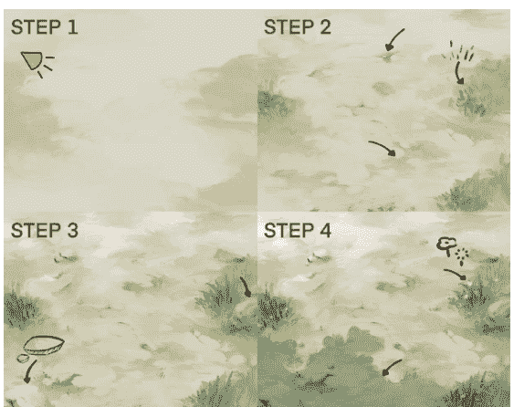

Figure 2.6 – 绘制碎石

你可以使用以下步骤绘制碎石：

- 1. 首先，使用去饱和的黄色作为底色绘制碎石的基础。
- 2. 添加一些泥土纹理和草，使其看起来更逼真。
- 3. 添加一些岩石和额外的阴影到纹理中，并突出光源照射到的区域。
- 4. 最后，添加一些额外细节，例如树影和一些小花，并提高色彩饱和度。

### 理解技巧

首先使用去饱和的黄色或浅灰黄色绘制碎石的基础。这将成为你的岩石和泥土的基础（步骤 1）。加入一些泥土纹理和草，使场景看起来更逼真。这可以通过变化笔触和颜色来模仿泥土和草的自然外观。你可以为其应用颗粒状或粗糙的纹理以便操作并节省更多时间（步骤 2）。然后，绘制不同大小和形状的岩石。为岩石添加阴影会赋予它们深度，使其看起来更具三维感（步骤 3）。要实现这一点，你可以使用 Procreate 的混合模式，例如 Multiply，或应用物体底色的较暗色调来创建阴影。为光源照射到岩石和泥土的区域添加高光会营造出深度和真实感。阴影应添加到光源照不到的区域。最后，添加一些细节，例如树影和小花，并提高色彩饱和度以增强场景的整体外观（步骤 4）。

## 学习如何绘制栅栏

栅栏是为背景场景增添魅力的有趣方式。它还可以通过在最近处绘制更大的栅栏、远处绘制更小的栅栏来为背景场景增添深度。保持栅栏柱之间间距的一致性是绘制栅栏时至关重要的事项之一，这可以通过使用 Procreate 的 2D 网格来实现，可在 Drawing Guides | 2D Grid 中找到。将它们绘制成不规则的形状或形式可以营造出诡异或废弃的氛围。我们在绘制栅栏时面临的一个挑战是捕捉木质纹理。如果我们不熟悉木质纹理，需要绘制的细节数量可能会很困难。在本演练中，我将分享一个逐步流程，帮助你轻松绘制栅栏。

### 按步骤操作

在进入逐步流程之前，请参考图 2.7 作为指导，以便更有效地跟随演练。

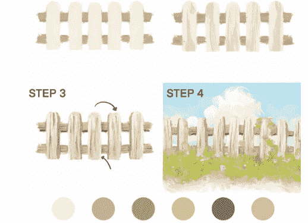

Figure 2.7 – 绘制栅栏

你可以使用以下步骤绘制栅栏：

- 1. 首先，使用奶油色和去饱和的浅棕色绘制栅栏的基础。
- 2. 然后，使用比底色更深的颜色绘制不均匀的线条用于纹理。
- 3. 在栅栏上绘制木质纹理并添加一些阴影使其看起来逼真。
- 4. 最后，复制栅栏并添加带有云朵和草的背景以完成它。

### 理解技巧

从用两种不同颜色绘制栅栏柱开始（步骤 1）。在本演练中，我使用了奶油色和去饱和棕色。你可以自由使用任何你喜欢的颜色来绘制栅栏。然后，使用较深的颜色绘制一些不均匀的水平线，这作为纹理的基础。一旦添加，就使用较深的颜色添加木质纹理（步骤 2）。请避免绘制得过于完美，否则可能看起来过于僵硬和不自然。为光源照不到的区域添加阴影（步骤 3）。最后，复制栅栏以填充背景或放置在需要的位置（步骤 4）。现在，栅栏可以使用了，你可以将其粘贴到背景场景上。你可以使用 Procreate 中的 Warp 和 Distort 工具重新塑形，使其看起来更自然和随机。你可以在栅栏绘画中添加背景场景以完成它。

## 学习如何绘制小房子

绘制房屋是营造温馨宜人背景场景的最简单方法。通过绘制房屋，我们可以创造一个故事，当观众看到它时，他们可以想象有人曾经住在那所房子里或有一个家庭住在那里。这会引起观众的情感共鸣，使他们能够与艺术产生联系。房子通常代表安全和舒适；因此，这将帮助观众在观看后感到安全感。通过改变房屋大小，绘制小房子也有助于在背景插图中营造深度。我们有时会因为房屋的细节数量而害怕绘制房屋。在艺术中没有绘制房屋的正确方法；你可以按照自己的喜好绘制房屋。在本演练中，我将帮助你以最简单的方式绘制房屋，你将不再需要担心在房屋上绘制复杂的细节。

### 按步骤操作

在进入逐步流程之前，请参考图 2.8 作为指导，以便更有效地跟随演练。

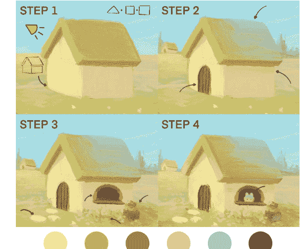

Figure 2.8 – 绘制小房子

你可以使用以下步骤绘制小房子：

- 1. 首先，绘制房屋形状，如图 2.8 中的 *步骤 1* 所示。
- 2. 然后，添加门和阴影等细节，并使用蓝色作为反射光。
- 3. 添加小路、小花、窗户以及房屋周围的任何装饰等细节。
- 4. 最后，为房屋添加你喜欢的任何角色。

### 理解技巧

对于小房子，你可以绘制正方形、矩形和三角形等简单形状作为主要基础。然后，通过在上面添加阴影来调整形状，使其成为三维形状。你可以参考前一图中的 *步骤 1* 寻求指导。一旦房屋基础创建完成，绘制一扇门并添加额外的阴影以形成对比。在屋顶上，你可以添加浅蓝色作为反射光。你可以使用 Procreate 的 **柔光** 混合模式来绘制此效果（*步骤 2*）。屋顶上的反射光之所以产生，是因为光线从蓝天反射并照射到屋顶。添加花园小路、小花、窗户和周围其他装饰等额外细节，使其更生动（*步骤 3*）。最后，添加一个角色为房屋增添一些故事（*步骤 4*）。这将营造出更欢乐宁静的景象。为房屋添加角色纯属可选，并非必需。

## 学习如何绘制绿地

绿地提供了自然而宁静的背景，使整体场景更悦目。绿色常与宁静、祥和和自然相关联。在背景中加入绿地可以帮助传达作品中的特定情绪或氛围，并为绘画增添深度和透视。它有助于营造距离感和空间感，使场景看起来更自然。除此之外，绿地可以通过添加草、花和小房子等各种元素来增强背景场景的视觉美感。由于背景场景中可绘制的形状有限，我们总是担心画出来会显得过于单调乏味。在本演练中，我将分享并创建我的方法，使绿地看起来漂亮有趣。

### 按步骤操作

在进入逐步流程之前，请参考图 2.9 作为指导，以便更有效地跟随演练。

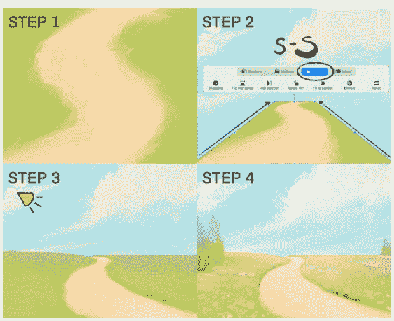

Figure 2.9 – 绘制绿地

你可以使用以下步骤绘制绿地：

- 1. 首先，使用绿色和浅棕色绘制绿地的基础，如图 2.9 中的 *步骤 1* 所示。
- 2. 在绿地图层下方按照 *步骤 2* 中的布局创建明亮的蓝天和柔和的白云。如有需要，可参考之前的云朵教程寻求指导。
- 3. 然后，使用 **扭曲工具** 按照自己的喜好重新塑形绿地。
- 4. 在绿地上添加蓝绿色和黄绿色。
- 5. 最后，添加花朵和树木等细节以完成它。

### 理解技巧

要轻松绘制绿地，你可以先用绿色填充画布，然后在其上使用浅棕色添加一个类似 S 的形状形成道路（*步骤 1*）。然后，进入 Procreate 的设置并使用 **扭曲** 工具重新塑形（*步骤 2*）。这有助于为背景场景增添距离感和透视感。Procreate 中的 **扭曲** 工具是 **变换** 选项的一部分，可让你操纵作品的形状以创建透视效果。要使用它，首先选择要调整的图层并点击 **变换** 按钮。然后，从工具栏中选择 **扭曲** 模式。这将在所选图层周围显示一个边界框。你可以拖动该框的角节点来重新塑形作品，使其产生倾斜或角度效果，模仿三维深度。如你所见，道路的透视和构图可以使用 **扭曲** 工具轻松改变。然后用颜色填充空白区域。在最远处使用浅蓝色，在最近的绿地上使用鲜艳的橄榄色（*步骤 3*）。这是为了在背景场景中营造距离感。最后，添加一些树木和小花以增强整体氛围（*步骤 4*）。最后一步是可选的，完成时添加花朵并非必要。额外细节取决于你希望通过插图表达的情绪或氛围。

## 学习如何绘制湖泊

湖泊常唤起宁静祥和的感觉。加入静止的湖泊或缓缓流动的小溪等元素可以为背景场景营造出宁静祥和的氛围。另一方面，绘制瀑布、波浪拍打岸边或汹涌河流等运动中的水可以为背景场景增添动感和能量。水面反射中出现的反射物体或事物可以增添魅力并吸引观众观看。绘制水可能具有挑战性，尤其是在捕捉水的运动以及知道为湖泊、海等水景使用哪些颜色方面。在本演练中，我们将学习如何为场景添加湖泊，使其看起来自然而宁静。

## 按步骤进行

在进入逐步流程之前，请参考图 2.10 作为指导，以便更有效地跟随演示。

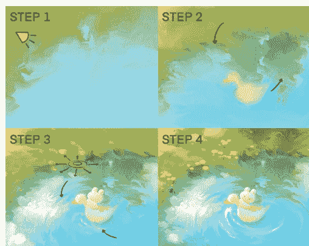

图 2.10 – 绘制湖泊

你可以使用以下步骤绘制湖泊：

- 1. 首先，使用绿色和蓝色绘制水的底色。
- 2. 然后，在水面上添加倒影，并为草地添加一些不同的绿色阴影。可选地，添加一个角色作为主要焦点。我将画一只鸭子和一只兔子作为主要焦点。
- 3. 在角色周围绘制水波纹，然后在水面上添加阴影和额外的倒影。
- 4. 最后，添加一些细节，如小花、高光和阴影来完成它。

## 理解技巧

要重现湖泊场景，请使用绿色和蓝色作为底色填充画布。你可以根据自己的喜好绘制湖泊的形状（步骤 1）。然后，添加不同深浅的绿色，使草地看起来更生动。添加一个角色可以创造一个吸引观众注意力的焦点，这就是我画了鸭子和兔子的原因（步骤 2）。在水面上添加湖边物体的倒影。物体的倒影不需要完美；只要画得与原物足够相似即可。这将帮助观众想象整个场景。在角色周围添加水波纹以营造动感（步骤 3）。请记住，如果在绘制物体倒影的水域添加波纹，倒影的形状会变得扭曲并显得改变。最后，增强湖边周围的细节以完成它。你可以添加诸如花朵、高光和阴影等额外细节来营造对比（步骤 4）。

## 学习如何绘制雪

雪景传达出一种宁静和孤独的感觉，但它也常与冬季和节日季节相关联。在艺术作品中添加雪可以唤起季节性和节日般的感觉，使作品感觉温暖，并显著影响作品的氛围。这取决于你希望通过插图表达什么情感。由于雪地环境中可见的颜色方案有限，很难找到合适的颜色来使用。当我们添加阴影时问题就会出现，我们不确定应该使用什么颜色的阴影来防止它看起来平淡空洞。在本次演示中，我们将学习如何绘制雪季的宁静景象。

## 按步骤进行

在进入逐步流程之前，请参考图 2.11 作为指导，以便更有效地跟随演示。

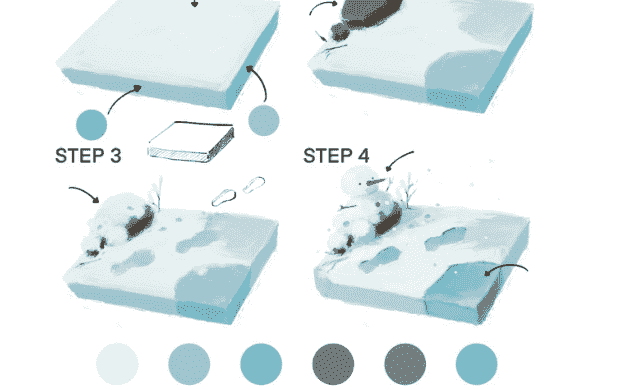

图 2.11 – 绘制雪

你可以使用以下步骤绘制雪：

- 1. 首先，使用三种不同深浅的蓝色为雪绘制底色。
- 2. 然后，添加石头、小树枝和结冰的湖泊等细节，使其看起来更逼真。
- 3. 在步骤 2 中绘制的物体上添加雪。
- 4. 最后，使用鲜艳的蓝色添加雪人、脚印、增强的阴影和反射光等额外细节来完成它。

## 理解技巧

绘制雪可以通过准备三种不同深浅的蓝色并将其用作底色来实现（步骤 1）。然后，添加石头和一些树枝使其更逼真。你可以添加一个冻结的湖泊来增加魅力（步骤 2）。由于这是雪景，请在已绘制的物体上绘制积雪，例如石头（步骤 3）。你可以添加脚印为你的插图增添故事性。这可以帮助观众想象有人可能之前走过，或者有人正在走动寻找柴火。最后，添加诸如雪人等额外细节为氛围增添趣味。通过添加鲜艳的蓝色增强雪的颜色，使颜色更突出（步骤 4）。你可以自由添加任何你喜欢的其他细节来完成它。记住，在艺术中，不必让一切看起来完美，否则插图会显得不自然。以你感觉合适的方式绘制，展现你独特的视野，创作出真正独一无二的插图。

## 了解更多...

你也可以在 Procreate 中使用雪刷使其看起来更逼真并节省时间。如果你希望雪具有更多纹理，可以在 Procreate 中使用纹理刷，例如 Soft Pastel 或 Tamar 刷。

## 总结

本章逐步教你如何绘制美丽的自然风景和日常元素，过程平静愉快。你从柔和的云朵开始，使用柔和的形状和混合使其看起来轻盈蓬松。然后你学习如何绘制树木，专注于简单的树干和树叶，随后添加光影以赋予深度。接下来是草地，短 strokes 和柔和的颜色有助于营造宁静的感觉。在花田部分，你运用形状、颜色和 Warp 工具为场景增添动感。绘制碎石教你如何用岩石和阴影添加逼真的地面纹理，而栅栏则为背景增添魅力与结构。

小房子部分展示了简单形状如何讲述温暖、诱人的故事。然后你学习绘制绿色田野，添加颜色和透视来构建宁静开阔的空间。在湖泊教程中，你使用柔和的倒影和波纹营造宁静祥和的水面场景。最后，你探索雪，通过分层蓝色和细腻细节捕捉雪天的宁静感。每个部分都提醒你，自然细节不必复杂。最重要的是通过形状、光线和纹理表达感受，同时让自己的风格和想象力引领方向。

在下一章中，你将探索如何使用透视为艺术作品带来深度和动感。通过自然透视和线性透视的简单技巧，你将学会让场景感觉更生动、更富有表现力。

## 立即解锁本书的独家福利

扫描此二维码或访问 packtpub.com/unlock，然后按名称搜索本书。

## 精通透视以打造动态场景

在艺术中实现透视需要深入理解何时以及如何使用它。透视可分为两大类：自然透视和线性透视。自然透视涉及根据所见进行绘画，捕捉场景如眼中所见的本质。另一方面，线性透视涉及遵循一套规则来绘制物体，以准确表现其尺寸。许多艺术家发现透视具有挑战性，因为其结构复杂，可能难以在作品中有效应用。然而，掌握透视对于创作逼真艺术作品至关重要。

在本章中，我们将探讨如何将透视有效融入艺术中。我们将学习自然透视和线性透视的概念，并提供逐步指导，说明如何将这些技巧应用于绘画和绘画作品。到本章结束时，你将获得使用透视增强艺术作品所需的信心和技能，使其更具动态性和视觉吸引力。

在漫游的帮助下，我们将涵盖以下主题：

- 如何在背景绘制中应用自然透视
- 如何使用线性透视内置系统
- 如何在真实生活图像中识别线性透视
- 如何在背景插图中实现线性透视技巧

## 如何在背景绘制中应用自然透视

自然透视和线性透视是艺术中为背景绘制添加透视的两种不同技巧。对于自然透视，你将专注于绘制所见之物，而不是遵循某些指导和规则，而对于线性透视，你需要遵循特定指导在背景绘制中添加透视，我们将在本章继续学习。自然透视的目的是按你所见的方式绘制物体。我们可以用几种简单的方法做到这一点，但首先，我们需要了解大气透视、大小透视和细节透视是如何工作的。自然透视起初可能难以使用，但在本章中，我们将学习如何将这些透视技巧应用于背景风景。

**大气透视** 是艺术中用于通过描绘物体随着远离背景而颜色和对比度的变化来创造深度和距离的错觉的技术。例如，远处的物体看起来比近处的物体更亮、更蓝、细节更少。

如果你走动并注意周围环境，你会注意到远处的物体，如房屋、树木和山丘，会显得更苍白，呈紫蓝色。无论物体的真实颜色是什么，当它离你很远时，看起来会有一点紫蓝色。物体越远，看起来就越苍白。

例如，让我们参考以下图示：

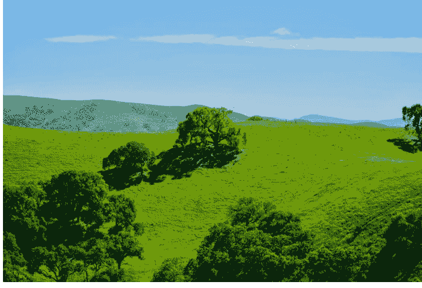

图 3.1 – 大气透视的示例（来源：https://unsplash.com/photos/a-lush-green-hillside-with-trees-and-hills-in-the-background-lbhS3vP_ybY）

我们注意到最近的树木和山丘的颜色比远处的山丘和树木更鲜艳。这是因为你在和物体之间空气中的颗粒物起到了滤镜的作用，导致颜色发生偏移。为我们的背景绘画增添深度最好的方法是使用大气透视法，我们将通过一个简单的逐步绘画过程学习如何在艺术中有效地使用它。

### 按步骤操作

添加大气透视可以按以下方式进行：

1. 在 Procreate 的空白画布中，准备一个带有山丘的简单背景场景。你可以参考图 3.2 或创建自己的背景。

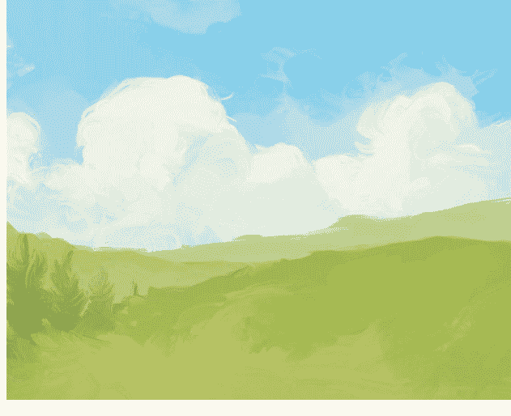

图 3.2 – 山景示例

2. 在图层 1 背景场景上方添加一个新图层。让我们将新图层命名为 Distant Hill 以避免混淆。请查看图 3.3 了解指导。

3. 将新图层的混合模式更改为 **Soft Light.**

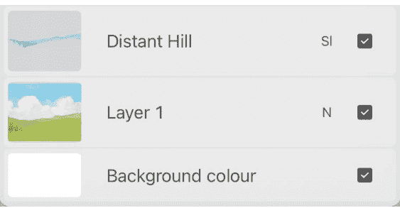

图 3.3 – 图层名称和设置

4. 使用浅蓝色调绘制远处的山丘。如果不确定如何操作，请参考图 3.3 中的 *Distant Hill layer*。

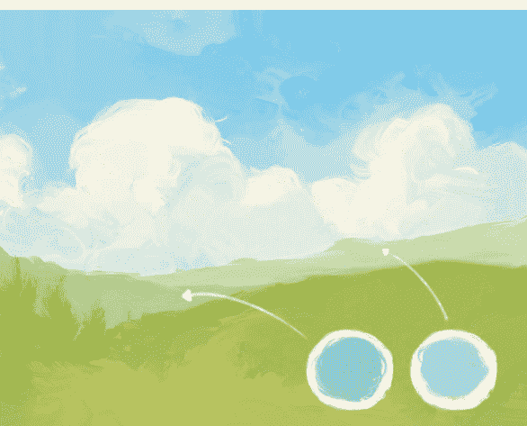

图 3.4 – 绘制远处山丘所用颜色的示例

### 小贴士

你可以通过同时用两根手指轻点 Distant Hill 图层来按自己的喜好更改其不透明度，不透明度滑块将会出现，准备就绪。

图 3.5 显示了为背景场景添加大气透视后的结果。场景看起来更自然、更逼真：

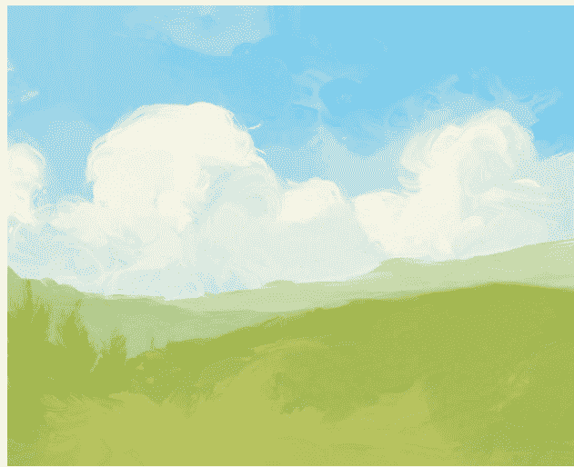

图 3.5 – 添加浅蓝色调以创建大气透视后的山景示例

现在，我们已成功使用不同的颜色值为背景场景添加了大气透视。让我们继续了解其工作原理。

### 理解技巧

绘制逼真背景场景的规则是画出你所看到的并相信自己的眼睛。如果看到物体呈蓝灰色或更淡，就这样画。要在背景场景中重现蓝灰色效果，请使用 Soft Light 混合模式。Procreate 中的 Soft Light 就像你艺术作品的魔法滤镜。它温和地融合颜色，使光照、阴影和氛围看起来更柔和，同时不会压倒你的原始设计。可以把它看作是微妙地调整作品氛围的一种方式，使其感觉更生动。通过这样做，你可以创作出看起来自然逼真的背景绘画。需要记住，并非所有物体看起来都是紫色或蓝灰色，因此在为物体上色时最好使用自己的判断。为背景场景添加大气透视会在插图中创造深度，使其看起来更辽阔。

## 尺寸透视

**Size perspective** 是我们看到或思考某物大小相对于其他事物的方式。它帮助我们了解某物相对于周围环境的大小。例如，当你看一张小动物旁边是巨大建筑的照片时，尺寸透视帮助你意识到那只动物到底有多小。它也适用于物体之间距离的联系。

想象你站着面对一条长路。如果你注意观察道路，你会发现道路离你越远，看起来就越小。通过将远处的物体画得比最近的物体小，你可以在背景场景中增添深度感。这里的建议是相信自己的眼睛，按你所见的方式绘制。如果远处的树看起来更小，就画得更小，即使你知道所有树的大小大致相同。尺寸透视帮助我们更好地理解事物的比例，使背景绘画看起来更逼真。

让我们看一下以下示例：

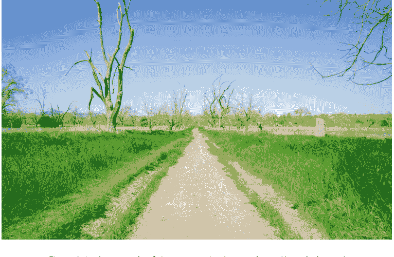

图 3.6 – 尺寸透视的示例（来源：https://unsplash.com/photos/a-dirt-path-in-a-grassy-field-with-dead-trees-ejb7MHasSME）

如图 3.6 所示，道路离你越远就越小越窄。道路的大小可以传达道路的距离；因此，它可以为背景场景引入深度感。树木和其他物体在这种情况下也起着同样的作用。当某物靠近你时，它看起来更大，因为它离你的眼睛近，所以你能看到更多。但当某物离你很远时，它看起来更小，因为它离你的眼睛更远，所以你无法看得那么清楚或详细。这是因为我们的眼睛和大脑理解距离和大小的方式。就像你近距离看到一栋高楼：它看起来巨大，但如果你从远处看同一栋楼，它看起来很小。这帮助我们理解事物有多远以及它们如何融入周围的空间。

接下来，让我们通过执行以下步骤来重现尺寸透视。

### 按步骤操作

添加尺寸透视可以按以下方式进行：

1. 准备纯色色块，如图 3.7 所示。绿色表示草地区域，而浅棕色表示道路。

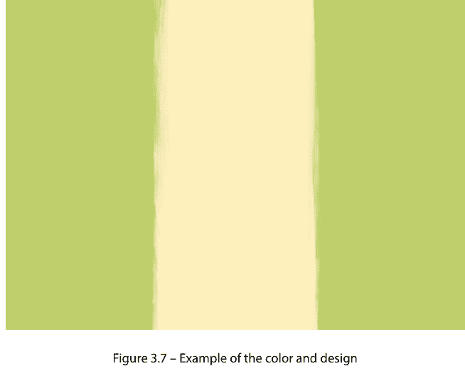

图 3.7 – 颜色和设计的示例

2. 使用 Distort 工具调整道路的形状，如图 3.8 所示。

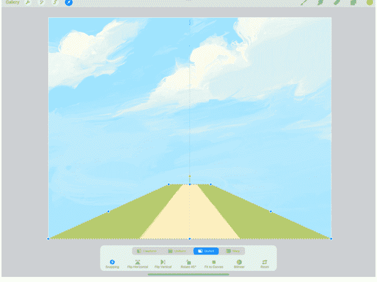

图 3.8 – 使用 Distort 工具的示例

3. 接下来，填充空白并添加一些树木。从大到小绘制它们，如图 3.9 所示。

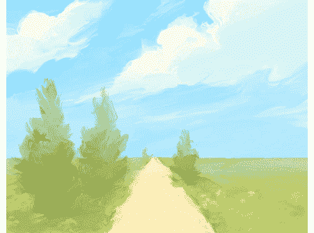

图 3.9 – 使用尺寸透视的最终结果

图 3.9 显示了为背景场景添加尺寸透视后的结果。通过使树木随着远离而变小，我们可以在背景场景中创造深度。在你的绘画中使用尺寸透视有助于引导观众的视线到最重要部分，就像带领他们通过艺术进行一次旅程。它让他们感觉像是在沿着一条小路走向某件特别或重要的事物，在作品中创造出深度和冒险感。

### 理解技巧

添加尺寸透视可以帮助你使背景看起来更逼真，但如果你希望插图更容易理解，并不一定需要在背景场景中添加透视技巧。这更多基于你自己的审美偏好，你可以自由地按自己的喜好绘画。

### 了解更多...

Procreate 的透视工具，如 Drawing Guide，可以帮助你将尺寸透视技巧应用于背景绘画。我们将在本章中进一步探讨这种方法。

## 细节透视

Detail perspective（也称为景深）是指仔细观察某物并专注于其细小部分或特征，而不是看到整体画面。它涉及关注具体细节，如颜色、纹理和形状，这些可以揭示有关整体主要焦点的重要信息。

就像相机一样，我们的眼睛一次只能聚焦于一个物体，而周围的物体变得模糊。如果你手持一支铅笔并聚焦于它，你会注意到周围的物体看起来模糊。这可以帮助显示一个物体的距离，从而帮助你在背景场景中创造透视。Detail perspective 指的是图像中看起来清晰聚焦的部分，而其他区域则故意模糊以创造深度并吸引注意力到特定部分。

例如，让我们看一下以下风景照片：

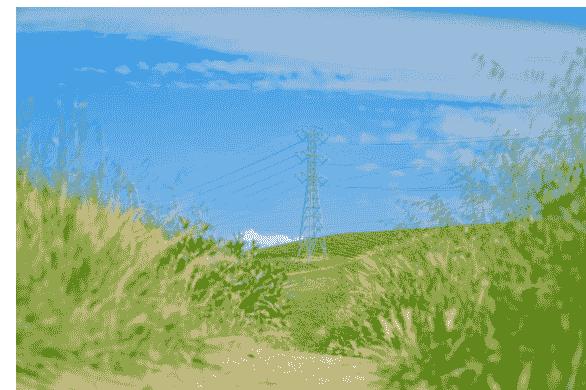

图 3.10 – 显示最近物体与远处焦点物体相比模糊的参考（来源：https://unsplash.com/photos/a-grassy-field-with-a-power-line-in-the-background-21KUVpTNwIQ）

从前面的图中，我们注意到输电线路是焦点；因此最近的草变得模糊不清。如我们所见，与输电线路相比，最近的草失去了细节。这表明我们正在看远处的物体。

让我们在这里看第二个示例：

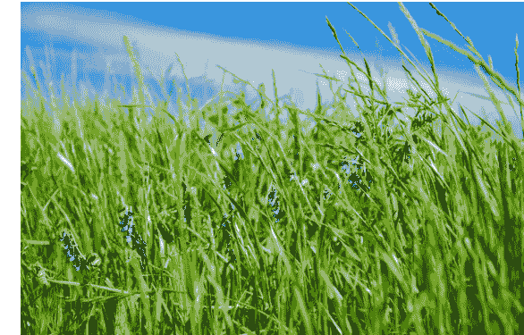

图 3.11 – 显示最近物体比远处物体更清晰的参考（来源：https://unsplash.com/photos/a-field-of-green-grass-with-purple-flowers-7Ulud_NeEzY）

如果我们仔细观察，会发现最近的花朵和草看起来比背景中的更详细。模糊的区域表明背景中的草距离最近的花朵和草很远。它与图 3.10 所示的方法类似，其中最近的物体是模糊的，而远处的物体则更详细。这两种方法都可用于为背景场景增添深度。现在，我将分享一个逐步的细节透视教程，介绍如何在背景场景中使用这种技巧。

## 按步骤操作

添加细节透视可以按以下方式进行：

- 1. 准备一个以兔子为主焦点的背景场景。你可以为背景场景绘制任何你喜欢的内容。

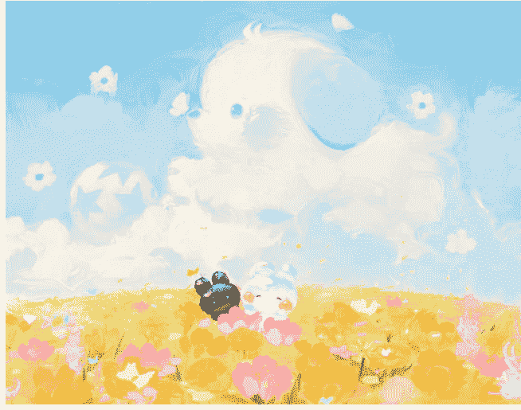

Figure 3.12 – 背景场景插图的示例

- 2. 在单独的图层中添加花朵或草等细节作为前景的主焦点，如图 3.13 所示。

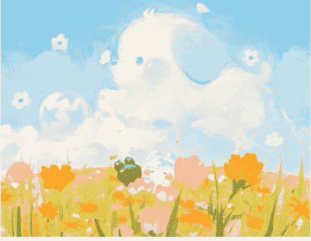

Figure 3.13 – 在前景添加草和花朵的示例

- 3. 然后，对最近细节的图层使用 **Gaussian Blur**，即花朵和草。

图 3.14 显示了我们模糊最近细节后得到的结果：

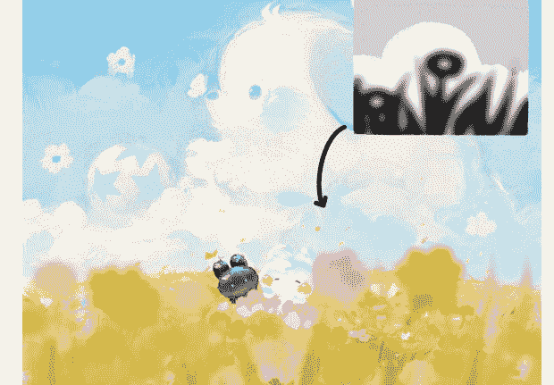

Figure 3.14 – 最近物体被模糊的示例（草和花朵）

- 4. 让我们再次使用 **Gaussian Blur** 模糊背景中的细节，然后为最近的草和花朵添加细节。

图 3.15 显示了我们模糊背景细节后得到的结果：

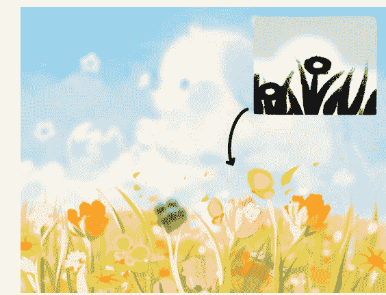

Figure 3.15 – 远处物体被模糊的示例（兔子和云朵）

按步骤操作，我们已成功借助 **Gaussian Blur** 轻松创建了两种不同的细节透视技巧。让我们看看这种方法是如何工作的。

## 理解技巧

如果我们比较图 3.14 和图 3.15，可以看到模糊和朦胧的物体可以营造深度，并在背景场景中增添距离感。如果我们在插图中每个物体的每个部分都添加相同数量的细节，背景场景会失去一些深度，看起来会很平坦。为了便于理解，请想象有前景、中景和背景。选择一个区域作为作品的主要焦点。确定焦点后，选择其他区域进行模糊，以增强对所选主题的聚焦。在 Procreate 中使用 **Gaussian Blur** 使这些部分变柔和并完成效果。**Gaussian Blur** 是一种通过营造柔和的失焦效果来软化并平滑作品部分的工具。它非常适合混合颜色、增加深度或在插图中营造梦幻氛围。你可以使用 Apple Pencil 将其应用于整个图层或特定区域。

使用时，点按 **Adjustments** 菜单（魔术棒图标），选择 **Gaussian Blur**，然后在屏幕上滑动手指以调整强度。确保主要焦点和你打算模糊的物体放置在单独的图层上。这样，调整或编辑会变得更简单、更灵活。

## 如何使用线性透视内置系统

线性透视是一种利用平行线营造细节错觉和深度感的技巧。它可分为三种方法：**one-point perspective**、**two-point perspective** 和 **three-point perspective**。借助 Procreate 的内置设置，我们可以轻松创建一点透视和两点透视。目前，Procreate 尚未提供创建三点透视的内置功能。然而，我将在三点透视部分提供逐步指南，介绍如何手动将此技巧应用于背景绘画。让我们先看看如何使用 Procreate 轻松创建一点透视。

## 一点透视

艺术中的一点透视是一种绘画技巧，通过使用单个消失点在平面上营造深度和空间的错觉。这个消失点通常位于地平线上，场景中所有的平行线似乎都在此处汇聚。在本教程中，我们将学习如何有效地使用 Procreate 的内置一点透视工具。

### 按步骤操作

使用 Procreate 添加一点透视可以按以下方式进行：

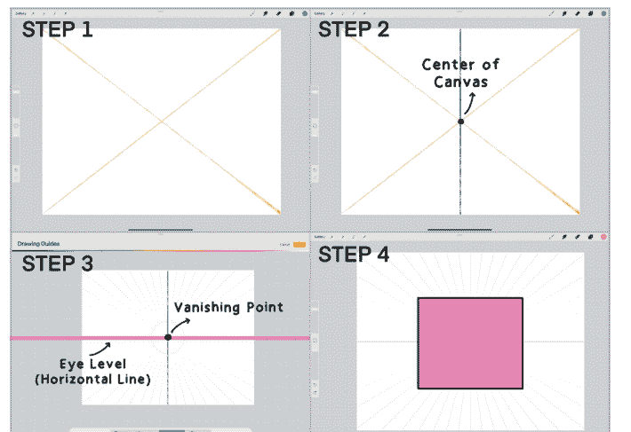

Figure 3.16 – 使用 Procreate 创建一点透视的逐步过程

提示
🔍 快速提示：需要查看此图像的高分辨率版本吗？在新一代 Packt Reader 中打开本书或在 PDF/ePub 副本中查看。
🔒 新一代 Packt Reader 和本书免费的 PDF/ePub 副本已包含在你的购买中。扫描二维码或前往 packtpub.com/unlock，然后使用搜索栏按名称查找本书。仔细核对所示的版本，以确保获取正确的版本。

- 1. 首先，通过从画布的一个角到对角绘制两条对角线来找到画布中心，如图 3.16 中的 STEP 1 所示。
- 2. 然后，在两条线交叉处在画布中间绘制一条垂直线。
- 3. 然后，打开绘图指南并选择透视。点按画布中心，将出现一条水平线。画布中心作为消失点。
- 4. 最后，点按完成，一点透视现在即可使用。

一点透视已为你创建，你现在可以将其用作创建背景场景的指南。让我们继续进行两点透视。两点透视与一点透视略有不同。这种技巧通常用于展示物体的不同角度。

提示
水平线的位置决定了物体的放置位置以及它们在高度和距离方面与观看者视角的关系。它有助于建立作品的整体视点和深度。在 Procreate 中，使用透视指南时，眼平线（水平线）会自动设置，但也可以手动调整。

## 两点透视

艺术中的两点透视是创建绘画深度和立体感的另一种方法。与仅使用单个消失点的一点透视不同，两点透视依赖于放置在地平线上的两个消失点。这两个点用于以角度绘制物体，展示物体在远去时两侧的形态。现在，我们将通过以下步骤学习如何轻松使用 Procreate 的两点透视工具。

### 按步骤操作

使用 Procreate 添加两点透视可以按以下方式进行：

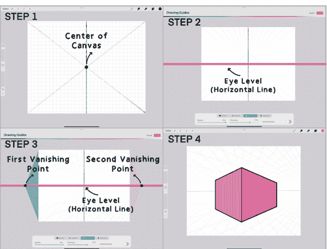

Figure 3.17 – 使用 Procreate 创建两点透视的逐步过程

- 1. 首先，前往 Procreate 的工具栏并打开 **Drawing Guides**。如 Figure 3.16 中的 *STEP 1* 和 *STEP 2* 所示，确定画布中心并绘制延伸线。
- 2. 然后，点按 **Edit Drawing Guide** 并选择 **Perspective** 部分。
- 3. 现在，点按画布中心，将出现一条水平线。为水平线的左右两侧各添加一个消失点。它将如 Figure 3.17 中的 *STEP 3* 所示。
- 4. 最后，点按 **Done**，两点透视现在即可使用。

> **重要提示**
> 这条水平线作为眼平线。水平线的高度将决定物体的放置位置。

两点透视已为你创建，你现在可以将其用作创建背景的指南。

## 三点透视

三点透视使用三个消失点。这些消失点在二维物体中营造出深度的错觉。三点透视的独特之处在于第三个消失点远离眼平线。虽然两个消失点放置在眼平线上，但第三个消失点放置在画布之外，你需要走很远才能找到退缩线的末端。

### 按步骤操作

手动创建三点透视可以按以下方式进行：

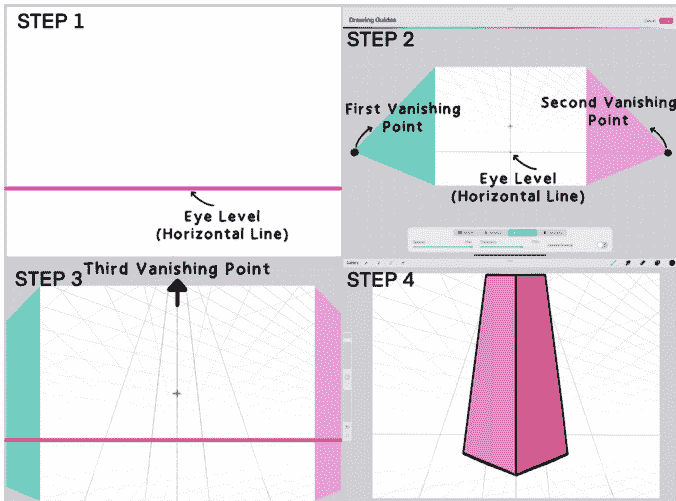

Figure 3.18 – 手动创建三点透视的逐步过程

- 1. 在空白画布上绘制一条直线。这条线作为眼平线（水平线）。
- 2. 找到画布中心，然后添加两个消失点：一个在其左侧，一个在其右侧。
- 3. 在眼平线上方添加一个消失点。线条应如 Figure 3.18 中的 STEP 3 所示。

三点透视已为你创建，你现在可以将其用作创建背景场景的指南。

我们已学习如何使用一点透视、两点透视和三点透视；现在，让我们学习它们的工作原理以及在背景场景中何时使用它们。

## 理解技巧

在一点透视中，你可以根据自己的喜好自由决定视平线的放置位置。Procreate 内置的 **Perspective** 工具使创建透视指南变得简单，无需手动绘制。

对于两点透视，第一和第二消失点之间的距离将决定绘图中物体的大小。如果你将消失点移得更近，透视看起来会更极端或更拉伸。如果你将它们放置得更远，透视看起来会更自然、戏剧性更小。在规划和[content]
## 理解技巧

在一点透视中，你可以根据自己的喜好自由决定视平线的放置位置。Procreate 内置的 **Perspective** 工具使创建透视指南变得简单，无需手动绘制。

对于两点透视，第一和第二消失点之间的距离将决定绘图中物体的大小。如果你将消失点移得更近，透视看起来会更极端或更拉伸。如果你将它们放置得更远，透视看起来会更自然、戏剧性更小。在规划和草拟你的想法时请记住这一点，以便获得准确的比例和透视。

在一点透视和两点透视之间进行选择取决于构图和你想要达到的效果。一点透视适用于观众直视前方场景，例如走廊、街道或房间。它使用单一消失点，营造出简洁和聚焦的感觉，这对于对称或直接的设计非常有效。另一方面，两点透视更适合以角度观看的场景，例如建筑物的拐角或广阔的户外景观。这种透视使用两个消失点，通过展示物体的多面来提供更动态和更逼真的视图。通过仔细选择透视，你可以增强艺术作品的深度和视觉冲击力。

三点透视在我们周围随处可见。通常在我们站在高大建筑或树木前面时就能注意到。

例如，让我们来看一下下面的图示：

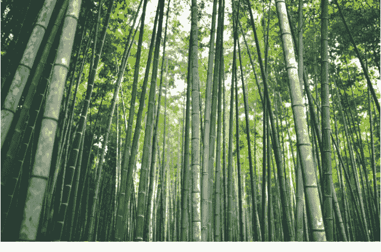

Figure 3.19 – Example of three-point perspective for background scenery (source: https://unsplash.com/photos/low-angle-photography-of-bamboo-trees-O7Fd4L72BkA)

视平线放置在竹子的下部区域；两个消失点放置在视平线线上，而第三个消失点放置在视平线线之上并远离其位置。使用这种方法，我们可以用线的引导轻松创建三维物体。通常在三点透视中绘制的物体放置在视平线之下或之上。就好像我们在看一栋高楼，或站在更高的地方俯视比我们低的建筑。这是在区分我们之前学过的两种透视的更简单方法。由于 Procreate 没有创建三点透视的功能，我们学习了手动方法。

正如我们之前学到的，透视技术作为指南帮助你为背景场景添加深度。不要过分依赖透视指南。你可以根据背景场景的最佳效果自行调整指南。

**Important note**
The **vanishing point** is where parallel lines meet and disappear. **Eye level** is a horizontal line that is parallel to the ground.

## 如何在真实生活图像中识别线性透视

线性透视是一种在平面上创造深度和三维幻觉的方法。通过在地平线上利用消失点，它复制了平行线在远处逐渐消失时似乎汇聚的方式。这种技术有助于描绘逼真的空间，例如风景、室内或城市景观，使其看起来更逼真。有时，很难弄清楚真实生活图像中使用了哪种透视技术。这使得找到水平线和消失点的位置变得棘手。在本演练中，我们将学习在日常图片中识别一点、两点和三点透视的简单方法。我们将从一点透视开始，随着章节的推进逐渐过渡到两点透视和三点透视。这将有助于建立坚实的基础，使理解每种透视变得更容易。

## 在真实生活图像中识别一点透视

你可以通过观察所有平行线在地平线上一个点汇聚的情况来识别现实生活中的一点透视。示例包括将你的注意力引向尽头的长走廊、似乎在远处相遇的铁路轨道、由建筑物框住朝向单一点的城市街道，或朝向远处点的隧道。观察这些元素可以帮助你在日常场景中发现线性透视。在真实生活图像中寻找一点透视的主要问题是确定视平线的位置。本演练将向你展示一种简单、逐步的方法，帮助你轻松识别它并更好地理解一点透视。

## 理解技巧

Figure 3.20 will be used for this walkthrough. You can use any image as long as it resembles the Figure 3.20 composition.

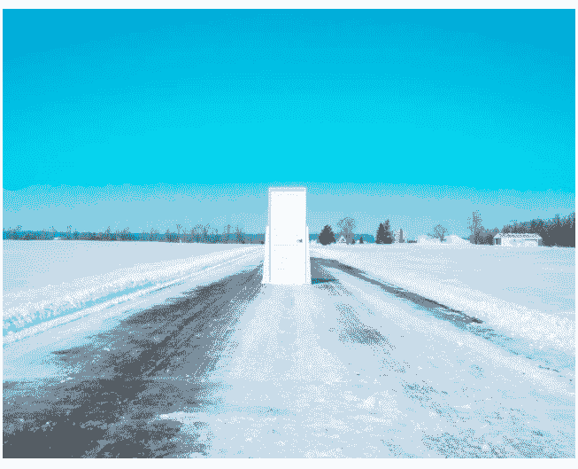

Figure 3.20 – Example of a real-life image (source: https://unsplash.com/photos/white-wooden-house-on-snow-covered-ground-during-daytime-_hBBM5KEzdQ)

让我们一起学习如何在一点透视中找到消失点和视平线（水平线）：

- 1. Identify the eye level by locating where the sky meets the ground in the image. Draw a straight horizontal line across the image, as shown in Figure 3.21.

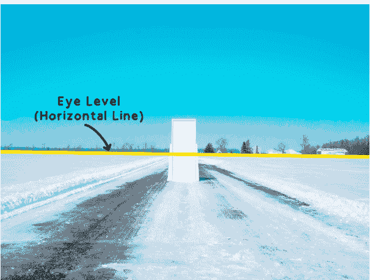

Figure 3.21 – Example of eye level in one-point perspective

- 2. Find the center of the image and mark the point where the eye level intersects this center. This is the vanishing point.

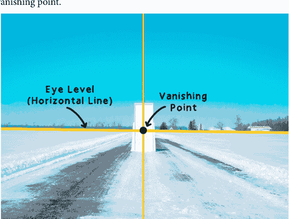

Figure 3.22 – Example of vanishing point in one-point perspective

- 3. Starting from the vanishing point, draw several straight lines radiating outward to create the perspective framework.

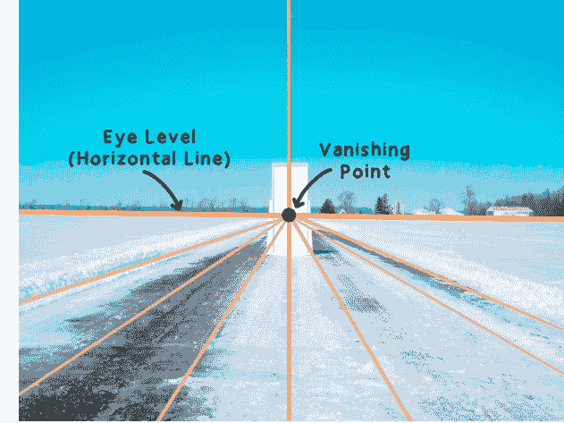

Figure 3.23 – Example of one-point perspective

Now, we have successfully identified the placement of the vanishing point and eye level (horizontal line) in a real-life image, as shown in Figure 3.23. Let us move forward to the next walkthrough, which identifies these in a two-point perspective.

## 在真实生活图像中识别两点透视

你可以通过观察两组平行线在地平线上两个消失点相遇的场景来识别现实生活中的两点透视。例如，在建筑物的拐角处，边缘似乎朝向两个遥远的点倾斜，创造出深度和立体感。这种技术常出现在倾斜的街道或呈对角线放置的家具中。在真实生活图像中寻找两点透视的主要问题是确定第二个消失点的位置。在本演练中，你将学习一种简单、逐步的方法来轻松识别它，使使用两点透视变得更加简单。

## 理解技巧

Figure 3.24 will be used for this walkthrough. You can use any image as long as it resembles the Figure 3.24 composition.

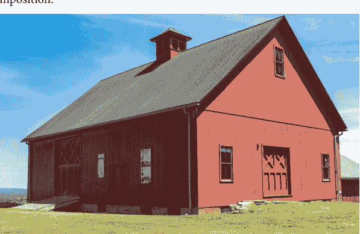

Figure 3.24 – Example of real-life image (source: https://unsplash.com/photos/a-barn-with-a-red-roof-GlcG1J1CFEg)

让我们一起学习如何在两点透视中找到消失点和视平线：

- 1. Start by identifying the main object's shape in the image. Sketch the outline of this shape, as shown in Figure 3.25. Mark the corners of the shape by drawing small circles at each corner for better visualization.
- 2. Once the main shape is defined, resize the image (as illustrated in Figure 3.25) to ensure there is enough space to locate the vanishing points.

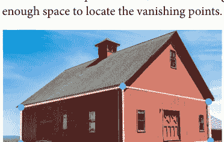

Figure 3.25 – Example of outlined main object and resized image

- 3. Based on the shape you’ve outlined, draw two lines on one side of the object. These lines should converge at a single point on the horizon. This point is referred to as *Vanishing Point 1*.

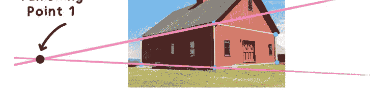

Figure 3.26 – Example of the first vanishing point in two-point perspective

- 4. Repeat the process for the other side of the object, drawing another set of lines that converge at a different point on the horizon. This second point is *Vanishing Point 2*, as shown in Figure 3.27.

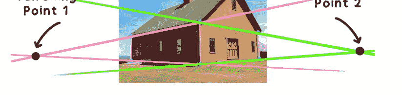

Figure 3.27 – Example of the second vanishing point in two-point perspective

- 5. Finally, draw a straight horizontal line connecting *Vanishing Point 1* and *Vanishing Point 2*. This line represents the eye level, indicating the viewer’s perspective.

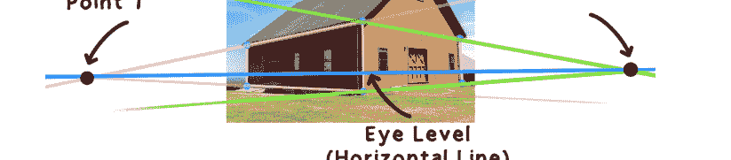

Figure 3.28 – Example of eye level in two-point perspective

我们已成功识别出两点透视中的消失点和视平线。现在，让我们进入下一步，即在三点透视中识别它们。

## 在真实图像中识别三点透视

三点透视展示了我们从极端角度看到物体的方式，例如仰视高楼或从高处俯视。它有三个消失点：两个用于物体的侧面，一个用于其高度。物体的线条会越来越近，似乎在这些点相交。这使得物体看起来更具戏剧性和真实感，尤其是近处物体显得很大而远处物体显得很小的时候。在真实图像中识别三点透视的主要挑战是确定视平线和第三个消失点的位置。在本教程中，我们将探讨一种简单的方法，帮助你准确轻松地定位这些元素。

### 按步骤操作

本教程将使用图 3.29。你可以使用任何图像，只要其构图与图 3.29 相似即可。

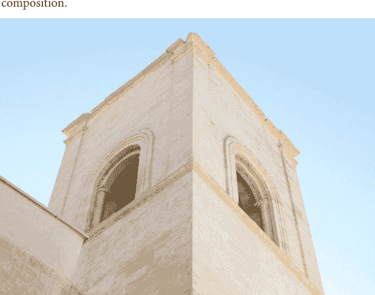

Figure 3.29 – 真实图像示例（来源：https://unsplash.com/photos/a-stone-church-tower-rises-against-a-blue-sky-YagoqWNw0Pg）

让我们一起学习如何在三点透视中找到消失点和视平线：

- 1. 首先在图像中识别主要物体的形状。勾勒出该形状的轮廓，如图 3.30 所示。通过在每个角落画小圆圈来标记形状的角点，以便更好地可视化。
- 2. 主体形状确定后，调整图像大小（如图 3.30 所示），以确保有足够的空间定位全部三个消失点。

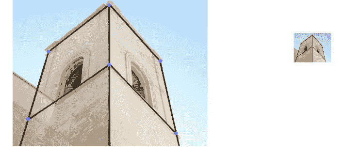

Figure 3.30 – 主体物体轮廓及调整大小后的图像示例

- 3. 现在，从物体的角点添加垂直线，使其收敛于位于地平线之上的第三个消失点。该点被称为 Vanishing Point 3。

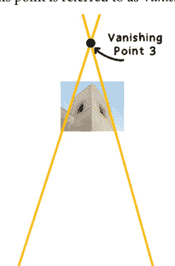

Figure 3.31 – 三点透视中第三个消失点的示例

- 4. 根据你勾勒出的形状，在物体的一侧画两条线，使其在地平线上的一个点相交。该点被称为 Vanishing Point 1。

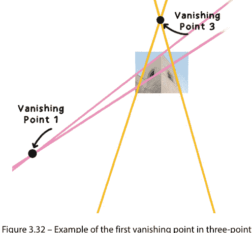

Figure 3.32 – 三点透视中第一个消失点的示例

- 5. 对物体的另一侧重复此过程，画另一组线使其在地平线上的不同点相交。该点为 Vanishing Point 2。

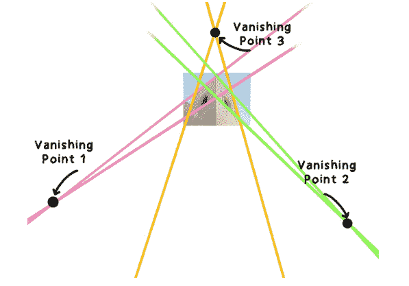

Figure 3.33 – 三点透视中第二个消失点的示例

- 6. 最后，在地平线上画一条直线连接 *Vanishing Point 1* 和 *Vanishing Point 2*。这条线代表视平线，表示观察者的视角。

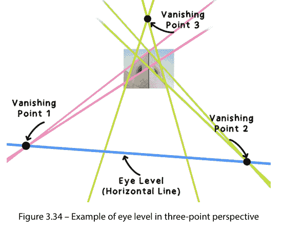

Figure 3.34 – 三点透视中视平线的示例

我们已成功识别出三点透视中的消失点和视平线。

## 理解技巧

了解透视绘画中的消失点和视平线是让你的绘画看起来逼真准确的关键。消失点是绘画中线条相交以表现深度的点，例如道路似乎向远处变窄的方式。视平线是地平线，显示观察者的位置并指导物体位于该线的上方还是下方。

在一点透视中，一切都指向一个消失点，这对于走廊等直观视角非常理想。两点透视使用两个消失点来表现建筑物等角度场景。三点透视增加了戏剧性，展示高或低视角，并使用三个点来保持比例。这些工具帮助艺术家控制深度，使绘画更专业、栩栩如生。

当我们了解如何在真实图片中找到消失点和视平线时，有助于我们在艺术中创作看起来逼真且细节丰富的背景场景。它还能提高我们对透视的理解，使我们能够制作更有趣、更具动感的插图。

> **重要提示**
> 在为你的作品使用多个参考图像时，确保它们都具有相同的视平线至关重要。这能保持绘画的一致性，防止任何不匹配的透视使构图看起来不协调或令人困惑。

## 如何在背景插画中实现线性透视技巧

在本教程中，我们将尝试使用之前学到的所有线性透视方法（一點透視、兩點透視和三點透視）来创作场景。通过遵循以下逐步教程，我们可以更好地理解艺术中的线性透视，并提高为背景场景绘画增添深度的技巧。

## 使用一点透视绘制背景场景

在本教程中，我们将学习如何在背景绘画中有效地应用一点透视。通过遵循这些简单步骤，我们将能够轻松绘制一点透视。

### 按步骤操作

以下步骤将展示如何在铁路场景中使用一点透视：

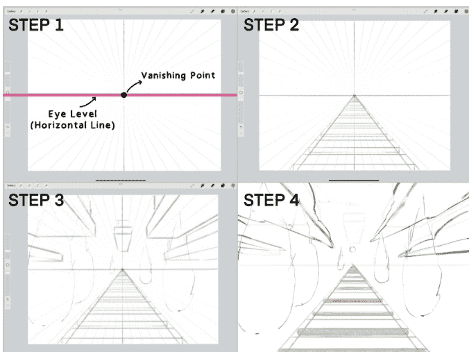

Figure 3.35 – 使用一点透视绘制背景场景的逐步过程

- 1. 在 Procreate 中使用透视和线条设置，画一条直线水平线，如图 3.35 中的 STEP 1 所示。线的高度位置将决定背景场景的深度。水平线越高，深度越远，反之亦然。
- 2. 使用 Procreate 提供的一点透视指南勾勒出铁路。
- 3. 画几棵树和云朵。
- 4. 关闭指南设置并添加一个新图层（Clean Sketch layer）。在此图层中重新绘制并清理草图。

使用一点透视得到的结果如下：

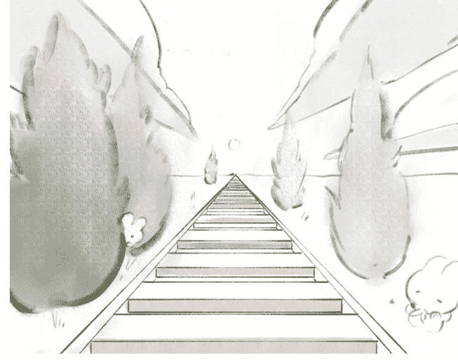

Figure 3.36 – 使用一点透视的最终结果

由于结构简单，使用一点透视是绘制场景最简单的方法。需要注意的是，你不必完全遵循线条；只需将其作为指南来绘制你想要绘制的物体的细节和位置即可。

## 使用两点透视绘制背景场景

在本教程中，我们将学习如何使用两点透视技巧绘制背景场景。通过了解如何使用此技巧，我们可以绘制引人注目的背景画。

### 按步骤操作

这是如何使用两点透视绘制房屋场景：

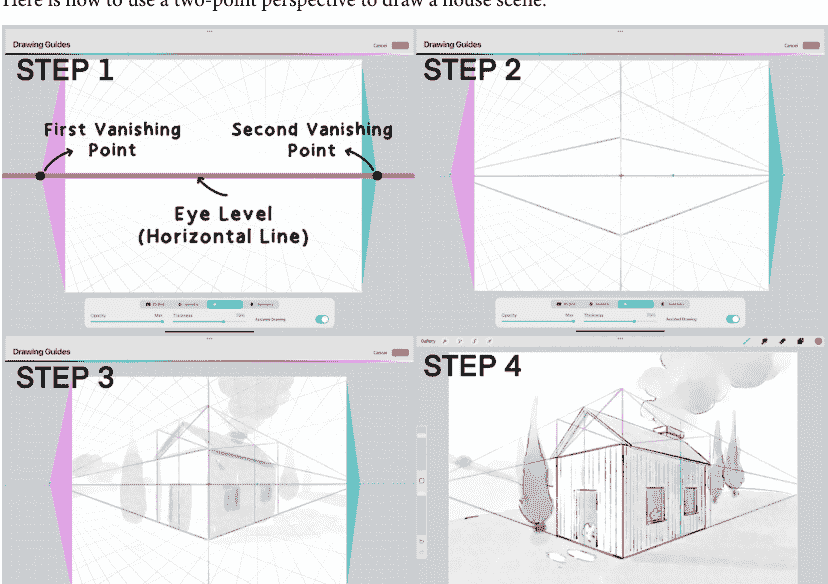

Figure 3.37 – 使用两点透视绘制背景场景的逐步过程

- 1. 在 Procreate 中使用透视和线条设置，画一条直线水平线和两个消失点，如 *Figure 3.37* 中的 *STEP 1* 所示。线的高度位置将决定背景场景的深度。
- 2. 勾勒出从两个消失点发出的几条线，如 *Figure 3.37* 中的 *STEP 2* 所示。这些线应使用 Procreate 的辅助绘图模式绘制，该模式有助于将线条准确吸附到消失点。
- 3. 画几棵树、云朵以及作为主要焦点的房屋。
- 4. 关闭指南设置并添加一个新图层（`Clean Sketch layer`）。在此图层中重新绘制并清理草图。

使用两点透视得到的结果如下：

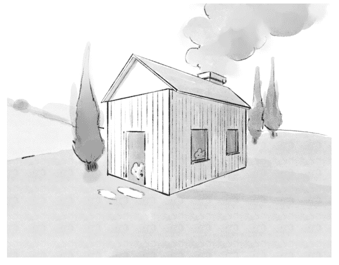

Figure 3.38 – 使用两点透视的最终结果

使用两点透视是为背景场景增添独特视角的有趣方式。由于我们可以改变退缩线的长度，因此可以轻松操纵所绘制物体的大小和透视。

## 使用三点透视绘制背景场景

在本教程中，我们将学习如何在背景绘画中使用三点透视。这种技巧起初可能令人困惑，但通过遵循本逐步教程，我们将学会如何将其应用到我们的艺术中。

## 按照步骤进行

这是如何使用三点透视绘制树木场景的：

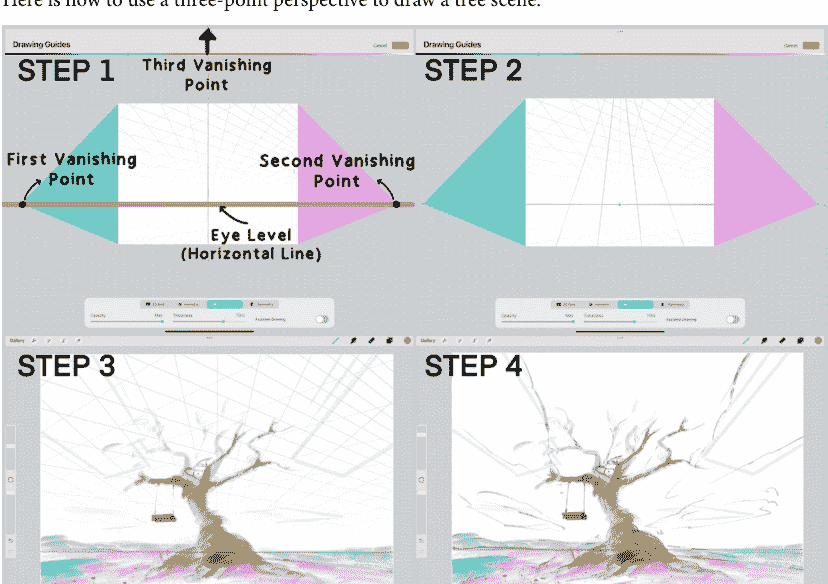

图 3.39 – 使用三点透视绘制背景景色的逐步过程

- 1. 打开绘图指南并按照图 3.39 中的 STEP 1 所示放置两个消失点。第三个消失点将放置在视线水平之上。使用 Procreate 中的线条和透视设置，绘制一条如 STEP 1 所示的水平直线。
- 2. 勾勒出几条指向第三个消失点的线条，如图 3.39 中的 STEP 2 所示。
- 3. 绘制细节，例如以巨大的树木作为主要焦点、草地、碎石和石头。
- 4. 关闭参考线并添加一个新图层。在此图层中，重新绘制并清理草图。

使用三点透视得到的结果如下：

图 3.40 – 使用三点透视的最终结果

在三点透视中，并非所有消失点都位于视线水平上。虽然两个点仍可能与视线水平对齐，但第三个消失点可以位于其上方或下方。这会产生仰视或俯视物体的效果，增加戏剧性的深度，使透视看起来更具动感和真实感。它特别适用于绘制高楼大厦或陡峭的景色！

## 理解技巧

在绘画和使用透视时，并不需要始终遵循严格的规则。大多数时候，你可以依靠自己的眼睛，画出你认为看起来正确的东西。透视规则在你想要创建准确形状时很有帮助，但有时它们可能不适合你想要绘制的内容。透视技巧用于帮助为你的艺术作品增添深度和结构——它们不必完全准确地捕捉每一个细节。相反，它们可以在为创造力和诠释留出空间的同时指导你的艺术方法。如果规则不适用于特定情况，不用担心——你可以跳过它们，只专注于画出你所看到的。最重要的是表达你的愿景并享受过程。艺术不必完美；它只需要让你感觉正确！

## 总结

在本章中，我们温和地迈出一步，学习透视如何为我们的作品带来深度和生命。我们从自然透视开始，专注于描绘我们所看到的。诸如大气透视等技巧向我们展示了远处物体如何显得更亮、更蓝，而大小透视则教我们使远处的元素变小以增加深度。我们还探索了细节透视，它教我们如何通过高斯模糊使某些区域模糊，从而吸引注意力并增加距离感。

接下来，我们使用 Procreate 的内置工具探索线性透视。通过清晰的步骤，我们学习如何使用一点透视来绘制直视的场景，例如道路或走廊；使用两点透视来绘制角度视图，例如建筑物和风景；以及使用三点透视在仰视或俯视高大物体时增加戏剧性。

我们还被展示了如何在真实图像中识别线性透视，这使得理解消失点和视线水平变得更容易。这有助于我们将透视自然地应用到自己的绘画中。

最后，我们在背景插图中练习使用全部三种线性透视技巧，绘制包含铁路、建筑物和树木的场景，以帮助我们自信地使用这些工具。每一遍讲解都提醒我们，透视并非关于严格的规则——而是将其作为指导，同时相信自己的眼睛并画出感觉正确的东西。

## 增强光照以提升你的作品

光线和阴影是艺术中的关键元素，有助于创造深度、立体感和构图精美的作品。为了使我们的作品完整，我们需要知道如何为背景添加高光和阴影。这些元素对于吸引观众的注意力至关重要。良好的光照可以使背景更具吸引力。通过了解光线如何与物体相互作用，我们可以创造出三维效果并引导观众的视线到场景的重要部分。使用高光和阴影还有助于表现纹理、强调物体的形状，并营造场景的氛围或感觉。掌握这些技巧可以使我们的艺术作品更具视觉吸引力和吸引眼球。在本章中，我们将学习如何提高使用光线和阴影绘制背景景色的技能。

在讲解的帮助下，我们将涵盖以下主题：

- 使用真实图像和参考图像观察光线和阴影
- 理解光线和阴影技巧
- 使用光线和阴影描绘宁静的清晨场景
- 使用光线和阴影描绘明亮的午后场景
- 使用光线和阴影描绘温暖的傍晚场景
- 使用光线和阴影描绘宁静的夜晚场景
- 以最简单的方式掌握光照和着色

在开始本章之前，请查看以下重要提示，以确保所有步骤都能顺利进行。这将有助于在整个过程中保持清晰和一致。

> **重要提示**
> 在本章中，所有插图都将使用单独的图层创建，以保持调整的灵活性。图层应命名如下：*草图层*、*干净线稿层*、*对比层*、*底色层*和*最终细节层*。这种结构化的方法确保艺术作品的每个阶段都保持可编辑状态，允许在不影响之前步骤的情况下进行完善。以这种方式保持图层的有序，可以使创作过程更顺畅、更高效。

## 使用真实图像和参考图像观察光线和阴影

观察真实图像和参考照片中的光线和阴影可以帮助我们分析光线如何与不同物体相互作用。我们也能够理解光线和阴影的工作原理，从而帮助我们更有信心地作画。

当我们不确定如何为物体添加光线以及物体的阴影将被投射到何处时，我们经常会遇到障碍。通过研究光线和阴影在不同表面上的表现，我们可以创作出逼真且视觉上吸引人的插图，这正是我们将从本次讲解中学到的内容。

> **提示**
> 在 Procreate 中，你可以添加参考图像来帮助你的作品。点击左上角的扳手图标打开**动作**菜单，然后进入**画布**标签并打开**参考**。一个小窗口会出现，你可以在其中从图库导入图像。你可以在绘画时根据需要移动和调整此窗口的大小。如果你想从参考中选取颜色，使用**吸管**工具。如果你需要多个参考，可以使用**分屏**同时查看多张图像。这使得保持作品的准确性和一致性变得更容易。

## 光线和阴影在光滑表面上的表现

在本次讲解中，我们将学习光线和阴影在光滑表面（如金属）上的工作原理。光滑表面以特殊的方式反射光线，使其在某些区域看起来明亮闪亮，在其他区域则显得黑暗。当光线照射到金属上时，会产生明亮的高光和深邃的阴影。高光和阴影会根据光线来源和强度而变化。为了使金属在艺术作品中看起来逼真，我们需要了解光线如何从表面反射。

## 按照步骤进行

以下步骤将向我们展示如何在光滑表面上引入光线和阴影：

1. 拍摄你周围的景物或附近物体的照片。如果你无法拍照，可以选择你已选定的真实图像进行研究，或使用以下我在此讲解中使用的图像：

图 4.1 – 参考图像（来源：https://unsplash.com/photos/a-yellow-light-house-sitting-on-top-of-a-pier-84vl7X58HMs）

2. 在图像中，找到光线来自何处。如图 4.1 所示，光线来自灯塔的右侧。你可以将相关区域标记为光源。

3. 由于光线来自右侧，阴影在灯塔的左侧形成。

4. 圈出光线照射到物体上的区域以及灯塔投射阴影的区域。

5. 然后，识别灯塔的材料和表面。如图 4.1 所示，灯塔由金属制成，表面光滑发亮。

6. 根据你获得的信息，在参考图像旁边写下描述。你可以这样写下描述：

- 1) 金属由于其反射表面而产生闪亮的照明
- 2) 水泥由于其粗糙表面而产生暗淡的照明
- 3) 光源来自右侧 = 照明在右侧产生
- 4) 阴影投射在左侧，隐藏于光源之外

图 4.2 – 参考图像上描述的示例

我们从本次演练中了解到光线和阴影如何在光滑表面上形成。物体的不同表面会产生不同的绘画照明方式。在接下来的演练中，我们将学习光线和阴影如何在粗糙表面物体（如岩石）上形成。

## 粗糙表面的光线和阴影

在本次演练中，我们将学习光线和阴影在粗糙表面（如岩石）上看起来如何。当光线照射到岩石上时，会产生明亮的光斑和黑暗的阴影。这是因为岩石具有粗糙的纹理，使光线向不同方向散射。

为了让艺术作品中的岩石看起来真实，我们需要了解光线如何与它们的粗糙表面相互作用。我们将学习如何添加高光以显示纹理，并使用阴影为岩石赋予深度和形状。通过正确处理这些细节，我们可以使岩石的绘画看起来更逼真。

### 按照步骤进行

以下步骤将向我们展示如何在粗糙表面（如岩石）上创建光线和阴影：

- 1. 拍摄你周围环境的照片或与之前照片表面不同的物体。你可以使用以下图像，我在本次演练中使用它。
- 2. 从图像中找出光线来自何处。如图 4.3 所示，光线来自岩石的右侧。将该区域标记为光源。
- 3. 由于光线来自右侧，阴影在岩石的左侧形成。
- 4. 圈出光线照射到物体上的区域以及岩石投射阴影的区域。
- 5. 然后，识别岩石的材料和表面。如图 4.3 所示，岩石由矿物组成，因此表面比金属更粗糙、反射性更低。

图 4.3 – 参考图像；来源： https://unsplash.com/photos/shallow-focus-photo-gray-balance-stone-HWRAHxoBlpU

6. 根据我们获得的信息，在参考图像旁边写下描述。你可以这样写描述：

- 1) 岩石由于其粗糙表面而产生暗淡的照明
- 2) 光源来自右侧 = 照明在右侧产生
- 3) 阴影投射在左侧，隐藏于光源之外

图 4.4 – 参考图像上描述的示例

## 理解技巧

通过遵循前面的演练，我们可以更好地理解光线如何在物体上呈现。同时，我们可以学习阴影如何从某些物体投射出来。在图 4.1 中，我们可以看到灯塔的金属表面和下面的水泥反射光线的方式不同。我们可以看到，金属表面的照明比水泥表面更具反射性。这是由表面差异造成的。表面越光滑或越有光泽，反射性就越强。

这两点是在继续为插图添加照明之前我们需要考虑的主要方面。然而，表面不会影响物体投射阴影的密度。它只会改变阴影的形状；阴影的黑暗程度或不透明度不会受到表面差异的影响。我们将在下一个演练中更多地了解这一点。

你的描述文字可以详细到你希望的程度，因为它可以帮助你在决定重新学习之前所写的内容时理解。要深入了解光线和阴影是如何产生的，我建议你制作该演练的多个版本。这样做将有助于你提高分析真实图像中光线和阴影的能力。图像和描述可以保存在一个文件夹中，以便将来重新访问。你也可以将其打印出来，以便快速轻松地访问。

## 理解光线和阴影技巧

光线影响物体的外观，塑造其形态和纹理。通过观察光线如何落在不同表面上，你可以使背景绘画更具趣味性和自然感。当你绘画时，了解光线来自何处以及强度如何有助于让你的作品栩栩如生。明亮的光斑显示光线照射的位置，而阴影有助于定义物体的形状。强光产生清晰的阴影，使事物看起来大胆清晰，而柔光产生柔和的阴影，带来平静梦幻的效果。例如，如果你想强调场景中的一个角色，可以确保最亮的光线落在他们身上，同时保持周围环境昏暗。这种对比会使角色脱颖而出。同样，将强光源放置在关键物体附近会使其显得更重要并立即吸引注意力。

正确使用光线和阴影可以将平面绘画转变为看起来三维的绘画。它使物体看起来更坚实、更逼真，有助于它们自然地融入场景。当为艺术作品添加光线和阴影时，我们经常难以决定阴影应该有多大、看起来有多暗、照明应该有多亮，以及阴影如何从物体投射出来。在本次演练中，我们将学习如何通过使用真实照片作为参考更轻松地添加光线和阴影。我们还将探讨光源强度如何影响绘画中光线和阴影的呈现方式。

### 照明技巧

我们可以使用不同的照明技巧来吸引对绘画重要部分的注意。轮廓光在物体周围创造出发光的轮廓，使其从背景中脱颖而出。聚光将明亮的光线聚焦在主体上，使其成为主要关注点。渐进阴影有助于光线和阴影平滑融合，创造出柔和自然的外观。

### 你需要什么

准备两张真实生活图像：一张显示暗淡光源且没有强烈或明亮照明的图像，另一张显示明亮且强烈的光源。请参考图 4.5 查看柔光源，图 4.7 查看明亮光源。

### 识别柔光源

在本次演练中，我们将学习如何发现柔光源以及它们在物体上产生的阴影。柔光温和均匀，产生边缘模糊的阴影。柔光通常来自大光源，例如阴天天空或透过窗帘的光线。在绘画中使用柔光可以使事物看起来更自然、更真实。它非常适合营造平静祥和的氛围。通过学习柔光和阴影的工作原理，你可以使你的艺术作品看起来平和舒缓。

### 按照步骤进行

通过真实生活图像识别柔光源的光线和阴影可以按以下方式进行：

- 1. 选择任何你喜欢的真实生活图像用于本次演练。你可以使用此图像作为参考：
- 2. 从图 4.5 中，圈出橙子上产生的照明并将其标记为照明区域。
- 3. 然后，圈出橙子投射的阴影并将其标记为阴影区域。
- 4. 查看橙子投射的光线和阴影，并写下光线和阴影的描述和特征。

图 4.5 – 柔光源参考图像；来源： https://unsplash.com/photos/orange-fruit-on-white-textile-AKw62669WW0

5. 通过添加光源的放置位置和强度级别来完成。你可以像以下示例一样完成：

图 4.6 – 柔光源示例描述

现在，我们能够识别和分析柔光源。让我们来看看如何识别明亮光源。

## 识别明亮光源

在本次演练中，我们将研究如何识别明亮光源以及它们在物体上投射的阴影。了解明亮光线对于创建生动而戏剧性的插图至关重要，这些插图能够吸引观众的注意力。

明亮光线，通常称为硬光，其特点是强烈而集中的照明。它产生清晰的阴影和高光，使物体与背景形成清晰对比而脱颖而出。这种类型的照明通常由直接光源产生，例如晴天时的太阳、聚光灯或强人工光。

## 按照步骤进行

通过真实生活图像识别明亮光源的照明和阴影可以按如下方式进行：

- 1. 选择你喜欢的任何真实生活图像作为本次演示。 你可以使用此图像作为参考：
- 2. 在图 4.7 中，圈出橙子上产生的光照并将其标记为光照区域。
- 3. 然后，圈出橙子投射的阴影并将其标记为阴影区域。
- 4. 查看橙子产生的光照和阴影，并写下光照和阴影的描述及特征。
- 5. 通过添加光源的放置位置和强度等级来完成。 你可以按照以下示例完成：

图 4.7 – 明亮光源的参考图像 (来源: https://unsplash.com/photos/orange-fruit-on-white-table-PUMfrQZQffU)

图 4.8 – 明亮光源的示例描述

至此，我们现在了解了明亮光源对物体产生的影响。 我们也知道如何区分柔和光源和明亮光源。

## 理解技巧

在图 4.6 中，我们可以看到橙子上产生的光照和投射的阴影与图 4.8 相比更柔和。 这是因为光源的亮度和距离。 暗淡的光源在橙子上形成了柔和的光照，阴影也更柔和、强度更低。 如果与明亮光源相比，由于阴影的强度和光线的亮度，我们可以快速识别出橙子投射的阴影。 图 4.8 表明光源靠近橙子，且亮度水平高于图 4.6。

我们记住它的最简单方法是如下：

- Duller light source = softer lighting and shadow
- Brighter light source = intense lighting and shadow

另一个需要考虑的事情是光源的 *distance*。 如果光源靠近物体，光照和投射的阴影会很强烈，而如果光源更远，光照和投射的阴影会更柔和。 光源越远，物体投射的阴影边缘越柔和。 让我们看一下图 4.8； 与橙子最远的阴影相比，橙子投射的最近阴影更清晰。

根据光源的不同，光照和阴影的颜色会随着整体配色方案而变化。 为了创作逼真的插图，考虑光源非常重要。 这可能是阳光，也可能是篝火、星星、灯或其他周围灯光等人工光源。 理解这些光源如何与环境相互作用有助于使场景更具真实感。

背景绘制中其他细节发出的光源会在物体上产生反射光。 在艺术中，反射光是指从表面反射并照射到物体阴影区域的光。 当光线从周围物体反射到主体上并在阴影区域内形成微妙的高光时就会发生这种情况。 我们将在本章最后一次演示中学习如何添加反射光。

## 使用光影描绘宁静的清晨场景

我们需要学习如何重现清晨时常见的柔和色调，如柔和的蓝色、粉色和黄色，以营造宁静的清晨场景。 添加太多刺眼的颜色，如深蓝色、红色、绿色等，会影响清晨的氛围。 然而，以上提到的颜色可用于其他场景，如夜间和傍晚氛围。 通过遵循本演示，我们可以轻松营造宁静的清晨氛围。

### 按照步骤进行

为宁静的清晨场景添加光影可以按如下方式进行：

- 1. 勾勒出背景草图并准备清晨配色方案。
- 2. 根据清晨配色方案，为背景场景绘制底色。

图 4.9 – 宁静清晨的底色和配色方案示例

- 3. 确定清晨场景中光源的位置。 我将使用日出作为从背景绘制的下部发出的光源。
- 4. 在背景绘制中为周围物体的下部添加光照。

图 4.10 – 添加光照的示例

- 5. 然后，在背景绘制中为周围物体的隐蔽侧添加阴影。

图 4.11 – 添加阴影的示例

- 6. 最后，根据周围物体和一些细节在主体上添加反射光，以完成清晨背景绘制。 我将使用 Happyyu 画笔包中的 Oil Paint 3 和 Oil Paint 7 为背景绘制添加纹理。

图 4.12 – 宁静清晨的最终插图

至此，你的宁静清晨插图已完成。 现在你可以泡一杯茶，欣赏作品中柔和光照的效果。

### 理解技巧

选择合适的颜色对于绘制清晨场景至关重要，因为它们决定了作品的基调和情绪。 光源的放置和强度对于营造清晨背景同样重要。 清晨时分，光线通常柔和而温柔，为景观投下温暖的光辉。 为了捕捉这种氛围，你应使用包含淡蓝色、柔和粉色、温和橙色和温暖黄色的配色方案。 这些颜色模仿了清晨光线的自然色调，唤起宁静和清新的感觉。

光源的放置也很重要。 清晨时，光线通常来自低角度，例如初升的太阳。 这会产生长而柔和的阴影，为你的绘画增添深度。 通过仔细放置光源，你可以突出场景中的重要部分，例如主要焦点。 阴影通常看起来更冷，因为它们没有直接光照，所以吸收的温暖较少。 一个常见的错误是使阴影过于灰色或黑色，这会使绘画显得平淡。 相反，添加一点蓝色、紫色或柔和的绿色可以使阴影看起来更自然。

## 了解更多...

在 Procreate 中，你可以使用 **Selection** 工具创建精确的阴影效果。 首先，在顶部菜单中点击 **Selection** 工具（S形丝带图标），然后选择 **Freehand** 或 **Automatic** 模式。 勾勒出你想要添加阴影的区域，确保只有所选部分会受到影响。 选择区域后，在底稿上方创建一个新图层以保持阴影分离，这样以后调整起来更方便。 然后，使用柔和的画笔，如喷枪，在所选区域内轻轻涂抹阴影。 调整画笔的不透明度以实现更平滑的融合，并使用 **Multiply** 等混合模式以获得更自然的阴影效果。 为了细化阴影，使用 **Eraser** 工具软化生硬的边缘。

## 小贴士

在 Procreate 中，你可以保存配色方案以保持喜欢的颜色井然有序。 首先，通过点击右上角的颜色圆圈打开 **Color** 面板。 然后，转到面板底部的 **Palettes** 选项卡。 要创建新调色板，点击 + 图标并选择 **Create New**。 你可以使用 **Eyedropper** 工具添加颜色，通过选取一种颜色并点击调色板中的空白色块来保存它。 如有需要，通过点击其名称重命名调色板并重新排列颜色以便更好地组织。 此外，Procreate 允许你通过点击调色板旁边的三个点并选择 **Share** 来导出调色板，这可以让你将其保存到你的文件中。

## 使用光影描绘明亮的午后场景

要创作明亮的午后场景，我们需要关注光源的放置和阳光的强度。 通常，光源会从物体的上方和更高角度照射。 我们需要为光照使用明亮的高光，但必须确保不要过度，否则会掩盖插图的主题或焦点。 通过遵循本演示，我们可以学习如何保持午后氛围的平衡光照并成功绘制背景场景。

### 按照步骤进行

为明亮的午后场景添加光影可以按如下方式进行：

- 1. 勾勒出背景草图并准备午后配色方案。
- 2. 根据午后配色方案，为背景景色绘制底色。

图 4.13 – 明亮午后的底色和配色方案

- 3. 确定午后场景中光源的位置。 我将使用明亮的太阳作为从背景绘制的上部发出的光源。

4. 在背景画中对周围物体的上侧添加光照。

Figure 4.14 – 添加光照

5. 然后，在背景画中为周围物体的隐蔽侧添加阴影。你可以使用剪贴蒙版并在树皮图层上绘制，以使阴影更具可定制性。

Figure 4.15 – 添加阴影

6. 最后，根据周围物体为主要主体添加反射光，并添加一些细节以完成下午背景画。我将使用 **Oil Paint 3** 和 **Oil Paint 7** 来自 Happyyu Brush Pack 为背景画添加纹理。

Figure 4.16 – 明亮下午的最终插图

我们已成功营造出明亮愉悦的下午氛围。有了它，我们现在可以毫不费力地绘制下午景色并保持顺畅的工作流程。让我们继续前进并探索该技巧。

### 理解技巧

下午景色通常非常明亮且充满活力。所有颜色都因阳光的自然光而得到增强。使用 *鲜艳的颜色* 营造下午氛围对于创作逼真的绘画非常重要。你还可以玩转色彩温度，例如通过在调色板中使用更多黄色或橙色色调使其更温暖。对于阴影，由于阳光光线的强度，我们需要将阴影画得更强烈、更清晰。例如，与之前教程中的柔和光照相比，云朵底部的阴影更强烈，我们可以清楚地看到阴影的轮廓。这些是在绘制下午背景画时需要考虑的一些重要事项，但你可以使用任何颜色来描绘自己的下午场景。

## 使用光影描绘温暖的傍晚场景

为了营造温暖的傍晚场景，我们需要使用黄色、橙色和柔和红色等暖色调来唤起温馨的氛围。添加几个柔和的光源可以营造出温柔的傍晚氛围。使用较深的阴影可以营造出强烈的氛围。这是一种营造复杂氛围的好方法，但添加过多的深色阴影可能会掩盖傍晚背景画的整体氛围。按照本教程操作，我们可以营造出温馨的傍晚背景设置。

### 按照步骤操作

为温暖的傍晚场景添加光影可以按以下步骤进行：

- 1. 勾勒出背景画并准备傍晚调色板。
- 2. 根据傍晚调色板，为背景景色绘制底色。

Figure 4.17 – 温暖傍晚的底色和调色板

- 3. 确定傍晚场景的光源位置。我将使用日落作为来自背景画左侧的光源。
- 4. 在背景画中对周围物体的左侧添加光照。

Figure 4.18 – 添加光照

- 5. 然后，在背景画中为周围物体的隐蔽侧添加阴影。

Figure 4.19 – 添加阴影

- 6. 最后，为了完成傍晚背景，基于附近物体为主要主体添加反射光。然后，完善诸如柔和光晕和纹理等细节，使场景感觉自然完整。我将使用 Oil Paint 3 和 Oil Paint 7 来自 Happyyu Brush Pack 为背景画添加纹理。

Figure 4.20 – 温暖傍晚的最终插图

现在，我们可以在作品中有效地营造出温暖的傍晚场景。我们现在可以坐下来欣赏我们创造的诱人场景。

### 理解技巧

使用暖色调，如黄色和橙色，以及柔和的光线可以营造出温馨的氛围。我们需要平衡这些颜色，以防止场景显得过于橙色或过于黄色。你可以使用这些颜色创建渐变，这可以作为傍晚氛围的背景。记得添加柔和的光晕以营造放松且诱人的景色。要添加柔和光晕，你可以使用 blending modes  such as Color Dodge 或 Soft Light。你也可以使用其他颜色，只要它们代表放松的傍晚氛围即可，例如粉色、紫色和柔和的黄色色调。要调整作品中的颜色，请前往 Procreate 中的 Adjustments | Hue, Saturation, Brightness in Procreate。该工具可让你改变颜色的暖冷程度，使其更亮或更暗，并控制颜色的强度。提高 Saturation 会使颜色更鲜艳，降低则会使其柔和。调整 Brightness 有助于平衡光影，使背景景色看起来更自然。

## 使用光影描绘宁静的夜晚场景

为了营造宁静的夜晚场景，我们需要保持整体光源在周围环境的平衡，以确保能够营造出宁静的氛围。添加过多的光线会使夜晚背景画显得有些刺眼，从而失去夜间环境的自然美感。按照本教程操作，通过学习如何有效地添加光影，我们可以营造出令人平静的夜晚氛围。

### 按照步骤操作

为宁静的夜晚场景添加光影可以按以下步骤进行：

- 1. 勾勒出背景画并准备夜间调色板。
- 2. 根据夜间调色板，为背景景色绘制底色。

Figure 4.21 – 宁静夜晚的底色和调色板

- 3. 确定夜间场景的光源位置。我将使用月亮作为来自背景画上部的光源。
- 4. 在背景画中对周围物体的上侧添加光照。

Figure 4.22 – 添加光照

- 5. 然后，在背景画中为周围物体的隐蔽侧添加阴影。

Figure 4.23 – 添加阴影

- 6. 最后，为了完成夜间背景画，请考虑周围物体并融入这些细节，为主要主体添加反射光。我将使用 **Oil Paint 3** 和 **Oil Paint 7** 来自 Happyyu Brush Pack 为背景画添加纹理。

Figure 4.24 – 最终的宁静夜晚插图

通过遵循前面概述的技巧，我们现在能够轻松地创作夜间景色。让我们继续前进，更深入地了解夜间插图的工作原理。

### 理解技巧

创作夜晚氛围是最容易的，因为我们只需要使用两种主要色调，例如蓝色和黄色。对于夜晚氛围，我们需要使用冷色调来描绘宁静的夜晚。你也可以使用暖色来营造温暖的夜晚氛围，例如露营夜晚插图。你可以添加微妙的光源，如星星和萤火虫，以营造宁静的环境。如果你不熟悉使用蓝色和黄色色调，你可以使用任何代表你认为最好的夜晚的颜色。

## 以最简单的方式掌握光影

掌握光影最简单的方法是使用 blending modes such as **Add**、**Multiply** 和 **Soft Light**。**Add** 混合模式可用于光照，而 **Multiply** 可用于阴影。**Screen** 混合模式可用于添加反射光。通常，我们会遇到不确定如何添加阴影以及需要使用什么颜色的问题。通过使用此技巧，我们可以轻松地为绘画添加光照、阴影和反射光。

### 按照步骤操作

添加光照、阴影和反射光可以按以下步骤进行：

- 1. 使用你喜欢的底色绘制角色或任何物体。在本教程中，我将绘制一只黑猫。

Figure 4.25 – 黑猫的底色和线稿

- 2. 添加三个新图层并将它们命名为 `Highlight`、`Shadow` 和 `Reflected Light`。

3. 将三个新图层裁剪到主底色中。图层的顺序应如下所示：

图 4.26 – 高光、阴影和反射光图层

4. 然后，按如下方式更改混合模式：

- **高光**：**添加**混合模式
- **阴影**：**正片叠底**混合模式
- **反射光**：**柔光**混合模式

5. 确定此画面的光源来自何处。我的光源将在黑猫上方。在**阴影**图层上，为被光源遮挡的区域添加阴影。

图 4.27 – 在黑猫上添加阴影

6. 在**高光**图层上，为光源可见的区域添加光线。由于光线来自上方，高光将位于黑猫的上部。

图 4.28 – 为黑猫添加高光

7. 观察周围环境，并在**反射光**图层上为黑猫的下部区域添加反射光。

图 4.29 – 为黑猫添加反射光

8. 将所有图层合并为一个图层以进行渲染。

1) 将反射光、高光和阴影图层合并为一个设计图层

2) 你可以通过捏合想要合并的顶部和底部图层来合并多个图层

图 4.30 – 合并图层

9. 然后，使用模糊工具抚平高光、阴影和反射光的边缘。

图 4.31 – 为黑猫添加反射光

10. 最后，添加一些最终细节，例如黑猫周围的白色高光和星星。以下是按照本教程操作的结果：

图 4.32 – 柔化高光、阴影和反射光的边缘

我们现在已成功使用多种混合模式，即添加、正片叠底和柔光，创作出了一幅完整的光影作品。使用这种技术可以节省更多时间，并确保完成插图的流程顺畅。

## 理解技巧

光线和阴影的投射方式取决于光源的位置，而反射光则取决于周围物体。让我们通过图 4.33、图 4.34 和图 4.35 来了解光线照射到物体时的作用方式：

图 4.33 – 光线来自球体的左侧

光源位于左侧，因此光线在球体表面形成，然后在光线未照射到的区域形成阴影。靠近周围物体或地面的阴影区域会产生反射光。反射光出现在光线遇到物体并反射到附近另一物体时。在这种情况下，你可以看到反射光呈明亮的黄色，因为周围环境是黄色的。如果我们将周围环境改为紫色，反射光将呈现明亮的紫色：

图 4.34 – 背景变化影响反射光

现在回到光源。无论光源位于何处，高光、阴影和反射光都会按顺序出现。一旦我们理解了这一概念，就能轻松添加高光、阴影和反射光。阴影总是在光线出现的相反位置形成。它永远不会与光线并排出现或占据同一区域。

以下是光源位于球体上方和右侧的一些示例：

图 4.35 – 光线来自球体的上侧和右侧

在混合模式的帮助下，我们可以在不花费太多时间寻找合适颜色的情况下添加光线、阴影和反射光。如果你不熟悉这种方法，更喜欢手动寻找颜色，也可以这样做。最好使用你感到舒适的方法。

要绘制复杂的阴影，请观察真实图像，了解光线如何与物体相互作用。阴影的形成基于阻挡光线的物体的形状。例如，在图 4.36 中，花朵形成了细致的阴影，因为花朵形状复杂。

图 4.36 – 物体投射的复杂阴影；来源：https://unsplash.com/photos/pink-and-yellow-flowers-on-white-background-6tmSqG9a1xE

要绘制阴影，只需遵循物体的形状来定义它投射的阴影。阴影会根据光线的强弱和与物体的距离而变化。明亮、近的光源会产生清晰的阴影，而柔和、远的光源则使其模糊。理解这一点可以使绘制阴影变得更容易。通过理解这些原理，你可以创作出自然、准确的阴影，从而增强作品的真实感。

## 了解更多...

为了使阴影和光线看起来自然，请坚持使用一个主要光源。场景中的一切（高光、反射光和阴影）都应遵循该光线方向。

图 4.37 – 来自不同方向的光源和一个主要光源

这能让你的作品看起来更真实，并使物体感觉属于同一个空间。

## 总结

在本章中，我们学习光线和阴影如何为背景带来生命力、氛围和真实感。我们首先观察光线在不同表面上的表现，例如光滑的金属和粗糙的岩石，并使用真实照片来指导我们的理解。这些教程提醒我们，每个表面反射光线的方式不同，为场景赋予独特的质感和深度。

我们探索柔和和明亮的光源：柔和光线营造出平静、模糊的阴影，而明亮光线则投射出大胆、清晰的形状。我们学习如何通过观察识别每种类型，以及它们如何影响绘画中的色彩、氛围和细节。

通过逐步指南，我们创作出四种不同的氛围：清晨宁静的场景，色彩柔和，高光温和；明亮的午后，充满清晰的光线和更锐利的阴影；温暖的傍晚氛围，使用舒适的色调；最后是宁静的夜晚场景，使用冷色调和微妙的光线来反映安静的氛围。

然后我们学习通过使用 Procreate 的混合模式轻松掌握光线：高光使用添加，阴影使用正片叠底，反射光使用柔光。通过有条理地组织图层并深思熟虑地调整光线方向，我们简化了光线、阴影和反射如何协同作用形成自然场景。本章向我们展示，光线不仅仅是技巧，更是感受。光线有助于让绘画看起来更有生命力、充满情感。你不需要做到完美——只需画出你感觉对的东西。

在下一章中，我们将探索色彩理论。我们将学习色彩和谐、明度与对比度如何帮助我们的艺术作品闪耀脱颖而出，使用有用的工具和技巧构建美丽的配色方案，并在过程中自信地将想象力变为现实。

## 立即解锁本书的专属福利

扫描此二维码或访问 packtpub.com/unlock，然后按书名搜索本书。

## 探索色彩理论，打造生动的插画

本章全部关于色彩理论，这对于提升插画水平非常重要。通过学习色彩如何协同作用以及理解对比度，你可以轻松改善艺术作品中的用色。色彩理论帮助艺术家挑选合适的颜色，创作出美丽、引人注目的画面。实现这一点的方法有很多，在本章中，我将向你展示一些简单技巧。这些提示将帮助你快速选择颜色，为作品制作出色的配色方案。到本章结束时，你将知道如何创建自己的配色方案，调整色彩明度使作品更美观，并使用对比度为插画增添深度和趣味。

你将学习不同的配色方案，例如使用一种颜色及其不同色调（单色），色轮上相邻的颜色（类似色），彼此相对的颜色（互补色），以及色轮上均匀分布的三种颜色（三元色）。通过学习这些技巧，你将能够让作品更美观，并在选择颜色时节省时间。让我们开始探索如何使用色彩理论创作出惊艳的插画。

在教程的帮助下，我们将涵盖以下内容：

- 使用 Procreate 创建色彩和谐
- 色彩明度的重要性及其在艺术中的使用方法
- 如何以及何时使用暖色和冷色
- 提升艺术作品的对比度
- 选择随机颜色创建配色方案
- 使用渐变映射创建配色方案
- 在艺术中使用色彩和谐、色彩明度和对比度

在开始本章之前，请先阅读以下重要说明，以确保所有步骤都能顺利进行。这有助于在整个过程中保持清晰和一致。

> **重要说明**
> 在本章中，插图将分层绘制，以保持调整的灵活性。图层应命名如下：*草图图层*、*干净线稿图层*、*对比图层*、*底色图层*和*最终细节图层*。这种结构化的方法确保艺术品的每个阶段都保持可编辑状态，允许在不影响之前步骤的情况下进行完善。以这种方式保持图层有序，使创作过程更顺畅高效。你可以参考*第1章*了解本书使用的画笔。

## 使用 Procreate 创建色彩和谐

**色彩和谐**在艺术中至关重要，因为它使插图在视觉上令人愉悦且引人入胜。当我们观看一件艺术品时，颜色通常是首先吸引我们眼球的东西。这就是为什么实现色彩和谐如此重要。作为插画师，我们经常难以为草图选择合适的颜色，这会让我们感到停滞不前，不确定如何继续。在本教程中，我们将探讨如何轻松找到一个好的配色方案。理解色彩和谐可以显著提升你的作品质量，并使其对观众更具观赏性。有几种有效的方法可以实现色彩和谐，每种方法都提供独特的好处和美感。在本章中，我们将学习四种流行的方法：单色、邻近色、互补色和三角色彩方案。

> **说明**
> 色彩和谐可以唤起不同的感受和情绪。例如，互补色可以营造出令人兴奋和大胆的氛围，而邻近色通常令人平静和谐。

## 创建单色方案

我们现在将学习如何手动使用单色方案轻松创建调色板。

### 按步骤操作

使用单色方案可以按以下方式进行：

- 1. 首先，在 Procreate 上创建一个新画布并选择一个单一的基色。本教程我将使用黄色：

图 5.1 – 黄色基色

- 2. 创建颜色的变体，从浅到深：

图 5.2 – 不同色值的黄色

- 3. 使用这些变体创建一个宁静的调色板：

图 5.3 – 黄色的单色调色板

黄色的单色调色板现已创建。让我们继续学习如何创建邻近色方案。

## 创建邻近色方案

现在，我们将学习如何使用 Procreate 的工具轻松创建邻近色方案的调色板。

### 按步骤操作

使用邻近色方案可以按以下方式进行：

- 1. 首先，在 Procreate 上创建一个新画布并选择一个基色。本教程我将使用浅蓝色。

图 5.4 – 浅蓝色基色

- 2. 使用 Procreate 的色轮系统，在色轮部分点击 Harmony。然后，将设置更改为 Analogous：

图 5.5 – 使用 Procreate 工具更改配色方案设置的示例

- 3. 移动基色，你会注意到另外两种颜色会自动创建并围绕浅蓝色基色跟随。使用取色器保存创建的三种颜色并粘贴到空白画布上：

图 5.6 – 浅蓝色的邻近色调色板

现在已使用 Procreate 调色板工具创建了邻近色方案。让我们继续下一个技巧，即互补色方案。

## 创建互补色方案

接下来，我们将学习如何使用 Procreate 的工具轻松创建互补色方案的调色板。

### 按步骤操作

使用互补色方案可以按以下方式进行：

- 1. 首先，在 Procreate 中创建一个新画布并选择一个基色。本教程我将使用鲜艳的蓝色：

图 5.7 – 蓝色基色

- 2. 使用 Procreate 的色轮系统，在色轮部分点击 **Harmony**。然后，将设置更改为 **Complementary**：

图 5.8 – 使用 Procreate 工具更改配色方案设置的示例

- 3. 移动基色，你会注意到另一种颜色会自动创建并围绕鲜艳的蓝色基色跟随。使用取色器保存创建的两种颜色并粘贴到空白画布上：

图 5.9 – 蓝色的互补色调色板

为你创建了蓝色的互补色调色板。你现在可以将其用于你的设计插图。现在，让我们继续最后一个技巧，即三角色彩方案。

## 创建三角色彩方案

在这里，我们将学习如何使用 Procreate 的工具轻松创建三角色彩方案的调色板。

### 按步骤操作

使用三角色彩方案可以按以下方式进行：

- 1. 首先，在 Procreate 中创建一个新画布并选择一个基色。本教程我将使用浅棕色：

图 5.10 – 浅棕色基色

- 2. 使用 Procreate 的色轮系统，在色轮部分点击 **Harmony**。然后，将设置更改为 **Triadic**。

图 5.11 – 使用 Procreate 工具更改配色方案设置的示例

- 3. 移动基色，你会注意到其他颜色会自动创建并围绕浅棕色基色跟随。使用取色器保存创建的两种颜色并粘贴到空白画布上：

图 5.12 – 浅棕色的三角色彩调色板

至此，我们已为棕色创建了三角色彩调色板。通过使用 Procreate 工具，我们可以为插图创建无限的配色方案。

## 理解技巧

通过遵循传统方法可以实现良好的色彩和谐，这些方法包括单色、邻近色、互补色和三角色彩方案。还有很多其他方法，但这些方法常用于平衡色彩和谐。

单色方案如图 5.3 所示，涉及使用单一颜色的变体。通过选择一个基色并创建该颜色的不同阴影、色调和色相，你可以实现和谐的外观。例如，如果你选择黄色作为基色，你可以创建包含黄色更浅和更深变体的调色板。

邻近色方案如图 5.6 所示，使用色轮上彼此相邻的颜色。这些颜色通常搭配良好，并创造宁静舒适的设计。例如，如果你选择浅蓝色作为基色，你可以创建如浅青色和浅紫色的调色板。

互补色方案如图 5.9 所示，涉及使用色轮上彼此相对的颜色。这些颜色创造出高对比度和鲜艳的外观。例如，如果你选择鲜艳的蓝色作为基色，你可以将其与它的互补色橙色搭配。

最后，三角色彩方案如图 5.12 所示，使用色轮上均匀分布的三种颜色。这创造出平衡且鲜艳的调色板。例如，如果你选择浅棕色作为基色，你可以创建包含青色和紫色等颜色的调色板。

这些方法常用于艺术和设计中创造色彩和谐，有助于提高你的上色技巧。这些是传统创建调色板的示例，但如果你发现使用困难，你可以自由地用自己的方式寻找好的色彩组合。在选择颜色时，相信自己的视觉很重要。如果你找到一个对你来说完美的色彩组合，但它违背了传统方法，那么你不必遵循传统规则。

## 色彩明度的重要性及如何在艺术中使用它

色彩明度在艺术中指的是颜色的明暗程度。它是色彩理论中的一个重要方面，因为它有助于在作品中创造深度和对比。通过调整色彩明度，我们可以突出某些区域，从而帮助吸引观众的注意力去观看你的艺术。我们经常害怕在艺术中添加一点暗色，担心它会影响整体场景。给艺术添加一点黑暗和亮点将使我们能够创造出动态而神秘的插图。在本教程中，我们将学习如何有效地将色彩明度应用于我们的艺术。

### 按步骤操作

在本教程中，我们将学习色彩明度如何影响背景场景的整体情绪和氛围。经常我们不确定如何做到，但通过遵循本教程，我们可以轻松提高色彩明度技巧。

对我们的艺术作品应用色彩明度可以按如下方式进行：

- 1. 如以下图所示，先勾画出背景场景插图：

图 5.13 – 背景场景草图

- 2. 为草图准备简单的底色：

图 5.14 – 无色彩明度的底色示例

- 3. 为了增加插图的深度，将最近和最远的物体涂成较暗的颜色，同时由于光源居中放置，保持中间区域较亮。用偏黑的背景色进行涂色，以在场景中营造出深度和距离感：

图 5.15 – 在背景场景上添加色彩明度的示例

- 4. 最后，如图 5.16 所示，使用正片叠底混合模式为树木的上部添加阴影：

图 5.16 – 为背景场景添加阴影的示例

按照本逐步讲解，我们现在可以轻松地为艺术作品添加色彩明度。让我们来看看色彩明度是如何发挥作用的。

## 理解技巧

在图 5.14 中，我们可以看到插图相比图 5.15 看起来更平淡、更扁平。这是因为我们为背景场景使用的颜色有限。这种上色方式常用于儿童插图中，以便观众轻松理解故事情节。有时，它也用于审美目的，被简约和极简设计所青睐。

由于我们想要创建动态的背景场景，必须使用色彩明度技巧。使用色彩明度，我们可以增加深度并改善氛围。如果直接使用颜色对你来说有点困难，你可以练习使用不同色调的灰色作为上色的指导。你可以参考图 5.34 作为示例。

## 如何以及何时使用暖色和冷色

暖色和冷色调在艺术中起着重要作用。暖色，如红色、橙色和黄色，常与能量、激情和温暖相关联。它们往往显得鲜艳醒目，非常适合用来吸引人们对某些区域的注意。另一方面，冷色，如蓝色、绿色和紫色，唤起宁静、安宁和距离感。它们提供深度和平衡感。了解如何以及何时使用暖色和冷色可以增强作品的情绪和冲击力。

## 应用暖色调

在本讲解中，我们将学习如何使用和应用暖色调来增强背景场景。通过本讲解，我们将学习如何在背景中使用这些暖色调来营造[content]
对我们的艺术作品应用色彩明度可以按如下方式进行：

- 1. 如以下图所示，先勾画出背景场景插图：

图 5.13 – 背景场景草图

- 2. 为草图准备简单的底色：

图 5.14 – 无色彩明度的底色示例

- 3. 为了增加插图的深度，将最近和最远的物体涂成较暗的颜色，同时由于光源居中放置，保持中间区域较亮。用偏黑的背景色进行涂色，以在场景中营造出深度和距离感：

图 5.15 – 在背景场景上添加色彩明度的示例

- 4. 最后，如图 5.16 所示，使用正片叠底混合模式为树木的上部添加阴影：

图 5.16 – 为背景场景添加阴影的示例

按照本逐步讲解，我们现在可以轻松地为艺术作品添加色彩明度。让我们来看看色彩明度是如何发挥作用的。

## 理解技巧

在图 5.14 中，我们可以看到插图相比图 5.15 看起来更平淡、更扁平。这是因为我们为背景场景使用的颜色有限。这种上色方式常用于儿童插图中，以便观众轻松理解故事情节。有时，它也用于审美目的，被简约和极简设计所青睐。

由于我们想要创建动态的背景场景，必须使用色彩明度技巧。使用色彩明度，我们可以增加深度并改善氛围。如果直接使用颜色对你来说有点困难，你可以练习使用不同色调的灰色作为上色的指导。你可以参考图 5.34 作为示例。

## 如何以及何时使用暖色和冷色

暖色和冷色调在艺术中起着重要作用。暖色，如红色、橙色和黄色，常与能量、激情和温暖相关联。它们往往显得鲜艳醒目，非常适合用来吸引人们对某些区域的注意。另一方面，冷色，如蓝色、绿色和紫色，唤起宁静、安宁和距离感。它们提供深度和平衡感。了解如何以及何时使用暖色和冷色可以增强作品的情绪和冲击力。

## 应用暖色调

在本讲解中，我们将学习如何使用和应用暖色调来增强背景场景。通过本讲解，我们将学习如何在背景中使用这些暖色调来营造[content]
对我们的艺术作品应用色彩明度可以按如下方式进行：

- 1. 如以下图所示，先勾画出背景场景插图：

图 5.13 – 背景场景草图

- 2. 为草图准备简单的底色：

图 5.14 – 无色彩明度的底色示例

- 3. 为了增加插图的深度，将最近和最远的物体涂成较暗的颜色，同时由于光源居中放置，保持中间区域较亮。用偏黑的背景色进行涂色，以在场景中营造出深度和距离感：

图 5.15 – 在背景场景上添加色彩明度的示例

- 4. 最后，如图 5.16 所示，使用正片叠底混合模式为树木的上部添加阴影：

图 5.16 – 为背景场景添加阴影的示例

按照本逐步讲解，我们现在可以轻松地为艺术作品添加色彩明度。让我们来看看色彩明度是如何发挥作用的。

## 理解技巧

在图 5.14 中，我们可以看到插图相比图 5.15 看起来更平淡、更扁平。这是因为我们为背景场景使用的颜色有限。这种上色方式常用于儿童插图中，以便观众轻松理解故事情节。有时，它也用于审美目的，被简约和极简设计所青睐。

由于我们想要创建动态的背景场景，必须使用色彩明度技巧。使用色彩明度，我们可以增加深度并改善氛围。如果直接使用颜色对你来说有点困难，你可以练习使用不同色调的灰色作为上色的指导。你可以参考图 5.34 作为示例。

## 如何以及何时使用暖色和冷色

暖色和冷色调在艺术中起着重要作用。暖色，如红色、橙色和黄色，常与能量、激情和温暖相关联。它们往往显得鲜艳醒目，非常适合用来吸引人们对某些区域的注意。另一方面，冷色，如蓝色、绿色和紫色，唤起宁静、安宁和距离感。它们提供深度和平衡感。了解如何以及何时使用暖色和冷色可以增强作品的情绪和冲击力。

## 应用暖色调

在本讲解中，我们将学习如何使用和应用暖色调来增强背景场景。通过本讲解，我们将学习如何在背景中使用这些暖色调来营造[content]
对我们的艺术作品应用色彩明度可以按如下方式进行：

- 1. 如以下图所示，先勾画出背景场景插图：

图 5.13 – 背景场景草图

- 2. 为草图准备简单的底色：

图 5.14 – 无色彩明度的底色示例

- 3. 为了增加插图的深度，将最近和最远的物体涂成较暗的颜色，同时由于光源居中放置，保持中间区域较亮。用偏黑的背景色进行涂色，以在场景中营造出深度和距离感：

图 5.15 – 在背景场景上添加色彩明度的示例

- 4. 最后，如图 5.16 所示，使用正片叠底混合模式为树木的上部添加阴影：

图 5.16 – 为背景场景添加阴影的示例

按照本逐步讲解，我们现在可以轻松地为艺术作品添加色彩明度。让我们来看看色彩明度是如何发挥作用的。

## 理解技巧

在图 5.14 中，我们可以看到插图相比图 5.15 看起来更平淡、更扁平。这是因为我们为背景场景使用的颜色有限。这种上色方式常用于儿童插图中，以便观众轻松理解故事情节。有时，它也用于审美目的，被简约和极简设计所青睐。

由于我们想要创建动态的背景场景，必须使用色彩明度技巧。使用色彩明度，我们可以增加深度并改善氛围。如果直接使用颜色对你来说有点困难，你可以练习使用不同色调的灰色作为上色的指导。你可以参考图 5.34 作为示例。

## 如何以及何时使用暖色和冷色

暖色和冷色调在艺术中起着重要作用。暖色，如红色、橙色和黄色，常与能量、激情和温暖相关联。它们往往显得鲜艳醒目，非常适合用来吸引人们对某些区域的注意。另一方面，冷色，如蓝色、绿色和紫色，唤起宁静、安宁和距离感。它们提供深度和平衡感。了解如何以及何时使用暖色和冷色可以增强作品的情绪和冲击力。

## 应用暖色调

在本讲解中，我们将学习如何使用和应用暖色调来增强背景场景。通过本讲解，我们将学习如何在背景中使用这些暖色调来营造一个[content]
对我们的艺术作品应用色彩明度可以按如下方式进行：

- 1. 如以下图所示，先勾画出背景场景插图：

图 5.13 – 背景场景草图

- 2. 为草图准备简单的底色：

图 5.14 – 无色彩明度的底色示例

- 3. 为了增加插图的深度，将最近和最远的物体涂成较暗的颜色，同时由于光源居中放置，保持中间区域较亮。用偏黑的背景色进行涂色，以在场景中营造出深度和距离感：

图 5.15 – 在背景场景上添加色彩明度的示例

- 4. 最后，如图 5.16 所示，使用正片叠底混合模式为树木的上部添加阴影：

图 5.16 – 为背景场景添加阴影的示例

按照本逐步讲解，我们现在可以轻松地为艺术作品添加色彩明度。让我们来看看色彩明度是如何发挥作用的。

## 理解技巧

在图 5.14 中，我们可以看到插图相比图 5.15 看起来更平淡、更扁平。这是因为我们为背景场景使用的颜色有限。这种上色方式常用于儿童插图中，以便观众轻松理解故事情节。有时，它也用于审美目的，被简约和极简设计所青睐。

由于我们想要创建动态的背景场景，必须使用色彩明度技巧。使用色彩明度，我们可以增加深度并改善氛围。如果直接使用颜色对你来说有点困难，你可以练习使用不同色调的灰色作为上色的指导。你可以参考图 5.34 作为示例。

## 如何以及何时使用暖色和冷色

暖色和冷色调在艺术中起着重要作用。暖色，如红色、橙色和黄色，常与能量、激情和温暖相关联。它们往往显得鲜艳醒目，非常适合用来吸引人们对某些区域的注意。另一方面，冷色，如蓝色、绿色和紫色，唤起宁静、安宁和距离感。它们提供深度和平衡感。了解如何以及何时使用暖色和冷色可以增强作品的情绪和冲击力。

## 应用暖色调

在本讲解中，我们将学习如何使用和应用暖色调来增强背景场景。通过本讲解，我们将学习如何在背景中使用这些暖色调来营造一个[content]
对我们的艺术作品应用色彩明度可以按如下方式进行：

- 1. 如以下图所示，先勾画出背景场景插图：

图 5.13 – 背景场景草图

- 2. 为草图准备简单的底色：

图 5.14 – 无色彩明度的底色示例

- 3. 为了增加插图的深度，将最近和最远的物体涂成较暗的颜色，同时由于光源居中放置，保持中间区域较亮。用偏黑的背景色进行涂色，以在场景中营造出深度和距离感：

图 5.15 – 在背景场景上添加色彩明度的示例

- 4. 最后，如图 5.16 所示，使用正片叠底混合模式为树木的上部添加阴影：

图 5.16 – 为背景场景添加阴影的示例

按照本逐步讲解，我们现在可以轻松地为艺术作品添加色彩明度。让我们来看看色彩明度是如何发挥作用的。

## 理解技巧

在图 5.14 中，我们可以看到插图相比图 5.15 看起来更平淡、更扁平。这是因为我们为背景场景使用的颜色有限。这种上色方式常用于儿童插图中，以便观众轻松理解故事情节。有时，它也用于审美目的，被简约和极简设计所青睐。

由于我们想要创建动态的背景场景，必须使用色彩明度技巧。使用色彩明度，我们可以增加深度并改善氛围。如果直接使用颜色对你来说有点困难，你可以练习使用不同色调的灰色作为上色的指导。你可以参考图 5.34 作为示例。

## 如何以及何时使用暖色和冷色

暖色和冷色调在艺术中起着重要作用。暖色，如红色、橙色和黄色，常与能量、激情和温暖相关联。它们往往显得鲜艳醒目，非常适合用来吸引人们对某些区域的注意。另一方面，冷色，如蓝色、绿色和紫色，唤起宁静、安宁和距离感。它们提供深度和平衡感。了解如何以及何时使用暖色和冷色可以增强作品的情绪和冲击力。

## 应用暖色调

在本讲解中，我们将学习如何使用和应用暖色调来增强背景场景。通过本讲解，我们将学习如何在背景中使用这些暖色调来营造一个The user wants translation. The output should be in [content]...
按照本教程，我们现在可以在作品中营造出良好的对比。让我们继续深入了解这些技巧。

## 理解技巧

对比关系到背景艺术构图的差异，如颜色、明度、大小和纹理。要增强作品的对比度，可以使用不同的明暗色值来营造深度，改变元素的大小以产生尺度感，并混合不同的纹理来吸引人们对艺术的注意。

在图 5.27 中，我们的眼睛会立即被吸引到插图的中心，因为该区域被突出显示。前后较暗的颜色赋予插图深度，使其看起来房间更长并分为三个部分。如果我们将图 5.25 与图 5.27 进行比较，可以看到图 5.27 具有更好的氛围和构图。改变高光的位置也会改变插图的氛围。让我们在这里看一个关于不同高光放置位置的示例：

图 5.28 – 高光不同放置位置的示例

如图 5.28 所示，与图 5.27 相比，改变插图的高光放置位置或焦点会产生更神秘的效果。较暗的区域唤起了一种隐藏含义的感觉，营造出一种诡异的氛围。这种方法吸引观众的注意力，鼓励他们深入探索作品的故事，从而增强艺术的叙事性。在进行上色之前，建议先确定对比度，以便在上色过程中获得更顺畅的工作流程。

## 选择随机颜色创建配色方案

在艺术中选择颜色涉及理解色彩理论并将其应用于创建视觉上吸引人且和谐的构图。我们在选择颜色时常常感到困难，并担心它们是否相互搭配。通常，我们会使用传统方法，如使用单色方案、三色方案等来创建和谐的配色方案。在本教程中，我们将学习如何在不使用传统方法的情况下创建自己的配色方案。按照本教程，我们可以在创建配色方案时获得更大的自由度。

## 按照步骤进行

在本教程中，我们将了解如何在不依赖传统方法寻找适合作品的颜色组合的情况下创建自己的配色方案。按照这些步骤，我们将更好地理解色彩理论，并在创建调色板时更有信心。

通过选择随机颜色创建配色方案可以按如下方式进行：

- 1. 画一个形状或角色剪影；可以是你喜欢的任何东西。我将在本教程中画一只兔子（图 5.29 中的步骤 1）。
- 2. 选择一种颜色开始创建你的调色板。我将使用粉色作为第一种颜色（步骤 2）。
- 3. 然后，选择第二种颜色。我将使用蓝色，如步骤 3 所示。
- 4. 开始混合随机颜色，直到对整体颜色结果满意为止（步骤 4）。

图 5.29 – 使用此方法创建的配色方案

- 5. 将颜色按图 5.30 所示排列，确保它们准备好导入到 Procreate 调色板中。

图 5.30 – 使用此方法创建的配色方案

- 6. 最后，将其导入 Procreate 中的调色板。要详细了解如何访问调色板工具，请参阅图 5.31：

将配色方案保存为 JPEG。然后进入调色板并点击“从照片新建”以将配色方案上传到 Procreate。

配色方案现在可以使用了，尽情享受！ :)

图 5.31 – 使用此方法创建的配色方案

Tip
🔍 **Quick tip:** 需要查看此图像的高分辨率版本吗？在新一代 Packt Reader 中打开本书或在 PDF/ePub 副本中查看。
🔒 **新一代 Packt Reader** 和本书的 **免费 PDF/ePub 副本** 已包含在您的购买中。扫描二维码或前往 packtpub.com/unlock，然后使用搜索栏按名称查找本书。请仔细核对所示版本，以确保获得正确的版本。

一个新颖独特的配色方案已为您创建。我们现在可以用它来创建独一无二的设计插图。

## 理解技巧

随机选择颜色并对其进行实验可以带来出乎意料且独特的颜色组合。这种方法允许更直观和创造性的过程，你可以相信自己的直觉并看看它会带你去哪里。通过远离传统的配色方案和方法，你可以为自己打开更多可能性，发现使用颜色在作品中创造新颖和令人兴奋的方式。

当你随机选择颜色时，你可能会偶然发现以前从未考虑过的组合。这可以为你的作品增添新鲜和新颖的元素，使其脱颖而出。此外，这种方法鼓励你创造性地思考。由于它允许你在无需遵循色彩理论传统方式的情况下进行探索和实验，因此这可以是一次有趣的体验。

相信你的直觉，自由混合颜色，不要害怕随意尝试颜色。你可能会对通过随机选择和实验所能取得的独特成果感到惊讶。

## 了解更多...

要在 Procreate 中从图像创建配色方案，首先将图像导入应用程序。然后打开 **Colors** 面板并点击 + 按钮。选择 **New from photos** 并选择你的图像，让 Procreate 根据图像中检测到的颜色自动生成调色板。这是从参考中获取配色方案的一种快速有效的方法。

## 使用渐变映射创建配色方案

在之前的教程中，我们学习了如何通过选择随机颜色来创建配色方案。有些人可能会觉得之前的技巧更困难。在本教程中，我们将学习如何使用渐变映射工具轻松快速地创建配色方案。

## 按照步骤进行

在本教程中，我们将学习如何在 Procreate 中使用渐变工具创建配色方案。在 Procreate 中使用渐变创建配色方案可以是一种有趣且富有创造性的过程。按照本逐步教程，我们可以轻松为我们的艺术创作无限的配色方案。

使用 Procreate 渐变映射工具创建配色方案可以按如下方式进行：

- 1. 勾勒出背景场景并用不同色调的灰色填充背景：

图 5.32 – 添加颜色值的示例背景艺术

- 2. 然后，进入 **Gradient** 工具，你会看到 **Gradient Library** 面板弹出在屏幕上。点击 + 符号，一组灰色区域将会出现。
- 3. 然后，在每个灰色方块区域上，将其更改为新的颜色以满足你自己的喜好。你可以添加灰色区域以获得更多配色方案选择。

图 5.33 – 在 Procreate 中使用渐变映射工具的示例

- 4. 修改颜色后，通过点击 **Done** 完成。这将保存你的渐变设置。

图 5.34 – 使用渐变映射工具的最终结果

在 Procreate 中借助 **Gradient Map** 工具，我们可以为我们的艺术创作无限的配色方案。我们现在可以坐下来享受 Procreate 中这个很酷的功能来创建配色方案。

## 理解技巧

使用 Procreate 中的 **Gradient Map** 工具可以高效地创建各种配色方案，使过程更快更方便。这种方法节省时间，因为它消除了手动调色的需要。要使用此方法，首先用不同深浅的灰色填充背景。一旦你有了灰度背景，就应用 **Gradient Map** 工具。

**Gradient Map** 工具会根据你选择的渐变将灰度转换为多样化的颜色。这种技术让你可以尝试各种配色方案，并在无需手动混合颜色的麻烦下找到作品的完美调色板。通过使用 **Gradient Map** 工具，你可以改进工作流程并轻松创建配色方案。

## 在艺术中使用色彩和谐、色彩明度与对比度

理解并应用色彩和谐、色彩明度与对比度可以显著提升你的作品。色彩和谐指的是作品中色彩的悦目搭配，而色彩明度是指色彩的明暗程度。对比度指的是构图元素之间的差异，如色彩、明度、大小和纹理。将这些技巧全部应用到我们的艺术创作中，可以营造出动感且吸引人的背景。我们在之前的逐步教程中学习了所有这些方法，但我们可能会遇到如何将它们全部应用到艺术创作中的问题。在本教程中，我们将学习如何使用它们来创建一个简单快捷的背景场景，可用于作品集。

## 按照步骤进行

在本教程中，我们将学习如何添加对比度、平衡色彩明度，并确保拥有和谐的配色方案。通过理解和应用这些方法，你可以创作出充满活力且美妙的背景艺术。

应用色彩和谐、色彩明度与对比度可以按以下方式进行：

- 1. 首先绘制背景轮廓，并在两个独立图层上使用多种灰色调进行上色。接下来，用更亮更明亮的灰色调突出主要主体（兔子）：

图 5.35 – 添加色彩明度后的背景艺术示例

- 2. 接下来，在 Procreate 中打开 **渐变映射** 工具，并根据自己的喜好修改颜色。你可以参考 *图 5.33* 了解如何访问 **渐变映射** 工具。修改颜色后，通过点击 **完成** 来最终确定：

图 5.36 – 使用渐变映射生成的调色板

- 3. 使用 **变暗** 混合模式图层对背景插图中对象进行上色。这将帮助你在不影响之前创建的阴影和配色方案的情况下进行绘画。你可以参考 *图 5.40* 了解图层和混合模式的指南。

图 5.37 – 使用变暗混合模式图层在底色上绘画的示例

- 4. 接下来，通过模糊第二层线稿并根据图 5.38 调整颜色来修改线稿图层：

图 5.38 – 线稿图层设置的示例

- 5. 最后，使用 **加亮** 和 **叠加** 混合模式添加光照，以重现温暖的光线。你可以参考 *图 5.40* 了解图层放置位置。

图 5.39 – 插图的最终效果

通过这种方法，我们现在可以创作出色彩和谐、明度良好且对比度佳的插图。通过理解这种方法的工作原理，我们可以提升背景场景并改进绘画技巧，从而创作出杰作。

## 理解技巧

*图 5.40 显示了本教程中使用的图层排列和混合模式：*

## 上色图层的示例
混合模式：变暗

1) 线稿图层应位于所有这些图层的最上方，以确保它们不受高光效果的影响

## 高光图层的示例

2) 高光图层应位于“上色图层”和“线稿图层”之间

图层应按此顺序排列，以确保所有混合模式都能正确工作，从第 1 层到第 15 层

图 5.40 – 图层设置

在艺术中，良好的对比度对于营造动感视野至关重要。在上色之前，通过为主要焦点添加高光来确定对比度，然后创建调色板并根据对比度和色彩明度进行绘画。我们可以使用图 5.35 所示的灰色调来帮助作品中营造对比度，并使光影规划更易进行。它们充当指南，在添加颜色之前显示光线照射的位置和阴影落下的位置。这使得最终图像看起来更平衡、更逼真。你可以使用传统方法、选择随机颜色，或在 Procreate 中使用渐变映射工具进行顺畅的上色过程。最后用光照收尾并清理上色。

精通色彩和谐、色彩明度与对比度的使用可以显著提升你的作品。通过理解如何创建悦目的色彩搭配、调整色彩的明暗以增加深度，以及使用对比度吸引关键区域的注意力，你可以创作出动感且引人入胜的插图。这些技巧不仅增强了艺术的视觉吸引力，还有助于更有效地传达预期的情绪和信息。

让我们继续练习和尝试这些技巧，以提高背景上色的能力。

## 总结

在本章中，我们学习了如何使用色彩使插图更美观、更清晰、更富情感。我们探索了挑选和选择和谐色彩的不同方法，如单色、邻近色、互补色和三元色方案，并使用 Procreate 工具练习了每种方法。我们还发现了如何调整色彩明度以增加深度、使用暖色和冷色调营造氛围，以及改善对比度以使主体脱颖而出。最后，我们通过选择随机颜色并使用渐变映射工具来创建自己的调色板，乐在其中，这有助于我们找到令人兴奋和新鲜的组合。

在下一章中，我们将学习如何使用色彩情绪来营造情绪和氛围。我们将探索如何选择能唤起快乐、悲伤、神秘、强烈和温暖等情绪的颜色。通过理解色彩与感受的联系，你将能够塑造与观众情感产生共鸣的场景，使你的故事更具亲和力。

## 立即解锁本书的专属福利

扫描此二维码或访问 packtpub.com/unlock，然后按书名搜索本书。

## 使用实用技巧营造情绪与氛围

使用色彩营造情绪和氛围有助于让你的艺术作品更具意义并产生深刻的情感影响。不同的颜色可以让人产生不同的情绪体验；例如，黄色往往会营造出快乐的感觉，而蓝色会让人感到平静或悲伤。同时，人们对色彩的感觉会因个人经历而变化，因此探索最适合你故事的方法是很有益的。

在本章中，你将学习如何挑选与作品中想要传达的感觉相匹配的颜色。无论你希望你的绘画感觉快乐、神秘还是温馨，你选择的颜色都会帮助观众感受到你想要表达的情绪。可以想象，理解这一点可以使你的艺术作品更具力量，更容易产生共鸣。

在逐步教程的帮助下，我们将涵盖以下内容：

- 色彩情绪及其在艺术中的应用
- 学习哪些颜色营造快乐的氛围
- 学习哪些颜色营造悲伤的氛围
- 学习哪些颜色营造神秘的氛围
- 学习哪些颜色营造强烈的氛围
- 学习哪些颜色营造温暖人心的氛围
- 发现色彩与构图的联系

在开始本章之前，请查看以下重要提示，以确保所有步骤都能顺利进行。这将有助于在整个过程中保持清晰和一致。

**重要提示**
在本章中，插图将分图层绘制，以保持调整的灵活性。图层应命名如下：草图图层、干净线稿图层、对比图层、底色图层和最终细节图层。这种结构化的方法确保了艺术作品的每个阶段都保持可编辑状态，允许在不影响之前步骤的情况下进行完善。保持图层的这种组织方式使创作过程更顺畅高效。你可以参考第 1 章了解本书使用的画笔。

## 色彩情绪及其在艺术中的应用

**色彩情绪** 指的是色彩能够唤起的情感反应以及它们与个人的联系。某些颜色可以触发心理反应，这会影响我们为艺术作品选择的配色方案。通过掌握色彩情绪的使用，我们可以有效地吸引合适的受众。例如，要创作出平静且具有治疗效果的插图，可以使用蓝色和绿色。每种颜色都有其独特目的，但在艺术中选择合适的颜色来传达特定情绪有时会具有挑战性。通过深入理解色彩情绪，我们可以增强艺术的视觉冲击力和叙事性。让我们接下来看一个色彩情绪的例子。

## 解析色彩情绪

*图 6.1* 是色彩情绪的图表，可在为艺术作品选择颜色时作为参考。你可以使用 **参考** 工具将此图或任何其他色彩情绪图表导入 Procreate。

图 6.1 – 色彩情绪指导

不同的色彩色调通常与特定的感受或情绪相关联，它们会影响人们如何感知和与你的艺术或品牌产生联系。

请看以下示例：

- 黄色可能激发幸福、喜悦或好运
- 绿色与自然、成长和宁静相关联
- 蓝色常与平静、安宁和沉郁联系在一起
- 粉色与甜美、真诚和爱相关联
- 红色可以唤起力量、激情或紧迫感
- 黑色传达正式感、安全感或简约氛围

理解色彩情感使艺术家和设计师能够有意使用色彩来增强叙事、传达特定情感或吸引特定受众。它在视觉传达和信息感知方式中发挥着至关重要的作用。参考 *第5章，使用 Procreate 创建色彩和谐*，获取更多指导。

## 色彩情感的相关性

为艺术作品添加特定的色彩情感不仅对品牌建设有用，对讲故事也很有帮助。例如，如果我们想营造一个温暖人心的场景，可以使用橙色作为主色调。通过为艺术作品选择合适的颜色，我们可以确保观众与我们想要传达的信息产生共鸣并理解。了解在艺术作品中何时以及使用哪些色彩情感至关重要。

例如，如果我们想为悬疑类漫画上色，应该使用较暗且饱和度较低的色调来营造紧张的氛围。如果改用明亮的颜色，可能会削弱故事中的神秘感，使插图看起来令人困惑或不清晰。

现在我们已经熟悉了色彩情感的概念，让我们深入了解一些操作指南。

## 学习哪些颜色营造快乐氛围

如前所述，要在艺术作品中传达**快乐氛围**，我们需要使用明亮和温暖的颜色，例如黄色、橙色、鲜艳的蓝色和柔和的粉色。这些颜色有助于唤起欢乐感和乐观情绪。例如，黄色常用于儿童玩具、卡通人物和游乐场，因为它与幸福和积极相关，而蓝色则常用于营造平静祥和的氛围。作为艺术家，我们可能对快乐氛围的颜色选择感到不确定，因为可选颜色太多。在本操作指南中，你将得到指导，帮助找到适合快乐氛围的正确颜色。

### 按照步骤操作

现在，让我们探索如何为快乐氛围选择颜色。之后，我们将学习如何在作品中应用这些颜色：

- 1. 首先，绘制一些背景场景。可以是草图或干净的线稿。接下来，如图 6.2 所示，在 *对比度* 层添加不同明度的灰色调。
- 2. 以黄色作为主色。然后，根据自己的喜好混合搭配颜色来创建调色板。以下是我为快乐氛围准备的调色板。你可以将此调色板添加到 Procreate 的 **参考** 工具中，以便在创作作品时随时访问。

图 6.2 – 背景场景草图

图 6.3 – 快乐氛围调色板

- 3. 最后，使用调色板绘制剩余的背景场景并通过添加细节完成。我使用了 **色彩曲线** 来调整对比度。这是我的快乐氛围背景场景的最终效果。

图 6.4 – 快乐氛围示例

### 理解技巧

在图 6.4 中，你可以看到使用暖色和冷色的混合，例如明亮的黄色、鲜艳的绿色和浅蓝色，可以营造出愉快的氛围。蓝色的天空配合黄绿色草地会带来幸福感。只要确保平衡颜色，以便传达出你想要分享的整体情绪即可。随意选择与你产生共鸣的颜色；只要确保它们唤起温暖和活力感即可！

### 了解更多...

使用过多的蓝色会营造出冷冽、沉重的情绪。如果你的目标是营造沉郁或忧郁的氛围，这很完美。但如果你追求更鲜艳、振奋的感觉，可以考虑用暖色调平衡调色板，例如暖粉色、橙色或金黄色。这些颜色可以软化冷感并提亮场景。

你也可以使用 **曲线** 工具来调整和微调阴影、中间调和高光的颜色值，以获得更好的平衡。

> **上色技巧**
> Procreate 中的 **ColorDrop** 可让你快速用颜色填充区域。只需选择一种颜色，然后从右上角的颜色圆圈将其拖到想要填充的位置。如果颜色扩散效果不理想，按住滴落以调整 **阈值** 滑块——它控制填充空间的多少。这是一种无需手动绘制即可快速上色大面积区域的超级便捷方法。

## 学习哪些颜色营造悲伤氛围

设计悲伤氛围的调色板时，重点关注柔和和冷色调，例如深蓝色、去饱和的绿色和灰色。为了简化流程，你可以选择任何去饱和的色调来营造沉重感和沉郁情绪。有时在创作悲伤主题时，人们倾向于只使用蓝色。在本操作指南中，我们将探讨如何加入其他颜色来打造引人注目且沉郁的插图。

### 按照步骤操作

现在，让我们看看如何使用特定调色板营造悲伤氛围：

- 1. 首先，绘制一些背景场景。可以是草图或干净的线稿。接下来，如图 6.5 所示，在 *对比度* 层添加不同明度的灰色调。

图 6.5 – 背景场景草图

- 2. 以蓝色作为主色。然后，根据自己的喜好混合搭配颜色来创建调色板。这是我的悲伤氛围调色板。你可以将此调色板添加到 Procreate 的 **参考** 工具中，以便在创作作品时随时访问。

图 6.6 – 悲伤氛围调色板

- 3. 最后，使用调色板绘制剩余的背景场景并通过添加细节完成。我使用了 **色彩曲线** 来调整对比度。这是悲伤氛围背景场景的最终效果。

图 6.7 – 悲伤氛围示例

### 理解技巧

要营造悲伤氛围，蓝色因其与忧郁情绪的关联而成为极佳选择。我们可以使用单色色彩理论，通过蓝色调的不同色相、色调和色度来营造悲伤情绪。如果作品感觉有些单调，加入一点暖色调可以增强视觉吸引力。使用暖色时，去饱和的色调是理想选择，以确保它们不会压倒冷色调。你可以使用 Overlay 和 Soft Light 等混合模式在背景场景中营造柔和温暖的光晕，例如月亮和流星。例如，在图 6.7 中，我使用了柔和的黄色作为月亮，以保持背景的沉郁情绪。最好避免鲜艳的颜色，因为它们可能会将情绪转移到其他情感，例如幸福。我用半透明效果绘制了兔子，并配以落雨，营造出它在挥手告别时逐渐消失的印象。这是为了传达告别和忧郁的氛围。我也改变了表情以唤起悲伤的感觉。

## 学习哪些颜色营造神秘氛围

创建神秘氛围的调色板时，重点关注深邃、丰富的颜色，例如深蓝色、紫色、黑色和柔和的绿色，并带有一点金属色调，如金色或银色。加入雾状灰色和去饱和紫色的色调可以唤起诡异而优雅的氛围。较暗的颜色可能难以处理，因为它们可能会压倒整个设计。在本操作指南中，我们将一起学习如何找到神秘氛围的完美颜色。

### 按照步骤操作

让我们学习如何为神秘氛围选择颜色并将其应用于背景绘画：

- 1. 首先，绘制一些背景场景。可以是草图或干净的线稿。接下来，如图 6.8 所示，在 Contrast 层添加不同明度的灰色调。

图 6.8 – 背景场景草图

2. 以灰色作为主色调。然后，根据自己的喜好混合搭配颜色来创建配色方案。这是我的神秘氛围配色方案。你可以将此配色方案添加到 Procreate 的 **Reference** 工具中，以便在创作作品时随时访问。

Figure 6.9 – 神秘配色方案

3. 最后，使用配色方案绘制剩余的背景场景，并通过添加细节来完成。我使用了 **Color Curve** 来调整对比度。这是神秘氛围背景场景的最终效果。

Figure 6.10 – 神秘氛围示例

## 理解技巧

要营造神秘氛围，我们需要融入特定的元素，如情绪化灯光、阴影和雾气氛围。我们可以使用颜色的较暗色调和柔和的绿色调来在观众中唤起神秘的感觉。添加一点红色也能唤起一种诡异的感觉。如果我们比较图 6.7 和图 6.10，可以看到，通过使用不同的色相，即使使用相同的草图底稿或设计概念，也能改变整体氛围。这表明色彩情绪在讲述故事和分享你的愿景中起着关键作用。即使兔子看起来在微笑，通过使用不同的配色方案，我们也可以创造出全新的故事和氛围。

## 学习哪些颜色能营造强烈氛围

强烈氛围是通过使用强烈的灯光和大胆的对比度来营造的，使你的作品更具动感和吸引力。添加纹理可以帮助增加深度，使构图看起来更好。你可以使用红色、鲜艳的紫色和黑色来创造这种效果，因为它们通常与激情和紧迫感的感觉相关联。明亮的红色调很难处理，因为它们很难混合到平衡的配色方案中。在本教程中，我们将专注于使用红色和较暗的色调来营造强烈而戏剧化的效果。

## 按步骤操作

为强烈氛围选择颜色以及如何将其应用到我们的艺术作品中说明如下：

- 1. 首先，绘制一些背景场景。可以是草图或干净的线稿。接下来，如图 6.11 所示，在 *Contrast* 图层中添加不同明度的灰色调。

Figure 6.11 – 背景场景草图

2. 以红色作为主色调。然后，根据自己的喜好混合搭配颜色来创建配色方案。这是我的强烈氛围配色方案。你可以将此配色方案添加到 Procreate 的 **Reference** 工具中，以便在创作作品时随时访问。

Figure 6.12 – 强烈氛围配色方案

3. 最后，使用配色方案绘制剩余的背景场景，并通过添加细节来完成。我使用了 **Color Curve** 来调整对比度。这是强烈氛围背景场景的最终效果。

Figure 6.13 – 强烈氛围示例

## 理解技巧

如你在图 6.13 中所见，我们可以通过使用红色、蓝色和深紫色并带有一点鲜艳的紫色来营造强烈氛围。为了创造良好的对比度，我用去饱和的蓝色绘制了角色，使其更突出。如果我们用强烈和鲜艳的颜色绘制所有内容，它会压倒整体场景和设计。绘画会失去对比度，使人更难专注于绘画的主要主题。保持整体色相平衡和谐很重要。我们可以通过混合高饱和度和去饱和色调来平衡强烈氛围的色相。我使用了暖色和冷色调来创造良好的对比度，如图 6.13 所示。

## 学习哪些颜色能营造温暖氛围

要营造温暖氛围，我们可以使用暖色，如黄色、橙色和柔和的红色。在背景场景中添加暖光会营造出柔和而[content]
2. 以灰色作为主色调。然后，根据自己的喜好混合搭配颜色来创建配色方案。这是我的神秘氛围配色方案。你可以将此配色方案添加到 Procreate 的 **Reference** 工具中，以便在创作作品时随时访问。

Figure 6.9 – 神秘配色方案

3. 最后，使用配色方案绘制剩余的背景场景，并通过添加细节来完成。我使用了 **Color Curve** 来调整对比度。这是神秘氛围背景场景的最终效果。

Figure 6.10 – 神秘氛围示例

## 理解技巧

要营造神秘氛围，我们需要融入特定的元素，如情绪化灯光、阴影和雾气氛围。我们可以使用颜色的较暗色调和柔和的绿色调来在观众中唤起神秘的感觉。添加一点红色也能唤起一种诡异的感觉。如果我们比较图 6.7 和图 6.10，可以看到，通过使用不同的色相，即使使用相同的草图底稿或设计概念，也能改变整体氛围。这表明色彩情绪在讲述故事和分享你的愿景中起着关键作用。即使兔子看起来在微笑，通过使用不同的配色方案，我们也可以创造出全新的故事和氛围。

## 学习哪些颜色能营造强烈氛围

强烈氛围是通过使用强烈的灯光和大胆的对比度来营造的，使你的作品更具动感和吸引力。添加纹理可以帮助增加深度，使构图看起来更好。你可以使用红色、鲜艳的紫色和黑色来创造这种效果，因为它们通常与激情和紧迫感的感觉相关联。明亮的红色调很难处理，因为它们很难混合到平衡的配色方案中。在本教程中，我们将专注于使用红色和较暗的色调来营造强烈而戏剧化的效果。

## 按步骤操作

为强烈氛围选择颜色以及如何将其应用到我们的艺术作品中说明如下：

- 1. 首先，绘制一些背景场景。可以是草图或干净的线稿。接下来，如图 6.11 所示，在 *Contrast* 图层中添加不同明度的灰色调。

Figure 6.11 – 背景场景草图

2. 以红色作为主色调。然后，根据自己的喜好混合搭配颜色来创建配色方案。这是我的强烈氛围配色方案。你可以将此配色方案添加到 Procreate 的 **Reference** 工具中，以便在创作作品时随时访问。

Figure 6.12 – 强烈氛围配色方案

3. 最后，使用配色方案绘制剩余的背景场景，并通过添加细节来完成。我使用了 **Color Curve** 来调整对比度。这是强烈氛围背景场景的最终效果。

Figure 6.13 – 强烈氛围示例

## 理解技巧

如你在图 6.13 中所见，我们可以通过使用红色、蓝色和深紫色并带有一点鲜艳的紫色来营造强烈氛围。为了创造良好的对比度，我用去饱和的蓝色绘制了角色，使其更突出。如果我们用强烈和鲜艳的颜色绘制所有内容，它会压倒整体场景和设计。绘画会失去对比度，使人更难专注于绘画的主要主题。保持整体色相平衡和谐很重要。我们可以通过混合高饱和度和去饱和色调来平衡强烈氛围的色相。我使用了暖色和冷色调来创造良好的对比度，如图 6.13 所示。

## 学习哪些颜色能营造温暖氛围

要营造温暖氛围，我们可以使用暖色，如黄色、橙色和柔和的红色。在背景场景中添加暖光会营造出柔和而欢迎的氛围。我们通常为温暖的场景使用暖色，如温馨和怀旧的环境。由于可用的色相有限，使用暖色可能会受到限制。在本教程中，我们将学习如何使用有限的色相创造引人注目的、温暖的氛围。

## 按步骤操作

让我们学习哪些颜色适合温暖氛围。然后，我们将学习如何将其应用到我们的背景绘画中：

- 1. 首先，绘制一些背景场景。可以是草图或干净的线稿。接下来，如图 6.14 所示，在 Contrast 图层中添加不同明度的灰色调。

Figure 6.14 – 背景草图

2. 以橙色作为主色调。然后，根据自己的喜好混合搭配颜色来创建配色方案。这是我的温暖氛围配色方案。你可以将此配色方案添加到 Procreate 的 **Reference** 工具中，以便在创作作品时随时访问。

Figure 6.15 – 温暖氛围配色方案

3. 最后，使用配色方案绘制剩余的背景场景，并通过添加细节来完成。我使用了 **Color Curve** 来调整对比度。这是温暖氛围背景场景的最终效果。

Figure 6.16 – 温暖氛围示例

## 理解技巧

如我们在图 6.16 中所见，我们仅使用暖色来营造温暖氛围。我避免为温暖氛围使用冷色调，因为我想保持氛围温暖而 inviting。如果我们仔细观察图 6.16，场景看起来在发光，即使我们没有使用混合模式来添加灯光。这意味着通过使用彼此融合良好的颜色，我们可以自然地创造出发光效果。我们可以通过练习和尝试颜色来实现这一点。我们也可以在单独的图层中使用 Add 和 Overlay 等混合模式来重现温暖而发光的灯光。

Figure 6.17 – 编译的色彩情绪添加到背景场景

Figure 6.17 显示了并排放置的不同背景场景。看着它们，我们可以看到颜色如何改变绘画的情绪和感觉。这证明了选择与我们想要创作的故事或艺术风格相匹配的颜色是多么重要。

## 了解更多...

完成这些色彩情绪插图后，你可以将配色方案保存在 Procreate 中以供将来使用。要在 Procreate 中从图像创建配色方案，首先将图像导入应用程序。然后，打开颜色面板并点击 + 按钮。选择“从照片新建”并选择你的图像，让 Procreate 根据图像中检测到的颜色自动生成调色板。这是从参考中获取配色方案的快速有效方法。

## 探索色彩与构图的联系

色彩和构图在艺术中发挥着重要作用。色彩可以唤起并影响插图对观众的情感影响。对比度可以引导观众的视线并通过增加深度来增强插图的整体构图。例如，暖色可以唤起温馨的感觉，在主角上添加高光可以创造良好的对比度。色彩构图是指在艺术作品中安排和组合颜色以创造视觉上吸引人和和谐的设计的方式。它涉及理解不同颜色如何相互作用以及它们的对比度、平衡和对作品情绪或故事的整体效果。然而，最初将它们应用到你的艺术作品中可能会感觉有点不知所措。在本教程中，我们将探索将和谐的配色方案和有效的构图无缝集成到你的艺术作品中的简单方法。

## 按步骤操作

现在我们将学习如何将色彩和构图都实现到我们的背景绘画中，以创造引人注目的插图：

- 1. 首先，准备一个具有不同灰色明度的背景场景。你可以参考此背景场景作为指导。

Figure 6.18 – 使用灰色调的背景场景草图

2. 根据你的喜好选择一个底色。底色的数值必须遵循灰色调的数值。你可以使用 ColorDrop 来填充绘图的特定区域。

图 6.19 – 背景草图的底色示例

3. 在最近的主体上添加阴影以增加深度并创造对比。要使最近物体的颜色变暗，请通过点击屏幕左侧的 Magic Wand 图标打开 Adjustments 菜单。然后选择 Hue、Saturation、Brightness (HSB) 并降低 Brightness 滑块以获得更暗的色调。要调整插图中特定的细节，请使用 Selections 工具。我使用 Freehand 勾勒出我想要的区域。这是一种轻松修改绘图特定部分的方法。

图 6.20 – 为背景景色添加阴影的示例

4. 最后，为了完成背景景色，通过平滑颜色、调整光线并增强深度来细化渲染。然后，添加最终细节，例如高光和反射光，以增添魅力。

图 6.21 – 背景景色的最终效果

## 理解技巧

在步骤 1 中，我们使用灰色色值绘制背景。这是为了确保透视和构图正确。通过使最近的物体变暗并突出主要主体，我们可以创造出良好的对比。

图 6.22 – 眼动如何通过背景景色引导的示例

如果仔细观察 *图 6.22*，灰色色值会随着远离最近的物体而逐渐降低，最近的物体是带有橙子的树枝。如果你需要快速回顾 **大气透视**，可以参考 *第 3 章*。这种技术通过使用更柔和的边缘和更浅的颜色使物体看起来更远。这是一种为你的作品增添深度的好方法。

通过为背景绘画添加良好的构图和对比，我们可以引导观众的视线从带有橙子的树枝开始，到最近的兔子，再到地上的橙子，然后到中间的兔子，最后到天空背景。这将吸引观众的兴趣并帮助他们理解你希望通过艺术传达的故事。如 *图 6.19* 所示，请使用灰色色值作为选择颜色的指导。你可以将灰度图层添加到 Procreate 的 **Reference** 工具中，在绘画时用作参考。这有助于你在不破坏配色方案的情况下记住色调和构图。只需从 **Canvas** 设置中启用 **Reference** 工具，然后上传灰度版本以便在工作时检查。这是一种确保整个绘画过程中的光线和深度保持一致的好方法。为了创造更好的对比，你可以使最近的物体变暗以创造动态场景。最后，渲染插图并为其中的物体添加细节。

如 *图 6.21* 所见，我特意让带有橙子的树枝更详细，因为我希望观众首先关注该区域，然后慢慢将视线移向最近的兔子，最后移向主要主体，即被突出的兔子。在 *图 6.21* 中，我使用了黄金螺旋方法来创造良好的构图和和谐的场景。我们将在 *第 9 章* 中更深入地学习这种技术。通过使用这种技术，你可以创造动态场景并帮助观众理解你希望在艺术中传达的内容。从这幅插图中，我们可以看到兔子在采摘橙子时遇到了新朋友。在 *图 6.23* 中，你可以看到我如何使用黄金螺旋来塑造插图。通过调整螺旋的大小，更容易以更自然、平衡的方式引导场景。

图 6.23 – 金色螺旋的示例

要通过艺术分享故事，你可以使用这些方法并将其融入你的艺术中。一开始可能很困难，但通过持续练习，你会变得更好并成功创作出杰作。

## 总结

在本章中，我们学习了如何使用颜色和构图来设定插图的情绪和氛围。我们探讨了不同颜色如何表达喜悦、悲伤、神秘、强度和温暖等感受，以及这些情感基调如何帮助讲述故事。通过简单的逐步演示，我们学习了如何为不同情绪创建配色方案并逐步应用。我们还研究了构图在引导观众视线方面的作用，使用对比、光线以及黄金螺旋等有用的方法。我们了解到，通过将色彩选择与构图技巧相结合，我们可以创造出不仅看起来美丽而且在情感上也能与观众产生共鸣的场景。

在下一章，我们将开始将想法通过草图、色彩和情感转化为故事，让你的作品中的一切栩栩如生。你将逐步得到温和的指导，从头脑风暴你的第一个想法到创建最终插图。我们将一起探索如何建立情绪板、勾勒故事线、边做边修改，并添加支持你想要分享的感觉的色彩。

## 立即解锁本书的专属福利

扫描此二维码或访问 packtpub.com/unlock，然后按名称搜索本书。

