## 通过艺术讲故事：创造视觉叙事

当你的艺术讲述一个故事时，它会变得更具情感吸引力、有意义且更具表现力。就像色彩营造氛围一样，你的故事线为观众提供了可以产生共鸣的东西——无论是一个勇敢的小角色、一片宁静的绿色田野，还是一幅奇幻的场景。当你的绘画的各个部分以清晰的故事融合在一起时，你的作品会变得更有趣、更完整。

在本章中，我们将学习如何将我们的想法转化为一个自然流淌于插图中的简单故事。同时，我们将学习如何将角色无缝地融入背景景色。从勾勒主要场景和角色到通过色彩添加细节和情感，你将看到视觉叙事如何让你的作品中的一切栩栩如生。无论你的故事感觉温暖、冒险还是神秘，本章的步骤都将帮助指导你的创作选择，使你的作品更具亲和力和记忆点。

在逐步示例的帮助下，我们将涵盖以下内容：

- 头脑风暴并写下想法
- 为参考创建情绪板
- 勾勒故事线
- 即兴发挥故事和草图
- 将色彩情感融入草图
- 完成故事和插图

在开始本章之前，请查看以下重要提示，以确保所有步骤都能顺利进行。这将有助于在整个过程中保持清晰和一致。

### 重要提示
在本章中，插图将绘制在单独的图层中，以保持调整的灵活性。图层应命名如下：*Sketch* 图层、*Clean line art* 图层、*Contrast* 图层、*Base color* 图层和 *Final details* 图层。这种结构化方法确保艺术品的每个阶段都保持可编辑状态，允许在不影响之前步骤的情况下进行完善。以这种方式保持图层的组织使创作过程更顺畅、更高效。你可以参考 *第 1 章* 了解本书中使用的画笔。

## 头脑风暴并写下想法

头脑风暴想法是产生创意概念和解决方案的好方法。它涉及写下所有想到的想法，无论它们看起来多么随机或结构松散。这个过程有助于组织思维，并可能带来创新和独特的想法。现场思考新想法可能很困难，你可能会因创造力的压力而感到不知所措。此外，写下所有想法并尝试将它们全部联系起来可能具有挑战性，因为我们不知道从哪里开始以及如何开始。在本演示中，我将分享生成想法的最快、最简单的方法。

## 按照步骤进行

让我们一起学习如何头脑风暴并写下我们的想法：

1. 首先，创建一个包含三个空框的模板。模板应如下所示：
2. 填写 Character、Environment 和 Theme 框。

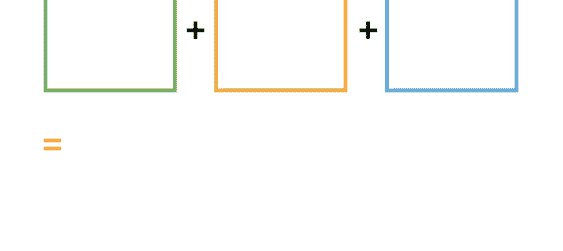

- 3. 根据你创建的模板写下脑中出现的任何想法。
- 4. 最后，从你写下的想法中选择一个并完成它。完整的版本看起来像这样：

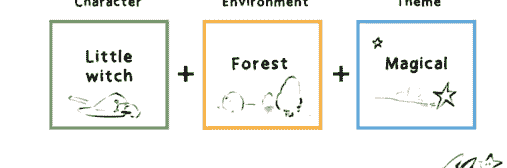

## 最终想法

小女巫在森林里找到了一颗魔星。她被新朋友们包围着。

Figure 7.2 – 填入模板的示例

## 理解技巧

三格法有助于在保持故事线一致的同时产生大量新想法。记住，每个格子中的想法都很重要，因此请确保最终的故事线忠于它们。否则，随着故事的发展，我们的故事线会变得不清晰且不一致。

## 为参考创建情绪板

创建情绪板是帮助你可视化想法并为项目收集灵感的最简单方法。凭想象作画需要对解剖学、透视和构图技巧有深入的理解。如果不使用参考，就很难可视化并创作详细、精确的绘画。这会导致完成绘画时缺乏灵感。如果我们强迫自己仅依靠想象来作画，会在精神上感到疲惫并导致倦怠。如果没有参考，在绘制连贯的故事线系列作品（如漫画或绘本）时，保持绘画的一致性会很困难。项目开始时创建情绪板是建立明确方向的好方法。由于所有创造力都源于真实生活经验，使用参考资料可以让你在作品中融入真实元素，同时加入自己的想象力。它就像一个想法和灵感的集合，你可以在需要参考和保持正轨时随时查看。在本教程中，我们将学习如何一步步创建情绪板。

## 按照步骤进行

现在，让我们学习如何创建有吸引力且信息丰富的情绪板：

- 1. 首先，基于上一教程中创建的想法，搜索几张图像作为你的想法参考。
- 2. 然后，进入 Procreate 并设计一个情绪板。你可以根据自己的喜好设计自己的情绪板。这是我的情绪板设计：

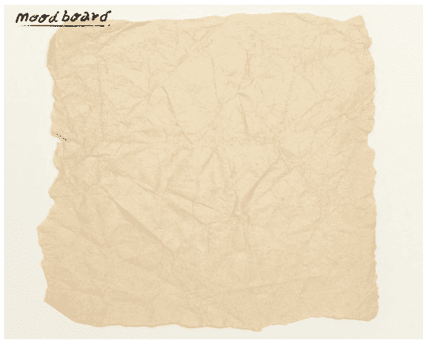

Figure 7.3 – 情绪板示例；来源：https://unsplash.com/photos/brown-textile-on-white-background-lggtliOpeFU

- 3. 将所有图像导入情绪板。快速引入参考图像的方法是使用 **操作 > 添加 > 插入照片**，这允许你直接从设备将图像拉入画布。
- 4. 最后，在不同的图层中写下笔记并绘制与你的想法相关的一些草图，以保持情绪板可编辑且井然有序。

## 情绪板

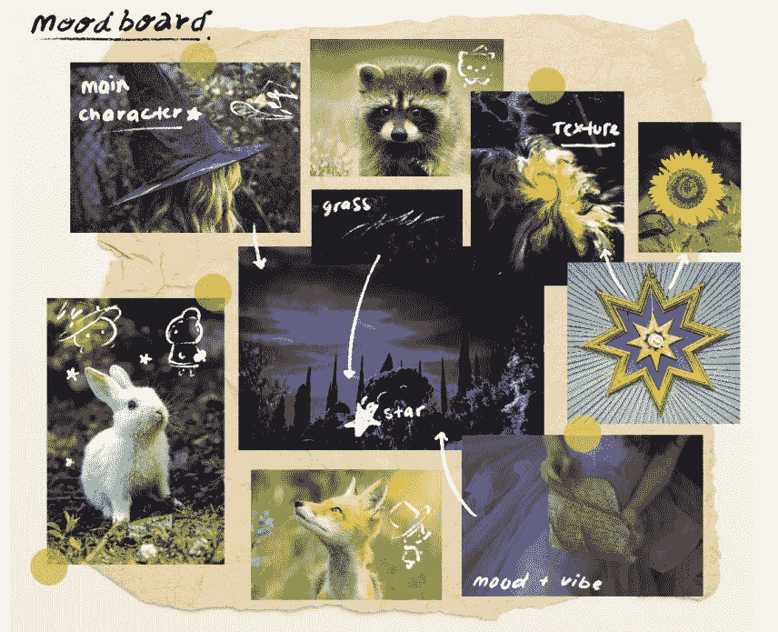

Figure 7.4 – 带参考图像的情绪板示例；来源：https://unsplash.com/photos/sunflower-CeSpMyxqKl4; https://unsplash.com/photos/sunflower-CeSpMyxqKl4; https://unsplash.com/photos/white-rabbit-on-green-grass-u_kMWN-BWyU; https://unsplash.com/photos/black-leafed-tree-near-gazebo-6uEtb1fLX7E; https://unsplash.com/photos/raccoon-walking-on-lawn-grass-6GMq7AGxNbE; https://unsplash.com/photos/multicolored-abstract-painting-QwoNAhbmLLo; https://unsplash.com/photos/a-woman-in-a-blue-dress-holding-a-piece-of-paper-0LSV9wTjNRc; https://unsplash.com/photos/red-fox-standing-on-grass-field-7TGVEgcTKIY; https://unsplash.com/photos/brown-star-decor-r82HiTMi8eM

## 理解技巧

创建情绪板是将你的创意想法组织并可视化到一个地方的绝佳方式。它在整个项目中充当参考点，帮助你保持与原始概念和主题的一致。通过拥有清晰的视觉指南，你可以避免偏离最初的想法，减少后期返工或反复怀疑的风险。这使得更容易保持对愿景的一致性，确保项目的各个元素和谐地协同工作。情绪板通过保持一切整洁易于遵循，使创意过程更顺畅。它帮助你保持井然有序，节省时间和精力。它不仅仅是一个规划工具；也是保持灵感和可视化设计概念的好方法，因为你可以在一个地方看到所有想法汇聚在一起。

## 了解更多...

一些插画师更喜欢拥有实体情绪板来保持一切就位。以下是为你的项目创建有趣且信息丰富的实体情绪板的方法：

- 1. 设计你的情绪板以适合你，无论是基于艺术的故事线还是项目主题，通过准备一个大纸箱或简单地只用一个笔记本。
- 2. 将你收集的元素（如照片、材料、印刷图像等）安排到你的情绪板上。
- 3. 寻找元素之间的共同主题或风格，以确保你的情绪板清楚地代表你的愿景和故事线。
- 4. 在元素旁边写下笔记，解释你选择它们的原因以及它们如何与你的故事线相连。
- 5. 一旦所有元素就位，仔细审阅情绪板。
- 6. 删除任何不符合或与整体愿景不一致的图像或参考资料。
- 7. 最后，确保情绪板上的所有内容都支持你期望的故事线和艺术方向。

实体情绪板现在可以使用，作为你在 Procreate 中作画时放在身边的有帮助的参考。你可以在整个过程中瞥一眼它，以保持颜色、主题和整体艺术方向的一致性。

## 重要提示

设计良好的情绪板反映了你的艺术风格，可以以有吸引力的方式向客户或合作者展示你的想法。情绪板旨在指导你的艺术作品，但你不必将其中的每个元素都融入其中。将收集的参考资料放在一起无疑会为你的作品激发新的想法。

## 勾勒故事线

勾勒故事是一个代表故事线的过程。这种方法可以将想法转化为视觉形式，使更容易看到整体结构并理解故事不同细节如何契合。通过概述主要场景、角色和场景，我们可以为插画创建更清晰、更详细的故事情节。这种练习不仅能提高讲故事技巧，还能帮助完善想法。创作故事发生地点的场景和背景的精确详细草图可能具有挑战性。在本教程中，我们将学习如何更好地勾勒我们的想法。

## 按照步骤进行

现在，我们将通过以下简单步骤勾勒出我们的故事线：

- 1. 首先，思考故事中的关键场景以及你希望如何可视化它们。
- 2. 然后，基于图 7.4 中的想法为你的故事勾勒场景和背景。为了获得自然的草图笔触，你可以降低画笔的 **不透明度** 值，或在 Procreate 中调整 **压力和柔滑** 设置，尤其是在使用 **Apple Pencil** 时。这些调整将有助于使你的草图感觉更自然、更有表现力。

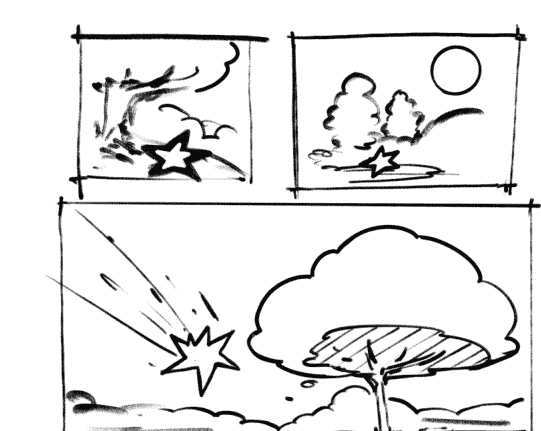

Figure 7.5 – 环境草图

- 3. 绘制主角的粗略草图以及与你的角色相关的几件物品。

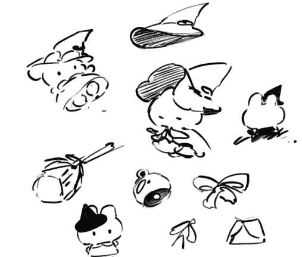

Figure 7.6 – 主角草图

- 4. 最后，绘制其他细节，如其他角色、装饰以及与故事线相关的任何其他内容。

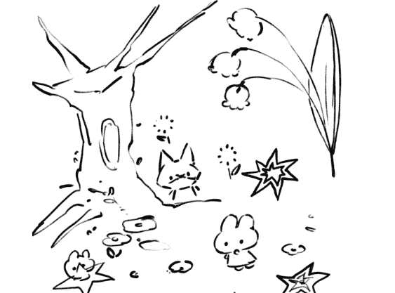

Figure 7.7 – 配角和细节草图

## 理解技巧

在勾勒故事线时，在这个阶段不要陷入细节。相反，专注于自由地绘制脑中出现的想法，只要它们与你正在发展的故事线一致。这个早期阶段完全是关于探索概念并将你的愿景转化为粗略草图，而不必过于担心完美或精确。为了保持井然有序，你可以在单独的画布上绘制背景、主角和配角，如图 7.5、图 7.6 和图 7.7 所示。这样，你可以一次专注于每个部分，保持清晰。例如，单独勾勒背景让你可以在没有干扰的情况下尝试不同的场景和氛围。同样，单独绘制角色给了你空间调整他们的姿势、表情和细节，而不必担心一切如何融合在一起。它使过程更简单、更专注。这种循序渐进的过程让你能够探索想法并构建视觉故事，同时保持一切平衡和谐。

> Tip
> 在这个阶段，我们将让草图分开绘制。然后，我们将混合搭配。这将使我们的工作流程更轻松，因为我们可以根据需要进行尽可能多的更改。在未完成故事线的情况下将所有细节一起草绘将导致项目期间出现许多更改。

## 即兴发挥故事和草图

即兴发挥故事和改进草图是创意过程的重要组成部分。它帮助你的第一个想法成长为更清晰、更好的故事。这种方法意味着保持灵活，尝试新事物，并在处理故事线和绘画时保持开放以做出更改。即兴发挥还让你以不同方式审视自己的作品，这可能导致新鲜而令人兴奋的想法，使你的故事更上一层楼。

在开始粗略草图时，往往有一种倾向要立即追求完美。然而，这会使草图感觉不自然，限制创意流动。粗略草图旨在自由和富有表现力，作为构建的基础，而不是最终产品。接受它们的瑕疵可以带来更具创造性的结果。在本教程中，我们将学习如何自然地即兴发挥我们的故事线和草图。

## 按照步骤进行

现在，让我们即兴发挥我们的故事并勾勒出故事线：

- 1. 首先，基于之前教程中创建的草图，通过修改和编辑来完善你的故事线。使用 Procreate 的 **添加文字** 工具写下或输入即兴的故事线。

## 最终想法

一只小兔子女巫在森林里发现了一颗魔星。她被新朋友包围着，例如兔子和狐狸。

突然，一只黑兔子从星星中出现。这颗星星充当着来自不同维度的传送门。虽然森林里的所有生物看到黑兔子都感到惊讶，但它们也渴望了解整个故事。

图 7.8 – 最终故事线

- 2. 然后，混合搭配我们在之前教程中创建的草图（*图 7.5*、*图 7.6* 和 *图 7.7*）来创建多个构图。我们可以通过画布复制元素或使用 **操作 > 添加 > 复制 > 粘贴** 复制图层。此外，调整 Procreate 的 **图层不透明度** 和 **变换工具** 可实现非破坏性调整，使你在保留原始创意的同时更容易尝试不同的布局选项。

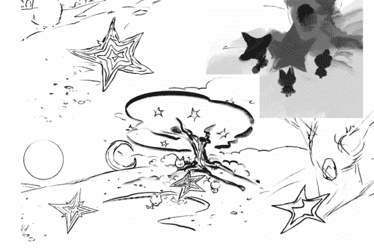

图 7.9 – 背景场景草图

- 3. 最后，重新绘制元素以开发新的背景概念并完成创意。在此阶段，不必担心草图看起来粗糙。重点是确保构图结构正确且与预期的艺术方向一致。

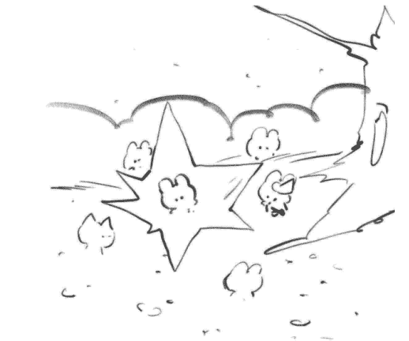

图 7.10 – 所选背景插图草图

## 理解技巧

如 图 7.10 所示，背景场景是基于 图 7.8 和 图 7.9 中的即兴创意创建的。在创作过程中不要犹豫修改和完善你的创意和故事线。如果最初的想法感觉不太合适，你始终可以更改和改进它。例如，我将 图 7.2 中的创意即兴发挥成更好更清晰的故事线，如 图 7.9 所示。图 7.10 是基于故事线选择的，因为它比其他草图更合适。追求完美有时会导致缺乏多样性和独特性，从而使故事线吸引力下降。记住，最好的创意往往源于不完美和自发产生。随意尝试不同的概念。例如，引入悬念元素可以为你的故事线和作品增添惊人的情节转折。一旦你的创意感觉更精致，花时间写下故事线的更新版本。这将帮助你保持井然有序，并确保所有更改都得到妥善记录。

## 将色彩情感融入草图

如 *第 6 章* 所述，不同颜色会唤起不同的情感和感受。例如，红色可以象征激情或愤怒，蓝色可以代表平静或悲伤，而黄色可以传达幸福或能量。通过使用不同的配色方案，我们可以在艺术中表达某些情感。

我们还可以使用颜色来吸引人们对故事线和艺术中重要场景的注意。我们在上色时通常面临的问题是选择彼此搭配良好的颜色。如果使用的颜色不能互补或和谐，插图和故事线可能会变得令人困惑。在本教程中，我们将学习如何选择与故事线和艺术氛围相符的配色方案。

## 按照步骤进行

我们现在将基于神秘氛围添加色彩情感，这是我们在 *第 6 章* 中学到的：

- 1. 首先，创建一个与你希望在故事线和艺术中传达的情感相符的配色方案。
- 2. 然后，尝试不同的色彩组合，看看它们如何影响作品的情绪。你可以参考 *第 6 章* 来找到适合神秘氛围的完美配色方案。
- 3. 确定将用于故事线的配色方案。我将使用 *图 7.11* 中所示的配色方案用于背景场景。

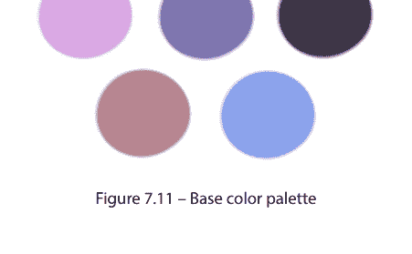

- 4. 最后，在草图图层下方进行粗略上色以完成它。

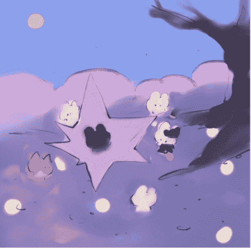

图 7.12 – 粗略上色示例

## 理解技巧

创建配色方案可能具有挑战性，当我们不确定想要通过艺术表达的氛围或感觉时。然而，对插图的情绪和故事线有清晰的愿景可以使过程变得容易得多。例如，如 图 7.2 所示，如果背景场景的主题专注于发现和魔法，想象一个神奇的场景可能会让我们选择蓝色和紫色调，因为这些颜色最能代表与这些主题相关的惊奇和迷人感觉。

为了让项目保持正轨，保持专注并坚持故事线很重要。创作过程中途更改想法是可以的，但在团队合作时进行重大更改可能会不方便，因为其他人已经在为原始概念付出努力。因此，从开始就保持清晰的方向很重要，以帮助一切顺利进行并节省更多时间。

## 提示

灵感可能随时出现，因此请保持开放，添加新鲜创意，使你的插图在仍坚持主要愿景的同时变得更好。在图层堆栈顶部保留一个 *色彩测试* 图层，以便在不改变主要作品的情况下自由尝试色板、混合模式和其他效果。这使你可以在保持构图完整的同时测试颜色和调整。这是一种简单而有效的方法，可以在承诺最终更改之前完善你的调色板。

创建清晰详细的插图需要时间，因此在创作过程中给自己留出思考和改进的空间。这都是创作过程的一部分，因此允许自己自由探索和实验，不要过度束缚。

## 完成故事和插图

通过艺术，你可以讲述故事并在情感上与人建立联系。通过描绘重要场景、角色和环境，你可以将故事线转变为人们可以视觉体验并产生共鸣的东西。它允许你以文字 alone 无法完全捕捉的方式展示情感、思想和主题。这就是为什么创建视觉叙事可以为你的故事带来如此多的生命力和深度。

与他人分享你的故事线以获取反馈是过程中的重要部分，尽管一开始可能感觉令人望而生畏。从他人那里获得意见可以帮助你发现需要改进的地方并提供新鲜想法。它还允许你从新的角度看待你的故事，这在你完善作品时非常有价值。反馈可以突出你可能没有注意到的优势，并揭示增强你的讲故事和艺术的方法。

完成故事线及其插图可能具有挑战性。有时很难知道如何使插图感觉完整和精致。你可能会担心缺少某些东西或不确定要添加什么润色。这是在完成插图时我们面临的常见困境。在本教程中，我们将探索简单的步骤，帮助你自信清晰地成功完成故事线和插图。

## 按照步骤进行

我们已到达最终艺术流程；我们现在将通过以下简单步骤完成故事线和插图：

- 1. 首先，完善你的草图并添加一些最终细节，如云朵、月亮和花朵。对于对称元素，如星星，你可以使用 **绘图辅助** 来帮助你轻松绘制。

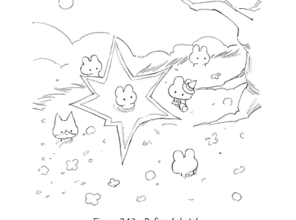

图 7.13 – 完善的草图

- 2. 然后，清理我们在 图 7.12 中早先完成的底色，使其更清晰并准备好进行渲染。

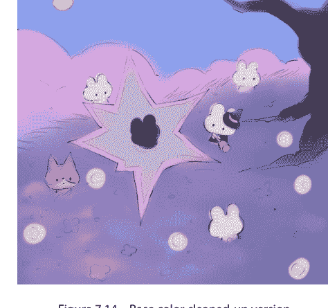

图 7.14 – 底色清理版

3. 基于我们在第4章学到的技巧，为你的插画添加光照和阴影。

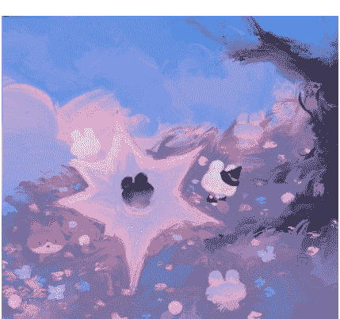

图 7.15 – 添加光照的示例

4. 最后，渲染你的插画并通过调整背景的对比度来完成它，以增强整体氛围。完善角色的细节，确保它们与场景和谐融合，同时在需要时脱颖而出。这些最后的润色将为你的作品增添深度和精致的外观。

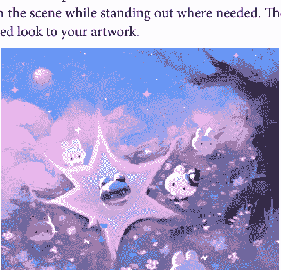

图 7.16 – 渲染并最终完成的插画

## 理解技巧

要完成我们的故事线和插画，首先回顾你的第一张草图并进行必要的调整。这可能涉及完善线条、添加细节或纠正任何错误，如 *图 7.15* 所示。目标是创建一个干净精确的草图，作为插画的基础，这样你做底色上色时会更容易。一旦草图完善，重点清理底色。这涉及用我们在 *图 7.11* 中之前创建的调色板填充插画的区域，确保它们完全上色。为了给插画带来深度和立体感，添加光照和阴影。对于 *图 7.16*，我使用底色的较暗色调来制作阴影，而不是 **Multiply** 混合模式。这种方法有助于保持自然的外观并确保颜色平滑融合。然而，如果你想加快工作流程，使用 **Multiply** 混合模式可以成为添加阴影的绝佳捷径。请随意选择最适合你流程的方法。然后，考虑场景中的光源以及它如何影响插画的不同元素。

在 *图 7.15* 中，光源在左侧，因此光线来自插画左侧和坠落的星星。添加阴影和高光以创造良好的对比，如 *图 7.15* 所示。最后一步是渲染你的插画，这涉及添加润色和细节。这包括完善画笔的纹理、添加小细节，并确保所有元素都平衡良好。你可以通过使用纹理材料添加纹理来增强你的作品。

注意微小的细节，例如小花、星星以及角色上的细节，这些都可以提升你作品的整体质量。按照这些步骤，你可以有效地完成你的故事和插画，创作出完整且视觉独特的作品。

完成插画意味着清理粗糙的草图和底色，使其看起来更清晰、更精致。例如，在 *图 7.13* 中，来自 *图 7.10* 的粗稿被清理干净，使得添加颜色和完成插画变得更容易。这个清理后的版本是一个重要步骤，因为它有助于让你的插画看起来更清晰、更适合最后的润色。如你在 *图 7.17* 中所见，我添加了诸如星星和柔和高光等最后润色，以吸引人们对黑兔子的注意，黑兔子是插画的焦点。我还加入了纹理和小细节，使背景景色感觉更神奇、更充满魅力。

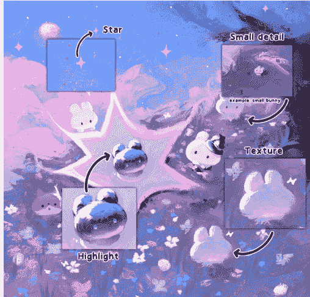

图 7.17 – 特写细节

上色时，你有选择：你可以将所有图层合并为一个以改善笔触并创建更平滑的纹理，或者如果你觉得更好，也可以保持图层分离。如第1章所述，添加纹理是为插画增添独特、成品感的另一种好方法。收尾你的插画并将一切融合在一起起初可能感觉有点令人生畏，但不要让它困扰你。只要相信过程，一步一步来，你就会惊讶于一切最终如何融合在一起。有时，魔法会在你最不期望的时候发生！

## 总结

在本章中，我们学习了如何通过绘画来讲述故事。我们首先使用三格法想出有趣的点子，然后创建情绪板来收集有用的参考图像。之后，我们勾勒主要场景和角色，逐步构建我们的插画。在过程中我们不断完善想法，使用色彩传达情感，添加光线和纹理以增加深度，并以鲜艳的色彩和最终细节完成作品。

在下一章中，我们将通过一些简单的步骤探索创建具有独特个性和背景故事的角色的过程。我们还将学习如何创建一个角色表，清晰地展示角色的外观、表情和独特特征。然后，我们将研究如何将角色放置到支持其故事的背景中，使整个场景感觉连贯而充满活力。

无论你是纯粹为了好玩创作，还是为作品集组装作品，本章将帮助你自信而愉快地展示你的角色。

## 立即解锁本书的独家福利

扫描此二维码或访问 `packtpub.com/unlock`，然后按名称搜索本书。

