## 设计与背景无缝融合的角色

在艺术行业中，绘制角色设计很重要，尤其是在动画、游戏、3D手办、商品等实体艺术方面。它还有助于通过外观展示角色的个性来定义角色在故事中的作用。例如，神秘的角色看起来阴郁，我们倾向于让他们穿着较暗或浅色的服装。身体特征，例如独特特征（例如胎记或图案），可以反映他们的个性和身份。服装和配色方案在唤起特定情感和匹配角色特征方面也起着重要作用。除了这些之外，还有各种其他因素使角色设计具有挑战性，例如我们担心自己无意中复制了别人的风格，以及在不同角度保持角色大小的一致性。

在本章中，我将指导你完成创建角色使其自然融入其环境的过程，从而增强插画的整体构图和讲故事能力。

在讲解的帮助下，我们将涵盖以下内容：

- 头脑风暴和勾勒角色设计
- 完成角色设计
- 从不同视角绘制角色设计
- 绘制面部表情
- 为作品集准备角色表
- 将角色添加到背景绘画中
- 将角色完美地融入背景绘画

## 头脑风暴和勾勒角色设计

设计角色时，重要的是要考虑代表角色的几个重要方面。首先定义角色在故事中的作用并据此设计角色。考虑角色的概念和动机以在外观中展现他们的个性很重要。例如，反派角色可能具有可怕的外观或疤痕，而开朗的角色看起来快乐并穿着鲜艳的服装。身体特征如体型和独特特征应展示他们的个性和身份。

独特特征可以是角色身上的胎记或符号。服装也应与角色的个性相匹配。如前所述，色彩在角色设计中起着重要作用，因此请确保你使用正确的颜色来唤起特定情感并匹配角色特征。想出原创且独特的角色概念可能很困难。很容易陷入创造与现有角色过于相似的角色的循环。在这个简单易懂的分步讲解中，我们将学习如何在没有任何担忧的情况下创建独特的原创角色。

### 按照步骤进行

以下是你可以进行角色设计头脑风暴和草图绘制的方法：

1. 首先，创建一个包含三个空方框的模板，按照我们在 *第7章* 中之前学到的方法进行操作。为此，激活 **Drawing Guide**（通过 **Actions** > **Canvas** > **Drawing Guide**）并选择 **Grid**。然后，绘制三个等距的方框，分别标记为 `Character Type`、`Character Concept` 和 `Personalities`。使用 **Add Text** 工具添加注释以提高清晰度。模板应如下所示：

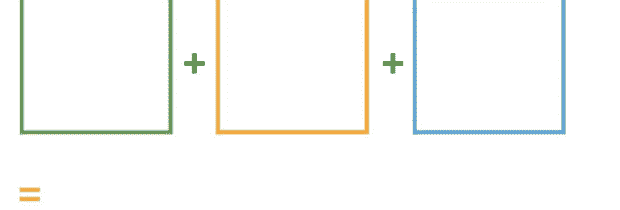

图 8.1 – 将想法整理为角色类型、概念和个性的模板

2. 根据你创建的模板，填写 **角色类型**、**角色概念** 和 **个性** 框，写下脑中浮现的任何想法：

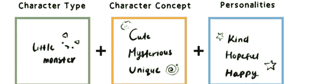

Figure 8.2 – 设计小怪物角色特征的示例填充模板

3. 最后，通过混合搭配 **角色类型**、**角色概念** 和 **个性** 想法，绘制多个角色设计。将每个框内的手写文字替换为打字文字。这样布局更易读、视觉更清晰。

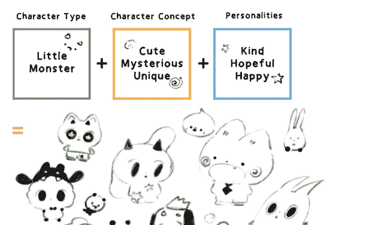

Figure 8.3 – 展示不同特征如何混合搭配形成独特设计的草图

现在你已经完成了头脑风暴步骤，让我们更深入地看看这种方法如何更有意义地塑造你的角色。

## 理解技巧

三个框的目的在于帮助高效地组织你的想法。一旦我们为每个框列出信息，就可以混合搭配细节来创建角色设计。例如，如图 8.2 所示，对于角色类型，我选择了小怪物，然后为角色概念选择了独特，为个性选择了善良。混合搭配后的角色设计结果如图 8.3 所示。

让我们看一下图 8.4 中的另一个例子。在这个设计中，我希望角色感觉柔软圆润，所以我选择了蓬松的圆形造型。概念受水果启发，拥有大而宽的眼睛，让角色显得富有表现力且可爱。对于个性，我专注于甜美和害羞等特质。为了清晰地表现这一点，我在他们的脸颊上画了温柔的腮红，并赋予他们柔和安静的外观。这些小细节有助于设计与角色的感受相匹配，使他们显得善良且平易近人。

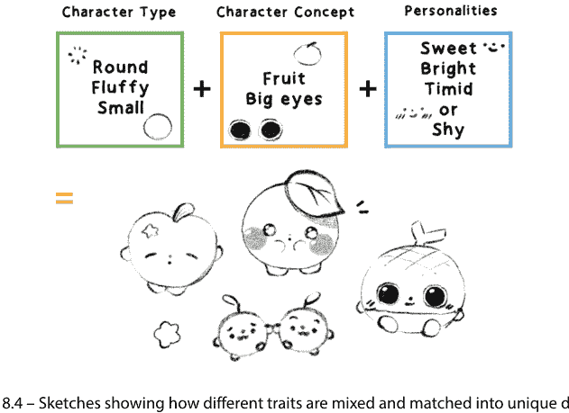

Figure 8.4 – 展示不同特征如何混合搭配形成独特设计的草图

这里还有一个如图 8.5 所示的例子。这个角色被设计成柔软而困倦的感觉，笨拙的个性增添了魅力。为了匹配这个想法，我用圆润柔软的造型绘制了他们，使其看起来额外可爱且舒适。他们柔软的形态强调了困倦的感觉，就像一个总是快要睡着的角色，这有助于突出他们温柔和笨拙的特质。

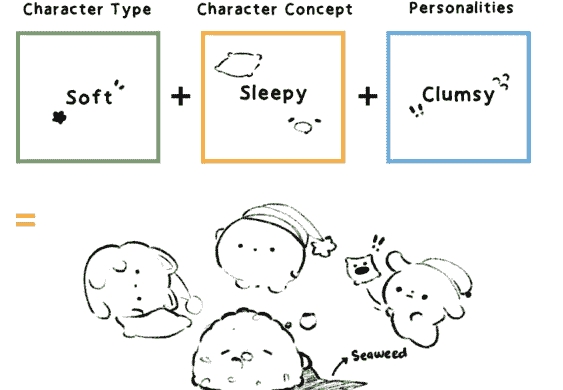

Figure 8.5 – 展示不同特征如何混合搭配形成独特设计的草图

通过将个性特质与概念元素混合，我们可以赋予角色情感深度。这让他们在观众脑海中栩栩如生，并让观众想要了解更多关于你的角色。

### 小贴士
除了之前的方法，我们还可以通过参考情绪板来创建角色设计，如第 7 章 Storytelling Through Art: Creating Visual Narratives 所示。一些艺术家更喜欢这种方法，因为他们可以根据情绪板上的图像可视化角色的外观。随意选择最适合你的方法。

现在我们的想法开始成形，是时候用干净的线条和色彩将其中一个想法[content]
2. 根据你创建的模板，填写 **角色类型**、**角色概念** 和 **个性** 框，写下脑中浮现的任何想法：

Figure 8.2 – 设计小怪物角色特征的示例填充模板

3. 最后，通过混合搭配 **角色类型**、**角色概念** 和 **个性** 想法，绘制多个角色设计。将每个框内的手写文字替换为打字文字。这样布局更易读、视觉更清晰。

Figure 8.3 – 展示不同特征如何混合搭配形成独特设计的草图

现在你已经完成了头脑风暴步骤，让我们更深入地看看这种方法如何更有意义地塑造你的角色。

## 理解技巧

三个框的目的在于帮助高效地组织你的想法。一旦我们为每个框列出信息，就可以混合搭配细节来创建角色设计。例如，如图 8.2 所示，对于角色类型，我选择了小怪物，然后为角色概念选择了独特，为个性选择了善良。混合搭配后的角色设计结果如图 8.3 所示。

让我们看一下图 8.4 中的另一个例子。在这个设计中，我希望角色感觉柔软圆润，所以我选择了蓬松的圆形造型。概念受水果启发，拥有大而宽的眼睛，让角色显得富有表现力且可爱。对于个性，我专注于甜美和害羞等特质。为了清晰地表现这一点，我在他们的脸颊上画了温柔的腮红，并赋予他们柔和安静的外观。这些小细节有助于设计与角色的感受相匹配，使他们显得善良且平易近人。

Figure 8.4 – 展示不同特征如何混合搭配形成独特设计的草图

这里还有一个如图 8.5 所示的例子。这个角色被设计成柔软而困倦的感觉，笨拙的个性增添了魅力。为了匹配这个想法，我用圆润柔软的造型绘制了他们，使其看起来额外可爱且舒适。他们柔软的形态强调了困倦的感觉，就像一个总是快要睡着的角色，这有助于突出他们温柔和笨拙的特质。

Figure 8.5 – 展示不同特征如何混合搭配形成独特设计的草图

通过将个性特质与概念元素混合，我们可以赋予角色情感深度。这让他们在观众脑海中栩栩如生，并让观众想要了解更多关于你的角色。

### 小贴士
除了之前的方法，我们还可以通过参考情绪板来创建角色设计，如第 7 章 Storytelling Through Art: Creating Visual Narratives 所示。一些艺术家更喜欢这种方法，因为他们可以根据情绪板上的图像可视化角色的外观。随意选择最适合你的方法。

现在我们的想法开始成形，是时候用干净的线条和色彩将其中一个想法带到现实中了。

## 完成角色设计

完成角色设计涉及创建代表角色的角色、背景和个性特征的精致设计。重要的是要创建反映其故事和个性的外貌、服装和配色方案。开发包含各种角度和表情的详细角色表有助于保持设计元素的一致性。随着我们在本章的进展，我们将更好地理解这一点。一旦满意，我们可以在整个讲故事过程中随着想法的演变而保持对调整的开放性，从而完成角色设计。

在创建角色设计时，很容易沉迷于细节，这可能会压倒初始设计并使其更难完成。在本演练中，我们将学习如何高效地完成角色设计，而不会陷入添加过多细节的无休止循环。

### 按照步骤进行

现在，我们将学习如何完成角色设计并为其上色：

首先，选择图 8.3 中的一个角色设计草图并创建其干净的线稿版本。你可以使用 Studio Pen 等画笔来创建流畅的线稿：

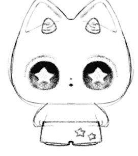

Figure 8.6 – 从所选草图创建的干净线稿

- 1. 为角色准备一个配色方案。确保配色方案与角色的个性和概念相匹配：
- 2. 最后，使用图 8.7 中的配色方案为你的角色上色。为了确保干净高效的上色，你可以在 Procreate 中使用 Alpha Lock 或 Clipping Mask。这些技术有助于保留你的线稿，同时允许你在其下方或上方上色。

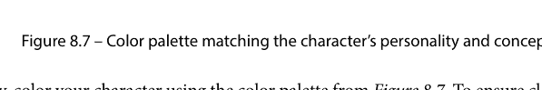

Figure 8.7 – 与角色个性和概念相匹配的配色方案

### 小贴士
使用 **Clipping Mask**：首先，在你的线稿下方创建一个底色图层。然后，在其上方添加一个新图层，点击一次图层并选择 **Clipping Mask**。你应用的任何画笔笔触现在都将保持在底色范围内。

使用 **Alpha Lock**：或者，点击底色图层并启用 **Alpha Lock**。这会锁定透明像素，让你只能在有色区域内绘画。随意选择最适合你工作流程的方法。

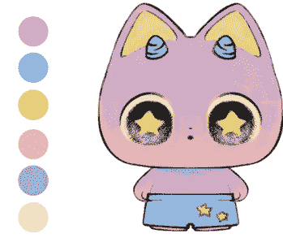

Figure 8.8 – 完成的角色设计

你已用干净的线条和色彩让你的草图栩栩如生。让我们探讨一下这个过程的每个部分如何帮助你的工作流程以及颜色与角色之间的联系。

## 理解技巧

在开始为角色上色之前先创建配色方案有助于节省时间并使工作流程更顺畅。如果配色方案是在渲染过程中选择的，可能会导致进度延迟，因为你可能需要频繁更改。也很重要的是确保颜色与角色的个性和主题相匹配。例如，在图 8.8 中，我使用了紫色和柔和的颜色的调色板，以保持设计与角色神秘概念的一致。

### 小贴士
颜色承载着情感。使用暖色调营造友好的角色，冷色调营造平静的个性，以及大胆的颜色如亮红色营造充满活力的角色。

清理你的设计有助于人们关注角色的故事，而不仅仅是细节。漂亮的线稿和底色表明你已仔细思考角色是谁，这也使他人更容易理解他们。

现在你的角色有了精致的外观，让我们看看它从不同角度看起来如何。

## 从不同视角绘制角色设计

如你所知，关于角色，了解它们从不同角度的外观极其重要。这种方法帮助艺术家了解角色在不同场景中的外观以及与周围环境的互动。通过从各个角度绘制角色，如正面、侧面和背面，你可以轻松看到其设计的细节，包括姿势、表情和比例，使角色看起来更逼真、更有活力。从不同视角绘制还允许创造性姿势并更好地理解角色的整体形状，使其在不同情况下更容易绘制。在整个故事线或一系列插图中保持角色的外观、服装和配色方案一致可能很困难，但通过本演练，你将学习如何在保持其形态和设计细节的同时从不同角度绘制角色。

### 按照步骤进行

我们在之前的演练中完成了角色的着色。现在，让我们从不同角度绘制角色：

- 1. 首先，在角色设计后面绘制几条平行线作为造型和尺寸指南。使用 **Drawing Guide** 中的 **Perspective Grid** 绘制直线以保持比例一致：
- 2. 按照指南绘制角色的左侧：

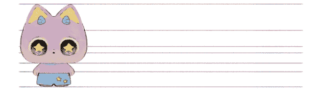

Figure 8.9 – 角色设计指南

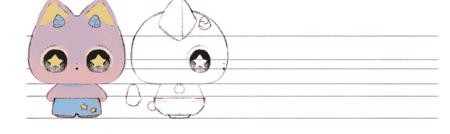

Figure 8.10 – 角色的左侧视图

3. 然后，绘制角色的右侧和背面视图。对于右侧视图，你可以翻转并镜像角色之前的左侧视图来指导对称的姿势。为此，复制你的图层并使用 **变换 > 水平翻转/垂直翻转**：

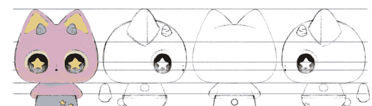

图 8.11 – 角色的所有角度

4. 最后，为角色设计上色以完成它：

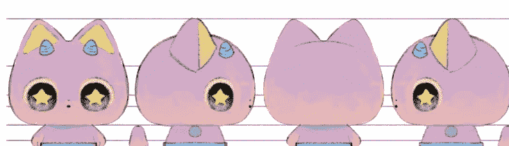

图 8.12 – 从不同角度展示的全彩角色

## 理解技巧

一旦你的角色确定，就该探索它从不同角度看起来如何：正面、侧面和背面。为了保持设计一致性并在 Procreate 中保持工作区整洁，将每个视角分组到单独的图层或文件夹中。对于每个视图（正面、侧面和背面），在 **图层** 面板中创建一个专用的分组文件夹。为每个文件夹明确命名，例如 *正面视图*、*左侧视图*、*右侧视图* 和 *背面视图*。在每个文件夹内，包含线稿、底色、阴影和高光的图层。这样可以更轻松地调整某个角度的元素，而不会混淆。

你可以在 **绘画指南** 中使用 **透视网格** 来保持比例和对齐。可通过 **动作** > **画布** > **绘画指南** 访问。考虑复制你的正面视图草图并水平翻转（通过 **变换** > **水平翻转**），作为侧面或背面视图的起点。从各个侧面展示你的角色证明了他们在你的世界中是真实的，因为观众可以想象他们。将视图分组到文件夹中保持整洁，也节省了你在同一个文件夹中查找所有设计的时间。

现在角色的视图已完成，让我们通过面部表情探索他们的情感。

## 绘制面部表情

面部表情是传达艺术和角色设计中情感、思想和个性的有力方式。它们在讲故事中发挥着重要作用，因为它们让观众能够在更深层次的情感上与角色产生联系。通过了解面部表情的工作原理，我们可以使用眼睛和嘴巴等特征来表现不同的情感。一些关键技巧包括放大特征以清晰地表现情感、改变面部特征的形状，以及添加线条和阴影等额外细节。这些元素可以帮助观众产生共鸣并理解角色的感受。

绘制面部表情对许多人来说也相当棘手，但研究并使用真实人物的参考图像可以极大地提高你的理解。通过观察现实生活中的例子，我们可以更好地捕捉创建更准确、更有表现力的角色所需的细节。主要困难之一是通过眼睛、眉毛和嘴巴等面部特征理解并准确传达广泛的情感，这需要深入了解这些特征如何随不同情感而变化。在本教程中，我们将学习如何为我们的角色绘制面部表情。

## 按照步骤进行

现在，让我们绘制几种不同的面部表情，使角色看起来生动且富有个性：

- 1. 首先，确定 5–9 种适合你的角色的面部表情。对于本教程，我将选择害羞、愉快、害怕、兴奋、平静、快乐、悲伤和震惊。如果一次绘制太多感到不知所措，请随意从较小的范围开始，只画 3–5 个表情。
- 2. 然后，根据你选择的表情开始绘制角色的面部表情草图。也可以随意使用参考图像。它们对于理解每种情绪的外观以及面部特征如何变化非常有帮助：

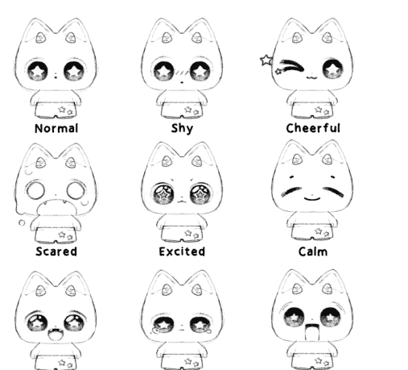

图 8.13 – 面部表情示例

- 3. 最后，完成它并为其上色：

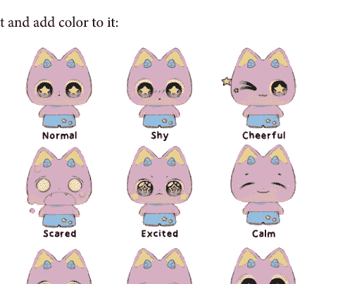

图 8.14 – 最终彩色表情让角色栩栩如生

> 提示
> 你可以使用 **液化**（在 **调整** 中）以非破坏性的方式微妙地修改表情。将每个表情放在单独的图层上或将其分组到文件夹中，以便以后轻松编辑。

在完成所有这些精彩的表情后，让我们看看展示一系列情感如何让你的角色栩栩如生。

## 理解技巧

表情是角色无需言语就能交流的方式。当你绘制他们的情感，如喜悦或惊讶时，观众可以理解角色当时的感受。这让你的角色感觉像他们认识的人，并有助于展现其个性。因此，创建不同的面部表情将有助于角色看起来更具吸引力和生动，因为它可以表现不同的情感。

我们首先为角色确定 5–9 种面部表情。这些可能包括快乐、悲伤、愤怒、惊讶等情感。接下来，用每种表情绘制角色的脸。专注于眼睛、眉毛、嘴巴和其他面部特征，以准确描绘情感。眼睛、眉毛和嘴巴是创造面部表情的关键方面。通过改变眉毛的位置和形状，我们可以创造不同的表情。例如，通过改变眉毛角度使其指向眼睛，角色会显得愤怒，而将其指向眼睛角落的末端向下则使角色显得平静。

一旦你对表情草图满意，就通过细化线条并添加颜色来完成它们。这将使表情栩栩如生，使其更具视觉吸引力。

每种表情都讲述他们故事的一部分，所以让我们将所有内容整理成一张你可以自豪分享的角色表。

> 试试这个
> 想象你的角色刚刚到达一个从未去过的地方。他们会如何反应？会好奇、焦虑还是兴奋？在那一刻绘制他们的表情。

## 为作品集准备角色表

制作 **角色表** 是展示你角色设计技能的好方法。它帮助你组织和展示角色独特的特征、个性和灵活性。一张好的角色表可以让你的作品集脱颖而出，并展示你能够创建一致且有趣的设计。它还展示了角色的外观、故事和个性，帮助雇主或客户更好地理解他们。这是你展示你在角色设计、色彩、面部表情和讲故事等领域技能的机会，这些对于动画、游戏和插画工作都很重要。通过结合视觉和故事，你可以创建一个突出你的风格和创作过程的作品集。本教程将展示制作一个有效且对艺术相关工作有帮助的作品集的简单步骤。

## 按照步骤进行

现在我们已准备好一切，让我们学习如何组织角色表并将其转变为作品集：

- 1. 首先，在 Procreate 上通过在空白画布中创建文件夹，为你的角色设计创建一个专用文件。
- 2. 然后，设计第一个界面来介绍你的角色设计：
- 3. 为你的角色准备背景故事。你可以将其写成段落，也可以保持背景故事简单。如果追求简化版本，目标是写 3–5 句话来捕捉角色的动机和个性：

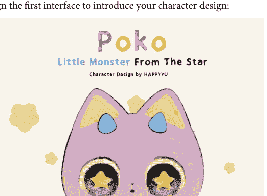

图 8.15 – 作品集角色设计界面的示例

## Poko

来自星星的小怪物

Poko 是一个从星星上掉落的小怪物。Poko 的名字是由照顾他的一个人类朋友起的。Poko 不知道朋友的名字，只记得他的剪影。有 一天，Poko 的人类朋友消失了。Poko 决定踏上旅程，去寻找人类朋友失踪的真相。Poko 是一个善良、充满希望且快乐的灵魂。他有看到人们光环的能力，并能够解决他们的问题。在旅途中，他遇到了很多新人，并在寻找真相的同时帮助他们。Poko 希望能够再次见到他的 人类朋友。

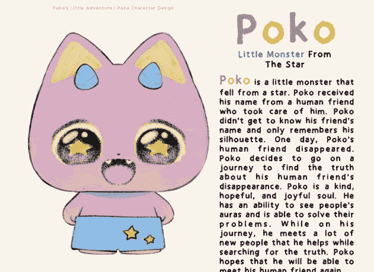

图 8.16 – 角色设计背景故事示例

- 4. 现在，你可以从不同视角展示你的角色设计：

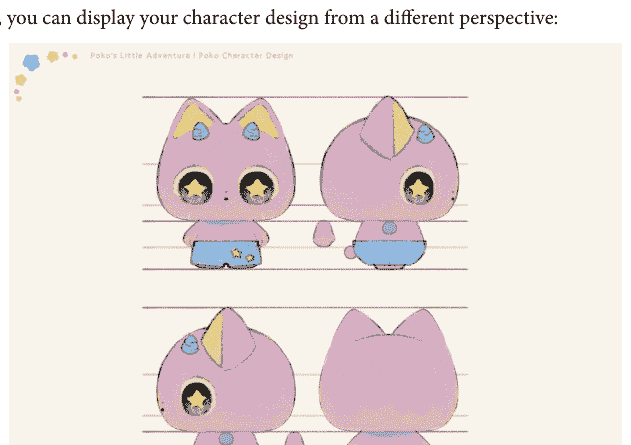

图 8.17 – 角色从不同角度的视图排列在一张纸上

5. 添加角色的面部表情：

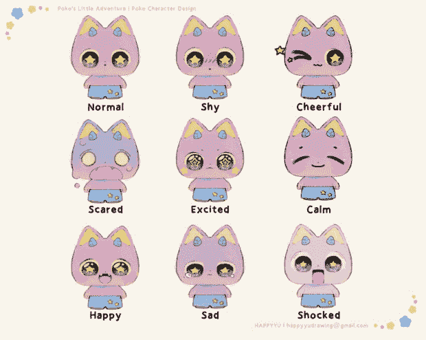

图 8.18 – 显示全范围情感的面部表情表。

6. 最后，将图像导出为单独的 JPEG 文件或 PDF 以作为作品集分享。导出时，使用“操作 > 分享 > PDF 或 JPEG”，具体取决于作品集的格式：

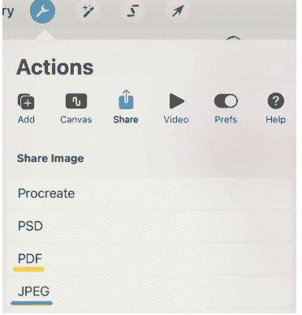

图 8.19 – 如何导出图像以创建作品集的示例

现在你的角色表已经准备好了，让我们反思一下每个元素如何帮助他人与你的角色和你的创造力产生联系，最终可以形成作品集。

## 理解技巧

你的角色表就像在一页上讲故事。一个简短、清晰的背景故事展示了角色是谁以及他们在乎什么。这有助于他人对你创造的世界感到好奇和感兴趣。这也是分享你创作声音的绝佳方式。

创建多个角色表可以让客户看到你作品的多样性并评估你处理他们项目的潜力。不要过于担心完善角色的每一个细节；关键是保持作品集整洁有序，让客户能够专注于你的设计。你可以在角色表的背景中添加一些小的装饰元素，但要确保它们不会掩盖角色本身。一旦一切最终确定，你可以将作品导出为 JPEG 或 PDF 文件。PDF 通常更受欢迎，因为它们能将所有内容保存在一个有序的文档中。准备好文件后，将其上传到你的网站。Carrd、Behance、Issuu 和 Google Sites 等免费平台是免费在线展示作品集的绝佳选择。你也可以通过电子邮件将作品集发送给潜在客户，如果他们正在寻找插画师。

- **链接**
  - Carrd: https://carrd.co/
  - Behance: https://www.behance.net/
  - Issuu: https://issuu.com/
  - Google Sites: https://sites.google.com/

表格设置好后，是时候将你的角色放置到能讲述更多其故事的背景中了。

## 将角色添加到背景绘画中

将角色放置到背景中是创作完整且引人入胜的插画的重要技能。它涉及将角色置于与其故事和个性相匹配的环境中，使整幅作品更生动、视觉上更吸引人。学习如何将角色自然地融入周围环境可以增强艺术作品的叙事性，使场景更引人注目。我们将在下一个实操中学习更多关于融合和上色的内容。在本次实操中，我们将探讨将角色添加到背景中的简单步骤，使其看起来对观众来说自然。

## 按照步骤操作

这是一个以角色为主焦点的背景绘制简单指南：

1. 首先，将你的角色设计添加到空白画布上：

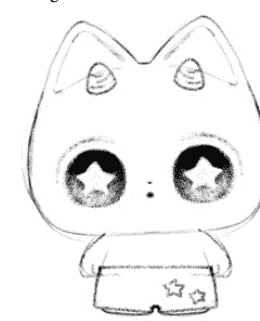

图 8.20 – 将角色设计添加到空白画布的示例

2. 绘制与主角设计概念相匹配的背景景色：

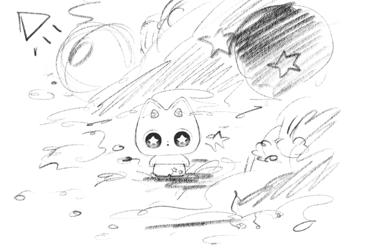

图 8.21 – 背景景色草图

3. 最后，通过使草图更清晰、更整洁来清理粗略草图以完成它：

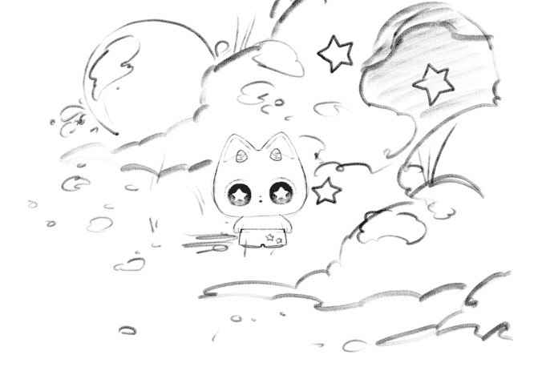

图 8.22 – 角色的最终背景景色

你已将角色置于他们的世界中。让我们花点时间了解背景如何支持角色的叙事。

## 理解技巧

创建背景景色时，重要的是确保它与角色的整体氛围相匹配。将角色放置在场景中表明他们属于那里。它帮助人们了解他们来自哪里以及属于什么类型的故事。当一切都契合时，色彩、光线和感觉会让画面显得完整而令人兴奋。例如，在图 8.21 中，我画了角色从传送门中出现，以暗示它来自另一个世界，让观众渴望了解更多关于角色背景故事的信息。在图 8.3 中，我决定角色具有神秘的概念，因此背景绘画需要增强那种神秘感。通过这样做，我们帮助观众理解角色的故事，并通过艺术了解更多我们展示的角色。除了匹配配色方案外，还要确保角色的光线与环境相匹配。利用高光使角色脱颖而出，并根据背景构图、位置或深度放置角色，以吸引观众的注意力。

背景添加后，让我们将一切融合在一起，使其感觉像一幅完整而神奇的插画。

## 将角色完美融入背景绘画

将角色添加到背景绘画中是创作引人入胜插画的基本技能。此过程涉及将角色置于与其故事和个性相匹配的环境中，使整体构图更自然、更有趣。通过学习如何将角色完美融入环境，我们可以增强作品的叙事性并创造更独特的场景。将角色融入背景绘画可能相当具有挑战性，原因有几个。主要困难之一是确保角色和背景看起来自然协调。这涉及将角色的光线、色彩调色板和透视与背景相匹配。在本次实操中，我们将学习如何将角色融入背景绘画。

## 按照步骤操作

我们已到达角色设计过程的末尾。现在，让我们学习如何将角色与背景景色融合：

1. 首先，为你的背景绘画准备一个底色：

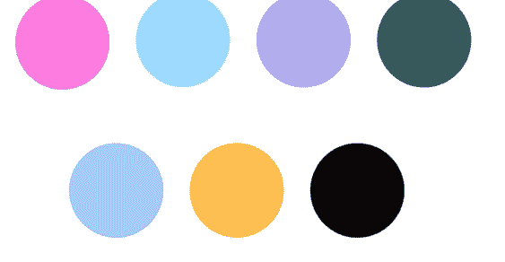

图 8.23 – 背景景色的色彩调色板

2. 使用图 8.23 中创建的色彩调色板为背景上色：

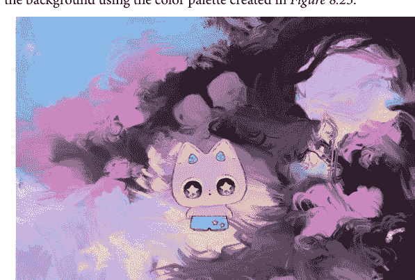

图 8.24 – 背景景色的底色

3. 渲染角色和背景绘画：

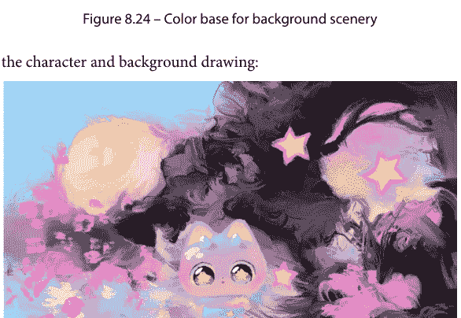

图 8.25 – 渲染角色和背景以使它们融合

4. 最后，使用 Procreate 中的色相、饱和度、亮度和曲线工具添加最终细节并增强色彩：

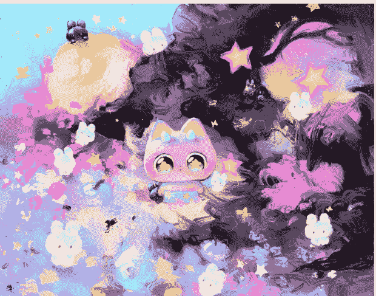

图 8.26 – 最终插画

你已完成场景！让我们看看这种融合技巧如何创造出感觉神奇的完成效果。

> 提示
> 融合插画时，我通常会将所有图层合并为一个。这可以改善笔触和纹理，并使角色更容易自然地与背景融合。然而，并非必须合并所有图层才能实现这一点——只需采用最适合你工作流程的融合方法即可。

## 理解技巧

要将角色融入背景，请确保背景颜色与角色颜色搭配良好。此步骤有助于你的插画感觉流畅自然，仿佛角色和背景本就注定在一起。良好的融合使人们更容易专注于你的故事。它还通过添加人们可以跟随并产生共鸣的故事来展现你作品的精华。

例如，在图 8.24 中，由于角色的主要颜色是紫色和蓝色，我使用三元配色方案挑选了蓝色、紫色和黄色等背景颜色。正如我们在第 5 章学到的，你可以使用任何取色方法来创建色彩调色板。只需确保背景颜色不会压倒角色。你可以为角色添加高光，使其成为作品的焦点。

请记住，你的目标不是完美，而是讲故事。Procreate 提供了图层设置、参考图像和绘画指南等工具，帮助你逐步构建角色。尽情享受、尝试并相信你的视野。你已完成角色设计，一切在其中汇聚成一个美丽的故事。在下一章中，我们将继续前进，探索构图如何引导观众的注意力并使你的插画更具力量。

## 总结

在本章中，我们学习了如何创造真正感觉属于其世界的角色。从使用三格法头脑风暴独特特征，到绘制富有表现力的设计并用色彩完成，我们打造了具有情感和背景故事的角色。我们还练习了从多个角度绘制角色以确保一致性，通过面部表情捕捉他们的个性，并将设计整理成完整的角色表用于作品集。最后，我们学习了如何通过协调光线、色彩调色板和氛围将这些角色融入背景插画中，从而创造出更生动的场景。

在下一章中，我们将探索构图的力量，以及它如何利用黄金螺旋、对角线等技巧引导观众的视线穿过你的插画。这些技巧将帮助你以创造平衡、焦点和叙事的方式放置角色和背景元素。

## 立即解锁本书的专属福利

扫描此二维码或访问 packtpub.com/unlock，然后按书名搜索本书。

