## 为视觉震撼的艺术完善构图

**构图**在艺术中指的是在插图中对视觉元素的排列，以创造和谐且引人注目的杰作。它涉及使用艺术中的一些主要元素，如平衡、对比和流动，来引导我们在插图中观众的视角。我们可以通过使用多种技巧来改善背景插图的构图，例如 C 形构图、黄金分割构图、圆形构图等等。这些技巧可用于各种艺术创作，例如绘制人像、角色设计和背景场景。

在本章中，我们将学习如何使用这些技巧使我们的插图看起来平衡且逼真，尤其是在绘制背景场景时。到本章结束时，我们将知道如何在艺术中创建良好的构图并提高绘制背景的技能。这将帮助我们理解如何使用背景插图来讲述故事。

我们将通过以下主题配合演示示例进行讲解：

- 开始学习背景构图
- 学习如何在艺术中使用 C 形构图
- 学习如何在艺术中使用 V 形构图
- 学习如何在艺术中使用不平衡构图
- 学习如何在艺术中使用平衡构图
- 学习如何使用对角线构图
- 学习如何在艺术中使用交叉构图
- 学习如何在艺术中使用圆形构图
- 学习如何在艺术中使用黄金分割构图

在开始本章之前，请阅读以下重要说明，以确保所有步骤都能顺利进行。这将有助于在整个过程中保持清晰和一致性。

> 重要说明
> 
> 在本章中，插图将分层绘制以保持调整的灵活性。图层应命名如下：*草图图层*、*构图图层*、*对比图层*和*最终插图图层*。这种结构化的方法确保艺术品的每个阶段都保持可编辑状态，允许在不影响之前步骤的情况下进行完善。像这样保持图层的有序会使创作过程更顺畅高效。我将在此说明之后留下图层放置的截图。

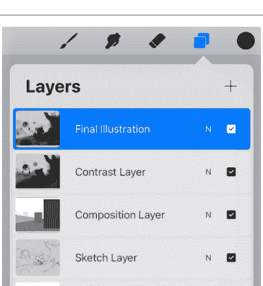

图 9.1 – 示例图层设置

### 开始学习背景构图

艺术中的构图意味着在插图中安排主体，使其看起来平衡且生动。这可以通过理解如何放置物体、颜色和纹理来实现，从而引导观众的视线、营造感受并传达信息。通过关注这些元素，我们可以创作出与人产生共鸣的艺术作品。然而，作为艺术家，我们在为背景插图创建良好构图时常常遇到困难。在本演示中，我们将学习深度构图技巧，以帮助我们创建平衡且引人注目的背景插图。

### 按照步骤进行

可以通过以下步骤为背景绘画添加深度构图：

1. 首先，构思你想要绘制的背景概念。头脑风暴想法并写下来。你可以参考我们在第 7 章中介绍的步骤，*头脑风暴和写下想法*，来指导你完成此过程。这将帮助你为背景插图创建一个清晰且结构化的计划。
2. 如图 9.2 所示，用不同的色彩值勾出主要设计元素。这是在深入详细渲染之前建立背景场景结构和流动的基础且有效的方法。通过大致塑造主要形态（前景、中景和背景），你本质上是在创建视觉路线图，有助于在整个构图过程中保持平衡、透视和叙事焦点。

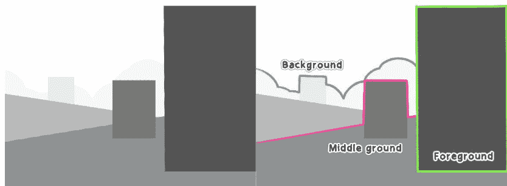

图 9.2 – 使用不同色彩值勾出元素以改善构图的示例

3. 接下来，使用我们在步骤 1 中开发的想法创建背景草图。为了增加构图的深度，让更靠近观众的物体显得更大，并将更远的物体画得更小。这种技巧将有助于在背景插图中营造出维度和透视感。此背景场景的主要焦点是中景中的角色，小女巫，如图 9.3 所示。
4. 通过重新绘制粗略草图，使其成为线条清晰的干净版本来完善它。这将有助于定义构图的细节和结构，使其为艺术作品的下一步做好准备。我在这一步和前一步中使用了 Procreate 的 Vine Charcoal 画笔。
5. 最后，对前景和中景区域应用阴影，以增强艺术作品中的深度和透视感。降低背景的色彩强度，使其更远离，并帮助小女巫作为焦点脱颖而出。你可以通过降低背景图层的透明度，或使用同一画笔或 Procreate 中的 Soft Airbrush 轻轻擦除其部分来实现这一点。

### 步骤 1

一位年轻的女巫踏上
旅程
在一个神奇的地方。

### 步骤 2

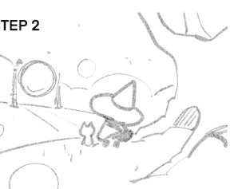

### 步骤 3

### 步骤 4

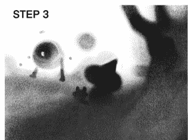

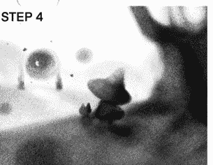

图 9.3 – 改善构图的逐步教程

6. 图 9.4 说明了将深度构图技巧应用于背景绘画后的成果。如图所示，插图看起来平衡且视觉上令人愉悦，使观众能够轻松理解你通过艺术分享的故事。

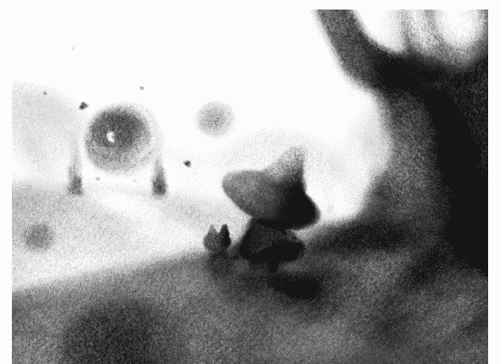

图 9.4 – 插图的最终结果

### 理解技巧

要创建良好的构图，在插图中添加焦点非常重要。在图 9.4 中，我将小女巫作为我的焦点。一旦你决定并添加了焦点，你就可以继续添加深度以创建良好的构图。为了增加深度，我们可以在前景和中景中靠近焦点的设计元素上添加阴影。这是为了确保观众的视线首先落在焦点上，然后再转向插图的其余部分。

请确保焦点与周围的物体相关，以营造和谐的氛围和流动。例如，在图 9.4 中，我们首先注意到的是小女巫和猫，然后是树，然后我们的视线慢慢移动到巨型神秘光球的方向。你可以在通向巨型光球的方向上添加其他细节，以增加背景场景的魅力。

### 常见错误及如何修正

作为艺术家，我们在为背景插图创建强有力的构图时常常遇到困难。让我们探讨几个常见错误以及如何改进它们，以获得更具吸引力和视觉效果的结果：

- **场景过于拥挤：**
  - **错误：** 背景细节太多，导致杂乱无章，难以阅读。
  - **如何修正：** 通过减少不必要的元素来简化构图。利用负空间确保场景的视觉清晰。
- **视线流动和方向不佳：**
  - **错误：** 观众的视线无法自然地穿过场景，使构图感觉零散。
  - **如何修正：** 使用引导线、曲线形状或对比度将观众的视线引导至焦点。道路或河流可以帮助为背景场景创造自然的流动。

> **重要说明**
> 
> 要创建良好的构图，它必须至少包含一个主要焦点，然后是次要焦点，以引导观众视线的方向。强有力的构图通常以主要焦点开始。这就是你希望观众首先看的东西。之后，拥有一个或多个次要焦点有助于引导观众浏览艺术作品的其余部分，创造流动和视觉趣味。

现在我们对构图的工作原理有了基本了解，让我们继续探索其他可以增强插图并使其更引人注目的构图技巧。我们将从学习 C 形构图开始。

## 学习如何在艺术中使用 C 形构图

**C 形构图** 在艺术中指的是构成作品内部 C 形流动或路径的特定元素排列。这种构图技巧引导观者的视线环绕作品，营造出动感并将其引向焦点。C 形可以通过策略性的形状和色彩形成，这些形状和色彩常模仿自然形态，例如树干的形状或新月。

这种构图技巧有助于营造深度和动感，引导观者探索作品。使用 C 形构图可能很困难，因为很难找到类似 C 形流动的物体。在本教程中，我们将学习如何将 C 形构图应用于背景场景，以及如何以弯曲的 C 布局排列元素，创造出吸引观者注意力的自然流动。

### 按步骤进行

绘制背景场景的 C 形构图可以按如下步骤进行：

- 1. 首先在空白画布上画一个 C 形，如图 9.5 中的 *步骤 1* 所示。
- 2. 确定构图中要包含的关键元素并确定其沿 C 形的放置位置。标记区域如下：
  - *区域 1：* 星星（主要焦点）
  - *区域 2 和区域 3：* 树枝和猫
  - *区域 4：* 小女巫
- 3. 勾勒背景场景，将重要细节融入各自的区域。
- 4. 最后，为前景和中景区域添加阴影，以增强作品的深度和透视感。降低背景的色彩强度，使其更远，并帮助小女巫作为主要焦点突出。你可以通过降低背景图层的透明度，或使用相同画笔或柔软空气画笔轻轻擦除其部分来实现。

### 步骤 1

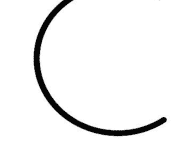

### 步骤 2

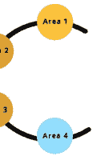

### 步骤 3

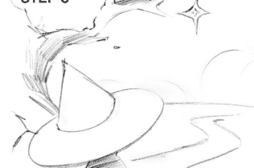

### 步骤 4

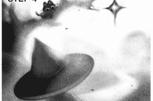

图 9.5 – 使用 C 形构图的逐步教程

图 9.6 显示了只需按照本逐步教程即可达到的效果：

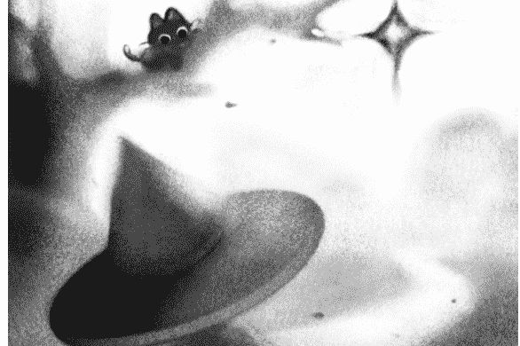

图 9.6 – 插图的最终效果

这就是我们在背景绘画中应用 C 形构图的方法。让我们来看看这种技巧是如何运作的。

### 理解技巧

绘制 C 形构图是我们可应用于背景场景的最简单、最容易的技巧，因为你只需沿着 C 形绘制细节，就能成功创造出良好的构图。对于图 9.6，我将星星和猫绘制为主焦点和次要焦点。随后是小女巫、树和一条长路。从观者的角度来看，他们会先关注星星，然后是猫，然后是树干，接着是小女巫，最后是通往地平线的长路。我们绘制的树形似 C 形。

使用 C 形构图并不需要真正画一棵树或完美的 C。你可以画任何东西，只要形状以曲线排列，引导观者的视线呈 C 形即可。在图 9.5 中，我没有画出精确的 C。我只是利用形状的概念来帮助引导视线。所以请记住，C 只是一个指南，帮助你以流畅的方式放置事物；它不必完美。

### 常见错误及如何修正

虽然 C 形构图是引导观者视线的有力方式，但我们有时会难以让曲线足够强劲以创造自然流动。让我们探讨一个常见错误以及如何改进它，以获得更具动感和视觉吸引力的效果：

- **错误：** 焦点放置在曲线之外，打断了自然流动
- **如何修正：** 确保焦点位于曲线内或靠近曲线中心，以便观者的视线自然跟随形状

现在我们已经了解了如何使用 C 形构图让曲线引导观者视线，让我们尝试更 bold 的做法。接下来，我们将探索 V 形构图，它非常适合营造戏剧感并将焦点导向场景中的有力点。

## 学习如何在艺术中使用 V 形构图

**V 形构图** 在艺术中指的是元素被定位以形成 V 形的结构性排列。这在作品中营造出动感、方向和流动感。这种构图类型引导观者的视线朝向焦点，通常位于 V 的顶点，可用于强调重要元素。它还能唤起稳定和平衡的感觉，因为 V 的两侧在引导视线的同时营造出和谐感。

它也常被用来在作品中唤起戏剧感和行动感。使用 V 形构图可能很困难，因为强行形成 V 形可能导致杂乱或不自然的场景。我们有时难以在可信的深度和氛围中平衡形状。在本教程中，我将分享一个逐步教程，教你如何为背景绘画创建完美的 V 形构图。

### 按步骤进行

绘制背景场景的 V 形构图可以按如下步骤进行：

- 1. 首先在空白画布上画一个 V 形，如图 9.7 中的步骤 1 所示。
  确定构图中要包含的关键元素并确定其沿 V 形的放置位置。标记区域如下：
  - 区域 1 和区域 2：树木
  - 区域 3：小女巫和猫（主要焦点）
- 2. 勾勒背景场景，将重要细节融入各自的区域。
- 3. 最后，为前景和中景区域添加阴影，以增强作品的深度和透视感。

对于此构图，我有意将背景留空，以营造神秘和未知的感觉。如果添加任何背景元素，它们应以比前景和中景更低的色彩值渲染，以保持适当的深度和焦点。让我们更仔细地看看场景是如何一步步构建的，使用 V 形构图引导观者的视线朝向焦点。

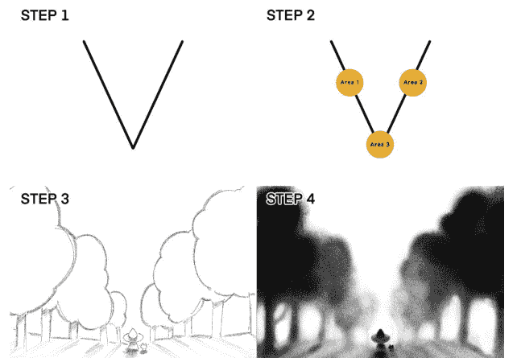

图 9.7 – 使用 V 形构图的逐步教程

*图 9.8 显示了只需按照本逐步教程即可达到的效果：*

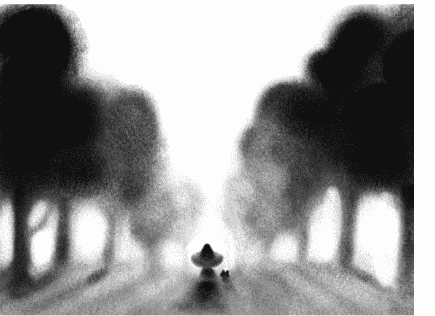

图 9.8 – 插图的最终效果

这就是我们在背景绘画中应用 V 形构图的方法。让我们来看看这种技巧是如何运作的。

### 理解技巧

V 形构图应用起来有点具有挑战性，因为在自然环境中它并不总是立即显而易见。与更明显的构图结构不同，V 形通常需要有意构建或微妙暗示。为了更容易，你可以围绕 V 形绘制细节，而主要物体将在两条线相交处作为主要焦点绘制。在图 9.8 中，我们可以看到树木是朝向小女巫和猫绘制的。这是为了确保观者的视线方向移动到位于 V 顶点的小女巫和猫。你可以在区域 1 和区域 2 中添加一些细节，使插图对观众来说更详细、更迷人，例如鸟类、更详细的树叶和地上的花朵。通过仔细排列元素形成 V 形，我们可以引导观者的视线朝向主体，并在场景中营造出强烈的方向感。即使这种构图可能不会自然出现，通过深思熟虑的放置，例如树木向内指向或沿两侧添加细节，我们可以为这种构图创造出视觉上有趣的场景。

### 常见错误及如何修正

V 形构图自然地将注意力导向焦点，但如果结构太弱，场景可能会显得零散。让我们看看一个常见陷阱以及如何修正它：

- **错误：** 焦点太弱或缺乏对比，导致其与背景融合
- **如何修正：** 使用光线、饱和度或纹理在 V 的顶点增加对比度，使焦点突出

> **提示**
> 除了树木，你还可以使用山脉和云朵来打造有效的 V 形构图。例如，两座山坡汇聚成 V 形，自然地将注意力导向场景中的关键元素，如蜿蜒的河流或远处的山峰。同样，云朵形成指向人物的 V 形。这种排列有助于突出中心焦点，同时赋予作品动感和平衡感。

虽然 V 形赋予我们对称性和强烈的焦点，但有时打破平衡会创造出更多视觉趣味。让我们看看不平衡构图如何利用对比和张力来保持观者的参与度。

## 学习如何在艺术中使用不平衡构图

**不平衡构图** 可以是艺术中一种强大的技巧，因为它创造了张力和动感。要有效使用不平衡构图，请考虑在画面内不对称地放置元素，其中元素不是镜像或两侧均匀平衡，但仍感觉视觉和谐。这可能涉及将焦点置于画面中心之外，或改变视觉元素，例如大小、颜色或纹理的差异。主要目标是通过作品引导观者的视线，营造动感和运动感。这种技巧常被忽视，因为我们担心它可能由于其简单性而导致重复或乏味的构图。在本教程中，我将分享一种有趣且简单的方法，使用这种构图技巧创建引人注目的背景绘画。

### 按步骤进行

以下是你如何为背景场景创建不平衡构图的方法：

- 1. 首先在空白画布上画两个不同大小的矩形，如 *图 9.9* 所示。

2. 确定构图需要包含的关键元素，并在两个矩形形状中确定它们的位置。按如下方式标记区域：
- 区域 1: 小女巫、猫和树（主要焦点）
- 区域 2: 小房子

3. 勾勒背景景色，将重要细节融入各自的区域。

4. 最后，为前景和中景区域添加阴影，以增强作品的深度和透视感。降低背景的色彩强度，使其更远离，并帮助小女巫作为焦点突出。你可以通过降低背景图层的透明度，或使用相同画笔或柔软空气画笔轻轻擦除其部分来实现。

### 步骤 1

### 步骤 2

### 步骤 3

### 步骤 4

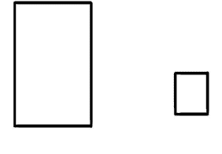

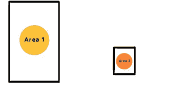

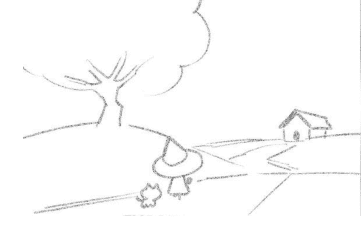

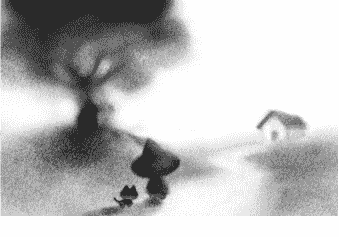

Figure 9.9 – 使用不平衡构图的逐步教程

Figure 9.10 显示了只需按照此逐步指导即可实现的效果：

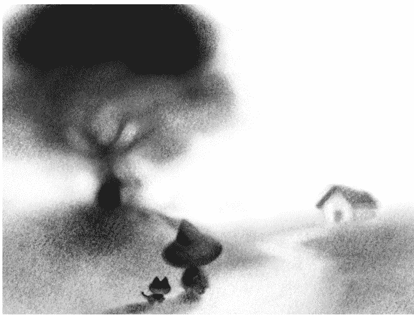

Figure 9.10 – 插图的最终结果

这就是我们将不平衡构图应用于背景绘画的方式。让我们看看这种技术是如何运作的。

## 理解技巧

在 Figure 9.10 中，我们描绘了一棵树、一位小女巫、一只猫和一座小房子，其中较大且更详细的物体置于前景，较小的物体置于背景。通过调整它们的大小，我们能够在背景景色中营造出深度和动感。这种技术有助于建立强烈的透视感，自然地引导观众的注意力朝向道路尽头，并将焦点吸引到尽头的小房子上。

主要焦点是小女巫、猫和树，观众的注意力自然地沿着道路向下引导，指向远处的小房子。为了增强构图，你可以在道路沿线添加更多细节，如栅栏或鲜花，以赋予场景更多魅力并营造出欢迎的感觉。或者，增加小女巫的对比度可以使整体插图更具视觉冲击力和吸引力。这幅背景景色展示了如何谨慎使用大小、对比度和方向来使画面感觉深邃且引人入胜。观众的眼睛自然地沿着道路从前方跟随到远处的小房子，营造出一种惊奇和温暖的感觉，就像被邀请与小女巫一起走进宁静、神奇的世界。

## 常见错误及如何修正

不平衡构图创造了动感和张力，但如果处理不当，会感觉混乱而非有意为之。以下是如何将其精炼以获得更具吸引力的效果：

- **错误：** 次要焦点过强，与主体竞争
- **如何修正：** 减少次要焦点的细节和对比度，使其起到支持作用而非分散对主体的注意力

虽然不平衡构图通过大小对比和不对称创造动感，但有些场景需要的是宁静和静止的感觉。这时就需要平衡构图了。在下一个指导中，我们将探讨如何使用对称和均匀放置的视觉元素来帮助在背景插图中营造出宁静而稳定的氛围。

## 学习如何在艺术中使用平衡构图

**平衡** 在构图中指的是在作品中对具有相同特征或大小的主体进行均匀分布，从而营造出宁静的氛围。对称平衡涉及在中心轴两侧镜像元素，营造出正式而稳定的外观。为了有效地使用平衡，我们应考虑元素的位置、主体的视觉外观以及背景景色的整体氛围，以确保构图感觉稳定而宁静。

这种构图是最简单的构图技巧之一，但我们往往会避免使用它，因为我们不确定要画什么才能创造出平衡的构图。在本指导中，我们将学习如何在背景景色中重现这种平衡。

## 按照步骤进行

绘制背景景色的平衡构图可以按如下方式进行：

- 1. 首先在空白画布上绘制两个镜像的矩形形状，如 *Figure 9.11* 所示。
- 2. 确定构图需要包含的关键元素，并在两个矩形形状中确定它们的位置。按如下方式标记区域：
  - *区域 1:* 狐狸雕像（主要焦点）
  - *区域 2:* 狐狸雕像（主要焦点）
- 3. 勾勒背景景色，将重要细节融入各自的区域。
- 4. 最后，为前景和中景区域添加阴影，以增强作品的深度和透视感。降低背景的色彩强度，使其更远离，并帮助小女巫作为焦点突出。你可以通过降低背景图层的透明度，或使用相同画笔或柔软空气画笔轻轻擦除其部分来实现。

### 步骤 1

### 步骤 2

### 步骤 3

### 步骤 4

区域 1

区域 2

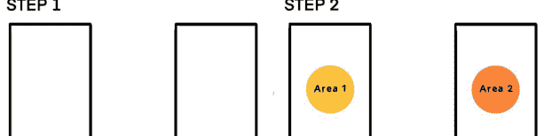

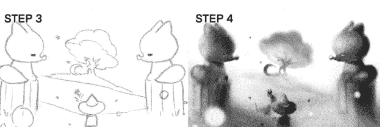

Figure 9.11 – 使用平衡构图的逐步教程

Figure 9.12 显示了只需按照此逐步指导即可实现的效果：

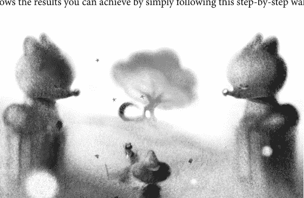

Figure 9.12 – 插图的最终结果

这就是我们将平衡构图应用于背景绘画的方式。让我们看看这种技术是如何运作的。

## 理解技巧

平衡构图可以通过在空白画布上添加两个对称的矩形来创建，主要焦点位于每个矩形的中心（区域 1 和区域 2）。在这些区域，我们绘制了两座相对而立的狐狸雕像。为了使它们突出，我们可以在这些区域添加更多细节，以便观众的眼睛先聚焦于它们，然后再看整幅插图。在平衡的布局中，你可以在区域 1 和区域 2 中放置任何设计元素，如树木、建筑物或鲜花，只要它们的高度和大小相似即可。当场景的两侧感觉均衡时，就能营造出宁静和谐的构图，易于观众欣赏。

在区域 1 和区域 2 之外，我们添加了风景背景，并在狐狸雕像之间放置了小女巫和猫作为次要焦点。在远处，我们画了一棵大树，暗示角色正凝视着它。为了让树更具魔幻感，我们在它下方添加了一个新月形状。

## 常见错误及如何修正

虽然平衡构图是最容易应用的技巧之一，但艺术家有时会难以使其感觉自然且引人入胜。让我们探讨一个常见错误以及如何将其精炼以获得更具动感和视觉吸引力的效果：

- **错误：** 主要和次要焦点分布过于均匀，使观众难以知道首先关注哪里
- **如何修正：** 通过添加更多细节或对比度来强化主要焦点，以引导观众的注意力

在了解了平衡构图之后，让我们再次打破常规！对角线构图为画面带来能量和动感，非常适合需要运动感或方向感的场景。接下来让我们看看这一点。

## 学习如何使用对角线构图

**对角线构图** 涉及在作品中放置两条相交或指向焦点的对角线，从而营造出动感和深度。要使用这种构图，首先确定作品中的主要主体和期望的强调点。然后，创建一条引导观众视线朝向该焦点的对角线。这种技术有助于建立强烈的张力，并可以增强作品的整体故事性，使其更具吸引力和动感。

我们可以在草图或习作中练习这种构图，以加深对该构图的理解。使用这种构图可能很困难，尤其是当我们刚开始使用这种技巧时。在本教程中，我们将学习如何在背景场景中有效地使用这种构图技巧。

## 按步骤进行

为背景场景绘制对角线构图可以按以下步骤进行：

- 1. 首先在空白画布上画一条对角线，如图 9.13 所示。
- 2. 确定构图中要包含的关键元素，并在对角线上确定其位置。标记区域如下：
  - Area 1: 山丘、小女巫和猫（主要焦点）
- 3. 勾勒背景场景，将重要细节融入各自的区域。
- 4. 最后，为前景和中景区域添加阴影，以增强作品的深度和透视感。对于这种构图，我有意将背景留空，以营造一种宁静和未知的感觉。如果添加任何背景元素，它们应使用比前景和中景更低的色彩值来呈现，以保持适当的深度和焦点。

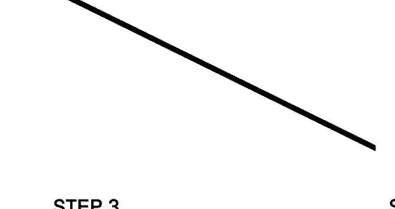

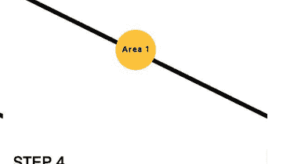

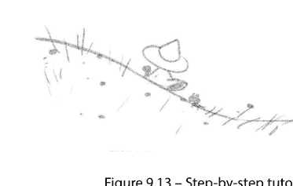

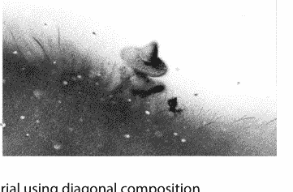

Figure 9.13 – 使用对角线构图的逐步教程

图 9.14 显示了只需按照本逐步教程即可达到的效果：

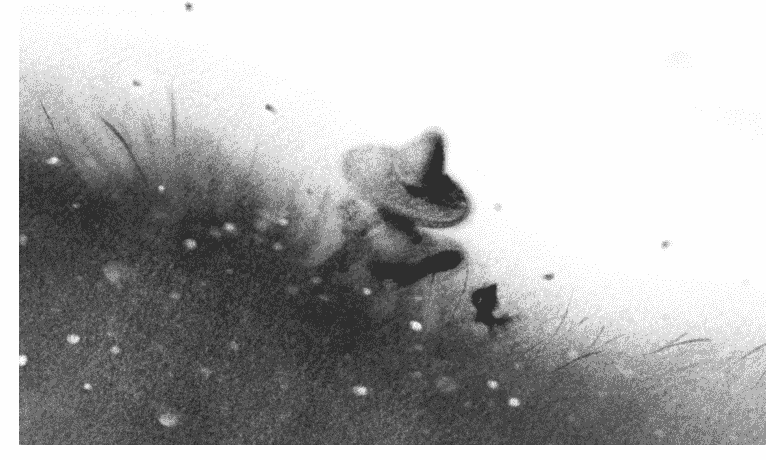

Figure 9.14 – 插图的最终效果

这就是我们将对角线构图应用于背景绘画的方式。让我们来看看这种技巧是如何运作的。

## 理解技巧

在这幅作品中，对角线有助于引导整个场景。我从左上到右下绘制它，轻轻地引导观众的视线穿过页面。为了增加一点故事性，我将小女巫和猫作为主要焦点放置，让它们走向神秘的事物。这让人感到好奇并增添了一丝惊奇。我在山丘沿线添加了柔和的点缀，如小花和草，使旅程感觉更具魔力，但我保持简洁，以便焦点保持在角色上。我有意将背景大部分留空。这样，观众会觉得被吸引到山丘和角色正在走的路径上。如果你想添加背景，那完全没问题！只要确保它不会分散小女巫和猫的注意力即可。这种构图风格增添了宁静的动感，非常适合宁静的讲故事时刻。

## 常见错误及如何修正

对角线构图很适合营造动感，但如果对角线没有引导到清晰的焦点，构图就会显得混乱。让我们探讨一个常见错误以及如何改进以获得更强的视觉冲击力：

- **Mistake**: 对角线元素太弱，导致构图失去动态能量。
- **How to fix**: 使用强烈的光影对比、动态形状或流动的布料、被风吹动的草等运动元素来强化对角线。例如，在插图的主要焦点上添加强烈的亮部和高细节。

对角线有助于引导视线在画布上移动，而交叉构图则帮助我们营造更结构化的氛围。让我们看看相交线条如何框定焦点并带来平衡与动感。

## 学习如何在艺术中使用交叉构图

**Cross composition** 在艺术中指的是创建平衡的背景绘画的技术，强调中央焦点。它可以通过使用引导观众视线穿过作品的相交线条来创造动态视觉艺术。要创建交叉构图，我们应专注于创造清晰的焦点并平衡元素以保持和谐的氛围。交叉构图可以通过使用垂直和水平线将画布分成四个部分来创建。我们通常将这种构图用于树木、自然风景等，例如湖上的船。船将画在垂直线上，而湖则画在水平线上。作为艺术家，由于构图的复杂性，构图工作可能具有挑战性。然而，在本逐步教程中，我们将简化流程并探索如何轻松地将构图融入作品中。

> **Tip**
> 虽然交叉构图通常使用引导动态运动的相交对角线构建，但在本次教程中，我们将演示一种使用垂直和水平线的变体。这两种方法都强调中央焦点和平衡布局，因此请根据场景的需求或偏好随意调整交叉结构。

## 按步骤进行

以下是如何为背景场景创建交叉构图的方法——比你想象的更简单：

- 1. 首先在空白画布上勾勒两条相交线，一条垂直一条水平，形成一个十字，将画布分成四个部分，如图 9.15 所示。
- 2. 确定构图中要包含的关键元素，并在两条相交的垂直和水平线上确定其位置。标记区域如下：
  - Area 1: 云朵
  - Area 2: 小女巫和猫（主要焦点）
  - Area 3: 草地
- 3. 勾勒背景场景，将重要细节融入各自的区域。
- 4. 最后，为前景和中景区域添加阴影，以增强作品的深度和透视感。降低背景的色彩强度，使其更远，并帮助小女巫作为焦点脱颖而出。你可以通过降低背景图层的透明度，或使用相同画笔或柔软空气画笔轻轻擦除其部分来实现。

### 步骤 1

### 步骤 2

### 步骤 3

### 步骤 4

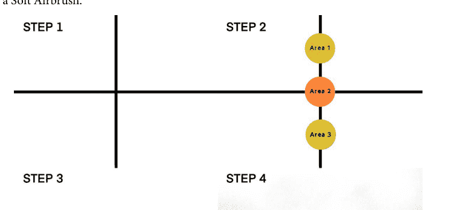

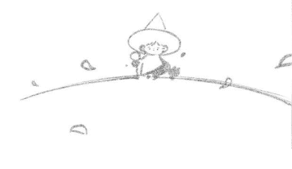

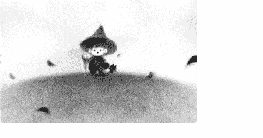

Figure 9.15 – 使用交叉构图的逐步教程

图 9.16 显示了只需按照本逐步教程即可达到的效果：

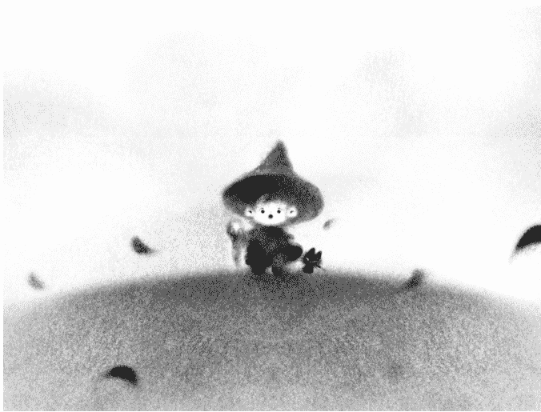

Figure 9.16 – 插图的最终效果

这就是我们将交叉构图应用于背景绘画的方式。让我们来看看这种技巧是如何运作的。

## 理解技巧

要在空白画布上创建交叉构图，首先勾勒两条相交的水平和垂直线形成一个十字，将画布分成四个部分。主要焦点将绘制在画布中间线条相交处。在图 9.16 中，我将小女巫和猫放在中心作为主要焦点，以帮助它们脱颖而出。我希望它感觉像是她们刚刚发现了某种魔法的东西，将观众的注意力直接吸引到那一刻。将主要主体放在这里自然会引导视线到场景的主要焦点。围绕它们，我添加了细微的背景元素，如远处的云朵和广阔的草地，以支持主要焦点而不掩盖它。为了营造深度，我绘制了不同大小的散落草丛向观众漂移。这个小细节有助于背景感觉不那么平坦，使整幅插图更充满生机。

## 常见错误及如何修正

交叉构图有助于创造强烈的焦点，但如果相交线条不能有效地框定主体，构图就会显得脱节。让我们探讨一个常见错误以及如何改进以获得更连贯的效果：

- **Mistake:** 背景元素压倒了焦点，使其难以区分
- **How to fix:** 在保持焦点清晰细致的同时，降低背景的对比度或饱和度

在使用强烈的相交线条之后，圆形构图提供了一种更柔和的方法；它以流畅、连续的运动引导观众的视线环绕场景。这种技巧在你希望中心主体在环境中脱颖而出时特别有用。接下来让我们看看这一点。

## 学习如何在艺术中使用圆形构图

**Circular composition** 是一种将主体安排成引导观众视线以圆形运动环绕作品的技术。要使用圆形构图，首先确定一个吸引观众注意力的中心焦点。从这一点出发，将其他元素安排成向外辐射或回向中心的曲线或线条，营造出动感。

这种构图通常在你希望观众关注你想通过艺术传达的内容时绘制。例如，如果你想介绍你的新角色，你可以将其画在人群中心，以吸引观众的注意力到你的新角色上。使用圆形构图绘制可能有点困难，因为我们不确定可以画什么来体现圆形运动。在本教程中，我们将学习如何在艺术中轻松使用圆形构图。

## 按步骤进行

为背景场景绘制圆形构图可以按以下步骤进行：

- 1. 首先在空白画布上画一个圆形，如图 9.17 所示。
- 2. 确定你想在构图中包含的关键元素，并决定将它们放置在圆内和圆外边缘的位置。你可以这样标记区域：
  - *Area 1:* 月亮和小女巫（主要焦点）
  - *Area 2:* 发光的星星和萤火虫
- 3. 勾勒背景场景，将重要细节融入各自的区域。
- 4. 最后，为前景和中景区域添加阴影，以增强作品的深度和透视感。降低背景的色彩强度，使其更远，并帮助小女巫作为焦点脱颖而出。你可以通过以下方式实现：

降低背景图层的透明度，或使用同一画笔或柔软喷枪轻轻擦除其部分。

### 第 1 步

### 第 2 步

### 第 3 步

### 第 4 步

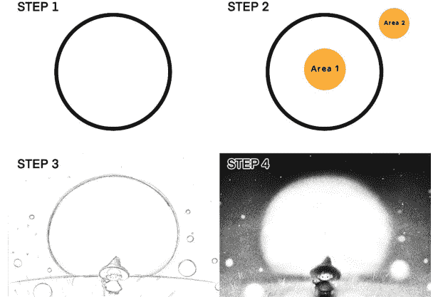

图 9.17 – 使用圆形构图的逐步教程

图 9.18 显示了只需按照此逐步指导即可实现的效果：

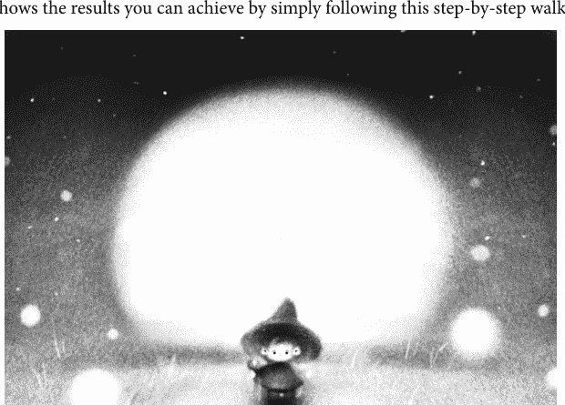

图 9.18 – 插图的最终效果

这就是我们在背景绘画中应用圆形构图的方法。让我们来看看这种技巧是如何运作的。

## 理解技巧

对于圆形构图，在画布上画一个圆，作为主要细节的指导。在区域 1 中，我们将绘制主要焦点。在图 9.18 中，我选择了满月和小女巫作为背景场景的主要焦点。月亮效果很好，因为它的圆形形状与圆形构图非常契合。但不用担心，你不需要把所有东西都画成完美的圆形。只要你的主要元素遵循圆形运动，构图就会显得平衡。例如，形状圆润的湖泊也能同样出色。为了增加对比，我在月亮周围放置了发光的星星，使天空显得生动，同时突出月亮。我给小女巫使用了较暗的色值，这样她就能在身后明亮的夜空和发光的月亮映衬下脱颖而出。为了将一切融合在一起，我在田野中添加了草地纹理，并画了几只萤火虫。有些萤火虫画得更大更近，而有些则更小更远。这有助于为插图增添深度感。只要确保月亮周围的细节保持柔和和微妙即可，这样它们就不会分散对主要焦点的注意力。

## 常见错误及如何修正

圆形构图有助于创造流畅、连续的流动，但如果圆形运动不够强，观众的视线可能会游离。让我们探讨一个常见错误以及如何修正它：

- **错误：** 焦点放置在圆形流动之外，打乱了构图
- **如何修正：** 确保焦点位于圆形排列的中心或附近，以便观众的视线能顺畅地围绕它移动

## 了解更多…

除了池塘之外，我们还可以使用排列成圆形图案的花坛，为花园场景营造整洁和谐的外观。环绕雕像或喷泉等特征的弯曲小径也能自然地形成圆形流动，引导观众的注意力并为构图增添平衡感。这些元素在风景画中重现圆形效果时效果非常出色！

我们已经“画”了完整的圆，字面意义上！现在，让我们转向更高级的布局：黄金分割。这种永恒的构图技巧利用自然的完美比例构建出 effortless 且引人注目的场景。

## 学习如何在艺术中使用黄金分割构图

黄金分割，也称为黄金比例（1.618），是一种数学比例，已在艺术和设计中被使用了几个世纪，用于创造平衡且视觉上[content]
降低背景图层的透明度，或使用同一画笔或柔软喷枪轻轻擦除其部分。

### 第 1 步

### 第 2 步

### 第 3 步

### 第 4 步

图 9.17 – 使用圆形构图的逐步教程

图 9.18 显示了只需按照此逐步指导即可实现的效果：

图 9.18 – 插图的最终效果

这就是我们在背景绘画中应用圆形构图的方法。让我们来看看这种技巧是如何运作的。

## 理解技巧

对于圆形构图，在画布上画一个圆，作为主要细节的指导。在区域 1 中，我们将绘制主要焦点。在图 9.18 中，我选择了满月和小女巫作为背景场景的主要焦点。月亮效果很好，因为它的圆形形状与圆形构图非常契合。但不用担心，你不需要把所有东西都画成完美的圆形。只要你的主要元素遵循圆形运动，构图就会显得平衡。例如，形状圆润的湖泊也能同样出色。为了增加对比，我在月亮周围放置了发光的星星，使天空显得生动，同时突出月亮。我给小女巫使用了较暗的色值，这样她就能在身后明亮的夜空和发光的月亮映衬下脱颖而出。为了将一切融合在一起，我在田野中添加了草地纹理，并画了几只萤火虫。有些萤火虫画得更大更近，而有些则更小更远。这有助于为插图增添深度感。只要确保月亮周围的细节保持柔和和微妙即可，这样它们就不会分散对主要焦点的注意力。

## 常见错误及如何修正

圆形构图有助于创造流畅、连续的流动，但如果圆形运动不够强，观众的视线可能会游离。让我们探讨一个常见错误以及如何修正它：

- **错误：** 焦点放置在圆形流动之外，打乱了构图
- **如何修正：** 确保焦点位于圆形排列的中心或附近，以便观众的视线能顺畅地围绕它移动

## 了解更多…

除了池塘之外，我们还可以使用排列成圆形图案的花坛，为花园场景营造整洁和谐的外观。环绕雕像或喷泉等特征的弯曲小径也能自然地形成圆形流动，引导观众的注意力并为构图增添平衡感。这些元素在风景画中重现圆形效果时效果非常出色！

我们已经“画”了完整的圆，字面意义上！现在，让我们转向更高级的布局：黄金分割。这种永恒的构图技巧利用自然的完美比例构建出 effortless 且引人注目的场景。

## 学习如何在艺术中使用黄金分割构图

黄金分割，也称为黄金比例（1.618），是一种数学比例，已在艺术和设计中被使用了几个世纪，用于创造平衡且视觉上[content]
降低背景图层的透明度，或使用同一画笔或柔软喷枪轻轻擦除其部分。

### 第 1 步

### 第 2 步

### 第 3 步

### 第 4 步

图 9.17 – 使用圆形构图的逐步教程

图 9.18 显示了只需按照此逐步指导即可实现的效果：

图 9.18 – 插图的最终效果

这就是我们在背景绘画中应用圆形构图的方法。让我们来看看这种技巧是如何运作的。

## 理解技巧

对于圆形构图，在画布上画一个圆，作为主要细节的指导。在区域 1 中，我们将绘制主要焦点。在图 9.18 中，我选择了满月和小女巫作为背景场景的主要焦点。月亮效果很好，因为它的圆形形状与圆形构图非常契合。但不用担心，你不需要把所有东西都画成完美的圆形。只要你的主要元素遵循圆形运动，构图就会显得平衡。例如，形状圆润的湖泊也能同样出色。为了增加对比，我在月亮周围放置了发光的星星，使天空显得生动，同时突出月亮。我给小女巫使用了较暗的色值，这样她就能在身后明亮的夜空和发光的月亮映衬下脱颖而出。为了将一切融合在一起，我在田野中添加了草地纹理，并画了几只萤火虫。有些萤火虫画得更大更近，而有些则更小更远。这有助于为插图增添深度感。只要确保月亮周围的细节保持柔和和微妙即可，这样它们就不会分散对主要焦点的注意力。

## 常见错误及如何修正

圆形构图有助于创造流畅、连续的流动，但如果圆形运动不够强，观众的视线可能会游离。让我们探讨一个常见错误以及如何修正它：

- **错误：** 焦点放置在圆形流动之外，打乱了构图
- **如何修正：** 确保焦点位于圆形排列的中心或附近，以便观众的视线能顺畅地围绕它移动

## 了解更多…

除了池塘之外，我们还可以使用排列成圆形图案的花坛，为花园场景营造整洁和谐的外观。环绕雕像或喷泉等特征的弯曲小径也能自然地形成圆形流动，引导观众的注意力并为构图增添平衡感。这些元素在风景画中重现圆形效果时效果非常出色！

我们已经“画”了完整的圆，字面意义上！现在，让我们转向更高级的布局：黄金分割。这种永恒的构图技巧利用自然的完美比例构建出 effortless 且引人注目的场景。

## 学习如何在艺术中使用黄金分割构图

黄金分割，也称为黄金比例（1.618），是一种数学比例，已在艺术和设计中被使用了几个世纪，用于创造平衡且视觉上[content]
降低背景图层的透明度，或使用同一画笔或柔软喷枪轻轻擦除其部分。

### 第 1 步

### 第 2 步

### 第 3 步

### 第 4 步

图 9.17 – 使用圆形构图的逐步教程

图 9.18 显示了只需按照此逐步指导即可实现的效果：

图 9.18 – 插图的最终效果

这就是我们在背景绘画中应用圆形构图的方法。让我们来看看这种技巧是如何运作的。

## 理解技巧

对于圆形构图，在画布上画一个圆，作为主要细节的指导。在区域 1 中，我们将绘制主要焦点。在图 9.18 中，我选择了满月和小女巫作为背景场景的主要焦点。月亮效果很好，因为它的圆形形状与圆形构图非常契合。但不用担心，你不需要把所有东西都画成完美的圆形。只要你的主要元素遵循圆形运动，构图就会显得平衡。例如，形状圆润的湖泊也能同样出色。为了增加对比，我在月亮周围放置了发光的星星，使天空显得生动，同时突出月亮。我给小女巫使用了较暗的色值，这样她就能在身后明亮的夜空和发光的月亮映衬下脱颖而出。为了将一切融合在一起，我在田野中添加了草地纹理，并画了几只萤火虫。有些萤火虫画得更大更近，而有些则更小更远。这有助于为插图增添深度感。只要确保月亮周围的细节保持柔和和微妙即可，这样它们就不会分散对主要焦点的注意力。

## 常见错误及如何修正

圆形构图有助于创造流畅、连续的流动，但如果圆形运动不够强，观众的视线可能会游离。让我们探讨一个常见错误以及如何修正它：

- **错误：** 焦点放置在圆形流动之外，打乱了构图
- **如何修正：** 确保焦点位于圆形排列的中心或附近，以便观众的视线能顺畅地围绕它移动

## 了解更多…

除了池塘之外，我们还可以使用排列成圆形图案的花坛，为花园场景营造整洁和谐的外观。环绕雕像或喷泉等特征的弯曲小径也能自然地形成圆形流动，引导观众的注意力并为构图增添平衡感。这些元素在风景画中重现圆形效果时效果非常出色！

我们已经“画”了完整的圆，字面意义上！现在，让我们转向更高级的布局：黄金分割。这种永恒的构图技巧利用自然的完美比例构建出 effortless 且引人注目的场景。

## 学习如何在艺术中使用黄金分割构图

黄金分割，也称为黄金比例（1.618），是一种数学比例，已在艺术和设计中被使用了几个世纪，用于创造平衡且视觉上[content]
降低背景图层的透明度，或使用同一画笔或柔软喷枪轻轻擦除其部分。

### 第 1 步

### 第 2 步

### 第 3 步

### 第 4 步

图 9.17 – 使用圆形构图的逐步教程

图 9.18 显示了只需按照此逐步指导即可实现的效果：

图 9.18 – 插图的最终效果

这就是我们在背景绘画中应用圆形构图的方法。让我们来看看这种技巧是如何运作的。

## 理解技巧

对于圆形构图，在画布上画一个圆，作为主要细节的指导。在区域 1 中，我们将绘制主要焦点。在图 9.18 中，我选择了满月和小女巫作为背景场景的主要焦点。月亮效果很好，因为它的圆形形状与圆形构图非常契合。但不用担心，你不需要把所有东西都画成完美的圆形。只要你的主要元素遵循圆形运动，构图就会显得平衡。例如，形状圆润的湖泊也能同样出色。为了增加对比，我在月亮周围放置了发光的星星，使天空显得生动，同时突出月亮。我给小女巫使用了较暗的色值，这样她就能在身后明亮的夜空和发光的月亮映衬下脱颖而出。为了将一切融合在一起，我在田野中添加了草地纹理，并画了几只萤火虫。有些萤火虫画得更大更近，而有些则更小更远。这有助于为插图增添深度感。只要确保月亮周围的细节保持柔和和微妙即可，这样它们就不会分散对主要焦点的注意力。

## 常见错误及如何修正

圆形构图有助于创造流畅、连续的流动，但如果圆形运动不够强，观众的视线可能会游离。让我们探讨一个常见错误以及如何修正它：

- **错误：** 焦点放置在圆形流动之外，打乱了构图
- **如何修正：** 确保焦点位于圆形排列的中心或附近，以便观众的视线能顺畅地围绕它移动

## 了解更多…

除了池塘之外，我们还可以使用排列成圆形图案的花坛，为花园场景营造整洁和谐的外观。环绕雕像或喷泉等特征的弯曲小径也能自然地形成圆形流动，引导观众的注意力并为构图增添平衡感。这些元素在风景画中重现圆形效果时效果非常出色！

我们已经“画”了完整的圆，字面意义上！现在，让我们转向更高级的布局：黄金分割。这种永恒的构图技巧利用自然的完美比例构建出 effortless 且引人注目的场景。

## 学习如何在艺术中使用黄金分割构图

黄金分割，也称为黄金比例（1.618），是一种数学比例，已在艺术和设计中被使用了几个世纪，用于创造平衡且视觉上[content]
降低背景图层的透明度，或使用同一画笔或柔软喷枪轻轻擦除其部分。

### 第 1 步

### 第 2 步

### 第 3 步

### 第 4 步

图 9.17 – 使用圆形构图的逐步教程

图 9.18 显示了只需按照此逐步指导即可实现的效果：

图 9.18 – 插图的最终效果

这就是我们在背景绘画中应用圆形构图的方法。让我们来看看这种技巧是如何运作的。

## 理解技巧

对于圆形构图，在画布上画一个圆，作为主要细节的指导。在区域 1 中，我们将绘制主要焦点。在图 9.18 中，我选择了满月和小女巫作为背景场景的主要焦点。月亮效果很好，因为它的圆形形状与圆形构图非常契合。但不用担心，你不需要把所有东西都画成完美的圆形。只要你的主要元素遵循圆形运动，构图就会显得平衡。例如，形状圆润的湖泊也能同样出色。为了增加对比，我在月亮周围放置了发光的星星，使天空显得生动，同时突出月亮。我给小女巫使用了较暗的色值，这样她就能在身后明亮的夜空和发光的月亮映衬下脱颖而出。为了将一切融合在一起，我在田野中添加了草地纹理，并画了几只萤火虫。有些萤火虫画得更大更近，而有些则更小更远。这有助于为插图增添深度感。只要确保月亮周围的细节保持柔和和微妙即可，这样它们就不会分散对主要焦点的注意力。

## 常见错误及如何修正

圆形构图有助于创造流畅、连续的流动，但如果圆形运动不够强，观众的视线可能会游离。让我们探讨一个常见错误以及如何修正它：

- **错误：** 焦点放置在圆形流动之外，打乱了构图
- **如何修正：** 确保焦点位于圆形排列的中心或附近，以便观众的视线能顺畅地围绕它移动

## 了解更多…

除了池塘之外，我们还可以使用排列成圆形图案的花坛，为花园场景营造整洁和谐的外观。环绕雕像或喷泉等特征的弯曲小径也能自然地形成圆形流动，引导观众的注意力并为构图增添平衡感。这些元素在风景画中重现圆形效果时效果非常出色！

我们已经“画”了完整的圆，字面意义上！现在，让我们转向更高级的布局：黄金分割。这种永恒的构图技巧利用自然的完美比例构建出 effortless 且引人注目的场景。

## 学习如何在艺术中使用黄金分割构图

黄金分割，也称为黄金比例（1.618），是一种数学比例，已在艺术和设计中被使用了几个世纪，用于创造平衡且视觉上[content]
降低背景图层的透明度，或使用同一画笔或柔软喷枪轻轻擦除其部分。

### 第 1 步

### 第 2 步

### 第 3 步

### 第 4 步

图 9.17 – 使用圆形构图的逐步教程

图 9.18 显示了只需按照此逐步指导即可实现的效果：

图 9.18 – 插图的最终效果

这就是我们在背景绘画中应用圆形构图的方法。让我们看看这种技巧如何运作。

## 理解技巧

圆形构图时，在画布上画一个圆作为主要细节的引导。在区域 1 绘制主要焦点。在图 9.18 中，我选择满月和小女巫作为背景的主要焦点。月亮很合适，因其圆形与构图契合。不必画完美的圆，只要主要元素沿圆形运动，构图就平衡。例如圆润的湖泊也很美。为增加对比，我在月亮周围放置发光星星，使天空生动并突出月亮。我给小女巫较暗的色值，使其在明亮夜空和发光月亮后更突出。为统一整体，我在田野添加草地纹理并画几只萤火虫。部分萤火虫画得大且近，部分小且远，有助于增加深度。注意月亮周围细节要柔和微妙，避免分散主要焦点。

## 常见错误及如何修正

圆形构图可创造流畅连续的流动，但圆形运动不足时视线会游离。来看一个常见错误及修正：

- **错误：** 焦点置于圆形流动之外，打乱构图
- **如何修正：** 确保焦点在圆形排列中心或附近，使视线能顺畅围绕

## 了解更多…

除池塘外，可用圆形花坛为花园营造整洁和谐感。环绕雕像或喷泉的弯曲小径也能自然形成圆形流动，引导注意力并增加平衡。这些元素在风景画中重现圆形效果很美！

我们已经字面意义上画完整圆！现在转向更高级布局：黄金分割。这种永恒技巧用自然完美比例构建 effortless 且引人注目的场景。

## 学习如何在艺术中使用黄金分割构图

黄金分割又称黄金比例 1.618，是艺术设计中数百年用于创造平衡视觉上[content]
降低背景图层的透明度，或使用同一画笔或柔软喷枪轻轻擦除其部分。

### 第 1 步

### 第 2 步

### 第 3 步

### 第 4 步

图 9.17 – 使用圆形构图的逐步教程

图 9.18 显示了只需按照此逐步指导即可实现的效果：

图 9.18 – 插图的最终效果

这就是我们在背景绘画中应用圆形构图的方法。让我们来看看这种技巧是如何运作的。

## 理解技巧

对于圆形构图，在画布上画一个圆，作为主要细节的指导。在区域 1 中，我们将绘制主要焦点。在图 9.18 中，我选择了满月和小女巫作为背景场景的主要焦点。月亮效果很好，因为它的圆形形状与圆形构图非常契合。但不用担心，你不需要把所有东西都画成完美的圆形。只要你的主要元素遵循圆形运动，构图就会显得平衡。例如，形状圆润的湖泊也能同样出色。为了增加对比，我在月亮周围放置了发光的星星，使天空显得生动，同时突出月亮。我给小女巫使用了较暗的色值，这样她就能在身后明亮的夜空和发光的月亮映衬下脱颖而出。为了将一切融合在一起，我在田野中添加了草地纹理，并画了几只萤火虫。有些萤火虫画得更大更近，而有些则更小更远。这有助于为插图增添深度感。只要确保月亮周围的细节保持柔和和微妙即可，这样它们就不会分散对主要焦点的注意力。

## 常见错误及如何修正

圆形构图有助于创造流畅、连续的流动，但如果圆形运动不够强，观众的视线可能会游离。让我们探讨一个常见错误以及如何修正它：

- **错误：** 焦点放置在圆形流动之外，打乱了构图
- **如何修正：** 确保焦点位于圆形排列的中心或附近，以便观众的视线能顺畅地围绕它移动

## 了解更多…

除了池塘之外，我们还可以使用排列成圆形图案的花坛，为花园场景营造整洁和谐的外观。环绕雕像或喷泉等特征的弯曲小径也能自然地形成圆形流动，引导观众的注意力并为构图增添平衡感。这些元素在风景画中重现圆形效果时效果非常出色！

我们已经“画”了完整的圆，字面意义上！现在，让我们转向更高级的布局：黄金分割。这种永恒的构图技巧利用自然的完美比例构建出 effortless 且引人注目的场景。

## 学习如何在艺术中使用黄金分割构图

黄金分割，也称为黄金比例（1.618），是一种数学比例，已在艺术和设计中被使用了几个世纪，用于创造平衡且视觉上[content]
降低背景图层透明度，或用同一画笔或柔软喷枪轻轻擦除部分。

### 第 1 步

### 第 2 步

### 第 3 步

### 第 4 步

图 9.17 – 使用圆形构图的逐步教程

图 9.18 显示了按此逐步指导可实现的效果：

图 9.18 – 插图的最终效果

这就是背景绘画中应用圆形构图的方法。来看该技巧如何运作。

## 理解技巧

圆形构图时在画布上画圆作为主要细节引导。区域 1 绘制主要焦点。图 9.18 中我选满月和小女巫为背景主要焦点。月亮很合适，因圆形与构图契合。不必画完美圆，只要主要元素沿圆形运动，构图就平衡。如圆润湖泊也很美。为增加对比，我在月亮周围放发光星星，使天空生动并突出月亮。小女巫用较暗色值，在明亮夜空和发光月亮后更突出。为统一，我在田野加草地纹理并画几只萤火虫。部分萤火虫大且近，部分小且远，增加深度。注意月亮周围细节要柔和微妙，避免分散焦点。

## 常见错误及如何修正

圆形构图可创造流畅连续流动，但圆形运动不足时视线会游离。看一个常见错误及修正：

- **错误：** 焦点置于圆形流动外，打乱构图
- **如何修正：** 确保焦点在圆形排列中心或附近，使视线顺畅围绕

## 了解更多…

除池塘外，可用圆形花坛为花园营造整洁和谐。环绕雕像或喷泉的弯曲小径也能自然形成圆形流动，引导注意力并增加平衡。这些元素在风景画中重现圆形效果很美！

我们已字面意义上画完整圆！现在转向更高级布局：黄金分割。该永恒技巧用自然完美比例构建 effortless 且引人注目的场景。

## 学习如何在艺术中使用黄金分割构图

黄金分割又称黄金比例 1.618，是艺术设计数百年用于创造平衡且视觉上[content]
降低背景图层的透明度，或使用同一画笔或柔软喷枪轻轻擦除其部分。

### 第 1 步

### 第 2 步

### 第 3 步

### 第 4 步

图 9.17 – 使用圆形构图的逐步教程

图 9.18 显示了只需按照此逐步指导即可实现的效果：

图 9.18 – 插图的最终效果

这就是我们在背景绘画中应用圆形构图的方法。让我们来看看这种技巧是如何运作的。

## 理解技巧

对于圆形构图，在画布上画一个圆，作为主要细节的指导。在区域 1 中，我们将绘制主要焦点。在图 9.18 中，我选择了满月和小女巫作为背景场景的主要焦点。月亮效果很好，因为它的圆形形状与圆形构图非常契合。但不用担心，你不需要把所有东西都画成完美的圆形。只要你的主要元素遵循圆形运动，构图就会显得平衡。例如，形状圆润的湖泊也能同样出色。为了增加对比，我在月亮周围放置了发光的星星，使天空显得生动，同时突出月亮。我给小女巫使用了较暗的色值，这样她就能在身后明亮的夜空和发光的月亮映衬下脱颖而出。为了将一切融合在一起，我在田野中添加了草地纹理，并画了几只萤火虫。有些萤火虫画得更大更近，而有些则更小更远。这有助于为插图增添深度感。只要确保月亮周围的细节保持柔和和微妙即可，这样它们就不会分散对主要焦点的注意力。

## 常见错误及如何修正

圆形构图有助于创造流畅、连续的流动，但如果圆形运动不够强，观众的视线可能会游离。让我们探讨一个常见错误以及如何修正它：

- **错误：** 焦点放置在圆形流动之外，打乱了构图
- **如何修正：** 确保焦点位于圆形排列的中心或附近，以便观众的视线能顺畅地围绕它移动

## 了解更多…

除了池塘之外，我们还可以使用排列成圆形图案的花坛，为花园场景营造整洁和谐的外观。环绕雕像或喷泉等特征的弯曲小径也能自然地形成圆形流动，引导观众的注意力并为构图增添平衡感。这些元素在风景画中重现圆形效果时效果非常出色！

我们已经“画”了完整的圆，字面意义上！现在，让我们转向更高级的布局：黄金分割。这种永恒的构图技巧利用自然的完美比例构建出 effortless 且引人注目的场景。

## 学习如何在艺术中使用黄金分割构图

黄金分割，也称为黄金比例 1.618，是艺术和设计中数百年用于创造平衡且赏心悦目的构图的一种数学比例，如图 9.19 所示。

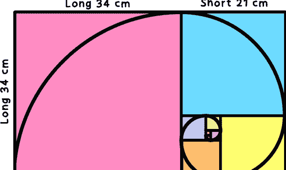

Long + Short / Long = Long / Short = 1.618 → (34 cm + 21 cm) / 34 cm = 34 cm / 21 cm = 1.618

图 9.19 – 黄金比例 1.618 的示例

在艺术中应用黄金分割最有效的方式之一是通过黄金螺旋，它源于斐波那契数列。斐波那契数列是一种每个数都是前两个数之和的数列，从 0 和 1 开始，依次为：0, 1, 2, 3, 5, 8, 13, 21, 34，等等。如图 9.19 所示。该螺旋向外扩展，形成动态流动，引导观众视线聚焦于关键焦点。通过将重要元素沿螺旋曲线放置，我们可以打造 effortless 却突出的构图。

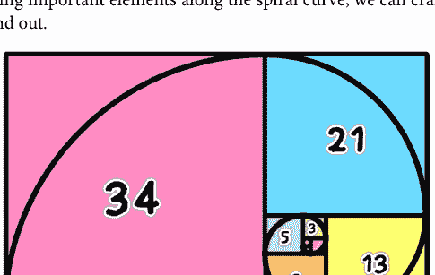

图 9.20 – 使用斐波那契数列的黄金螺旋示例

掌握黄金分割看似复杂，但可简化为实用步骤，帮助我们将其融入背景插图。本教程将探讨如何使用黄金螺旋增强叙事、创造深度并在作品中建立强视觉。

## 按照步骤进行

以下是使用黄金螺旋构图设计背景场景的方法：

- 1. 首先，从 `https://www.freepik.com/vectors/golden-ratio-template` 下载黄金分割模板并粘贴到画布上，如图 9.21 所示。
- 2. 确定构图所需关键元素并沿螺旋曲线确定其位置。标记区域如下：
  - *区域 1*：从背后看的狐狸
  - *区域 2*：散落的星星
  - *区域 3*：树
  - *区域 4*：发光星星和小鬼
  - *区域 5*：小女巫和猫（主要焦点）
- 3. 绘制背景场景，将重要细节纳入各自区域。
- 4. 最后，对前景和中景区域应用阴影以增强深度和透视。降低背景色彩强度使其更远并突出小女巫作为焦点。可通过降低背景图层透明度或用同一画笔或柔软喷枪轻轻擦除部分来实现。

### 第 1 步

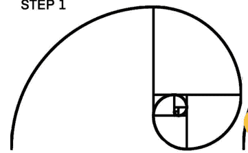

### 第 2 步

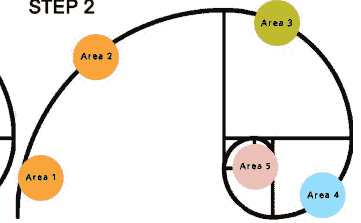

### 第 3 步

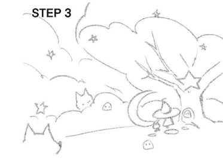

### 第 4 步

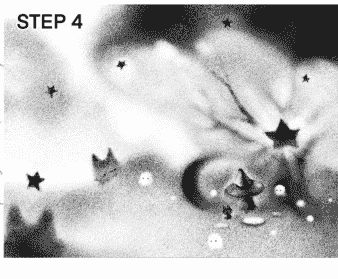

图 9.21 – 使用黄金螺旋构图的逐步教程

图 9.22 显示了只需按照此逐步指导即可实现的效果：

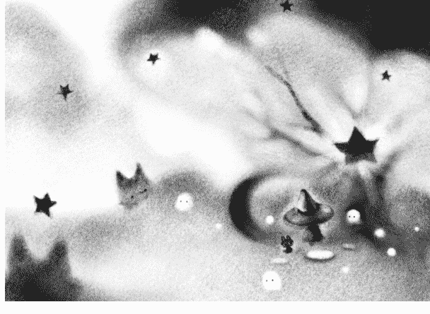

图 9.22 – 插图的最终效果

这就是我们在背景绘画中应用黄金分割构图的方法。让我们看看这种技巧如何运作。

## 理解技巧

使用黄金螺旋构图于背景场景或任何绘画都是创造动态迷人作品最有效的方式。因为黄金螺旋构图流动性好，帮助观众视线顺畅移动到最后一个焦点。例如在图 9.22 中，我想讲述小女巫和猫历经长途跋涉终于到达目的地的故事。

为用黄金螺旋传达这一叙事，我在前景放置狐狸，随后散落星星通向顶部有发光星星的大树。为进一步引导视线，我在树根加入小鬼，仿佛在迎接他们。最后在螺旋末端（主要焦点）绘制小女巫和猫，标志旅程结束。

有效使用黄金螺旋的关键是沿螺旋曲线放置细节，自然引导观众注意力至主要焦点。此例中小女巫和猫置于螺旋末端，使构图完整和谐。

## 常见错误及如何修正

黄金分割构图是创造动态迷人作品的有效方式，但元素未正确对齐时构图会失衡。来看一个常见错误及如何改进：

- **错误：** 螺旋太弱，使观众视线方向不清晰
- **如何修正：** 通过沿曲线放置更小细节强化螺旋，加强向焦点的运动

> **提示**
> 
> 为改进构图，草图时以黄金螺旋模板为引导。你可在 Google 图片中搜索 `Golden Spiral template` 在线查找并下载。将模板以不同图层叠加在画布上，置于草图图层下方，以规划焦点和支撑细节的放置。这有助于构图自然流动并与螺旋对齐。随着练习，你最终可无需模板直觉应用黄金螺旋。初次尝试不必过于焦虑。记住艺术在于享受过程，而不仅追求完美结果。尽情尝试，让创意流动！

## 了解更多...

回顾本章中我们创作的所有构图，将它们结合起来可以构建一个讲述出强有力且引人入胜故事的分镜，如图 9.23 所示。这个分镜可以有多重用途，例如用于动画或书籍插图。此外，它可以成为你作品集的有价值补充，向潜在客户展示你的叙事和背景设计技巧。这不仅突出了你的艺术能力，也帮助他人理解你的创作过程。通过使用我们探索过的构图，你不仅在提升背景设计技巧；你也在学习如何通过艺术讲述引人入胜的故事。

背景概念：一位年轻的女巫踏上魔法之地之旅。

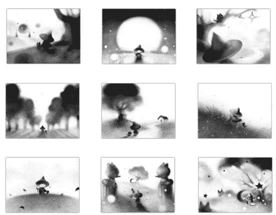

图 9.23 – 分镜示例

## 总结

你做得非常棒，学会了如何让你的绘画更具思考性和视觉美感。在本章中，我们探讨了如何通过恰当的摆放物体来清晰而美丽地讲述你的故事。

我们练习使用 C、V、圆形和螺旋等形状，轻轻引导观众的视线穿过你的场景。我们还发现了平衡、深度和对比如何改变你的作品感受，无论是宁静祥和还是充满能量和兴奋。

最好的部分是你不需要遵循每一条规则。这些技巧在这里指导你，但你的想象力始终排在第一位。随着每一张草图，你正在越来越信任自己的眼睛和想法。

继续创作，继续尝试吧，记住，你独特的[content]
## 了解更多...

回顾本章中我们创作的所有构图，将它们结合起来可以构建一个讲述出强有力且引人入胜故事的分镜，如图 9.23 所示。这个分镜可以有多重用途，例如用于动画或书籍插图。此外，它可以成为你作品集的有价值补充，向潜在客户展示你的叙事和背景设计技巧。这不仅突出了你的艺术能力，也帮助他人理解你的创作过程。通过使用我们探索过的构图，你不仅在提升背景设计技巧；你也在学习如何通过艺术讲述引人入胜的故事。

背景概念：一位年轻的女巫踏上魔法之地之旅。

图 9.23 – 分镜示例

## 总结

你做得非常棒，学会了如何让你的绘画更具思考性和视觉美感。在本章中，我们探讨了如何通过恰当的摆放物体来清晰而美丽地讲述你的故事。

我们练习使用 C、V、圆形和螺旋等形状，轻轻引导观众的视线穿过你的场景。我们还发现了平衡、深度和对比如何改变你的作品感受，无论是宁静祥和还是充满能量和兴奋。

最好的部分是你不需要遵循每一条规则。这些技巧在这里指导你，但你的想象力始终排在第一位。随着每一张草图，你正在越来越信任自己的眼睛和想法。

继续创作，继续尝试吧，记住，你独特的触感让每件作品都真正与众不同。

在下一章，我们将深入探讨创作引人入胜的风景艺术，以衬托你的角色并增强你的叙事。你将学习如何通过调整光线、色彩和氛围来为不同时段——清晨、下午、傍晚和夜晚——设定场景。我们将探讨如何营造氛围、表现距离以及使用层次使你的场景感觉自然而生动。

## 立即解锁本书的专属福利

扫描此二维码或前往 packtpub.com/unlock，然后按书名搜索本书。

