## 绘制引人入胜背景的分步指南

背景绘画可以发挥多重作用，例如确立作品的整体情绪和氛围，定义场景和环境，并通过艺术增强叙事。精心制作的背景有助于更有效地传达你的故事，因为它可以塑造整体基调并影响作品中角色的感知。背景绘画在艺术行业中很重要，因为它为作品的主要主体搭建舞台。画得好的背景可以帮助营造场所感和氛围，使场景更可信、更吸引观众。它为主要元素提供背景，增强整体叙事和情感冲击。

此外，良好的构图可以引导观众的视线聚焦于焦点，使作品更具趣味性和平衡感。背景绘画的主要挑战之一是实现正确的透视和深度，如果执行不当，场景会显得平坦或不真实。为了让我们的作品具有真实的距离感和深度，我们可以使用一些简单的技巧。尝试让物体在远离时画得更小；这是一种快速表现空间的方法。

你也可以重叠元素，让较近的物体稍微遮挡后面的物体。这种分层有助于事物感觉更自然、更具三维感。另一个有用的技巧是使用深度透视：物体越远，显得越浅、越模糊、细节越少。这些技巧使你的绘画更逼真，并增添空间感。

在本章中，我们将学习如何绘制不同时段的风景，这将帮助我们更好地绘制背景景色。

本章将涵盖以下主题：

- 学习如何绘制宁静的清晨风景
- 学习如何绘制欢快的午后风景
- 学习如何绘制怀旧的傍晚风景
- 学习如何绘制宁静的夜晚风景
- 绘画挑战：创作一幅背景绘画

在讲解的帮助下，我们将探索如何绘制代表不同时段的背景：清晨、下午、傍晚和夜晚。每个讲解都会给你实验的空间，但提供充足的指导以保持轻松。到本章结束时，你将更有信心设计出不仅美丽而且对未来项目有用的背景。

在开始本章之前，请阅读以下重要说明，以确保所有步骤都能顺利跟进。这将有助于在整个过程中保持清晰和一致。

## 重要说明

在本章中，插图将分层绘制以保持调整的灵活性。图层应命名如下：*构图图层*、*草图图层*、*对比图层*、*底色图层*、*渲染图层*、*高光图层* 和 *最终细节图层*。这种结构化方法确保艺术品的每个阶段都保持可编辑，允许在不影响之前步骤的情况下进行完善。像这样保持图层有序会使创作过程更顺畅、更高效。一旦我开始渲染过程，我将关闭 *构图图层*、*草图图层* 和 *对比图层*。所有渲染都将在 *单层* 上完成，以充分利用画笔纹理和混合效果。然而，请随意在这些讲解中使用一层或多层图层，以最适合你的工作流程为准。以下是本章图层摆放的截图：

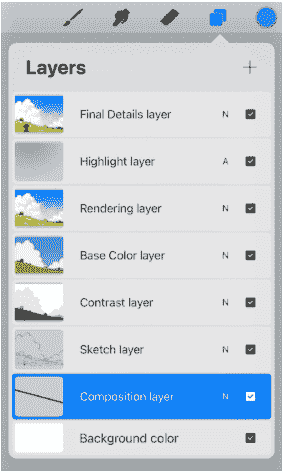

图 10.1 – 本章图层摆放

以下是我在讲解中会使用的画笔。欢迎你也使用它们，或换成你喜欢的工具——无论什么对你的流程感觉舒适。目标是享受体验并找到适合你的方法：

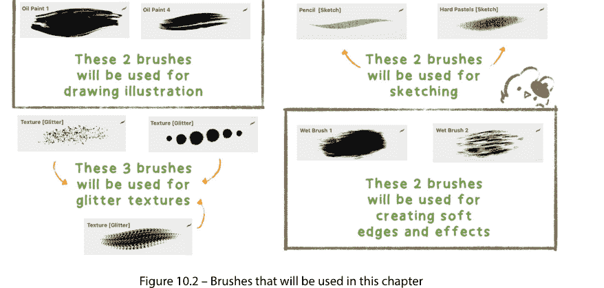

图 10.2 – 本章将使用的画笔

## 学习如何绘制宁静的清晨风景

在艺术中，清晨背景在营造宁静氛围方面发挥着重要作用。黎明的柔和而温和的光线可以营造出平静、放松和启发的感觉。我们可以使用柔和的色彩并添加晨光阴影来增强深度和质感。除此之外，清晨景色的宁静氛围可以唤起宁静的感觉，使其适合舒缓和治愈的艺术。在艺术中创作清晨背景可能很棘手，因为你需要混合暖色和冷色来表现黎明清新柔和的光辉。光线很柔和，所以阴影应该细腻且拉长。例如，靠近地平线的暖色调如橙色、粉色和黄色逐渐过渡到上方较冷的蓝色，使场景感觉宁静自然。一开始平衡暖色和冷色以捕捉早晨的光辉可能看起来很棘手，但不用担心！在本讲解中，我将一步步指导你混合色彩以营造柔和的光线和宁静的氛围。你会看到温暖的日出和清凉的阴影如何结合起来营造出宁静之美。

## 按照步骤进行

如何创建宁静的清晨风景（见图 10.3）：

1. 首先，选择 *第 9 章，视觉冲击艺术的构图完善* 中介绍的构图技巧之一，例如 C 形或平衡构图。对于图 10.3 所示的设计，我选择应用 **对角构图**。
2. 现在，使用你选择的构图技巧勾勒背景。我会画一条倾斜的山丘，配上远处的树木、山丘和房屋，以重现对角构图。对于主要焦点，我会在前景添加一个小女巫和她的猫。为了让场景感觉更深，我会在田野中画上花朵，靠近时画得大，越远越画得小。
3. 在这一步，我们将使用不同的色彩明度开始铺块细节。请记住，靠近前方的物体（前景）应使用较深的颜色绘制，而较远的物体应更浅。这有助于营造深度，使你的场景看起来更真实。如果你需要更多帮助，可以查阅 *第 9 章，视觉冲击艺术的构图完善* 获取示例和技巧。
4. 之后，我们将为背景添加底色，就像 *第 4 步* 中那样（见图 10.3）。由于日出光线柔和温和，太阳会放置在地平线附近的低处。选择颜色时，选择柔和的混合，不要使用太多对比度，这样场景才能保持宁静祥和的清晨氛围。

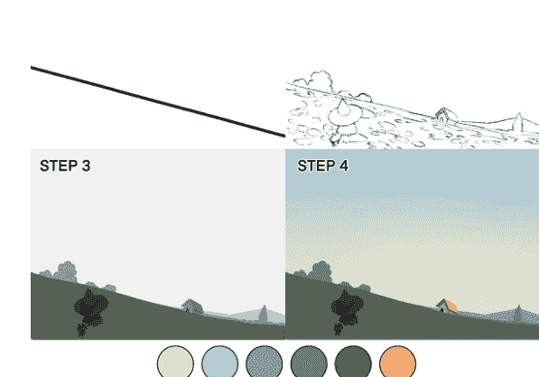

图 10.3 – 创建宁静清晨风景的分步绘制过程

在 *渲染* 层上，开始为绿色田野、远处的树木和远处的山丘添加细节。在田野中，我加入了几块园林石，引导视线通向小房子，以营造流动感并引导观众视线。请务必坚持我们在 *第 3 步* 中制定的对比度计划，以便整体平衡和深度保持一致。对于这部分，我将在一个图层上绘制所有内容，以充分利用画笔纹理和混合效果。

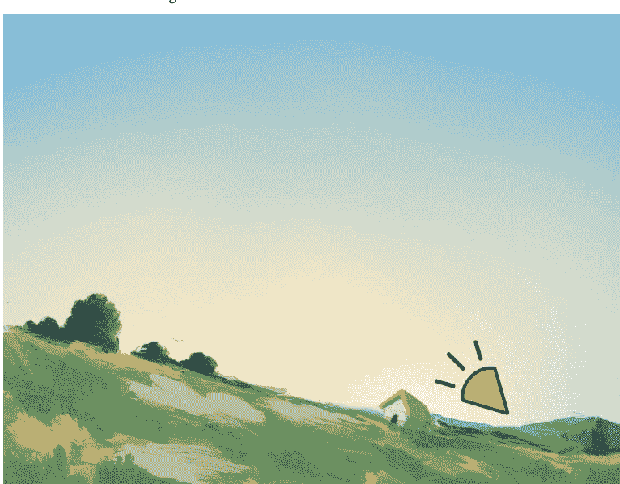

图 10.4 – 宁静早晨的基础色

在同一图层上，让我们继续为花朵、远处的树木和小房子添加更多细节。为了增加背景景深，请专注于为前景元素（如花朵和园林石）添加更多纹理和对比度，使其自然吸引观众的注意力。不要忘记考虑光源，如图 10.4 所示。由于早晨的光源来自地平线附近，请确保所有的阴影和高光都遵循那个较低的角度。这有助于整幅插图在日出宁静的光辉下显得温柔、柔软且自然。

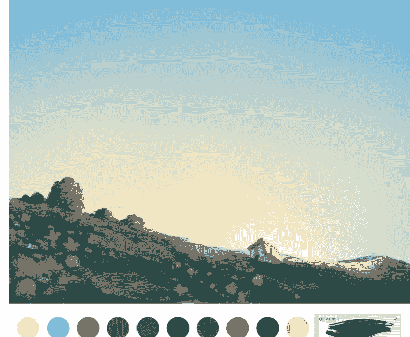

图 10.5 – 宁静早晨场景的细节处理过程

在完成插图之前，让我们轻轻地在光源所在的位置添加高光，即地平线附近。为此，将图层的混合模式从 **普通** 改为 **加法**。这有助于提亮这些区域并营造柔和的光晕效果，非常适合日出光线或梦幻氛围。使用 Procreate 的 **柔软画笔** 并降低不透明度，使光晕保持柔和，不会压倒宁静的早晨氛围。

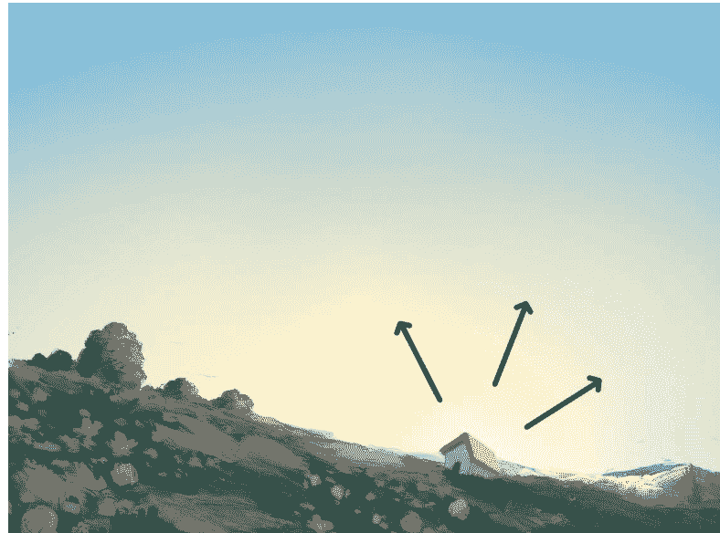

图 10.6 – 为宁静早晨场景添加高光

最后，让我们添加角色来完成插图。我们在最后一步进行此操作，以便更容易地为其上色并将其融入场景。此时，背景颜色已经确定，这有助于我们为角色选择合适的色调和光照。这样，一切看起来都平衡且自然地相互连接。

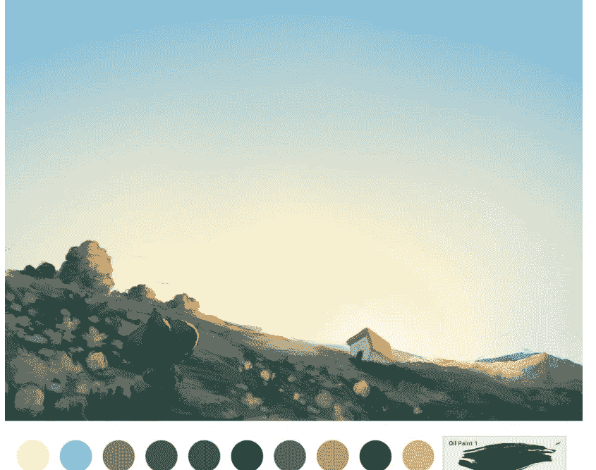

图 10.7 – 宁静早晨场景的最终版本

这是宁静早晨插图的成果。现在，让我们深入 *理解技巧* 部分，以便更好地理解本教程。

## 理解技巧

图 10.8 展示了宁静早晨绘画过程的汇编：

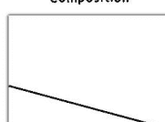

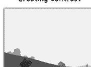

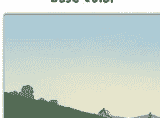

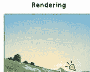

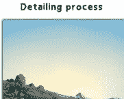

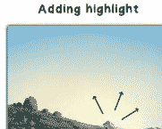

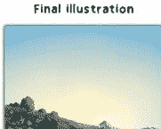

图 10.8 – 展示宁静早晨绘画过程的分步汇编

宁静的早晨风景是通过仔细平衡柔和的色彩、细腻的纹理和宁静的氛围来创造的。日出应作为光源，投射出柔和、拉长的阴影，以反映黎明的温柔光辉。对背景树木应用大气透视有助于营造深度。可以通过使远处物体的颜色值显得更浅、更朦胧，同时保持近处元素更详细、对比度更强来实现。色彩搭配应是暖色调的混合，例如地平线附近的柔和橙色或淡黄色，过渡到天空更高处的冷蓝色，以保持清新的早晨感觉。所有这些元素都很重要，因为它们有助于营造宁静祥和的早晨场景。为了让早晨场景具有温暖、宁静的感觉，请使用加法混合模式和设置为低不透明度的柔软画笔，在日出周围轻轻刷出光晕。

## 了解更多...

想要让你的早晨场景感觉更加宁静吗？尝试使用 Procreate 的柔软画笔或雨林画笔在田野上方添加柔和的薄雾，或在远处树木周围添加轻雾。为了柔和地融合边缘，使用涂抹工具获得平滑自然的外观。你还可以绘制漂浮在天空中的柔和云朵，或一座安静的湖泊柔和地反射早晨的色彩。这些小细节为你的作品增添了清新和宁静，营造出充满柔和光线和宁静能量的温馨氛围。

## 提示

要在背景中营造更强烈的大气透视效果，尝试使用 **高斯模糊** 或在 Procreate 中使用 **色相、饱和度、亮度** 调整轻轻降低饱和度。这有助于远处元素看起来更柔和、色彩不那么鲜艳，使其感觉更远，并为你的作品增添空间感。

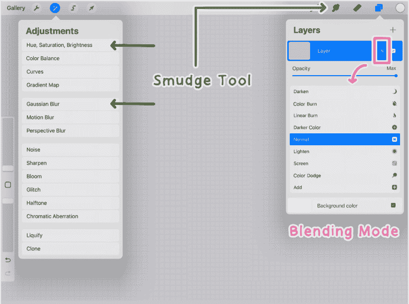

图 10.9 – 宁静早晨的色彩搭配

现在我们已经描绘出早晨的宁静感觉，让我们提亮一下。接下来，我们将学习如何绘制温暖而欢快的午后场景。

## 学习如何绘制欢快的午后风景

在艺术中，午后背景常传达出欢乐和温暖的感觉，象征着愉快的时刻。它经常代表夏季，唤起充满活力和生动的氛围。午后温暖明亮的光线可以营造出一种唤起幸福和兴奋感的氛围，影响观众产生同样的感受。融入阴影和光线可以强调形状和细节，引导观众视线，并增强插图的整体深度，使其更逼真。

午后风景背景可能难以绘制，因为色彩强烈鲜艳。太阳的位置对阴影和高光造成了独特的挑战，影响整体深度。此外，色彩搭配相对有限，需要仔细平衡才能达到理想效果。要在绘画中营造良好的午后氛围，我们需要捕捉温暖的金色阳光，同时平衡较冷的阴影。这可能很棘手，使午后风景更难绘制。与其回避它们，不如练习色彩混合并研究光线的工作原理，可以让它变得更容易。在本教程中，我们将绘制一幅欢快的午后风景，捕捉阳光的温暖和晴朗日子里的生机。

## 按照步骤进行

要创建欢快的午后风景，让我们按照以下步骤进行（见图 10.10）：

- 1. 首先，选择第 9 章《完善构图以打造视觉冲击力艺术》中介绍的构图技巧之一，例如 C 形或平衡构图。对于图 10.10 所示的设计，我选择应用对角线构图。
- 2. 现在，使用你选择的构图技巧勾勒背景。我将绘制一个斜坡山丘，背景中有远处的树木、山丘、大云朵和一座房子，以重现对角线构图。对于主要焦点，我将在前方添加一个小女巫和她的猫。为了让场景感觉更深，我将在田野中绘制花朵，近处的大花逐渐变小，越远越小。
- 3. 在这一步，我们将使用不同的颜色值开始填充背景细节。请记住，靠近前方的物体（前景）应使用较暗的颜色绘制，而更远的物体应更浅。这有助于营造深度，使场景看起来更逼真。如果需要更多帮助，可以查看第 9 章《完善构图以打造视觉冲击力艺术》中的示例和提示。
- 4. 之后，我们将像第 4 步一样为背景添加基础颜色。由于午后光线明亮强烈，太阳会在天空更高处。选择颜色时，专注于明亮的蓝色、黄色和鲜艳的绿色等色调，以捕捉午后的欢快能量。增加光影之间的对比以表现清晰的阳光，但要小心不要太强烈；保持平衡将有助于场景感觉生动温暖。

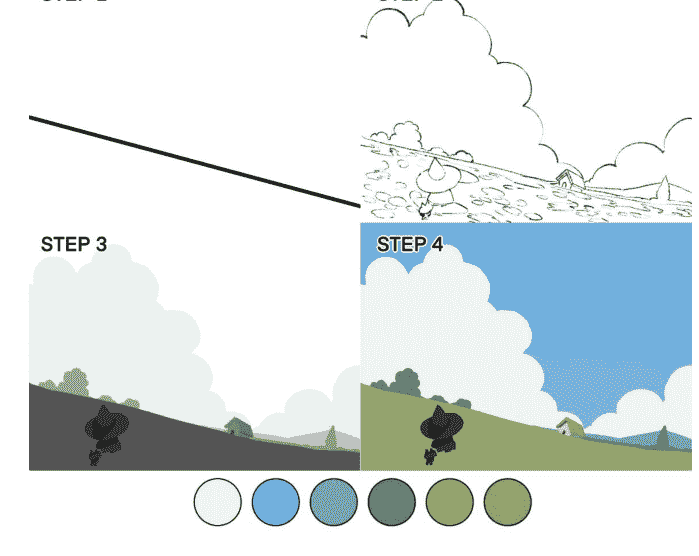

图 10.10 – 欢快午后场景的分步绘画过程

在渲染层上，开始为绿色田野、远处的树木和远处的山丘添加细节。在田野中，我加入了几块园林石，引导视线通向小房子，以营造流动感并引导观众视线。请务必坚持我们在第 3 步中制定的对比度计划，以便整体平衡和深度保持一致。对于这部分，我将在一个图层上绘制所有内容，以充分利用画笔纹理和混合效果。

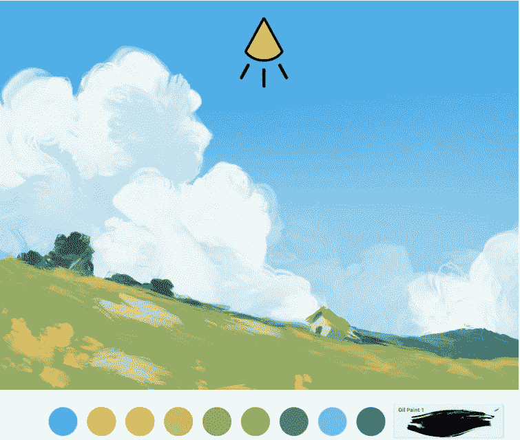

图 10.11 – 欢乐午后场景的基础色

在同一图层上，让我们继续为花朵、远处的树木和小房子添加更多细节。为了增加背景景深，请专注于为前景元素（如花朵和园林石）添加更多纹理和对比度，使其自然吸引观众的注意力。不要忘记考虑图 10.11 所示的光源。由于午后光源来自上方，请确保所有的阴影和高光都遵循该方向。这有助于整幅插画在午后阳光下显得明亮、温暖，并自然地呈现高光效果。

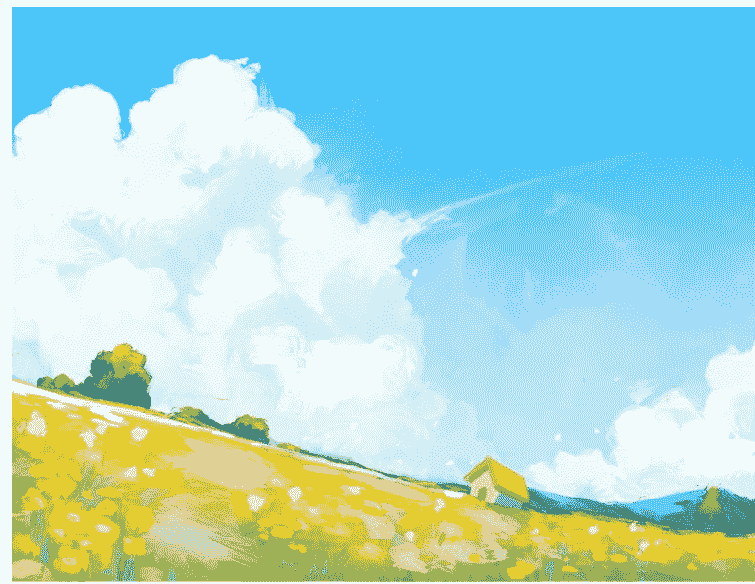

图 10.12 – 欢乐午后场景的细节处理过程

在完成插画之前，让我们轻轻地在阳光照射到的场景处添加高光，由于是午后，光线来自上方。为此，将图层的混合模式从 **普通** 切换到 **增亮**。这会使这些区域变亮，并产生温暖的发光效果，与充满活力的午后光线相匹配。使用 Procreate 的 **柔软画笔** 并降低不透明度，以便光晕保持自然，不会压倒欢快、阳光明媚的氛围。

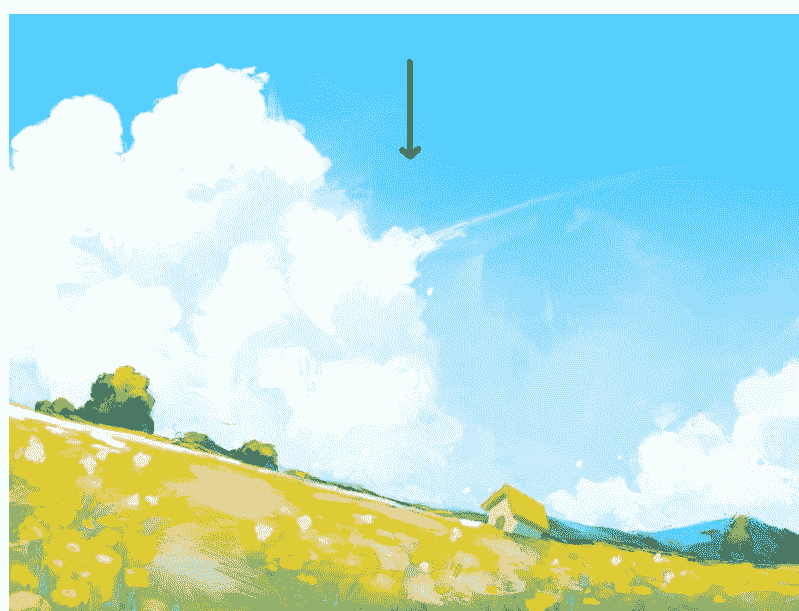

图 10.13 – 为欢乐午后场景添加高光

最后，让我们添加角色来完成插画。我们在最后一步进行，这样更容易为角色上色并将其融入场景。此时，背景颜色已经确定，这有助于我们为角色选择合适的色调和光照。这样，一切看起来都平衡且自然地联系在一起。

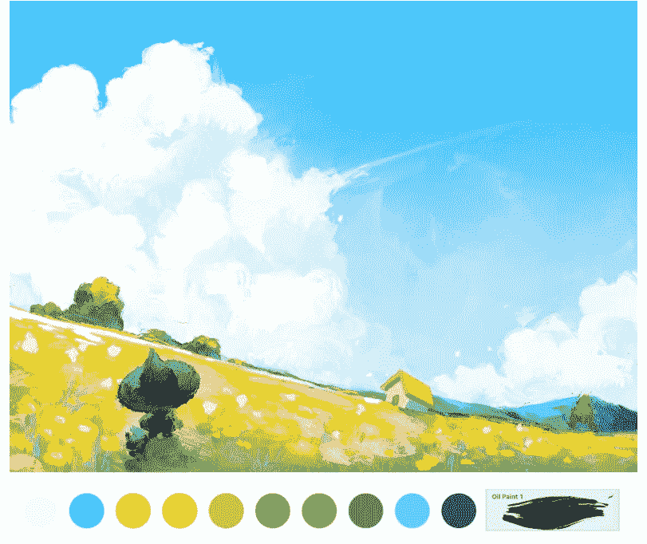

图 10.14 – 欢乐午后场景的最终版本

这是欢乐午后插画的结果。现在，让我们深入 *理解技巧* 部分，以便更好地理解本教程。

## 理解技巧

*图 10.15 展示了欢乐午后绘画过程的汇编：*

### 构图
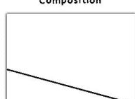

### 草图

### 创造对比
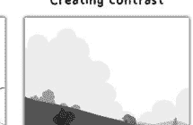

### 基础色
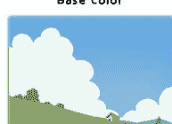

### 渲染
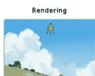

### 细节处理过程

### 添加高光
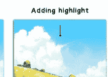

### 最终插画
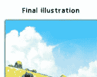

图 10.15 – 展示欢乐午后绘画过程的逐步汇编

绘制午后场景时，重点在于捕捉定义这一时段的温暖明亮光线。午后阳光会产生强烈、有方向性的阴影，因此观察物体如何投下清晰的阴影并利用它们增强构图的深度。将阳光的暖色调与较冷的阴影平衡起来，会使场景感觉自然而充满活力。天空通常会转变为更柔和的颜色，从明亮的蓝色过渡到鲜艳的蓝色，如图 10.15 所示。请注意大气透视，通过用更浅、饱和度更低的颜色淡化远处元素，如树木，以营造深度感。加入散落在叶片上的阳光、表面上的轻柔反射以及边缘上的明亮高光等细节，可以增强景观的真实感。例如，我在绿色田野上添加了明亮的高光，使其更具光泽并脱颖而出。通过熟练运用这些技巧，我们可以创作出明亮而充满活力的午后场景，让观众感到生动而[content]

图 10.11 – 欢乐午后场景的基础色

在同一图层上，让我们继续为花朵、远处的树木和小房子添加更多细节。为了增加背景景深，请专注于为前景元素（如花朵和园林石）添加更多纹理和对比度，使其自然吸引观众的注意力。不要忘记考虑图 10.11 所示的光源。由于午后光源来自上方，请确保所有的阴影和高光都遵循该方向。这有助于整幅插画在午后阳光下显得明亮、温暖，并自然地呈现高光效果。

图 10.12 – 欢乐午后场景的细节处理过程

在完成插画之前，让我们轻轻地在阳光照射到的场景处添加高光，由于是午后，光线来自上方。为此，将图层的混合模式从 **普通** 切换到 **增亮**。这会使这些区域变亮，并产生温暖的发光效果，与充满活力的午后光线相匹配。使用 Procreate 的 **柔软画笔** 并降低不透明度，以便光晕保持自然，不会压倒欢快、阳光明媚的氛围。

图 10.13 – 为欢乐午后场景添加高光

最后，让我们添加角色来完成插画。我们在最后一步进行，这样更容易为角色上色并将其融入场景。此时，背景颜色已经确定，这有助于我们为角色选择合适的色调和光照。这样，一切看起来都平衡且自然地联系在一起。

图 10.14 – 欢乐午后场景的最终版本

这是欢乐午后插画的结果。现在，让我们深入 *理解技巧* 部分，以便更好地理解本教程。

## 理解技巧

*图 10.15 展示了欢乐午后绘画过程的汇编：*

### 构图

### 草图

### 创造对比

### 基础色

### 渲染

### 细节处理过程

### 添加高光

### 最终插画

图 10.15 – 展示欢乐午后绘画过程的逐步汇编

绘制午后场景时，重点在于捕捉定义这一时段的温暖明亮光线。午后阳光会产生强烈、有方向性的阴影，因此观察物体如何投下清晰的阴影并利用它们增强构图的深度。将阳光的暖色调与较冷的阴影平衡起来，会使场景感觉自然而充满活力。天空通常会转变为更柔和的颜色，从明亮的蓝色过渡到鲜艳的蓝色，如图 10.15 所示。请注意大气透视，通过用更浅、饱和度更低的颜色淡化远处元素，如树木，以营造深度感。加入散落在叶片上的阳光、表面上的轻柔反射以及边缘上的明亮高光等细节，可以增强景观的真实感。例如，我在绿色田野上添加了明亮的高光，使其更具光泽并脱颖而出。通过熟练运用这些技巧，我们可以创作出明亮而充满活力的午后场景，让观众感到生动而欢迎。

## 了解更多...

午后场景可以根据绘制方式唤起温暖、充满活力或宁静的感觉。金色阳光下的宁静乡村感觉平静，而充满午后光泽的繁忙城市则显得生动。为了使场景看起来真实，添加柔软的草地、散落的树叶和有纹理的云朵等小细节会有帮助。为了在午后场景中重现柔和的光线，可以尝试使用 **增亮** 或 **柔光** 等混合模式：

- **增亮** 非常适合明亮发光的效果。它突出并为阳光照射的区域增添温暖。
- **柔光** 带来自然、柔和的亮度，能与周围颜色柔和融合。它非常适合营造平滑过渡和发光边缘。

使用低不透明度的柔软画笔配合这些模式，将有助于让光线轻松呈现温暖、梦幻且自然的效果。

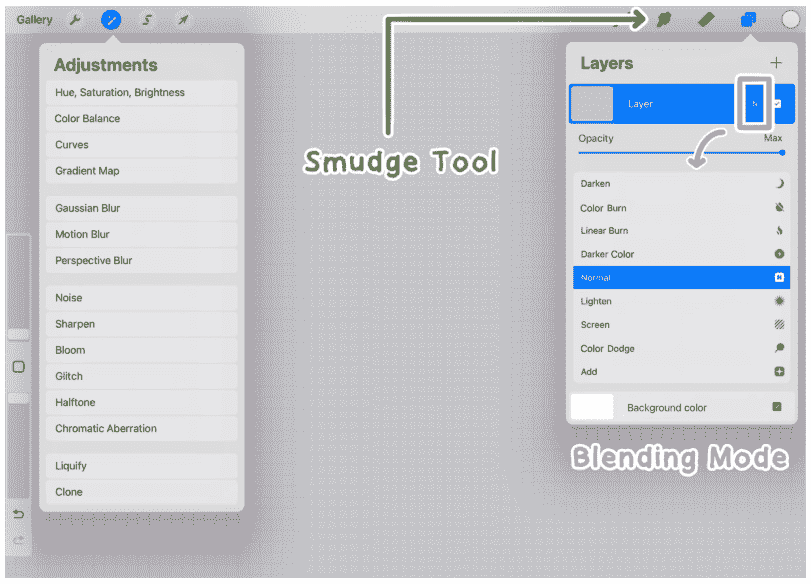

图 10.16 – Procreate 工具的屏幕截图

在阳光明媚的午后之后，光线开始变柔和。让我们继续探索傍晚的温馨光晕，了解如何创作出宁静、怀旧的日落。

## 学习如何绘制怀旧傍晚风景

傍晚风景通常会唤起特定的情感和解读，灯光的暖色调营造出安全和渴望的感觉。我们可以利用傍晚的氛围创作出怀旧的瞬间，让观众产生幸福或悲伤的感觉。它适合情感插画，如告别场景或快乐事件。添加温暖的光晕，如落日之光，可以使傍晚风景更具吸引力和宁静感。柔和的温暖增强了情绪，营造出令人安心且怀旧的氛围，吸引观众。然而，最大的挑战之一是捕捉傍晚微妙变化的光线并有效平衡暖色和冷色。如果你是背景绘制新手，这可能具有挑战性，但有了正确的方法，就会变得更容易。在本教程中，我们将探讨如何通过混合橙色和紫色色调、添加柔和的日落光晕以及绘制地平线附近低角度太阳的阴影来绘制怀旧的感觉。

### 按照步骤进行

要创作出怀旧傍晚风景，你可以按照以下步骤进行（见图 10.17）：

1. 首先，选择第 9 章《完善构图以打造视觉冲击力艺术》中介绍的构图技巧之一，例如 C 形或平衡构图。对于图 10.17 所示的设计，我选择应用对角线构图。
2. 现在，使用你选择的构图技巧勾勒背景。我会画一个斜坡山丘、远处的树木、山丘、背景中的大云朵和一座房子，以重现对角线构图。对于主要焦点，我会在前方添加一个小女巫和她的猫。为了使场景更深，我会在田野中画上花朵，近处画大朵，越远越小。
3. 在这一步，我们将使用不同的色值开始填充背景细节。请记住，靠近前方的物体（前景）应使用较暗的颜色绘制，而较远的物体应更浅。这有助于营造深度，使场景看起来更逼真。如果需要更多帮助，可以查看第 9 章《完善构图以打造视觉冲击力艺术》以获取示例和提示。
4. 之后，我们将像第 4 步一样为背景添加基础色。由于日落光线温暖而金黄，太阳会低悬在地平线附近，在场景上投下柔和的光晕。选择颜色时，目标是实现橙色、棕色以及少量粉色和紫色的平滑混合。避免强烈对比，以便整体情绪保持平静和怀旧，就像宁静的傍晚氛围一样。

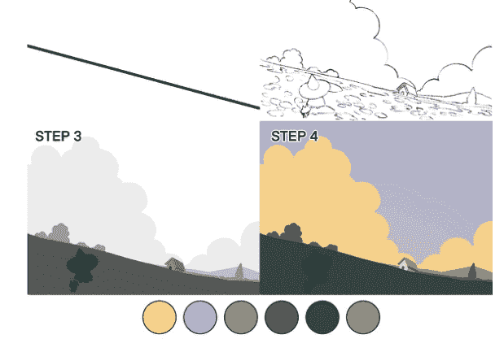

图 10.17 – 怀旧傍晚场景的逐步绘画过程

在 *渲染* 图层上，开始为绿色田野、远处的树木和远处的山丘添加细节。在田野中，我加入了几块通往小房子的园林石，以创造流动感并引导观众视线。请务必坚持我们在 *第 3 步* 建立的对比计划，以便整体平衡和深度保持一致。对于这部分，我会将所有内容绘制在一层上，以充分利用画笔纹理和混合效果。

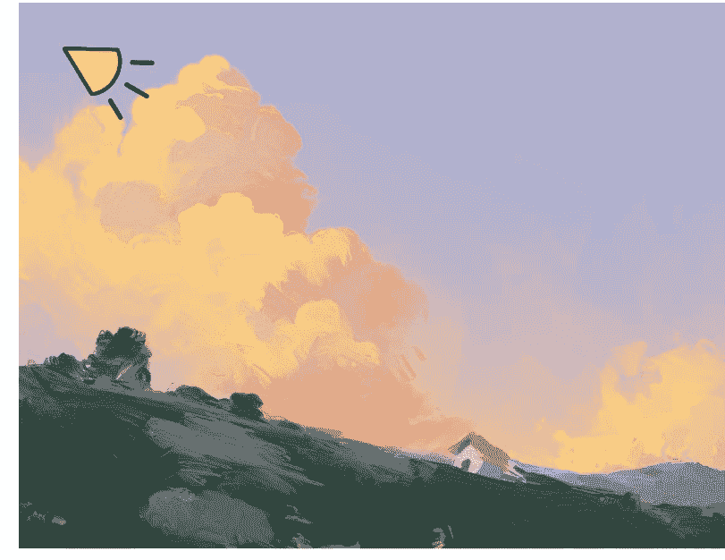

图 10.18 – 怀旧傍晚场景的色彩板

在同一图层上，让我们继续为花朵、远处的树木和小房子添加更多细节。为了增加背景景深，请专注于为前景元素（如花朵和园林石）添加更多纹理和对比度，使其自然吸引观众的注意力。在日落时，光源来自地平线附近，在场景上投下温暖的光晕。就像 *图 10.19* 中一样，请确保所有阴影和高光都遵循该方向，以保持一切看起来自然且与傍晚氛围一致。

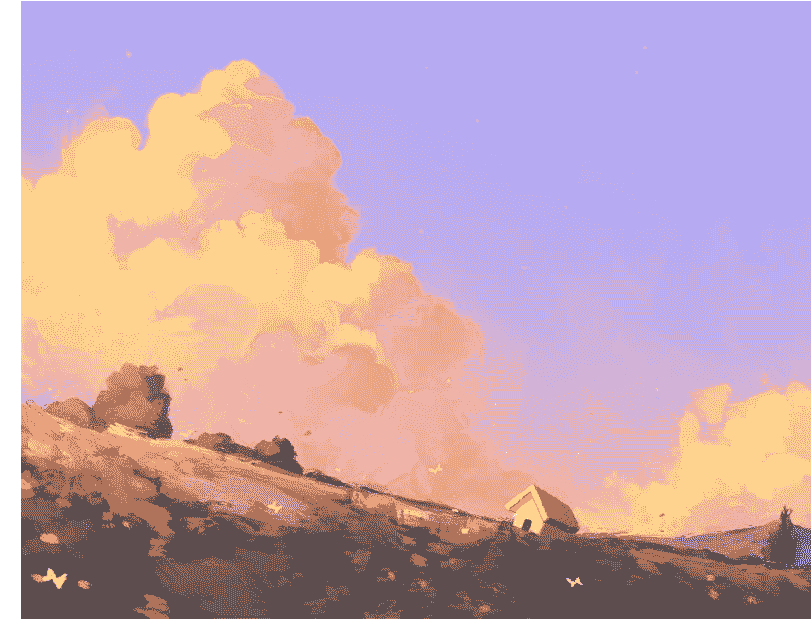

图 10.19 – 怀旧傍晚场景的细节处理过程

在完成插画之前，让我们轻轻地在日落光线照射到地平线附近场景的地方添加高光。为此，将图层的混合模式从 **正常** 切换到 **颜色减淡**。这会使这些区域变亮，并增添温暖的光晕效果，与金色日落氛围完美契合。使用 Procreate 的 **柔软画笔** 并保持低不透明度，使光线保持柔和，不会压倒宁静的傍晚氛围。

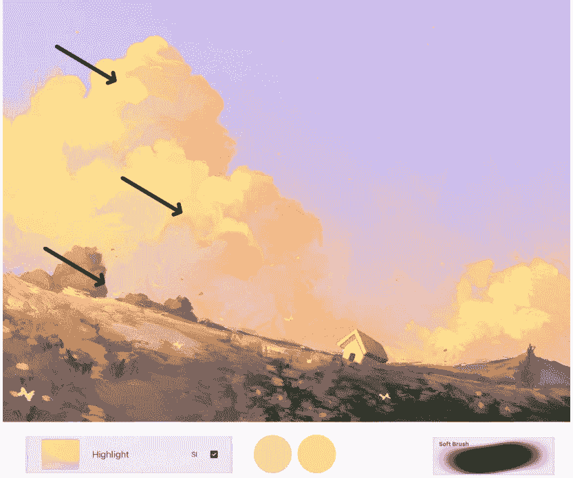

图 10.20 – 为怀旧傍晚场景添加高光

最后，让我们添加角色来完成插画。我们将其放在最后一步，这样更容易为它们上色并将其融入场景。到此时，背景颜色已经确定，这有助于我们为角色选择合适的色调和光线。这样，一切看起来平衡且自然地联系在一起。

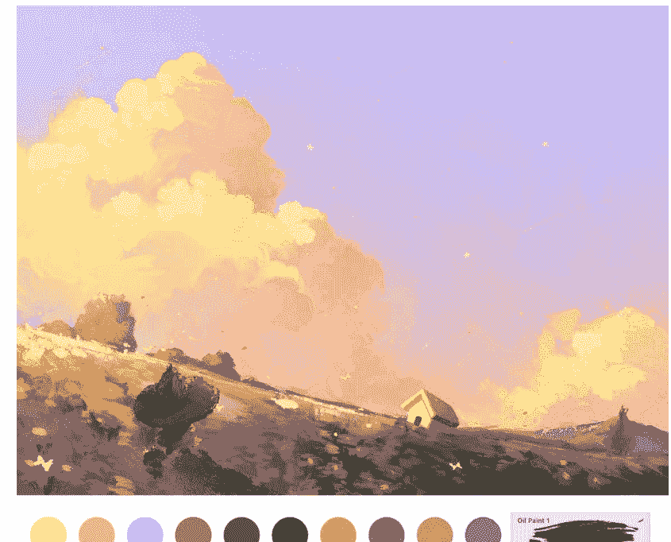

图 10.21 – 怀旧傍晚场景的最终版本

这是怀旧傍晚插画的结果。现在，让我们深入 *理解技巧* 部分，以便更好地理解本教程。

## 理解技巧

图 10.22 显示了怀旧傍晚绘画过程的汇编：

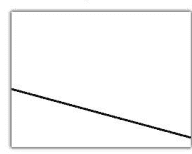

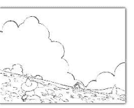

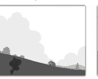

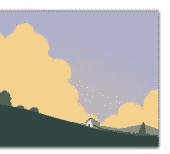

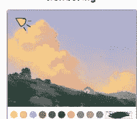

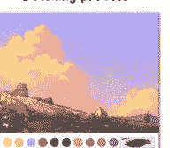

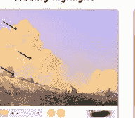

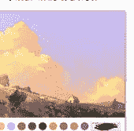

图 10.22 – 展示怀旧傍晚绘画过程的分步汇编

当绘制傍晚场景时，专注于营造温暖而宁静的感觉，使用柔和的暖色调，例如黄色和橙色。傍晚的光线具有金色光晕，逐渐淡入紫色并带有一丝粉色，因此混合这些颜色有助于营造合适的氛围。这可以很容易地使用高斯模糊完成。对于日落场景，随着太阳下沉，阴影变得更长更柔和，使氛围更具怀旧感。添加诸如光斑、发光表面或微小星星等小细节可以使场景更真实。远处物体应看起来更亮、细节更少以营造深度。无论是绘制宁静的乡村还是日落时繁忙的城市，使用正确的光线和颜色都会展现出怀旧傍晚的美。

## 了解更多...

为了营造怀旧氛围，诸如树木、栅栏或建筑物等暗色形状可以框住日落，使其感觉更个人化、更怀旧。它们简单的轮廓在多彩的天空下脱颖而出，引领观众的视线聚焦于落日温暖的光辉。这营造出宁静而富有情感的氛围，使场景更具意义。现在，我们将步入夜晚，学习如何绘制宁静而梦幻的夜景。

## 学习如何绘制宁静的夜景

宁静的夜景是希望传达宁静和孤独感的人的完美背景场景。场景可以呈现宁静的夜景，月亮倒映在湖面上。夜景常被用来描述宁静的感觉，因此，如果我们想传达宁静的感觉，就可以绘制夜景。通过添加黑暗来营造对比，我们可以唤起从孤独到神秘或不安氛围的各种情感，使其成为讲故事和艺术表达的合适选择。绘制夜景背景会带来一些挑战，由于色彩和光源的使用有限。为了营造逼真的夜晚氛围，我们必须深入理解对比，并能够平衡冷暖色调。

起初使用深色可能会让人感到畏惧，因为它们似乎过于强烈或难以控制，尤其是如果你更习惯浅色调。但别担心；在本次教程中，我将一步步展示如何营造夜晚氛围。我们将学习如何使用对比来增加深度，以及如何混合暖色和冷色以保持平衡和美观。

## 按步骤进行

要创建宁静的夜景，你可以按照以下步骤进行（见图 10.23）：

- 1. 首先，选择 *第 9 章，打造视觉冲击力的构图* 中介绍的构图技巧之一，例如 C 形或平衡构图。对于 *图 10.23* 中所示的设计，我选择应用 **对角线构图**。
- 2. 现在，使用你选择的构图技巧勾勒背景。我将绘制一条斜坡山丘，配上远处的树木、山丘和房屋，以重现对角线构图。对于主要焦点，我将在前方添加一个小女巫和她的猫。为了使场景更深，我将在田野中绘制花朵，近处的花朵较大，越远越小。
- 3. 在此步骤中，我们将使用不同的色彩明度开始填充背景细节。请记住，靠近前方的物体（前景）应使用较深的颜色绘制，而远处的物体应更浅。这有助于营造深度，使场景看起来更逼真。如果需要更多帮助，可以查阅 *第 9 章，打造视觉冲击力的构图* 获取示例和技巧。
- 4. 之后，我们将像 *第 4 步* 一样为背景添加底色。由于夜晚自然光线很少，请专注于使用较深的色调，如深蓝色、淡黄色和柔和的灰色。月亮和星星通常是夜晚的主要光源，因此它们将决定场景中高光和阴影的放置。由于月亮和星星发出柔和的冷光，请务必使用轻柔、低对比度的阴影。避免强烈对比，以保留宁静夜景的平静安宁氛围。

### 第 1 步

### 第 2 步

### 第 3 步

### 第 4 步

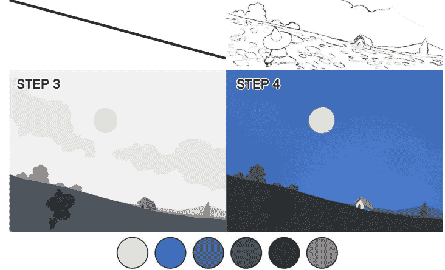

图 10.23 – 宁静夜晚的分步绘画过程

在渲染图层上，开始为绿色田野、远处的树木、背景中的柔和云朵和远处的山丘添加细节。在田野中，我加入了几块花园石子通向小房子，以营造流动感并引导观众视线。请务必坚持我们在第 3 步中制定的对比计划，以保持整体平衡和深度的连贯性。对于这部分，我将所有内容绘制在同一图层上，以充分利用画笔纹理和混合效果。

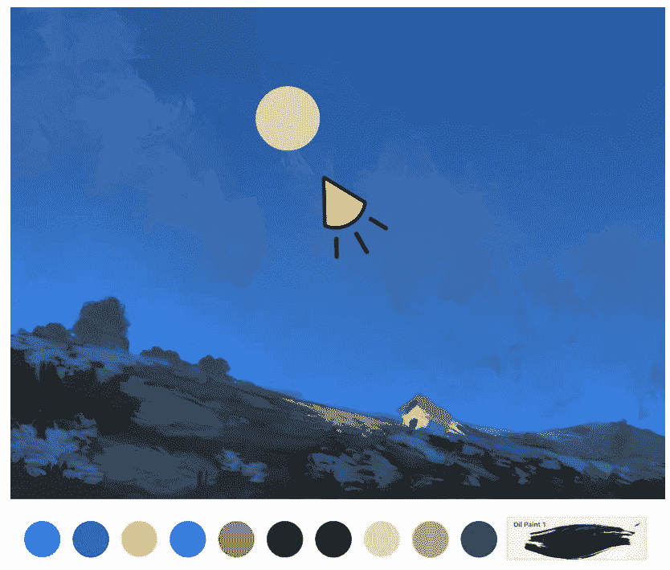

图 10.24 – 宁静夜景的色彩板

在同一图层上，让我们继续为花朵、远处的树木、月亮、星星和小房子添加更多细节。为了为背景景色增加更多深度，请专注于为前景元素（如花朵和花园石子）添加更多纹理和对比度，使其自然吸引观众的注意力。请记住考虑光源，就像图 10.24 中一样。夜晚，光线通常来自月亮和星星，它们位于天空上方。这意味着你的阴影和高光应遵循同样的柔和方向，帮助整个场景感觉平静并始终如一地被夜空照亮。

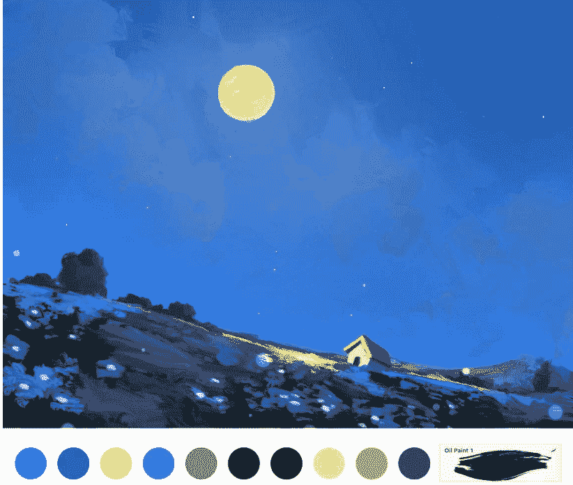

图 10.25 – 宁静夜晚的细节处理过程

在完成插画之前，让我们轻轻地在月亮或星星等光源从上方照射的地方添加高光。为此，将图层的混合模式从 **正常** 更改为 **颜色减淡**。这将轻轻提亮场景的部分区域，并赋予微妙温暖的光晕效果，契合夜晚宁静而魔幻的感觉。使用 Procreate 的 **柔软画笔** 并保持低不透明度，使光晕保持柔和，不会压倒宁静的夜晚氛围。

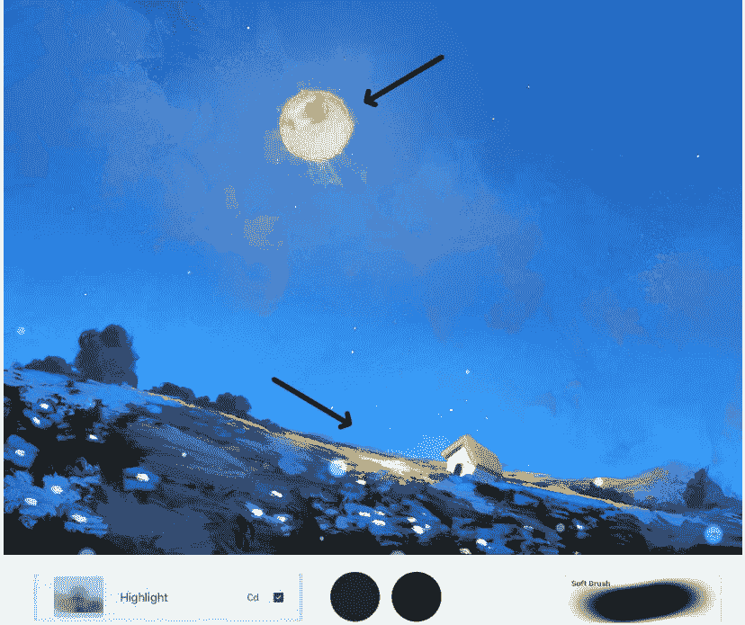

Figure 10.26 – 为宁静夜景添加高光

最后，让我们添加角色来完成插画。我们在最后一步这样做，这样更容易为它们上色并将其融入场景。到此时，背景颜色已经确定，这有助于我们为角色选择合适的色调和光线。这样，一切看起来平衡且自然地联系在一起。

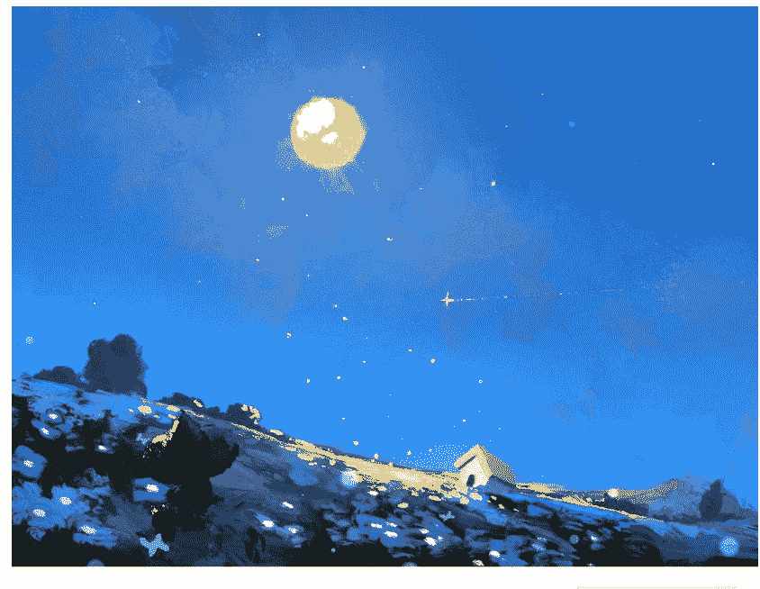

Figure 10.27 – 宁静夜景的最终版本

这是宁静夜景插画的结果。现在，让我们深入了解*理解技巧*部分，以便更好地理解本次讲解。

## 理解技巧

Figure 10.28 显示了宁静清晨绘画过程的汇编：

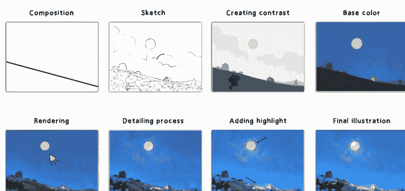

Figure 10.28 – 展示宁静夜景绘画过程的分步汇编

绘制夜景时，重点是使用深蓝色和黑色来表现夜空，营造出宁静的效果。在夜空中添加微妙的渐变和散落的星星可以增强氛围，使场景更具真实感。光源，如月亮或发光的星星，在夜景中起着至关重要的作用，因为它们投射出柔和的光线和轻柔的阴影。由于夜景通常昏暗柔和，尽量不要使用非常强烈或明亮的对比。保持光线柔和会使作品感觉更自然、更宁静。

我们可以使用模糊工具在光影之间创建平滑过渡，以营造自然的外观。添加明亮的高光，例如在花田和小房子上，可以使夜景更具真实感。深度透视在夜景中也很重要。远处的物体应显得柔和且细节较少，以强调夜晚的辽阔。无论是描绘星空下的宁静乡村还是繁忙的城市景观，光线调整都有助于传达夜晚场景的情绪和情感。你可以在 Procreate 中使用曲线工具温和地调整作品的对比度和颜色。它可以帮助你微调整体氛围和平衡，而不会使效果过于强烈或生硬。

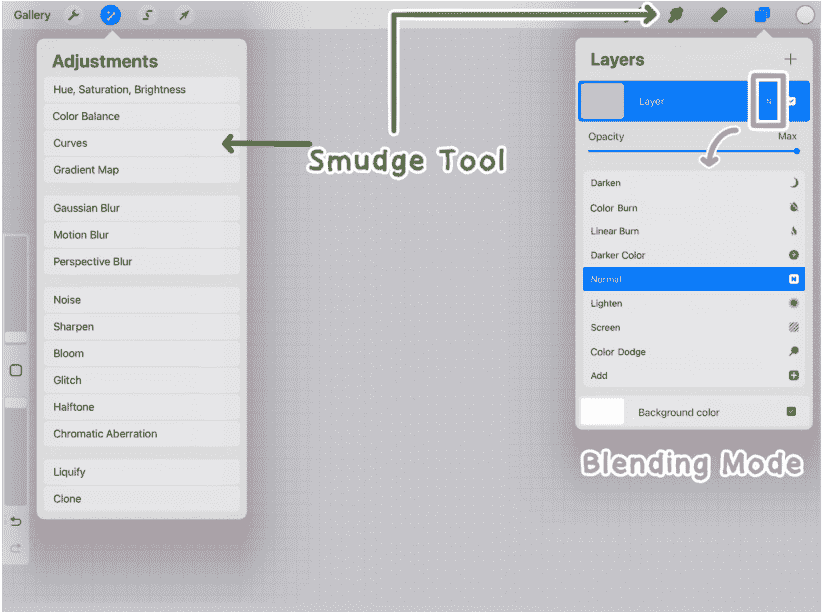

Figure 10.29 – Procreate 工具截图

## 了解更多...

为了营造温暖的夜景，我们可以绘制发光的月亮、灯笼或城市灯光，使夜景感觉温暖而诱人。使用柔软画笔添加柔和的光晕效果会使光线看起来更自然。你可以使用混合模式，如 Color Dodge，来在物体表面重现明亮温暖的光晕。

Color Dodge in Procreate is perfect for creating glowing light effects and vibrant highlights. It’s especially useful when you want to make areas of your artwork look bright and magical.

Here’s how Color Dodge works in Procreate: it brightens mid-tones and highlights, making colors stand out with vivid energy. This blend mode is perfect for adding glow to light sources such as lanterns, fireflies, or magical auras. It also helps create a dreamy or radiant atmosphere, enhancing the mood of your artwork beautifully.

To use it, do the following:

- 1. Create a new layer above your artwork.
- 2. Tap the layer “N” to open **Blending Mode**.
- 3. Choose **Color Dodge**. Use a soft brush with darker colors (such as brown) and low opacity for best results.

Up next, you will create your very own background drawing. Let’s take everything we’ve learned and create something wonderful together.

## 绘画挑战：创作背景场景

Background drawing in digital art is important as it creates the setting and mood of the piece, providing context for the viewer. To create a good background drawing, we need to have good depth to create a sense of space that will attract the viewer’s attention to explore our art at a deeper level. It also allows us to showcase our skills in perspective, color, and detail, helping us to get better at telling a story through art. Ultimately, backgrounds help the storytelling become more engaging and give more context to the viewer. One major challenge in background drawing is balancing detail and the story we want to share. We must learn how to balance out the details without overwhelming the scene. Creating realistic backgrounds can be challenging and time-consuming. In industries such as animation and game design, strict deadlines and high-quality expectations make it even more difficult, often adding pressure on artists to work efficiently while maintaining detail and accuracy.

This final walkthrough is all about bringing together everything you’ve learned about composition, color, lighting, and storytelling and letting your imagination shine. In this challenge, we’ll create an original background scene from start to finish.

## 按照步骤进行

In this final walkthrough of the book, we will explore how to design our own background scenery and create a stunning masterpiece. Here’s how to bring your vision to life (see Figure 10.30):

- 1. Firstly, choose one of the composition techniques we learned about in Chapter 9, such as C-shape composition or balance composition. For the design shown in Figure 10.30, I will use **double diagonal composition**.
- 2. Next, sketch the background using the composition style you chose. I’ll draw a shooting star and big, fluffy clouds. To highlight the double diagonal composition, I’ve placed the shooting star falling toward the left side of the illustration, while the green field gently leans to the right. These opposite directions create a strong visual flow and help make the scene stand out more.
- 3. In this step, we will clean up the sketch to make the design clearer and ready for coloring.
- 4. Then, we will decide on the light source placement and use shades of gray to create a contrast base for the background scenery, as shown in STEP 4 in the following figure. I will create an afternoon setting for this background scenery, where the lighting is bright and the colors are vibrant. Since the afternoon atmosphere naturally has strong contrasts, the illustration will feature bold highlights and deep shadows, as demonstrated in STEP 4 in Figure 10.30.

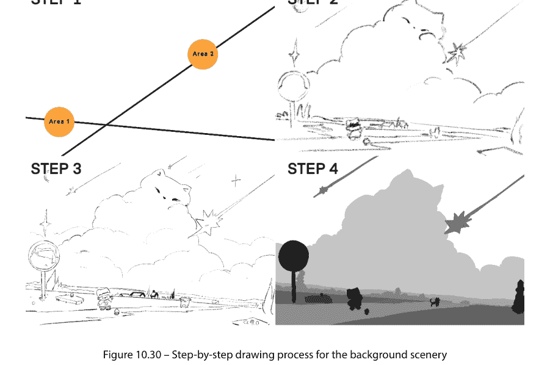

Figure 10.30 – 背景场景的分步绘画过程

Prepare a color palette for the background scenery. I will use the color palette shown in Figure 10.31.

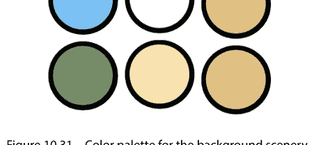

Figure 10.31 – 背景场景的配色方案

Paint the background scenery using the color palette by following the color contrast we created in *Step 4*.

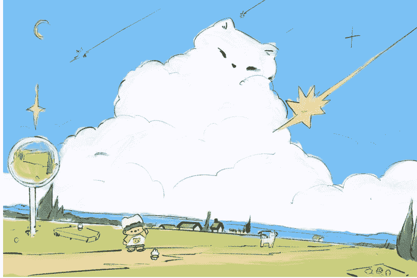

Figure 10.32 – 背景绘画的基础色

最后，为了最后的润色，完善渲染并通过添加花朵、阴影和光线等细节来增强背景。这些元素将为场景带来深度和活力，完美地完成插画。我使用来自 *Chapter 1* 的 **Oil Paint** 画笔来创建具有传统油画外观和质感的背景场景。

Figure 10.33 – 背景绘画的最终版本

最后，在 Instagram 或 X（Twitter）上使用 #HappyuuBook 标签分享你的作品。我会转发它们。

This is the result of drawing background scenery. Now, let's dive into the Understanding the technique section to give us a better understanding of this walkthrough.

## 理解技巧

Creating a dreamy and magical background is all about mixing soft colors, storytelling, and playful details. We start by picking a composition style, such as double diagonal, to lead the viewer's eye and build a strong visual flow. Then, we sketch the scenery with big clouds, shooting stars, and gentle hills in the background to bring that composition to life.

Using a base color palette, as shown in Figure 10.31, we paint the sky and background in smooth blends that suit the time of day. For brighter settings, such as afternoon, bold highlights and shadows, as in Figure 10.33, help the scenery feel warm and full of energy. In the foreground, adding details such as soft flowers, grassy fields, and garden stones adds depth and makes the scene feel alive. Small touches, such as a cozy cottage, a character with a little companion, or magical skies, help tell your story better.

一旦所有内容都如 *图 10.34* 所示渲染完成，场景就像一幅完成的画作一样美丽融合。为了增加柔和的光晕并提亮背景，我在设置为 **加法** 混合模式的图层上使用 **柔软画笔**。这有助于为最终插画带来光感和魔力。

## 绘画任务：一起创作吧！

是时候让你的愿景成真了！你已经学会了如何用色彩、光线和讲故事来构建背景，现在轮到你创造自己的作品了。选择你最喜欢的构图，决定氛围或时间，并构建一个能打动你的场景。

想象夜幕降临前的宁静山丘。天空中闪耀着温暖的橙色光芒，一个宁静的小村庄正准备迎接满是星星的夜晚。小灯笼照亮了道路，远处山坡上坐落着一间舒适的小屋，散发着柔和温暖的光晕。

你的主角是一位快乐的旅行者，背着一袋星星。他们平静地走向房子，身边伴着他们的小动物朋友。

在绘画时，想想你想要唤起的感受。是宁静、神奇，还是有点神秘？利用你所学的一切关于构图和光线的知识来讲述你的故事。每朵花、每块石头、每朵云和每道阴影都能帮助营造氛围。当你完成时，欢迎在 Instagram 或 X（Twitter）上使用 #HappyuuBook 标签分享你的作品，或标记 @gummy.y 和 @happyuu_，让我们看到并庆祝你的美丽作品。如果你想要一些帮助或反馈，可以通过 happyyudrawing@gmail.com 联系我。我会非常乐意指导你！

## 总结

你已经到达了这本书的结尾……但你的旅程才刚刚开始！

你已经翻到了最后一页，但你的艺术之旅才刚刚起步！还有那么多场景可以速写、色彩可以尝试、故事可以讲述。感谢你与我一起绘画。与你共同创作、分享想法、探索艺术之美是一件多么快乐的事。我希望这段艺术之旅能让你感到受启发、受鼓励，并兴奋地继续用心绘画。

创作背景风景需要对色彩和谐与构图有深刻的理解，以及清晰的故事线。通过理解这些元素如何运作，我们可以创作出好的背景绘画，帮助我们将艺术事业提升到下一个层次。

当我们到达这本书的结尾时，请记住艺术是一段持续学习、实验和成长的旅程。你练习过的每一次笔触、每一种构图和每项技巧都为你独特的创作作品做出了贡献。无论你是在绘制宁静的风景、动态的场景还是简单的插画，你所培养的技能都将帮助你自信地将想法变为现实。

艺术无关完美；它关乎表达、讲故事和发现自己的风格。继续挑战自己，保持好奇心，不要害怕画新东西。你画得越多、尝试的新想法越多，你就会变得越好，你的艺术风格也会越清晰。每一次练习，你都会进步，并更了解什么最适合你。

不要拿自己的进度与他人比较；相反，以自己的节奏继续艺术之旅。当我们感到沮丧时，提醒自己为什么开始这段艺术之旅是很重要的。最后，继续前进，画你喜欢的东西而不是追随潮流。这样你会吸引真正的支持者和真正欣赏你作品的社区。

再次感谢你通过这本书与我一起学习。我希望我们一起探索的技巧和技术能帮助你建立对自己技能的信任，并在艺术中获得快乐。现在，开始吧，拿起你的画笔，打开你的画布，让你的创造力闪耀。世界正在等待看到你的美丽艺术和独特的想象力。让我们继续学习，继续创作，并带着喜悦和我们解锁的所有新技能迈出下一步。我迫不及待想看到你接下来会画什么！
