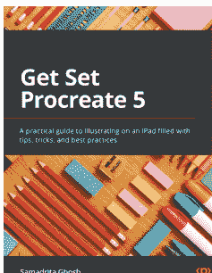
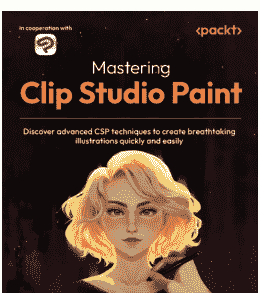
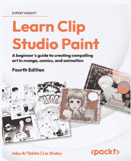

## 索引

### A

类似色系
创建 120-122
苹果铅笔 177
大气透视 48, 168

### B

背景颜色
探索 24-26
使用，技巧 23
使用，以设定氛围 21
使用暖色调 22
背景构图
绘制 215, 216
修正错误 217
技巧 217
背景风景
创建 279
背景场景
绘制 275-279
使用一点透视绘制 75, 76
使用三点透视绘制 78-80
使用两点透视绘制 76-78
技巧 278, 279

平衡构图 226
绘制 226-228
修正错误 228
技巧 228
混合模式 33
明亮的午后场景，带光影
描绘 98-100
描绘，技巧 100
明亮光源
识别 91-93
画笔
信息 6, 7
材料 2-5
探索样式 7, 8
纹理画笔 5

### C

宁静夜景，带光影
描绘 104-106
描绘，技巧 106
角色设计
头脑风暴和草图 192
头脑风暴和草图，步骤 192, 193
头脑风暴和草图，技巧 194, 195
定稿 195
定稿，步骤 196, 197
定稿，技巧 197, 198
不同视角的角色设计
绘制 198
绘制，步骤 198, 199
绘制，技巧 199, 200
角色融入背景绘制
融合 209
融合，步骤 209-211
融合，技巧 211, 212
作品集用角色表
准备 202
准备，步骤 203-206
准备，技巧 206
角色加入背景绘制
添加 206
添加，步骤 207, 208
添加，技巧 208
圆形构图 234
绘制 234-236
修正错误 236
技巧 236
色彩与构图
联系 165-167
技巧 167, 168
色彩对比 136
ColorDrop 156
色彩情感 152
应用 152
示例 153
快乐氛围，技巧 155
温暖氛围，技巧 164
融入草图 182, 183
强烈氛围，技巧 162
学习创建快乐氛围 153-155
学习创建温暖氛围 162, 163
学习创建强烈氛围 160, 161
学习创建神秘氛围 158, 159
学习创建悲伤氛围 156, 157
神秘氛围，技巧 160
相关性 153
悲伤氛围，技巧 158
色彩和谐
在艺术中使用 145-149
使用 Procreate 的色彩和谐
创建类似色系 120-122
创建互补色系 122-124
创建 118
创建，技巧 126, 127
创建单色系 118-120
创建三角色系 124-126
色彩调色板
随机颜色选择技巧以创建 141
随机颜色选择以创建 139-141
使用渐变映射工具的色彩调色板
创建 142-144
创建，技巧 144
色彩价值
意义 127-130
在艺术中使用 127-130, 145-149
在艺术中使用，技巧 130
互补色系
创建 122-124
构图 213, 214
背景构图 214
艺术中的对比
改善 136-138
改善，技巧 138
使用 145-149
冷色调
使用和应用 132-134
使用和应用，技巧 134, 135
交叉构图 231
创建 231, 233
修正错误 234
技巧 233
C形构图 218
绘制 218, 219
修正错误 220
技巧 220
曲线工具 273

### D

精致树木
绘制 29-31
景深 55
细节透视 55-59
技巧 59
对角线构图 228, 246
绘制 229, 230
修正错误 231
技巧 230
双对角线构图 275

### E

视平线 65

### F

面部表情
绘制 200
绘制，步骤 200-202
绘制，技巧 202
栅栏
绘制 37, 38
斐波那契数列 237
花田场景
绘制 33-35
蓬松的云朵
绘制 28, 29

### G

黄金分割构图 236
修正错误 240
示例 237
黄金螺旋构图 237
示例 237, 238
技巧 240
使用 238-240
碎石
绘制 35, 36
绿色田野
绘制 40, 41

### I

点子
头脑风暴 172, 173
写下 172, 173
插画
定稿 184-188

### J

欢乐午后风景
创建 253-258
技巧 258, 259

### L
- **湖泊**
  - 绘制 41, 42
- **图层不透明度 180**
- **光照与着色**
  - 掌握，技巧 111-114
  - 掌握，方法 107-111
- **光照与阴影**
  - 观察，粗糙表面 86, 87
  - 观察，光滑表面 84-86
  - 观察，技巧 88
  - 观察，使用实拍图像和参考图像 84
- **光照与阴影，技巧 89**
  - 明亮光源，识别 91-93
  - 识别 93
  - 柔和光源，识别 89-91
- **线性透视**
  - 识别，实拍图像中 65
- **小房子**
  - 绘制 38, 39

### M
- **单色方案**
  - 创建 118-120
- **情绪板**
  - 创建，用于参考 173-176

### N
- **自然透视，在背景绘制中**
  - 应用 48-51
  - 应用，技巧 51
  - 细节透视 55-59
  - 尺寸透视 52-55
- **怀旧傍晚风景**
  - 创建 260-266
  - 技巧 266

### O
- **一点透视 60, 61**
  - 识别，实拍图像中 65
  - 用于，绘制背景景色 75, 76

### P
- **宁静的清晨场景，带光影**
  - 描绘 94-97
  - 描绘，技巧 97
- **宁静夜景**
  - 创建 267-275
  - 技巧 273
- **Procreate 1**

### R
- **随机颜色**
  - 选择，创建调色板的技巧 141
  - 选择，用于创建调色板 139-141
- **参考图像**
  - 基于调色板，准备 11-13
  - 选择 9-11
  - 技巧 13
  - 使用，用于灵感 8

### S
- **宁静清晨风景**
  - 创建 245-250
  - 自定义 251, 252
  - 技巧 251
- **简单构图，用于背景绘制**
  - 要求 14
  - 使用 13
  - 使用，步骤 14-16
  - 使用，技巧 16, 17
- **尺寸对比** 136
- **尺寸透视** 52-55
  - 技巧 55
- **草图**
  - 颜色情感，融入 182, 183
  - 即兴创作 179-181
- **雪**
  - 绘制 43, 44
- **柔和光源**
  - 识别 89-91
- **舒缓的草**
  - 绘制 32, 33
- **故事**
  - 定稿 184-188
  - 即兴创作 179-181
- **故事情节**
  - 草拟 177-179

### T
- **纹理对比** 136
- **纹理材质，用于插画**
  - 添加 17-21
  - 应用 17-19
  - 准备 17
- **三点透视 63**
  - 识别，实拍图像中 71-74
  - 技巧 64, 65
  - 用于，绘制背景景色 78-80
- **变换工具** 180
- **三元色方案**
  - 创建 124-126
- **两点透视 61, 62**
  - 识别，实拍图像中 68
  - 用于，绘制背景景色 76-78

### U
- **不平衡构图 223**
  - 创建 223-225
  - 错误，修正 226
  - 技巧 225

### V
- **消失点** 65
- **V形构图 220**
  - 绘制 221, 222
  - 错误，修正 223
  - 技巧 222

### W
- **暖色调**
  - 使用和应用 130-132
  - 使用和应用，技巧 134, 135
- **温暖的傍晚场景，带光影**
  - 描绘 101-103
  - 描绘，技巧 103

packtpub.com

订阅我们的在线数字图书馆，即可完全访问超过 7,000 本书籍和视频，以及行业领先的工具，帮助您规划个人发展并推进职业生涯。更多信息，请访问我们的网站。

## 为什么订阅？
- 用来自 4,000 多名行业专业人士的实用电子书和视频，花更少时间学习，花更多时间编码
- 使用专为你打造的技能计划提升学习效果
- 每月免费获得一本电子书或视频
- 完全可搜索，便于快速获取重要信息
- 复制粘贴、打印和书签保存内容

在 www.packtpub.com，您还可以阅读一系列免费技术文章，订阅各类免费通讯，并获得 Packt 书籍和电子书的独家折扣和优惠。

## 您可能喜欢的其他书籍

如果您喜欢这本书，您可能对 Packt 出版的其他这些书籍感兴趣：

### 入门 Procreate 5

Samadrita Ghosh

ISBN: 978-1-80056-300-1

- 熟练掌握 Procreate 的基础知识
- 根据你的工作流程个性化 Procreate 应用
- 获得初步工具知识，以便进一步探索用于你的艺术作品
- 使用手势和快捷方式加快工作流程
- 在画笔库和画笔工作室的帮助下探索、编辑和创建各种画笔
- 使用辅助绘图工具提高准确性
- 使用 Procreate 的 Animation Assist 工具学习动画
- 了解 Procreate 5.2 的新功能，如 Page Assist 和 3D 绘画。

### 精通 Clip Studio Paint

Bruna Belfort

ISBN: 978-1-80512-403-0

- 设计个性化的 CSP 工作区以提高生产力
- 完善你的艺术流程，实现无缝创意工作流程
- 使用矢量图层和标尺等绘图工具进行精确线稿
- 充分利用图层和混合模式，获得更动态、更富想象力的效果
- 使用高级画笔设置自定义画笔
- 精通工具选择、上色技巧和调整图层，以获得精致效果
- 了解如何在插图中操作 3D 对象
- 利用 CSP 的 3D 功能塑造复杂的照明系统和背景

### 学习 Clip Studio Paint - 第四版

Inko Ai Takita, Liz Staley

ISBN: 978-1-83588-658-8

- 组织图层使艺术作品易于编辑
- 自定义工具和画笔绘制引人入胜的角色
- 在你的艺术作品中实施上墨和上色技巧
- 设计引人入胜的漫画分镜布局
- 使用图层蒙版和网点以获得专业效果
- 使用 3D 模型学习角色姿势
- 探索动画基础，使你的艺术作品栩栩如生
- 利用 Clip Studio Paint 庞大的素材库
- 将你的作品导出到各种平台，包括印刷和网络

## Packt 正在寻找像你这样的作者

如果您有兴趣成为 Packt 的作者，请访问 `authors.packtpub.com` 并立即申请。我们已与数千名开发人员和技术专业人士合作，就像您一样，帮助他们与全球技术社区分享见解。您可以提交通用申请，申请我们正在招聘作者的特定热门主题，或提交您自己的想法。

## 分享您的想法

现在您已完成 *Procreate for Digital Artists*，我们很想听听您的想法！如果您在 Amazon 购买了本书，请点击此处直接前往本书在 Amazon 的评论页面分享您的反馈或在您购买的网站上留下评论。

您的评论对我们和技术社区都很重要，并将帮助我们确保提供优质的内容。
