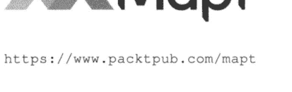

## 制作人员

**作者**  
Burkhard A. Meier

**文字编辑**  
Muktikant Garimella

**技术审校**  
Mohit

**项目协调人**  
Ulhas Kambali

**组稿编辑**  
Kunal Parikh

**校对**  
Safis Editing

**策划编辑**  
Denim Pinto

**索引编制**  
Aishwarya Gangawane

**内容开发编辑**  
Anurag Ghogre

**图形制作**  
Abhinash Sahu

**技术编辑**  
Prashant Mishra

**制作协调人**  
Nilesh Mohite

## 关于作者

**Burkhard A. Meier** 在软件行业拥有超过 17 年的专业经验，担任软件测试人员和开发人员，专攻软件测试自动化的开发、执行和分析。他在 Python 3 软件测试自动化开发方面拥有非常扎实的背景，同时精通 SQL 关系数据库管理、存储过程开发和代码调试。

尽管他在 Visual Studio .NET C#、Visual Test、TestComplete 及其他测试语言（如 C/C++）方面经验丰富，但过去五年作者的主要精力是开发用 Python 3 编写的测试自动化，用于测试面向 iPhone、Android 智能手机和手持平板的 FLIR ONE（现已推出第三代）红外摄像头的先进功能，并确保 FLIR 热辐射计红外相机平台的质量。

由于非常欣赏艺术、美和编程，作者使用 C# 和 Python 开发 GUI 来简化日常测试自动化任务，使这些自动化测试可以无人值守地运行数周，收集非常有用的数据进行分析，自动绘制成图表，并在夜间自动化测试运行完成后通过电子邮件发送给高层管理人员。

他此前曾在 InfoGenesis（现为 Agilysys）、QAD、InTouch Health 和 FLIR Systems 担任高级测试自动化工程师和设计师。

您可以通过他的 LinkedIn 账户与他联系：https://www.linkedin.com/pub/burkhard-meier/5/246/296。

我要感谢所有真正的伟大艺术家，如列奥纳多·达·芬奇、夏尔·波德莱尔、埃德加·爱伦·坡等众多艺术家，他们为人类生活带来了美的存在。这本书讲述了如何使用 Python 编程语言创建非常漂亮的 GUI，其灵感正是来自这些真正伟大的艺术家。

我要感谢所有让本书得以出版的优秀人士。没有你们任何人，这本书只会存在于我的脑海中。我要特别感谢 Packt Publishing 的所有编辑：Sonali、Anurag、Prashant、Vivek、Arwa、Sumeet、Saurabh、Pramod、Nikhil 等等。我还要感谢本书所有代码的审阅者。没有他们，这本书将更难阅读，也更难应用于实际问题。最后但同样重要的是，我要感谢我的妻子、我们的女儿以及我们的父母，在本书第二版的写作过程中，他们给予了如此成功的情绪支持。我还要感谢 Python 这一真正美丽而强大的编程语言的创造者。谢谢您，Guido。

## 关于审稿人

Mohit（mohitraj.cs@gmail.com）是一位 Python 程序员，对信息安全领域有浓厚兴趣。他在 Kurukshetra 大学获得计算机科学学士学位，并在 Patiala 的 Thapar 大学获得计算机科学工程硕士学位（2012 年）。他拥有美国 EC-Council 的 C|EH 和 ECSA 认证，也是前 IBM 员工。他在国内和国际杂志上发表过多篇文章。他还是《Python Penetration Testing Essentials》和《Python Penetration Testing for Developers》的作者，这两本书也由 Packt Publishing 出版。

## www.PacktPub.com

有关本书的支持文件和下载，请访问 www.PacktPub.com。

您是否知道 Packt 为每一本已出版的书都提供电子书版本，提供 PDF 和 ePub 文件？您可以在 www.PacktPub.com 升级到电子书版本，作为纸质书客户，您有权在电子书副本上享受折扣。如需更多详情，请通过 service@packtpub.com 与我们联系。

在 www.PacktPub.com 上，您还可以阅读一系列免费技术文章，订阅多种免费通讯，并获得 Packt 图书和电子书的独家折扣与优惠。



https://www.packtpub.com/mapt

通过 Mapt 获得最热门的软件技能。Mapt 让您全面访问所有 Packt 图书和视频课程，以及行业领先的工具，帮助您规划个人发展和推进职业生涯。

### 为何订阅？

- 可全文搜索 Packt 出版的所有图书
- 可复制、粘贴、打印和书签内容
- 按需提供，可通过网页浏览器访问

## 读者反馈

感谢您购买这本 Packt 图书。在 Packt，质量是我们编辑过程的核心。为了帮助我们改进，请在此书的亚马逊页面 https://www.amazon.com/dp/1787129454 留下您的真实评价。

如果您想加入我们的常驻评论员团队，可以发送电子邮件至 customerreviews@packtpub.com。我们会向常驻评论员赠送免费电子书和视频，以感谢他们的宝贵反馈。帮助我们不断提升产品品质！


## 前言

在本书第二版中，我们将使用 Python 编程语言探索图形用户界面（GUI）的美丽世界。我们将使用最新版本的 Python 3。本版包含了第一版的所有配方。我们在第二版中添加了一些新的配方，您可能无法通过 Google 搜索轻松找到。我认为这些新配方对读者来说会很有用且有趣。

这是一本编程菜谱书。每章都是独立的，并解释了某种编程解决方案。我们将从非常简单开始，但在本书中我们将构建一个用 Python 3 编写的正在运行的应用程序。每个配方都会扩展构建此应用程序。我们将沿途与网络、队列、数据库、OpenGL 图形库以及更多技术进行交互。我们将应用设计模式并使用最佳实践。

本书假设读者对 Python 编程语言有一定经验，但这并不是成功使用本书的必要条件。如果您致力于成为一名 Python 程序员，本书也可以用作 Python 编程语言的入门。

如果您是任何其他语言的经验丰富的开发人员，您将通过将使用 Python 编写 GUI 添加到您的专业工具箱中而获得乐趣。准备好了吗？

让我们开始我们的旅程…

## 本书涵盖内容

- 第 1 章，*创建 GUI 表单并添加控件*，解释了如何在 Python 中开发我们的第一个 GUI。我们将从构建可运行的 GUI 应用程序所需的最小代码开始。然后每个配方都会向 GUI 表单添加不同的控件。
- 第 2 章，*布局管理*，探讨了如何排列控件以创建我们的 Python GUI。网格布局管理器是我们将使用的内置于 tkinter 的最重要的布局工具之一。
- 第 3 章，*外观和感觉定制*，展示了如何创建良好的外观和感觉 GUI 的几个示例。在实践层面，我们将添加功能到我们在其中一个配方中创建的 Help | About 菜单项。


## 前言

第4章“数据与类”讨论了如何保存GUI所显示的数据。我们将开始使用面向对象编程（OOP），以扩展Python的内置功能。

第5章“Matplotlib图表”讲解了如何创建美观的图表来可视化表示数据。根据数据源的格式，我们可以在同一图表中绘制一列或多列数据。

第6章“线程与网络”讲解了如何使用线程、队列和网络连接来扩展Python GUI的功能。这将向我们展示，GUI完全不受限于个人电脑的本地范围。

第7章“通过GUI将数据存储到MySQL数据库”向我们展示了如何连接到MySQL数据库服务器。本章的第一个操作指南将演示如何安装免费的MySQL Server社区版，在后续的操作指南中，我们将创建数据库、表，将数据加载到这些表中，并修改这些数据。我们还将从MySQL服务器中将数据读取回GUI中。

第8章“国际化与测试”展示了如何通过在不同语言的标签、按钮、选项卡和其他控件上显示文本，来实现GUI的国际化。我们将从简单的方式开始，然后探索如何在设计层面为GUI的国际化做好准备。我们还将探讨几种使用Python内置单元测试框架自动测试GUI的方法。

第9章“使用wxPython库扩展GUI”介绍了另一个当前未随Python一起发布的Python GUI工具包。它名为wxPython，我们将使用wxPython的Phoenix版本，该版本被设计为能与Python 3良好协作。

第10章“使用PyOpenGL和PyGLet创建惊艳的3D GUI”展示了如何通过赋予GUI真正的三维能力来对其进行改造。我们将使用两个Python第三方包。PyOpenGL是OpenGL标准的Python绑定，OpenGL是一个随所有主流操作系统内置的图形库。这使生成的控件具有原生外观和感觉。PyGLet是另一种类似的绑定，我们将在本章中进行探索。我们还将展示一些直接使用PyOpenGL库的代码。这是一种底层方法，可能会为感兴趣的读者打开一些大门。

第11章“最佳实践”探讨了各种最佳实践，这些实践可以帮助我们高效地构建GUI，并使其保持可维护性和可扩展性。最佳实践适用于任何优秀的代码，我们的GUI也不例外，同样需要设计和实施良好的软件实践。

### 本书所需环境

本书所需的所有软件都可以在线获取，并且是免费的。这些软件首先是Python 3本身，然后延展到Python的附加模块。为了下载任何所需软件，你需要一个可用的互联网连接。

### 本书读者对象

本书面向希望创建GUI的程序员。你可能会对使用Python编程语言能够创建出美观、实用且功能强大的GUI感到惊讶。Python是一门奇妙、直观的编程语言，并且非常易于学习。

我邀请你现在就开始这段旅程。这将充满乐趣！

### 排版约定

在本书中，你会发现多种不同的文本样式，用以区分不同种类的信息。以下是其中一些样式的示例，以及对其含义的解释。

文本中的代码词、数据库表名、文件夹名、文件名、文件扩展名、路径名和用户输入显示如下：“使用Python，我们可以使用`class`关键字而不是`def`关键字来创建自己的类。”

代码块设置如下：

```
import tkinter as tk
win = tk.Tk()
win.title("Python GUI")
win.mainloop()
```

任何命令行输入或输出都写成如下形式：

```
pip install numpy-1.9.2+mkl-cp36-none-win_amd64.whl
```

新术语和重要词语以**粗体**显示。你在屏幕上看到的文字，例如菜单或对话框中的文字，在正文中显示如下：“接下来，我们将为菜单项添加功能，例如，通过单击Exit菜单项关闭主窗口，以及显示Help | About对话框。”

警告或重要提示以这样的方框显示。

技巧和窍门以这样的形式显示。

### 读者反馈

我们始终欢迎来自读者的反馈。请告诉我们您对这本书的看法——您喜欢或不喜欢的地方。读者反馈对我们很重要，因为它有助于我们开发出真正让您受益匪浅的图书。

要向我们发送一般性反馈，只需发送电子邮件至feedback@packtpub.com，并在邮件主题中注明书名。

如果您在某个主题上具有专业知识，并且对撰写或参与编写图书感兴趣，请参阅我们的作者指南，网址为www.packtpub.com/authors。

### 客户支持

既然您已成为Packt图书的拥有者，我们有多项服务可帮助您充分利用您的购买。

#### 下载示例代码

您可以从您的账户中下载本书的示例代码文件，网址为 http://www.packtpub.com 。如果您从其他渠道购买了本书，可以访问 http://www.packtpub.com/support 并注册，以便我们将文件直接通过电子邮件发送给您。

您可以通过以下步骤下载代码文件：

1. 使用您的电子邮件地址和密码登录或注册我们的网站。
2. 将鼠标指针悬停在上方的“支持”(SUPPORT)选项卡上。
3. 单击“代码下载与勘误”(Code Downloads & Errata)。
4. 在“搜索”(Search)框中输入书名。
5. 选择您要为其下载代码文件的书。
6. 在下拉菜单中选择您购买本书的渠道。
7. 单击**代码下载**。

文件下载完成后，请确保使用以下最新版本解压缩或解压文件夹：

- Windows系统：WinRAR / 7-Zip
- Mac系统：Zipeg / iZip / UnRarX
- Linux系统：7-Zip / PeaZip

本书的代码包也托管在GitHub上，网址为 https://github.com/PacktPublishing/Python-GUI-Programming-Cookbook-Second-Edition 。我们还有其他丰富的图书和视频代码包，可在 https://github.com/PacktPublishing/ 获取。去看看吧！

#### 下载本书彩色图片

我们还为您提供了一个PDF文件，其中包含本书使用的截图/图表的彩色图片。彩色图片将帮助您更好地理解输出的变化。您可以从 https://www.packtpub.com/sites/default/files/downloads/PythonGUIProgrammingCookbookSecondEdition_ColorImages.pdf 下载此文件。

#### 勘误

尽管我们已竭尽全力确保内容的准确性，但错误仍有可能发生。如果您在我们的某本书中发现了错误——也许是文本或代码中的错误——我们将感谢您向我们报告。这样做可以让其他读者免于困惑，并帮助我们改进本书的后续版本。如果您发现任何勘误，请访问 http://www.packtpub.com/submit-errata ，选择您的图书，单击**勘误提交表单**链接，并输入勘误详情。一旦您的勘误得到验证，您的提交将被接受，勘误将上传到我们的网站，或添加到该图书勘误部分的现有勘误列表中。

要查看先前提交的勘误，请访问 https://www.packtpub.com/books/content/support ，并在搜索字段中输入书名。所需信息将显示在**勘误**部分。

#### 盗版

互联网上对受版权保护材料的盗版是所有媒体持续存在的问题。在Packt，我们非常严肃地对待对我们版权和许可证的保护。如果您在互联网上以任何形式发现我们作品的非法副本，请立即向我们提供位置地址或网站名称，以便我们寻求补救措施。

请通过`copyright@packtpub.com`联系我们，并附上涉嫌盗版材料的链接。

我们感谢您帮助保护我们的作者以及我们为您提供有价值内容的能力。

#### 问题

如果您对本书的任何方面有问题，可以通过`questions@packtpub.com`联系我们，我们将尽最大努力解决该问题。


