## 创建 GUI 表单并添加控件

在本章中，我们将使用 Python 3.6 及以上版本开始创建出色的 GUI。我们将涵盖以下主题：

- 创建我们的第一个 Python GUI
- 防止 GUI 被调整大小
- 向 GUI 表单添加标签
- 创建按钮并更改其文本属性
- 文本框控件
- 将焦点设置到控件并禁用控件
- 组合框控件
- 创建具有不同初始状态的复选框
- 使用单选按钮控件
- 使用滚动文本控件
- 在循环中添加多个控件

### 简介

在本章中，我们将用 Python 开发我们的第一个 GUI。我们将从构建一个可运行的 GUI 应用程序所需的最少代码开始。随后每个方案都会向 GUI 表单添加不同的控件。

在前两个方案中，我们将展示全部代码，仅由几行代码组成。在接下来的方案中，我们将只展示需要添加到之前方案中的代码。

到本章结束时，我们将创建一个可用的 GUI 应用程序，其中包含标签、按钮、文本框、组合框、各种状态的复选框，以及用于更改 GUI 背景颜色的单选按钮。

在每章开头，我会展示属于该章的 Python 模块。然后，我会引用与所展示、学习和运行的代码相关的各个模块。

以下是本章涉及的 Python 模块（以 .py 扩展名结尾）概览：

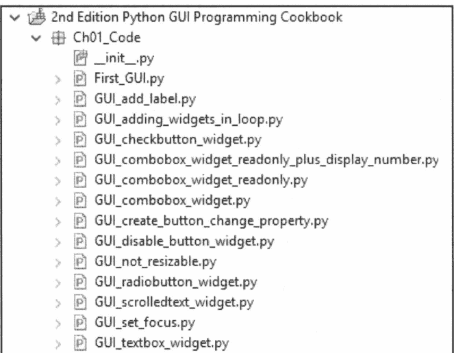

## 创建我们的第一个 Python GUI

Python 是一种非常强大的编程语言。它内置了 `tkinter` 模块。只需几行代码（准确地说，四行），我们就可以构建出第一个 Python GUI。

### 准备工作

要遵循本方案，一个可用的 Python 开发环境是前提条件。Python 自带的 IDLE GUI 足以开始。IDLE 就是使用 tkinter 构建的！

- 本书中的所有方案都是在 Windows 10 64 位操作系统上使用 Python 3.6 开发的。它们没有在任何其他配置上测试过。由于 Python 是一种跨平台语言，每个方案的代码预计都可以在任何地方运行。
- 如果你使用的是 Mac，它确实自带 Python，但可能缺少一些模块，例如 tkinter，而本书中我们将全程使用该模块。
- 我们使用的是 Python 3.6，Python 的创造者特意选择不使其向后兼容 Python 2。如果你使用的是 Mac 或 Python 2，你可能需要从 www.python.org 安装 Python 3.6，才能成功运行本书中的方案。
- 如果你确实希望在 Python 2.7 上运行本书中的代码，则需要进行一些调整。例如，Python 2.x 中的 tkinter 是大写 T。Python 2.7 的 print 语句在 Python 3.6 中是一个函数，需要加上括号。
- 虽然 Python 2.x 分支的 EOL（生命周期结束）已延长到 2020 年，但我强烈建议你开始使用 Python 3.6 及以上版本。
- 除非真的有必要，否则为什么要固守过去呢？这里有一个链接，指向与 Python 2 的 EOL 相关的 Python 增强提案（PEP）373：https://www.python.org/dev/peps/pep-0373/

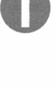

### 如何操作…

以下是创建最终 GUI 所需的四行 `First_GUI.py` 代码：

```
```python
6  #====================
7  # imports
8  #====================
9  import tkinter as tk

11 # Create instance
12 win = tk.Tk()

14 # Add a title
15 win.title("Python GUI")

17 #====================
18 # Start GUI
19 #====================
20 win.mainloop()
```
```

执行这段代码并欣赏结果：

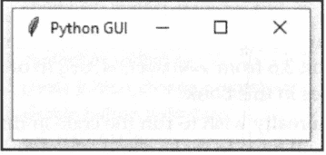

### 工作原理…

在第 9 行，我们导入了内置的 `tkinter` 模块，并将其别名为 `tk`，以简化我们的 Python 代码。在第 12 行，我们通过调用 Tk 类的构造函数来创建该类的实例（Tk 后面的括号将类转换为实例）。我们使用别名 `tk`，因此不必使用较长的 `tkinter` 一词。我们将该类实例分配给名为 `win` 的变量（window 的缩写）。由于 Python 是一种动态类型语言，我们不必在赋值前声明此变量，也不必为其指定特定类型。Python 会根据此语句的赋值推断类型。Python 是一种强类型语言，因此每个变量始终具有类型。只是我们不必像其他语言那样预先指定其类型。这使 Python 成为一种非常强大且高效的编程语言。

### 关于类与类型的一点说明：

- 在 Python 中，每个变量始终具有类型。我们不能创建没有类型的变量。然而，在 Python 中，我们不必像在 C 编程语言中那样预先声明类型。
- Python 足够聪明，可以推断类型。在撰写本书时，C# 也具备这种能力。使用 Python，我们可以使用 `class` 关键字而不是 `def` 关键字创建自己的类。
- 为了将类分配给变量，我们必须先创建类的实例。我们创建实例并将该实例分配给我们的变量，例如：

```
class AClass(object):
    print('Hello from AClass')
class_instance = AClass()
```

现在，变量 `class_instance` 的类型是 AClass。如果这听起来令人困惑，请不要担心。我们将在接下来的章节中介绍 OOP（面向对象编程）。

在第 15 行，我们使用类的实例变量 (`win`) 通过 `title` 属性为窗口设置标题。在第 20 行，我们通过在类实例 `win` 上调用 `mainloop` 方法来启动窗口的事件循环。到目前为止，在我们的代码中，我们创建了一个实例并设置了一个属性，但在我们启动主事件循环之前，GUI 不会显示。

- 事件循环是一种使我们的 GUI 正常工作的机制。我们可以将其视为一个无限循环，GUI 在其中等待事件被发送给它。按钮单击会在我们的 GUI 中创建一个事件，或者调整 GUI 大小也会创建一个事件。
- 我们可以预先编写所有 GUI 代码，但在我们调用前面代码中的这个无限循环（`win.mainloop()`）之前，用户的屏幕上不会显示任何内容。当用户单击红色 X 按钮或我们编程用于结束 GUI 的控件时，事件循环结束。当事件循环结束时，我们的 GUI 也随之结束。

### 更多内容...

本方案使用最少的 Python 代码创建了我们的第一个 GUI 程序。但是，在本书中，我们将在有意义的情况下使用 OOP。

## 防止 GUI 被调整大小

默认情况下，使用 tkinter 创建的 GUI 可以调整大小。这并不总是理想的。我们放置在 GUI 表单上的控件最终可能会以不恰当的方式被调整大小，因此在本方案中，我们将学习如何防止 GUI 应用程序的用户调整我们的 GUI 大小。

### 准备工作

本方案是对前一个方案 *创建我们的第一个 Python GUI* 的扩展，因此一个要求是你已经亲自将第一个方案输入到了自己的项目中，或者从 https://github.com/PacktPublishing/Python-GUI-Programming-Cookbook-Second-Edition/ 下载代码。

### 如何操作...

我们要防止 GUI 被调整大小，请看：

```
GUI_not_resizable.py
```

```
6 #====================
7 # imports
8 #====================
9 import tkinter as tk
10
11 # Create instance
12 win = tk.Tk()
13
14 # Add a title
15 win.title("Python GUI")
16
17 # Disable resizing the GUI by passing in False/False
18 win.resizable(False, False)
19
20 # Enable resizing x-dimension, disable y-dimension
21 # win.resizable(True, False)
22
23 #====================
24 # Start GUI
25 #====================
26 win.mainloop()
```

运行这段代码会创建如下 GUI：

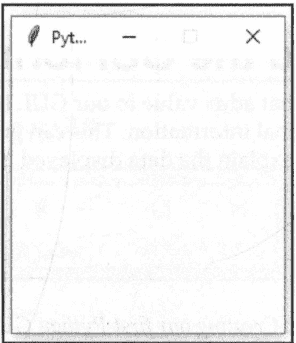

### 工作原理...

第 18 行防止 Python GUI 被调整大小。

运行此代码将产生一个与我们在第一个方案中创建的 GUI 类似的 GUI。但是，用户无法再调整它的大小。另外，请注意窗口工具栏中的最大化按钮是如何变灰的。

为什么这很重要？因为一旦我们在表单上添加了控件，调整大小可能会使我们的 GUI 看起来不如我们预期的那么好。我们将在接下来的方案中向我们的 GUI 添加控件。

resizable() 方法是 Tk() 类的方法，通过传入 (False, False)，我们防止 GUI 被调整大小。我们可以禁用 GUI 的 x 和 y 两个维度的调整大小，或者我们可以通过传入 True 或任何非零数字来启用其中一个或两个维度。(True, False) 将启用 x 维度，但阻止 y 维度被调整大小。

我们还为代码添加了注释，为本书中的方案做准备。


在诸如 Visual Studio .NET 之类的可视化编程 IDE 中，C# 程序员通常不会考虑防止用户调整他们用该语言开发的 GUI 的大小。这会创建较差的 GUI。添加这一行 Python 代码可以让我们的用户欣赏我们的 GUI。

## 向 GUI 表单添加标签

标签是一个非常简单的控件，它为我们的 GUI 增加了价值。它解释了其他控件的用途，提供了额外的信息。这可以引导用户理解 Entry 控件的含义，也可以解释控件显示的数据，而无需用户输入数据。

### 准备工作

我们正在扩展第一个方案《创建我们的第一个 Python GUI》。我们将保持 GUI 可调整大小，因此不要使用第二个方案中的代码（或将 win.resizable 行注释掉）。


## 如何操作...

为了向我们的 GUI 添加一个 Label 控件，我们将从 tkinter 导入 ttk 模块。请注意这两个 import 语句。将以下代码添加到 `win.mainloop()` 之前，该语句位于第一和第二份食谱的底部：

GUI_add_label.py

```
6 #===================
7 # imports
8 #===================
9 import tkinter as tk
10 from tkinter import ttk
11
12 # Create instance
13 win = tk.Tk()
14
15 # Add a title
16 win.title("Python GUI")
17
18 # Adding a Label
19 ttk.Label(win, text="A Label").grid(column=0, row=0)
20
21 #===================
22 # Start GUI
23 #===================
24 win.mainloop()
```

运行代码后，我们的 GUI 中会添加一个标签：

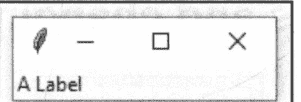

## 其工作原理...

在前述代码的第 10 行，我们从 tkinter 包中导入了一个单独的模块。ttk 模块有一些高级控件，能让我们的 GUI 看起来很棒。从某种意义上说，ttk 是 tkinter 包中的一个扩展。

我们仍然需要导入 tkinter 包本身，但我们必须指定现在还想使用 tkinter 包中的 ttk。

ttk 代表 themed tk。它改善了我们 GUI 的外观和感觉。

第 19 行在我们调用 mainloop 之前将标签添加到 GUI。

我们将窗口实例传递给 ttk.Label 构造函数并设置 text 属性。这将成为我们的 Label 显示的文本。

我们还使用了网格布局管理器，我们将在第 2 章《布局管理》中更深入地探讨它。

注意我们的 GUI 突然比之前的食谱小了很多。

它变得这么小的原因是我们向表单添加了一个控件。没有控件时，tkinter 包会使用默认大小。添加控件会导致优化，这通常意味着使用尽可能少的空间来显示控件。

如果我们使标签的文本更长，GUI 会自动扩展。我们将在第 2 章《布局管理》中的后续食谱中介绍这种自动表单大小调整。

## 还有更多...

尝试调整此带标签的 GUI 的大小并最大化它，看看会发生什么。

## 创建按钮并更改其文本属性

在本食谱中，我们将添加一个按钮控件，并使用此按钮来更改我们 GUI 的另一个控件的属性。这让我们了解了 Python GUI 环境中的回调函数和事件处理。

### 准备工作

本食谱扩展了前一个食谱 *向 GUI 表单添加标签*。你可以从 `https://github.com/PacktPublishing/Python-GUI-Programming-Cookbook-Second-Edition/` 下载全部代码。

### 如何操作…

我们添加一个按钮，点击时执行操作。在本食谱中，我们将更新我们在上一食谱中添加的标签以及按钮的文本属性：

`GUI_create_button_change_property.py`

```
18  # Adding a Label that will get modified
19  a_label = ttk.Label(win, text="A Label")
20  a_label.grid(column=0, row=0)
21
22  # Button Click Event Function
23  def click_me():
24      action.configure(text='*** I have been Clicked! ***')
25      a_label.configure(foreground='red')
26      a_label.configure(text='A Red Label')
27
28  # Adding a Button
29  action = ttk.Button(win, text='Click me!', command=click_me)
30  action.grid(column=1, row=0)
31
32  #====================
33  # Start GUI
34  #====================
35  win.mainloop()
```

以下屏幕截图显示了我们点击按钮之前 GUI 的外观：

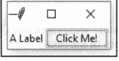

点击按钮后，标签的颜色发生了变化，按钮的文本也随之改变，如下所示：

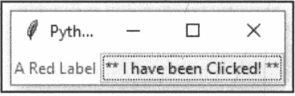

### 其工作原理…

在第 19 行，我们将标签分配给一个变量，并在第 20 行使用此变量在表单内定位标签。我们需要此变量，以便在 `click_me()` 函数中更改其属性。默认情况下，这是一个模块级变量，因此只要我们在调用它的函数之上声明该变量，我们就可以在函数内部访问它。

第 23 行是事件处理程序，当按钮被点击时会被调用。

在第 29 行，我们创建按钮并将 command 绑定到 `click_me()` 函数。

> GUI 是事件驱动的。点击按钮会产生一个事件。我们使用 `ttk.Button` 控件的 `command` 属性在回调函数中绑定事件发生时要执行的操作。注意我们没有使用括号，只使用了名称 `click_me`。

我们还将标签的文本更改为包含 `red`，因为在印刷版书籍中，否则可能不明显。当你运行代码时，你可以看到颜色确实发生了变化。

第 20 行和第 30 行都使用了网格布局管理器，这将在下一章中讨论。这使标签和按钮对齐。

### 还有更多…

我们将继续向我们的 GUI 添加更多控件，并在本书的其他食谱中利用许多内置属性。

## 文本框控件

在 tkinter 中，典型的单行文本框控件称为 Entry。在本食谱中，我们将向我们的 GUI 添加这样的 Entry 控件。我们将使标签更有用，通过描述 Entry 控件为用户做了什么。

### 准备工作

本食谱基于 创建按钮并更改其文本属性 食谱。

### 如何操作...

查看以下代码：

GUI_textbox_widget.py

```
22 # Modified Button Click Function
23 def click_me():
24     action.configure(text='Hello ' + name.get())
25
26 # Changing our Label
27 ttk.Label(win, text="Enter a name:").grid(column=0, row=0)
28
29 # Adding a Text box Entry widget
30 name = tk.StringVar()
31 name_entered = ttk.Entry(win, width=12, textvariable=name)
32 name_entered.grid(column=0, row=1)
```

现在，我们的 GUI 看起来像这样：

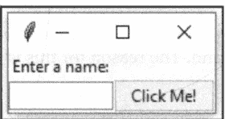

输入一些文本并点击按钮后，GUI 发生了以下变化：

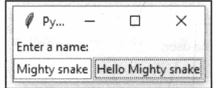

### 其工作原理...

在第 24 行，我们获取 Entry 控件的值。我们还没有使用 OOP，那么我们怎么能访问一个甚至还没有声明的变量的值呢？

不使用 OOP 类，在 Python 的过程式编码中，我们必须在尝试使用该名称的语句之前物理地放置一个名称。那么为什么这会起作用呢？它确实起作用。

答案是按钮点击事件是一个回调函数，到用户点击按钮时为止，此函数中引用的变量是已知的并且确实存在。

生活很美好。

第 27 行为我们的标签赋予了更有意义的名称；目前，它描述了它下面的文本框。我们将按钮向下移动到标签旁边，以便在视觉上将两者关联起来。我们仍然在使用网格布局管理器，这将在第 2 章《布局管理》中更详细地解释。

第 30 行创建了一个变量 name。此变量绑定到 Entry 控件，在我们的 click_me() 函数中，我们能够通过在此变量上调用 get() 来检索 Entry 控件的值。这工作得很好。

现在我们看到，虽然按钮显示了我们输入的全部文本（以及更多），但文本框 Entry 控件并未扩展。原因是在第 31 行我们将其硬编码为宽度 12。

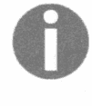

- Python 是一种动态类型语言，会根据赋值推断类型。这意味着如果我们将字符串赋给 `name` 变量，它将是 `string` 类型，如果我们将整数赋给 `name`，其类型将是整数。
- 使用 `tkinter` 时，我们必须在成功使用之前将 `name` 变量声明为 `tk.StringVar()` 类型。原因是 tkinter 不是 Python。我们可以从 Python 使用它，但它不是同一种语言。

## 设置控件焦点并禁用控件

虽然我们的 GUI 正在变得越来越好，但如果 GUI 出现时光标就出现在 Entry 控件中会更方便、更有用。在这里我们学习如何做到这一点。

### 准备工作

本食谱扩展了前一个食谱，文本框控件。

### 如何操作...

Python 真的很棒。我们要做的就是在 GUI 出现时将焦点设置到特定控件上，只需在我们之前创建的 `tkinter` 控件实例上调用 `focus()` 方法即可。在我们当前的 GUI 示例中，我们将 `ttk.Entry` 类实例分配给一个名为 `name_entered` 的变量。现在，我们可以让它获得焦点。


将以下代码放在模块底部启动主窗口事件循环的代码上方，就像我们在之前的配方中所做的那样：

GUI_set_focus.py

```python
29 # Adding a Textbox Entry widget
30 name = tk.StringVar()
31 name_entered = ttk.Entry(win, width=12, textvariable=name)
32 name_entered.grid(column=0, row=1)
33
34 # Adding a Button
35 action = ttk.Button(win, text="Click Me!", command=click_me)
36 action.grid(column=1, row=1)
37
38 name_entered.focus()      # Place cursor into name Entry
39 #========================
40 # Start GUI
41 #====================
42 win.mainloop()
```

如果出现错误，请确保将变量调用放在声明它们的代码之后。我们还没有使用面向对象编程，因此这仍然是必要的。以后，我们将不再需要这样做。

在 Mac 上，你可能需要先将焦点设置到 GUI 窗口，然后才能将焦点设置到该窗口中的 Entry 控件。

添加这一行（第38行）Python 代码会将光标放入文本 Entry 控件中，从而使文本 Entry 控件获得焦点。一旦 GUI 出现，我们就可以直接在该文本框中输入，而无需先点击它。

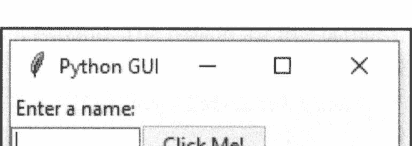


注意光标现在默认位于文本 Entry 框内。

我们还可以禁用控件。为此，我们将在控件上设置一个属性。我们可以通过添加下面这一行（下方第37行）Python 代码来创建按钮，从而禁用该按钮：

```python
34 # Adding a Button
35 action = ttk.Button(win, text="Click Me!", command=click_me)
36 action.grid(column=1, row=1)
37 action.configure(state='disabled')    # Disable the Button Widget
38 
39 name_entered.focus()        # Place cursor into name Entry
```

添加上述 Python 代码行后，点击按钮将不再产生任何操作：

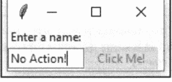

### 工作原理...

这段代码不言自明。我们为其中一个控件设置焦点，并禁用另一个控件。编程语言中良好的命名有助于消除冗长的解释。在本书后面，将介绍一些高级技巧，讲解如何在工作中编程或在 家中练习编程技能时做到这一点。

### 更多内容...

是的。这仅仅是第一章。后面还有更多内容。

## 组合框控件

在本配方中，我们将通过添加具有初始默认值的下拉组合框来改进我们的 GUI。我们既可以将用户限制为只能选择某些选项，也可以允许用户输入他们想要的任何内容。

### 准备工作

本配方扩展了之前的配方“将焦点设置到控件并禁用控件”。

### 操作步骤...

我们使用网格布局管理器在 Entry 控件和 Button 控件之间插入另一列。以下是 Python 代码：

GUI_combobox_widget.py

```python
31 # Adding a Textbox Entry widget
32 name = tk.StringVar()
33 name_entered = ttk.Entry(win, width=12, textvariable=name)
34 name_entered.grid(column=0, row=1)                # column 0
35 
36 # Adding a Button
37 action = ttk.Button(win, text="Click Me!", command=click_me)
38 action.grid(column=2, row=1)                      # <= change column to 2
39 
40 ttk.Label(win, text="Choose a number:").grid(column=1, row=0)
41 number = tk.StringVar()
42 number_chosen = ttk.Combobox(win, width=12, textvariable=number)
43 number_chosen['values'] = (1, 2, 4, 42, 100)
44 number_chosen.grid(column=1, row=1)               # <= Combobox in column 1
45 number_chosen.current(0)
46 
47 name_entered.focus()      # Place cursor into name Entry
48 #========================
49 # Start GUI
50 #========================
51 win.mainloop()
```

将这段代码添加到之前的配方中后，会生成以下 GUI。请注意，在上述代码的第43行，我们为组合框分配了一个包含默认值的元组。这些值会出现在下拉框中。我们也可以根据需要更改它们（在应用程序运行时输入不同的值）：

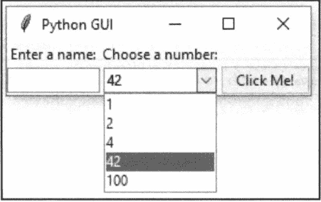

### 工作原理...

第40行添加了第二个标签，以匹配新创建的组合框（在第42行创建）。第41行将该框的值赋给一个特殊的 tkinter 类型 `StringVar` 的变量，就像我们在之前的配方中所做的那样。

第44行将两个新控件（标签和组合框）对齐到我们之前的 GUI 布局中，第45行指定了一个默认值，在 GUI 首次可见时显示。这是 `number_chosen['values']` 元组的第一个值，即字符串 "1"。我们在第43行没有为整数元组添加引号，但由于在第41行我们声明值为 `tk.StringVar` 类型，它们被转换成了字符串。

上面的截图显示用户选择了 42。该值被赋给 number 变量。

### 更多内容...

如果我们希望限制用户只能选择我们编程到组合框中的值，可以通过将 state 属性传递给构造函数来实现。按如下方式修改第42行：

GUI_combobox_widget_readonly_plus_display_number.py

```python
40 ttk.Label(win, text="Choose a number:").grid(column=1, row=0)
41 number = tk.StringVar()
42 number_chosen = ttk.Combobox(win, width=12, textvariable=number, state='readonly')
43 number_chosen['values'] = (1, 2, 4, 42, 100)
44 number_chosen.grid(column=1, row=1)
45 number_chosen.current(0)
```

现在，用户不能再向组合框中输入值。我们可以通过在 Button 点击事件回调函数中添加以下代码行来显示用户选择的值：

```python
22 # Modified Button Click Function
23 def click_me():
24     action.configure(text='Hello ' + name.get() + ' ' +
25                         number_chosen.get())
```

在选择一个数字、输入名称并点击按钮后，我们得到以下 GUI 结果，它现在也显示了所选的数字：

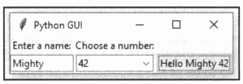

## 创建具有不同初始状态的复选按钮

在本配方中，我们将添加三个复选按钮控件，每个控件具有不同的初始状态。

### 准备工作

本配方扩展了之前的配方“组合框控件”。

### 操作步骤...

我们将创建三个状态不同的复选按钮控件。第一个处于禁用状态且带有复选标记。由于该控件被禁用，用户无法移除这个复选标记。

第二个复选按钮处于启用状态，默认没有复选标记，但用户可以点击它来添加复选标记。

第三个复选按钮默认处于启用且选中状态。用户可以随意取消选中和重新选中该控件。请看以下代码：

GUI_checkbutton_widget.py

```python
35 # Adding a Button
36 action = ttk.Button(win, text="Click Me!", command=click_me)
37 action.grid(column=2, row=1)
38 
39 # Creating three checkbuttons
40 ttk.Label(win, text="Choose a number:").grid(column=1, row=0)
41 number = tk.StringVar()
42 number_chosen = ttk.Combobox(win, width=12, textvariable=number, state='readonly')
43 number_chosen['values'] = (1, 2, 4, 42, 100)
44 number_chosen.grid(column=1, row=1)
45 number_chosen.current(0)
46 
47 chVarDis = tk.IntVar()
48 check1 = tk.Checkbutton(win, text="Disabled", variable=chVarDis, state='disabled')
49 check1.select()
50 check1.grid(column=0, row=4, sticky=tk.W)
51 
52 chVarUn = tk.IntVar()
53 check2 = tk.Checkbutton(win, text="UnChecked", variable=chVarUn)
54 check2.deselect()
55 check2.grid(column=1, row=4, sticky=tk.W)
56 
57 chVarEn = tk.IntVar()
58 check3 = tk.Checkbutton(win, text="Enabled", variable=chVarEn)
59 check3.select()
60 check3.grid(column=2, row=4, sticky=tk.W)
61 
62 name_entered.focus()      # Place cursor into name Entry
63 #====================
64 # Start GUI
65 #====================
66 win.mainloop()
```

运行新代码会得到以下 GUI：

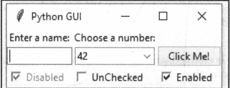

### 工作原理...

在第47、52和57行，我们创建了三个 IntVar 类型的变量。在每个变量后的下一行，我们创建一个 Checkbutton，并将这些变量传递进去。它们将保存 Checkbutton 的状态（未选中或选中）。默认情况下，状态为 0（未选中）或 1（选中），因此变量类型是 tkinter 整数。

我们将这些 Checkbutton 控件放置在主窗口中，因此传递给构造函数的第一个参数是控件的父级，在本例中是 win。我们通过 text 属性为每个 Checkbutton 控件指定不同的标签。

将 grid 的 sticky 属性设置为 tk.W 意味着控件将对齐到网格的西部。这与 Java 语法非常相似，意味着它将左对齐。当我们调整 GUI 大小时，控件将保持在左侧，而不会向 GUI 中心移动。

第49和59行通过调用这两个 Checkbutton 类实例上的 select() 方法，将复选标记放入 Checkbutton 控件中。

我们继续使用网格布局管理器来排列控件，这将在第2章“布局管理”中更详细地解释。

## 使用单选按钮控件

在本配方中，我们将创建三个 tkinter Radiobutton 控件。我们还将添加一些代码，根据选择的是哪个 Radiobutton 来更改主窗体的颜色。


# 准备工作

本食谱扩展了之前的食谱，使用不同初始状态创建复选按钮。

# 如何做...

我们在之前的食谱中添加以下代码：

GUI_radiobutton_widget.py

```
74  # Radiobutton Globals
75  COLOR1 = "Blue"
76  COLOR2 = "Gold"
77  COLOR3 = "Red"
78
79  # Radiobutton Callback
80  def radCall():
81      radSel=radVar.get()
82      if  radSel == 1: win.configure(background=COLOR1)
83      elif radSel == 2: win.configure(background=COLOR2)
84      elif radSel == 3: win.configure(background=COLOR3)
85
86  # create three Radiobuttons using one variable
87  radVar = tk.IntVar()
88
89  rad1 = tk.Radiobutton(win, text=COLOR1, variable=radVar, value=1, command=radCall)
90  rad1.grid(column=0, row=5, sticky=tk.W, columnspan=3)
91
92  rad2 = tk.Radiobutton(win, text=COLOR2, variable=radVar, value=2, command=radCall)
93  rad2.grid(column=1, row=5, sticky=tk.W, columnspan=3)
94
95  rad3 = tk.Radiobutton(win, text=COLOR3, variable=radVar, value=3, command=radCall)
96  rad3.grid(column=2, row=5, sticky=tk.W, columnspan=3)
97
98  name_entered.focus()      # Place cursor into name Entry
99  ====================
100 # Start GUI
101 ====================
102 win.mainloop()
```

运行此代码并选择名为 Gold 的单选按钮会创建以下窗口：

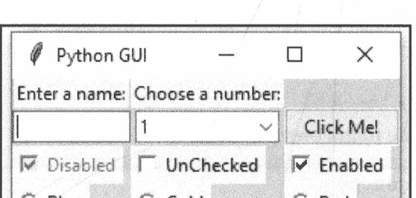

# 它是如何工作的...

在第 75-77 行，我们创建了一些模块级全局变量，我们将在创建每个单选按钮以及创建更改主窗体背景颜色的操作的回调函数中使用它们（使用实例变量 win）。

我们使用全局变量是为了使更改代码更容易。通过将颜色名称分配给变量并在多个地方使用该变量，我们可以轻松尝试不同的颜色。无需对硬编码字符串进行全局搜索和替换（容易出错），我们只需更改一行代码，其余部分就会正常工作。这被称为 DRY 原则，即 Don't Repeat Yourself。这是我们在本书后面的食谱中会使用的 OOP 概念。

我们分配给变量的颜色名称（COLOR1、COLOR2 ...）是 tkinter 关键字（从技术上讲，它们是符号名称）。如果我们使用不是 tkinter 颜色关键字的名称，则代码将无法工作。

第 80 行是根据用户选择更改主窗体（win）背景的回调函数。

在第 87 行我们创建一个 tk.IntVar 变量。重要的是，我们只创建一个变量供所有三个单选按钮使用。正如屏幕截图所示，无论我们选择哪个单选按钮，其他单选按钮都会自动为我们取消选择。

第 89 到 96 行创建三个单选按钮，将它们分配给主窗体，并传入将在创建更改主窗口背景的操作的回调函数中使用的变量。

虽然这是第一个更改小部件颜色的食谱，但说实话，它看起来有点难看。本书中很大一部分后续食谱解释了如何让我们的 GUI 看起来真正令人惊艳。

# 还有更多...

以下是可在官方 tcl 手册页 http://www.tcl.tk/man/tcl8.5/TkCmd/colors.htm 上查找的可用符号颜色名称的小样本。

| Name | Red | Green | Blue |
|---|---|---|---|
| alice blue | 240 | 248 | 255 |
| AliceBlue | 240 | 248 | 255 |
| Blue | 0 | 0 | 255 |
| Gold | 255 | 215 | 0 |
| Red | 255 | 0 | 0 |

其中一些名称创建相同的颜色，因此 alice blue 创建的颜色与 AliceBlue 相同。在本食谱中，我们使用了符号名称 Blue、Gold 和 Red。

# 使用滚动文本小部件

ScrolledText 小部件比简单的 Entry 小部件大得多，并且跨越多行。它们是像记事本一样的控件，会自动换行，并在文本大于 ScrolledText 小部件高度时自动启用垂直滚动条。

# 准备工作

本食谱扩展了之前的食谱，使用单选按钮小部件。您可以从 https://github.com/PacktPublishing/Python-GUI-Programming-Cookbook-Second-Edition/ 下载本书每个章节的代码。

# 如何做...

通过添加以下代码行，我们创建了一个 ScrolledText 小部件：

GUI_scrolledtext_widget.py

```
6 #====================
7 # imports
8 #====================
9 import tkinter as tk
10 from tkinter import ttk
11 from tkinter import scrolledtext

99 # Using a scrolled Text control
100 scrol_w = 30
101 scrol_h = 3
102 scr = scrolledtext.ScrolledText(win, width=scrol_w, height=scrol_h, wrap=tk.WORD)
103 scr.grid(column=0, columnspan=3)
104
105 name_entered.focus()      # Place cursor into name Entry
106 #====================
107 # Start GUI
108 #====================
109 win.mainloop()
```

我们实际上可以输入我们的控件，如果我们输入足够的单词，行会自动换行：

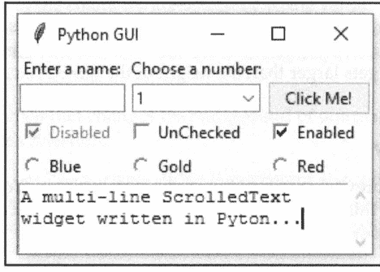

一旦我们输入的单词超过控件可以显示的高度，垂直滚动条就会启用。所有这些开箱即用，无需我们编写更多代码即可实现：

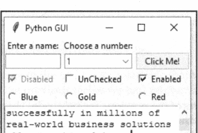

# 它是如何工作的...

在第 11 行，我们导入包含 ScrolledText 小部件类的模块。将此添加到模块顶部，位于另外两个 import 语句下方。

第 100 行和第 101 行定义了我们即将创建的 ScrolledText 小部件的宽度和高度。这些是我们在第 102 行传递给 ScrolledText 小部件构造函数的硬编码值。

这些值是通过实验得出的魔数，可以很好地工作。你可以尝试将 scol_w 从 30 改为 50 并观察效果！

在第 102 行，我们还通过传入 wrap=tk.WORD 在小部件上设置了一个属性。

通过将 wrap 属性设置为 tk.WORD，我们告诉 ScrolledText 小部件按单词换行，这样我们就不会在单词中间换行。默认选项是 tk.CHAR，它会在单词中间时换行任何字符。

第二个屏幕截图显示垂直滚动条向下移动，因为我们正在阅读更长的文本，该文本完全不适合我们创建的 ScrolledText 控件的 x、y 尺寸。

将 ScrolledText 小部件的 grid 小部件的 columnspan 属性设置为 3 使此小部件跨越全部三个列。如果我们不设置此属性，我们的 ScrolledText 小部件将仅位于第一列，这不是我们想要的。

# 在循环中添加多个小部件

到目前为止，我们已经通过基本上复制和粘贴相同的代码然后修改变化（例如列号）创建了多个相同类型的小部件（例如 Radiobutton）。在本食谱中，我们开始重构代码以使其不那么冗余。

# 准备工作

我们正在重构上一食谱 Using scrolled text widgets 的某些部分代码，因此您需要该代码才能将本食谱应用到其中。

# 如何做...

以下是我们重构代码的方式：

GUI_adding_widgets_in_loop.py

```
76 # First, we change our Radiobutton global variables into a list
77 colors = ["Blue", "Gold", "Red"]
78 
79 # We have also changed the callback function to be zero-based, using the list
80 # instead of module-level global variables
81 # Radiobutton Callback
82 def radCall():
83     radSel=radVar.get()
84     if  radSel == 0: win.configure(background=colors[0])  # now zero-based
85     elif radSel == 1: win.configure(background=colors[1])  # and using list
86     elif radSel == 2: win.configure(background=colors[2])
87 
88 # create three Radiobuttons using one variable
89 radVar = tk.IntVar()
90 
91 # Next we are selecting a non-existing index value for radVar
92 radVar.set(99)
93 
94 # Now we are creating all three Radiobutton widgets within one loop
95 for col in range(3):
96     curRad = tk.Radiobutton(win, text=colors[col], variable=radVar,
97                             value=col, command=radCall)
98     curRad.grid(column=col, row=5, sticky=tk.W)
99
```


运行这段代码会创建与之前相同的窗口，但我们的代码更加简洁，易于维护。这将在我们后续菜谱中扩展 GUI 时帮助我们。

## How it works...

第 77 行，我们将全局变量变成了一个列表。

第 89 行，我们为我们命名的 tk.IntVar 变量 radVar 设置了一个默认值。这很重要，因为，虽然在之前的菜谱中我们将 Radiobutton 小部件的值从 1 开始设置，但在新的循环中，使用 Python 的零基索引会方便得多。如果我们没有将默认值设置为超出 Radiobutton 小部件范围的值，那么在 GUI 出现时其中一个单选按钮会被选中。虽然这本身可能不是什么大问题，但它不会触发回调，我们最终会得到一个被选中的单选按钮，但它不起作用（即，不会改变主 win 表单的颜色）。

第 95 行，我们用一个循环替换了之前三个硬编码的 Radiobutton 小部件创建方式，它做的事情相同。它只是更简洁（代码行数更少），而且维护性更强。例如，如果我们想创建 100 个而不是仅仅三个 Radiobutton 小部件，我们只需要更改 Python range 操作符内部的数字即可。我们不必输入或复制粘贴 97 段重复代码，只需一个数字。

第 82 行显示了修改后的回调函数。

## There's more...

本菜谱结束了本书的第一章。所有后续章节中的所有后续菜谱都将在此基础上构建我们迄今为止构建的 GUI，大大增强它。

## 2
