## Layout Management

在本章中，我们将使用 Python 3.6 及以上版本来布局我们的 GUI。我们将涵盖以下菜谱：

- 在 label frame 小部件内排列多个标签
- 使用 padding 在小部件周围添加空间
- 小部件如何动态扩展 GUI
- 通过在框架内嵌入框架来对齐 GUI 小部件
- 创建菜单栏
- 创建选项卡式小部件
- 使用 grid 布局管理器

## Introduction

在本章中，我们将探讨如何在小部件内排列小部件以创建我们的 Python GUI。学习 GUI 布局设计的 fundamentals 将使我们能够创建外观精美的 GUI。有一些技术可以帮助我们实现这种布局设计。

grid 布局管理器是我们将使用的内置于 tkinter 的最重要的布局工具之一。

我们可以使用 tkinter 非常轻松地创建菜单栏、选项卡式控件（又名 Notebooks）以及更多小部件。

## Arranging several labels within a label frame widget

LabelFrame 小部件允许我们以有组织的方式设计我们的 GUI。我们仍然使用 grid 布局管理器作为主要的布局设计工具，但通过使用 LabelFrame 小部件，我们对 GUI 设计的控制力更强。

## Getting ready

我们将开始向我们的 GUI 添加越来越多的 widgets，并在接下来的菜谱中使其完全功能化。在这里，我们将开始使用 LabelFrame 小部件。我们将重用来自第 1 章《Creating the GUI Form and Adding Widgets》中菜谱《Adding Several Widgets in a Loop》的 GUI。

## How to do it...

在 Python 模块底部 main 事件循环上方添加以下代码：

GUI_LabelFrame_column_one.py

```
108 # Create a container to hold labels
109 buttons_frame = ttk.LabelFrame(win, text=' Labels in a Frame ')
110 buttons_frame.grid(column=0, row=7)
111 # buttons_frame.grid(column=1, row=7)                # now in col 1
112 
113 # Place labels into the container element
114 ttk.Label(buttons_frame, text="Label1").grid(column=0, row=0, sticky=tk.W)
115 ttk.Label(buttons_frame, text="Label2").grid(column=1, row=0, sticky=tk.W)
116 ttk.Label(buttons_frame, text="Label3").grid(column=2, row=0, sticky=tk.W)
117 
118 name_entered.focus()      # Place cursor into name Entry
119 #===================
120 # Start GUI
121 #===================
122 win.mainloop()
```

运行代码后，GUI 将如下所示：

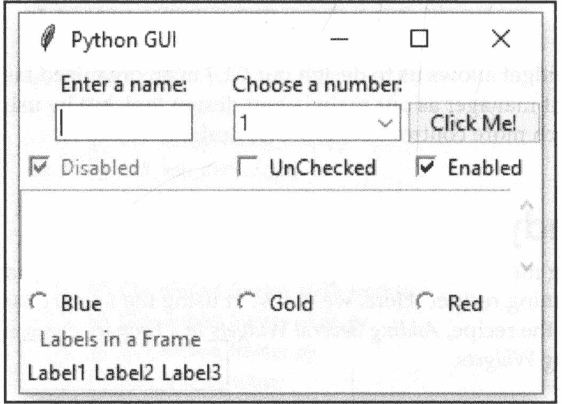

取消注释第 111 行并注意 LabelFrame 的不同对齐方式。

我们可以通过更改代码轻松地将标签垂直对齐，如下图所示：

```
```python
113  # Place labels into the container element
114  ttk.Label(buttons_frame, text="Label1").grid(column=0, row=0)
115  ttk.Label(buttons_frame, text="Label2").grid(column=0, row=1)
116  ttk.Label(buttons_frame, text="Label3").grid(column=0, row=2)
117
118  for child in buttons_frame.winfo_children():
```
```

请注意，我们唯一需要做的更改就是列和行编号。

现在 GUI LabelFrame 如下所示：

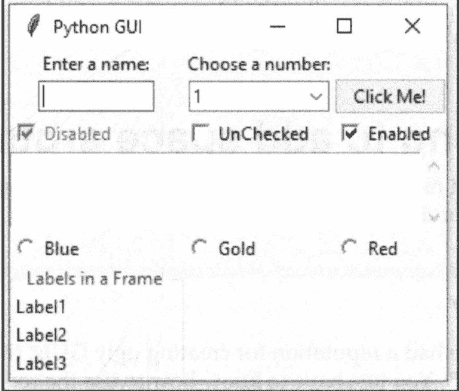

## How it works...

第 109 行，我们创建了第一个 ttk LabelFrame 小部件并将 resulting 实例分配给 buttons_frame 变量。父容器是 win，我们的主窗口。

第 114 到 116 行，我们创建标签并将它们放置在 LabelFrame 中。buttons_frame 是标签的父级。我们使用重要的 grid 布局工具在 LabelFrame 内排列标签。此布局管理器的 column 和 row 属性赋予我们控制 GUI 布局的能力。

我们标签的父级是 LabelFrame 的 buttons_frame 实例变量，而不是主窗口的 win 实例变量。我们在这里可以看到布局层次结构的开始。

我们可以看到，通过 column 和 row 属性更改布局是多么容易。请注意我们如何将 column 更改为 0，并通过按顺序编号 row 值将标签垂直分层。

name ttk 代表 themed tk。tk-themed 小部件集是在 Tk 8.5 中引入的。

## There's more…

在本章后面的一个菜谱中，我们将在 `LabelFrame` 小部件内嵌入 `LabelFrame` 小部件，将它们嵌套以控制我们的 GUI 布局。

## Using padding to add space around widgets

我们的 GUI 正在很好地创建。接下来，我们将通过在它们周围添加一些空间来改善小部件的视觉方面，让它们有呼吸的空间。

## Getting ready

虽然 tkinter 可能曾因创建丑陋的 GUI 而闻名，但自版本 8.5 以来这种情况已发生了巨大变化。你只需要知道如何使用可用的工具和技术。那就是我们接下来要做的。


tkinter 版本 8.6 随 Python 3.6 一起发布。

## How to do it…

添加小部件周围间距的程序化方式首先展示，然后我们将使用循环以更好的方式实现同样的效果。

我们的 `LabelFrame` 看起来有点紧凑，因为它与底部的 main window 融为一体。让我们现在修复它。

修改上一菜谱中 `GUI_LabelFrame_column_one.py` 代码片段的第 110 行，通过添加 `padx` 和 `pady`。你也可以在以下位置找到代码：

`GUI_add_padding.py`

```
buttons_frame.grid(column=0, row=7, padx=20, pady=40)
```

现在，我们的 LabelFrame 有了呼吸空间：

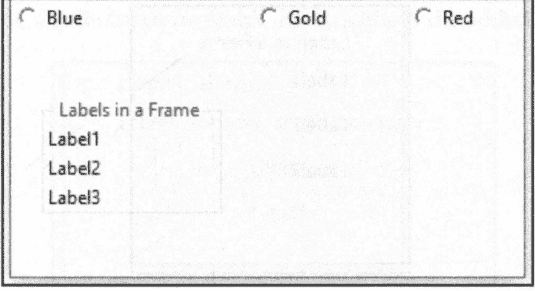

## How it works...

在 tkinter 中，水平和垂直添加空间是通过使用名为 padx 和 pady 的内置属性来完成的。这些可用于在许多小部件周围添加空间，分别改善水平和垂直对齐。我们为 LabelFrame 硬编码了左右各 20 像素的空间，并在框架顶部和底部各添加了 40 像素。现在我们的 LabelFrame 比之前更突出。


前面的截图仅显示了相关的更改。

我们可以使用循环为 LabelFrame 包含的标签添加空间：

GUI_add_padding_loop.py

```
113 # Place labels into the container element
114 ttk.Label(buttons_frame, text="Label1").grid(column=0, row=0)
115 ttk.Label(buttons_frame, text="Label2").grid(column=0, row=1)
116 ttk.Label(buttons_frame, text="Label3").grid(column=0, row=2)
117 
118 for child in buttons_frame.winfo_children():
119     child.grid_configure(padx=8, pady=4)
120 
121 name_entered.focus()      # Place cursor into name Entry
122 #===========================
123 # Start GUI
124 #===========================
125 win.mainloop()
```


现在，`LabelFrame` 小部件中的标签周围也有一些空间：

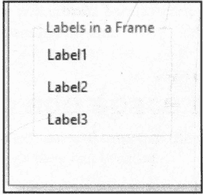

`grid_configure()` 函数使我们能够在主循环显示它们之前修改 UI 元素。因此，与其在第一次创建小部件时硬编码值，我们可以在文件末尾、GUI 创建之前处理布局然后安排间距。这是一个值得了解的巧妙技巧。

`winfo_children()` 函数返回属于 `buttons_frame` 变量的所有子项的列表。这使我们能够遍历它们并为每个标签分配内边距。

> 需要注意的一点是，标签右侧的间距实际上并不明显。这是因为 `LabelFrame` 的标题比标签名称更长。我们可以通过使标签名称更长来尝试这一点。

考虑在 `GUI_long_label.py` 中按如下方式更改代码：

```python
# Place labels into the container element - vertically with long label
ttk.Label(buttons_frame, text="Label1 - sooooo much loooonger...?").grid(column=0, row=0)
ttk.Label(buttons_frame, text="Label2").grid(column=0, row=1)
ttk.Label(buttons_frame, text="Label3").grid(column=0, row=2)
```

现在，我们的 GUI 如以下屏幕截图所示。请注意，现在长标签旁边点号的右侧添加了一些空间。最后一个点不再触碰 `LabelFrame`，如果没有添加的空间，它本应触碰：

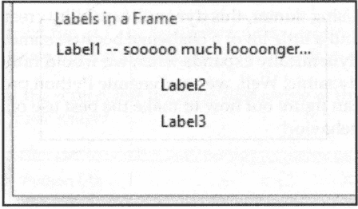

我们也可以删除 `LabelFrame` 的名称来查看 `padx` 对标签位置的影响：

`GUI_LabelFrame_no_name.py`

```python
buttons_frame = ttk.LabelFrame(win, text='')    # no LabelFrame name
```

通过将 `text` 属性设置为空字符串，我们移除了之前为 `LabelFrame` 显示的名称：

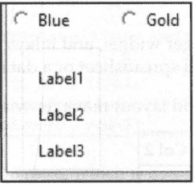

## 小部件如何动态扩展 GUI

您可能已经在之前的屏幕截图中注意到，并且通过运行代码发现小部件具有将自身扩展到所需空间以便视觉显示其文本的能力。


- Java 引入了动态 GUI 布局管理的概念。相比之下，视觉开发 IDE，例如 VS.NET，以视觉方式布局 GUI，并且基本上硬编码 UI 元素的 x 和 y 坐标。
- 使用 tkinter，这种动态能力既创造了优势，也带来了一点挑战，因为有时我们的 GUI 会在我们宁愿它不那么动态时动态扩展！好吧，我们是动态的 Python 程序员，所以我们可以弄清楚如何最好地利用这种出色的行为！

## 准备工作

在上一节 *Using padding to add space around widgets* 的开头，我们添加了一个 `LabelFrame` 小部件。这将我们的一些控件移到了第 0 列的中心。我们可能不希望在 GUI 布局中进行此修改。接下来，我们将探讨一些解决办法。

## 如何操作...

让我们首先意识到在我们的 GUI 布局中发生的细微细节，以便更好地理解它。

我们使用的是 grid 布局管理器小部件，它以零基网格布局我们的 widgets。这与 Excel 电子表格或数据库表非常相似。

以下是具有两行三列的 grid 布局管理器的示例：

| Row 0; Col 0 | Row 0; Col 1 | Row 0; Col 2 |
|---|---|---|
| Row 1; Col 0 | Row 1; Col 1 | Row 1; Col 2 |

使用 grid 布局管理器，任何给定列的宽度由该列中最长的名称或小部件决定。这会影响所有行。

通过添加我们的 `LabelFrame` 小部件并为其提供一个标题，该标题比某些硬编码大小的小部件更长，例如左上角的标签和下面的文本输入，我们动态地将这些小部件移动到第 0 列的 **中心**，在这些小部件的左侧和右侧添加空间。

顺便说一下，因为我们为 Checkbutton 和 `ScrolledText` 小部件使用了 `sticky` 属性，所以它们仍然附着在框架的左侧。

让我们更详细地查看本章第一个配方 *Arranging several labels within a label frame widget* 的屏幕截图：

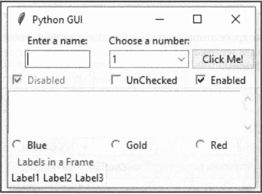

我们添加了以下代码来创建 `LabelFrame`，然后将标签放置到此框架中：

```python
# Create a container to hold labels
buttons_frame = ttk.LabelFrame(win, text=' Labels in a Frame ')
buttons_frame.grid(column=0, row=7)
```

由于 `LabelFrame` 的 `text` 属性，即显示为 `LabelFrame` 标题的内容，比我们的 **Enter a name:** 标签和下面的文本框输入都长，这两个小部件在第 0 列的新宽度内被动态居中。

第 0 列中的 Checkbutton 和 Radiobutton 小部件没有被居中，因为我们在创建这些小部件时使用了 `sticky=tk.W` 属性。

对于 `ScrolledText` 小部件，我们使用了 `sticky=tk.WE`，它将小部件绑定到框架的西侧（即左侧）和东侧（即右侧）。

## 布局管理

让我们从 `ScrolledText` 小部件中移除 `sticky` 属性并观察此更改带来的效果：

`GUI_remove_sticky.py`

```python
# Using a scrolled Text control
scrol_w = 30
scrol_h  = 3
scr = scrolledtext.ScrolledText(win, width=scrol_w, height=scrol_h, wrap=tk.WORD)
# scr.grid(column=0, row=5, sticky='WE', columnspan=3)
scr.grid(column=0, row=5, columnspan=3)             # sticky property removed
```

现在，我们的 GUI 在 `ScrolledText` 小部件周围有了新的空间，左右两侧都有。因为我们使用了 `columnspan=3` 属性，我们的 `ScrolledText` 小部件仍然跨越所有三列：

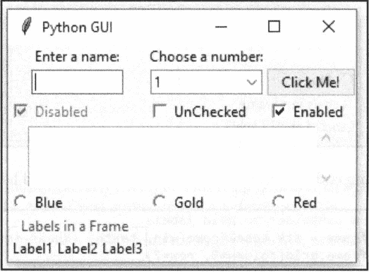

如果我们移除 `columnspan=3`，我们将得到以下 GUI，这不是我们想要的。现在，我们的 `ScrolledText` 仅占据第 0 列，并且由于其大小而拉伸布局：

`GUI_remove_columnspan.py`

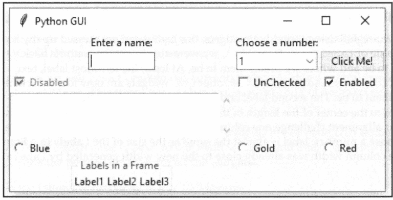

一种让我们的布局恢复到添加 `LabelFrame` 之前状态的方法是调整网格列位置。将列值从 0 改为 1：

```python
buttons_frame.grid(column=1, row=7)      # now in col 1
```

现在我们的 GUI 看起来如下：

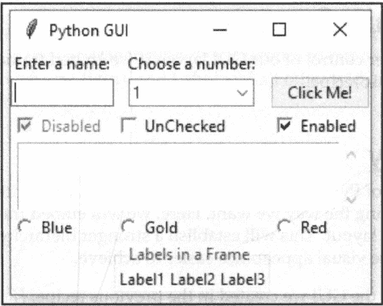

## 它是如何工作的…

因为我们仍然使用单个小部件，所以我们的布局可能会被搞乱。通过将 `LabelFrame` 的列值从 0 移到 1，我们能够将控件恢复到它们以前的位置，也是我们更喜欢的位置。至少，最左边的标签、文本、`Checkbutton`、`ScrolledText` 和 `Radiobutton` 小部件现在位于我们打算它们所在的位置。第 1 列中的第二个标签和文本 `Entry` 根据 **Labels in a Frame** 小部件的长度自行对齐到中心，因此我们基本上将对齐挑战向右移动了一列。它并不那么明显，因为 **Choose a number:** 标签的大小几乎与 **Labels in a Frame** 标题的大小相同，因此列宽度已经接近 `LabelFrame` 生成的新宽度。

## 还有更多…

在下一个配方 *Aligning the GUI widgets by embedding frames within frames* 中，我们将嵌入框架内的框架，以避免在本配方中刚刚遇到的小部件意外错位。

## 通过在框架内嵌入框架来对齐 GUI 小部件

如果我们在框架内嵌入框架，我们将对 GUI 布局有更好的控制。这就是本配方中我们要做的事情。

## 准备工作

Python 及其 GUI 模块的动态行为可能会给真正让我们的 GUI 看起来我们想要的样子带来一点挑战。在这里，我们将在框架内嵌入框架以获得对布局的更多控制。这将在不同的 UI 元素之间建立更强的层次结构，使视觉外观更容易实现。

我们将继续使用在上一配方 *How widgets dynamically expand the GUI* 中创建的 GUI。


# 如何实现...

这里，我们将创建一个顶级框架，用来容纳其他框架和小部件。这将帮助我们获得想要的GUI布局。

为了实现这一点，我们必须将当前控件嵌入到一个名为 `ttk.LabelFrame` 的中央框架中。该 `ttk.LabelFrame` 框架是主父窗口的子级，所有控件都将成为这个 `ttk.LabelFrame` 的子级。

到目前为止，在我们的教程中，我们一直将所有小部件直接分配给主GUI框架。现在，我们只将 `LabelFrame` 分配给主窗口，之后让这个 `LabelFrame` 成为所有小部件的父容器。

这会在我们的GUI布局中创建如下层次结构：

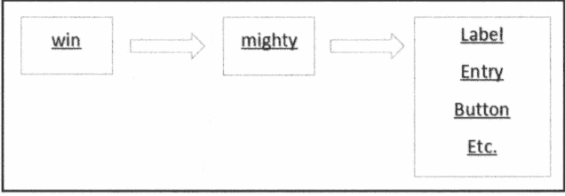

在上图中，**win** 是保存对主GUI tkinter窗口框架引用的变量，**mighty** 是保存对 `LabelFrame` 引用的变量，并且是主窗口框架 (**win**) 的子级，而 **Label** 及所有其他小部件现在都被放入 `LabelFrame` 容器 (**mighty**) 中。

将以下代码添加到Python模块的顶部：

GUI_embed_frames.py

```
6 #====================
7 # imports
8 #====================
9 import tkinter as tk
10 from tkinter import ttk
11 from tkinter import scrolledtext
12 
13 # Create instance
14 win = tk.Tk()
15 
16 # Add a title
17 win.title("Python GUI")
18 
19 # We are creating a container frame to hold all other widgets
20 mighty = ttk.LabelFrame(win, text=' Mighty Python ')
21 mighty.grid(column=0, row=0, padx=8, pady=4)
```

接下来，我们将修改以下控件，使用 mighty 作为父级，替换 win。下面是一个如何操作的示例：

```
23 # Modify adding a Label using mighty as the parent instead of win
24 a_label = ttk.Label(mighty, text="Enter a name:")
25 a_label.grid(column=0, row=0)
```

这会产生如下GUI：

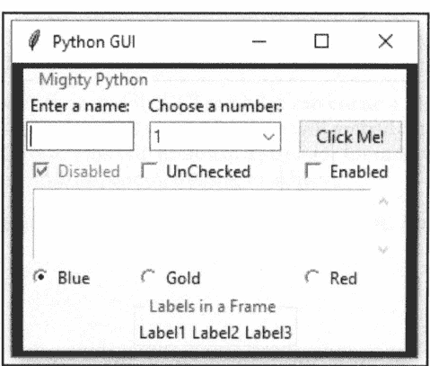

让我们将第0列中的输入框左对齐：

```
# Adding a Textbox Entry widget
name = tk.StringVar()
name_entered = ttk.Entry(mighty, width=12, textvariable=name)
name_entered.grid(column=0, row=1, sticky=tk.W)      # align left/West
```

现在，标签和输入框都向 West（左）对齐：

GUI_embed_frames_align_entry_west.py

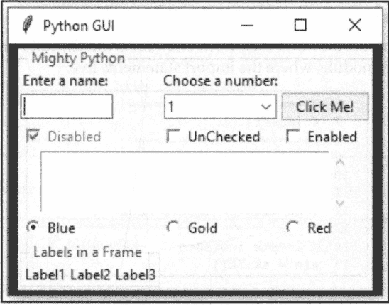

为了将 Frame LabelFrame 中标签长度对我们GUI布局其余部分的影响隔离开来，我们不能将这个 LabelFrame 与其他小部件放在同一个 LabelFrame 中，而必须将其直接分配给主GUI窗体 (win)。我们将在后续章节中这样做。

## 创建菜单栏

在本节中，我们将为主窗口添加菜单栏，在菜单栏中添加菜单，然后向菜单添加菜单项。

## 准备工作

我们将首先学习如何添加菜单栏、多个菜单以及几个菜单项的技术，以展示其操作原理。最初，单击菜单项不会产生任何效果。然后，我们将为菜单项添加功能，例如单击 Exit 菜单项时关闭主窗口，以及显示 Help | About 对话框。

我们将继续扩展上一个教程中创建的GUI，即通过“在框架中嵌入框架”来对齐GUI小部件。

## 如何实现...

首先，我们必须从 tkinter 导入 Menu 类。将以下代码行添加到Python模块的顶部，即import语句所在的位置：

```
6 # ====================
7 # imports
8 # ====================
9 import tkinter as tk
10 from tkinter import ttk
11 from tkinter import scrolledtext
12 from tkinter import Menu
13 
14 # Create instance
15 win = tk.Tk()
```

接下来，我们将创建菜单栏。将以下代码添加到模块底部，即创建主事件循环的代码上方：

GUI_menubar_tearoff.py

```
118 # Creating a Menu Bar
119 menu_bar = Menu(win)
120 win.config(menu=menu_bar)
121 
122 # Create menu and add menu items
123 file_menu = Menu(menu_bar)                # create File menu
124 file_menu.add_command(label="New")       # add File menu item
```

在第119行，我们调用导入的 Menu 模块类的构造函数，并传入主GUI实例 win。我们将 Menu 对象的一个实例保存在 menu_bar 变量中。在第120行，我们将GUI配置为使用刚刚创建的 Menu 作为GUI的菜单。

为了使其正常工作，我们还需要将菜单添加到菜单栏，并为其指定一个标签。

菜单项已经添加到菜单中，但我们仍然必须将菜单添加到菜单栏：

GUI_menubar_file.py

```
122 # Create menu and add menu items
123 file_menu = Menu(menu_bar)                  # create File menu
124 file_menu.add_command(label="New")          # add File menu item
125 menu_bar.add_cascade(label="File", menu=file_menu)  # add File menu to menu bar and give it a label
126
127 name_entered.focus()        # Place cursor into name Entry
128 #========================
129 # Start GUI
130 #========================
131 win.mainloop()
```

运行此代码会添加一个带有一个菜单项的菜单栏：

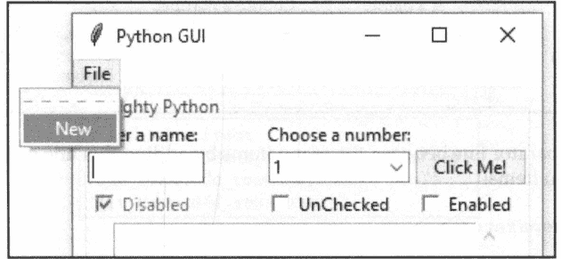


如果这个 tkinter 菜单栏语法看起来有点令人困惑，不必担心。这只是 tkinter 创建菜单栏的语法。它并不十分 Pythonic。

## 布局管理

接下来，我们将在添加到菜单栏的第一个菜单中添加第二个菜单项：

```
GUI_menubar_exit.py
```

```
```python
# Add menu items
file_menu = Menu(menu_bar)
file_menu.add_command(label="New")
file_menu.add_command(label="Exit")
menu_bar.add_cascade(label="File", menu=file_menu)

name_entered.focus()        # Place cursor into name Entry
#====================
# Start GUI
#====================
win.mainloop()
```
```

运行代码会产生以下结果：

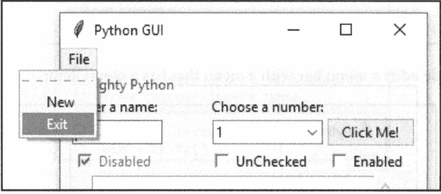

我们可以在现有菜单项之间添加一行代码，以添加分隔线：

```
GUI_menubar_separator.py
```

```
# Creating a Menu Bar
menu_bar = Menu(win)
win.config(menu=menu_bar)

# Add menu items
file_menu = Menu(menu_bar)
file_menu.add_command(label="New")
file_menu.add_separator()
file_menu.add_command(label="Exit")
menu_bar.add_cascade(label="File", menu=file_menu)
```

现在，我们可以在两个菜单项之间看到一条分隔线：

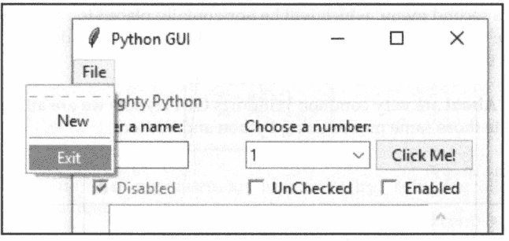

通过将 tearoff 属性传递给菜单的构造函数，我们可以移除默认出现在菜单第一个菜单项上方的第一条虚线：

```
# Add menu items
file_menu = Menu(menu_bar, tearoff=0)
file_menu.add_command(label="New")
file_menu.add_separator()
```

现在，虚线不再出现，我们的GUI看起来好多了：

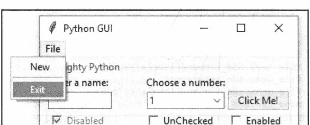

接下来，我们将添加第二个菜单，它将被水平放置到第一个菜单的右侧。我们给它一个菜单项，命名为 About，并且为了使其正常工作，我们必须将第二个菜单添加到菜单栏。

File 和 Help | About 是我们非常熟悉的常见 Windows GUI 布局，我们可以使用 Python 和 tkinter 创建相同的菜单：

GUI_menubar_help.py

```
# Creating a Menu Bar
menu_bar = Menu(win)
win.config(menu=menu_bar)

# Add menu items
file_menu = Menu(menu_bar, tearoff=0)
file_menu.add_command(label="New")
file_menu.add_separator()
file_menu.add_command(label="Exit")
menu_bar.add_cascade(label="File", menu=file_menu)

# Add another Menu to the Menu Bar and an item
help_menu = Menu(menu_bar, tearoff=0)
menu_bar.add_cascade(label="Help", menu=help_menu)
help_menu.add_command(label="About")

name_entered.focus()      # Place cursor into name Entry
====================
# Start GUI
====================
win.mainloop()
```


现在，我们有了第二个菜单，其中包含一个菜单项，位于菜单栏中：

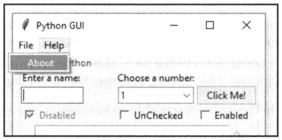

此时，我们的 GUI 有一个菜单栏和两个菜单，其中包含一些菜单项。在添加一些命令之前，点击它们不会产生什么效果。这就是我们接下来要做的。在创建菜单栏的代码上方添加以下代码：

```python
# Exit GUI cleanly
def _quit():
    win.quit()
    win.destroy()
    exit()
```

接下来，我们将“文件 | 退出”菜单项绑定到此函数，方法是在菜单项中添加以下命令：

GUI_menubar_exit_quit.py

```python
# Exit GUI cleanly
def _quit():
    win.quit()
    win.destroy()
    exit()

# Creating a Menu Bar
menu_bar = Menu(win)
win.config(menu=menu_bar)

# Add menu items
file_menu = Menu(menu_bar, tearoff=0)
file_menu.add_command(label="New")
file_menu.add_separator()
file_menu.add_command(label="Exit", command=_quit)
menu_bar.add_cascade(label="File", menu=file_menu)
```

接下来，我们创建一个函数来干净地退出 GUI 应用程序。这是推荐的 Python 风格的主事件循环结束方式。

我们使用 tkinter 的 `command` 属性将我们创建的函数绑定到菜单项。每当我们希望菜单项真正执行某些操作时，都必须将它们中的每一个绑定到一个函数。

> 我们使用了一种推荐的 Python 命名约定，在 `quit` 函数前面加一个下划线，以表明这是一个私有函数，不应由我们代码的客户端调用。

## 更多内容…

我们将在*第 3 章 外观与感觉定制*中添加**帮助 | 关于**功能，该章将介绍消息框以及更多内容。

## 创建选项卡式控件

在本节中，我们将创建选项卡式控件，以进一步组织用 tkinter 编写的不断扩展的 GUI。

## 准备工作

为了使用选项卡改进我们的 Python GUI，我们将从头开始，使用最少的必要代码。在本节中，我们将创建一个简单的 GUI，然后添加前面小节中的控件，并将它们放入这个新的选项卡式布局中。

## 操作步骤...

创建一个新的 Python 模块，并将以下代码放入该模块：

GUI_tabbed.py

```python
#========================
# imports
#========================
import tkinter as tk
from tkinter import ttk

win = tk.Tk()                         # Create instance
win.title("Python GUI")              # Add a title
tabControl = ttk.Notebook(win)       # Create Tab Control
tab1 = ttk.Frame(tabControl)         # Create a tab
tabControl.add(tab1, text='Tab 1')   # Add the tab
tabControl.pack(expand=1, fill="both")  # Pack to make visible

#========================
# Start GUI
#========================
win.mainloop()
```

这将创建以下 GUI：

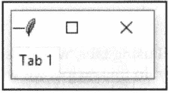

虽然目前还不是很令人印象深刻，但这个控件为我们的 GUI 设计工具箱添加了另一个非常强大的工具。在上面的极简示例中，它有其自身的局限性（例如，我们既不能重新定位 GUI，也不能显示完整的 GUI 标题）。

虽然我们在前面的小节中为较简单的 GUI 使用了网格布局管理器，但我们可以使用更简单的布局管理器，pack 就是其中之一。

在前面的代码中，我们将 `tabControl` 和 `ttk.Notebook` 控件打包到主 GUI 窗体中，将笔记本选项卡控件扩展到填充所有边。

我们可以向控件添加第二个选项卡，并在它们之间单击切换：

GUI_tabbed_two.py

```python
tabControl = ttk.Notebook(win)          # Create Tab Control

tab1 = ttk.Frame(tabControl)            # Create a tab
tabControl.add(tab1, text="Tab 1")      # Add the tab
tab2 = ttk.Frame(tabControl)            # Add a second tab
tabControl.add(tab2, text="Tab 2")      # Add second tab

tabControl.pack(expand=1, fill="both")  # Pack to make visible

#====================
# Start GUI
#====================
win.mainloop()
```

现在，我们有两个选项卡。单击 **Tab 2** 使其获得焦点：

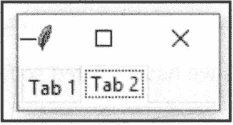

我们非常希望看到窗口的标题；因此，要做到这一点，我们必须向其中一个选项卡添加一个控件。该控件必须足够宽，以便动态扩展我们的 GUI 以显示窗口标题：

GUI_tabbed_two_mighty.py

```python
# LabelFrame using tab1 as the parent
mighty = ttk.LabelFrame(tab1, text="Mighty Python")
mighty.grid(column=0, row=0, padx=8, pady=4)

# Label using mighty as the parent
a_label = ttk.Label(mighty, text="Enter a name:")
a_label.grid(column=0, row=0, sticky='W')
```

现在，所有控件都位于 Tab 1 中。让我们将其中一些移动到 Tab 2。首先，我们创建第二个 LabelFrame 作为将要重新定位到 Tab 2 的控件的容器：

```python
mighty2 = ttk.LabelFrame(tab2, text=' The Snake ')
mighty2.grid(column=0, row=0, padx=8, pady=4)
```

接下来，我们通过指定新的父容器（我们将其命名为 `mighty2` 的新变量）将复选框和单选按钮移动到 Tab 2。下面是一个示例，我们将其应用于所有重新定位到 Tab 2 的控件：

```python
chVarDis = tk.IntVar()
check1 = tk.Checkbutton(mighty2, text="Disabled", variable=chVarDis, state='disabled')
```

当我们运行代码时，我们的 GUI 现在看起来不同了。Tab 1 中的控件比以前少，当时它包含我们之前创建的所有控件：

```text
GUI_tabbed_all_widgets_both_tabs.py
```

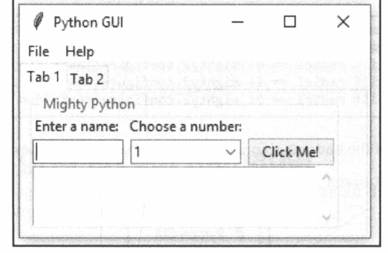

## 布局管理

我们现在可以单击 **Tab 2** 查看我们重新定位的控件：

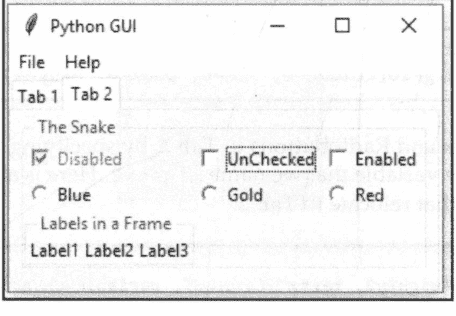

单击重新定位的 `Radiobutton` 不再有任何效果，因此我们将更改它们的操作，将 text 属性从 `LabelFrame` 控件的标题重命名为 `Radiobuttons` 显示的名称。当我们单击 **Gold** `Radiobutton` 时，我们不再将框架的背景设置为金色，而是替换 `LabelFrame` 的文本标题。Python **The Snake** 现在变成了 **Gold**。

```python
def radCall():
    radSel = radVar.get()
    if radSel == 0:
        mighty2.configure(text='Blue')
    elif radSel == 1:
        mighty2.configure(text='Gold')
    elif radSel == 2:
        mighty2.configure(text='Red')
```

现在，选择任何一个 `RadioButton` 控件都会更改 `LabelFrame` 的名称：

`GUI_tabbed_all_widgets_both_tabs_radio.py`

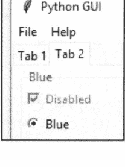

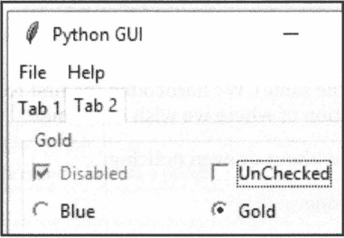

## 工作原理...

创建第二个选项卡后，我们将最初位于 **Tab 1** 中的一些控件移动到了 **Tab 2**。添加选项卡是组织我们不断增长的 GUI 的另一种极好方法。这是处理 GUI 设计复杂性的一个非常好的方法。我们可以将控件按自然归属分组，并通过使用选项卡让用户远离杂乱。

> 在 tkinter 中，创建选项卡是通过 `Notebook` 控件完成的，该控件允许我们添加选项卡式控件。与许多其他控件一样，`tkinter` 笔记本控件带有我们可以使用和配置的附加属性。开始探索我们可用的 tkinter 控件附加功能的一个绝佳位置是官方网站：`https://docs.python.org/3.11/library/tkinter.ttk.html#notebook`。

## 使用网格布局管理器

网格布局管理器是我们可用的最有用的布局工具之一。我们已经在前面的许多小节中使用过它，因为它非常强大。

## 准备工作...

在本节中，我们将回顾网格布局管理器的一些技术。我们已经在使用它们，在这里我们将进一步探索。

## 操作步骤...

在本章中，我们创建了行和列，这确实是一种数据库方法的 GUI 设计（MS Excel 也是如此）。我们对前几行进行了硬编码，但随后我们忘记为下一行指定我们希望它所在的位置。

Tkinter 在我们没有注意到的情况下为我们填充了这一点。

以下是我们代码中的做法：

```python
# Using a scrolled Text control
scrol_w = 30
scrol_h = 3
scr = scrolledtext.ScrolledText(mighty, width=scrol_w, height=scrol_h, wrap=tk.WORD)
# scr.grid(column=0, row=2, sticky='WE', columnspan=3)
scr.grid(column=0, sticky='WE', columnspan=3)            # row not specified
```

Tkinter 会自动在我们未指定特定行的位置添加缺失的行。我们可能没有意识到这一点。

我们将 Entry 控件放在第 1 行，然后忘记为 ScrolledText 控件指定行（我们通过 `scr` 变量引用它），然后添加了要放在第 3 行的 Radiobutton 控件。

这样做效果很好，因为 tkinter 会自动为我们的 ScrolledText 控件递增行位置，使其使用下一个最大行号，即第 2 行。

查看我们的代码，而没有意识到我们忘记将 ScrolledText 控件显式定位到第 2 行，我们可能会认为那里什么都没有。

因此，我们可能会尝试以下操作。如果我们将变量 `curRad` 设置为使用第 2 行，我们可能会得到一个令人不快的意外：

GUI_grid_layout.py


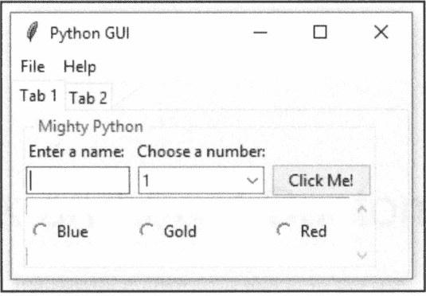

## 如何工作…

注意我们的 `RadioButton(s)` 行突然出现在我们的 `ScrolledText` 控件中间！这绝对不是我们希望 GUI 看起来的样子！


如果我们忘记显式指定行号，默认情况下 tkinter 将使用下一个可用的行。

我们还使用了 `columnspan` 属性来确保我们的控件不会仅限于一列。以下是我们确保 `ScrolledText` 控件跨越 GUI 所有列的方法：

```python
# Using a scrolled Text control
scroll_w = 30
scroll_h = 3
scr = scrolledtext.ScrolledText(mighty, width=scroll_w, height=scroll_h, wrap=tk.WORD)
scr.grid(column=0, row=2, sticky='WE', columnspan=3)                 # using columnspan
```

# 3
