# 外观与风格自定义

在本章中，我们将使用 Python 3.6 及以上版本自定义我们的 GUI。我们将涵盖以下配方：

- 创建消息框 – 信息、警告和错误
- 如何创建独立的消息框
- 如何创建 tkinter 窗口表单的标题
- 更改主根窗口的图标
- 使用微调框控件
- 控件的浮雕、下沉和凸起外观
- 使用 Python 创建工具提示
- 向 GUI 添加进度条
- 如何使用画布控件

# 引言

在本章中，我们将通过更改其部分属性来自定义 GUI 中的一些控件。我们还将介绍 tkinter 为我们提供的几个新控件。

Creating tooltips using Python 配方将创建一个 ToolTip OOP 风格的类，它将成为我们迄今为止一直使用的单个 Python 模块的一部分。

以下是本章 Python 模块的概述：

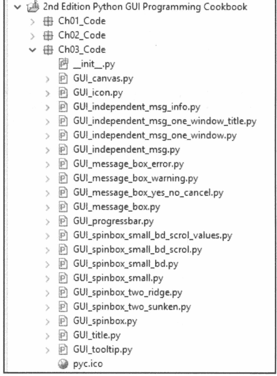

# 创建消息框 – 信息、警告和错误

消息框是一个弹出窗口，向用户提供反馈。它可以是信息性的，提示潜在问题以及灾难性错误。

使用 Python 创建消息框非常容易。

# 准备工作

我们将向上一章 Creating tabbed widgets 配方中创建的 Help | About 菜单项添加功能。

代码来自 GUI_tabbed_all_widgets_both_tabs.py。大多数应用程序中点击 Help | About 菜单时对用户的典型反馈是信息性的。我们从此信息开始，然后改变设计模式以显示警告和错误。

# 如何操作…

在导入语句所在的模块顶部添加以下代码行：

```python
#===================
# imports
#===================
import tkinter as tk
from tkinter import ttk
from tkinter import scrolledtext
from tkinter import Menu
from tkinter import messagebox as msg
```

接下来，创建一个将显示消息框的回调函数。我们必须在将回调附加到菜单项的代码之上定位回调代码，因为这仍然是过程式而不是 OOP 代码。

在我们创建帮助菜单的行上方添加以下代码：

GUI_message_box.py

```python
# Display a Message Box
def _msgBox():
    msg.showinfo('Python Message Info Box', 'A Python GUI created using tkinter:\nThe year is 2017.')
# Add another Menu to the Menu Bar and an item
help_menu = Menu(menu_bar, tearoff=0)
help_menu.add_command(label="About", command=_msgBox)  # display messagebox when clicked
menu_bar.add_cascade(label="Help", menu=help_menu)
```

点击 Help | About 现在会弹出以下窗口：

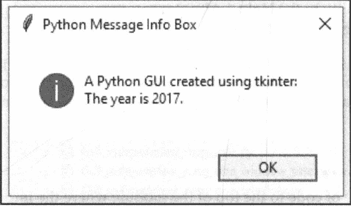

让我们将此代码转换为警告消息框弹出窗口。注释掉上一行并添加以下代码：

```python
# Display a Message Box
def _msgBox():
#     msg.showinfo('Python Message Info Box', 'A Python GUI created using tkinter:'
#                 '\nThe year is 2017.')
    msg.showwarning('Python Message Warning Box', 'A Python GUI created using tkinter:'
                    '\n\nWarning: There might be a bug in this code.')
```

运行前面的代码现在将导致以下稍作修改的消息框：

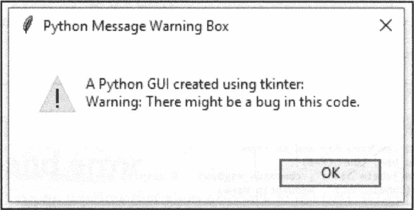

显示错误消息框很简单，通常会警告用户严重问题。如前一个代码片段所示，注释掉上一行并添加以下代码，如下所示：

```python
# Display a Message Box
def _msgBox():
#     msg.showinfo('Python Message Info Box', 'A Python GUI created using tkinter:\nThe year is 2017.')
#     msg.showwarning('Python Message Warning Box', 'A Python GUI created using tkinter:'
#                     '\nWarning: There might be a bug in this code.')
    msg.showerror('Python Message Error Box', 'A Python GUI created using tkinter:'
                  '\nError: Houston ~ we DO have a serious PROBLEM!')
```

错误消息如下所示：

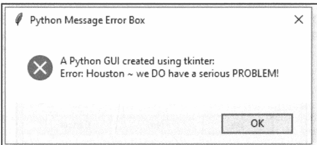

## 如何工作...

我们添加了另一个回调功能并将其作为委托附加以处理点击事件。现在，当我们点击 Help | About 菜单时，会发生一个动作。我们正在创建并显示最常见的弹出消息框对话框。它们是模态的，因此用户在点击 OK 按钮之前无法使用 GUI。

在第一个示例中，我们显示一个信息框，可以通过其左侧的图标看到。接下来，我们创建警告和错误消息框，它们会自动更改与弹出窗口关联的图标。我们要做的就是指定要显示哪个消息框。

有不同的消息框会显示不止一个 OK 按钮，我们可以根据用户的选择编程我们的响应。

以下是一个简单的示例，说明了此技术：

```python
# Display a Message Box
def _msgBox():
# msg.showinfo('Python Message Info Box', 'A Python GUI created using tkinter:\nThe year is 2017.')
# msg.showwarning('Python Message Warning Box', 'A Python GUI created using tkinter:\nWarning: There might be a bug in this code.')
# msg.showerror('Python Message Error Box', 'A Python GUI created using tkinter:\nError: Houston ~ we DO have a serious PROBLEM!')
answer = msg.askyesnocancel("Python Message Multi Choice Box", "Are you sure you really wish to do this?")
print(answer)
```

运行此 GUI 代码会产生一个弹出窗口，其用户响应可用于根据此事件驱动 GUI 循环的答案进行分支，通过将其保存在 answer 变量中：

GUI_message_box_yes_no_cancel.py

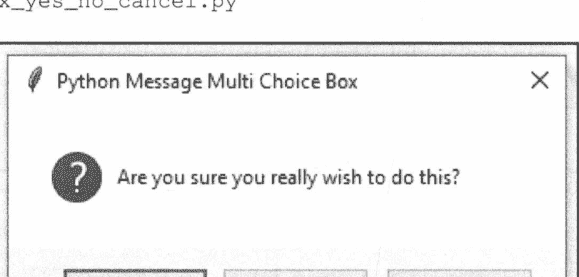

使用 Eclipse 的控制台输出显示，点击 Yes 按钮会导致布尔值 True 被分配给 answer 变量：

```text
Search Console
C:\Eclipse_NEON_workspace\2nd Edition Python GUI Programming Cookbook\Ch03_Code\GUI_message_box_yes_no_cancel.py
True
```

例如，我们可以使用以下代码：

```python
if answer == True:
    <do something>
```

点击 No 返回 False，Cancel 返回 None。

# 如何创建独立的消息框

在本配方中，我们将把 tkinter 消息框创建为独立的顶级 GUI 窗口。

你会首先注意到，通过这样做，我们最终会得到一个额外的窗口，因此我们将探索隐藏此窗口的方法。

在上一配方中，我们通过主 GUI 表单中的 Help | About 菜单调用 tkinter 消息框。

那么，为什么我们希望创建独立的消息框呢？

一个原因是我们可能会自定义我们的消息框并在多个 GUI 中重用它们。无需将相同的代码复制并粘贴到我们设计的每个 Python GUI 中，我们可以将其从主 GUI 代码中提取出来。这可以创建一个小型可重用组件，我们随后可以将其导入到不同的 Python GUI 中。

# 准备工作

我们在上一配方 Creating message boxes - information, warning, and error 中已经创建了消息框的标题。我们将不重用上一配方的代码，而是使用很少的 Python 代码构建一个新的 GUI。

# 如何操作…

我们可以创建简单的消息框，如下所示：

```python
from tkinter import messagebox as msg
msg.showinfo('Python GUI created using tkinter:\nThe year is 2017')
```


这将产生以下两个窗口：

```
GUI_independent_msg.py
```

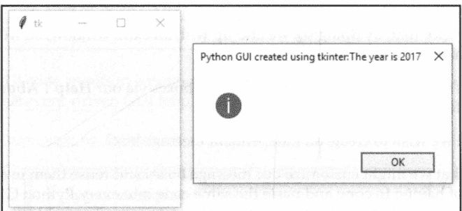

这看起来并非我们所期望的。现在，我们有两个窗口：一个是多余的，另一个则将文本显示成了标题。

哎呀！

让我们现在来解决这个问题。我们可以修改 Python 代码，添加一个单引号或双引号，后面再跟一个逗号：

```python
from tkinter import messagebox as msg
msg.showinfo('', 'Python GUI created using tkinter:\nThe year is 2017')
```

现在，我们没有标题了，但文本如预期那样显示在了弹出窗口中：

```
GUI_independent_msg_info.py
```

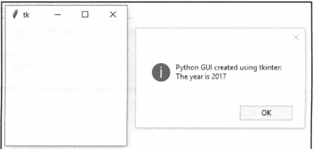

第一个参数是标题，第二个参数是弹出消息框中显示的文本。通过添加一对空的单引号或双引号，后面再跟一个逗号，我们就可以将文本从标题移到弹出消息框中。

我们仍然需要一个标题，而且肯定希望去掉这个多余的第二窗口。第二个窗口是由 Windows 事件循环引起的。我们可以通过抑制它来摆脱它。

添加以下代码：

```python
from tkinter import messagebox as msg
from tkinter import Tk
root = Tk()
root.withdraw()
msg.showinfo('', 'Python GUI created using tkinter:\nThe year is 2017')
```

现在，我们只剩一个窗口了。`withdraw()` 函数会移除我们不想让其四处漂浮的调试窗口：

```
GUI_independent_msg_one_window.py
```

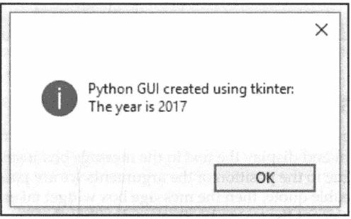

为了添加标题，我们只需在空的第一个参数中放入某个字符串即可。

## 外观与感觉定制

例如，考虑以下代码片段：

```python
from tkinter import messagebox as msg
from tkinter import Tk
root = Tk()
root.withdraw()
msg.showinfo('This is a Title', 'Python GUI created using tkinter:\nThe year is 2017')
```

现在，我们的对话框有了标题，如下面的截图所示：

```
GUI_independent_msg_one_window_title.py
```

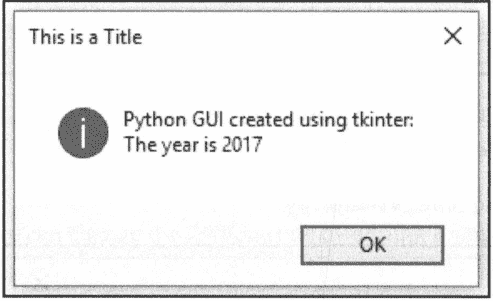

## 工作原理……

我们向消息框的 tkinter 构造函数传递更多参数，以便为窗口窗体添加标题，并在消息框中显示文本，而不是将其显示为标题。这是因为我们所传递参数的位置。如果我们省略空的单引号或双引号，那么消息框控件就会将第一个参数位置作为标题，而不是要在消息框内显示的文本。通过传递一个空引号后跟一个逗号，我们改变了消息框显示我们传递给函数的文本的位置。

我们通过在根窗口上调用 `withdraw()` 方法来抑制 tkinter 消息框控件自动创建的第二个弹出窗口。

## 如何创建 tkinter 窗口窗体的标题

更改 tkinter 主根窗口标题的原理与我们在上一个教程中讨论的“如何创建独立消息框”相同。我们只需将一个字符串作为第一个参数传递给控件的构造函数即可。

## 准备

我们不创建弹出对话框窗口，而是创建主根窗口并为其指定标题。

## 操作步骤……

以下代码创建主窗口并为其添加标题。我们在前面的教程中已经做过类似操作，例如在第 2 章“布局管理”的“创建选项卡控件”中。这里我们只关注 GUI 的这一方面：

```python
import tkinter as tk
win = tk.Tk()      # Create instance
win.title("Python GUI")  # Add a title
```

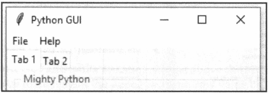

## 工作原理……

这通过使用 tkinter 内置的 `title` 属性来设置主根窗口的标题。在我们创建 `Tk()` 实例后，就可以使用所有 tkinter 内置属性来自定义我们的 GUI。

## 更改主根窗口的图标

自定义 GUI 的一种方式是给它一个不同于 tkinter 默认图标的图标。下面是我们如何做到这一点的。

## 准备

我们正在改进第 2 章“布局管理”中“创建选项卡控件”教程中的 GUI。我们将使用一个随 Python 一同提供的图标，但您也可以使用任何您觉得有用的图标。请确保代码中包含了图标的完整路径，否则可能会出错。

## 操作步骤……

在本示例中，我将从安装 Python 3.6 的目录中复制了图标到代码所在的同一个文件夹中。

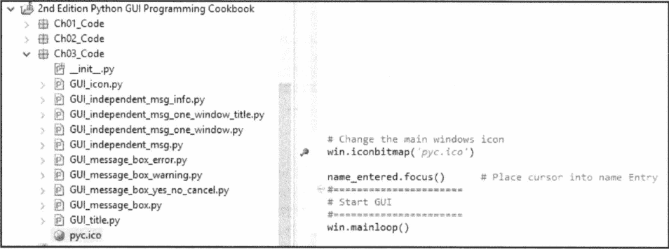

将以下代码放在主事件循环上方的某个位置：

```python
# Change the main window's icon
win.iconbitmap('pyc.ico')
```

注意 GUI 左上角默认的羽毛图标是如何变化的：

```
GUI_icon.py
```

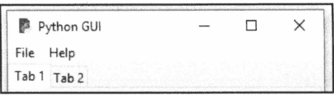

## 工作原理……

这是 tkinter 随附的另一个属性，它随 Python 3.6 及更高版本一起提供。我们使用 `iconbitmap` 属性，通过传入一个图标的相对路径来更改主根窗口窗体的图标。这会覆盖 tkinter 的默认图标，将其替换为我们选择的图标。

## 使用微调框控件

在本教程中，我们将使用一个 Spinbox 控件，并将键盘上的回车键绑定到我们某个控件上。

## 准备

我们将使用带选项卡的 GUI，并在 ScrolledText 控件上方添加一个 Spinbox 控件。这只需要我们将 ScrolledText 的行数值加一，然后将新的 Spinbox 控件插入到 Entry 控件上方的那一行。

## 操作步骤……

首先，我们添加 Spinbox 控件。将以下代码放在 ScrolledText 控件上方：

```python
# Adding a Spinbox widget
spin = Spinbox(mighty, from_=0, to=10)
spin.grid(column=0, row=2)
```

这将修改我们的 GUI 如下：

```
GUI_spinbox.py
```

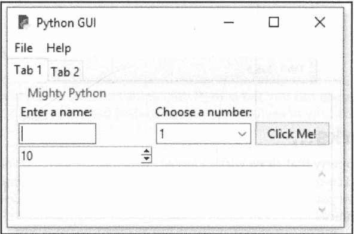

接下来，我们将减小 Spinbox 控件的大小：

```python
spin = Spinbox(mighty, from_=0, to=10, width=5)
```

运行上述代码会得到以下 GUI：

```
GUI_spinbox_small.py
```

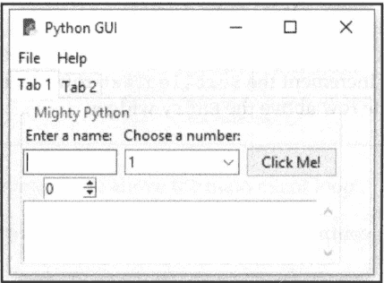

接下来，我们添加另一个属性来进一步定制我们的控件；`bd` 是 `borderwidth` 属性的简写：

```python
spin = Spinbox(mighty, from_=0, to=10, width=5, bd=8)
```

运行上述代码会得到以下 GUI：

```
GUI_spinbox_small_bd.py
```

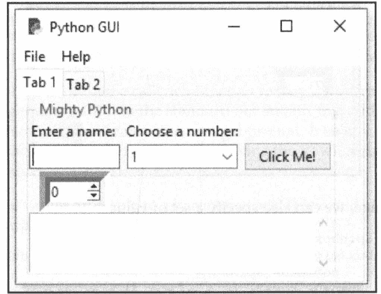

在这里，我们通过创建回调函数并将其链接到控件来为控件添加功能。

这会将 Spinbox 的选择打印到 ScrolledText 中，并同时打印到标准输出。变量 `scrol` 是我们对 ScrolledText 控件的引用：

```python
# Spinbox callback
def _spin():
    value = spin.get()
    print(value)
    scrol.insert(tk.INSERT, value + '\n')

spin = Spinbox(mighty, from_=0, to=10, width=5, bd=8,
                command=_spin)
```

运行上述代码会得到以下 GUI：

```
GUI_spinbox_small_bd_scrol.py
```

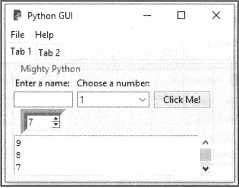

除了使用范围，我们也可以指定一组值：

```python
# Adding a Spinbox widget using a set of values
spin = Spinbox(mighty, values=(1, 2, 4, 42, 100), width=5, bd=8,
               command=spin)
spin.grid(column=0, row=2)
```

这将创建以下 GUI 输出：

```
GUI_spinbox_small_bd_scrol_values.py
```

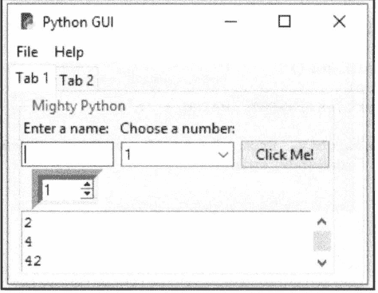

## 工作原理……

请注意，在第一张截图中，我们新的 Spinbox 控件默认宽度为 20，这将该列中所有控件的列宽都推了出去。这不是我们想要的。

我们给控件指定了从 0 到 10 的范围。

在第二张截图中，我们减小了 Spinbox 控件的宽度，使其在列中居中对齐。

在第三张截图中，我们添加了 Spinbox 的 `borderwidth` 属性，这使整个 Spinbox 看起来不再扁平，而是具有了三维效果。

在第四张截图中，我们添加了一个回调函数，用于在 ScrolledText 控件中显示所选数字，并将其打印到标准输出流中。我们添加了 `\n` 以便在新行上打印。注意默认值不会被打印。只有当我们点击控件时，回调函数才会被调用。通过将默认值 0 向下箭头点击，我们可以打印出 0 值。

最后，我们将可用值限制为一组硬编码的值。这也可以从数据源（例如文本或 XML 文件）中读取。

## 控件的浮雕、凹陷和凸起外观

我们可以通过使用一个属性来控制 Spinbox 控件的外观，使其呈现不同的凹陷或凸起格式。

## 准备

我们将再添加一个 Spinbox 控件，以演示可用的控件外观，使用 Spinbox 控件的 `relief` 属性。


## 如何操作...

首先，让我们增大边框宽度，以区分第二个 Spinbox 和第一个 Spinbox：

```python
# Adding a second Spinbox widget
spin = Spinbox(mighty, values=(0, 50, 100), width=5, bd=20,
    command=_spin)
spin.grid(column=1, row=2)
```

这将生成以下 GUI 输出：

GUI_spinbox_two_sunken.py

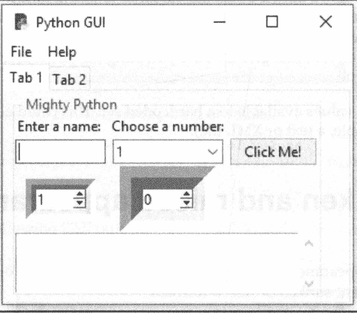

我们前面的两个 Spinbox 控件具有相同的浮雕样式。唯一的区别是，位于第一个 Spinbox 右侧的新控件具有大得多的边框宽度。

在我们的代码中，我们没有指定使用哪个浮雕属性，因此浮雕默认为 `tk.SUNKEN`。

我们将 tkinter 导入为 `tk`。这就是为什么我们可以将浮雕属性称为 `tk.SUNKEN`。

以下是可设置的浮雕属性选项：

| `tk.SUNKEN` | `tk.RAISED` | `tk.FLAT` | `tk.GROOVE` | `tk.RIDGE` |
|---|---|---|---|---|

通过为浮雕属性分配不同的可用选项，我们可以为此控件创建不同的外观。

将 `tk.RIDGE` 浮雕分配给控件，并将边框宽度减小到与我们的第一个 `Spinbox` 控件相同的值，将生成以下 GUI：

`GUI_spinbox_two_ridge.py`

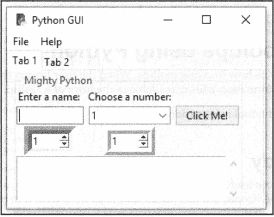

## 工作原理...

首先，我们创建了第二个 `Spinbox`，它位于第二列（索引 == 1）。它默认为 `SUNKEN`，因此看起来与我们的第一个 `Spinbox` 相似。我们通过增大第二个控件（右侧的那个）的边框宽度来区分这两个控件。

接下来，我们显式设置了 Spinbox 控件的浮雕属性。我们将边框宽度设为与第一个 Spinbox 相同，因为通过赋予它不同的浮雕，差异变得可见，而无需更改任何其他属性。

以下是不同选项的示例：

```python
# Adding a second Spinbox widget displaying its relief options with larger borderline
# uncomment each next code line to see the different effects
# spin = Spinbox(mighty, values=(0, 50, 100), width=5, bd=20, command=_spin)      # default value is: tk.SUNKEN
# spin = Spinbox(mighty, values=(0, 50, 100), width=5, bd=20, command=_spin, relief=tk.FLAT)
# spin = Spinbox(mighty, values=(0, 50, 100), width=5, bd=20, command=_spin, relief=tk.RAISED)
# spin = Spinbox(mighty, values=(0, 50, 100), width=5, bd=20, command=_spin, relief=tk.SUNKEN) # default
# spin = Spinbox(mighty, values=(0, 50, 100), width=5, bd=20, command=_spin, relief=tk.GROOVE)
# spin = Spinbox(mighty, values=(0, 50, 100), width=5, bd=20, command=_spin, relief=tk.RIDGE)
```

## 使用 Python 创建工具提示

本食谱将向我们展示如何创建工具提示。当用户将鼠标悬停在控件上时，将以工具提示的形式显示附加信息。

我们将把这些附加信息编码到 GUI 中。

## 准备工作

我们将为 GUI 添加更多有用的功能。令人惊讶的是，向控件添加工具提示本应很简单，但并没有我们希望的那么简单。

为了实现这一预期功能，我们将工具提示代码放入其自身的 OOP 类中。

## 如何操作...

在 import 语句的正下方添加以下类：

```python
class ToolTip(object):
    def __init__(self, widget):
        self.widget = widget
        self.tip_window = None

    def show_tip(self, tip_text):
        "Display text in a tooltip window"
        if self.tip_window or not tip_text:
            return
        x, y, cx, cy = self.widget.bbox("insert")      # get size of widget
        x = x + self.widget.winfo_rootx() + 25          # calculate to display tooltip
        y = y + cy + self.widget.winfo_rooty() + 25     # below and to the right
        self.tip_window = tw = tk.Toplevel(self.widget) # create new tooltip window
        tw.wm_overrideredirect(True)                    # remove all Window Manager (wm) decorations
        # tw.wm_overrideredirect(False)                  # uncomment to see the effect
        tw.wm_geometry("+%d+%d" % (x, y))                # create window size

        label = tk.Label(tw, text=tip_text, justify=tk.LEFT,
                         background="#ffffe0", relief=tk.SOLID, borderwidth=1,
                         font=("tahoma", "8", "normal"))
        label.pack(ipadx=1)

    def hide_tip(self):
        tw = self.tip_window
        self.tip_window = None
        if tw:
            tw.destroy()

def create_ToolTip(widget, text):
    tooltip = ToolTip(widget)      # create instance of class
    def enter(event):
        tooltip.show_tip(text)
    def leave(event):
        tooltip.hide_tip()
    widget.bind('<Enter>', enter)  # bind mouse events
    widget.bind('<Leave>', leave)
```

在面向对象编程（OOP）方法中，我们在 Python 模块中创建一个新类。Python 允许我们在同一个 Python 模块中放置多个类，也允许我们在同一模块中混合搭配类和常规函数。

前面的代码正是这样做的。

ToolTip 类是一个 Python 类，要使用它，我们必须实例化它。

如果你不熟悉 OOP 编程，实例化一个对象来创建类的实例听起来可能相当枯燥。

其原理非常简单，与通过 `def` 语句创建 Python 函数，然后在代码中稍后实际调用该函数非常相似。

以非常类似的方式，我们首先创建类的蓝图，然后通过在类名后面添加括号将其赋给变量，如下所示：

```python
class AClass():
    pass
instance_of_a_class = AClass()
print(instance_of_a_class)
```

前面的代码打印出一个内存地址，并显示我们的变量现在有了对该类实例的引用。

OOP 的妙处在于，我们可以创建同一个类的许多实例。

在我们的工具提示代码中，我们声明了一个 Python 类，并明确让它继承自 `object`，这是所有 Python 类的基础。我们也可以省略它，就像我们在 AClass 代码示例中所做的那样，因为它是所有 Python 类的默认父类。

在 ToolTip 类中所有必要的工具提示创建代码之后，我们切换到非 OOP 的 Python 编程，在类下方创建了一个函数。

我们定义了 `create_ToolTip()` 函数，它期望传入一个 GUI 控件作为参数，这样当我们将鼠标悬停在该控件上时，就可以显示工具提示。

`create_ToolTip()` 函数实际上为每个调用它的控件创建了一个新的 ToolTip 类实例。

我们可以为 Spinbox 控件添加工具提示，如下所示：

```python
# Add a Tooltip
create_ToolTip(spin, 'This is a Spin control')
```

我们可以以完全相同的方式为所有其他 GUI 控件做同样的事情。只需传入我们希望显示工具提示的控件的引用，并显示一些额外信息。对于我们的 ScrolledText 控件，我们让 `scrol` 变量指向它，因此我们将其传给创建工具提示的函数：

```python
# Using a scrolled Text control
scrol_w = 30
scrol_h = 3
scrol = scrolledtext.ScrolledText(mighty, width=scrol_w, height=scrol_h, wrap=tk.WORD)
scrol.grid(column=0, row=3, sticky='WE', columnspan=3)

# Add a Tooltip to the ScrolledText widget
create_ToolTip(scrol, 'This is a ScrolledText widget')
```

## 工作原理...

这是本书中 OOP 编程的开端。这可能看起来有点高级，但别担心；我们会解释一切，而且它确实有效。

考虑在创建 Spinbox 的代码正下方添加以下代码：

```python
# Add a Tooltip
create_ToolTip(spin, 'This is a Spin control.')
```

现在，当我们将鼠标悬停在 Spinbox 控件上时，会得到一个工具提示，向用户提供附加信息：

GUI_tooltip.py

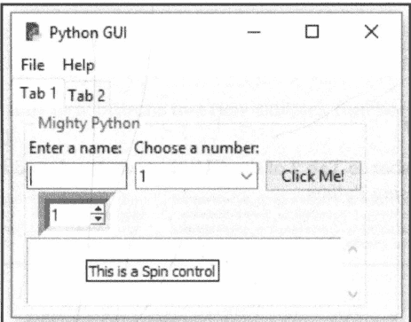

我们调用创建 ToolTip 的函数，然后传入控件的引用以及我们希望鼠标悬停在控件上时显示的文本。

本书剩余食谱将在有意义时使用 OOP。在这里，我们展示了可能最简单的 OOP 示例。默认情况下，我们创建的每个 Python 类都继承自 object 基类。Python 作为一门真正实用的编程语言，简化了类创建过程。

我们可以编写以下语法：

```python
class ToolTip(object):
    pass
```

我们也可以省略默认基类来简化它：

```python
class ToolTip():
    pass
```

类似地，我们可以继承并扩展任何 tkinter 类。

## 向 GUI 添加进度条

在本食谱中，我们将向 GUI 添加一个进度条。添加 `ttk.Progressbar` 非常容易，我们将演示如何启动和停止进度条。本食谱还将向你展示如何延迟进度条的停止以及如何循环运行它。

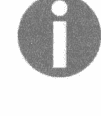

进度条通常用于显示长期运行进程的当前状态。

## 准备工作

我们将把进度条添加到我们在上一食谱（使用 Python 创建工具提示）中开发的 GUI 的 Tab 2 中。


## 如何操作...

首先，我们在标签页 2 的 LabelFrame 中添加了四个按钮，替换了之前存在的标签。我们将 LabelFrame 的 text 属性设置为 ProgressBar。

然后我们在标签页 2 的所有其他小部件下方放置一个 ttk.Progressbar 小部件，并将这个新小部件与其它小部件对齐。

我们的 GUI 现在如下所示：

GUI_progressbar.py

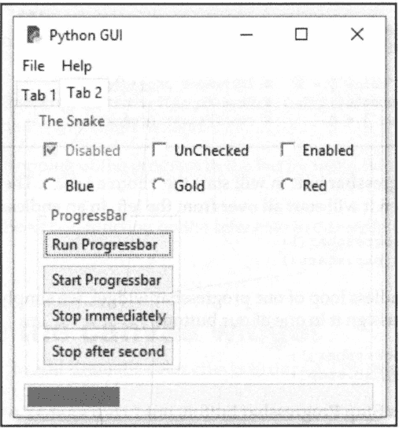

我们将四个新按钮中的每一个都连接到一个新的回调函数，并将其分配给它们的 command 属性：

```
# Add Buttons for Progressbar commands
ttk.Button(buttons_frame, text=" Run Progressbar ", command=run_progressbar).grid(column=0, row=0, sticky='W')
ttk.Button(buttons_frame, text=" Start Progressbar ", command=start_progressbar).grid(column=0, row=1, sticky='W')
ttk.Button(buttons_frame, text=" Stop immediately ", command=stop_progressbar).grid(column=0, row=2, sticky='W')
ttk.Button(buttons_frame, text=" Stop after second ", command=progressbar_stop_after).grid(column=0, row=3, sticky='W')
```

点击 Run Progressbar 按钮将使 Progressbar 从左向右运行，然后 Progressbar 将在那里停止，并且绿色条会消失。

以下是代码：

```
# Add a Progressbar to Tab 2
progress_bar = ttk.Progressbar(tab2, orient='horizontal', length=286, mode='determinate')
progress_bar.grid(column=0, row=3, pady=2)

# update progressbar in callback loop
def run_progressbar():
    progress_bar["maximum"] = 100
    for i in range(101):
        sleep(0.05)
        progress_bar["value"] = i    # increment progressbar
        progress_bar.update()        # have to call update() in loop
progress_bar["value"] = 0           # reset/clear progressbar
```

点击 Start Progressbar 按钮将启动 Progressbar。Progressbar 将运行到结束，然后它将从左侧重新开始，在无限循环中：

```
def start_progressbar():
    progress_bar.start()
```

为了停止我们 progressbar 小部件的这种无限循环，我们只需创建一个新的回调函数并将其分配给我们的按钮之一：

```
def stop_progressbar():
    progress_bar.stop()
```

一旦我们点击 Stop Progressbar 按钮，我们的 Progressbar 将停止并将自身重置到开始位置，使其不可见。我们不再在 Progressbar 内部看到绿色条。

如果我们点击 Run Progressbar 按钮然后点击 Stop Progressbar 按钮，条的进度会暂时停止，但随后循环将运行到完成，ProgressBar 也会完成。

我们也可以延迟正在运行的 ProgressBar 的停止。虽然我们可能会期望 sleep 语句能奏效，但它不起作用。相反，我们必须使用 tkinter 的 after 函数，如下所示：

```
def progressbar_stop_after(wait_ms=1000):
    win.after(wait_ms, progress_bar.stop)
```

这样编码将会在我们点击此按钮后，在 wait_ms 变量指定的时间（以毫秒为单位）后停止正在运行的 ProgressBar。

## 其工作原理...

我们可以指定一个最大值并在循环中使用该值，结合 sleep 语句。

我们可以使用 ProgressBar 小部件内置的 start 和 stop 命令来启动和停止 ProgressBar 的进度。

我们还可以通过使用 tkinter 内置的 after 函数来延迟条中进度的停止。

我们通过在我们命名的主 GUI 窗口的引用上调用 after 函数来实现这一点，我们将其命名为 win。

## 如何使用 canvas 小部件

本食谱展示了如何通过使用 tkinter canvas 小部件为我们的 GUI 添加戏剧性的颜色效果。

## 准备工作

我们将改进我们之前从 GUI_tooltip.py 的代码，并通过添加更多颜色来改善我们 GUI 的外观。

你可以通过在线搜索来查看绘图和绘制功能。我不会在本书中更深入地介绍这个小部件（但它非常酷）：

```
GUI_canvas.py
```

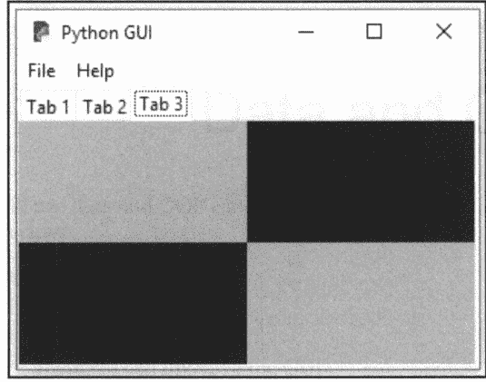

## 4
