## 数据和类

在本章中，我们将使用 Python 3.6 及以上版本的数据和 OOP 类。我们将涵盖以下食谱：

- 如何使用 `StringVar()`
- 如何从小部件获取数据
- 使用模块级全局变量
- 如何编码类可以改进 GUI
- 编写回调函数
- 创建可重用的 GUI 组件

## 简介

在本章中，我们将把 GUI 数据保存到 `tkinter` 变量中。我们还将开始使用 OOP 来扩展现有的 `tkinter` 类，以便扩展 tkinter 的内置功能。这将引导我们创建可重用的 OOP 组件。

以下是本章的 Python 模块概述：

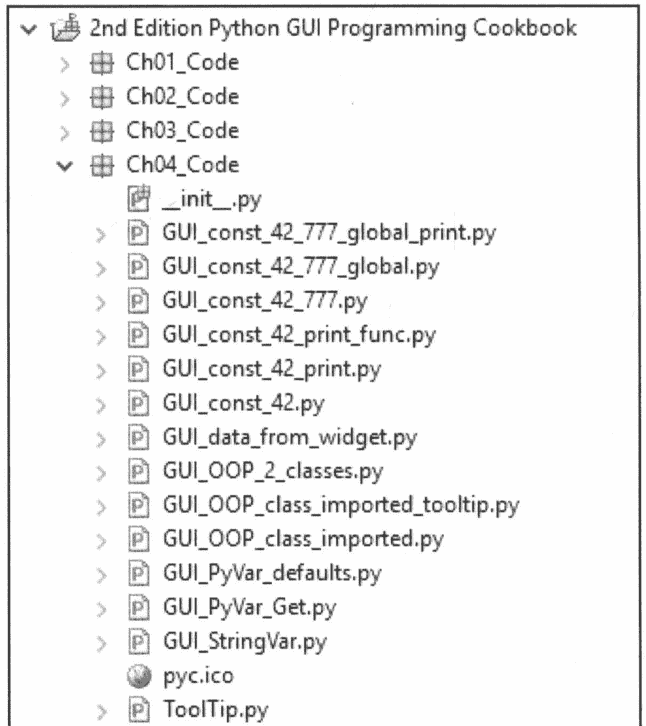

## 如何使用 StringVar()

tkinter 中内置的编程类型与我们习惯使用的 Python 类型略有不同。StringVar() 就是这样一种 tkinter 类型。本食谱将向你展示如何使用 StringVar() 类型。

## 准备工作

你将学习如何将数据从 tkinter GUI 保存到变量中以便我们使用该数据。我们可以设置和获取它们的值，这与 Java 的 getter/setter 方法非常相似。

以下是 tkinter 中可用的一些编码类型：

| strVar = StringVar() | # 持有字符串；默认值为空字符串 "" |
| intVar = IntVar() | # 持有整数；默认值是 0 |
| dbVar = DoubleVar() | # 持有浮点数；默认值是 0.0 |
| blVar = BooleanVar() | # 持有布尔值，False 返回 0，True 返回 1 |


不同语言将带小数点的数字称为 float 或 double。Tkinter 将它们称为 DoubleVar，这在 Python 中被称为 float 数据类型。根据精度级别，float 和 double 数据可能不同。在这里，我们将 tkinter DoubleVar 翻译成 Python 将其转换为的 Python float 类型。

当我们用 Python float 添加一个 `DoubleVar` 并查看 resulting 类型时，这就变得更清晰了，它是一个 Python `float` 而不再是 `DoubleVar`：

`GUI_PyDoubleVar_to_Float_Get.py`

```
```python
import tkinter as tk

# Create instance of tkinter
win = tk.Tk()

# Create DoubleVar
doubleData = tk.DoubleVar()
print(doubleData.get())              # default value
doubleData.set(2.4)
print(type(doubleData))

add_doubles = 1.222222222222222222222222 + doubleData.get()
print(add_doubles)
print(type(add_doubles))
```

Output:
```text
0.0
<class 'tkinter.DoubleVar'>
3.6222222222222222
<class 'float'>
```
```

## 如何操作…

我们将创建一个新的 Python 模块，下面的截图显示了代码和 resulting 输出：

`GUI_StringVar.py`

```
import tkinter as tk

# Create instance of tkinter
win = tk.Tk()

# Assign tkinter Variable to strData variable
strData = tk.StringVar()

# Set strData variable
strData.set('Hello StringVar')

# Get value of strData variable
varData = strData.get()

# Print out current value of strData
print(varData)
```

<terminated> C:\Eclipse_NEON_workspace\2nd Edition Python GUI Programming Cookbook\Ch04_Code\GUI_StringVar.py
Hello StringVar

首先，我们导入 tkinter 模块并将其别名为 tk。

接下来，我们使用此别名通过在 Tk 后面加上括号来创建 Tk 类的实例，这会调用类的构造函数。这与调用函数的机制相同；只是在这里，我们创建了一个类的实例。

通常，我们使用分配给 win 变量的此实例稍后在代码中启动主事件循环，但在这种情况下，我们没有显示 GUI，而是演示如何使用 tkinter StringVar 类型。

我们仍然必须创建 Tk() 的实例。如果我们注释掉这一行，我们将从 tkinter 得到一个错误，因此此调用是必要的。


然后，我们创建 tkinter StringVar 类型的实例并将其分配给我们的 Python strData 变量。

之后，我们使用我们的变量在 StringVar 上调用 set() 方法，设置值后，我们获取值，将其保存在名为 varData 的新变量中，然后打印其值。

在 Eclipse PyDev 控制台中，截图底部我们可以看到输出打印到控制台，其内容为 Hello StringVar。

接下来，我们将打印 tkinter IntVar、DoubleVar 和 BooleanVar 类型的默认值：

GUI_PyVar_defaults.py

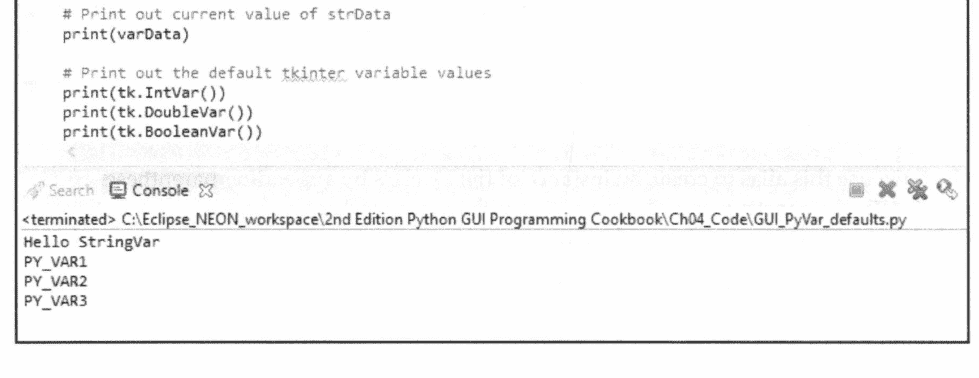

## 其工作原理...

如前面的截图所示，默认值并没有按我们预期的方式打印出来。

在线文献提到了默认值，但在我们对它们调用 get 方法之前我们看不到这些值。否则，我们只会得到一个自动递增的变量名（例如，截图中可以看到的 PY_VAR3）。


将 `tkinter` 类型赋值给 Python 变量并不会改变结果。我们仍然得不到默认值。

这里，我们专注于最简单的代码（它创建了 `PY_VAR0`）：

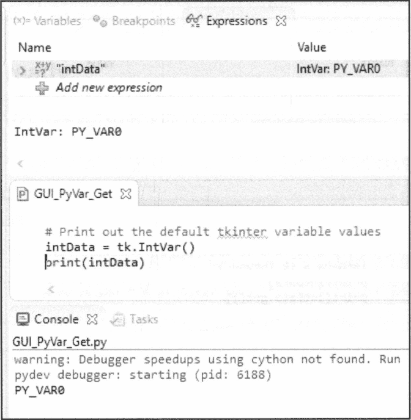

该值是 PY_VAR0，而不是预期的 0，直到我们调用 get 方法后，才能看到默认值。我们没有调用 set，所以一旦我们对每种 tkinter 类型调用 get 方法，就会看到自动分配给每个 tkinter 类型的默认值：

```
GUI_PyVar_Get.py
```

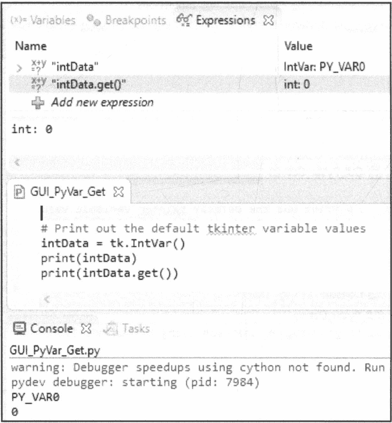

注意，对于保存在 intData 变量中的 IntVar 实例，其默认值 0 是如何被打印到控制台的。我们还可以在截图顶部的 Eclipse PyDev 调试器窗口中看到这些值。

## 如何从控件中获取数据

当用户输入数据时，我们希望能在代码中对这些数据进行处理。本配方演示了如何将数据捕获到变量中。在上一个配方中，我们创建了几个 tkinter 类变量。它们是独立的。现在，我们将它们连接到 GUI，使用从 GUI 获取的数据并将其存储到 Python 变量中。

### 准备工作

我们将继续使用在第 3 章“外观与感觉定制”中构建的 Python GUI。我们将复用并增强该章中 GUI_progressbar.py 的代码。

### 操作步骤...

我们将把 GUI 中的值赋给 Python 变量。

将以下代码添加到模块底部，主事件循环的上方：

```
strData = spin.get()
print("Spinbox value: " + strData)

# Place cursor into name Entry
name_entered.focus()
#======================
# Start GUI
#======================
win.mainloop()
```

运行代码，得到如下结果：

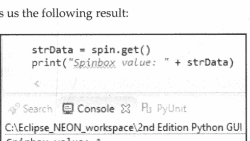

### 数据与类

我们将获取 `Spinbox` 控件的当前值。


我们将代码放在 GUI 主事件循环之上，因此打印发生在 GUI 可见之前。如果我们想在 GUI 显示后并更改了 `Spinbox` 控件的值之后再打印当前值，则必须将代码放入回调函数中。

我们使用以下代码创建了 `Spinbox` 控件，并将可用值硬编码到其中：

```python
# Adding a Spinbox widget using a set of values
spin = Spinbox(mighty, values=(1, 2, 4, 42, 100), width=5, bd=8,
               command=_spin)
spin.grid(column=0, row=2)
```

我们也可以将数据的硬编码从创建 `Spinbox` 类实例中移出，稍后再设置：

```python
# Adding a Spinbox widget assigning values after creation
spin = Spinbox(mighty, width=5, bd=8, command=_spin)
spin['values'] = (1, 2, 4, 42, 100)
spin.grid(column=0, row=2)
```

无论我们如何创建控件并向其中插入数据，都没有关系，因为我们可以通过对控件实例使用 `get()` 方法来访问这些数据。

### 工作原理...

为了从使用 tkinter 编写的 GUI 中获取值，我们在要获取值的控件实例上使用 tkinter 的 `get()` 方法。

在前面的示例中，我们使用了 `Spinbox` 控件，但对于所有具有 `get()` 方法的控件，原理都是相同的。

一旦我们获得了数据，就进入了纯粹的 Python 世界，而 tkinter 在构建 GUI 方面为我们提供了很好的服务。既然我们知道了如何从 GUI 中获取数据，就可以使用这些数据了。

## 使用模块级全局变量

封装是任何编程语言的主要优势，使我们能够使用面向对象编程（OOP）进行编程。Python 既支持面向对象编程，也支持过程式编程。我们可以创建局部于其所在模块的全局变量。它们仅对该模块是全局的，这是封装的一种形式。为什么我们需要这样？因为随着我们向 GUI 添加越来越多的功能，我们希望避免可能导致代码中出现 bug 的命名冲突。

> 我们不希望命名冲突在我们的代码中造成 bug！命名空间是避免这些 bug 的一种方法，在 Python 中，我们可以通过使用 Python 模块（即非官方命名空间）来做到这一点。

### 准备工作

我们可以在任意模块中、函数外部且紧邻函数上方的位置声明模块级**全局变量**。

然后，我们必须使用 Python 的 `global` 关键字来引用它们。如果忘记在函数中使用 `global`，就会意外创建新的局部变量。这将是一个 bug，也是我们确实不想做的事情。

> Python 是一种动态、强类型语言。只有在运行时，我们才会注意到诸如此类的 bug（忘记使用 `global` 关键字来限定变量作用域）。

### 操作步骤...

将第 17 行所示的代码添加到我们在上一个配方 *如何从控件中获取数据* 中使用的 GUI 中，以创建一个模块级全局变量。我们使用 C 风格的全大写约定，这并不完全符合 Python 风格，但我认为这确实强调了我们在本配方中讨论的原则：

```
6 #====================
7 # imports
8 #====================
9 import tkinter as tk
10 from tkinter import ttk
11 from tkinter import scrolledtext
12 from tkinter import Menu
13 from tkinter import messagebox as msg
14 from tkinter import Spinbox
15 from time import sleep        # careful - this can freeze the GUI
16 
17 GLOBAL_CONST = 42
18
```

运行代码会输出全局变量的值。注意，42 被打印到 Eclipse 控制台：

GUI_const_42_print.py

```
213 # Printing the Global works
214 print(GLOBAL_CONST)
215 
216 name_entered.focus()
217 #====================
218 # Start GUI
219 #====================
220 win.mainloop()

Search Console PyUnit
<terminated> C:\Eclipse_NEON_workspace\2nd Edition
42
```

### 工作原理...

我们在模块顶部定义了一个全局变量，然后在模块底部附近打印出它的值。这样是可以的。

将此函数添加到模块底部：

```
GUI_const_42_print_func.py
```

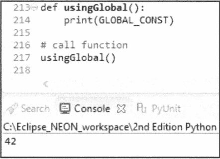

在上面的代码片段中，我们使用了模块级 `global`。很容易因遮蔽 `global` 而犯错，如下所示：

```
GUI_const_42_777.py
```

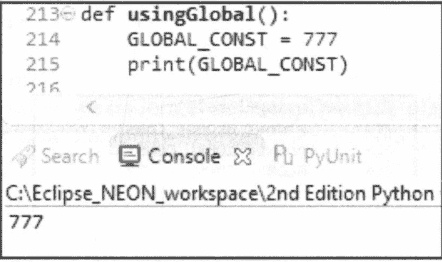

注意，即使我们使用相同的变量名，42 也会变成 777。

> Python 中没有编译器会在我们在局部函数中覆盖 `global` 变量时发出警告。这可能导致运行时调试困难。

如果不使用 global 限定符（第 214 行），我们会得到一个错误。

```
213 def usingGlobal():
214 #     global GLOBAL_CONST
215     print(GLOBAL_CONST)
216     GLOBAL_CONST = 777
217     print(GLOBAL_CONST)
218 
219 
220 # call function
221 usingGlobal()
222 
<terminated> C:\Eclipse_NEON_workspace\2nd Edition Python GUI Programming Cookbook\Ch04_Code\
Traceback (most recent call last):
  File "C:\Eclipse NEON workspace\2nd Edition Python GUI Programming Cookbook\Ch
    usingGlobal()
  File "C:\Eclipse NEON workspace\2nd Edition Python GUI Programming Cookbook\Ch
    print(GLOBAL_CONST)
UnboundLocalError: local variable 'GLOBAL_CONST' referenced before assignment
```

当我们使用 global 关键字限定局部变量时，我们可以打印出全局变量的值，也可以在本地覆盖该值：

```
213 def usingGlobal():
214     global GLOBAL_CONST
215     print(GLOBAL_CONST)
216     GLOBAL_CONST = 777
217     print(GLOBAL_CONST)
218 
219 
220 # call function
221 usingGlobal()
222 
C:\Eclipse_NEON_workspace\2nd Edition Python
42
777
```

`global` 变量在编写小型应用程序时非常有用。它们可以帮助我们在同一个 Python 模块中的方法和函数之间共享数据，而且有时使用 OOP 的开销并不划算。

随着程序复杂度的增长，使用全局变量所带来的好处会迅速减少。

> 最好避免使用全局变量，也要避免在不同作用域中使用相同名称而意外遮蔽变量。我们可以使用 OOP 来代替全局变量。

我们在过程式代码中尝试了 `global` 变量，并了解到它如何导致难以调试的 bug。在下一个配方中，我们将转向 OOP，这可以消除此类 bug。

## 在类中编码如何改进 GUI

到目前为止，我们一直以过程式风格编写代码。这是 Python 中一种快速的脚本编写方法。一旦代码变得越来越庞大，我们就需要进阶到使用 OOP 编码。

为什么？

因为，除许多其他好处外，OOP 允许我们通过方法来移动代码。一旦使用类，我们就不再需要将代码物理地放在调用它的代码之上。这为我们组织代码提供了极大的灵活性。

我们可以将相关代码写在一起，不再需要担心代码因未放在调用它的代码之前而无法运行。

我们甚至可以将其发挥到相当极致的程度：编写引用那些并非在该模块内创建的方法的模块。它们依赖于运行时状态，即这些方法在代码运行期间已被创建。

> 如果到那时我们调用的方法尚未创建，就会收到运行时错误。


## 准备工作

我们将非常简单地整个过程化代码转换为 OOP。只需将它变成一个类，缩进所有现有代码，并在所有变量前加上 `self`。

这非常容易。

虽然一开始必须用 `self` 关键字给所有内容加前缀，使代码变得冗长，可能有点烦人（嘿，我们浪费了这么多纸……），但最终这是值得的。

### 如何实现...

一开始，一切都乱套了，但我们很快就会修复这表面上的一团糟。

请注意，在 Eclipse 中，PyDev 编辑器通过代码编辑器右侧的红色高亮来提示编码问题。

也许我们根本不应该用 OOP 编码，但这就是我们要做的，而且有很好的理由：

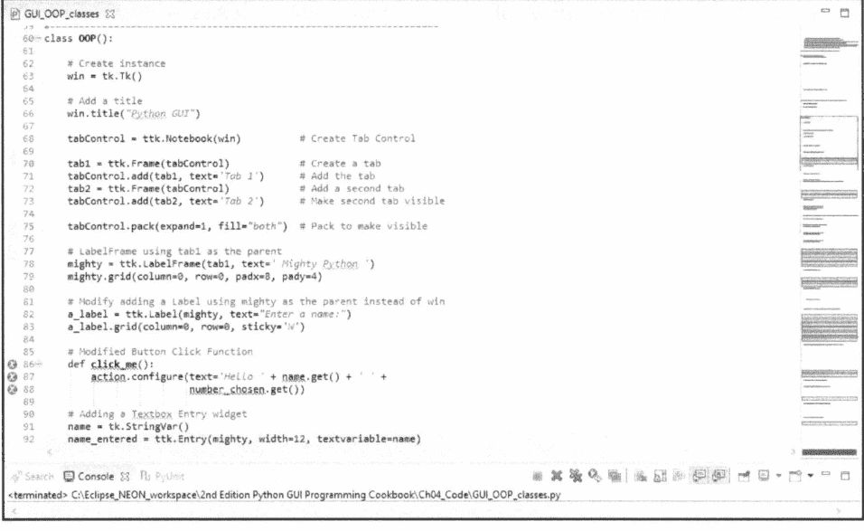

我们只需在所有变量前加上 `self` 关键字，并通过使用 `self` 将函数绑定到类，这在形式上和技术上都会把函数变为方法。

> 函数和方法之间是有区别的。Python 把这一点说得很清楚。方法绑定到类，而函数则不绑定。我们甚至可以在同一个 Python 模块中混合使用两者。

让我们将所有内容加上 `self` 前缀，以消除红色错误，这样我们就可以再次运行代码了：

```python
# Modified Button Click Function
def click_me(self):
    self.action.configure(text='Hello ' + self.name.get() + ' ' +
                          self.number_chosen.get())
```

一旦我们对所有红色高亮显示的错误都这样处理后，就可以再次运行我们的 Python 代码了。 `click_Me` 函数现在已绑定到类，并正式成为了一个方法。

不幸的是，以过程化方式开始，然后将其转换为 OOP，并不像我前面说的那么简单。代码已经变得一团糟。这正是在 Python 中使用 OOP 编码模型开始编程的一个很好的理由。

> Python 擅长用简单的方式做事。简单的代码往往会变得更复杂（因为一开始很简单）。一旦变得过于复杂，将过程化代码重构为真正意义上的 OOP 代码，会随着每一行代码而变得愈发困难。

我们正在把过程化代码转换为面向对象代码。看到我们陷入的所有麻烦，仅仅把 200 多行 Python 代码翻译成 OOP 就足以说明，我们不妨从一开始就用 OOP 来编码。

实际上，我们确实破坏了以前的一些功能。使用**标签页2**并点击单选按钮不再起作用。我们需要进一步重构。

过程化代码很简单，因为它只是从上到下的编码。现在我们已经将代码放入类中，必须将所有回调函数移到方法中。这可行，但转换原始代码确实需要一些工作：

```
########################################
# Our procedural code looked like this:
########################################
# Button Click Function
```

```
def click_me():
    action.configure(text='Hello ' + name.get() + ' ' +
                    number_chosen.get())

# Adding a Textbox Entry widget
name = tk.StringVar()
name_entered = ttk.Entry(mighty, width=12, textvariable=name)
name_entered.grid(column=0, row=1, sticky='W')

# Adding a Button
action = ttk.Button(mighty, text="Click Me!", command=click_me)
action.grid(column=2, row=1)

ttk.Label(mighty, text="Choose a number:").grid(column=1, row=0)
number = tk.StringVar()
number_chosen = ttk.Combobox(mighty, width=12,
                            textvariable=number, state='readonly')
number_chosen['values'] = (1, 2, 4, 42, 100)
number_chosen.grid(column=1, row=1)
number_chosen.current(0)

**************************************************
The new OOP code looks like this:
**************************************************
class OOP():
    def __init__(self):                # Initializer method
        # Create instance
        self.win = tk.Tk()

        # Add a title
        self.win.title("Python GUI")
        self.create_widgets()

# Button callback
def click_me(self):
    self.action.configure(text='Hello ' + self.name.get() + ' '
                        +self.number_chosen.get())
    # ... more callback methods

def create_widgets(self):
    # Create Tab Control
    tabControl = ttk.Notebook(self.win)
    tab1 = ttk.Frame(tabControl)                # Create a tab
    tabControl.add(tab1, text='Tab 1')          # Add the tab
    tab2 = ttk.Frame(tabControl)                # Create second tab
    tabControl.add(tab2, text="Tab 2")         # Add second tab
    # Pack to make visible
    tabControl.pack(expand=1, fill="both")
```

```python
# Adding a Textbox Entry widget - using self
self.name = tk.StringVar()
name_entered = ttk.Entry(mighty, width=12,
                         textvariable=self.name)
name_entered.grid(column=0, row=1, sticky='W')

# Adding a Button - using self
self.action = ttk.Button(mighty, text="Click Me!",
                         command=self.click_me)
self.action.grid(column=2, row=1)
# ...
# ====================
# Start GUI
# ====================
oop = OOP()              # create an instance of the class
# use instance variable to call mainloop via win
oop.win.mainloop()
```

我们将回调方法移到了模块顶部，放在新的 OOP 类中。我们将所有控件创建代码移到一个相当长的方法中，并在类的初始化器中调用它。

从技术上讲，在底层代码的深处，Python 确实有构造函数，但是 Python 让我们无需为此担心。它已经为我们处理好了。

相反，除了真正的构造函数之外，Python 还为我们提供了一个初始化器。

我们强烈建议使用这个初始化器。我们可以用它向类传递参数，初始化希望在类实例内部使用的变量。


在 Python 中，同一个 Python 模块中可以存在多个类。

与 Java 不同，Java 有非常严格的命名约定（没有它就无法工作），而 Python 要灵活得多。


我们可以在同一个 Python 模块中创建多个类。与 Java 不同，我们不需要依赖与每个类名匹配的文件名。Python 真的很棒！

一旦我们的 Python GUI 变得庞大，我们会将一些类拆分到各自的模块中，但与 Java 不同，我们并非必须这样做。在本书和项目中，我们会将一些类保留在同一个模块中，同时也会将其他一些类拆分到各自的模块中，并将它们导入到一个可以看作是 `main()` 函数的地方（这不是 C 语言，但我们可以将它想象成类似 C 语言的方式，因为 Python 非常灵活）。

到目前为止，我们已将 ToolTip 类添加到 Python 模块中，并将过程化 Python 代码重构为 OOP Python 代码。

在本小节中，我们可以看到，同一个 Python 模块中可以存在多个类。

确实很酷！

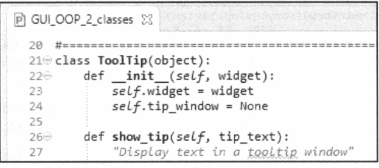

ToolTip 类和 OOP 类都位于同一个 Python 模块中：

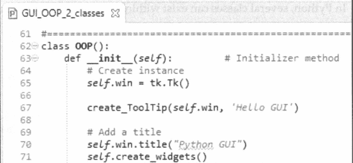

## 准备工作

Python 解释器会运行模块中的所有代码一次，找出并指出任何语法错误。如果语法不正确，就无法运行 Python 代码。这包括缩进（如果没有导致语法错误，错误的缩进通常会导致 bug）。

在下一轮解析时，解释器会解释并运行我们的代码。

在运行时，可以生成许多 GUI 事件，而通常是回调函数为 GUI 控件添加功能。

### 如何实现...

以下是 `Spinbox` 控件的回调：

```python
# Spinbox callback
def _spin(self):
    value = self.spin.get()
    print(value)
    self.scrol.insert(tk.INSERT, value + '\n')

# Adding a Spinbox widget
self.spin = Spinbox(mighty, values=(1, 2, 4, 42, 100), width=5, bd=9, command=self._spin)
self.spin.grid(column=0, row=2)
```

### 工作原理...

我们在 OOP 类中创建了一个回调方法，当我们从 `Spinbox` 控件中选择一个值时，该方法会被调用，因为我们通过 command 参数（`command=self._spin`）将该方法绑定到了控件。我们使用前导下划线来暗示这个方法应该像 Java 私有方法一样被尊重。

Python 有意避免语言限制，如 `private`、`public`、`friend` 等。在 Python 中，我们改用命名约定。关键字前后的双下划线被保留给 Python 语言本身使用，我们不应在自己的 Python 代码中使用它们。


不过，我们可以使用变量名或函数名加下划线前缀的方式来提示该名称应被视为私有辅助函数。

同时，如果我们希望使用原本是 Python 内置名称的单词，可以在其后加一个下划线后缀。例如，如果我们想用缩写表示列表的长度，可以这样做：

```
len_ = len(aList)
```


通常，下划线难以阅读且容易被忽略，所以这在实践中可能不是最好的做法。

## 创建可复用的 GUI 组件

我们将使用 Python 创建可复用的 GUI 组件。在本节中，我们将保持简单，把 `ToolTip` 类移动到它自己的模块中。然后，我们将导入并使用它，以便在 GUI 的多个控件上显示工具提示。

## 准备工作

我们的代码基于第 3 章《外观与感觉定制：GUI_tooltip.py》构建。

## 操作步骤……

我们将先把 `ToolTip` 类拆分成一个独立的 Python 模块。我们会对其进行轻微增强，以便传入控件控件以及当鼠标悬停在该控件上时希望显示的工具提示文本。

我们创建一个新的 Python 模块，将 `ToolTip` 类的代码放入其中，然后将此模块导入到我们的主模块中。

然后，我们通过创建多个工具提示来复用导入的 `ToolTip` 类，当鼠标悬停在多个 GUI 控件上时可以看到这些提示。

将我们通用的 `ToolTip` 类代码重构到独立模块中，有助于我们从这个模块复用代码。我们不再复制/粘贴/修改，而是遵循 DRY 原则，将通用代码只放在一个位置，这样当我们修改代码时，所有导入该模块的模块都会自动获得最新版本。

**DRY** 代表 **Don't Repeat Yourself**（不要重复自己），我们将在后面的章节中再次讨论它。我们也可以通过将 **Tab 3** 图像转换为可复用组件来做类似的事情。为了保持本节代码的简洁，我们移除了 **Tab 3**，但你可以用上一章的代码进行实验。该代码从 `GUI_tooltip.py` 中复用。

考虑运行 `GUI_tooltip.py`：

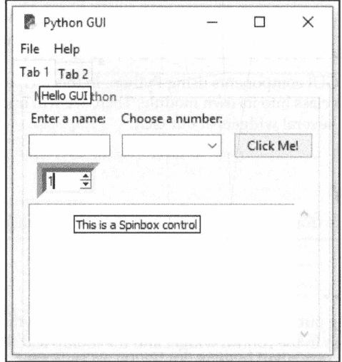

考虑以下代码：

```
# Add a Tooltip to the Spinbox
tt.create_ToolTip(self.spin, 'This is a Spinbox control')

# Add Tooltips to more widgets
tt.create_ToolTip(self.name_entered, 'This is an Entry control')
tt.create_ToolTip(self.action, 'This is a Button control')
tt.create_ToolTip(self.scrol, 'This is a ScrolledText control')
```

这在第二个选项卡上同样有效：

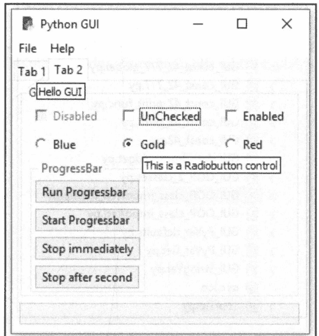

导入语句如下所示：

```
13  from tkinter import messagebox as msg
14  from tkinter import Spinbox
15  from time import sleep
16  import Ch04_Code.ToolTip as tt
17
18  GLOBAL_CONST = 42
19
20  #==============================================
21  class OOP():
22      def __init__(self):      # Initializer method
23          # Create instance
24          self.win = tk.Tk()
25
26          tt.create_ToolTip(self.win, 'Hello GUI')
```

新的代码结构现在如下所示：

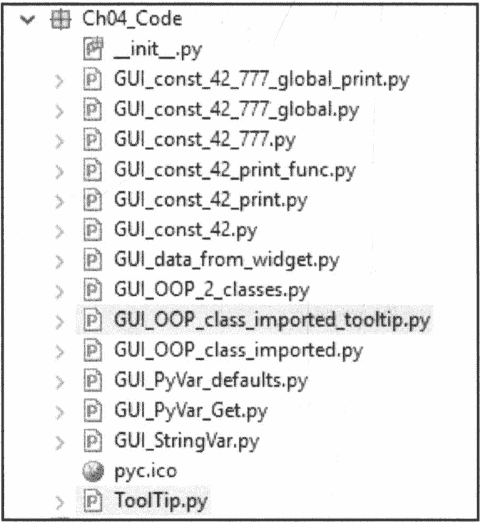

而拆分（即重构）后的代码在独立模块中看起来像这样：

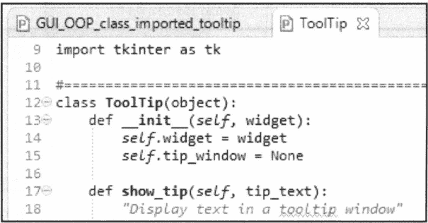

## Matplotlib 图表

在本章中，我们将使用 Python 3.6 和 `Matplotlib` 模块创建漂亮的图表。我们将涵盖以下内容：

- 使用 `Matplotlib` 创建漂亮的图表
- 使用 pip 配合 whl 扩展名安装 `Matplotlib`
- 创建我们的第一个图表
- 在图表上放置标签
- 如何为图表添加图例
- 缩放图表
- 动态调整图表的缩放比例

### 引言

在本章中，我们将创建美观的图表来直观地表示数据。根据数据源的格式，我们可以在同一图表中绘制一列或多列数据。

我们将使用 Python `Matplotlib` 模块来创建图表。

为了创建这些图形图表，我们需要下载额外的 Python 模块，有几种方法可以安装它们。

本章将说明如何下载 `Matplotlib` Python 模块以及所有其他必需的 Python 模块，以及实现此目的的方法。

在安装所需的模块后，我们将创建自己的 Python 风格图表。

以下是本章涉及 Python 模块的概览：

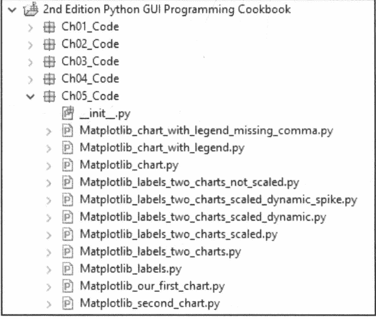

## 使用 Matplotlib 创建漂亮的图表

本节向我们介绍 `Matplotlib` Python 模块，它使我们能够使用 Python 3.6 及以上版本创建可视化图表。

网址 `http://matplotlib.org/users/screenshots.html` 是探索 Matplotlib 世界的一个很好的起点，它还教我们如何创建本章未介绍的许多图表。

### 准备工作

为了使用 `Matplotlib` Python 模块，我们首先必须安装该模块以及其他几个相关的 Python 模块。

如果你运行的是旧于 3.6 的 Python 版本，我建议你升级版本，因为本章将使用 Python `pip` 模块来安装所需的 Python 模块，而 `pip` 随 3.6 及以上版本一起安装。

虽然可以在更早的 Python 3 版本上安装 `pip`，但该过程不太直观，因此绝对最好升级到 3.6 或更高版本。

## 操作步骤……

下图是一个示例，展示了使用 Python 和 `Matplotlib` 模块可以创建的令人惊叹的图形图表：

```
Matplotlib_chart.py
```

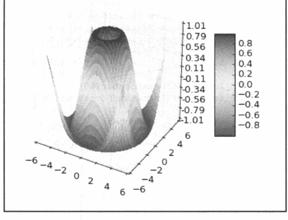

在下面的代码片段中，我从 http://matplotlib.org/ 网站上复制了一些创建此精美图表的代码。我还添加了一些注释。这个网站上有许多示例，我鼓励你尝试这些示例，直到找到你想创建的图表类型。

以下代码用不到 25 行 Python 代码（包括空格）创建了该图表：

```
from mpl_toolkits.mplot3d import Axes3D
from matplotlib import cm
from matplotlib.ticker import LinearLocator, FormatStrFormatter
import matplotlib.pyplot as plt
import numpy as np

fig = plt.figure()                                    # create a figure
ax = fig.gca(projection='3d')                        # create a 3-dimensional axis
X = np.arange(-5, 5, 0.25)                            # horizontal range
Y = np.arange(-5, 5, 0.25)                            # vertical range
X, Y = np.meshgrid(X, Y)                              # create a special grid
R = np.sqrt(X**2 + Y**2)                              # calculate square root
Z = np.sin(R)                                         # calculate sinus

## use #@UndefinedVariable below to ignore the error for cm.coolwarm
surf = ax.plot_surface(X, Y, Z, rstride=1, cstride=1,
                       cmap=cm.coolwarm, linewidth=0,
                       antialiased=False)
ax.set_zlim(-1.01, 1.01)                              # z-axis is third dimension

ax.zaxis.set_major_locator(LinearLocator(10))
ax.zaxis.set_major_formatter(FormatStrFormatter('%.02f'))

fig.colorbar(surf, shrink=0.5, aspect=5)

plt.show()                                            # display the figure
```


使用 Python 3.6 或更高版本以及 Eclipse PyDev 插件运行上述代码时，可能会显示一些未解析的导入和变量错误。你可以通过 `#@UnresolvedImport` 和 `#@UndefinedVariable` 在 Eclipse 中直接禁用这些错误。

如果你使用 Eclipse 进行开发，忽略这些错误即可，因为代码会成功运行。

## 工作原理……

为了创建如前所示的漂亮图表，我们需要下载 Matplotlib 以及其他几个 Python 模块。

以下内容将引导我们成功下载并安装所有必需的模块，从而使我们能够创建自己的漂亮图表。

## 使用 pip 配合 whl 扩展名安装 Matplotlib

下载额外 Python 模块的常用方法是使用 `pip`。pip 模块随最新版本的 Python（3.6 及以上）预装。


> 如果你使用的是较旧版本的 Python，你可能需要自行下载 pip 和 setuptools。

本节将展示如何使用 pip 成功安装 Matplotlib。我们将使用 `.whl` 扩展名进行安装，因此本节还将向你展示如何安装 wheel 模块。

### 准备工作

首先，让我们检查是否已经安装了 wheel 模块。wheel 模块对于下载和安装具有 `.whl` 扩展名的 Python 包是必需的。

我们可以使用 pip 查看当前已安装的模块。


在 Windows 命令提示符中，运行 pip list 命令：

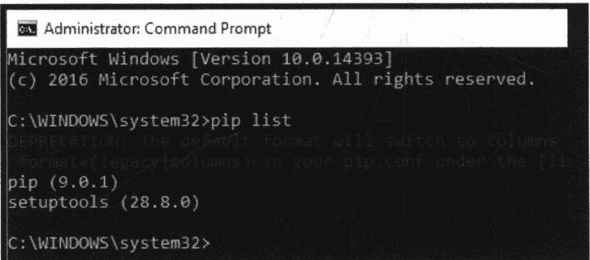

如果运行此命令时出现错误，你可能需要检查 Python 是否在你的环境路径中。如果当前不在，请点击左下角的“编辑...”按钮，将其添加到“系统变量 | Path”。然后，点击右上角的“新建”按钮，输入你的 Python 安装路径。同时，添加 Scripts 目录，因为 pip.exe 位于该目录中：

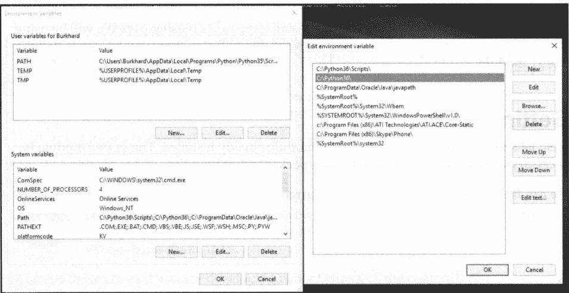

如果你安装了多个版本的 Python，建议将 Python 3.6 移到列表顶部。当我们输入 `pip install <module>` 时，会使用在 **系统变量 | Path** 中找到的第一个版本，如果旧版本的 Python 位于 Python 3.6 之上，你可能会遇到一些意外错误。

让我们运行 `pip install wheel`，然后使用 `pip list` 验证它是否成功安装：

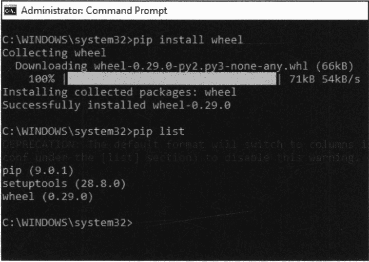


如果你确实非常习惯 Python 2.7，并坚持在 Python 2.7 中运行代码，可以尝试这个技巧。在 Python 3.6 下一切正常后，你可以将 3.6 的 `python.exe` 重命名为 `python3.exe`，然后在命令窗口中输入 `python.exe` 或 `python3.exe` 来运行不同的 Python 可执行文件，从而同时使用 2.7 和 3.6。这是一种变通方法。如果你真的想走这条路，那就要靠你自己了，但它确实可行。

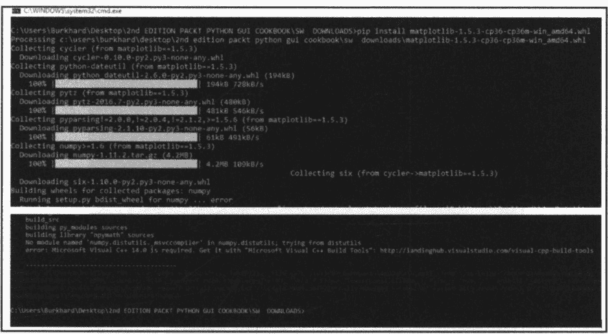

安装遇到了错误。解决方法是下载并安装 Microsoft Visual C++ 构建工具，我们可以从前面截图中提到的网站（http://landinghub.visualstudio.com/visual-cpp-build-tools）进行安装：

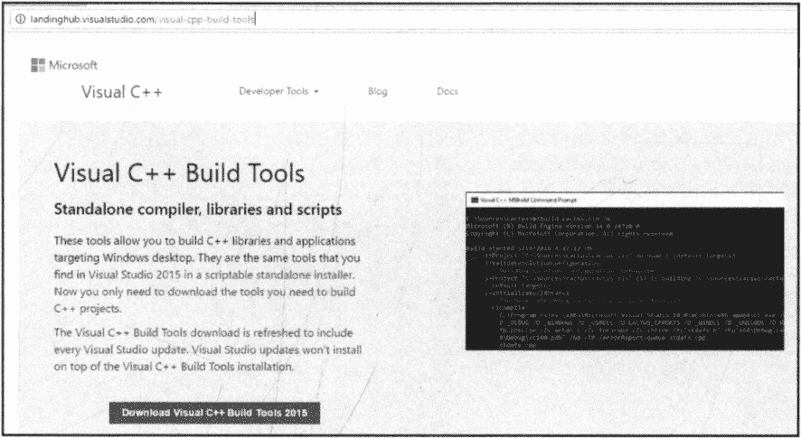

启动 MS VC++ 构建工具的安装界面如下所示：

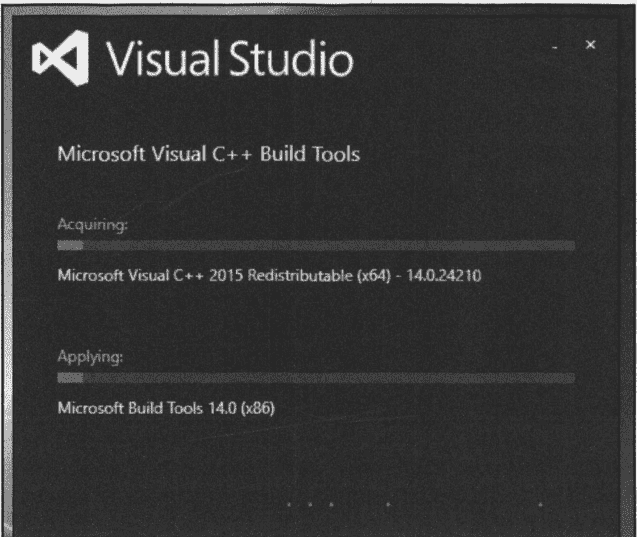

成功安装构建工具之后，我们现在可以完成 Matplotlib 的安装。因此，只需输入之前使用过的相同 pip 安装命令：

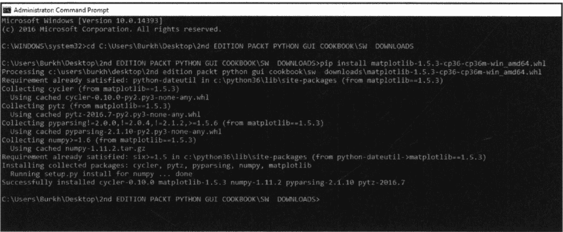

我们可以通过查看 Python 安装目录来验证是否已成功安装 Matplotlib。安装成功后，Matplotlib 文件夹会被添加到 site-packages 中。根据 Python 的安装位置，Windows 上 site-packages 文件夹的完整路径可能是：

```
C:\Python36\Lib\site-packages
```

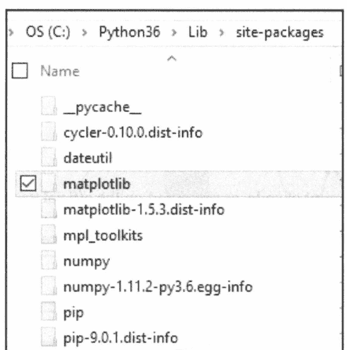

如果你在 Python 安装的 site-packages 文件夹中看到 matplotlib 文件夹，那么说明 Matplotlib 已成功安装。

### 工作原理

下载 Python 模块的常用方式是使用前面展示的 pip。为了安装 Matplotlib 所需的全部模块，其下载网站的主下载格式已发生变化，采用了 whl 格式。

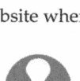

使用 pip 安装 Python 模块通常非常简单。但你可能会遇到一些意想不到的问题。按照前面的步骤操作，你的安装将成功。

## 创建我们的第一张图表

现在我们已经安装了所有必需的 Python 模块，可以使用 Matplotlib 创建自己的图表了。

我们只需几行 Python 代码即可创建图表。

### 准备工作

如前面的操作步骤所示，成功安装 Matplotlib 是本节的前提条件。

### 操作步骤

按照 Matplotlib 官方网站上展示的最少代码量，我们可以创建第一张图表。嗯，几乎可以。网站上的示例代码需要先从 pylab 导入 show 函数并调用它才能运行：

Matplotlib_our_first_chart.py

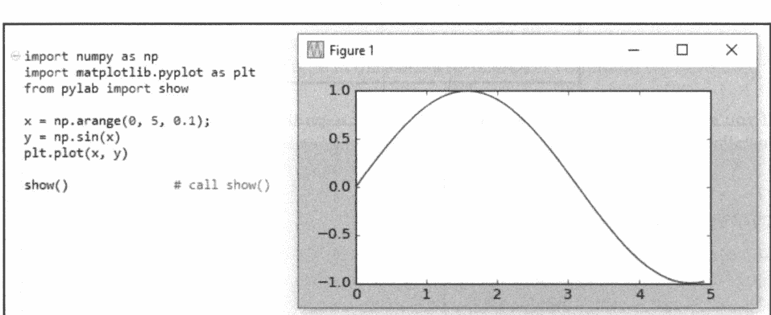

我们可以利用 Matplotlib 官方网站提供的众多示例中的另一个来简化代码，甚至改进它。`pylab` 模块自带绘图函数，因此如果我们想简化代码，就不需要再导入 `matplotlib` 了：

Matplotlib_second_chart.py

```python
from pylab import show, arange, sin, plot, pi

t = arange(0.0, 2.0, 0.01)
s = sin(2 * pi * t)
plot(t, s)

show()
```

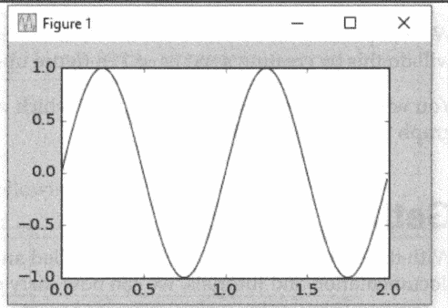

### 工作原理

Python 的 `Matplotlib` 模块与 `numpy` 等附加组件相结合，构建了一个非常丰富的编程环境，使我们能够轻松地执行数学计算并将其绘制为可视化图表。

`numpy` 的 `arange` 方法并不打算“排列”任何东西。它表示创建一个范围，用来替代 Python 内置的 `range` 运算符。`linspace` 方法也可能造成类似的混淆。谁是 *lin*？在什么 *空间* 中？

事实证明，这个名字的意思是 *线性等距向量*。

`pylab` 的 show 函数用于显示我们创建的图形。在成功创建第一个图形后，如果尝试绘制另一个图形，调用 `show()` 会产生一些副作用。

## 在图表上放置标签

到目前为止，我们使用了默认的 `Matplotlib` GUI。现在，我们将使用 `Matplotlib` 创建一些 `tkinter` GUI。

这将需要多写几行 Python 代码并导入更多库，但非常值得，因为我们将通过画布来掌控我们的绘图。

我们将在水平轴和垂直轴上放置标签，即 *x* 轴和 *y* 轴。为此，我们将创建一个用于绘图的 `Matplotlib` 图形对象。

你还将学习如何使用子图，从而可以在同一窗口中绘制多个图形。

### 准备工作

在安装了必要的 Python 模块并知道在哪里可以找到官方在线文档和教程后，我们现在可以继续创建 `Matplotlib` 图表了。

### 操作步骤

虽然 `plot` 是创建 `Matplotlib` 图表的最简单方式，但将 `Figure` 与 `Canvas` 结合使用可以创建更加定制的图形，外观更好，并且还可以向其中添加按钮和其他控件：

Matplotlib_labels.py

```python
from matplotlib.figure import Figure
from matplotlib.backends.backend_tkagg import FigureCanvasTkAgg
import tkinter as tk
#---------------------------------------------------------------
fig = Figure(figsize=(12, 8), facecolor='white')
#---------------------------------------------------------------
# axis = fig.add_subplot(111)    # 1 row, 1 column, only graph
axis = fig.add_subplot(211)     # 2 rows, 1 column, Top graph
#---------------------------------------------------------------
xValues = [1,2,3,4]
yValues = [5,7,6,8]
axis.plot(xValues, yValues)
axis.set_xlabel('Horizontal Label')
axis.set_ylabel('Vertical Label')
# axis.grid()                    # default line style
axis.grid(linestyle='-')         # solid grid lines
#-------------------------------------------------------------------
def _destroyWindow():
    root.quit()
    root.destroy()
#-------------------------------------------------------------------
root = tk.Tk()
root.withdraw()
root.protocol('WM_DELETE_WINDOW', _destroyWindow)
#-------------------------------------------------------------------
canvas = FigureCanvasTkAgg(fig, master=root)
canvas._tkcanvas.pack(side=tk.TOP, fill=tk.BOTH, expand=1)
#-------------------------------------------------------------------
root.update()
root.deiconify()
root.mainloop()
```

运行上述代码会生成下图：

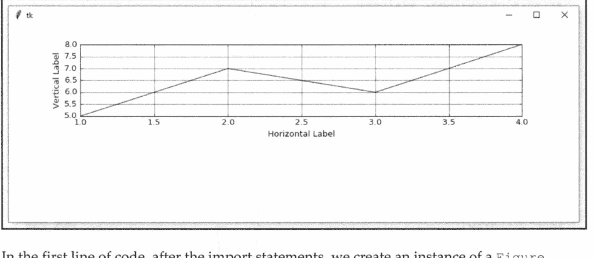

在导入语句之后的第一行代码中，我们创建了一个 Figure 对象的实例。接下来，我们通过调用 add_subplot(211) 向该图形添加子图。211 中的第一个数字告诉图形要添加多少个图，第二个数字决定列数，第三个数字告诉图形显示这些图的顺序。

提供一个基于 Matplotlib 网站的示例，可能会让这一点更清楚：

```python
from matplotlib.figure import Figure
from matplotlib.backends.backend_tkagg import FigureCanvasTkAgg
import tkinter as tk
#-------------------------------------------------------------------
fig = Figure(figsize=(12, 8), facecolor='white')
```


xValues = [1,2,3,4]
yValues = [5,7,6,8]
#-----------------------------------------------------------------
axis1 = fig.add_subplot(221)
axis2 = fig.add_subplot(222, sharex=axis1, sharey=axis1)
axis3 = fig.add_subplot(223, sharex=axis1, sharey=axis1)
axis4 = fig.add_subplot(224, sharex=axis1, sharey=axis1)
#-----------------------------------------------------------------
axis1.plot(xValues, yValues)
axis1.set_xlabel('Horizontal Label 1')
axis1.set_ylabel('Vertical Label 1')
axis1.grid(linestyle='-') # solid grid lines
#-----------------------------------------------------------------
axis2.plot(xValues, yValues)
axis2.set_xlabel('Horizontal Label 2')
axis2.set_ylabel('Vertical Label 2')
axis2.grid(linestyle='-') # solid grid lines
#-----------------------------------------------------------------
axis3.plot(xValues, yValues)
axis3.set_xlabel('Horizontal Label3')
axis3.set_ylabel('Vertical Label 3')
axis3.grid(linestyle='-') # solid grid lines
#-----------------------------------------------------------------
axis4.plot(xValues, yValues)
axis4.set_xlabel('Horizontal Label 4')
axis4.set_ylabel('Vertical Label 4')
axis4.grid(linestyle='-') # solid grid lines
#-----------------------------------------------------------------
def _destroyWindow():
    root.quit()
    root.destroy()
#-----------------------------------------------------------------
root = tk.Tk()
root.withdraw()
root.protocol('WM_DELETE_WINDOW', _destroyWindow)
#-----------------------------------------------------------------
canvas = FigureCanvasTkAgg(fig, master=root)
canvas._tkcanvas.pack(side=tk.TOP, fill=tk.BOTH, expand=1)
#-----------------------------------------------------------------
root.update()
root.deiconify()
root.mainloop()

运行上述代码将生成如下图表：

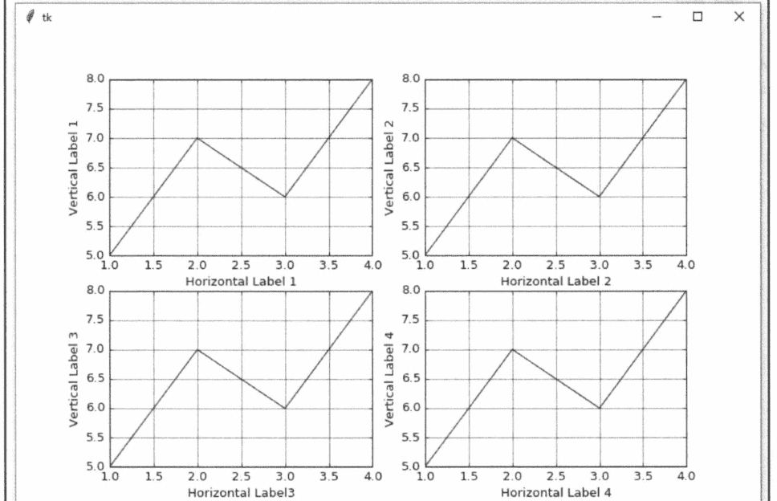

这里需要注意的重要一点是，我们创建了一个坐标轴，然后将其用作图表中其他图形的共享 x 轴和 y 轴。这样，我们就可以实现类似数据库的图表布局。

我们还添加了一个网格，并更改了其默认线型。尽管我们只在图表中显示一个图形，但通过将子图数量选择为 2，我们将图形向上移动，导致图表底部出现额外的空白区域。现在第一个图形只占屏幕的 50%，这会影响该图形网格线显示时的大小。

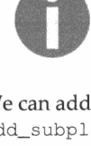

尝试修改代码，取消对 axis = 和 axis.grid() 相关代码的注释，以查看不同的效果。

我们可以通过使用 add_subplot(212) 将更多子图添加到第二个位置：

Matplotlib_labels_two_charts.py

```
from matplotlib.figure import Figure
from matplotlib.backends.backend_tkagg import FigureCanvasTkAgg
import tkinter as tk
#-------------------------------------------------------------------------------
fig = Figure(figsize=(12, 8), facecolor='white')
#-------------------------------------------------------------------------------
axis = fig.add_subplot(211)      # 2 rows, 1 column, Top graph
#-------------------------------------------------------------------------------
xValues = [1,2,3,4]
yValues = [5,7,6,8]
axis.plot(xValues, yValues)
axis.set_xlabel('Horizontal Label')
axis.set_ylabel('Vertical Label')
axis.grid(linestyle='-')        # solid grid lines
#-------------------------------------------------------------------------------
axis1 = fig.add_subplot(212)     # 2 rows, 1 column, Bottom graph
#-------------------------------------------------------------------------------
xValues1 = [1,2,3,4]
yValues1 = [7,5,8,6]
axis1.plot(xValues1, yValues1)
axis1.grid()                     # default line style
#-------------------------------------------------------------------------------
def _destroyWindow():
    root.quit()
    root.destroy()
#-------------------------------------------------------------------------------
root = tk.Tk()
root.withdraw()
root.protocol('WM_DELETE_WINDOW', _destroyWindow)
#-------------------------------------------------------------------------------
canvas = FigureCanvasTkAgg(fig, master=root)
canvas._tkcanvas.pack(side=tk.TOP, fill=tk.BOTH, expand=1)
#-------------------------------------------------------------------------------
root.update()
root.deiconify()
root.mainloop()
```

## 如何为图表添加图例

一旦我们开始绘制多条数据点线，事情可能会变得有些不清楚。因此，通过为图形添加图例，我们可以分辨哪些数据是什么，以及它们的实际含义。

我们不必选择不同的颜色来表示不同的数据。`Matplotlib` 会自动为每条数据点线分配不同的颜色。

我们只需创建图表并为其添加图例即可。

### 准备工作

在本指南中，我们将改进上一个指南 *在图表上放置标签* 中的图表。我们将只绘制一个图表。

### 操作步骤...

首先，我们将在同一图表上绘制更多数据线，然后为图表添加图例。

我们将通过修改上一个教程中的代码来实现这一点：

Matplotlib_chart_with_legend.py

```
from matplotlib.figure import Figure
from matplotlib.backends.backend_tkagg import FigureCanvasTkAgg
import tkinter as tk
#---------------------------------------------
fig = Figure(figsize=(12, 5), facecolor='white')
#---------------------------------------------
axis = fig.add_subplot(111)                         # 1 row, 1 column

xValues = [1,2,3,4]
yValues0 = [6,7.5,8,7.5]
yValues1 = [5.5,6.5,8,6]
yValues2 = [6.5,7,8,7]

t0, = axis.plot(xValues, yValues0)
t1, = axis.plot(xValues, yValues1)
t2, = axis.plot(xValues, yValues2)
```

```
axis.set_ylabel('Vertical Label')
axis.set_xlabel('Horizontal Label')

axis.grid()

fig.legend((t0, t1, t2), ('First line', 'Second line', 'Third line'), 'upper right')

#--------------------------------------------------------------------------
def _destroyWindow():
    root.quit()
    root.destroy()
#--------------------------------------------------------------------------
root = tk.Tk()
root.withdraw()
root.protocol('WM_DELETE_WINDOW', _destroyWindow)
#--------------------------------------------------------------------------
canvas = FigureCanvasTkAgg(fig, master=root)
canvas._tkcanvas.pack(side=tk.TOP, fill=tk.BOTH, expand=1)
#--------------------------------------------------------------------------
root.update()
root.deiconify()
root.mainloop()
```

运行修改后的代码将创建以下图表，其右上角有一个图例：

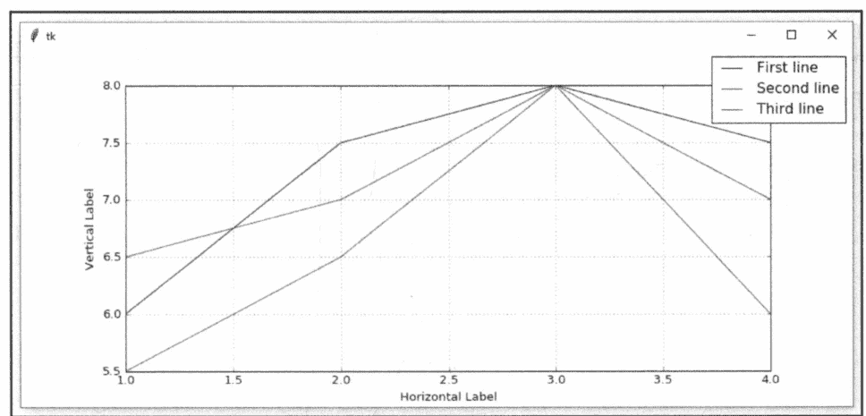

在本指南中，我们只绘制一个图形，这是通过更改 fig.add_subplot(111) 来实现的。我们还通过 figsize 属性稍微修改了图形的大小。

接下来，我们创建三个包含待绘制值的 Python 列表。绘制数据时，我们将绘图的引用保存在局部变量中。

我们通过传入一个包含三个绘图引用的元组、另一个包含随后显示在图例中的字符串的元组来创建图例，并通过第三个参数设置图例在图表中的位置。

Matplotlib 的默认设置会给所绘制的线条分配一种颜色方案。

我们可以通过在绘制每个坐标轴时设置一个属性，轻松地将默认颜色设置更改为我们偏好的颜色。

我们通过使用 color 属性并为其分配一个可用的颜色值来实现这一点：

Matplotlib_chart_with_legend.py

```
    t0, = axis.plot(xValues, yValues0, color = 'purple')
    t1, = axis.plot(xValues, yValues1, color = 'red')
    t2, = axis.plot(xValues, yValues2, color = 'blue')
```

请注意，t0、t1 和 t2 变量赋值后的逗号并不是错误。它是创建图例所必需的。

每个变量后的逗号会将列表转换为元组。如果我们省略它，图例将不会显示。

代码仍然可以运行，只是没有预期的图例。


当我们移除 t0 赋值后的逗号时，会得到一个错误，并且第一条线不再出现在图中。图表和图例仍会创建，但图例中不会出现第一条线。


# t0, t1 和 t2 之后的逗号是必需的
t0 = axis.plot(xValues, yValues0)      # no comma here
t1, = axis.plot(xValues, yValues1)
t2, = axis.plot(xValues, yValues2)

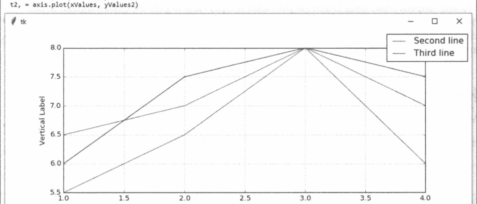

## How it works...

我们通过在同一张图表中绘制三条数据线并为其添加图例来增强图表，以便区分这三条线所绘制的数据。

## Scaling charts

在之前的配方中，在创建我们的第一个图表并对其进行增强时，我们对这些值如何被视觉表示的缩放进行了硬编码。

对于我们使用的值来说，这对我们很有帮助，但我们经常从非常大的数据库中绘制图表。

根据数据的范围，我们对垂直 y 维度的硬编码值可能并不总是最佳解决方案，并且可能使我们难以在图表中看到线条。

到目前为止，我们的图表已根据它们所视觉表示的数据自行调整。

虽然这是 Matplotlib 的实用特性，但这并不总是我们想要的。我们可以通过限制垂直 y 维度来限制图表的表示比例：

```
Matplotlib_labels_two_charts_scaled.py

yValues0 = [6,7.5,8,7.5]
yValues1 = [5.5,6.5,50,6]        # one very high value (50)
yValues2 = [6.5,7,8,7]

axis.set_ylim(5, 8)             # limit the vertical display
```

`axis.set_ylim(5, 8)` 代码行现在将开始值限制为 5，将垂直显示的结束值限制为 8。

现在，当我们创建图表时，之前的高值峰值不再产生之前的影响：

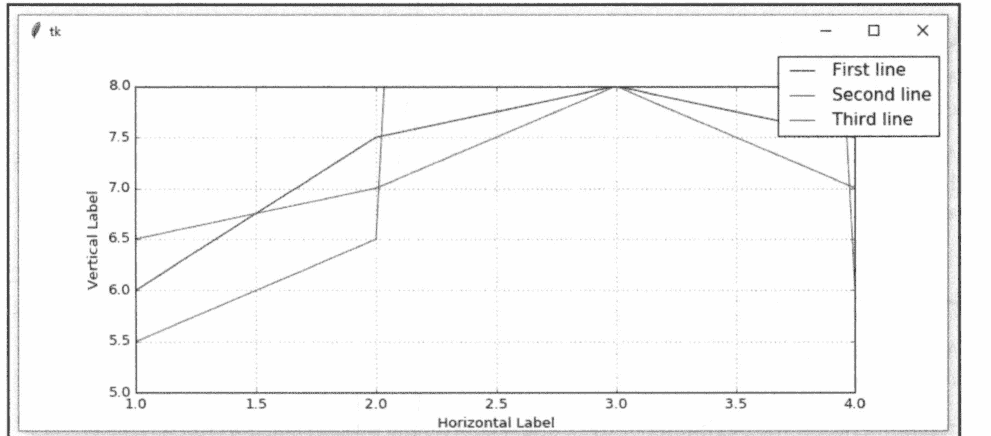

## How it works...

我们增加了一个数据值，这导致了戏剧性的效果。通过设置图表的垂直和水平显示的限制，我们可以看到我们最感兴趣的数据。

让我们修改代码以同时对 $x$ 和 $y$ 维度设置限制：

```
Matplotlib_labels_two_charts_scaled_dynamic.py

    xValues   = [1,2,3,4]

    yValues0  = [6,7.5,8,7.5]
    yValues1  = [5.5,6.5,50,6]          # one very high value (50)
    yValues2  = [6.5,7,8,7]

    axis.set_ylim(0, 8)                 # lower limit (0)
    axis.set_xlim(0, 8)                 # use same limits for x
```

现在我们为 $x$ 和 $y$ 设置了相同的限制，我们的图表可能看起来更平衡。
当我们运行修改后的代码时，我们得到以下结果：

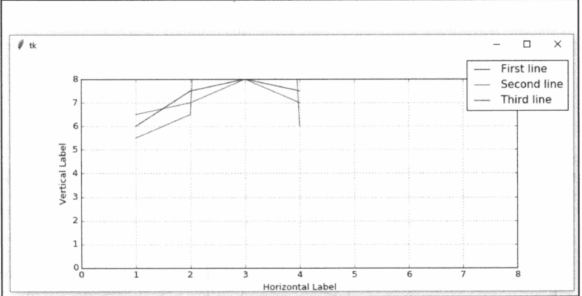

也许从 (0, 0) 开始并不是一个好主意...

我们真正想要做的是根据数据的范围动态调整图表，同时限制过高或过低的值。

我们可以通过解析要表示在图表中的所有数据，同时设置一些明确的限制来实现这一点。

## Modify the code as follows:

```
Matplotlib_labels_two_charts_scaled_dynamic.py

xValues = [1,2,3,4]

yValues0 = [6,7.5,8,7.5]
yValues1 = [5.5,6.5,50,6]                # one very high value (50)
yValues2 = [6.5,7,8,7]
yAll = [yValues0, yValues1, yValues2]   # list of lists

# flatten list of lists retrieving minimum value
minY = min([y for yValues in yAll for y in yValues])

yUpperLimit = 20
# flatten list of lists retrieving max value within defined limit
maxY = max([y for yValues in yAll for y in yValues if y <
            yUpperLimit])

# dynamic limits
axis.set_ylim(minY, maxY)
axis.set_xlim(min(xValues), max(xValues))

t0, = axis.plot(xValues, yValues0)
t1, = axis.plot(xValues, yValues1)
t2, = axis.plot(xValues, yValues2)
```

运行代码后得到以下图表。我们动态调整了其 x 和 y 维度。请注意，y 维度现在从 5.5 开始，而不是之前的 5.0。图表也不再从 (0, 0) 开始，为我们提供了关于数据的更有价值的信息：

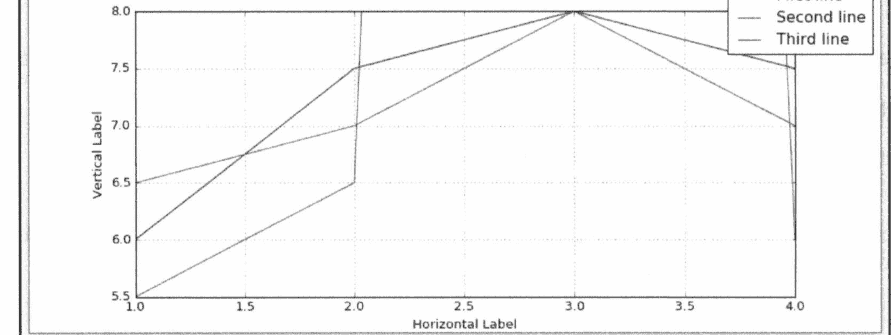

我们为 y 维度数据创建了一个列表的列表，然后使用列表推导式包装到 Python 的 min() 和 max() 函数调用中。

如果列表推导式看起来有点高级，它们本质上是一个非常压缩的循环。

它们还设计为比常规编程循环更快。

在前面的 Python 代码中，我们创建了三个列表来保存要绘制的 y 维度数据。然后我们创建了另一个列表来保存这三个列表，从而创建了一个列表的列表，如下所示：

```
yValues0 = [6,7.5,8,7.5]
yValues1 = [5.5,6.5,50,6]        # one very high value (50)
yValues2 = [6.5,7,8,7]
yAll = [yValues0, yValues1, yValues2]  # list of lists
```

我们有兴趣获取所有 y 维度数据的最小值以及这三个列表中包含的最大值。

我们可以通过 Python 列表推导式来实现这一点：

```
# flatten list of lists retrieving minimum value
minY = min([y for yValues in yAll for y in yValues])
```

运行列表推导式后，minY 为 5.5。

前一行代码是遍历三个列表中包含的所有数据的所有值并使用 Python min 关键字找到最小值的列表推导式。

以完全相同的模式，我们找到要绘制的数据中包含的最大值。这次，我们还在列表推导式中设置了一个限制，该限制忽略所有高于我们指定的限制的值，如下所示：

```
yUpperLimit = 20
# flatten list of lists retrieving max value within defined limit
maxY = max([y for yValues in yAll for y in yValues if y <
            yUpperLimit])
```

使用我们选择的限制运行前面的代码后，maxY 的值为 8（而不是 50）。

我们根据预定义的条件对最大值应用了限制，选择 20 作为图表中显示的最大值。

对于 x 维度，我们只需在 Matplotlib 方法中调用 min() 和 max() 来动态缩放图表的限制。

## How it works...

在本配方中，我们创建了多个 Matplotlib 图表并调整了一些可用的属性。我们还使用核心 Python 动态控制图表的缩放。

当我们在 Windows 任务管理器中运行我们的 Python GUI 时，我们可以看到已启动了一个新的 `python.exe` 进程。当我们为我们的 Python GUI 提供 `.pyw` 扩展名时，则创建的进程将是 `python.pyw`，正如在任务管理器中看到的那样。

当创建进程时，进程会自动创建一个主线程来运行我们的应用程序。这称为单线程应用程序。

对于我们的 Python GUI，单线程应用程序会导致我们的 GUI 在我们调用较长时间运行的任务时冻结，例如点击一个按钮，该按钮有几秒钟的睡眠时间。为了保持我们的 GUI 响应，我们必须使用多线程，这就是本章将要研究的主题。我们也可以通过创建我们 Python GUI 的多个实例来创建多个进程，正如在任务管理器中看到的那样。

进程按设计彼此隔离并且不共享公共数据。为了在单独的进程之间进行通信，我们必须使用 **Inter Process Communication (IPC)**，这是一种高级技术。另一方面，线程确实共享公共数据、代码和文件，这使得同一进程内线程之间的通信比使用 IPC 时容易得多。


> 关于线程的精彩解释可以在 `https://www.cs.uic.edu/~jbell/CourseNotes/OperatingSystems/4_Threads.html` 找到。

在本章中，我们将学习如何保持我们的 Python GUI 响应并防止其冻结。

以下是本章的 Python 模块概述：

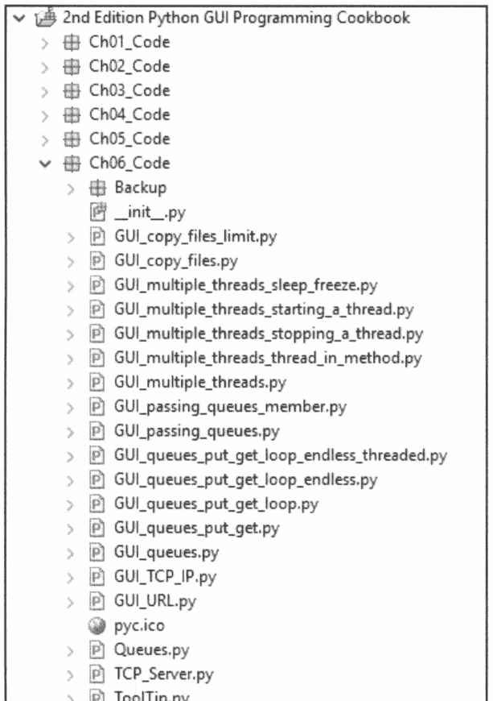

## How to create multiple threads

我们将使用 Python 创建多个线程。这对于保持我们的 GUI 响应是必要的。


线程就像用纱线编织布料一样，没什么好害怕的。

## 准备工作

多个线程运行在同一个计算机进程的内存空间中。无需使用 IPC，它会让我们的代码变得复杂。在本节中，我们将通过使用线程来避免 IPC。

## 如何实现…

首先，我们将增大 `ScrolledText` 控件的大小。我们把 `scrol_w` 增加到 40，`scrol_h` 增加到 10：

```
```python
# Using a scrolled Text control
scrol_w = 40; scrol_h = 10                         # increase sizes
self.scrol = scrolledtext.ScrolledText(mighty, width=scrol_w,
                                       height=scrol_h,
                                       wrap=tk.WORD)
self.scrol.grid(column=0, row=3, sticky='WE', columnspan=3)
```
```

当我们运行生成的 GUI 时，Spinbox 控件相对于其上方 Entry 控件是居中对齐的，看起来不太美观。我们将通过左对齐该控件来改变这一点。

将 `sticky='W'` 添加到 `grid` 控件中，以左对齐 Spinbox 控件：

```
```python
# Adding a Spinbox widget
self.spin = Spinbox(mighty, values=(1, 2, 4, 42, 100), width=5,
                   bd=9, command=self._spin)
self.spin.grid(column=0, row=2, sticky='W')             # align left
```
```

GUI 看起来还可以进一步改进，所以现在我们增加 Entry 控件的大小，以获得更均衡的 GUI 布局。

将 `width` 增加到 24，如以下代码片段所示：

```
```python
# Adding a Textbox Entry widget
self.name = tk.StringVar()
self.name_entered = ttk.Entry(mighty, width=24,
                              textvariable=self.name)
self.name_entered.grid(column=0, row=1, sticky='W')
```
```

我们还将 Combobox 的 `width` 稍微增加到 14：

```
```python
ttk.Label(mighty, text="Choose a number:").grid(column=1, row=0)
number = tk.StringVar()
self.number_chosen = ttk.Combobox(mighty, width=14,
                                  textvariable=number,
                                  state='readonly')
self.number_chosen['values'] = (1, 2, 4, 42, 100)
self.number_chosen.grid(column=1, row=1)
self.number_chosen.current(0)
```
```

运行修改并改进后的代码会得到一个更大的 GUI，我们将在此节及后续章节中使用它：

`GUI_multiple_threads.py`

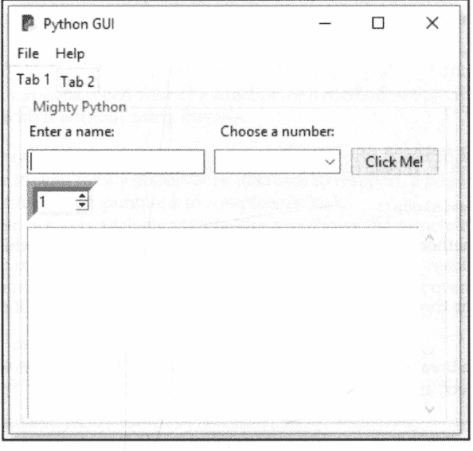

为了在 Python 中创建和使用线程，我们必须从 `threading` 模块导入 `Thread` 类：

```
```python
#============================
# imports
#============================
import tkinter as tk
```
```

```
from tkinter import ttk
from tkinter import scrolledtext
from tkinter import Menu
from tkinter import messagebox as msg
from tkinter import Spinbox
from time import sleep
import Ch06_Code.ToolTip as tt
from threading import Thread

GLOBAL_CONST = 42
```

让我们在 OOP 类中添加一个将在线程中创建的方法：

```
class OOP():
    def method_in_a_thread(self):
        print('Hi, how are you?')
```

现在我们可以在代码中调用我们的线程方法，并将实例保存在一个变量中：

```
#====================
# Start GUI
#====================
oop = OOP()

# Running methods in Threads
run_thread = Thread(target=oop.method_in_a_thread)

oop.win.mainloop()
```

现在，我们有了一个可以线程化的方法，但当我们运行代码时，控制台却什么都没有打印！

我们必须先启动线程，它才能运行，下一节将向我们展示如何做到这一点。

然而，在 GUI 主事件循环之后设置断点可以证明我们确实创建了一个线程对象，正如 Eclipse IDE 调试器中所看到的那样：

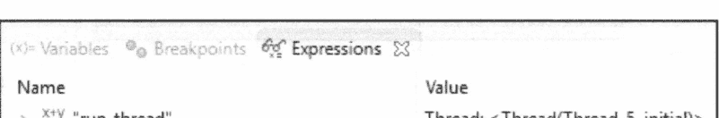

## 工作原理...

在本节中，我们通过先增大 GUI 尺寸来为使用线程做准备，以便我们能更好地看到打印到 `ScrolledText` 控件上的结果。

然后我们从 Python 的 `threading` 模块中导入了 `Thread` 类。

接下来，我们创建了一个方法，并会在 GUI 内部的线程中调用它。

## 启动线程

本节将向我们展示如何启动线程。它还将演示为什么在长时间运行的任务中需要线程来保持 GUI 的响应性。

## 准备工作

首先让我们看看，在不使用线程的情况下调用 GUI 中某个带 `sleep` 的函数或方法会发生什么。

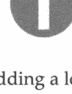

我们在这里使用 `sleep` 来模拟真实应用程序可能需要等待 Web 服务器或数据库响应、大文件传输或复杂计算完成其任务的情况。

`sleep` 是一个非常实际的替代方式，并展示了所涉及的原理。

在我们的按钮回调方法中添加一个带有 sleep 时间的循环，会导致 GUI 失去响应，而且当我们尝试关闭 GUI 时，情况会更糟：

GUI_multiple_threads_sleep_freeze.py

```
# Button callback
def click_me(self):
    self.action.configure(text='Hello ' + self.name.get() + ' '
        + self.number_chosen.get())
    # Non-threaded code with sleep freezes the GUI
    for idx in range(10):
        sleep(5)
        self.scrol.insert(tk.INSERT, str(idx) + '\n')
```

## 线程与网络

运行上述代码文件会得到以下截图：

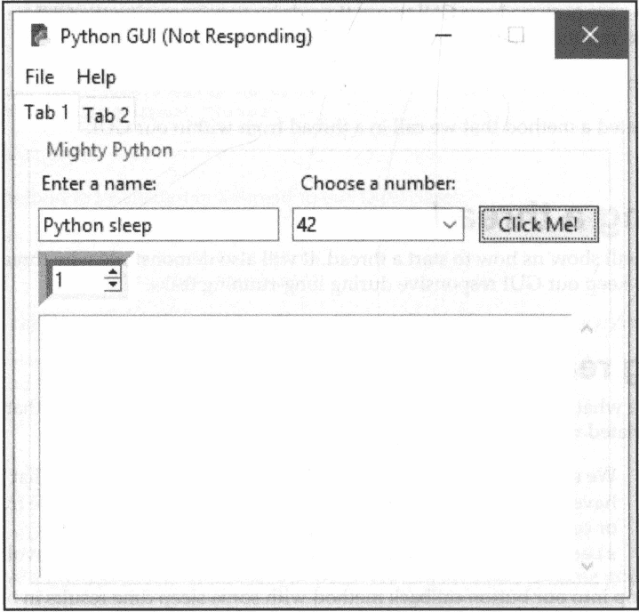

如果我们等待足够长的时间，该方法最终会完成，但在此期间，我们的 GUI 控件都不会响应点击事件。我们将通过使用线程来解决这个问题。


在上一节中，我们创建了一个要在线程中运行的方法，但到目前为止，该线程还没有运行！

与常规 Python 函数和方法不同，我们必须 `start` 一个将在其自身线程中运行的方法！

这就是我们接下来要做的事情。

## 如何实现...

首先，让我们将线程的创建移动到它自己的方法中，然后从按钮的 `callback` 方法中调用此方法：

```
```python
# Running methods in Threads
def create_thread(self):
    self.run_thread = Thread(target=self.method_in_a_thread)
    self.run_thread.start()                         # start the thread

# Button callback
def click_me(self):
    self.action.configure(text='Hello ' + self.name.get())
    self.create_thread()
```
```

现在点击按钮会导致调用 `create_thread` 方法，进而调用 `method_in_a_thread` 方法。

首先，我们创建一个线程并将其目标指向一个方法。接下来，我们启动该线程，在新线程中运行目标方法：

```
def method_in_a_thread(self):
    print('Hi, how are you?')

# Running methods in Threads
def create_thread(self):
    self.run_thread = Thread(target=self.method_in_a_thread)
    self.run_thread.start()

# Button callback
def click_me(self):
    self.action.configure(text='Hello ' + self.name.get())
    self.create_thread()
```

GUI 本身运行在自己的线程中，即应用程序的主线程。

当点击按钮时，数字会以五秒的延迟打印到 `ScrolledText` 控件中，与此同时，我们可以点击 GUI 中的任何位置、切换标签页等等。因为使用了线程，我们的 GUI 重新变得响应了！

`GUI_multiple_threads_starting_a_thread.py`

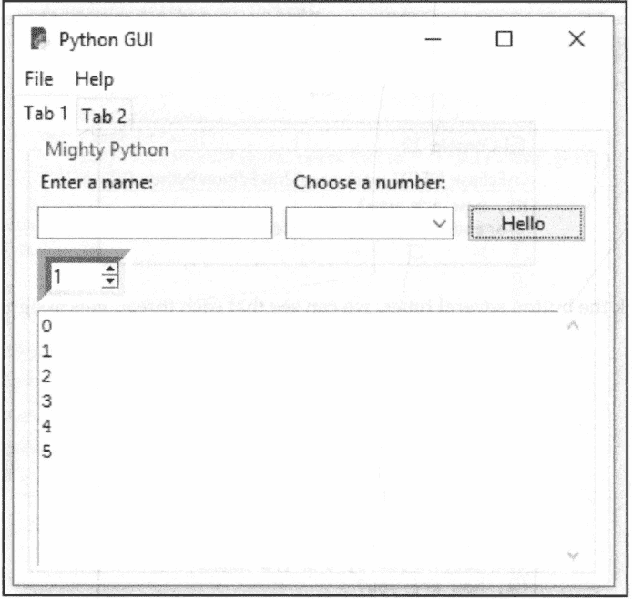

## 工作原理…

在本节中，我们在 GUI 类方法自身的线程中调用它们，并认识到我们必须启动线程。否则，线程会被创建，但只是停在那里等待我们运行其目标方法。

我们注意到每个线程都被分配了唯一的名称和 ID。

我们通过向代码中插入 sleep 语句来模拟长时间运行的任务，这向我们表明线程确实可以解决我们的问题。

## 停止线程

我们必须通过调用 start() 方法来启动线程，才能让它真正执行某些操作，因此直观上，我们会期望存在一个对应的 stop() 方法，但并没有这样的方法。在本节中，我们将学习如何将线程作为后台任务运行，这被称为守护线程。当我们关闭主线程（即我们的 GUI）时，所有守护线程也会自动停止。

## 准备工作

当我们在线程中调用方法时，还可以向该方法传递位置参数和关键字参数。我们正是从这一点开始本节的。

## 如何实现...

通过向线程构造函数添加 args=[8] 并修改目标方法以接收参数，我们可以向线程方法传递参数。传给 args 的参数必须是序列，因此我们将数字包装在 Python 列表中：

```
def method_in_a_thread(self, num_of_loops=10):
    print('Hi, how are you?')
    for idx in range(num_of_loops):
        sleep(5)
        self.scrol.insert(tk.INSERT, str(idx) + 'n')
```

在下面的代码中，run_thread 是一个局部变量，我们只能在创建它的方法作用域内访问它：

```
# Running methods in Threads
def create_thread(self):
    run_thread = Thread(target=self.method_in_a_thread, args=[8])
    run_thread.start()
```


## 线程与网络

通过将局部变量转为成员变量，我们就可以从另一个方法中调用 `isAlive` 来检查线程是否仍在运行：

```python
# Running methods in Threads
def create_thread(self):
    self.run_thread = Thread(target=self.method_in_a_thread, args=[8])
    self.run_thread.start()
    print(self.run_thread)
    print('createThread():', self.run_thread.isAlive())
```

在前面的代码中，我们将局部 `run_thread` 变量提升为类的成员。这使我们能够从类中的任何方法访问 `self.run_thread` 变量。

实现方式如下：

```python
def method_in_a_thread(self, num_of_loops=10):
    for idx in range(num_of_loops):
        sleep(1)
        self.scrol.insert(tk.INSERT, str(idx) + '\n')
    sleep(1)
    print('method_in_a_thread():', self.run_thread.isAlive())
```

当我们点击按钮然后退出 GUI 时，可以看到 `create_thread` 方法中的打印语句已被打印，但我们看不到来自 `method_in_a_thread` 的第二个打印语句。

考虑以下输出：

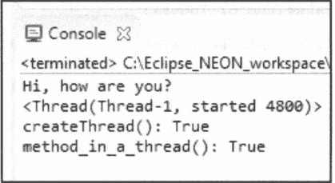

我们可以通过在启动线程前调用 `setDaemon(True)` 方法来实现：

```python
# Running methods in Threads
def create_thread(self):
    self.run_thread = Thread(target=self.method_in_a_thread, args=[8])
    self.run_thread.setDaemon(True)
    self.run_thread.start()
    print(self.run_thread)
```

现在当我们点击按钮并在线程尚未完成其分配任务时退出 GUI，我们就不会再收到任何错误：

GUI_multiple_threads_stopping_a_thread.py

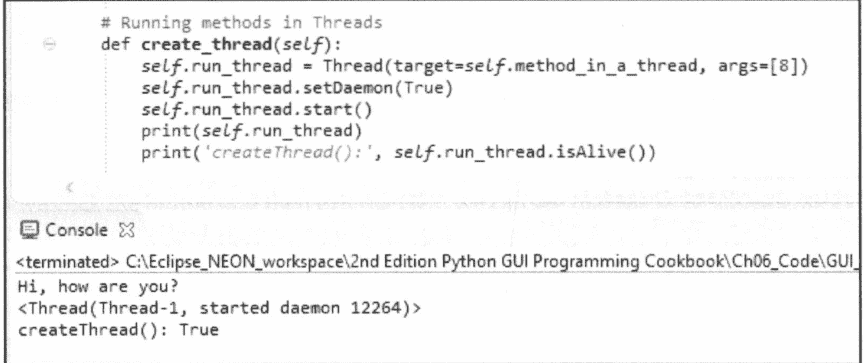

### 如何工作...

虽然有 `start` 方法让线程运行，但令人惊讶的是并没有真正等价的 `stop` 方法。

在本示例中，我们在线程中运行一个方法，该方法向我们的 ScrolledText 小部件打印数字。

当我们退出 GUI 时，我们不再关心曾经向小部件打印的线程，因此通过将线程设为守护线程，我们可以干净地退出 GUI。

### 如何使用队列

Python 队列是一种实现先进先出范式的数据结构，基本上像管道一样工作。你在一端将东西铲入管道，它就会从另一端掉出来。

这种队列铲运与将泥浆铲入物理管道之间的主要区别在于，在 Python 队列中，东西不会被混淆。你放入一个单元，这个单元就会在另一端原样返回。接下来，你再放入另一个单元，例如一个类的实例，这个完整的单元会作为一个整体从另一端返回。

它在另一端返回的顺序与我们插入代码到队列的顺序完全一致。


队列不是我们推送和弹出数据的栈。栈是一种 **后进先出 (LIFO)** 数据结构。

队列是容纳从潜在不同数据源馈入队列的数据的容器。我们可以让不同的客户端在有数据可用时随时向队列提供数据。无论哪个客户端准备好向我们的队列发送数据，它都会发送，我们就可以在小部件中显示这些数据或将其转发到其他模块。

使用多个线程完成队列中分配的任务在接收最终处理结果并显示它们时非常有用。数据从队列的一端插入，然后以有序的方式从另一端出来，**先进先出 (FIFO)**。

我们的 GUI 可能有五个不同的按钮小部件，每个按钮触发不同的任务，我们希望在 GUI 的小部件中显示这些任务，例如 `ScrolledText` 小部件。这五个不同任务完成所需的时间各不相同。

每当任务完成时，我们需要立即知道并在 GUI 中显示此信息。通过创建一个共享的 Python 队列并让五个任务将其结果写入该队列，我们可以使用 FIFO 方法立即显示已完成的任务的结果。

#### 准备工作

随着 GUI 的功能和实用性不断增加，它开始与网络、进程和网站通信，并最终必须等待数据可用以供 GUI 表示。在 Python 中创建队列解决了等待数据在 GUI 内部显示的问题。

#### 如何操作...

为了在 Python 中创建队列，我们必须从 queue 模块导入 Queue 类。在 GUI 模块顶部添加以下语句：

```python
from threading import Thread
from queue import Queue
```

这就开始了。

接下来，我们创建一个队列实例：

```python
def use_queues(self):
    gui_queue = Queue()                # create queue instance
    print(gui_queue)                   # print instance
```

我们在按钮点击事件中调用该方法：

```python
# Button callback
def click_me(self):
    self.action.configure(text='Hello ' + self.name.get())
    self.create_thread()
    self.use_queues()
```


在前面的代码中，我们创建了一个仅在此方法内可访问的局部 Queue 实例。如果我们希望从其他地方访问此队列，就必须通过使用 self 关键字将其转为类的成员，这会将局部变量绑定到整个类，使其可从类中的任何其他方法访问。在 Python 中，我们通常在 `__init__(self)` 方法中创建类实例变量，但 Python 非常务实，允许我们在代码中的任何位置创建这些成员变量。

现在我们有一个队列实例。我们可以通过打印它来证明它有效：

```
Hi, how are you?
<Thread(Thread-1, started daemon 6432)>
createThread(): True
<queue.Queue object at 0x0000023C005534A8>
method_in_a_thread(): True
```

为了将数据放入队列，我们使用 put 命令。为了从队列中取出数据，我们使用 get 命令：

```python
# Create Queue instance
def use_queues(self):
    gui_queue = Queue()
    print(gui_queue)
    gui_queue.put('Message from a queue')
    print(gui_queue.get())
```

运行修改后的代码后，消息首先被放入 Queue，然后从 Queue 取出，最后打印到控制台：

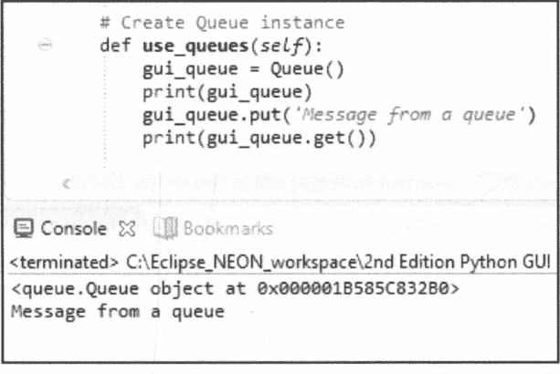

我们可以将许多消息放入 Queue：

```python
# Create Queue instance
def use_queues(self):
    gui_queue = Queue()
    print(gui_queue)
    for idx in range(10):
        gui_queue.put('Message from a queue: ' + str(idx))
    print(gui_queue.get())
```

我们已将十条消息放入 Queue，但我们只取出第一条。其他消息仍在 Queue 中，等待以 FIFO 方式取出：

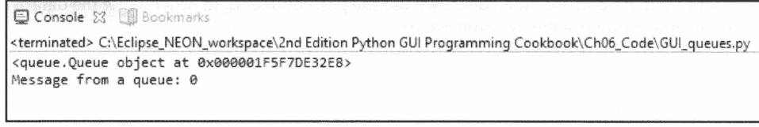

为了取出所有已放入 Queue 的消息，我们可以创建一个无限循环：

GUI_queues_put_get_loop_endless.py

```python
# Create Queue instance
def use_queues(self):
    gui_queue = Queue()
    print(gui_queue)
    for idx in range(10):
        gui_queue.put('Message from a queue: ' + str(idx))
    while True:
        print(gui_queue.get())
```

运行前面的代码会得到以下截图：

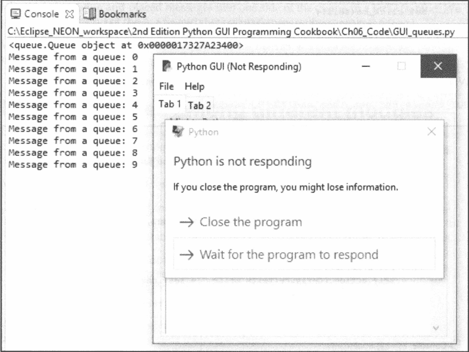

虽然这段代码可以工作，但不幸的是，它会冻结我们的 GUI。为了修复这个问题，我们必须在自己的线程中调用该方法，就像在之前的示例中所做的那样。

让我们在线程中运行我们的 Queue 方法：

```python
# Running methods in Threads
def create_thread(self):
    self.run_thread = Thread(target=self.method_in_a_thread, args=[8])
    self.run_thread.setDaemon(True)
    self.run_thread.start()

    # start queue in its own thread
    write_thread = Thread(target=self.use_queues, daemon=True)
```


### How it works...

我们创建了一个 Queue 并以 FIFO 方式将消息放入 Queue 的一侧。我们从 Queue 中取出消息，然后将其打印到控制台（stdout）。

我们意识到必须在自己的线程中调用该方法，因为否则我们的 GUI 可能会冻结。

## Passing queues among different modules

在本教程中，我们将在不同的模块之间传递队列。随着 GUI 代码复杂度的增加，我们希望将 GUI 组件与业务逻辑分离，将它们分离到不同的模块中。

模块化使我们能够重用代码，也使代码更易于阅读。

一旦要在 GUI 中显示的数据来自不同的数据源，我们将面临延迟问题，而队列正是解决此问题的方法。通过在不同的 Python 模块之间传递 Queue 实例，我们将模块功能的各个关注点分离开来。

理想情况下，GUI 代码只应关注创建和显示小部件。业务逻辑模块的工作只是执行业务逻辑。


我们必须将这两个元素结合起来，理想情况下在不同模块之间使用尽可能少的关联，减少代码的相互依赖。

避免不必要依赖的编码原则通常被称为松耦合。


为了理解松耦合的重要性，我们可以在白板或纸上画一些方框。一个方框代表我们的 GUI 类和代码，而其他方框代表业务逻辑、数据库等。

接下来，我们在方框之间画线，绘制出这些方框之间即我们 Python 模块的相互依赖关系。

我们 Python 方框之间的线越少，我们的设计就越松耦合。

### Getting ready

在上一教程 *How to use queues* 中，我们开始使用队列。在本教程中，我们将从主 GUI 线程向其他 Python 模块传递 `Queue` 的实例，这将使我们能够从另一个模块写入 `ScrolledText` 小部件，同时保持 GUI 响应。

### How to do it...

首先，我们在项目中创建一个新的 Python 模块。让我们将其命名为 `Queues.py`。我们将向其中放置一个函数（目前不需要 OOP）。

我们传递创建 GUI 表单和小部件的类的自引用，这使我们能够从另一个 Python 模块使用所有 GUI 方法。

我们在按钮回调中执行此操作。

这就是 OOP 的魔力。在类的中间，我们使用 `self` 关键字将自身传递给从类内部调用的函数。

代码现在如下所示：

```python
import Ch06_Code.Queues as bq

class OOP():
    # Button callback
    def click_me(self):
        # Passing in the current class instance (self)
        print(self)
        bq.write_to_scrol(self)
```

导入的模块包含我们调用的函数：

```python
def write_to_scrol(inst):
    print('hi from Queue', inst)
    inst.create_thread(6)
```

我们已在按钮回调中注释掉了对 `create_thread` 的调用，因为我们现在是从新模块调用它：

```python
# Threaded method does not freeze our GUI
# self.create_thread()
```


通过将类实例的自引用传递给类在另一个模块中调用的函数，我们现在可以从其他 Python 模块访问所有 GUI 元素。

运行代码会得到以下结果：

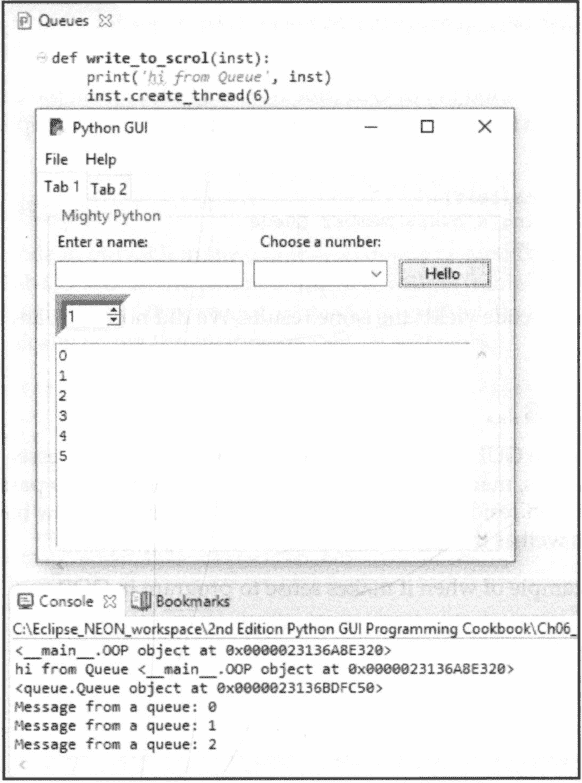

## Using dialog widgets to copy files to your network

本教程向我们展示了如何将文件从本地硬盘复制到网络位置。

我们将通过使用 Python tkinter 的内置对话框之一来实现，该对话框使我们能够浏览硬盘。然后我们可以选择要复制的文件。

本教程还向我们展示了如何使 Entry 小部件变为只读并将 Entry 默认为指定位置，这加快了我们硬盘的浏览速度。

### Getting ready

我们将扩展在上一教程 *Passing queues among different modules* 中构建的 GUI 的 Tab 2。

### How to do it...

将以下代码添加到我们在 `create_widgets()` 方法底部的 GUI 中，在我们创建 Tab Control 2 的位置。新小部件框架的父级是 `tab2`，我们在 `create_widgets()` 方法的开头创建了它。只要你将以下代码物理上放置在 `tab2` 创建之后，它就会生效：

```python
############################################################
def create_widgets(self):
    # Create Tab Control
    tabControl = ttk.Notebook(self.win)
    # Add a second tab
    tab2 = ttk.Frame(tabControl)
    # Make second tab visible
    tabControl.add(tab2, text='Tab 2')

    # Create Manage Files Frame
    mngFilesFrame = ttk.LabelFrame(tab2, text=' Manage Files: ')
    mngFilesFrame.grid(column=0, row=1, sticky='WE', padx=10, pady=5)

    # Button Callback
    def getFileName():
        print('hello from getFileName')

    # Add Widgets to Manage Files Frame
    lb = ttk.Button(mngFilesFrame, text="Browse to File...",
                    command=getFileName)
    lb.grid(column=0, row=0, sticky=tk.W)

    file = tk.StringVar()
    self.entryLen = scrol_w
    self.fileEntry = ttk.Entry(mngFilesFrame, width=self.entryLen,
                               textvariable=file)
    self.fileEntry.grid(column=1, row=0, sticky=tk.W)

    logDir = tk.StringVar()
    self.netwEntry = ttk.Entry(mngFilesFrame,
                               width=self.entryLen,
                               textvariable=logDir)
    self.netwEntry.grid(column=1, row=1, sticky=tk.W)

    def copyFile():
        import shutil
        src = self.fileEntry.get()
        file = src.split('/')[-1]
        dst = self.netwEntry.get() + ' ' + file
        try:
            shutil.copy(src, dst)
            msg.showinfo('Copy File to Network', 'Success: File copied.')
        except FileNotFoundError as err:
            msg.showerror('Copy File to Network',
                          '*** Failed to copy file! ***\n\n' +
                          str(err))
        except Exception as ex:
            msg.showerror('Copy File to Network',
                          '*** Failed to copy file! ***\n\n' + str(ex))

    cb = ttk.Button(mngFilesFrame, text="Copy File To : ",
                    command=copyFile)
    cb.grid(column=0, row=1, sticky=tk.E)

    # Add some space around each label
    for child in mngFilesFrame.winfo_children():
        child.grid_configure(padx=6, pady=6)
```

这将在我们的 GUI 的 Tab 2 中添加两个按钮和两个输入框。

我们尚未实现按钮回调函数的实际功能。

运行代码会创建以下 GUI：

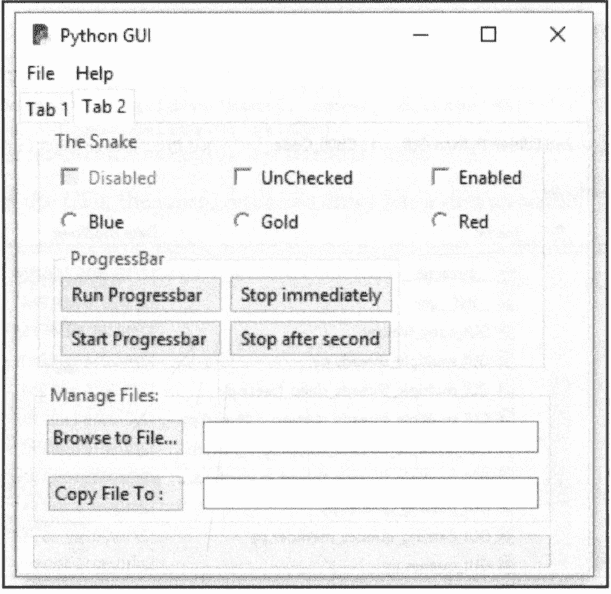

点击 **Browse to File...** 按钮目前会打印到控制台：

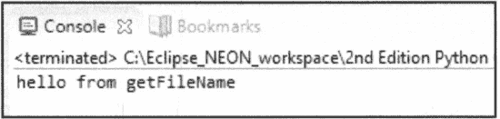

我们可以使用 tkinter 的内置文件对话框，因此让我们在 Python GUI 模块顶部添加以下 `import` 语句：

```python
from tkinter import filedialog as fd
from os import path
```

我们现在可以在代码中使用对话框。不要硬编码路径，我们可以使用 Python 的 `os` 模块找到我们的 GUI 模块所在的完整路径：

```python
def getFileName():
    print('hello from getFileName')
```

我们可以将默认值填入 Entry 小部件。在我们的 Tab 1 中，这非常简单。我们只需在 Entry 小部件的创建中添加以下两行代码即可：

```python
# Adding a Textbox Entry widget
self.name = tk.StringVar()
self.name_entered = ttk.Entry(mighty, width=24, textvariable=self.name)
self.name_entered.grid(column=0, row=1, sticky='W')
self.name_entered.delete(0, tk.END)
self.name_entered.insert(0, '< default name >')
```

现在运行 GUI 时，name_entered 输入框将具有默认值：

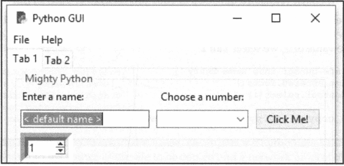

我们可以使用以下 Python 语法获取我们正在使用的模块的完整路径，然后在该路径下创建一个新的子文件夹。我们可以将其作为模块级全局变量，也可以将其在方法内创建：

```python
# Module level GLOBALS
GLOBAL_CONST = 42
fDir = path.dirname(__file__)
netDir = fDir + 'Backup'

def __init__(self):
    self.createWidgets()
    self.defaultFileEntries()

def defaultFileEntries(self):
    self.fileEntry.delete(0, tk.END)
    self.fileEntry.insert(0, fDir)
    if len(fDir) > self.entryLen:
        self.fileEntry.config(width=len(fDir) + 3)
        self.fileEntry.config(state='readonly')
```


```
self.netwEntry.delete(0, tk.END)
self.netwEntry.insert(0, netDir)
if len(netDir) > self.entryLen:
    self.netwEntry.config(width=len(netDir) + 3)
```

我们为两个 Entry 控件设置了默认值，设置完成后，将本地文件 Entry 控件设为只读。

这个顺序很重要。我们必须先填充条目，然后再将其设为只读。

我们还在调用主事件循环之前选择 Tab 2，并且不再将焦点设置到 Tab 1 的 Entry 中。在 tkinter 笔记本上调用 select 是从零开始的，因此传入值 1 时，我们选择 Tab 2：

```
# Place cursor into name Entry
# name_entered.focus()
tabControl.select(1)
```

运行 GUI_copy_files.py 会得到以下截图：


由于大家并非都在同一个网络上，本示例将以本地硬盘为例来模拟网络。

UNC 路径是一种 **通用命名约定（UNC）**，这意味着通过使用双反斜杠而不是典型的 `C:\`，我们可以访问网络上的服务器。


只需使用 UNC，并将 `C:\` 替换为 `\\<servername>\<folder>`。

此示例可用于将代码备份到备份目录，如果该目录不存在，可以使用 `os.makedirs` 创建它：

```
```python
# Module level GLOBALS
GLOBAL_CONST = 42

from os import makedirs
fDir   = path.dirname(__file__)
netDir = fDir + 'Backup'
if not path.exists(netDir):
    makedirs(netDir, exist_ok = True)
```
```

选择要复制到其他位置的文件后，我们导入 Python 的 shutil 模块。我们需要源文件的完整路径，以及网络或本地目录路径，然后将文件名追加到要复制到的路径中，使用 `shutil.copy`。


Shutil 是 shell 工具的简写形式。

我们还通过消息框向用户反馈复制成功或失败。为此，导入 `messagebox` 并将其别名设为 `msg`。

在接下来的代码中，我们将混合使用两种不同的 import 语句放置方式。在 Python 中，我们拥有其他语言所不具备的灵活性。我们通常将所有 import 语句放在每个 Python 模块的最顶部，以便清楚地知道正在导入哪些模块。同时，一种现代编码方式是将变量的创建放在首次使用它们的函数或方法附近。

在接下来的代码中，我们在 Python 模块的顶部导入消息框，但随后又在函数中导入 shutil 模块。为什么要这样做？这真的可行吗？答案是肯定的，确实可行。我们将这个 import 语句放在函数中，因为这是代码中唯一真正需要该模块的地方。

如果我们从不调用这个方法，那么我们就永远不会导入这个方法所需的模块。从某种意义上说，你可以将这种技术视为惰性初始化设计模式。如果不需要它，我们就不会导入它，直到我们的 Python 代码真正需要它时才导入。这里的想法是，我们的整个代码可能需要，比如说，20 个不同的模块。在运行时，真正需要哪些模块取决于用户的交互。如果我们从不调用 copyFile() 函数，那么就没有必要导入 shutil。

当我们点击调用 copyFile() 函数的按钮时，会在这个函数中导入所需的模块：

```
from tkinter import messagebox as msg
def copyFile():
    import shutil                #import module within function
    src = self.fileEntry.get()
    file = src.split('/')[-1]
    dst = self.netwEntry.get() + '/' + file
    try:
        shutil.copy(src, dst)
        msg.showinfo('Copy File to Network', 'Succes: File copied.')
    except FileNotFoundError as err:
        msg.showerror('Copy File to Network',
            '*** Failed to copy file! ***\n\n' + str(err))
    except Exception as ex:
        msg.showerror('Copy File to Network',
            '*** Failed to copy file! ***\n\n' + str(ex))
```

现在当我们运行 GUI，浏览到一个文件，点击 Copy，文件就会被复制到我们在 Entry 控件中指定的位置：


如果文件不存在，或者我们忘记浏览文件而试图复制整个父文件夹，代码也会让我们知道这一点，因为我们使用了 Python 内置的异常处理能力：


我们新增的 Entry 控件确实扩大了 GUI 的宽度。虽然能够看到整个路径有时是好的，但同时也推动了其他控件，使 GUI 看起来不太好。我们可以通过限制 Entry 控件的 width 参数来解决这个问题：

```
46
47     self.defaultFileEntries()
48
49 def defaultFileEntries(self):
50     self.fileEntry.delete(0, tk.END)
51     self.fileEntry.insert(0, fDir)
52     if len(fDir) > self.entryLen:
53 #       self.fileEntry.config(width=len(fDir) + 3)
54     self.fileEntry.config(width=35)                # limit width to adjust GUI
55     self.fileEntry.config(state='readonly')
56
57     self.netwEntry.delete(0, tk.END)
58     self.netwEntry.insert(0, netDir)
59     if len(netDir) > self.entryLen:
60 #       self.netwEntry.config(width=len(netDir) + 3)
61     self.netwEntry.config(width=35)                # limit width to adjust GUI
62
```

这得到了以下 GUI 尺寸。我们可以在启用的 Entry 控件中按右箭头键到达该控件的末尾：

```
GUI_copy_files_limit.py
```


## 工作原理...

我们使用 Python 的 shell 工具将文件从本地硬盘复制到网络。由于大多数人都没有连接到同一个局域网，我们通过将代码备份到另一个本地文件夹来模拟复制。

我们使用了 tkinter 的一个对话框控件，并且通过使目录路径成为默认值，可以提高复制文件的效率。

## 使用 TCP/IP 通过网络通信

本示例展示如何使用套接字通过 TCP/IP 进行通信。为了实现这一点，我们既需要 IP 地址，也需要端口号。

为了简单起见，并摆脱不断变化的互联网 IP 地址的影响，我们将创建自己的本地 TCP/IP 服务器，并以客户端身份学习如何连接它以及从 TCP/IP 连接读取数据。

我们将使用前面示例中创建的队列，把这种网络功能集成到我们的 GUI 中。

TCP/IP 是传输控制协议/因特网协议的缩写，是一组允许两台或多台计算机进行通信的网络协议。

## 准备工作

我们将创建一个新的 Python 模块作为 TCP 服务器。

## 操作步骤...

在 Python 中实现 TCP 服务器的一种方法是继承 socketserver 模块。我们继承 BaseRequestHandler，然后重写继承来的 handle 方法。只需很少几行 Python 代码，我们就可以实现一个 TCP 服务器：

```
from socketserver import BaseRequestHandler, TCPServer

class RequestHandler(BaseRequestHandler):
    # override base class handle method
    def handle(self):
        print('Server connected to: ', self.client_address)
        while True:
            rsp = self.request.recv(512)
            if not rsp: break
            self.request.send(b'Server received: ' + rsp)

def start_server():
    server = TCPServer(('', 24000), RequestHandler)
    server.serve_forever()
```

我们将 RequestHandler 类传递给 TCPServer 初始化器。空单引号是传入 localhost（即我们自己的电脑）的快捷方式，也就是 IP 地址 127.0.0.1。元组中的第二项是端口号。我们可以选择本地电脑上未被使用的任意端口号。

我们只需确保 TCP 连接客户端使用相同的端口，否则将无法连接到服务器。当然，我们必须先启动服务器，然后客户端才能连接它。

我们将修改 Queues.py 模块以使其成为 TCP 客户端：

```
# using TCP/IP
from socket import socket, AF_INET, SOCK_STREAM

def write_to_scrol(inst):
    print('hi from Queue', inst)
    sock = socket(AF_INET, SOCK_STREAM)
    sock.connect(('localhost', 24000))
    for idx in range(10):
        sock.send(b'Message from a queue: ' +
                  bytes(str(idx).encode()) )
        recv = sock.recv(8192).decode()
        inst.gui_queue.put(recv)
    inst.create_thread(6)
```

现在，当我们点击 “Click Me!” 按钮时，我们调用 bq.write_to_scrol(self)，这将创建前面展示的套接字和连接。

这就是我们与 TCP 服务器通信所需的全部代码。在这个示例中，我们只是向服务器发送一些字节，服务器会将它们发送回来，并在返回响应之前预先附加一些字符串。


这展示了 TCP 通过网络通信的工作原理。

一旦我们知道如何通过 TCP/IP 连接到远程服务器，就可以使用我们想要通信的程序的协议所设计的任何命令。第一步是先连接，然后才能向驻留在服务器上的特定应用程序发送命令。


在 `write_to_scrol` 函数中，我们将使用与之前相同的循环，但现在会将消息发送到 TCP 服务器。服务器修改收到的消息，然后将其发送回给我们。接着我们把它放入 GUI 成员队列中，与之前的菜谱一样，该队列在自己的线程中运行：

```python
sock.send(b'Message from a queue: ' + bytes(str(idx).encode()) )
```

注意字符串前面的 `b`，然后是所有其余必需的强制转换。

我们在 OOP 类的初始化器中，于其自身的线程中启动 TCP 服务器：

```python
class OOP():
    def __init__(self):
        # Start TCP/IP server in its own thread
        svrT = Thread(target=startServer, daemon=True)
        svrT.start()
```

在 Python 3 中，我们必须以二进制格式通过套接字发送字符串。现在加入整数索引变得有点绕，因为我们必须先将它转换为字符串、编码，再将编码后的字符串转换为字节！

现在，点击“标签页 1”上的“Click Me!”按钮，会在我们的 `ScrolledText` 控件以及控制台中产生以下输出，而且由于使用了线程，响应非常快：

GUI_TCP_IP.py


#### 工作原理……

我们创建了一个 TCP 服务器，用于模拟连接局域网或互联网中的服务器。我们将队列模块变成了一个 TCP 客户端。我们在各自的后台线程中运行队列和服务器，这使我们的 GUI 保持高度响应。

### 使用 urlopen 从网站读取数据

本菜谱展示了如何仅使用 Python 的内置模块轻松读取整个网页。我们先以原始格式显示网页数据，然后对其解码，最后再显示到 GUI 中。

#### 准备工作

我们将从网页读取数据，然后将其显示在 GUI 的 `ScrolledText` 控件中。

#### 操作步骤……

首先，我们创建一个新的 Python 模块，命名为 `URL.py`。然后导入使用 Python 读取网页所需的功能。只需几行代码即可完成。

我们将代码包裹在类似 Java 和 C# 的 `try...except` 块中。这是 Python 支持的现代编程方法。每当我们有可能会执行不完整的代码时，都可以尝试运行这段代码；如果它正常工作，那就没问题。如果 `try...except` 块中的代码不能正常工作，Python 解释器就会抛出若干可能的异常之一，我们可以将其捕获。捕获到异常后，我们就能决定下一步怎么做。

Python 中的异常存在层级结构，我们也可以创建自己的类，从 Python 的异常类继承并加以扩展。在下面的代码中，我们主要关心的是要打开的 URL 可能不可用，因此我们将代码包裹在 `try...except` 代码块中。如果代码成功打开了请求的 URL，一切正常。如果失败（也许是因为我们的网络连接中断了），就会进入代码的异常分支，并打印出发生了异常的信息：

```python
from urllib.request import urlopen
link = 'http://python.org/'

try:
    http_rsp = urlopen(link)
    print(http_rsp)
    html = http_rsp.read()
    print(html)
    html_decoded = html.decode()
    print(html_decoded)
except Exception as ex:
    print('*** Failed to get Html! ***\n\n' + str(ex))
else:
    return html_decoded
```

你可以在 https://docs.python.org/3.6/library/exceptions.html 上阅读更多关于 Python 异常处理的内容。

通过在 Python 官方网站上调用 `urlopen`，我们会获得完整数据，它就像一个很长的字符串。第一个 `print` 语句将这个长字符串打印到控制台。

然后我们对结果调用 `decode`，这次会得到 1,000 多行网页数据，其中包含一些空白符。

我们还会打印出调用 `urlopen` 的类型，它是一个 `http.client.HTTPResponse` 对象。实际上，我们先打印了它：


这就是我们刚刚读取的 Python 官方网页。如果你是一名 Web 开发者，你大概对如何处理这些解析后的数据有一些好主意：


然后我们将这些数据显示在 GUI 的 `ScrolledText` 控件中。为此，我们必须将新模块（负责从网页读取数据）连接到我们的 GUI。

要做到这一点，我们需要一个指向 GUI 的引用，一种方法是将新模块绑定到**标签页 1** 的按钮回调函数。我们可以将 Python 网页解码后的 HTML 数据返回给 `Button` 控件，然后将其放入 `ScrolledText` 控件中。

那么，让我们把代码变成一个函数，并将数据返回给调用方：

```python
from urllib.request import urlopen
link = 'http://python.org/'

def get_html():
    try:
        http_rsp = urlopen(link)
        print(http_rsp)
        html = http_rsp.read()
        print(html)
        html_decoded = html.decode()
        print(html_decoded)
    except Exception as ex:
        print('*** Failed to get Html! ***\n\n' + str(ex))
    else:
        return html_decoded
```

现在，我们可以先导入新模块，然后将数据插入控件，从而将按钮回调方法中的数据写入 `ScrolledText` 控件。在调用 `write_to_scrol` 之后，我们还让程序稍作休眠：

```python
import Ch06_Code.URL as url

# Button callback
def click_me(self):
    self.action.configure(text='Hello ' + self.name.get())
    bq.write_to_scrol(self)
    sleep(2)
    html_data = url.get_html()
    print(html_data)
    self.scrol.insert(tk.INSERT, html_data)
```

HTML 数据现在显示在我们的 GUI 控件中：

GUI_URL.py


#### 工作原理……

我们创建了一个新模块，将从网页获取数据的代码与 GUI 代码分离开来。这始终是一个好做法。我们读取网页数据，解码后再返回给调用代码。然后使用按钮回调函数将返回的数据放入 `ScrolledText` 控件中。

本章介绍了 Python 的一些高级编程概念，我们将它们结合起来，生成了一个功能完整的 GUI 程序。
