## 7 通过 GUI 将数据存储到 MySQL 数据库

在本章中，我们将通过连接 MySQL 数据库来增强 Python GUI。我们将涵盖以下菜谱：

- 从 Python 安装并连接到 MySQL 服务器
- 配置 MySQL 数据库连接
- 设计 Python GUI 数据库
- 使用 SQL INSERT 命令
- 使用 SQL UPDATE 命令
- 使用 SQL DELETE 命令
- 在我们的 MySQL 数据库中存储和检索数据
- 使用 MySQL Workbench

### 简介

在连接到 MySQL 服务器之前，我们必须能够访问一台 MySQL 服务器。


本章的第一个菜谱将向你展示如何安装免费的 MySQL Server Community Edition。

在成功连接到正在运行的 MySQL 服务器实例之后，我们将设计并创建一个数据库，用于存放书名（也可以是我们自己的日记，或是从互联网上某处找到的名言）。我们会要求提供书中的页码（可以为空），然后使用基于 Python 3.6 及以上版本构建的 GUI，将我们喜欢的名言（来自书籍、期刊、网站或朋友）`insert` 到 MySQL 数据库中。

我们将使用 Python GUI 来发出这些 SQL 命令并显示数据，从而插入、修改、删除和显示我们喜欢的名言。


**CRUD** 是一个你可能遇到的数据库术语，它缩写自四种基本的 SQL 命令，代表 **Create（创建）、Read（读取）、Update（更新）和 Delete（删除）**。

以下是本章所用 Python 模块的概览：

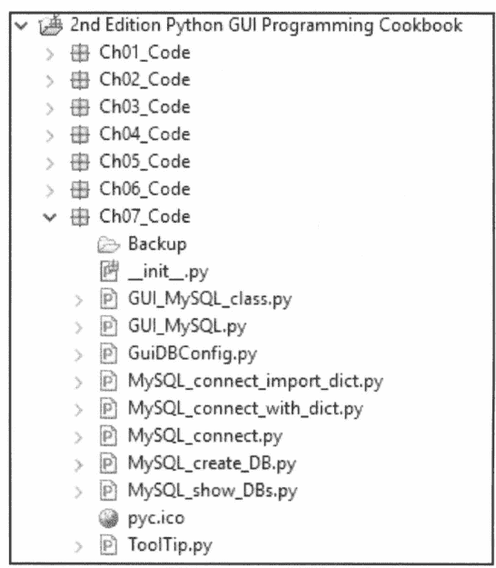

### 从 Python 安装并连接到 MySQL 服务器

在连接到 MySQL 数据库之前，我们必须先连接到 MySQL 服务器。为此，我们需要知道 MySQL 服务器的 IP 地址以及它监听的端口。

我们还必须注册为具有密码的用户，才能通过 MySQL 服务器的身份验证。

#### 准备工作

你需要能够访问正在运行的 MySQL 服务器实例，并且还需要具有管理员权限才能创建数据库和数据表。

MySQL 官方网站提供了免费的 MySQL Community Edition。你可以从 http://dev.mysql.com/downloads/windows/installer/5.7.html 下载并安装到本地电脑上：


## 通过 GUI 在我们的 MySQL 数据库中存储数据

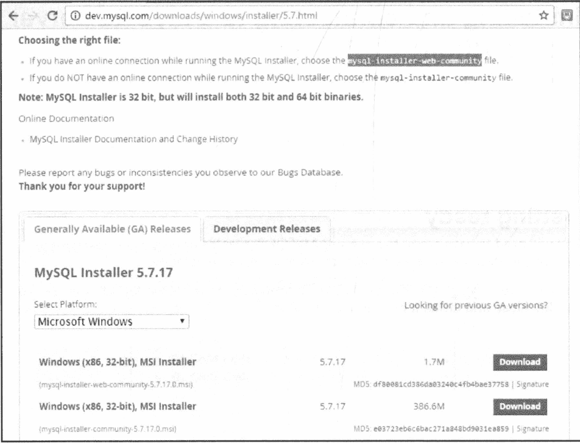

在安装过程中，您将为 Root 用户选择一个密码，并且还可以添加更多用户。我建议您将自己添加为 **DB Admin** 并同样选择一个密码：

## 账号和角色

## Root 账号密码

输入 root 账号的密码。请务必将此密码保存在安全的地方。

MySQL Root Password:

Repeat Password:

Password Strength: Weak

## MySQL 用户账号

为您的用户和应用程序创建 MySQL 用户账号。为用户分配一个由一组权限组成的角色。

| MySQL Username | Host | User Role |
| Burkhard | % | DB Admin |

Add User

Edit User

Delete


在本章中，我们使用的是最新的 MySQL Community Server Release 5.7.17。

验证我们是否安装了正确的驱动程序并且它能让 Python 与 MySQL 通信的一种方法，是查看 Python `site-packages` 目录。如果您的 `site-packages` 目录中出现了新的 `MySQLdb` 文件夹以及一些其他 `_mysql` 模块，则安装成功：

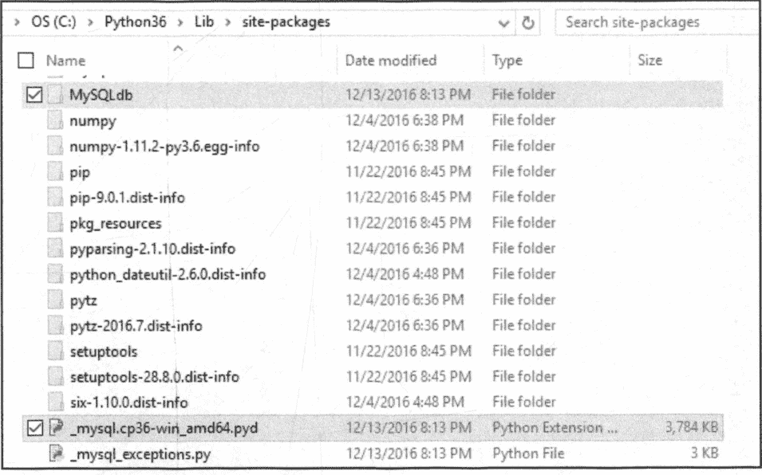

## 通过 GUI 在我们的 MySQL 数据库中存储数据

首先，让我们通过使用 *MySQL Command Line Client* 来验证我们的 MySQL 服务器安装是否正常工作。在 `mysql>` 提示符下，输入 `SHOW DATABASES;` 然后按 *Enter*：

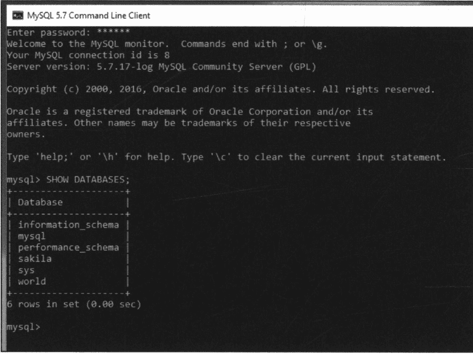

接下来，我们将验证是否可以使用 Python 3.6 实现相同的结果：

> 将占位符带括号的名称 `<adminUser>` 和 `<adminPwd>` 替换为您在 MySQL 安装中实际使用的凭据。

```
```python
import MySQLdb as mysql
conn = mysql.connect(user=<adminUser>, password=<adminPwd>,
host='127.0.0.1')
print(conn)
conn.close()
```
```

如果运行上述代码导致以下输出打印到控制台，则我们就没问题了：

```
MySQL_connect.py

<terminated> C:\Eclipse_NEON_workspace\2nd Edition Python GUI Programming Cookbook\Ch07_Code\MySQL_connect.py
<_mysql.connection open to '127.0.0.1' at 605769b8>
```

如果您无法通过 *Command Line Client* 或 Python *mysqlclient* 连接到 MySQL 服务器，则安装过程中可能出了问题。如果是这种情况，请尝试卸载、重新启动您的 PC，然后再次运行安装。

## How it works...

为了将我们的 GUI 连接到 MySQL 服务器，如果我们想创建自己的数据库，就需要能够使用管理员权限连接到服务器。如果数据库已存在，则我们只需要连接、插入、更新和删除数据的授权权限即可。我们将在下一个配方中在 MySQL 服务器上创建一个新数据库。

## 配置 MySQL 数据库连接

在之前的配方中，我们通过将用于身份验证的凭据硬编码到 `connection` 方法中使用了连接 MySQL 服务器的最简便方式。虽然这对于早期开发来说是一种快速的方法，但我们绝对不想让任何人看到我们的 MySQL 服务器凭据。相反，我们 *grant* 权限让特定用户访问数据库、表、视图和相关的数据库命令。

一种更安全的方式来让 MySQL 服务器进行身份验证是将凭据存储在配置文件中，这就是我们在本配方中要做的事情。我们将使用配置文件连接到 MySQL 服务器，然后在 MySQL 服务器上创建自己的数据库。


我们将在以下所有配方中使用此数据库。

## Getting ready

运行本配方中显示的代码需要访问具有管理员权限的正在运行的 MySQL 服务器。


> 上一个配方展示了如何安装免费的 MySQL Server Community Edition。管理员权限将使您能够实现本配方。

## How to do it…

首先，我们在 GUI_MySQL_class.py 代码的同一模块中创建一个字典：

```
```python
# create dictionary to hold connection info
dbConfig = {
    'user': <adminName>,       # use your admin name
    'password': <adminPwd>,    # not the real password
    'host': '127.0.0.1',       # IP address of localhost
}
```
```

接下来，在连接方法中，我们解包字典值。看一下以下代码片段：

```
```python
mysql.connect('user': <adminName>, 'password': <adminPwd>, 'host':
'127.0.0.1')
```
```

与其使用上述片段，我们使用 (**dbConfig)，它实现了与上述相同的功能，但要短得多：

```
```python
import MySQLdb as mysql
# unpack dictionary credentials
conn = mysql.connect(**dbConfig)
print(conn)
```
```

这会产生对 MySQL 服务器的相同成功连接，但区别在于连接方法不再暴露任何关键任务信息：

数据库服务器对您的任务至关重要。一旦您丢失了宝贵的数据...并且找不到任何最近的备份，您就会意识到这一点！

MySQL_connect_with_dict.py

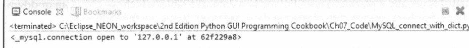

现在，将相同的用户名、密码、数据库等放入同一 Python 模块中的字典并不能消除任何浏览代码的人看到凭据的风险。

为了提高数据库安全性，我们首先将字典移至其自己的 Python 模块。让我们将新的 Python 模块命名为 GuiDBConfig.py。

然后我们导入此模块并像之前一样解包凭据：

```
import GuiDBConfig as guiConf
# unpack dictionary credentials
conn = mysql.connect(**guiConf.dbConfig)
print(conn)
```

一旦我们将此模块放置在与代码其余部分分离的安全位置，我们就为我们的 MySQL 数据实现了更好的安全级别。

现在我们知道如何连接到 MySQL 并且拥有管理员权限，我们可以通过发出以下命令来创建自己的数据库：

```
GUIDB = 'GuiDB'

# unpack dictionary credentials
conn = mysql.connect(**guiConf.dbConfig)

cursor = conn.cursor()

try:
    cursor.execute("CREATE DATABASE {}
                    DEFAULT CHARACTER SET 'utf8'".format(GUIDB))
```

```
except mysql.Error as err:
    print("Failed to create DB: {}".format(err))

conn.close()
```

为了执行对 MySQL 的命令，我们从连接对象创建一个游标对象。

游标通常是数据库表中特定行的位置，我们可以在表中上下移动它，但在这里，我们用它来创建数据库本身。我们将 Python 代码包装在 try...except 块中，并使用 MySQL 的内置错误代码来告诉我们是否出现任何问题。

我们可以通过执行创建数据库的代码两次来验证此块是否有效。第一次，它将在 MySQL 中创建一个新数据库，第二次，它将打印出一条错误消息，指出该数据库已存在：

MySQL_create_DB.py

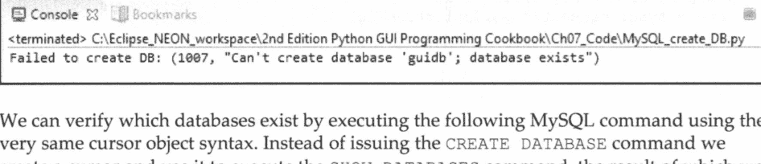

我们可以通过使用完全相同的游标对象语法执行以下 MySQL 命令来验证哪些数据库存在。与发出 CREATE DATABASE 命令不同，我们创建一个游标并使用它执行 SHOW DATABASES 命令，其结果我们获取并打印到控制台输出：

```
import MySQLdb as mysql
import GuiDBConfig as guiConf

# unpack dictionary credentials
conn = mysql.connect(**guiConf.dbConfig)

cursor = conn.cursor()

cursor.execute("SHOW DATABASES")
print(cursor.fetchall())

conn.close()
```

我们通过在游标对象上调用 `fetchall` 方法来检索结果。

运行此代码会显示我们 MySQL 服务器实例中当前存在的数据库。正如输出所示，MySQL 附带了多个内置数据库，例如 `information_schema` 等。我们已成功创建了自己的 `guidb` 数据库，这在输出中显示。所有其他数据库都是随 MySQL 一起提供的：

```
MySQL_show_DBS.py
```

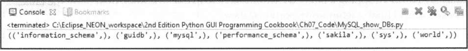

请注意，即使我们在创建时以混合大小写字母 GuiDB 指定了数据库，`SHOW DATABASES` 命令也会以小写显示 MySQL 中所有现有数据库，并将我们的数据库显示为 `guidb`。

## How it works…

为了将我们的 Python GUI 连接到 MySQL 数据库，我们首先必须知道如何连接到 MySQL 服务器。这需要建立连接，而此连接只有在我们能够提供所需凭据时才会被 MySQL 接受。

虽然将字符串放入一行 Python 代码很容易，但当我们处理数据库时，我们必须非常谨慎，因为今天的个人沙盒开发环境明天就可能在万维网上变得可访问。

您不想损害数据库安全性，本配方的第一部分展示了更安全的方法，即将 MySQL 服务器的连接凭据放入单独的文件中，并且通过将此文件放置在无法从外部世界访问的位置，我们的数据库系统将变得更安全。

在真实的生产环境中，MySQL 服务器安装、连接凭据和此 `dbConfig` 文件将由 IT 系统管理员处理，他们将使您能够导入 `dbConfig` 文件以连接到 MySQL 服务器，而无需您知道实际凭据是什么。解包 `dbConfig` 不会像我们的代码中那样暴露凭据。


The second part created our own database in a MySQL server instance, and we will extend and use this database in the following recipes, combining it with our Python GUI.

## Designing the Python GUI database

Before we start creating tables and inserting data into them, we have to design the database. Unlike changing local Python variable names, changing a database schema once it has been created and loaded with data is not that easy.

We would have to DROP the table, which means we would lose all the data that was in the table. So, before dropping a table, we would have to extract the data, then DROP the table, recreate it, and finally reimport the original data.

You get the picture...

Designing our GUI MySQL database means first thinking about what we want our Python application to do with it and then choosing names for our tables that match the intended purpose.

## Getting ready

We are working with the MySQL database we created in the previous recipe, Configuring the MySQL database connection. A running instance of MySQL is necessary and the two previous recipes show how to install MySQL, all necessary additional drivers, as well as how to create the database we are using in this chapter.

## How to do it...

First, we move the widgets from our Python GUI around between the two tabs we created in the previous recipes in order to organize our Python GUI better to connect to a MySQL database.

We rename several widgets and separate the code that accesses the MySQL data to what used to be named Tab 1, and we will move unrelated widgets to what we called Tab 2 in earlier recipes. We also adjust some internal Python variable names in order to understand our code better.

> Code readability is a coding virtue and not a waste of time.

Our refactored Python GUI now looks like the following screenshot. We have renamed the first tab as **MySQL** and created two tkinter `LabelFrame` widgets. We labeled the one on the top Python database and it contains two labels and six tkinter entry widgets plus three buttons, which we aligned in four rows and three columns using the tkinter grid layout manager. We will enter book titles and pages into the entry widgets, and clicking the buttons will result in either inserting, retrieving, or modifying book quotations. The `LabelFrame` at the bottom has a label of **Book Quotation** and the `ScrolledText` widget that is part of this frame will display our books and quotations:

```
GUI_MySQL.py
```

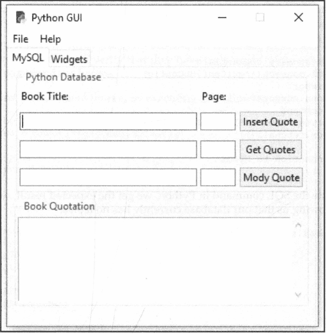

We will create two SQL tables to hold our data. The first will hold the data for the book title and book page, and then, we will join with the second table, which will hold the book quotation. We will link the two tables together via primary to foreign key relations.

So, let's create the first database table now. Before we do that, let's verify first that our database does, indeed, have no tables. According to the online MySQL documentation, the command to view the tables that exist in a database is as follows:


### 14.7.5.37 SHOW TABLES Syntax

```
SHOW [FULL] TABLES [{FROM | IN} db_name]
[LIKE 'pattern' | WHERE expr]
```

It is important to note that, in the preceding syntax, arguments in square brackets, such as FULL, are optional while arguments in curly braces, such as FROM, are required for the SHOW TABLES command. The pipe symbol between FROM and IN means that the MySQL syntax requires one or the other:

```
# unpack dictionary credentials
conn = mysql.connect(**guiConf.dbConfig)
# create cursor
cursor = conn.cursor()
# execute command
cursor.execute("SHOW TABLES FROM guidb")
print(cursor.fetchall())

# close connection to MySQL
conn.close()
```

When we execute the SQL command in Python, we get the expected result, which is an empty tuple showing us that our database currently has no tables:

```
GUI_MySQL_class.py
```

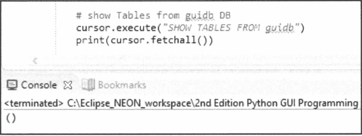

We can also first select the database by executing the `USE <DB>` command, and then we don't have to pass it into the `SHOW TABLES` command because we have already selected the database we want to talk to. The following code creates the same true result as the previous one:

```python
cursor.execute("USE guidb")
cursor.execute("SHOW TABLES")
```

Now that we know how to verify that our database has no tables, let's create some. After we have created two tables, we will verify that they have truly made it into our database by using the same commands as before.

We create the first table, named *Books*, by executing the following code:

```python
# connect by unpacking dictionary credentials
conn = mysql.connect(**guiConf.dbConfig)

# create cursor
cursor = conn.cursor()

# select DB
cursor.execute("USE guidb")

# create Table inside DB
cursor.execute("CREATE TABLE Books (
        Book_ID INT NOT NULL AUTO_INCREMENT,
        Book_Title VARCHAR(25) NOT NULL,
        Book_Page INT NOT NULL,
        PRIMARY KEY (Book_ID)
    ) ENGINE=InnoDB")

# close connection to MySQL
conn.close()
```

We can verify that the table has been created in our database by executing the following commands:

GUI_MySQL_class.py

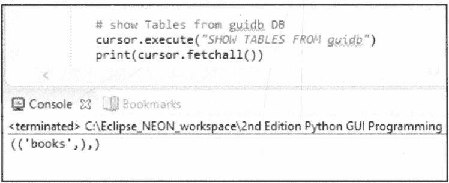

Now the result is no longer an empty tuple but a tuple that contains a tuple, showing the books table we just created.

We can use the MySQL command-line client to see the columns in our table. In order to do this, we have to log in as the root user. We also have to append a semicolon to the end of the command.

On Windows, you simply double-click the MySQL command-line client shortcut, which is automatically installed during the MySQL installation.

If you don’t have a shortcut on your desktop, you can find the executable at the following path for a typical default installation:

```
C:\Program Files\MySQL\MySQL Server 5.7\bin\mysql.exe
```

Without a shortcut to run the MySQL client, you have to pass it some parameters:

- C:\Program Files\MySQL\MySQL Server 5.7\bin\mysql.exe
- -u root
- -p

Either double-clicking the shortcut or using the command line with the full path to the executable and passing in the required parameters, will bring up the MySQL command-line client, which prompts you to enter the password for the root user:

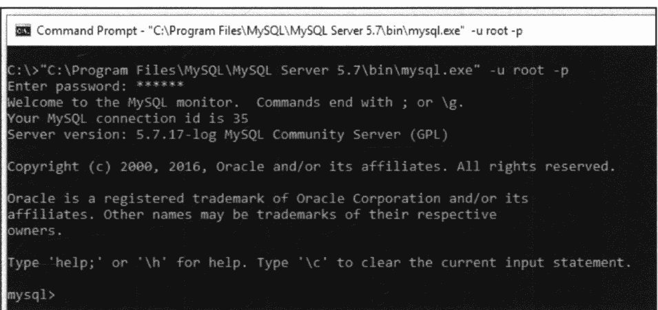

If you remember the password you assigned to the root user during the installation, you can then run the SHOW COLUMNS FROM books; command, as shown in the following screenshot. This will display the columns of our books table from our guidb:

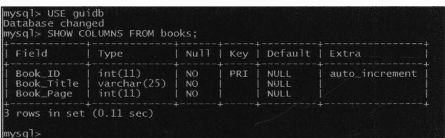

When executing commands in the MySQL client, the syntax is not Pythonic.

Next, we will create the second table, which will store the book and journal quotations. We will create it by executing the following code:

```
# select DB
cursor.execute("USE guidb")

# create second Table inside DB
cursor.execute("CREATE TABLE Quotations (
    Quote_ID INT,
    Quotation VARCHAR(250),
    Books_Book_ID INT,
    FOREIGN KEY (Books_Book_ID)
        REFERENCES Books(Book_ID)
        ON DELETE CASCADE
) ENGINE=InnoDB")
```

Executing the SHOW TABLES command now shows that our database has two tables:

GUI_MySQL_class.py

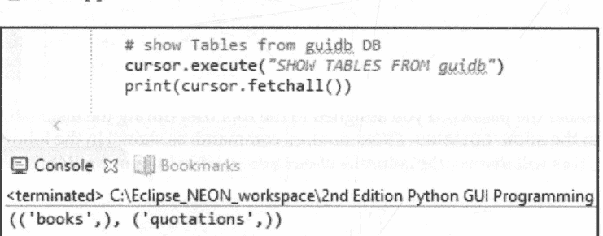

We can see the columns by executing the SQL command using Python:

GUI_MySQL_class.py

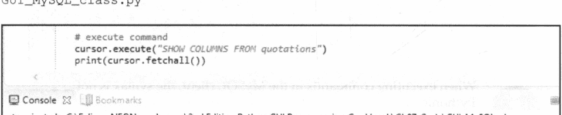

Using the MySQL client might present the data in a better format. We could also use Python's pretty print (`pprint`) feature:

GUI_MySQL_class.py
```python
from pprint import pprint
# execute command
cursor.execute("SHOW COLUMNS FROM quotations")
pprint(cursor.fetchall())

<terminated> C:\Eclipse_NEON_workspace\2nd Edition Python GUI Programming Cookbook
(('Quote_ID', 'int(11)', 'NO', 'PRI', None, 'auto_increment'),
 ('Quotation', 'varchar(250)', 'YES', '', None, ''),
 ('Books_Book_ID', 'int(11)', 'YES', 'MUL', None, ''))
```

The MySQL client still shows our columns in a clearer format, which can be seen when you run this client.

## How it works…

We designed our Python GUI database and refactored our GUI in preparation to use our new database. We then created a MySQL database and created two tables within it.

We verified that the tables made it into our database by using both Python and the MySQL client that ships with the MySQL server.

In the next recipe, we will insert data into our tables.

## Using the SQL INSERT command

This recipe presents the entire Python code that shows you how to create and drop MySQL databases and tables as well as how to display the existing databases, tables, columns, and data of our MySQL instance.

After creating the database and tables, we will insert data into the two tables we are creating in this recipe.


我们使用主外键关系来连接这两个表的数据。

我们将在接下来的两个菜谱中详细介绍其工作原理，在那里我们将修改和删除 MySQL 数据库中的数据。

## 准备工作

本菜谱基于上一菜谱 *Designing the Python GUI database* 中创建的 MySQL 数据库，并向你展示如何删除并重新创建 GuiDB。

删除数据库当然会删除数据库表中所有的数据，因此我们也会向你展示如何重新插入这些数据。

## 如何操作...

我们 `GUI_MySQL_class.py` 模块的完整代码位于本章的代码文件夹中，可从 https://github.com/PacktPublishing/Python-GUI-Programming-Cookbook-Second-Edition 下载。它创建数据库，向其中添加表，然后向我们创建的两个表中插入数据。

这里，我们将概述代码而不展示所有实现细节以节省篇幅，因为展示完整代码需要太多页数：

```
import MySQLdb as mysql
import Ch07_Code.GuiDBConfig as guiConf

class MySQL():
    # class variable
    GUIDB = 'GuiDB'
    #------------------------------------------------------------
    def connect(self):
        # connect by unpacking dictionary credentials
        conn = mysql.connector.connect(**guiConf.dbConfig)
        # create cursor
        cursor = conn.cursor()
        return conn, cursor
    #------------------------------------------------------------
```

```
def close(self, cursor, conn):
    # close cursor
#-------------------------------------------------------------------------------
def showDBs(self):
    # connect to MySQL
#-------------------------------------------------------------------------------
def createGuiDB(self):
    # connect to MySQL
#-------------------------------------------------------------------------------
def dropGuiDB(self):
    # connect to MySQL
#-------------------------------------------------------------------------------
def useGuiDB(self, cursor):
    '''Expects open connection.'''
    # select DB
#-------------------------------------------------------------------------------
def createTables(self):
    # connect to MySQL
    # create Table inside DB
#-------------------------------------------------------------------------------
def dropTables(self):
    # connect to MySQL
#-------------------------------------------------------------------------------
def showTables(self):
    # connect to MySQL
#-------------------------------------------------------------------------------
def insertBooks(self, title, page, bookQuote):
    # connect to MySQL
    # insert data
#-------------------------------------------------------------------------------
def insertBooksExample(self):
    # connect to MySQL
    # insert hard-coded data
#-------------------------------------------------------------------------------
def showBooks(self):
    # connect to MySQL
#-------------------------------------------------------------------------------
def showColumns(self):
    # connect to MySQL
#-------------------------------------------------------------------------------
def showData(self):
    # connect to MySQL
#-------------------------------------------------------------------------------
if __name__ == '__main__':
    # Create class instance
    mySQL = MySQL()
```

运行上述代码会在我们创建的数据库中创建以下表和数据：

```
mysql> USE guidb
Database changed
mysql> SELECT * FROM books;
+---------+----------------------------------+----------+
| Book_ID | Book_Title                       | Book_Page |
+---------+----------------------------------+----------+
|       1 | Design Patterns                  |        7 |
|       2 | xUnit Test Patterns              |       31 |
+---------+----------------------------------+----------+
2 rows in set (0.10 sec)

mysql> SELECT * FROM quotations;
+----------+-----------------------------------------------+---------------+
| Quote_ID | Quotation                                     | Books_Book_ID |
+----------+-----------------------------------------------+---------------+
|        1 | Programming to an Interface, not an Implementation |             1 |
|        2 | Philosophy of Test Automation                 |             2 |
+----------+-----------------------------------------------+---------------+
2 rows in set (0.00 sec)

mysql>
```

## 工作原理...

我们创建了一个 MySQL 数据库，连接到它，然后创建了两个表来保存最喜欢的书籍或期刊引用的数据。

我们将数据分布在两个表之间，因为引文往往比较大，而书籍标题和书籍页码则非常短。通过这样做，我们可以提高数据库的效率。

在 SQL 数据库语言中，将数据分离到不同的表中称为规范化。

## 使用 SQL UPDATE 命令

本菜谱将使用上一菜谱 Using the SQL INSERT command 中的代码，详细解释它，然后扩展代码以更新我们的数据。

## 准备工作

本菜谱基于上一菜谱 Using the SQL INSERT command，因此请阅读并研究上一菜谱，以便跟随本菜谱中的编码，在这里我们修改现有数据。

## 如何操作...

首先，我们将通过运行以下 Python 到 MySQL 命令来显示要修改的数据：

```
import MySQLdb as mysql
import Ch07_Code.GuiDBConfig as guiConf

class MySQL():
    # class variable
    GUIDB = 'GuiDB'
    #------------------------------------------------------------
def showData(self):
    # connect to MySQL
    conn, cursor = self.connect()

    self.useGuiDB(cursor)

    # execute command
    cursor.execute("SELECT * FROM books")
    print(cursor.fetchall())

    cursor.execute("SELECT * FROM quotations")
    print(cursor.fetchall())

    # close cursor and connection
    self.close(cursor, conn)
#================================================================
if __name__ == '__main__':
    # Create class instance
    mySQL = MySQL()
    mySQL.showData()
```

运行代码会得到以下结果：

`GUI_MySQL_class.py`

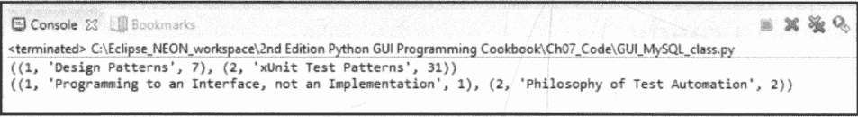

我们可能不同意四人组，所以让我们更改他们著名的编程名言。

> 四人组是四位创建了世界著名书籍 *Design Patterns* 的作者，该书极大地影响了整个软件行业，使其认识、思考和编码时使用软件设计模式。

我们将通过更新我们最喜欢的引文数据库来实现这一点。首先，我们通过搜索书籍标题检索主键值，然后将该值传递到我们对引文的搜索中：

```
```python
#====================================================
def updateGOF(self):
    # connect to MySQL
    conn, cursor = self.connect()

    self.useGuiDB(cursor)

    # execute command
    cursor.execute("SELECT Book_ID FROM books WHERE Book_Title = 'Design Patterns'")
    primKey = cursor.fetchall()[0][0]
    print("Primary key=" + str(primKey))

    cursor.execute("SELECT * FROM quotations WHERE Books_Book_ID = (%s)", (primKey,))
    print(cursor.fetchall())

    # close cursor and connection
    self.close(cursor, conn)
#====================================================
if __name__ == '__main__':
    mySQL = MySQL()        # Create class instance
    mySQL.updateGOF()
```
```

这给我们以下结果：

GUI_MySQL_class.py

```
# execute command
cursor.execute("SELECT Book_ID FROM books WHERE Book_Title = 'Design Patterns'")
primKey = cursor.fetchall()[0][0]
print("Primary key=" + str(primKey))

cursor.execute("SELECT * FROM quotations WHERE Books_Book_ID = (%s)", (primKey,))
print(cursor.fetchall())

<terminated> C:\Eclipse_NEON_workspace\2nd Edition Python GUI Programming Cookbook\Ch07_Code\GUI_MySQL_class.py
Primary key=1
((1, 'Programming to an Interface, not an Implementation', 1),)
```

现在我们知道了引文的主键，我们可以通过执行以下命令来更新引文：

```
#----------------------------------------------------------------
def showDataWithReturn(self):
    # connect to MySQL
    conn, cursor = self.connect()

    self.useGuiDB(cursor)

    # execute command
    cursor.execute("SELECT Book_ID FROM books WHERE Book_Title = 'Design Patterns'")
    primKey = cursor.fetchall()[0][0]
    print(primKey)

    cursor.execute("SELECT * FROM quotations WHERE Books_Book_ID = (%s)", (primKey,))
    print(cursor.fetchall())

    cursor.execute("UPDATE quotations SET Quotation = (%s) WHERE Books_Book_ID = (%s)", ("Pythonic Duck Typing: If it walks like a duck and talks like a duck it probably is a duck...", primKey))

    # commit transaction
    conn.commit()
```


```python
cursor.execute("SELECT * FROM quotations WHERE Books_Book_ID = (%s)", (primKey,))
print(cursor.fetchall())

# close cursor and connection
self.close(cursor, conn)

#==================================================================
if __name__ == '__main__':
    # Create class instance
    mySQL = MySQL()
    #----------------------------
    mySQL.updateGOF()
    book, quote = mySQL.showDataWithReturn()
    print(book, quote)
```

通过运行上述代码，我们使这一编程经典更具Python风格。

如下面的截图所示，在运行上述代码之前，我们Book_ID为1的书名通过与quotations表中Books_Book_ID列中的引文建立的主外键关系而关联。这是《设计模式》一书中的原始引文。

随后我们通过SQL UPDATE命令更新了与此ID相关的引文。

所有ID都没有改变，但与Book_ID 1关联的引文已经改变，如第二个MySQL客户端窗口所示：

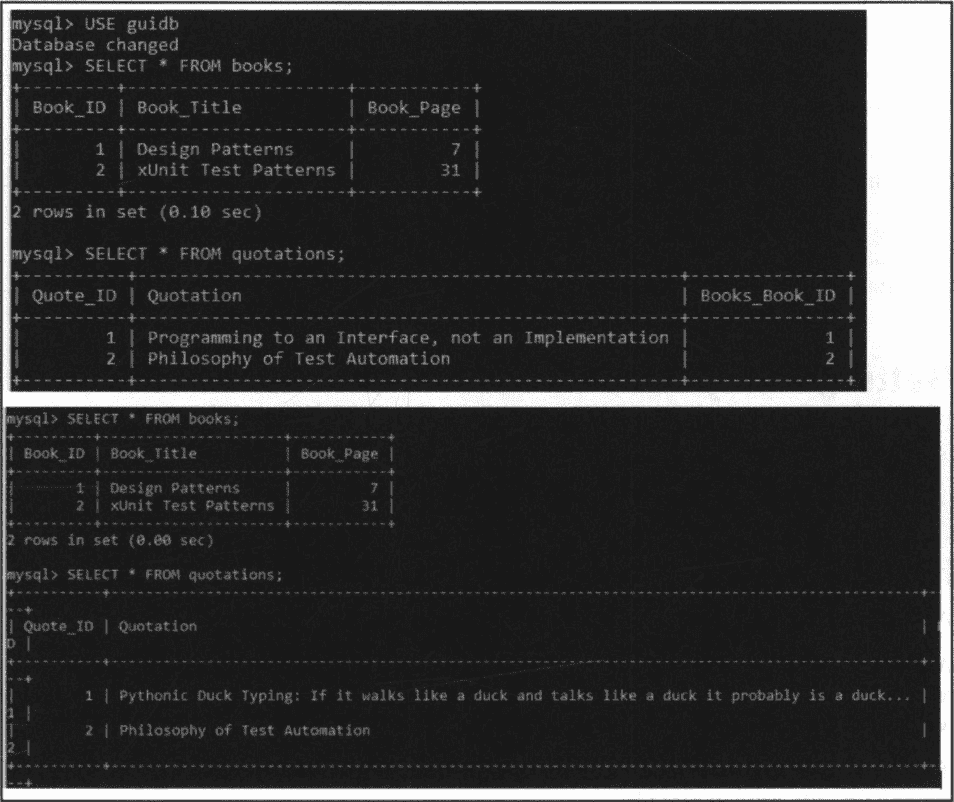

# 它是如何工作的……

在本节中，我们从先前各节创建的数据库和数据库表中检索了现有数据。我们向表中插入了数据，并使用SQL UPDATE命令更新了数据。

# 使用SQL DELETE命令

在本节中，我们将使用SQL DELETE命令删除我们在上一节（*使用SQL UPDATE命令*）中创建的数据。

尽管删除数据乍一听似乎很简单，但一旦我们在生产环境中拥有一个相当大的数据库设计，事情可能就不再那么容易了。

因为我们通过主外键关系关联两个表来设计GUI数据库，所以当我们删除某些数据时，不会产生孤立记录，因为这种数据库设计会自动处理级联删除。

## 准备工作

本节使用上一节（*使用SQL UPDATE命令*）中创建的MySQL数据库、表以及插入到那些表中的数据。为了演示如何创建孤立记录，我们将不得不更改其中一个数据库表的设计。

## 操作步骤

我们仅使用两个数据库表来保持数据库设计的简洁。

虽然这在删除数据时有效，但总有可能最终产生孤立记录。这意味着我们删除了一个表中的数据，却没有删除另一个SQL表中的相关数据。

如果我们创建quotations表时没有与books表建立外键关系，就可能会产生孤立记录：

```sql
# create second Table inside DB ---
# No FOREIGN KEY relation to Books Table
cursor.execute("CREATE TABLE Quotations (
    Quote_ID INT AUTO_INCREMENT,
    Quotation VARCHAR(250),
    Books_Book_ID INT,
    PRIMARY KEY (Quote_ID)
) ENGINE=InnoDB")
```

在向books和quotations表插入数据后，如果我们执行`DELETE`语句，我们只会删除`Book_ID`为1的书，而与之相关的、`Books_Book_ID`为1的引文则会被遗留。

这就是一条*孤立记录*。不再存在`Book_ID`为1的书记录：

```
mysql> SELECT * FROM books;
+---------+----------------------+-----------+
| Book_ID | Book_Title           | Book_Page |
+---------+----------------------+-----------+
|       2 | xUnit Test Patterns  |        31 |
+---------+----------------------+-----------+
1 row in set (0.00 sec)

mysql> SELECT * FROM quotations;
+---------+------------------------------------------+----------------+
| Quote_ID | quotation                                | Books_Book_ID |
+---------+------------------------------------------+----------------+
|       1 | programming to an Interface, not an Implementation |              2 |
|       2 | philosophy of Test Automation             |              2 |
+---------+------------------------------------------+----------------+
2 rows in set (0.00 sec)

mysql>
```

这种情况可能会造成混乱，我们可以通过使用级联删除来避免。

我们在创建表时通过添加某些数据库约束来实现这一点。在上一节创建保存引文的表时，我们创建了带外键约束的`quotations`表，该约束显式引用了books表的主键，从而将两者关联起来：

```
# create second Table inside DB
cursor.execute("CREATE TABLE Quotations (
            Quote_ID INT AUTO_INCREMENT,
            Quotation VARCHAR(250),
            Books_Book_ID INT,
            PRIMARY KEY (Quote_ID),
            FOREIGN KEY (Books_Book_ID)
                REFERENCES Books(Book_ID)
                ON DELETE CASCADE
        ) ENGINE=InnoDB")
```

`FOREIGN KEY`关系包含`ON DELETE CASCADE`属性，它基本上告知MySQL服务器：当此外键所关联的记录被删除时，也删除本表中的相关记录。

如果在创建表时未指定`ON DELETE CASCADE`属性，我们就既无法删除也无法更新数据，因为`UPDATE`本质上是一个`DELETE`后跟一个`INSERT`。

由于这种设计，不会留下任何孤立记录，这正是我们想要的。

在MySQL中，为了使用主外键关系，我们必须在这两个相关表上都指定`ENGINE=InnoDB`。

让我们显示数据库中的数据：

```python
#===============================================
if __name__ == '__main__':
    # Create class instance
    mySQL = MySQL()
    mySQL.showData()
```

这向我们展示了数据库表中的以下数据：

`GUI_MySQL_class.py`

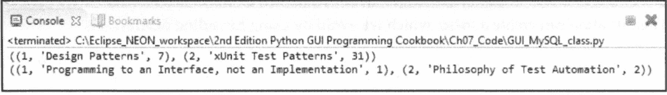

这告诉我们，有两个通过主外键关系关联的记录。

现在，当我们删除books表中的一条记录时，我们期望quotations表中相关的记录也会通过级联删除而被删除。让我们尝试在Python中执行以下SQL命令：

```python
import MySQLdb as mysql
import Ch07_Code.GuiDBConfig as guiConf

class MySQL():
    #===============================================
    def deleteRecord(self):
        # connect to MySQL
        conn, cursor = self.connect()
```

## 它是如何工作的……

在本节中，我们通过主外键关系并配合级联删除来可靠地设计数据库，从而触发了级联删除。

这使我们的数据保持合理且完整。

在下一节中，我们将使用来自Python GUI的`MySQL.py`模块中的代码。

## 存储和检索MySQL数据库中的数据

我们将使用Python GUI将数据插入MySQL数据库表。我们已经重构了先前各节中构建的GUI，为连接和使用数据库做好了准备。

我们将使用两个文本框输入小部件，用于输入书籍或期刊标题和页码。我们还将使用一个`ScrolledText`小部件来输入我们喜爱的书籍引文，然后将它们存储到MySQL数据库中。

## 准备工作

本节将基于我们在先前各节中创建的MySQL数据库和表进行构建。

## 操作步骤

我们将使用Python GUI插入、检索和修改我们喜爱的引文。为此，我们已经重构了GUI的MySQL选项卡：

```text
GUI_MySQL.py
```

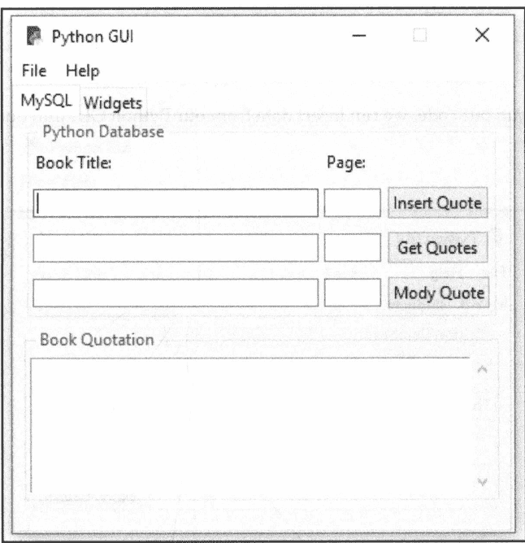

为了让按钮发挥作用，我们将像在先前各节中那样将它们连接到回调函数。我们将在按钮下方的`ScrolledText`小部件中显示数据。

为此，我们将像之前一样导入`MySQL.py`模块。与我们的MySQL服务器实例和数据库通信的全部代码都驻留在该模块中，这体现了面向对象编程精神下的代码封装。

我们将**插入引文**按钮连接到以下回调函数：

```python
# Adding a Button
self.action = ttk.Button(self.mySQL, text="Insert Quote",
                         command=self.insertQuote)
self.action.grid(column=2, row=1)

# Button callback
def insertQuote(self):
    title = self.bookTitle.get()
    page = self.pageNumber.get()
```

```python
quote = self.quote.get(1.0, tk.END)
print(title)
print(quote)
self.mySQL.insertBooks(title, page, quote)
```

当我们现在运行代码时，我们可以将来自 Python GUI 的数据插入到 MySQL 数据库中：

GUI_MySQL.py

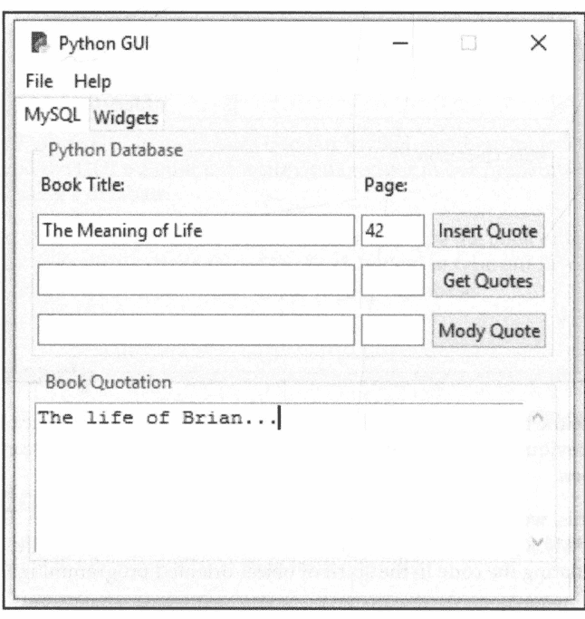

在输入图书标题和图书页码以及书籍或电影中的引文后，我们通过点击 Insert Quote 按钮将数据插入到数据库中。

我们当前的方案允许标题、页码和引文。我们也可以插入我们最喜欢的电影引文。虽然电影没有页码，但我们可以使用 page 列来插入引文在电影中发生的近似时间。

接下来，我们可以通过发出之前使用过的相同命令来验证所有这些数据是否已进入我们的数据库表：

```text
GUI_MySQL.py
```

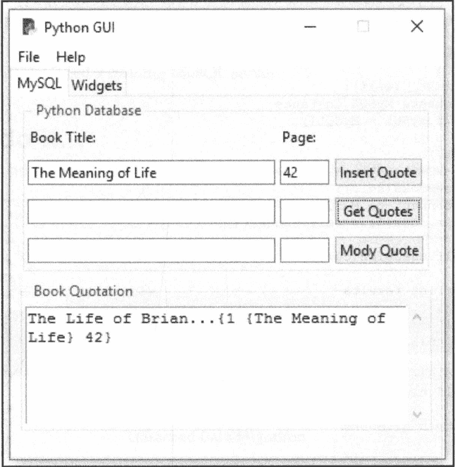

插入数据后，我们可以通过点击 **Get Quotes** 按钮来验证数据是否已进入我们的两个 MySQL 表，该按钮随后会显示我们插入到两个 MySQL 数据库表中的数据，如前面的屏幕截图所示。

点击 **Get Quotes** 按钮会调用我们与按钮点击事件关联的回调方法。这会给我们提供在 `ScrolledText` 部件中显示的数据：

```python
# Adding a Button
self.action1 = ttk.Button(self.mySQL, text="Get Quotes",
                          command=self.getQuote)
self.action1.grid(column=2, row=2)

# Button callback
```

```python
def getQuote(self):
    allBooks = self.mySQL.showBooks()
    print(allBooks)
    self.quote.insert(tk.INSERT, allBooks)
```

我们使用 `self.mySQL` 类实例变量来调用 `showBooks()` 方法，该方法是我们导入的 MySQL 类的一部分：

```python
from Ch07_Code.GUI_MySQL_class import MySQL

class OOP():
    def __init__(self):
        # create MySQL instance
        self.mySQL = MySQL()

class MySQL():
    #------------------------------------------------------------
    def showBooks(self):
        # connect to MySQL
        conn, cursor = self.connect()

        self.useGuiDB(cursor)

        # print results
        cursor.execute("SELECT * FROM Books")
        allBooks = cursor.fetchall()
        print(allBooks)

        # close cursor and connection
        self.close(cursor, conn)

        return allBooks
```

## How it works...

在本教程中，我们导入了我们编写的 Python 模块，其中包含连接到 MySQL 数据库的所有编码逻辑，并知道如何插入、更新和删除数据。

我们现在已将 Python GUI 连接到此 SQL 逻辑。

## Using the MySQL Workbench

MySQL 有一个非常不错的 GUI，我们可以免费下载。它名为 MySQL Workbench。

在本教程中，我们将成功安装此工作台，然后使用它对我们在之前的教程 Configuring the MySQL database connection、Designing the Python GUI database 等中创建的 GuiDB 运行 SQL 查询。

## Getting ready

为了使用本教程，您需要我们在之前的教程中开发的 MySQL 数据库。您还需要一个正在运行的 MySQL 服务器。

## How to do it...

我们可以从官方 MySQL 网站下载 MySQL Workbench：

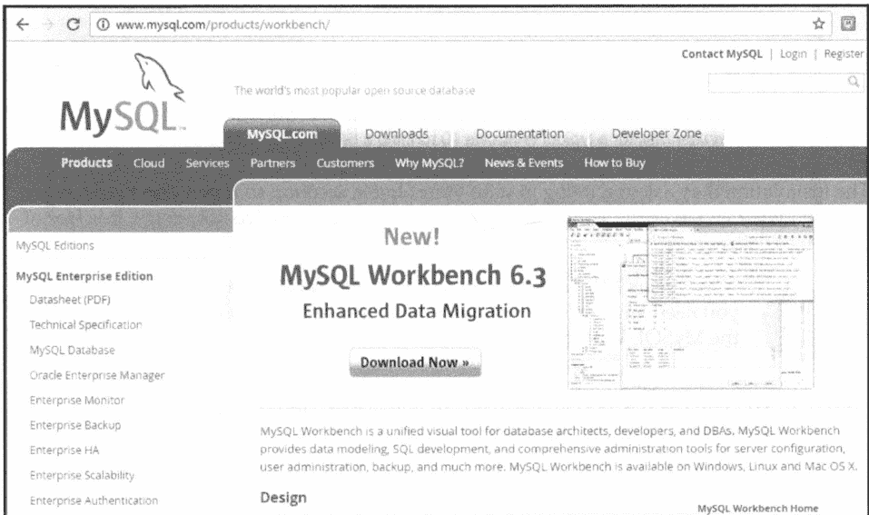

MySQL Workbench 本身就是一个 GUI，与我们在之前的教程中开发的非常相似。它还附带了一些专门用于与 MySQL 协作的附加功能。

## Storing Data in Our MySQL Database via Our GUI

当您安装 MySQL 时，如果您的 PC 上已安装了所需的组件，您可能已经安装了 MySQL Workbench。如果您尚未安装 Workbench，以下是安装 MySQL Workbench 的步骤：

1. 在 `http://www.mysql.com/products/workbench/` 网页上，您可以点击 **Download** 按钮，这会将您带到 `http://dev.mysql.com/downloads/workbench/` 网页：

   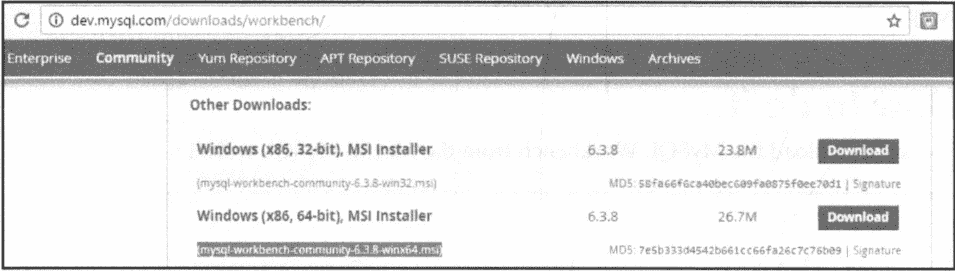

   下载与您的操作系统匹配的 MSI 安装程序，例如，对于典型的运行 64 位操作系统的 Windows 10，*mysql-workbench-community-6.3.8-winx64.msi*。

   安装可能会要求您使用 Oracle 账户登录，因此如果您还没有账户，您需要创建自己的 Oracle 开发者账户。不要担心，这是免费的。

   

   > 几年前，MySQL 被 Oracle 收购。这就是为什么您需要 Oracle 账户来下载和安装 MySQL Server 和 MySQL Workbench 的原因。

2. 您将看到以下屏幕，及其他屏幕，直到您成功安装 MySQL Workbench：

   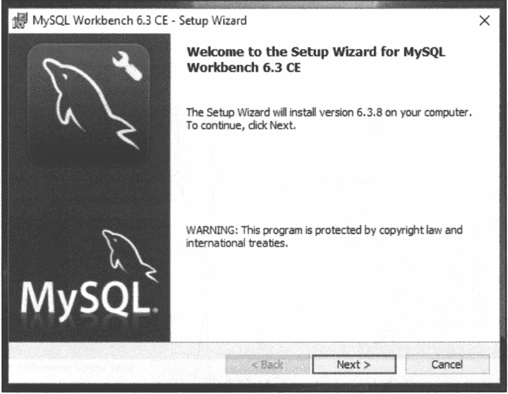

   安装程序窗口中的 6.3 CE 是 6.3 Community Edition 的缩写。

## Storing Data in Our MySQL Database via Our GUI

当您启动 MySQL Workbench 时，它会提示您连接。使用 root 用户和您为其创建的密码。MySQL Workbench 足够智能，可以识别您正在运行的 MySQL Server 及其监听的端口：

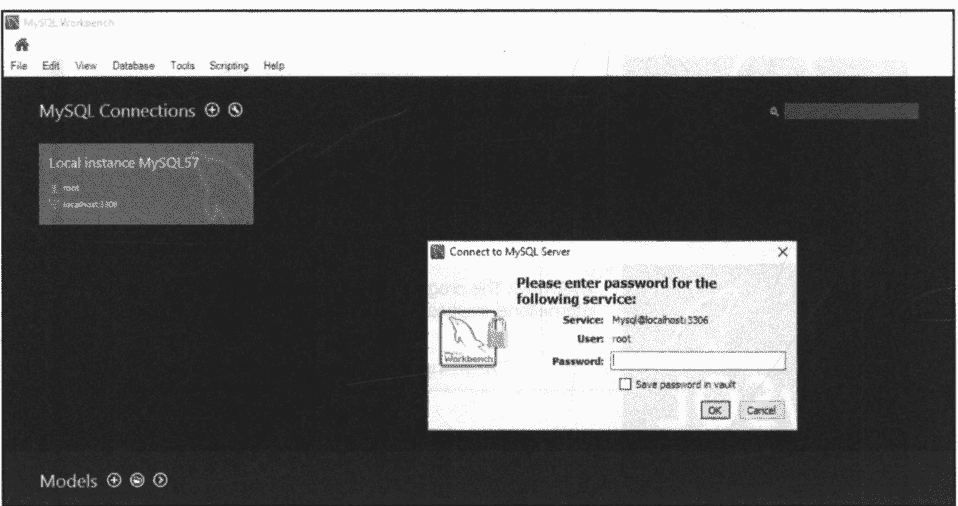

一旦您成功登录到 MySQL Server 实例，我们就可以选择我们的 `guidb`：

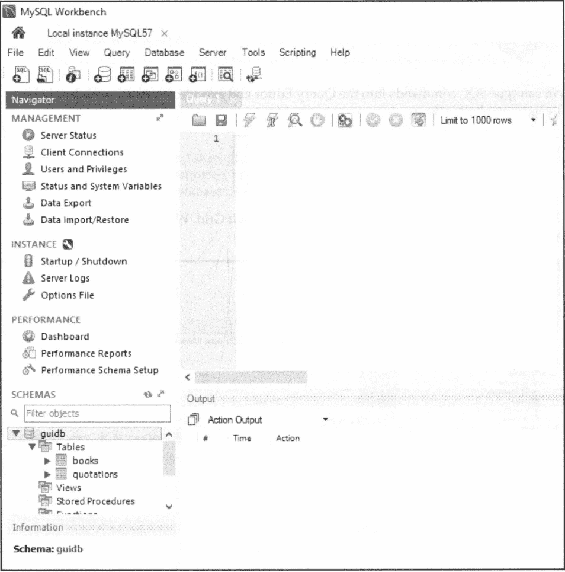

在 Workbench 左下角，我们可以在 **SCHEMAS** 标签下找到我们的 **guidb**。

在某些文献和产品中，数据库通常被称为 **SCHEMAS**。

我们可以将 SQL 命令输入到 Query Editor 中，并通过点击闪电图标执行我们的命令：


以下结果是 Query Editor 中的 Result Grid。我们可以点击不同的标签来查看不同的结果：

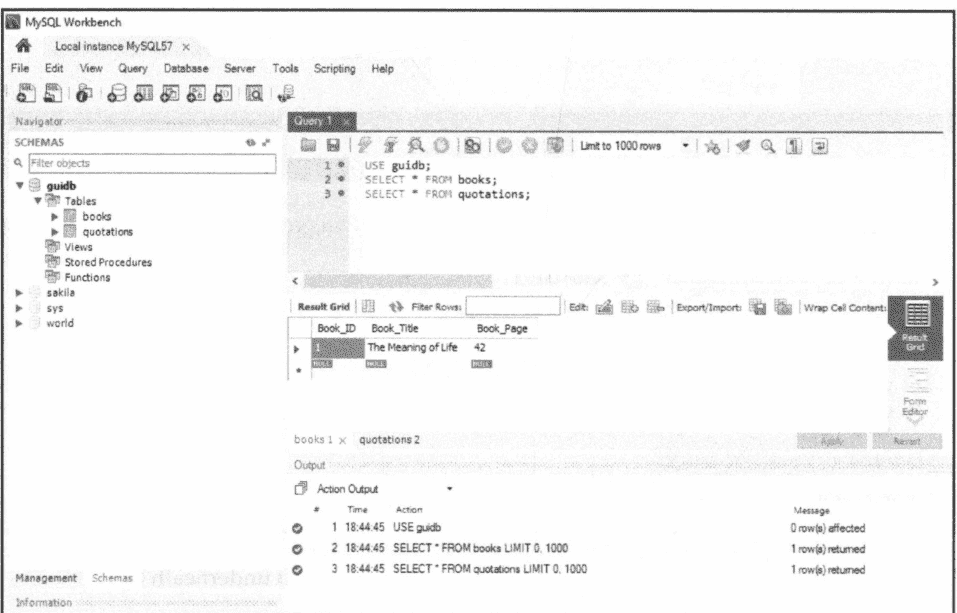

## How it works…

我们现在可以通过 *MySQL Workbench* GUI 连接到我们的 MySQL 数据库。我们可以执行之前发出的相同 SQL 命令，并在我们的 Python GUI 中执行时获得相同的结果。

## There's more…

凭借我们在本章和前几章的教程中获得的知识，我们现在完全有能力创建自己的 Python 编写的 GUI，这些 GUI 可以连接到 MySQL 数据库并与其通信。
