# 8

## Internationalization and Testing

在本章中，我们将对 Python GUI 进行国际化和测试，涵盖以下教程：

- 在不同语言中显示部件文本
- 一次性更改整个 GUI 语言
- 本地化 GUI
- 为国际化准备 GUI
- 如何以敏捷方式设计 GUI
- 我们需要测试 GUI 代码吗？
- 设置调试监视
- 配置不同的调试输出级别
- 使用 Python 的 `__main__` 部分创建自测试代码
- 使用单元测试创建健壮的 GUI
- 如何使用 Eclipse PyDev IDE 编写单元测试

## Introduction

在本章中，我们将通过在标签、按钮、选项卡和其他部件上以不同语言显示文本来对 GUI 进行国际化。我们将从简单开始，然后探索如何在设计层面为 GUI 准备国际化。

## Internationalization and Testing

我们还将本地化 GUI，这与国际化略有不同。


由于这些词很长，它们已被缩写为使用该词的第一个字符，后跟第一个和最后一个字符之间的字符总数，最后是该词的最后一个字符。因此，internationalization 缩写为 I18N，localization 缩写为 L10N。

我们还将测试我们的 GUI 代码，编写单元测试，并探索单元测试在我们的开发工作中可以提供的价值，这将引领我们走向 *refactoring* 代码的最佳实践。

以下是本章的 Python 模块概述：

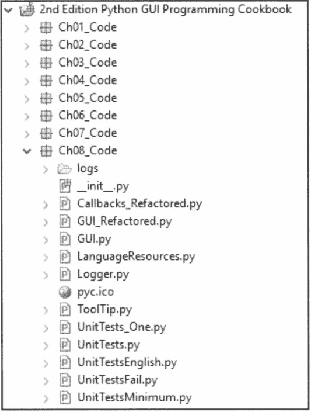


# 在不同语言中显示控件文本

在 Python 中国际化文本字符串最简单的方法是将它们移入一个单独的 Python 模块，然后通过向该模块传入参数来选择我们的 GUI 中要显示的语言。

虽然根据在线搜索结果，这种方法并不被强烈推荐，但取决于你所开发应用的具体需求，这种方法可能仍然是最务实且实现速度最快的方式。

## 准备工作

我们将复用之前创建的 Python GUI。我们已注释掉了一行创建 MySQL 选项卡的 Python 代码，因为本章不会涉及与 MySQL 数据库的交互。

## 操作步骤...

在本节中，我们将通过将窗口标题从英语改为另一种语言来开始我们 GUI 的 I18N（国际化）工作。

由于在其他语言中 GUI（图形用户界面）这个名称本身是相同的，我们首先要扩展这个名称，以便我们能够看到更改后的视觉效果。

以下是我们之前的代码行：

```
self.win.title("Python GUI")
```

让我们将其改为以下内容：

```
self.win.title("Python Graphical User Interface")
```

上述代码更改后，我们的 GUI 程序标题如下：

```
GUI_Refactored.py
```

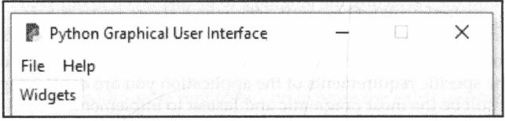

> 在本章中，我们将使用英语和德语来示例我们 Python GUI 国际化的原理。

将字符串硬编码到代码中从来都不是一个好主意，因此我们要做的第一件事就是将 GUI 中可见的所有字符串分离到它们自己的 Python 模块中。这就是我们 GUI 可见部分国际化的开端。

> 在进行 I18N 的同时，我们将一步到位地完成这次非常有益的重构和语言翻译。

让我们创建一个新的 Python 模块，并将其命名为 `LanguageResources.py`。接下来，将 GUI 标题的英文字符串移入该模块，然后将此模块导入到我们的 GUI 代码中。

> 我们将 GUI 与其显示的语言分离开来，这是一个 OOP 设计原则。

我们新的包含国际化字符串的 Python 模块现在如下所示：

```
class I18N():
    '''国际化'''
    def __init__(self, language):
        if language == 'en': self.resourceLanguageEnglish()
        elif language == 'de': self.resourceLanguageGerman()
        else: raise NotImplementedError('不支持的语言。')

    def resourceLanguageEnglish(self):
```

```
self.title = "Python Graphical User Interface"

def resourceLanguageGerman(self):
    self.title = 'Python Grafische Benutzeroberflaeche'
```
```

我们将这个新的 Python 模块导入到主 Python GUI 代码中，然后使用它：

```
from Ch08_Code.LanguageResources import I18N
class OOP():
    def __init__(self):
        self.win = tk.Tk()                  # 创建实例
        self.i18n = I18N('de')              # 选择语言
        self.win.title(self.i18n.title)     # 添加标题
```
```

根据我们传给 I18N 类的语言参数，我们的 GUI 将用该语言显示。

运行上述代码，我们现在得到如下国际化结果：

GUI.py

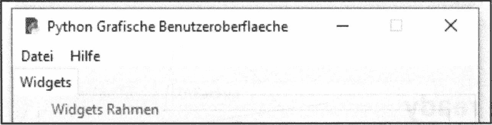

## 工作原理...

我们将构成 GUI 一部分的硬编码字符串拆解到它们各自的独立模块中。为此，我们创建了一个类，并在类的 `__init__()` 方法中，根据传入的语言参数来选择我们的 GUI 将显示哪种语言。

这样是可行的。

我们可以通过将国际化的字符串分离到单独的文件中，例如 XML 或其他格式，来进一步模块化我们的代码。我们也可以从 MySQL 数据库中读取它们。

这是一种关注点分离的编码方法，而这正是 OOP 编程的核心。

## 一次性更改整个 GUI 语言

在本节中，我们将一次性更改所有 GUI 显示名称，方法是将之前所有硬编码的英文字符串重构到一个单独的 Python 模块中，然后对这些字符串进行国际化。

本小节表明，避免硬编码 GUI 显示的任何字符串，而是将 GUI 代码与 GUI 显示的文本分离，这是一个良好的设计原则。

以模块化方式设计我们的 GUI 会使其国际化变得更加容易。

## 准备工作

我们将继续使用上一节中的 GUI。在那一节中，我们已经对 GUI 的标题进行了国际化。

## 操作步骤...

为了对我们所有 GUI 控件中显示的文本进行国际化，我们必须将所有硬编码字符串移入一个单独的 Python 模块中，这就是我们接下来要做的。

之前，我们 GUI 显示的一串串文字遍布于我们的 Python 代码各处。

以下是我们未经 I18N 时 GUI 的样子：

```
GUI_Refactored.py
```

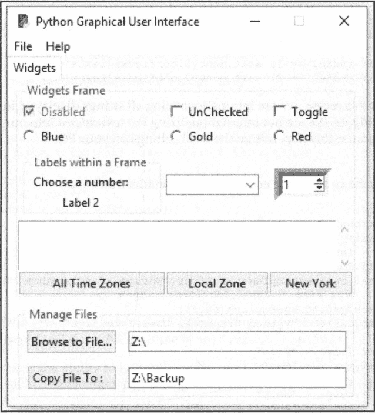

每个控件的每一个字符串，包括 GUI 的标题、选项卡控件名称等，都被硬编码并与创建 GUI 的代码混在一起。

> 在我们的 GUI 软件开发流程的设计阶段，考虑如何最好地实现 GUI 的国际化是一个好主意。

以下是我们代码的一个摘录：

```
WIDGET_LABEL = ' Widgets Frame '
class OOP():
    def __init__(self):
        self.win = tk.Tk()              # 创建实例
        self.win.title("Python GUI")    # 添加标题
```

```
# 单选按钮回调函数
def radCall(self):
    radSel=self.radVar.get()
    if    radSel == 0: self.monty2.configure(text='Blue')
    elif radSel == 1: self.monty2.configure(text='Gold')
    elif radSel == 2: self.monty2.configure(text='Red')
```
```

在本节中，我们将对 GUI 控件中显示的所有字符串进行国际化。我们不对*输入*到 GUI 中的文本进行国际化，因为这取决于你电脑上的本地设置。

以下是英文字符串国际化的代码：

```
class I18N():
'''国际化'''
    def __init__(self, language):
        if    language == 'en': self.resourceLanguageEnglish()
        elif language == 'de': self.resourceLanguageGerman()
        else: raise NotImplementedError('不支持的语言。')

    def resourceLanguageEnglish(self):
        self.title = "Python Graphical User Interface"

        self.file = "文件"
        self.new  = "新建"
        self.exit = "退出"
        self.help = "帮助"
        self.about = "关于"

        self.WIDGET_LABEL = ' 控件框架 '

        self.disabled  = "禁用"
        self.unChecked = "未选中"
        self.toggle    = "切换"

        # 单选按钮列表
        self.colors   = ["蓝色", "金色", "红色"]
        self.colorsIn = ["以蓝色", "以金色", "以红色"]

        self.labelsFrame  = ' 框架内的标签 '
        self.chooseNumber = "选择一个数字："
        self.label2       = "标签 2"

        self.mgrFiles = ' 管理文件 '

        self.browseTo = "浏览文件..."
        self.copyTo   = "复制文件到："
```
```

在我们的 Python GUI 模块中，所有之前硬编码的字符串现在都被我们的新 I18N 类的一个实例所替换，该类位于 LanguageResources.py 模块中。

以下是我们重构后的 GUI.py 模块中的一个示例：

```
from Ch08_Code.LanguageResources import I18N
class OOP():
    def __init__(self):
        self.win = tk.Tk()                  # 创建实例
        self.i18n = I18N('de')              # 选择语言
        self.win.title(self.i18n.title) # 添加标题

    # 单选按钮回调函数
    def radCall(self):
        radSel = self.radVar.get()
        if  radSel == 0: self.widgetFrame.configure(text=
                        self.i18n.WIDGET_LABEL + self.i18n.colorsIn[0])
        elif radSel == 1: self.widgetFrame.configure(text=
                        self.i18n.WIDGET_LABEL + self.i18n.colorsIn[1])
        elif radSel == 2: self.widgetFrame.configure(text=
                        self.i18n.WIDGET_LABEL + self.i18n.colorsIn[2])
```

注意，所有之前硬编码的英文字符串是如何被对我们新 I18N 类实例的调用所替换的。一个例子是 self.win.title(self.i18n.title)。

这赋予我们的是对 GUI 进行国际化的能力。我们只需使用相同的变量名，并通过传入一个参数来选择我们希望显示的语言，从而将它们组合起来。

我们也可以作为 GUI 的一部分随时切换语言，或者我们可以读取本地 PC 设置，并根据这些设置来决定我们的 GUI 文本应该显示哪种语言。


关于如何读取本地设置的示例将在下一节“本地化 GUI”中介绍。

我们现在可以通过简单地用对应单词填充变量名来实现德语的翻译：

```
class I18N():
    '''国际化'''
    def __init__(self, language):
        if  language == 'en': self.resourceLanguageEnglish()
        elif language == 'de': self.resourceLanguageGerman()
```


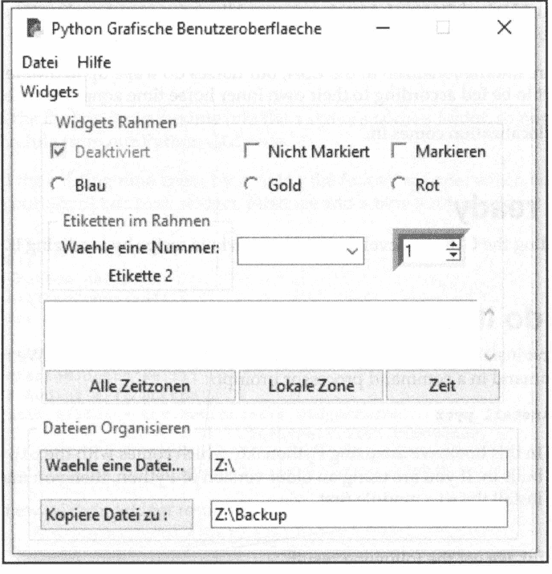

## How it works…

为了国际化我们的 GUI，我们将硬编码的字符串重构到一个单独的模块中，然后使用相同的类成员通过将字符串作为 I18N 类的初始化器传入来国际化我们的 GUI，从而有效控制 GUI 显示的语言。

## Localizing the GUI

在国际化 GUI 的第一步之后，下一步就是对其进行本地化。为什么我们要这样做呢？

好吧，在美国，我们都是牛仔，生活在不同的时区。

所以虽然我们已经国际化到美国，但我们的马在不同的时区醒来，并且期望按照它们自己的内在马时区时间表进食。

这就是本地化发挥作用的地方。

## Getting ready

我们将通过对其进行本地化来扩展我们在上一节食谱中开发的 GUI。

## How to do it...

我们首先通过 pip 安装 Python pytz 时区模块。我们在命令处理器提示符中输入以下命令：

```
pip install pytz
```

在本书中，我们使用的是 Python 3.6，其中内置了 pip 模块。如果你使用的是较旧版本的 Python，则可能需要先安装 pip 模块。

成功后，我们得到以下结果：

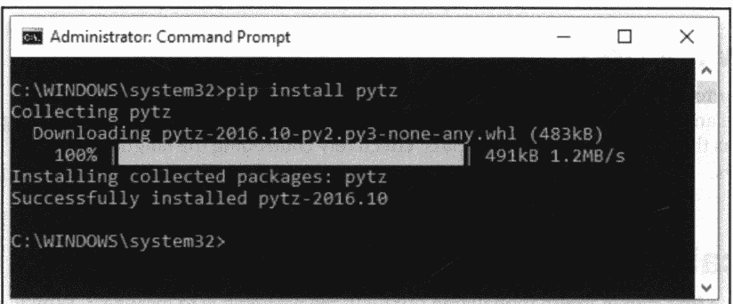

前面的屏幕截图显示该命令下载了 .whl 格式。如果你尚未安装，可能需要先安装 Python wheel 模块。

这将 Python pytz 模块安装到 site-packages 文件夹中，因此现在我们可以从 Python GUI 代码中导入该模块。

我们可以通过运行以下代码列出所有现有时区，该代码将时区显示在我们的 ScrolledText 小部件中。首先，我们向 GUI 添加一个新的 Button 小部件：

```
import pytz
class OOP():
    # TZ Button callback
    def allTimeZones(self):
        for tz in pytz.all_timezones:
            self.scr.insert(tk.INSERT, tz + '\n')

    def createWidgets(self):
        # Adding a TZ Button
        self.allTZs = ttk.Button(self.widgetFrame,
                                text=self.i18n.timeZones,
                                command=self.allTimeZones)
        self.allTZs.grid(column=0, row=9, sticky='WE')
```

点击我们新的 Button 小部件会得到以下输出：

GUI.py

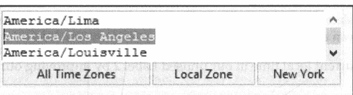

在我们安装 tzlocal Python 模块后，我们可以通过运行以下代码打印当前本地位置：

```
# TZ Local Button callback
def localZone(self):
    from tzlocal import get_localzone
    self.scr.insert(tk.INSERT, get_localzone())

def createWidgets(self):
```

```
# Adding local TZ Button
self.localTZ = ttk.Button(self.widgetFrame,
						text=self.i18n.localZone,
						command=self.localZone
self.localTZ.grid(column=1, row=9, sticky='WE')
```

我们在 Resources.py 中国际化了我们两个新按钮的字符串。

英文版本：

```
self.timeZones = "All Time Zones"
self.localZone = "Local Zone"
```

德文版本：

```
self.timeZones = "Alle Zeitzonen"
self.localZone = "Lokale Zone"
```

点击我们新的按钮现在会告诉我们所在的时区，嘿，我们不知道这一点，对吧……。

GUI.py

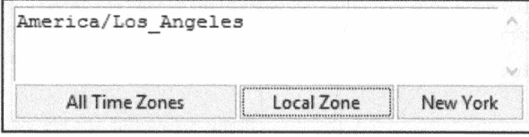

我们现在可以将本地时间转换为不同的时区。让我们以美国东部标准时间为例。

我们通过改进现有代码，在未使用的 Label 2 中显示当前本地时间。

当我们运行代码时，我们的国际化 Label 2 ，在德语中显示为 Etikette 2，将显示当前本地时间：

GUI.py

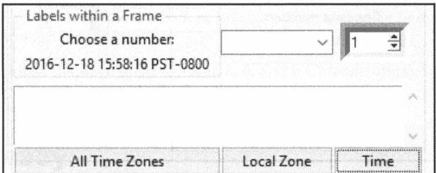

我们现在可以通过先将其转换为协调世界时 ，然后应用从导入的 pytz 模块导入的时区函数，将本地时间更改为美国东部时间 EST：

```
import pytz
class OOP():
    # Format local US time with TimeZone info
    def getDateTime(self):
        fmtStrZone = "%Y-%m-%d %H:%M:%S %Z%z"
        # Get Coordinated Universal Time
        utc = datetime.now(timezone('UTC'))
        print(utc.strftime(fmtStrZone))

        # Convert UTC datetime object to Los Angeles TimeZone
        la = utc.astimezone(timezone('America/Los_Angeles'))
        print(la.strftime(fmtStrZone))

        # Convert UTC datetime object to New York TimeZone
        ny = utc.astimezone(timezone('America/New_York'))
        print(ny.strftime(fmtStrZone))

        # update GUI label with NY Time and Zone
        self.lbl2.set(ny.strftime(fmtStrZone))
```

点击按钮，现在重命名为 New York，会得到以下输出：

```
GUI.py
```

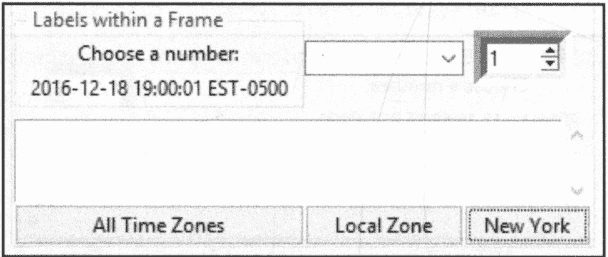

我们的 Label 2 已使用纽约的当前时间和时区进行了更新，我们正在打印城市洛杉矶和纽约的 UTC 时间，并使用美国日期格式字符串相对于 Eclipse 控制台上的 UTC 时间显示其各自的时区转换：

```
GUI.py
```

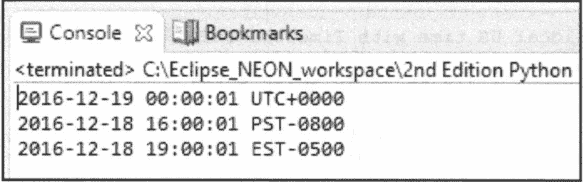

> UTC 从不遵守夏令时。在 **东部夏令时 EDT** 期间，UTC 比当地时间提前四小时，在 **标准时间 EST** 期间，它比当地时间提前五小时。

## How it works…

为了本地化日期和时间信息，我们首先需要将本地时间转换为 UTC 时间。然后我们应用 `timezone` 信息并使用 `pytz` Python 时区模块中的 `astimezone` 函数将其转换为世界任何地方的时区！

在本节食谱中，我们将美国西海岸的本地时间转换为 UTC，然后在 GUI 的 Label 2 中显示美国东海岸时间。

## Preparing the GUI for internationalization

在本节食谱中，我们将通过认识到将英语翻译成外语并非总是如预期般容易，为我们的 GUI 做好国际化准备。

我们仍然有一个问题需要解决，即如何正确显示外语中的非英语 Unicode 字符。

人们可能会期望 Python 3.6 会自动处理显示德语 ä、ö 和 ü Unicode 变音字符，但事实并非如此。

## Getting ready

我们将继续使用最近几章中开发的 Python GUI。首先，我们将在 GUI.py 初始化代码中将默认语言更改为德语。

我们通过取消注释该行 self.i18n = I18N('de') 来实现这一点。

## How to do it...

当我们将单词 Ueber 更改为正确的德语 Über 并使用变音字符时，Eclipse PyDev 插件并不太高兴：

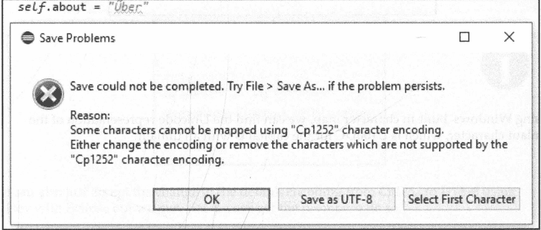

我们收到一条错误消息，这有点令人困惑，因为当我们从 Eclipse PyDev 控制台运行同一行代码时，我们会得到预期的结果：

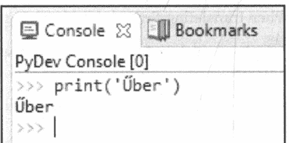

当我们询问 Python 默认编码时，我们得到预期的结果，即 utf-8：

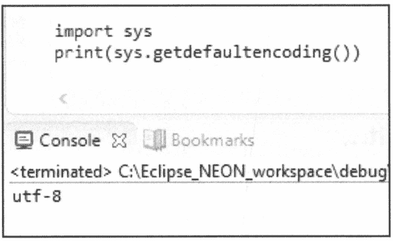


当然，我们始终可以求助于 Unicode 的直接表示。

使用 Windows 内置的字符映射表，我们可以找到变音字符的 Unicode 表示形式，即大写 U 带变音符号的 U+00DC：

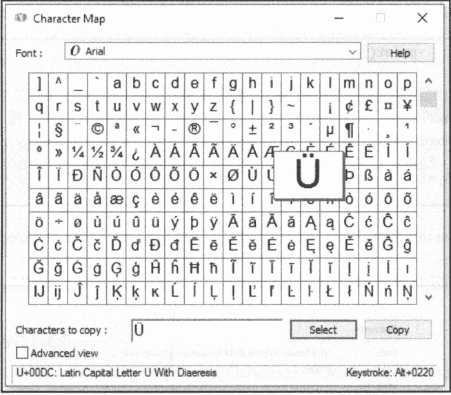

虽然这种变通方法确实很丑陋，但它确实有效。相反输入字面字符 Ü，我们可以传入 U+00DC 的 Unicode 以在我们的 GUI 中正确显示该字符：

```
```python
print("\u00DC" + "ber")
```

Console output:
```text
Uber
```
```

我们也可以直接接受默认编码从 *Cp1252* 到 **UTF-8** 的更改，使用 PyDev with Eclipse，但我们可能并不总是收到执行此操作的提示。

相反，我们可能会看到以下错误消息：

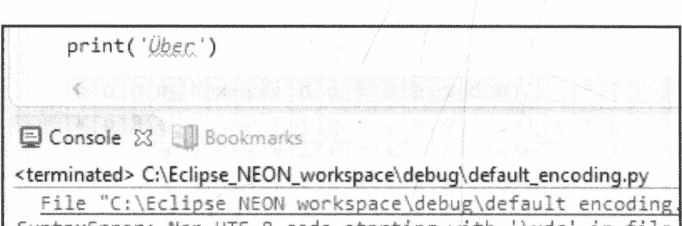

解决此问题的方法是更改 PyDev 项目的文本文件编码属性为 UTF-8：

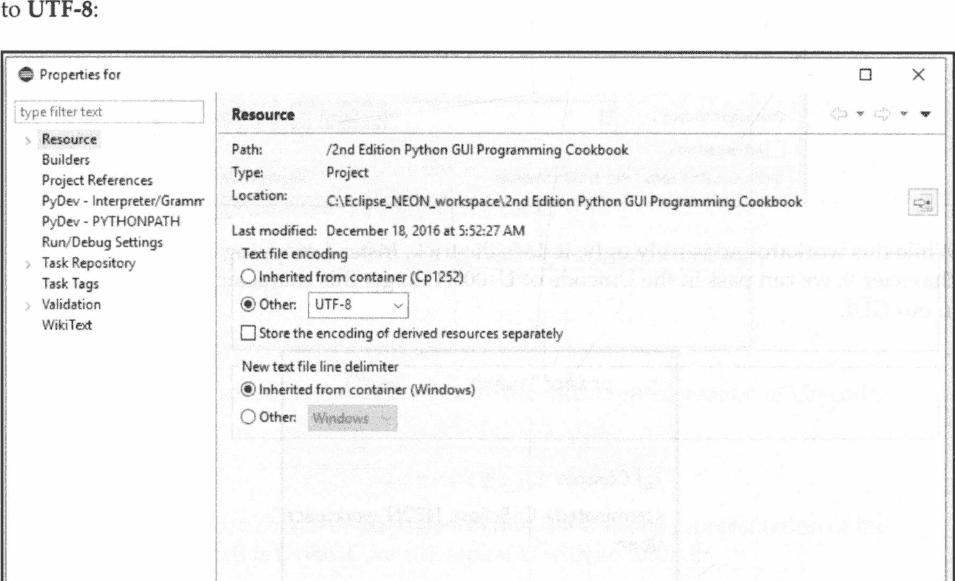


更改 PyDev 默认编码后，我们现在可以显示那些德语变音字符。我们还更新了标题以使用正确的德语 ä 字符：

```
GUI_Refactored.py
```

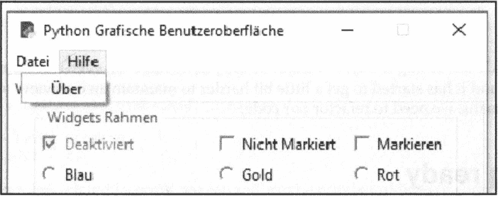

## 它是如何工作的…

国际化和使用外语 Unicode 字符的工作往往不如我们希望的那样直接。有时我们必须找到变通方法，并且通过在 Python 中使用直接表示形式通过在前面加上 `\u` 来表达 Unicode 字符可以解决问题。

在其他时候，我们只需要找到开发环境的设置进行调整即可。

## 如何以敏捷方式设计 GUI

现代敏捷软件开发方法在设计和编码方面源于软件专业人士的经验教训。这种方法适用于 GUI，也适用于任何其他代码。敏捷软件开发的主要关键之一是持续应用的重构过程。

重构代码如何帮助我们软件开发工作的一个实际例子是，首先使用函数实现一些简单功能。

随着代码复杂度的增加，我们可能希望将函数重构为类的 方法。这种方法将使我们能够删除全局变量，并且在类中放置方法的位置方面更加灵活。

虽然代码的功能没有改变，但结构已经改变了。

在这个过程中，我们编码、测试、重构，然后再次测试。我们以短周期进行操作，并且通常从实现某些功能所需的最小代码开始。

> 测试驱动软件开发是敏捷开发方法的一种特定风格。

虽然我们的 GUI 运行良好，但我们的主 GUI.py 代码一直在不断增加复杂性，并且开始变得有点难以维护代码的概览。这意味着，我们需要重构我们的代码。

## 准备工作

我们将重构在前几章中创建的 GUI。我们将使用 GUI 的英文版本。

## 如何操作…

我们在上一节食谱中将 GUI 显示的所有名称分离出来以实现国际化。这是对重构代码的极佳开端。

> 重构是改进现有代码的结构、可读性和可维护性的过程。我们没有添加新功能。

在前几章和食谱中，我们一直以自上而下的瀑布开发方法扩展我们的 GUI，在顶部添加导入，并在现有代码的底部添加代码。

虽然这在查看代码时很有用，但现在看起来有点混乱，我们可以改进它以帮助未来的开发。

让我们首先清理我们的导入语句部分，目前如下所示：

```
```python
#=====================
# imports
#=====================
import tkinter as tk
from tkinter import ttk
from tkinter import scrolledtext
```
```

```
```python
filedialog as fd, messagebox as mBox
from queue import Queue
from os import path
import Ch08_Code.ToolTip as tt
from Ch08_Code.LanguageResources import I18N
from Ch08_Code.Logger import Logger, LogLevel
from Ch08_Code.Callbacks_Refactored import Callbacks

# Module level GLOBALS
GLOBAL_CONST = 42

class OOP():
    def __init__(self):
        # Callback methods now in different module
        self.callbacks = Callbacks(self)
```
```

注意我们在调用 `Callbacks` 初始化器时传递了我们自己的 GUI 类实例（`self`）。

我们新的 `Callbacks` 类如下：

```
```python
#=================
# imports
#=================
import tkinter as tk
from time import sleep
from threading import Thread
from pytz import all_timezones, timezone
from datetime import datetime

class Callbacks():
    def __init__(self, oop):
        self.oop = oop

    def defaultFileEntries(self):
        self.oop.fileEntry.delete(0, tk.END)
        self.oop.fileEntry.insert(0, 'Z:')          # bogus path
        self.oop.fileEntry.config(state='readonly')
        self.oop.netwEntry.delete(0, tk.END)
        self.oop.netwEntry.insert(0, 'Z:Backup')    # bogus path

    # Combobox callback
    def __combo(self, val=0):
        value = self.oop.combo.get()
        self.oop.scr.insert(tk.INSERT, value + '\n')
```
```

在我们新类的初始化器中，传入的 GUI 实例被保存为 `self.oop` 的名称，并在整个新的 Python 类模块中使用。

运行重构后的 GUI 代码仍然有效。我们只是提高了其可读性并降低了代码的复杂性，为进一步的开发工作做好准备。

## 它是如何工作的...

我们首先通过对相关的导入语句进行分组来提高代码的可读性。接下来，我们将回调方法分离到自己的类和模块中，以进一步降低代码的复杂性。

我们已经通过让 `ToolTip` 类驻留在自己的模块中并在之前的食谱中将所有 GUI 字符串国际化，采用了相同的 OOP 方法。在本食谱中，我们通过将我们自己的实例传递给回调方法的类中我们的 GUI 所依赖的类，进一步在重构方面迈出了一步。这使我们能够使用所有 GUI 小部件。


现在我们更好地理解了模块化软件开发方法的价值，我们很可能会在未来的软件设计中从这种方法开始。

## 我们需要测试 GUI 代码吗？

在编码阶段以及在发布服务包或错误修复时，测试我们的软件是一项重要活动。

测试有不同的级别。第一个级别是开发人员测试，这通常从编译器或解释器不让我们运行有问题的代码开始，迫使我们在单个方法级别上测试代码的小部分。

这是第一道防线。

编码防御的第二个级别是当我们的源代码控制系统告诉我们存在一些需要解决的冲突，并且不允许我们签入修改后的代码时。

这非常有用，并且在我们作为开发团队专业工作时绝对必要。源代码控制系统是我们的朋友，它指出已提交到特定分支或主干的更改，无论是由我们自己还是其他开发人员提交，并告诉我们我们本地的代码版本既过时又有需要解决的冲突，然后我们才能将代码提交到存储库。

这部分假设您使用源代码控制系统来管理和存储代码。示例包括 git、mercurial、svn 等。Git 是一种非常流行的源代码控制系统，并且对单个用户是免费的。

第三个级别是 API 级别，我们通过仅允许通过已发布的接口与代码交互来封装对代码的潜在未来更改。

另一种测试级别是集成测试，当我们最终建造的桥梁的一半遇到其他开发团队创建的另一半，而两者不在同一高度相遇时（比如，一半最终比另一半高出两米或码...）。

然后是最终用户测试。虽然我们按他们指定的方式构建了它，但它并不是他们真正想要的。

以上所有示例都是为什么我们在设计和实现阶段都需要测试代码的有效原因。

## 准备工作

我们将测试在最近的食谱和章节中创建的 GUI。我们还将展示一些简单的例子，说明可能出现什么问题以及为什么我们需要继续测试我们的代码和通过 API 调用的代码。

## 如何操作...

虽然许多经验丰富的开发人员在调试时习惯于在代码中到处撒 `printf()` 语句，但 21 世纪的许多开发人员习惯于现代 IDE 开发环境，这些环境能有效加快开发时间。

在本书中，我们使用的是 Eclipse IDE 的 PyDev Python 插件。

如果您刚刚开始使用 IDE，例如带 PyDev 的 Eclipse，起初可能会有点不知所措。随 Python 3.6 附带的 Python IDLE 工具具有更简单的调试器，您可能希望先探索它。

每当我们的代码出现问题时，我们都必须调试它。执行此操作的第一步是设置断点，然后逐行或逐方法地逐步执行我们的代码。

在代码中逐步进入和退出是代码顺利运行前的日常活动。


在 Python GUI 编程中，最容易出错的事情之一就是遗漏了必需模块的导入，或者导入了已存在的模块。

这里有一个简单的例子：

GUI.py 中导入语句 `# import tkinter as tk` 被注释掉了：

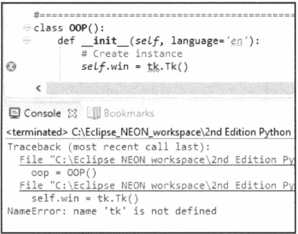

我们正试图创建 `tkinter` 类的一个实例，但事情并不如预期那样工作。

好吧，我们只是忘记导入模块并将其别名为 `tk`，我们可以通过在类创建语句上方添加一行 Python 代码来修复这个问题，导入语句就位于那里：

```
```python
#====================
# imports
#====================
import tkinter as tk
```
```

这是一个开发环境为我们做测试的例子。我们只需要进行调试和代码修复即可。

另一个更接近开发者测试的例子是当我们编写条件语句时，在常规开发过程中没有执行逻辑的所有分支。

以第 7 章 *通过 GUI 将数据存储到我们的 MySQL 数据库* 中的一个例子来说，假设我们点击了 **Get Quotes** 按钮并且它能正常工作，但我们从未点击过 **Modify Quote** 按钮。第一次按钮点击产生了期望的结果，但第二次却抛出异常（因为我们尚未实现这段代码，可能也完全忘记了它）：

第 7 章 *通过 GUI 将数据存储到我们的 MySQL 数据库* 中的 GUI_MySQL.py。

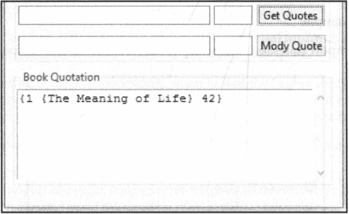

点击 **Modify Quote** 按钮会产生以下结果：

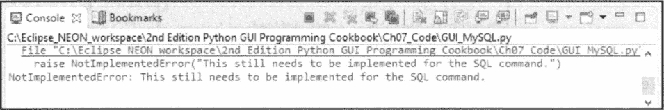

另一个潜在的错误区域是当某个函数或方法突然不再返回预期结果时。假设我们正在调用以下函数，它返回预期结果：

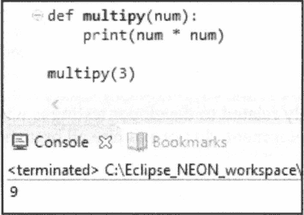

然后，有人犯了错误，我们不再得到之前的结果：

```
def multiply(num):
    print(num ** num)

multiply(3)

Console
<terminated> C:\Eclipse_NEON_workspace
27
```

我们不再进行乘法运算，而是将传入的数字作为幂进行运算，结果不再是原来的样子。

在软件测试中，这种类型的错误称为回归。

## How it works...

在本教程中，我们通过展示代码可能出错并引入软件缺陷（即 bug）的多个例子，强调了在软件开发生命周期的多个阶段进行软件测试的重要性。

## Setting debug watches

在现代集成开发环境（IDEs）中，例如 Eclipse 中的 PyDev 插件或 NetBeans 等其他 IDE，我们可以设置调试监视来监控 GUI 在代码执行期间的状态。

这与 Microsoft 的 Visual Studio IDE 以及更新版本的 Visual Studio.NET 非常相似。

设置调试监视是一种非常方便的方式，可以帮助我们的开发工作。

## Getting ready

在本教程中，我们将重用在之前的教程中开发的 Python GUI。我们将逐步执行之前开发的代码，并设置调试监视。

## How to do it...

虽然本教程适用于基于 Java 的 Eclipse IDE 中的 PyDev 插件，但其原则也适用于许多现代 IDE。

我们可能希望放置断点的第一个位置是在我们通过调用 tkinter 主事件循环使 GUI 可见的地方。

左侧的绿色气球符号是 PyDev/Eclipse 中的一个断点。当我们在调试模式下执行代码时，代码的执行会在执行到达断点时被暂停。此时，我们可以看到当前作用域中所有变量的值。我们还可以在调试器窗口之一中输入表达式，这些表达式将被执行并显示结果。如果结果是我们想要的，我们可能会决定使用刚刚学到的知识更改我们的代码。

我们通常通过点击 IDE 工具栏中的图标或使用键盘快捷键（例如按 F5 进入代码，F6 单步跳过，F7 从当前方法中跳出）来逐步执行代码：

GUI.py

```
#===================
# Start GUI
#===================
oop = OOP()
oop.win.mainloop()
```

在我们放置断点的位置然后逐步进入此代码会成为一个问题，因为我们最终会进入一些低级的 `tkinter` 代码，而我们现在并不想调试它。我们可以通过点击工具栏中的 Step-Out 图标（即项目菜单下方右侧的第三个黄色箭头）或按 F7（假设我们使用的是 Eclipse 中的 PyDev）来退出低级的 `tkinter` 代码。

我们通过点击屏幕截图右侧的虫子工具栏图标开始了调试会话。如果我们在不调试的情况下执行，则点击带有白色三角形的绿色圆圈图标，即虫子图标右侧的图标：

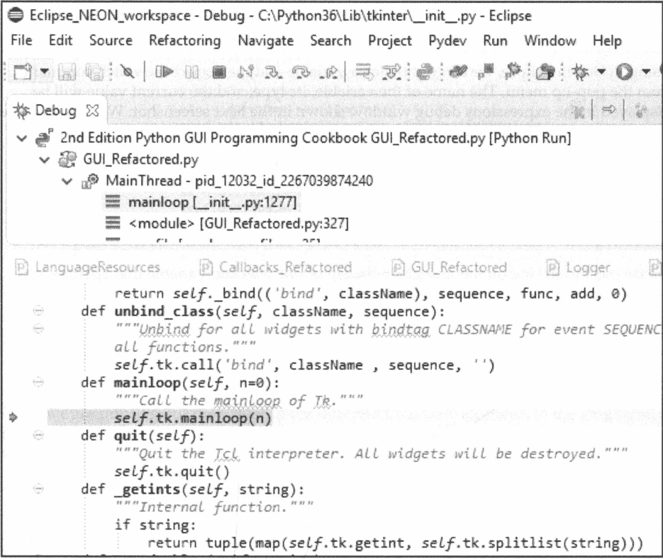

更好的做法是将断点放置得更接近我们自己的代码，以便监视我们自己的 Python 变量的值。在现代 GUI 的事件驱动世界中，我们必须将断点放置在事件期间被调用的代码处，例如按钮点击。

我们目前的一个主要功能位于按钮点击事件中。当我们点击标有 **New York** 的按钮时，我们会创建一个事件，然后在我们的 GUI 中产生某些操作。

让我们在 **New York** 按钮的回调方法 `getDateTime()` 处放置一个断点。

当我们现在运行调试会话时，我们将在断点处停止，然后我们可以启用作用域内变量的监视。

使用 Eclipse 中的 PyDev，我们可以右键单击一个变量，然后从弹出菜单中选择监视命令。变量的名称、类型和当前值将显示在下一个屏幕截图中显示的表达式调试窗口中。我们也可以直接在表达式窗口中输入。

我们监视的变量不仅限于简单数据类型。我们可以监视类实例、列表、字典等。

在监视这些更复杂的对象时，我们可以在表达式窗口中展开它们，并深入到类实例、字典等的所有值中。

我们通过点击 **Name** 列下最左侧出现的每个变量旁边的三角形来实现这一点：

```
Callbacks_Refactored.py
```

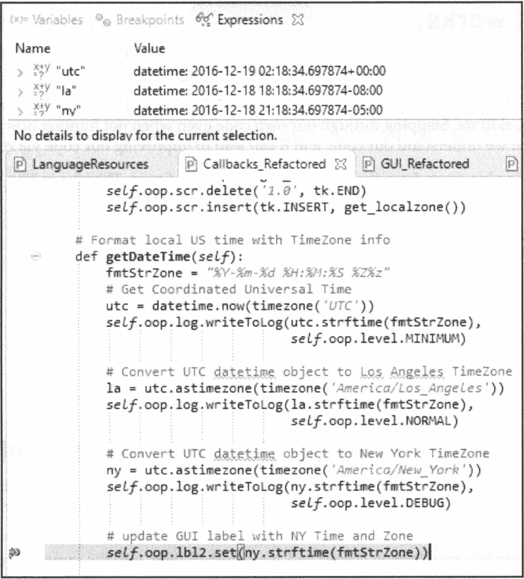

虽然我们在打印不同时区位置的值，但在长期来看，设置调试监视要方便得多，也更高效。我们不必用老式的 C 风格 `printf()` 语句 clutter 我们的代码。

> 如果你有兴趣学习如何安装带有 PyDev 插件的 Eclipse 用于 Python，这里有一个很棒的教程，它将帮助你开始安装所有必要的免费软件，然后通过创建一个简单的、可工作的 Python 程序向你介绍 Eclipse 中的 PyDev：http://www.vogella.com/tutorials/Python/article.html

## How it works…

我们在 21 世纪使用现代集成开发环境（IDEs），它们可免费获得，以帮助我们创建可靠的代码。

本教程展示了如何设置调试监视，这是每个开发人员技能集中的基本工具。即使在不追踪错误时逐步执行我们自己的代码也能确保我们理解自己的代码，并且可以通过重构来改进代码。

以下是我的第一本编程书 *Thinking in Java* 的引言，该书由 Bruce Eckel 所著。

> > “Resist the Urge to Hurry, it will only slow you down.”
> >
> > — Bruce Eckel

近二十年后，这一建议经受住了时间的考验。


调试监视帮助我们创建可靠的代码，并不是浪费时间。

## Configuring different debug output levels

在本教程中，我们将配置不同的调试级别，我们可以在运行时选择和更改。这使我们能够控制在调试代码时想要深入代码的程度。

我们将创建两个新的 Python 类，并将它们都放在同一个模块中。

我们将使用四种不同的日志级别，并将调试输出写入我们将创建的日志文件。如果 logs 文件夹不存在，我们也会自动创建它。

日志文件的名称是执行脚本的名称，即我们重构后的 GUI.py。我们也可以通过将完整路径传递给 Logger 类的初始化器来为日志文件选择其他名称。

## Getting ready

我们将继续使用上一教程中的重构 GUI.py 代码。


## 如何操作...

首先，我们创建一个新的Python模块，在其中放置两个新类。第一个类非常简单，用于定义日志级别。这基本上是一个枚举：

```python
class LogLevel:
    '''Define logging levels.'''
    OFF      = 0
    MINIMUM  = 1
    NORMAL   = 2
    DEBUG    = 3
```

第二个类通过传入的文件名的完整路径创建一个日志文件，并将其放入`logs`文件夹中。首次运行时，`logs`文件夹可能不存在，因此代码会自动创建该文件夹：

```python
import os, time
from datetime import datetime

class Logger:
    ''' Create a test log and write to it. '''

    #------------------------------------------------------------
    def __init__(self, fullTestName, loglevel=LogLevel.DEBUG):
        testName = os.path.splitext(os.path.basename(fullTestName))[0]
        logName  = testName + '.log'

        logsFolder = 'logs'
        if not os.path.exists(logsFolder):
            os.makedirs(logsFolder, exist_ok=True)

        self.log = os.path.join(logsFolder, logName)
        self.createLog()

        self.loggingLevel = loglevel
        self.startTime    = time.perf_counter()

    #------------------------------------------------------------
    def createLog(self):
        with open(self.log, mode='w', encoding='utf-8') as logFile:
            logFile.write(self.getDateTime() +
                          '\t\t*** Starting Test ***\n')
        logFile.close()
```

为了写入日志文件，我们使用`writeToLog()`方法。在该方法内部，我们首先检查消息的日志级别是否高于我们设置的所需日志输出级别。如果消息的级别较低，我们就丢弃它并从方法中立即返回。

如果消息具有我们想要显示的日志级别，我们接着检查它是否以换行符开头。如果是，我们使用Python的切片运算符从索引1开始切片来丢弃换行符（`msg = msg[1:]`）。

然后我们向日志文件写入一行，内容为当前日期时间戳、两个制表符空格、我们的消息，并以换行符结束：

```python
#--------------------------------------------------
def writeToLog(self, msg='', loglevel=LogLevel.DEBUG):
    # control how much gets logged
    if loglevel > self.loggingLevel:
        return

    # open log file in append mode
    with open(self.log, mode='a', encoding='utf-8') as logfile:
        msg = str(msg)
        if msg.startswith('\n'):
            msg = msg[1:]
        logfile.write(self.getDateTime() + '\t\t' + msg + '\n')

    logfile.close()
```

我们现在可以导入新的Python模块，并在GUI代码的`__init__`部分中创建`Logger`类的实例：

```python
from os import path
from Ch08_Code.Logger import Logger

class OOP():
    def __init__(self):
        # create Logger instance
        fullPath = path.realpath(__file__)
        self.log = Logger(fullPath)
        print(self.log)
```

我们通过`path.realpath(__file__)`获取正在运行的GUI脚本的完整路径，并将其传递给`Logger`类的初始化器。如果`logs`文件夹不存在，我们的Python代码会自动创建它。

这将产生以下结果：

`Callbacks_Refactored.py`，取消注释`print(self.log)`

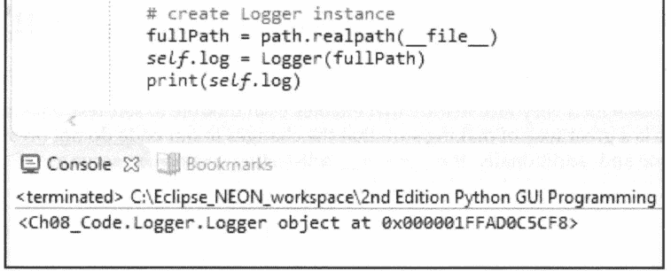

前面的截图显示我们创建了新的`Logger`类的一个实例，下面的截图显示`logs`文件夹和日志都已创建：

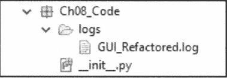

当我们打开日志时，可以看到当前日期和时间以及默认字符串已被写入日志：

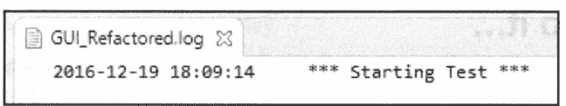

## 工作原理...

在本节中，我们创建了自己的日志类。虽然Python自带一个日志模块，但自己创建非常简单，这让我们能够完全控制日志格式。当我们将自己的日志输出与MS Excel或我们在上一章中探索的Matplotlib结合使用时，这非常有用。

在下一节中，我们将使用Python内置的`__main__`功能来使用我们刚刚创建的四个不同日志级别。

## 使用Python的`__main__`段创建自测试代码

Python带有一个非常好的特性，使每个模块都能进行自测试。利用该特性是确保我们对代码的修改不会破坏现有代码的好方法，此外，`__main__`自测试部分还可以作为每个模块如何工作的文档。

> 几个月或几年后，我们有时会忘记代码在做什么，因此在代码本身中写有解释确实非常有益。

尽可能为每个Python模块添加自测试部分是一个好主意。有时这不可能，但在大多数模块中是可以做到的。

### 准备工作

我们将扩展上一节的内容，因此为了理解本节中代码的作用，我们必须首先阅读并理解上一节的代码。

### 如何操作…

首先，我们通过将自测试部分添加到`LanguageResources.py`模块中来探索Python `__main__`自测试部分的强大功能。每当我们运行一个模块时，如果该模块底部有自测试部分，当该模块单独执行时，这些代码将运行。

当模块被其他模块导入和使用时，`__main__`自测试部分中的代码不会被执行。

这也是以下截图中显示的代码：

```python
if __name__ == '__main__':
    language = 'en'
    inst = I18N(language)
    print(inst.title)

    language = 'de'
    inst = I18N(language)
    print(inst.title)
```

添加自测试部分后，我们现在可以单独运行该模块，它会生成有用的输出，同时向我们展示代码按预期工作：

```text
LanguageResources.py
```

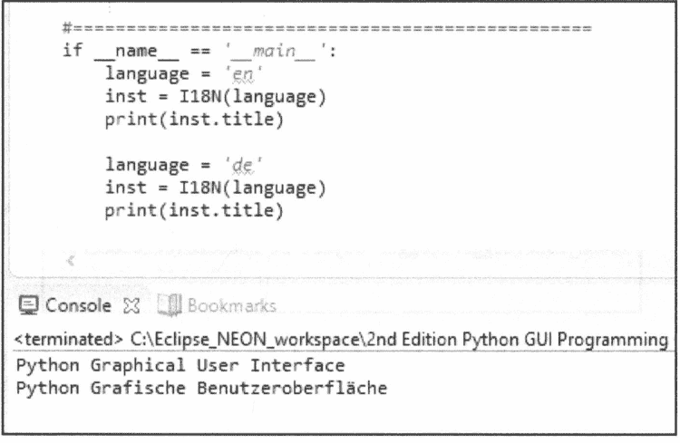

我们首先将英语作为GUI中显示的语言传入，然后将德语作为GUI将显示的语言传入。

我们打印GUI的标题，以表明我们的Python模块按我们预期的方式工作。


下一步是使用我们在上一节中创建的日志功能。

我们首先在重构后的`GUI_Refactored.py`模块中添加一个`__main__`自测试部分，然后验证我们创建了`Logger`类的实例：

`GUI_Refactored.py`，取消注释`print(oop.log)`

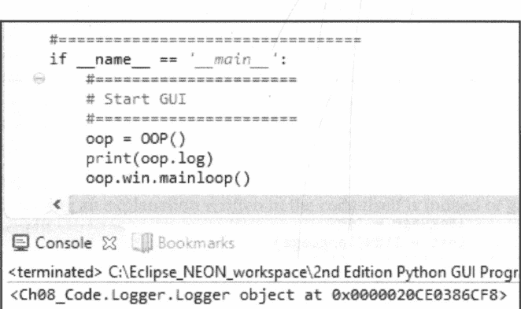

接下来，我们使用所示的命令写入日志文件。我们将日志级别设计为默认记录所有消息，即DEBUG级别，因此我们无需更改任何内容。只需将需要记录的消息传递给`writeToLog`方法：

```python
if __name__ == '__main__':
    #===================
    # Start GUI
    #===================
    oop = OOP()
    print(oop.log)
    oop.log.writeToLog('Test message')
    oop.win.mainloop()
```

这将被写入我们的日志文件，从下面的日志截图中可以看到：

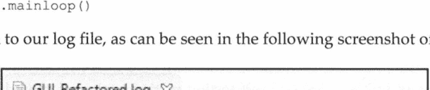

现在，我们可以通过为日志语句添加日志级别并设置我们想要输出的级别来控制日志记录。让我们将此功能添加到`Callbacks_Refactored.py`模块中的**纽约**按钮回调方法中，即`getDateTime`方法。

我们将之前的`print`语句改为使用不同调试级别的`log`语句。

在`GUI_Refactored.py`中，我们从`Logger`模块导入两个新类：

```python
from Ch08_Code.Logger import Logger, LogLevel
```

接下来，我们创建这些类的本地实例：

```python
# create Logger instance
fullPath = path.realpath(__file__)
self.log = Logger(fullPath)

# create Log Level instance
self.level = LogLevel()
```

由于我们将GUI类的实例传递给`Callbacks_Refactored.py`的初始化器，我们可以根据我们创建的`LogLevel`类来使用日志级别限制：

```python
# Format local US time with TimeZone info
def getDateTime(self):
    fmtStrZone = "%Y-%m-%d %H:%M:%S %Z"
    # Get Coordinated Universal Time
    utc = datetime.now(timezone('UTC'))
    self.oop.log.writeToLog(utc.strftime(fmtStrZone),
                            self.oop.level.MINIMUM)

    # Convert UTC datetime object to Los Angeles TimeZone
    la = utc.astimezone(timezone('America/Los_Angeles'))
    self.oop.log.writeToLog(la.strftime(fmtStrZone),
                            self.oop.level.NORMAL)

    # Convert UTC datetime object to New York TimeZone
    ny = utc.astimezone(timezone('America/New_York'))
    self.oop.log.writeToLog(ny.strftime(fmtStrZone),
                            self.oop.level.DEBUG)

    # update GUI label with NY Time and Zone
    self.oop.lbl2.set(ny.strftime(fmtStrZone))
```


当我们现在点击我们的 New York 按钮时，根据所选的日志级别，写入日志文件的内容会有所不同。默认日志级别是 DEBUG，这意味着所有内容都会写入日志：

```
GUI_Refactored.log
2016-12-19 18:30:40    *** Starting Test ***
2016-12-19 18:30:40    Test message
2016-12-19 18:30:42    2016-12-20 02:30:42 UTC+0000
2016-12-19 18:30:42    2016-12-19 18:30:42 PST-0800
2016-12-19 18:30:42    2016-12-19 21:30:42 EST-0500
```

当我们更改日志级别时，就可以控制写入日志的内容。我们通过调用 Logger 类的 setLoggingLevel 方法来实现这一点：

```
#-------------------------------------------------------------------------------
def setLoggingLevel(self, level):
    '''change logging level in the middle of a test.'''
    self.loggingLevel = level
```

在我们 GUI 的 __main__ 部分，我们将日志级别改为 MINIMUM，这样写入日志文件的输出就会减少：

```
if __name__ == '__main__':
#========================
# Start GUI
#========================
oop = OOP()
    oop.log.setLoggingLevel(oop.level.MINIMUM)
    oop.log.writeToLog('Test message')
    oop.win.mainloop()
```

现在，我们的日志文件不再显示 Test Message，只显示满足所设置日志级别的消息：

```
GUI_Refactored.log
2016-12-19 18:34:42    *** Starting Test ***
2016-12-19 18:34:43    2016-12-20 02:34:43 UTC+0000
```

## 工作原理...

在本节中，我们充分利用了 Python 内置的 __main__ 自测部分。我们引入了自己的日志文件，并同时学习了如何创建不同的日志级别。通过这样做，我们完全控制了写入日志文件的内容。

## 使用单元测试创建健壮的 GUI

Python 自带一个内置的单元测试框架，在本节中，我们将开始使用该框架来测试我们的 Python GUI 代码。

在开始编写单元测试之前，我们需要设计测试策略。我们可以轻松地将单元测试与被测代码混合在一起，但更好的策略是将应用程序代码与单元测试代码分开。


PyUnit 是根据所有其他 xUnit 测试框架的原则设计的。

## 准备工作

我们将测试本章前面创建的国际化的 GUI。

## 如何实现...

为了使用 Python 内置的单元测试框架，我们必须导入 Python 的 unittest 模块。让我们创建一个新模块并将其命名为 UnitTests.py。

我们首先导入 unittest 模块，然后创建自己的类，并在此类中继承和扩展 unittest.TestCase 类。

最简单的代码如下所示：

```
import unittest

class GuiUnitTests(unittest.TestCase):
    pass

if __name__ == '__main__':
```

unittest.main()

这段代码目前还没有做太多事情，但当我们运行它时，不会出现任何错误，这是一个好迹象：

UnitTestsMinimum.py

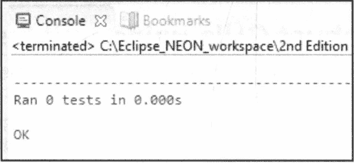

实际上，我们确实会得到一段写入控制台的输出，它说明我们成功运行了零个测试……

这个输出有点误导性，因为到目前为止，我们所做的只是创建了一个不包含任何实际测试方法的类。

我们通过遵循默认命名约定（所有测试方法都以单词 test 开头）来添加实际执行单元测试的测试方法。这是一个可以更改的选项，但遵循此命名约定更容易、更清晰。

让我们添加一个测试方法，用来测试我们 GUI 的标题。这将验证在传入预期参数的情况下，我们是否得到预期结果：

```
```python
import unittest
from Ch08_Code.LanguageResources import I18N

class GuiUnitTests(unittest.TestCase):

    def test_TitleEnglish(self):
        i18n = I18N('en')
        self.assertEqual(i18n.title, "Python Graphical User Interface")
```
```

我们正在从 Resources.py 模块导入 I18N 类，并传入英语作为 GUI 中显示的语言。由于这是我们的第一个单元测试，我们还会打印出标题结果，以确保我们知道返回的是什么。接下来，我们使用 unittest 的 assertEqual 方法来验证标题是否正确。

运行这段代码会得到 OK，这意味着单元测试通过：

UnitTests_One.py

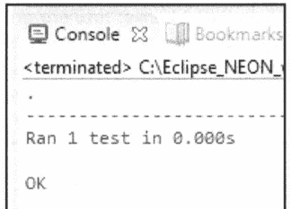

单元测试运行并成功，这由一个点号和 OK 字样表示。如果测试失败或出错，我们不会得到点号，而是会得到 F 或 E 作为输出。

现在，我们可以通过验证 GUI 德语版本的标题来执行同样的自动化单元测试检查。我们只需复制、粘贴并修改代码：

```
import unittest
from Ch08_Code.LanguageResources import I18N

class GuiUnitTests(unittest.TestCase):

    def test_TitleIsEnglish(self):
        i18n = I18N('en')
        self.assertEqual(i18n.title, "Python Graphical User Interface")

    def test_TitleIsGerman(self):
        i18n = I18N('en')
        self.assertEqual(i18n.title,
            'Python Grafische Benutzeroberfl' + "u00E4" + 'che')
```

现在，我们用两种语言测试我们国际化的 GUI 标题，并在运行代码后得到以下结果：

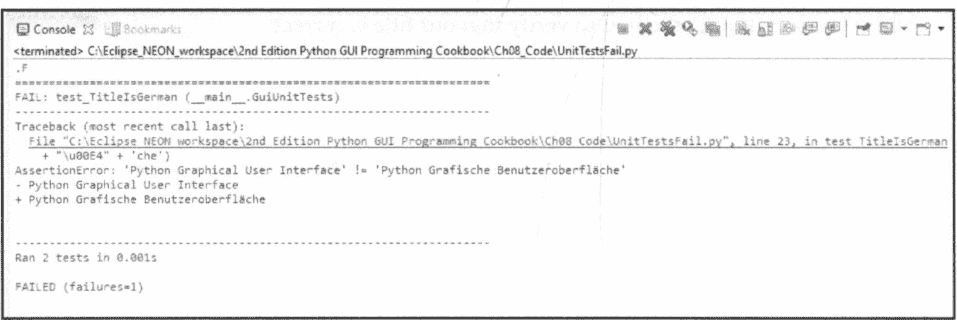

我们运行了两个单元测试，但得到的不是 OK，而是失败。发生了什么？

对于 GUI 的德语版本，我们的断言失败了……

在调试代码时，我们发现，在复制、粘贴和修改单元测试代码的过程中，我们忘记将德语作为语言参数传入。我们很容易修复这个问题：

```
def test_TitleIsGerman(self):
    # i18n = I18N('en')      # <= Bug in Unit Test
    i18n = I18N('de')
    self.assertEqual(i18n.title,
        'Python Grafische Benutzeroberfl' + "u00E4" + 'che')
```

当我们重新运行单元测试时，所有测试都通过了，得到了预期的结果：

已修正失败的 UnitTestsFail.py

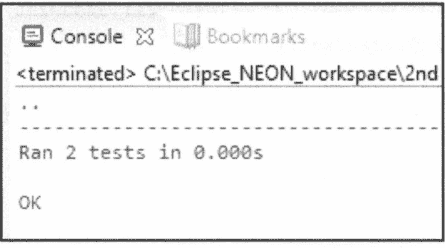

单元测试代码也是代码，也可能有 bug。

虽然编写单元测试的目的是真正测试应用程序代码，但我们必须确保测试编写正确。来自**测试驱动开发 (TDD)** 方法论的一种方法可能会帮助我们。

在 TDD 中，我们在实际编写应用程序代码之前先编写单元测试。现在，如果一个测试对于一个根本不存在的方法也能通过，那就说明有问题。下一步是创建那个不存在的方法，并确保它会失败。之后，我们可以编写使单元测试通过所需的最少量代码。

## 工作原理…

在本节中，我们开始测试我们的 Python GUI，并用 Python 编写单元测试。我们看到，Python 单元测试代码也只是代码，可能包含需要修正的错误。在下一节中，我们将扩展本节的代码，并使用 Eclipse IDE 的 PyDev 插件自带的图形化单元测试运行器。

## 如何使用 Eclipse PyDev IDE 编写单元测试

在上一节中，我们开始使用 Python 的单元测试功能，在本节中，我们将进一步使用该功能来确保 GUI 代码的质量。

我们会对 GUI 进行单元测试，以确保 GUI 显示的国际化字符串符合预期。

在上一节中，我们在单元测试代码中遇到了一些 bug，但通常情况下，单元测试会发现因修改现有应用程序代码而导致的回归 bug，而不是单元测试代码本身的 bug。一旦我们确认单元测试代码是正确的，通常就不会再更改它。

我们的单元测试也可以作为代码预期行为的文档。

默认情况下，Python 单元测试使用文本单元测试运行器执行，我们可以在 Eclipse IDE 中的 PyDev 插件中运行它。我们也可以在控制台窗口中运行完全相同的单元测试。

除了本节中的文本运行器之外，我们还将探索 PyDev 的图形化单元测试功能，该功能可以在 Eclipse IDE 中使用。

## 准备工作

我们将扩展上一节中开始使用 Python 单元测试的内容。

## 如何实现…

Python 单元测试框架带有所谓的 **测试夹具（Fixtures）**。

关于什么是测试夹具，请参阅以下 URL：

- `https://docs.python.org/3.6/library/unittest.html`
- `https://en.wikipedia.org/wiki/Test_fixture`
- `http://www.boost.org/doc/libs/1_51_0/libs/test/doc/html/utf/user-guide/fixture.html`

这意味着我们可以创建 `setup()` 和 `teardown()` 单元测试方法，这样在执行任何单个测试之前，都会在开始时调用 `setup()` 方法，而在每个单元测试结束时，都会调用 `teardown()` 方法。

这种测试夹具功能为我们提供了一个非常可控的环境，我们可以在其中运行单元测试。这类似于使用前置条件和后置条件。

让我们设置单元测试环境。我们将创建一个新的测试类，专注于验证上述代码的正确性：

```
import unittest
from Ch08_Code.LanguageResources import I18N
```


from Ch08_Code.GUI_Refactored import OOP as GUI

class GuiUnitTests(unittest.TestCase):
    def test_TitleIsEnglish(self):
        i18n = I18N('en')
        self.assertEqual(i18n.title, "Python Graphical User Interface")

    def test_TitleIsGerman(self):
        # i18n = I18N('en') # <= Bug in Unit Test
        i18n = I18N('de')
        self.assertEqual(i18n.title,
            'Python Grafische Benutzeroberfl' + "u00E4" + 'che')

class WidgetsTestsEnglish(unittest.TestCase):
    def setUp(self):
        self.gui = GUI('en')

    def tearDown(self):
        self.gui = None

    def test_WidgetLabels(self):
        self.assertEqual(self.gui.i18n.file, "File")
        self.assertEqual(self.gui.i18n.mgrFiles, ' Manage Files ')
        self.assertEqual(self.gui.i18n.browseTo, "Browse to File...")

#===================
if __name__ == '__main__':
    unittest.main()

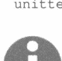

unittest.main() 会运行任何以 test 前缀开头的方法，无论我们在给定的 Python 模块中创建了多少个类。

这将产生以下输出：

UnitTestsEnglish.py

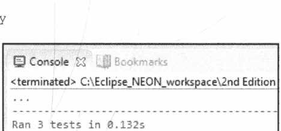

上述单元测试代码表明，我们可以创建多个单元测试类，并通过调用 unittest.main() 在同一模块中运行它们。

它还表明，setup() 方法在单元测试报告的输出中不计入测试数量（测试数量为 3），同时它也确实完成了预期工作，因为我们现在可以从单元测试方法内部访问类实例变量 self.gui。

我们希望测试所有标签的正确性，尤其是在修改代码时捕获错误。

如果我们将应用程序代码中的字符串复制并粘贴到测试代码中，那么只需单击单元测试框架的按钮，就能捕获任何非预期的更改。

我们还希望测试，以任何语言调用我们的任一 Radiobutton 控件，都会导致 LabelFrame 控件的文本得到更新。为了自动测试这一点，我们需要做两件事。

首先，我们必须获取 LabelFrame 控件的值，并将其赋值给一个名为 labelFrameText 的变量。我们必须使用以下语法，因为该控件的属性是通过字典数据类型传递和获取的：

```
self.gui.widgetFrame['text']
```

现在，我们可以验证默认文本，然后在以编程方式单击某个单选按钮控件后验证国际化版本：

```
class WidgetsTestsGerman(unittest.TestCase):
    def setUp(self):
        self.gui = GUI('de')

    def test_WidgetLabels(self):
        self.assertEqual(self.gui.i18n.file, "Datei")
        self.assertEqual(self.gui.i18n.mgrFiles, ' Dateien Organisieren ')
        self.assertEqual(self.gui.i18n.browseTo, "Waehle eine Datei... ")

    def test_LabelFrameText(self):
        labelFrameText = self.gui.widgetFrame['text']
        self.assertEqual(labelFrameText, " Widgets Rahmen ")
        self.gui.radVar.set(1)
        self.gui.callBacks.radCall()
        labelFrameText = self.gui.widgetFrame['text']
        self.assertEqual(labelFrameText, " Widgets Rahmen in Gold")
```

在验证默认的 labelFrameText 之后，我们以编程方式将单选按钮设置为索引 1，然后调用单选按钮的回调方法：

```
self.gui.radVar.set(1)
self.gui.callBacks.radCall()
```

这基本上等同于在 GUI 中单击单选按钮，只不过我们是在单元测试中通过代码触发该按钮的单击事件。

然后，我们验证 LabelFrame 控件中的文本是否已按预期更改。

当我们在 Eclipse 中使用 Python PyDev 插件运行单元测试时，Eclipse 控制台会输出以下内容：

```
UnitTests.py
```

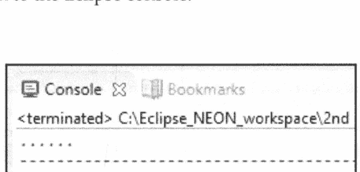

如果从命令提示符运行，只要导航到代码所在的文件夹，也会得到类似的输出：

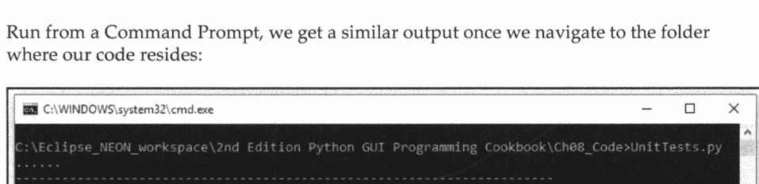

## 国际化与测试

如果遇到 `ModuleNotFoundError`，只需将 Python 代码所在目录添加到 Windows 的 PYTHONPATH 环境变量中，如下面的截图所示：

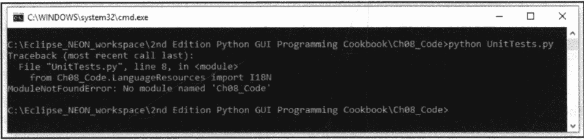

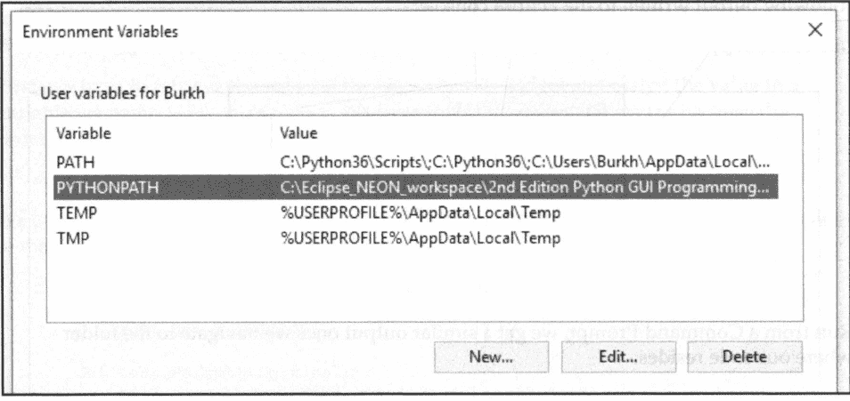

例如，`C:\Eclipse_NEON_workspace\2nd Edition Python GUI Programming Cookbook`：

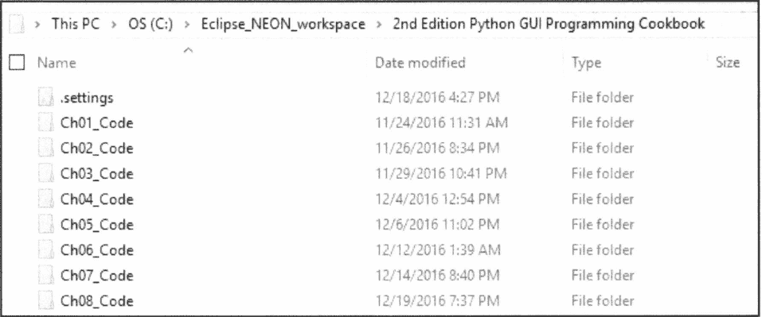

这样会将 Ch08_Code 文件夹识别为 Python 包，代码就能运行了。

使用 Eclipse 时，我们还可以选择不以普通 Python 脚本方式运行单元测试，而是以 *Python 单元测试* 脚本方式运行，这样会得到一些彩色输出，而不是 DOS 提示符那种黑白界面：

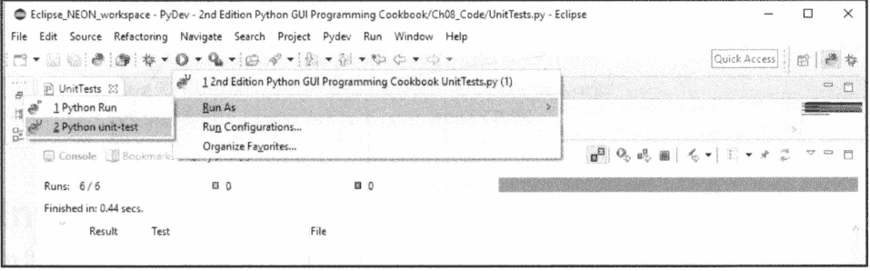

单元测试结果条为绿色，这意味着我们所有的单元测试都已通过。上面的截图还显示，GUI 测试运行器比文本测试运行器慢：在 Eclipse 中为 0.44 秒，而文本测试运行器为 0.376 秒。

## 工作原理

我们通过测试 `labels`、以编程方式调用 `Radiobutton`，然后在单元测试中验证 `LabelFrame` 控件的相应 `text` 属性是否已按预期更改，从而扩展了单元测试代码。我们测试了两种不同的语言。接着，我们使用 Eclipse/PyDev 内置的图形化单元测试运行器进行了测试。
