## 9
使用 wxPython 库扩展我们的 GUI

在本章中，我们将使用 wxPython 库来增强我们的 Python GUI。我们将介绍以下内容：

+   - 安装 wxPython 库
+   - 使用 wxPython 创建我们的 GUI
+   - 使用 wxPython 快速添加控件
+   - 尝试将主 wxPython 应用程序嵌入主 tkinter 应用程序中
+   - 尝试将我们的 tkinter GUI 代码嵌入 wxPython
+   - 使用 Python 控制两个不同的 GUI 框架
+   - 在两个连接的 GUI 之间通信

### 简介

在本章中，我们将介绍另一个目前不随 Python 一起发布的 Python GUI 工具包，它名为 wxPython。

这个库有两个版本。原始版本称为 Classic，而最新版本以其开发项目代号命名，即 Phoenix。

在本书中，我们仅使用 Python 3.6 及以上版本进行编程；由于新的 Phoenix 项目旨在支持 Python 3.6 及以上版本，因此我们将使用这个版本的 wxPython。

## 使用 wxPython 库扩展我们的 GUI

首先，我们将创建一个简单的 wxPython GUI，然后尝试将本书中开发的两个基于 tkinter 的 GUI 与新的 wxPython 库连接起来。


wxPython 是 wxWidgets 的 Python 绑定。wxPython 中的 w 代表 Windows 操作系统，x 代表基于 Unix 的操作系统，如 Linux 和 Apple 的 OS X（现已更名为 Mac OS）。

如果同时使用这两种 GUI 工具包无法顺利工作，我们将尝试使用 Python 来解决任何问题；如有必要，我们将在 Python 中使用**进程间通信（IPC）**，以确保我们的 Python 代码能够按预期工作。

以下是本章使用的 Python 模块概览：

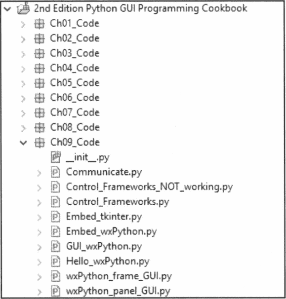

## 安装 wxPython 库

wxPython 库不随 Python 一起发布，因此要使用它，我们必须先安装它。

本指南将向我们展示在何处以及如何找到正确的安装版本，以匹配已安装的 Python 版本和当前运行的操作系统。

wxPython 第三方库已经存在了 18 年多，这表明它是一个成熟稳定的库。

### 准备工作

为了在 Python 3.6 及以上版本中使用 wxPython，我们必须安装 wxPython Phoenix 版本。

### 操作步骤

当你在网上搜索 wxPython 时，很可能会找到官方网站 www.wxpython.org：

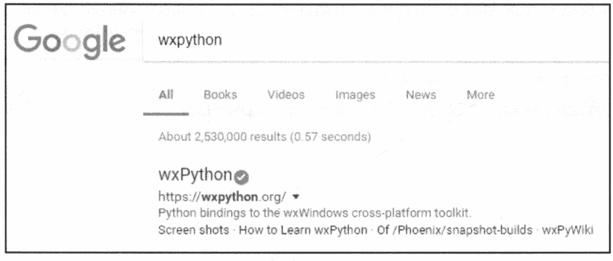


# 使用 wxPython 库扩展我们的 GUI

如果点击 MS Windows 的下载链接，你会看到几个 Windows 安装程序，它们都仅适用于 Python 2.x：

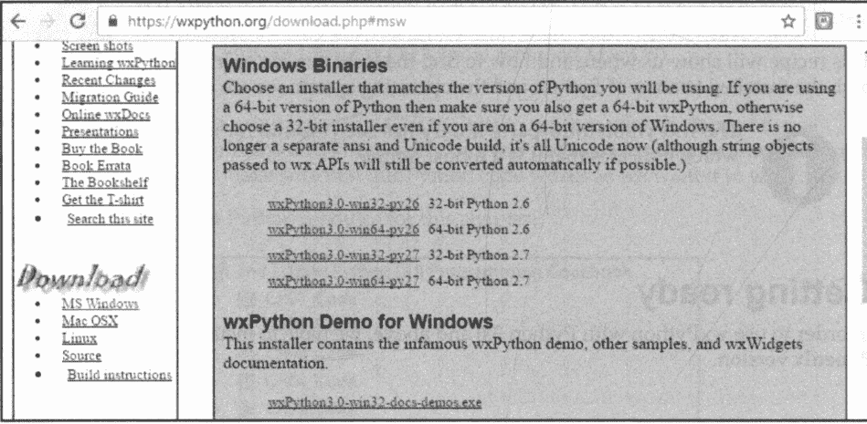

要使用 Python 3.6 的 wxPython，我们需要安装 wxPython/Phoenix 库。我们可以在 snapshot-builds 链接处找到安装程序：`http://wxpython.org/Phoenix/snapshot-builds/`

从这里，我们可以选择与我们的 Python 版本和操作系统相匹配的 wxPython/Phoenix 版本。我使用的是在 64 位 Windows 10 操作系统上运行的 Python 3.6。

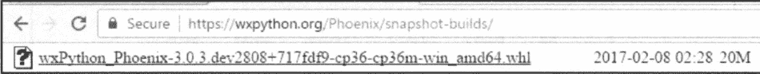

Python wheel（`.whl`）安装程序包有一个编号方案。

对我们来说，该方案中最重要的一部分是，我们安装的是适用于 Python 3.6（安装程序名称中的 *cp36*）并且适用于 Windows 64 位操作系统（安装程序名称中的 *win_amd64* 部分）的 wxPython/Phoenix 构建。

成功下载 wxPython/Phoenix 包后，我们现在可以导航到它所在的目录，并使用 pip 安装此包：

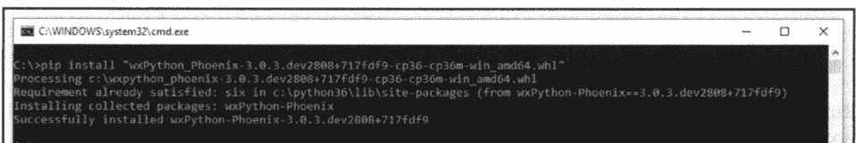

我们在 Python site-packages 文件夹中有了一个名为 wx 的新文件夹：

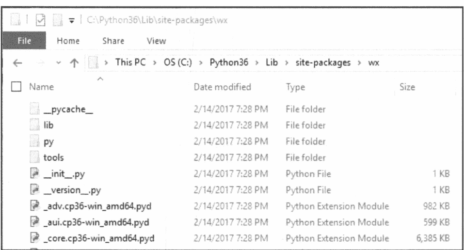


wx 是文件夹名称，wxPython Phoenix 库已安装到其中。我们将把此模块导入到我们的 Python 代码中。

我们可以通过执行来自官方 wxPython/Phoenix 网站的这个简单演示脚本来验证我们的安装是否成功。官方网站的链接是 http://wxpython.org/Phoenix/docs/html/。

考虑以下代码：

```
```python
import wx
app = wx.App()
frame = wx.Frame(None, -1, "Hello World")
frame.Show()
app.MainLoop()
```
```

运行上述 Python 3.6 脚本会使用 wxPython/Phoenix 创建以下 GUI：

Hello_wxPython.py

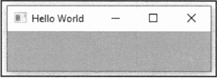

## How it works…

在本教程中，我们成功安装了可与 Python 3.6 一起使用的正确版本的 wxPython 工具包。我们找到了该 GUI 工具包的 Phoenix 项目，这是当前且活跃的开发分支。Phoenix 将在未来取代经典的 wxPython 工具包，并且特别旨在与 Python 3.6 良好配合。

成功安装 wxPython/Phoenix 工具包后，我们仅用五行代码就使用该工具包创建了一个 GUI。

我们之前通过使用 tkinter 实现了相同的结果。

## 在 wxPython 中创建我们的 GUI

在本教程中，我们将开始使用 wxPython GUI 工具包创建 Python GUI。

我们将首先重新创建之前使用随 Python 提供的 tkinter 创建的几个小部件。

然后，我们将探索 wxPython GUI 工具包提供的一些小部件，这些小部件使用 tkinter 创建起来并不容易。

## Getting ready

上一教程向你展示了如何安装与你的 Python 版本和正在运行的操作系统相匹配的正确版本的 wxPython。

## How to do it...

探索 wxPython GUI 工具包的一个好地方是访问以下 URL：http://wxpython.org/Phoenix/docs/html/gallery.html

此网页显示了许多 wxPython 小部件，并且通过点击其中任何一个，我们都会被带到其文档，这是一个非常有用的功能，可以快速了解 wxPython 控件：

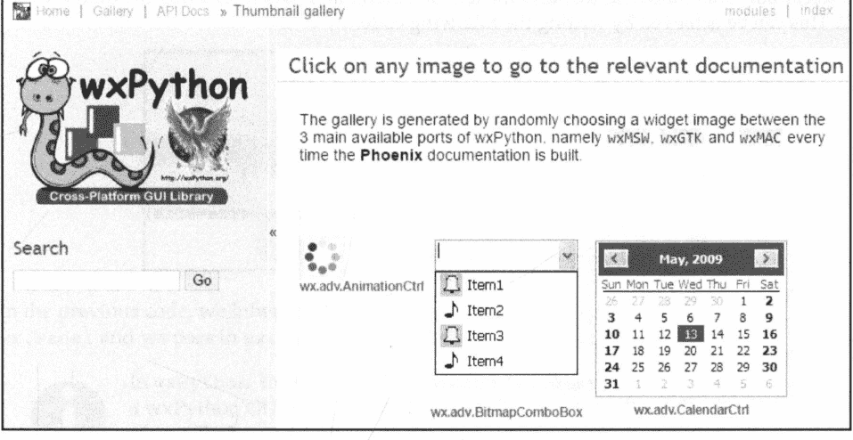

以下屏幕截图显示了 wxPython 按钮小部件的文档：

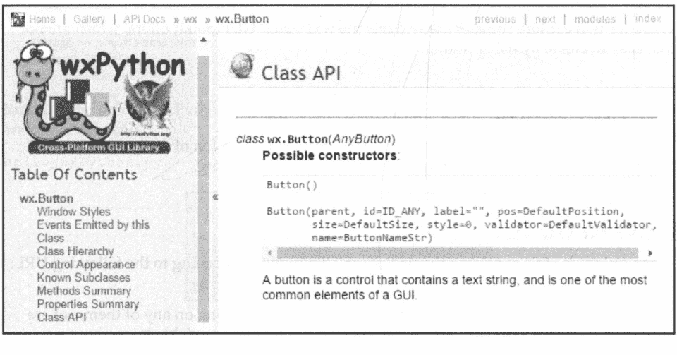

我们可以非常快速地创建一个带有标题、菜单栏和状态栏的工作窗口。当鼠标悬停在菜单项上时，该状态栏会显示菜单项的文本。这可以通过编写以下代码来实现：

```
# Import wxPython GUI toolkit
import wx

# Subclass wxPython frame
class GUI(wx.Frame):
    def __init__(self, parent, title, size=(200,100)):
        # Initialize super class
        wx.Frame.__init__(self, parent, title=title, size=size)

        # Change the frame background color
        self.SetBackgroundColour('white')

        # Create Status Bar
        self.CreateStatusBar()

        # Create the Menu
        menu= wx.Menu()

        # Add Menu Items to the Menu
        menu.Append(wx.ID_ABOUT, "About", "wxPython GUI")
        menu.AppendSeparator()
```

```
menu.Append(wx.ID_EXIT,"Exit"," Exit the GUI")

# Create the MenuBar
menuBar = wx.MenuBar()

# Give the Menu a Title
menuBar.Append(menu,"File")

# Connect the MenuBar to the frame
self.SetMenuBar(menuBar)

# Display the frame
self.Show()

# Create instance of wxPython application
app = wx.App()

# Call sub-classed wxPython GUI increasing default Window size
GUI(None, "Python GUI using wxPython", (300,150))

# Run the main GUI event loop
app.MainLoop()
```

这会创建以下 GUI，该 GUI 使用 wxPython 库用 Python 编写：

GUI_wxPython.py

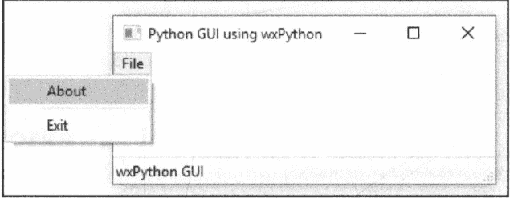

在之前的代码中，我们继承自 wx.Frame。在下一段代码中，我们继承自 wx.Panel，并且将 wx.Frame 传递给我们类的 __init__() 方法。


在 wxPython 中，顶级 GUI 窗口称为 frame。没有 frame 就没有 wxPython GUI，并且 frame 必须作为 wxPython 应用程序的一部分创建。我们在代码底部同时创建应用程序和 frame。

为了向我们的 GUI 添加小部件，我们必须将它们附加到一个面板。面板的父级是 frame（我们的顶级窗口），而我们放置到面板中的小部件的父级是面板。

以下代码将一个多行文本框小部件添加到其父级为 frame 的面板中。我们还在面板小部件中添加了一个按钮小部件，当点击时，它会向文本框打印一些文本。

以下是完整代码：

```
import wx                                          # Import wxPython GUI toolkit
class GUI(wx.Panel):                               # Subclass wxPython Panel
    def __init__(self, parent):

        # Initialize super class
        wx.Panel.__init__(self, parent)

        # Create Status Bar
        parent.CreateStatusBar()

        # Create the Menu
        menu= wx.Menu()

        # Add Menu Items to the Menu
        menu.Append(wx.ID_ABOUT, "About", "wxPython GUI")
        menu.AppendSeparator()
        menu.Append(wx.ID_EXIT,"Exit","  Exit the GUI")

        # Create the MenuBar
        menuBar = wx.MenuBar()

        # Give the Menu a Title
        menuBar.Append(menu,"File")

        # Connect the MenuBar to the frame
        parent.SetMenuBar(menuBar)

        # Create a Print Button
        button = wx.Button(self, label="Print", pos=(0,60))

        # Connect Button to Click Event method
        self.Bind(wx.EVT_BUTTON, self.printButton, button)

        # Create a Text Control widget
        self.textBox = wx.TextCtrl(self, size=(280,50),
                                   style=wx.TE_MULTILINE)
```

```
# callback event handler
def printButton(self, event):
    self.textBox.AppendText("The Print Button has been clicked!")

app = wx.App()        # Create instance of wxPython application
                      # Create frame
frame = wx.Frame(None, -1, size=(300,180))
GUI(frame)            # Pass frame into GUI
frame.Show()          # Display the frame
app.MainLoop()        # Run the main GUI event loop
```

在前面的代码中，parent 是我们传递给 GUI 初始化器的 wx.Frame。

运行前面的代码并点击我们的 wxPython 按钮小部件会产生以下 GUI 输出：

wxPython_panel_GUI.py

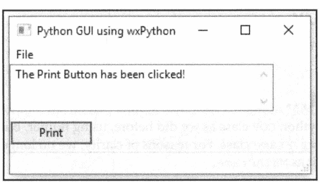

## How it works...

在本教程中，我们使用成熟的 wxPython GUI 工具包创建了自己的 GUI。仅用几行 Python 代码，我们就能创建一个功能齐全的 GUI，其中包含最小化、最大化和退出按钮。我们添加了菜单栏、多行文本控件和按钮。我们还创建了一个状态栏，当我们选择菜单项时显示文本。我们将所有这些小部件放置在 Panel 容器小部件中。

我们将按钮连接到向文本控件打印的功能。

当悬停在菜单项上时，一些文本会显示在状态栏中。


# 使用 wxPython 快速添加控件

在本节中，我们将重新创建本书前面用 tkinter 创建的 GUI，但这次我们将使用 wxPython 库。我们会看到使用 wxPython GUI 工具包创建我们自己的 Python GUI 是多么简单快捷。

我们不会重新创建前几章中实现的所有功能。例如，我们不会对 wxPython GUI 进行国际化，也不会将其连接到 MySQL 数据库。我们将重新创建 GUI 的视觉部分，并添加一些功能。

> 比较不同的库可以让我们选择使用哪些工具包来进行自己的 Python GUI 开发，而且我们可以在自己的 Python 代码中组合使用这些工具包中的多种。

## 准备工作

请确保你已安装 wxPython 模块，以便按照本节内容进行操作。

## 如何实现……

首先，像之前使用 tkinter 时那样创建我们的 Python OOP 类，但这次我们继承并扩展了 `wx.Frame` 类。为了清晰起见，我们不再将类命名为 OOP，而是将其重命名为 `MainFrame`。

> 在 wxPython 中，主 GUI 窗口被称为 Frame。

我们还创建了一个回调方法，当我们点击 **Exit** 菜单项时关闭 GUI，并声明一个浅灰色 `tuple` 作为 GUI 的背景颜色：

```
import wx
BACKGROUND_COLOR = (240, 240, 240, 255)

class MainFrame(wx.Frame):
    def __init__(self, *args, **kwargs):
        wx.Frame.__init__(self, *args, **kwargs)
        self.createWidgets()
        self.Show()
```

```
def exitGUI(self, event):      # callback
    self.Destroy()

def createWidgets(self):
    self.CreateStatusBar()      # wxPython built-in method
    self.createMenu()
    self.createNotebook()
```

然后，我们通过创建 wxPython Notebook 类的实例，为 GUI 添加一个选项卡控件，并将其作为我们自定义类 Widgets 的父级。

Notebook 类实例变量的父级是 wx.Panel：

```
#--------------------------------------------------
def createNotebook(self):
    panel = wx.Panel(self)
    notebook = wx.Notebook(panel)
    widgets = Widgets(notebook) # Custom class explained below
    notebook.AddPage(widgets, "Widgets")
    notebook.SetBackgroundColour(BACKGROUND_COLOR)
    # layout
    boxSizer = wx.BoxSizer()
    boxSizer.Add(notebook, 1, wx.EXPAND)
    panel.SetSizerAndFit(boxSizer)
```

在 wxPython 中，选项卡控件被命名为 Notebook，与 tkinter 中相同。

每个 Notebook 控件都需要有一个父级，并且为了在 wxPython 的 Notebook 中布局控件，我们使用不同类型的 sizer。

wxPython 的 sizer 是布局管理器，类似于 tkinter 的 grid 布局管理器。

接下来，我们向 Notebook 页面添加控件，方法是通过创建一个继承自 wx.Panel 的单独类：

```
class Widgets(wx.Panel):
    def __init__(self, parent):
        wx.Panel.__init__(self, parent)
        self.createWidgetsFrame()
        self.addWidgets()
        self.layoutWidgets()
```

## 使用 wxPython 库扩展我们的 GUI

我们按照 Python OOP 编程规范，将 GUI 代码分解为小方法来实现模块化，这使我们的代码保持可管理和易理解：

```
```python
#-----------------------------------------------
def createWidgetsFrame(self):
    self.panel = wx.Panel(self)
    staticBox = wx.StaticBox(self.panel, -1, "Widgets Frame")
    self.statBoxSizerV = wx.StaticBoxSizer(staticBox, wx.VERTICAL)
#-----------------------------------------------
def layoutWidgets(self):
    boxSizerV = wx.BoxSizer(wx.VERTICAL)
    boxSizerV.Add(self.statBoxSizerV, 1, wx.ALL)
    self.panel.SetSizer(boxSizerV)
    boxSizerV.SetSizeHints(self.panel)
#-----------------------------------------------
def addWidgets(self):
    self.addCheckBoxes()
    self.addRadioButtons()
    self.addStaticBoxWithLabels()
```
```

> 当使用 wxPython 的 `StaticBox` 控件时，为了成功布局它们，我们需要结合使用 `StaticBoxSizer` 和常规的 `BoxSizer`。wxPython 的 `StaticBox` 与 tkinter 的 `LabelFrame` 控件非常相似。

在 tkinter 中，将一个 `StaticBox` 嵌入另一个 `StaticBox` 中非常简单，但使用 wxPython 时则有点不太直观。下面代码片段展示了一种可行的方法：

```
```python
def addStaticBoxWithLabels(self):
    boxSizerH = wx.BoxSizer(wx.HORIZONTAL)
    staticBox = wx.StaticBox(self.panel, -1, "Labels within a Frame")
    staticBoxSizerV = wx.StaticBoxSizer(staticBox, wx.VERTICAL)
    boxSizerV = wx.BoxSizer(wx.VERTICAL)
    staticText1 = wx.StaticText(self.panel, -1, "Choose a number:")
    boxSizerV.Add(staticText1, 0, wx.ALL)
    staticText2 = wx.StaticText(self.panel, -1, "Label 2")
    boxSizerV.Add(staticText2, 0, wx.ALL)
    #-----------------------------------------------
    staticBoxSizerV.Add(boxSizerV, 0, wx.ALL)
    boxSizerH.Add(staticBoxSizerV)
    #-----------------------------------------------
    # boxSizerH.Add(wx.TextCtrl(self.panel))
    # Add local boxSizer to main frame
    self.statBoxSizerV.Add(boxSizerH, 1, wx.ALL)
```
```

首先，我们创建一个水平的 BoxSizer。接着，我们创建一个垂直的 StaticBoxSizer，因为我们希望在这个框架中垂直排列两个标签。

为了将另一个控件放在嵌入的 StaticBox 右侧，我们必须将嵌入的 StaticBox 及其子控件和下一个控件都分配给水平 BoxSizer，然后将这个现在同时包含嵌入的 StaticBox 和其他控件的 BoxSizer 分配给主 StaticBox。

这听起来是不是有点令人困惑？

你只需要亲自试验这些 sizer，才能熟悉它们的用法。从本节的代码开始，注释掉部分代码或修改一些 x 和 y 坐标来看看效果。

阅读官方 wxPython 文档来了解更多内容也是一个好主意。

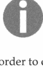

重要的是知道在代码中应该向不同的 sizer 添加什么，才能实现我们想要的布局。

为了在第一个 StaticBox 下方创建第二个 StaticBox，我们创建单独的 StaticBoxSizer，并将它们分配给同一个面板：

```
class Widgets(wx.Panel):
    def __init__(self, parent):
        wx.Panel.__init__(self, parent)
        self.panel = wx.Panel(self)
        self.createWidgetsFrame()
        self.createManageFilesFrame()
        self.addWidgets()
        self.addFileWidgets()
        self.layoutWidgets()

    #------------------------------------------------------------
    def createWidgetsFrame(self):
        staticBox = wx.StaticBox(self.panel, -1, "Widgets Frame",
                                size=(285, -1))
        self.statBoxSizerV = wx.StaticBoxSizer(staticBox, wx.VERTICAL)
    #------------------------------------------------------------
    def createManageFilesFrame(self):
        staticBox = wx.StaticBox(self.panel, -1, "Manage Files",
                                size=(285, -1))
        self.statBoxSizerMgrV = wx.StaticBoxSizer(staticBox, wx.VERTICAL)
    #------------------------------------------------------------
    def layoutWidgets(self):
        boxSizerV = wx.BoxSizer( wx.VERTICAL )
```

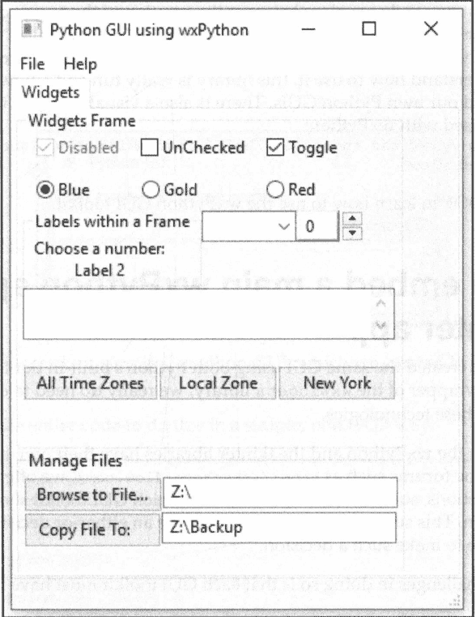

## 工作原理……

我们在几个类中设计和布局 wxPython GUI。

完成这些后，在 Python 模块的底部，我们创建 wxPython 应用的一个实例。接下来，我们实例化 wxPython GUI 代码。

之后，我们调用主 GUI 事件循环，该循环执行我们在此应用程序进程中运行的所有 Python 代码。这将显示我们的 wxPython GUI。

我们在创建 app 和调用其主事件循环之间放置的任何代码，都会成为我们的 wxPython GUI。也许需要一些时间才能真正适应 wxPython 库及其 API，但一旦我们理解了如何使用它，这个库真的很有趣，而且是构建我们自己的 Python GUI 的强大工具。还有一个可视化设计器工具可以与 wxPython 一起使用：
http://www.cae.tntech.edu/help/programming/wxdesigner-getting-started/view

本节使用了 OOP 来学习如何使用 wxPython GUI 工具包。

## 尝试将主 wxPython 应用嵌入主 tkinter 应用

现在我们已经使用 Python 内置的 tkinter 库以及 wxWidgets 库的 wxPython 封装创建了相同的 GUI，我们确实需要将使用这些技术创建的 GUI 结合起来。

wxPython 和 tkinter 库各有其优势。在 http://stackoverflow.com/ 等在线论坛中，我们经常看到诸如哪个更好、我应该使用哪个 GUI 工具包等问题。这似乎意味着我们必须做出二选一的决定。但我们不必做出这样的决定。

这样做的主要挑战之一是，每个 GUI 工具包都必须有自己的事件循环。

在本节中，我们将尝试从 tkinter GUI 中调用一个简单的 wxPython GUI，以将其嵌入其中。

## 准备工作

我们将复用第 1 章“创建 GUI 表单并添加控件”中“Combo Box 控件”一节构建的 tkinter GUI。


## 如何实现...

我们将从一个简单的 tkinter GUI 开始，如下所示：

Embed_wxPython.py

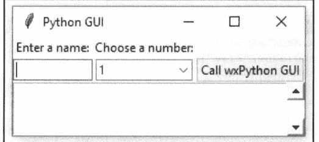

接下来，我们将尝试调用一个简单的 wxPython GUI，它是在本章之前的一个食谱中创建的。

以下是在一个简单的非 OOP 方式下执行此操作的完整代码：

```
#=============================================================
import tkinter as tk
from tkinter import ttk, scrolledtext

win = tk.Tk()
win.title("Python GUI")
aLabel = ttk.Label(win, text="A Label")
aLabel.grid(column=0, row=0)
ttk.Label(win, text="Enter a name:").grid(column=0, row=0)
name = tk.StringVar()
nameEntered = ttk.Entry(win, width=12, textvariable=name)
nameEntered.grid(column=0, row=1)
ttk.Label(win, text="Choose a number:").grid(column=1, row=0)
number = tk.StringVar()
numberChosen = ttk.Combobox(win, width=12, textvariable=number)
numberChosen['values'] = (1, 2, 4, 42, 100)
numberChosen.grid(column=1, row=1)
numberChosen.current(0)
scrolW = 30
scrolH = 3
scr = scrolledtext.ScrolledText(win, width=scrolW, height=scrolH, wrap=tk.WORD)
scr.grid(column=0, sticky='WE', columnspan=3)
nameEntered.focus()
#===============================================
def wxPythonApp():
    import wx
    app = wx.App()
    frame = wx.Frame(None, -1, "wxPython GUI", size=(200,150))
    frame.SetBackgroundColour('white')
    frame.CreateStatusBar()
    menu= wx.Menu()
    menu.Append(wx.ID_ABOUT, "About", "wxPython GUI")
    menuBar = wx.MenuBar()
    menuBar.Append(menu,"File")
    frame.SetMenuBar(menuBar)
    frame.Show()
    app.MainLoop()

action = ttk.Button(win, text="Call wxPython GUI", command=wxPythonApp)
action.grid(column=2, row=1)

#===================
# Start GUI
#===================
win.mainloop()
```

运行上述代码后，点击 tkinter 按钮控件，将从 tkinter GUI 启动一个 wxPython GUI：

Embed_wxPython.py

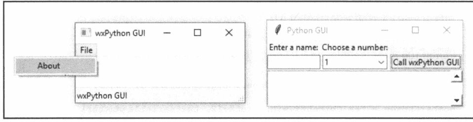

## 工作原理...

重要的是，我们将整个 wxPython 代码放入其自己的函数中，命名为 def wxPythonApp()。

在按钮点击事件的回调函数中，我们只需调用这段代码。

> > 需要注意的一点是，我们必须先关闭 wxPython GUI，然后才能继续使用 tkinter GUI。

## 尝试将我们的 tkinter GUI 代码嵌入到 wxPython 中

在本食谱中，我们将沿着与之前食谱相反的方向，尝试在 wxPython GUI 中调用我们的 tkinter GUI 代码。

### 准备工作

我们将复用本章之前食谱中创建的一些 wxPython GUI 代码。

### 如何实现...

我们将从一个简单的 wxPython GUI 开始，如下所示：

`Embed_tkinter.py`

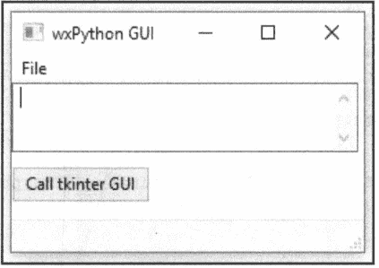

接下来，我们将尝试调用一个简单的 tkinter GUI。

运行上述代码后，点击 wxPython 按钮控件，将从 wxPython GUI 启动一个 tkinter GUI。然后，我们可以在 tkinter 文本框中输入文本，并点击其按钮，按钮文本将更新为该名称：

`Embed_tkinter.py`

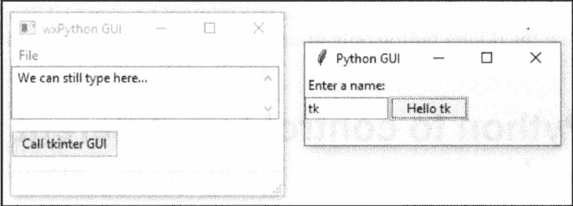

启动 tkinter 事件循环后，当 tkinter GUI 正在运行时，我们仍然可以向 TextCtrl 控件中输入文本，因此 wxPython GUI 仍然保持响应。

在之前的食谱中，我们必须先关闭 wxPython GUI，然后才能使用 tkinter GUI。如果我们想将这两种 Python GUI 技术结合起来，了解这一差异有助于我们的设计决策。

我们还可以通过多次点击 wxPython GUI 按钮来创建多个 tkinter GUI 实例。但是，只要任何 tkinter GUI 仍在运行，我们就无法关闭 wxPython GUI。我们必须先关闭它们：

`Embed_tkinter.py`

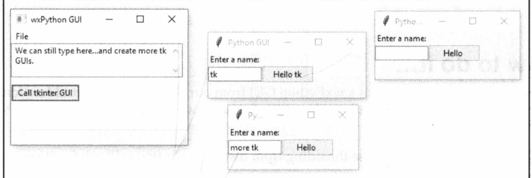

### 工作原理...

在本食谱中，我们沿与之前食谱相反的方向：首先使用 wxPython 创建 GUI，然后从其中创建多个使用 tkinter 构建的 GUI 实例。

当一个或多个 tkinter GUI 运行时，wxPython GUI 仍然保持响应。然而，点击 tkinter 按钮只会更新第一个实例中的按钮文本。

## 使用 Python 控制两个不同的 GUI 框架

在本食谱中，我们将探讨从 Python 控制 tkinter 和 wxPython GUI 框架的方法。我们已经在前面的一章“线程与网络”中使用过 Python 的 threading 模块来保持 GUI 的响应性，因此这里我们将尝试使用相同的方法。

我们会发现，事情并不总是按照直觉的方式运作。

然而，我们将改进我们的 tkinter GUI，使其在从内部调用 wxPython GUI 实例时不会失去响应。

### 准备工作

本食谱将扩展本章之前的食谱“尝试将主 wxPython 应用嵌入主 tkinter 应用”，在该食谱中，我们尝试将主 wxPython GUI 嵌入到 tkinter GUI 中。

### 如何实现...

当我们从 tkinter GUI 创建 wxPython GUI 实例时，在关闭这个 wxPython GUI 实例之前，我们无法再使用 tkinter GUI 控件。现在让我们对此进行改进。

我们的第一次尝试可能是从 tkinter 按钮回调函数中使用线程。

例如，我们的代码可能如下所示：

```
def wxPythonApp():
    import wx
    app = wx.App()
    frame = wx.Frame(None, -1, "wxPython GUI", size=(200,150))
    frame.SetBackgroundColour('white')
    frame.CreateStatusBar()
    menu= wx.Menu()
    menu.Append(wx.ID_ABOUT, "About", "wxPython GUI")
    menuBar = wx.MenuBar()
    menuBar.Append(menu,"File")
    frame.SetMenuBar(menuBar)
    frame.Show()
    app.MainLoop()

def tryRunInThread():
    runT = Thread(target=wxPythonApp)
    runT.setDaemon(True)
    runT.start()
    print(runT)
    print('createThread() :', runT.isAlive())

action = ttk.Button(win, text="Call wxPython GUI", command=tryRunInThread)
```

起初，这似乎是有效的，这也符合直觉，因为 tkinter 控件不再被禁用，我们可以通过点击按钮创建多个 wxPython GUI 实例。我们还可以在 wxPython GUI 中输入文本，并选择其他 tkinter 控件：

Control_Frameworks_NOT_working.py

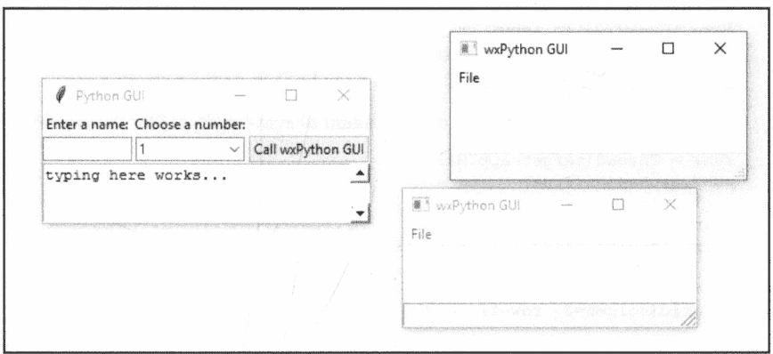

### 工作原理...

我们首先尝试在一个线程中运行整个 wxPython GUI 应用程序，但这没有用，因为 wxPython 的主事件循环期望成为应用程序的主线程。

我们通过只在一个线程中运行 wxPython 的 `app.MainLoop` 找到了解决方法，使其误以为自己是主线程。

这种方法的一个副作用是，我们无法再单独关闭所有 wxPython GUI 实例。其中至少有一个实例只在我们关闭创建线程为守护线程的 wxPython GUI 时才会关闭。您可以通过点击 **调用 wxPython GUI** 按钮一次或多次，然后尝试关闭所有已创建的 wxPython 窗口窗体来测试这一点。除非我们先关闭调用方的 tkinter GUI，否则我们无法关闭最后一个 wxPython GUI！

我不太确定为什么会这样。凭直觉，人们可能期望能够关闭所有守护线程，而不必等待创建它们的主线程先关闭。

这可能与主线程仍在运行时引用计数器尚未归零有关。

从实际角度来看，这就是当前的工作方式。

## 在两个连接的 GUI 之间通信

在之前的食谱中，我们找到了将 wxPython GUI 与 tkinter GUI 连接的方法，可以从一个调用另一个，反之亦然。

虽然两个 GUI 同时成功运行，但它们并没有真正相互通信，因为它们只是相互启动。

在本食谱中，我们将探讨让两个 GUI 相互对话的方法。

### 准备工作

阅读前面某个食谱可能对本食谱有很好的帮助。

在本食谱中，我们将使用相对于前一个食谱稍作修改的 GUI 代码，但大多数基本的 GUI 构建代码是相同的。

### 如何实现...

在之前的食谱中，我们的主要挑战之一是如何组合两种 GUI 技术，而它们都被设计为应用程序唯一的 GUI 工具包。我们找到了各种简单的方法来组合它们。

我们将再次从 tkinter GUI 的主事件循环启动 wxPython GUI，并在其自己的线程中启动 wxPython GUI，该线程在 Python.exe 进程内运行。

为此，我们将使用一个共享的全局 multiprocessing Python 队列。

虽然通常最好避免使用全局数据，但在本食谱中，这是一个实用的解决方案，而且 Python 全局变量实际上只在其声明的模块中是全局的。

下面是使两个 GUI 在一定程度上相互通信的 Python 代码。为了节省篇幅，这不是纯 OOP 代码。我们也没有展示所有控件的创建代码。这些代码与之前的食谱相同：

```
# Communicate.py
import tkinter as tk
from tkinter import ttk
from threading import Thread

win = tk.Tk()
win.title("Python GUI")

from queue import Queue
sharedQueue = Queue()
dataInQueue = False

def putDataIntoQueue(data):
    global dataInQueue
    dataInQueue = True
    sharedQueue.put(data)

def readDataFromQueue():
```


```
global dataInQueue
    dataInQueue = False
    return sharedQueue.get()
#================================================================
import wx
class GUI(wx.Panel):
    def __init__(self, parent):
        wx.Panel.__init__(self, parent)
        parent.CreateStatusBar()
        button = wx.Button(self, label="Print", pos=(0,60))
        self.Bind(wx.EVT_BUTTON, self.writeToSharedQueue, button)

    #------------------------------------------------------------
    def writeToSharedQueue(self, event):
        self.textBox.AppendText("The Print Button has been clicked!\n")
        putDataIntoQueue('Hi from wxPython via Shared Queue.\n')
        if dataInQueue:
            data = readDataFromQueue()
            self.textBox.AppendText(data)
            text.insert('0.0', data) # insert data into tkinter GUI

#================================================================
def wxPythonApp():
    app = wx.App()
    frame = wx.Frame(None, ,
                    size=(300,180))
    GUI(frame)
    frame.Show()
    runT = Thread(target=app.MainLoop)
    runT.setDaemon(True)
    runT.start()
    print(runT)
    print('createThread():', runT.isAlive())
#================================================================
action = ttk.Button(win, text="Call wxPython GUI", command=wxPythonApp)
action.grid(column=2, row=1)

#==================
# Start GUI
#==================
win.mainloop()
```

## 使用 wxPython 库扩展我们的 GUI

运行前面的代码首先创建程序的 tkinter 部分，当我们点击此 GUI 中的按钮时，它会运行 wxPython GUI。两者像之前一样同时运行，但这次两个 GUI 之间有额外的通信层：

```
Communicate.py
```

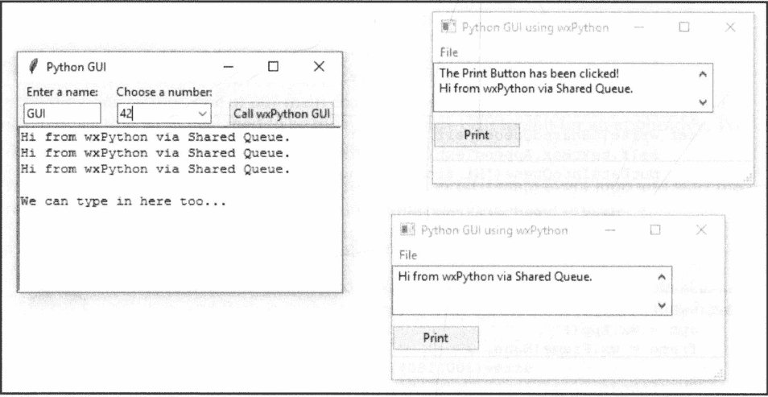

前面的截图中左侧显示了 tkinter GUI，通过点击 **Call wxPython GUI** 按钮，我们会调用一个 wxPython GUI 实例。我们可以通过多次点击按钮来创建多个实例。

> 所有创建的 GUI 都保持响应。它们不会崩溃也不会冻结。

在任何 wxPython GUI 实例上点击 **Print** 按钮会向其自己的 TextCtrl 小部件写入一句话，然后再向自身以及 tkinter GUI 写入另一行。你需要向上滚动才能在 wxPython GUI 中看到第一句话。

> 这样工作的方式是使用模块级队列和 tkinter Text 小部件。

一个需要注意的重要元素是，我们创建了一个线程来运行 wxPython app.MainLoop，就像我们在上一节食谱中所做的那样：

```
def wxPythonApp():
    app = wx.App()
    frame = wx.Frame(None, ,
                    size=(300,180))
    GUI(frame)
    frame.Show()
    runT = Thread(target=app.MainLoop)
    runT.setDaemon(True)
    runT.start()
```

我们创建一个继承自 wx.Panel 的类并命名为 GUI，然后在前面的代码中实例化该类的一个实例。

我们在此类中创建一个按钮点击事件回调方法，该方法随后调用在其上方编写的过程代码。正因为如此，该类可以访问函数并写入共享队列：

```
#----------------------------------------------------------------
def writeToSharedQueue(self, event):
    self.textBox.AppendText("The Print Button has been clicked\n")
    putDataIntoQueue('Hi from wxPython via Shared Queue.\n')
    if dataInQueue:
        data = readDataFromQueue()
        self.textBox.AppendText(data)
        text.insert('0.0', data) # insert data into tkinter
```

我们在前面的方法中首先检查数据是否已放置在共享队列中，如果是，则将公共数据打印到两个 GUI。

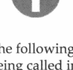

putDataIntoQueue() 行将数据放入队列，而 readDataFromQueue() 则将其读回，保存在 data 变量中。text.insert('0.0', data) 是将此数据从 Print 按钮的 wxPython 回调方法写入 tkinter GUI 的行。

以下是在代码中被调用并使其工作的过程函数（不是方法，因为它们未绑定）：

```
from multiprocessing import Queue
sharedQueue = Queue()
dataInQueue = False

def putDataIntoQueue(data):
    global dataInQueue
    dataInQueue = True
```
