## 10

## 使用 PyOpenGL 和 PyGLet 创建惊人的 3D GUI

在本章中，我们将创建显示真实三维图像的惊人 Python GUI，这些图像可以围绕自身旋转，以便我们从各个角度观察它们。我们将涵盖以下食谱：

- PyOpenGL 转换我们的 GUI
- 我们的 GUI 在 3D 中！
- 使用位图使我们的 GUI 更漂亮
- PyGLet 比 PyOpenGL 更容易转换我们的 GUI
- 我们的 GUI 呈现惊人的色彩
- OpenGL 动画
- 使用 tkinter 创建幻灯片放映

## 简介

在本章中，我们将通过赋予其真正的三维功能来转换我们的 GUI。我们将使用两个 Python 第三方包。PyOpenGL 是 OpenGL 标准的 Python 绑定，OpenGL 是一个图形库，已内置于所有主要操作系统中。这使得生成的部件具有原生的外观和感觉。

PyGLet 是另一个 OpenGL 库的 Python 绑定，但它也可以创建 GUI 应用程序，这使得使用 PyGLet 编码比使用 PyOpenGL 更容易。

以下是本章的 Python 模块概述：

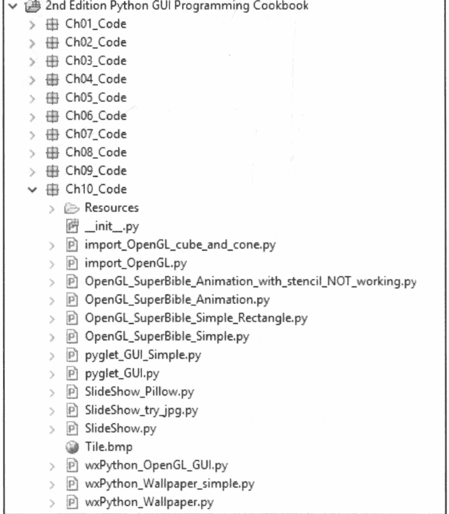

## PyOpenGL 转换我们的 GUI

在本节食谱中，我们将成功创建一个导入 PyOpenGL 模块并实际工作的 Python GUI！为了做到这一点，我们将克服一些初始挑战。

本食谱将展示一种经过验证可行的方法。如果你自己尝试并遇到困难，请记住托马斯·A·爱迪生的名言。

托马斯·爱迪生，灯泡的发明者，回答了一位记者关于爱迪生失败的问题。爱迪生回答说：“我没有失败。我只是找到了 10,000 种行不通的方法。”

首先，我们必须安装 PyOpenGL 扩展模块。成功安装与我们操作系统架构匹配的 PyOpenGL 模块后，我们将创建一些示例代码。

### 准备工作

我们将安装 PyOpenGL 包。在本书中，我们使用的是 Windows 10 64 位操作系统和 Python 3.6。下面的下载截图适用于此配置。

我们还将使用 wxPython。如果你没有安装 wxPython，可以阅读上一章中的一些食谱，了解如何安装 wxPython 以及如何使用此 GUI 框架。

我们使用的是 wxPython Phoenix 版本，这是最新版本，未来将取代原始的经典 wxPython 版本。

### 如何操作...

为了使用 PyOpenGL，我们必须先安装它。以下 URL 是官方 Python 包安装网站：

```
https://pypi.python.org/pypi/PyOpenGL/3.0.2.
```

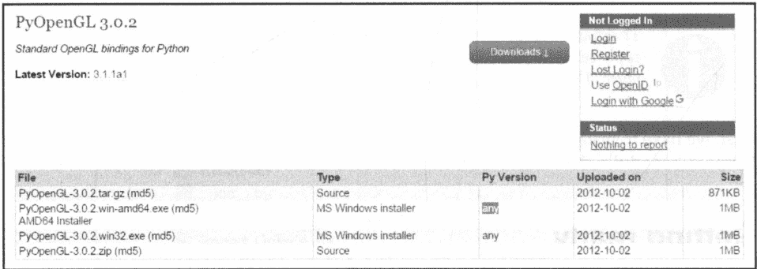

这似乎是正确的安装，但事实证明它与 Windows 10 64 位操作系统和 Python 3.6 64 位不兼容。

在上一章的一个食谱中提到了一个更好的 Python 安装包查找位置。你可能已经很熟悉了。URL 为 http://www.lfd.uci.edu/~gohlke/pythonlibs/。

我们必须下载同时匹配我们操作系统和 Python 版本的包。它带有新的 .whl 格式。如果你使用的是较旧版本的 Python，你必须先安装 Python wheel 包：

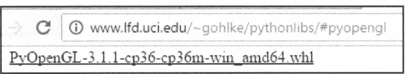

如何安装 Python wheel 包在第 5 章 Matplotlib Charts 中，Installing Matplotlib using pip with whl extension 食谱中有描述。

使用 pip 命令通过 PyOpenGL-3.1.1-cp36-cp36m-win_amd64.whl 文件安装 PyOpenGL 既成功又安装了我们所需的所有 64 位模块。

将 <your full path> 替换为你下载 .whl 安装程序的完整路径：

```
pip install <your full path> PyOpenGL-3.1.1-cp36-cp36m-win_amd64.whl
```

现在当我们尝试导入一些 PyOpenGL 模块时，它可以工作，如此代码示例所示：

```
import wx
from wx import glcanvas
from OpenGL.GL import *
from OpenGL.GLUT import *
```

这段代码所做的只是导入几个 OpenGL Python 模块，以及导入 wxPython。它不做其他任何事情，但当我们运行 Python 模块时，我们不会收到任何错误。

这证明我们已成功将 OpenGL 绑定到 Python。

现在我们的开发环境已成功设置，我们可以使用 wxPython 尝试一下。


许多在线示例仅限于使用 Python 2 以及使用经典版本的 wxPython。我们使用的是 Python 3.6 和 Phoenix。

基于 wxPython 演示示例的代码创建了一个工作的 3D 立方体。相比之下，运行锥体示例不起作用，但该示例让我们走上了正确的轨道。

以下是 URL：http://wiki.wxpython.org/GLCanvas%20update

以下是代码的一些修改：

```
import wx
from wx import glcanvas
from OpenGL.GL import *
from OpenGL.GLUT import *
```

```
class MyCanvasBase(glcanvas.GLCanvas):
    def __init__(self, parent):
        glcanvas.GLCanvas.__init__(self, parent, -1)
        # This context was missing from the original code
```


```
```python
self.context = glcanvas.GLContext(self)

def OnPaint(self, event):
    dc = wx.PaintDC(self)
    # self.SetCurrent()          # commented out because:
    self.SetCurrent(self.context)  # We have to pass in a context
```
```

我们现在可以创建以下 GUI：

```
```python
import_OpenGL_cube_and_cone.py
```
```

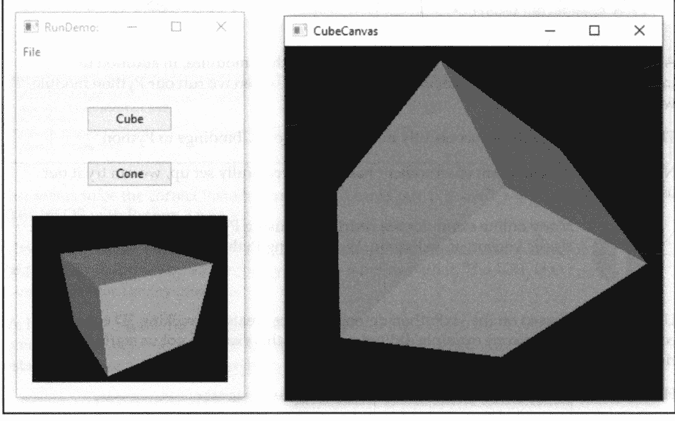

在经典版本的 wxPython 中，SetCurrent() 不需要上下文。以下是我们在网上搜索时可能会找到的一些代码：

```
```python
def OnPaint(self, event):
    dc = wx.PaintDC(self)
    self.SetCurrent()
    if not self.init:
        self.InitGL()
        self.init = True
    self.OnDraw()
```
```

使用 wxPython Phoenix 时，前述代码无法工作。我们可以在网上查找 Phoenix 的正确语法：

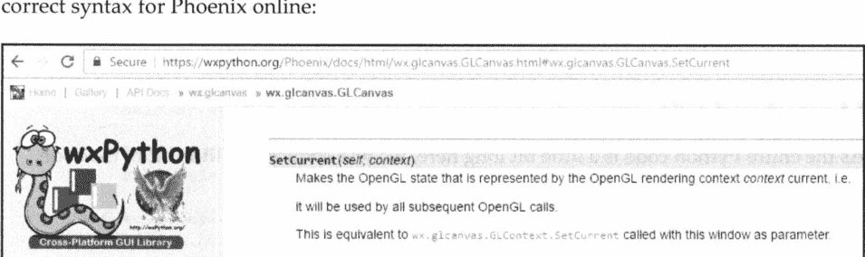

## How it works...

在本教程中，我们首次使用 PyOpenGL Python 绑定体验了 OpenGL。虽然 OpenGL 可以在真正的 3D 中创建真正令人惊叹的图像，但在途中我们遇到了一些挑战，然后找到了解决这些挑战的方案，使其得以工作。

我们正在用 Python 编程，创建 3D 图像！

## Our GUI in 3D!

在本教程中，我们将使用 wxPython 创建自己的 GUI。我们将重用 wxPython 演示示例中的一些代码，并将其精简为显示 3D OpenGL 所需的最小代码。

OpenGL 是一个非常庞大的库。我们不会详细介绍该库的说明。如果您想进一步研究 OpenGL，有大量书籍和在线文档可供查阅。它有自己的着色语言。

## Getting ready

阅读上一教程可能是本教程的良好准备。

## How to do it...

由于整个 Python 代码在这里有点长，我们只展示其中一小部分代码。

完整的代码可在网上获得，该 Python 模块名为 wxPython_OpenGL_GUI.py：

```
import wx
from wx import glcanvas
from OpenGL.GL import *
from OpenGL.GLUT import *

#------------------------------------------------------------
class CanvasBase(glcanvas.GLCanvas):
    def __init__(self, parent):
        glcanvas.GLCanvas.__init__(self, parent, -1)
        self.context = glcanvas.GLContext(self)
        self.init = False

        # Cube 3D start rotation
        self.last_X = self.x = 30
        self.last_Y = self.y = 30

        self.Bind(wx.EVT_SIZE, self.sizeCallback)
        self.Bind(wx.EVT_PAINT, self.paintCallback)
        self.Bind(wx.EVT_LEFT_DOWN, self.mouseDownCallback)
        self.Bind(wx.EVT_LEFT_UP, self.mouseUpCallback)
        self.Bind(wx.EVT_MOTION, self.mouseMotionCallback)

    def sizeCallback(self, event):
        wx.CallAfter(self.setViewport)
        event.Skip()

    def setViewport(self):
        self.size = self.GetClientSize()
        self.SetCurrent(self.context)
        glViewport(0, 0, self.size.width, self.size.height)

    def paintCallback(self, event):
        wx.PaintDC(self)
        self.SetCurrent(self.context)
        if not self.init:
```

```
```python
glNormal3f( 0.0, 0.0,-1.0)
glVertex3f(-0.5,-0.5,-0.5)

#============================================================
app = wx.App()
frame = wx.Frame(None, size=(300,230))
GUI(frame)
frame.Show()
app.MainLoop()
```
```

以下屏幕截图显示了我们的 wxPython GUI：wxPython_OpenGL_GUI.py

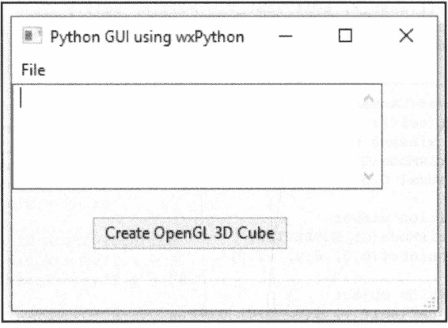

当我们点击按钮控件时，会出现以下第二个窗口：

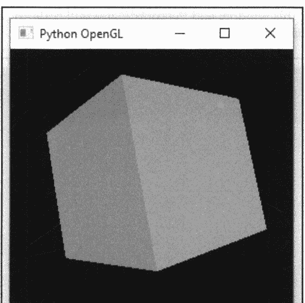

我们现在可以使用鼠标拖动立方体，以查看其六个面：

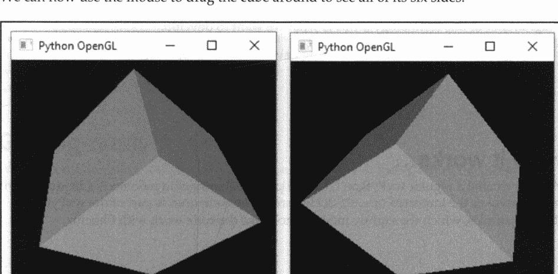

我们也可以最大化此窗口，坐标会缩放，并且可以在这个更大的窗口中旋转这个立方体！

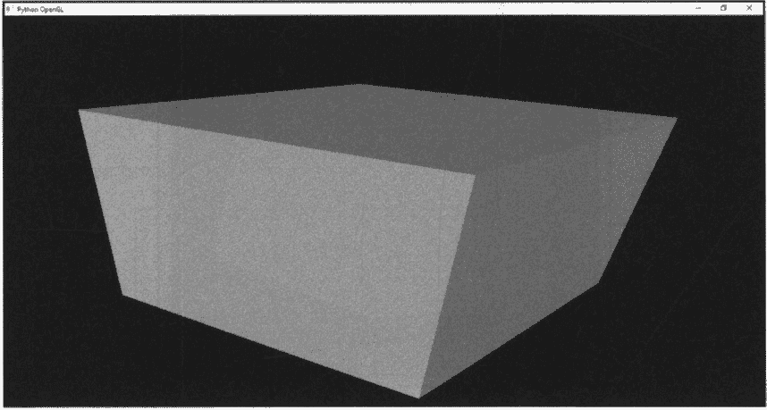

立方体也可以是一艘星际迷航的宇宙飞船！如果我们想开发这个，就必须成为该技术的资深程序员。

许多视频游戏都是使用 OpenGL 开发的。

## How it works...

我们首先创建了一个常规的 wxPython GUI，并在其上放置了一个按钮控件。点击此按钮会调用导入的 OpenGL 3D 库。使用的代码是 wxPython 演示示例的一部分，我们对其进行了轻微修改以使其与 Phoenix 兼容。

本教程将我们自己的 GUI 粘合到此库上。

OpenGL 是一个庞大而令人印象深刻的库。本教程展示了如何在 Python 中创建工作示例的思路。

通常，一个可工作的示例就是我们开始旅程所需的一切。

## Using bitmaps to make our GUI pretty

本教程的灵感来自于一个 wxPython IDE 构建框架，该框架在某个时间点曾经可以工作。我们将重用该项目提供的庞大代码量中的位图图像。

GitHub 仓库的 URL 为 https://github.com/reingart/gui2py。

我无法使用 Python 3.6 重现此 IDE。但它展示了可能性。如果您有兴趣开发拖放 IDE 框架，您可以通过让此代码在 Python 3.6 及更高版本上运行来帮助整个 Python Windows 开发者社区（并与 MS Visual Studio 竞争...）。

## Getting ready

我们将在本教程中继续使用 wxPython，因此阅读上一章的至少部分内容作为本教程的准备可能是有用的。

## How to do it...

在逆向工程 gui2py 代码并对代码进行其他更改后，我们可能会实现以下窗口控件，该控件显示漂亮的平铺背景：

```
wxPython_Wallpaper_simple.py
```

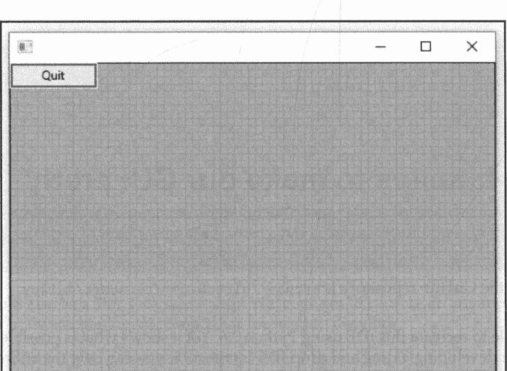

当然，我们在重构上述网站的代码时丢失了很多控件，但它确实为我们提供了很酷的背景，点击 Quit 按钮仍然有效。

下一步是弄清楚如何将代码的有趣部分集成到我们自己的 GUI 中。我们通过将以下代码添加到上一教程中的 GUI 来实现这一点：

```
#-------------------------------------------------------------------------------
class GUI(wx.Panel):                 # Subclass wxPython Panel
    def __init__(self, parent):
        wx.Panel.__init__(self, parent)

        imageFile = 'Tile.bmp'
        self.bmp = wx.Bitmap(imageFile)
        # react to a resize event and redraw image
        parent.Bind(wx.EVT_SIZE, self.canvasCallback)
```

```
```python
def canvasCallback(self, event=None):
    # create the device context
    dc = wx.ClientDC(self)
    brushBMP = wx.Brush(self.bmp)
    dc.SetBrush(brushBMP)
    width, height = self.GetClientSize()
    dc.DrawRectangle(0, 0, width, height)
```
```

> > 我们必须绑定到 parent，而不是 self；否则，我们的位图将不会显示。

运行改进后的代码后，会将位图平铺为我们 GUI 的背景：

```
```text
wxPython_Wallpaper.py
```
```

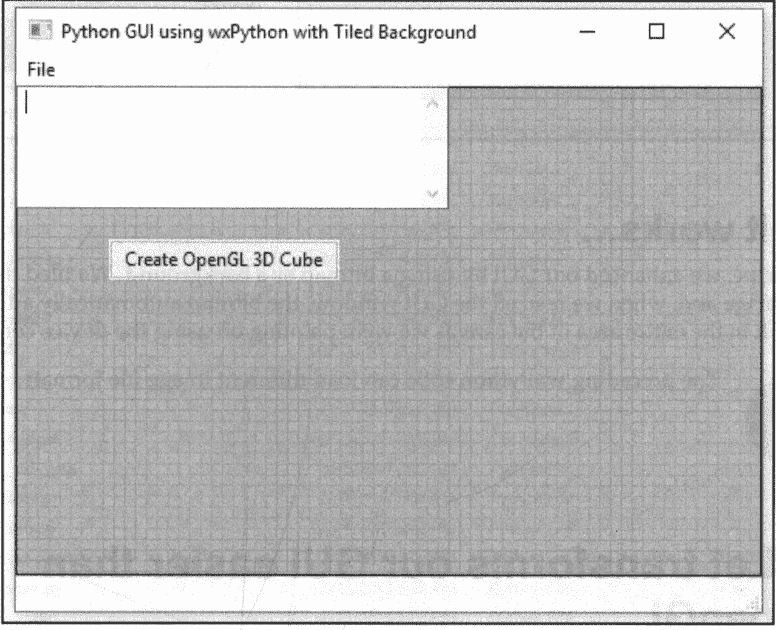

点击按钮仍然会调用我们的 OpenGL 3D 绘制，因此我们没有失去任何功能：

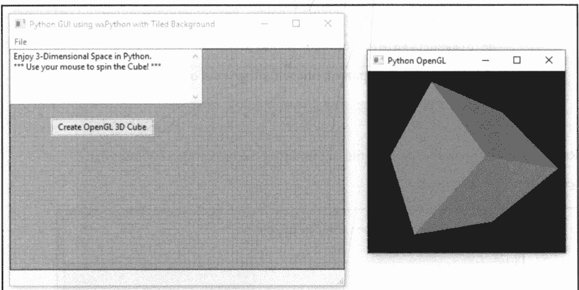

## How it works...

在本教程中，我们通过使用位图作为背景来增强了我们的 GUI。我们平铺了位图图像，并且在调整 GUI 窗口大小时，位图会自动调整自身以填满我们使用设备上下文绘制的画布的整个区域。


前述 wxPython 代码可以加载不同的图像文件格式。

## PyGLet transforms our GUI easier than PyOpenGL

在本教程中，我们将使用 PyGLet GUI 开发框架来创建我们的 GUI。

PyGLet 比 PyOpenGL 更易于使用，因为它自带自己的 GUI 事件循环，因此我们不需要使用 tkinter 或 wxPython 来创建 GUI。

## How to do it...

为了使用 PyGLet，我们首先必须安装这个第三方 Python 插件。

使用 pip 命令，我们可以轻松安装该库，成功安装后在我们的 site-packages Python 文件夹中看起来像这样：

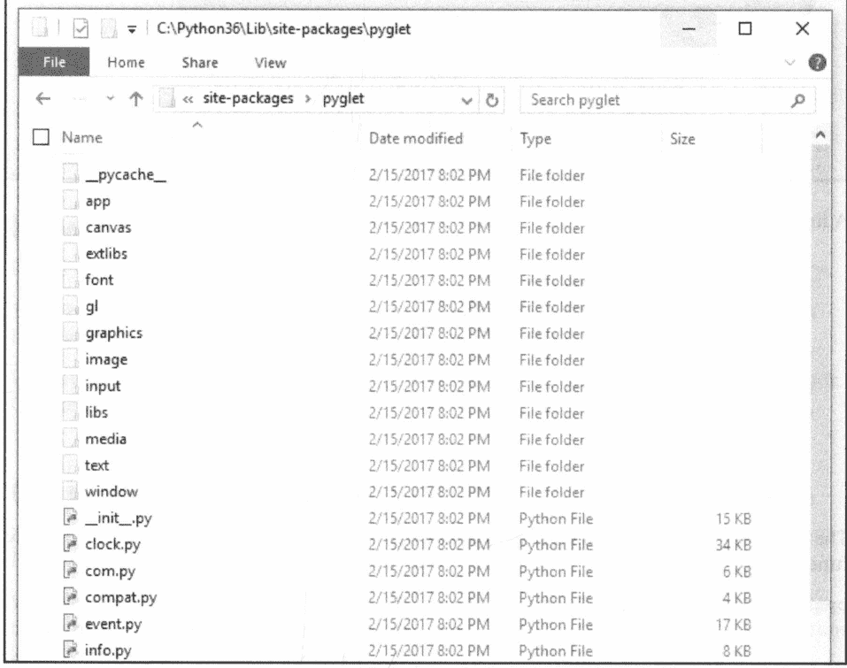


在线文档位于 https://pyglet.readthedocs.org/en/pyglet-1.2-maintenance/ 网站，用于当前发行版：

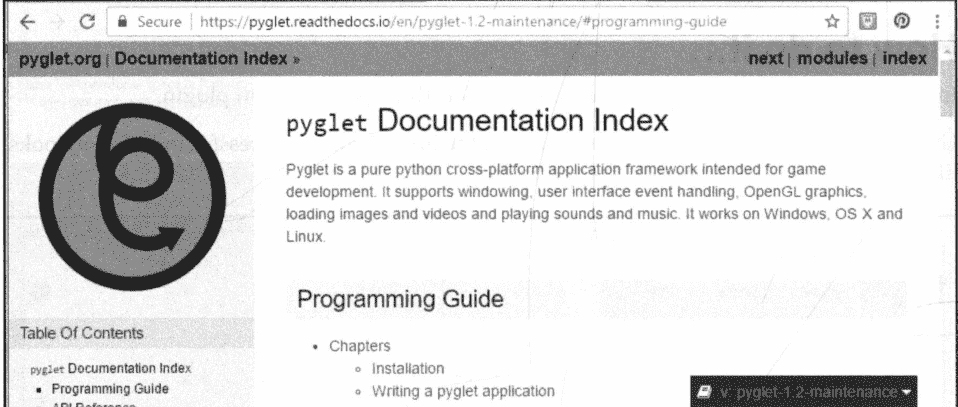

首次使用 pyglet 库的体验可能如下所示：

```
import pyglet
window = pyglet.window.Window()
label = pyglet.text.Label('PyGLet GUI',
    font_size=42,
    x=window.width//2, y=window.height//2,
    anchor_x='center', anchor_y='center')

@window.event
def on_draw():
    window.clear()
    label.draw()

pyglet.app.run()
```

上述代码来自官方 pyglet.org 网站，并生成以下完全可用的 GUI：

pyglet_GUI_Simple.py

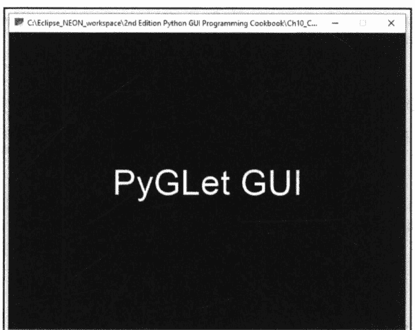

## How it works...

在本教程中，我们使用了另一个第三方 Python 模块，该模块封装了 OpenGL 库。

此库自带自己的事件循环处理能力，使我们无需再依赖另一个库来创建运行中的 Python GUI。

我们探索了官方网站，该网站向我们展示了如何安装和使用这个出色的 GUI 库。

## Our GUI in amazing colors

在本教程中，我们将扩展上一教程 *PyGLet transforms our GUI easier than PyOpenGL, by turning it into true 3D.* 中使用 PyGLet 编写的 GUI。

我们还将为其添加一些漂亮的颜色。本教程受到了 *OpenGL SuperBible* 书系中一些示例代码的启发。它创建了一个非常多彩的立方体，我们可以使用键盘上的上、下、左、右按钮在三维空间中旋转它。

我们通过让图像在按住其中一个键时转动，而不是必须按下并释放键，来稍微改进了示例代码。

## Getting ready

上一教程 *PyGLet transforms our GUI easier than PyOpenGL* 解释了如何安装 PyGLet 并介绍了该库。如果您尚未阅读，建议您浏览该教程。

> 在在线文档中，PyGLet 通常以全小写形式拼写。虽然这可能是 Python 式的做法，但我们将类的首字母大写，并对变量、方法和函数名称使用小写以开始每个名称。

## How to do it...

以下代码创建了 3D 彩色立方体，其代码如下所示。这次，我们将使用键盘方向键来旋转图像而不是鼠标：

```
```python
import pyglet
from pyglet.gl import *
from pyglet.window import key
from OpenGL.GLUT import *

WINDOW    = 400
INCREMENT = 5

class Window(pyglet.window.Window):

    # Cube 3D start rotation
    xRotation = yRotation = 30

    def __init__(self, width, height, title=''):
        super(Window, self).__init__(width, height, title)
        glClearColor(0, 0, 0, 1)
        glEnable(GL_DEPTH_TEST)

    def on_draw(self):
        # Clear the current GL Window
        self.clear()

        # Push Matrix onto stack
        glPushMatrix()
```
```

```
```python
glRotatef(self.xRotation, 1, 0, 0)
glRotatef(self.yRotation, 0, 1, 0)

# Draw the six sides of the cube
glBegin(GL_QUADS)

# White
glColor3ub(255, 255, 255)
glVertex3f(50,50,50)

# Yellow
glColor3ub(255, 255, 0)
glVertex3f(50,-50,50)

# Red
glColor3ub(255, 0, 0)
glVertex3f(-50,-50,50)
glVertex3f(-50,50,50)

# Blue
glColor3f(0, 0, 1)
glVertex3f(-50,50,-50)

# <... more color defines for cube faces>

glEnd()

# Pop Matrix off stack
glPopMatrix()

def on_resize(self, width, height):
    # Set the Viewport
    glViewport(0, 0, width, height)

    # using Projection mode
    glMatrixMode(GL_PROJECTION)
    glLoadIdentity()

    aspectRatio = width / height
    gluPerspective(35, aspectRatio, 1, 1000)

    glMatrixMode(GL_MODELVIEW)
    glLoadIdentity()
    glTranslatef(0, 0, -400)

def on_text_motion(self, motion):
    if motion == key.UP:
        self.xRotation -= INCREMENT
```
```

```
```python
elif motion == key.DOWN:
    self.xRotation += INCREMENT
elif motion == key.LEFT:
    self.yRotation -= INCREMENT
elif motion == key.RIGHT:
    self.yRotation += INCREMENT

if __name__ == '__main__':
    Window(WINDOW, WINDOW, 'Pyglet Colored Cube')
    pyglet.app.run()
```
```

pyglet_GUI.py

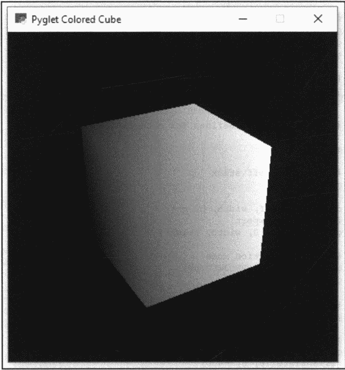

使用键盘方向键，我们可以旋转 3D 立方体：

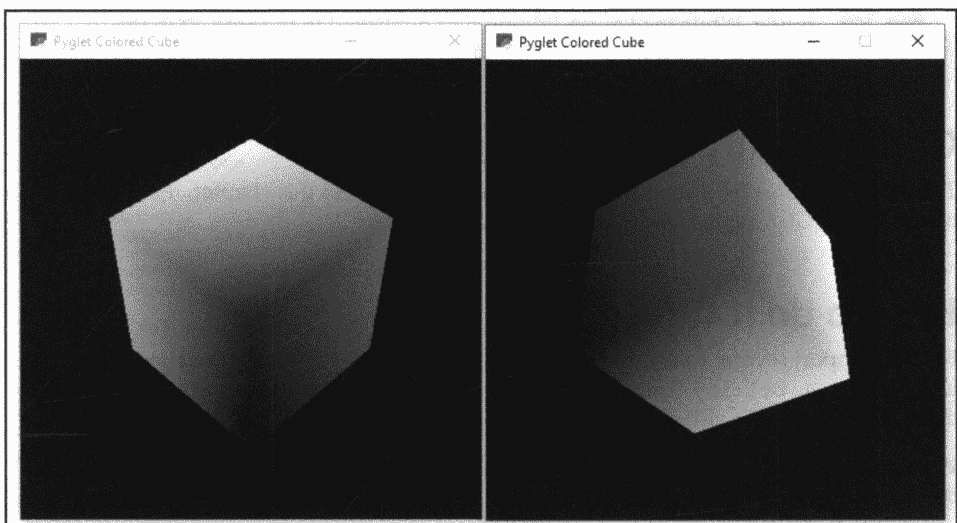

## How it works...

在本教程中，我们使用 pyglet 创建了一个彩色立方体，可以使用键盘方向键在 3D 空间中旋转它。

我们为立方体的六个面定义了几种颜色，并使用 pyglet 创建了主窗口框架。

代码与本章中一个先前的教程相似，在该教程中我们使用 wxPython 库创建了一个立方体。其原因在于，在底层，wxPython 和 PyGLet 都使用 OpenGL 库。

## OpenGL animation

在之前的教程中，我们使用 wxPython 和 PyGLet 框架来显示 OpenGL。在本教程中，我们将使用纯 Python 和 OpenGL 创建一个在蓝色背景窗口内弹跳的红色矩形。

```
from OpenGL.GLUT import *
from OpenGL.GL import *
from OpenGL.GLU import *

def RenderScene():
    # display callback function
    glClear(GL_COLOR_BUFFER_BIT)      # clear window with color defined in SetupRC
    glFlush()                         # flush/execute the OpenGL drawing command(s)

def SetupRC():
    # rendering context
    glClearColor(0.0, 0.0, 1.0, 1.0)  # RGBA: R=0.0, G=0.0, B=1.0 => becomes Blue

def main():
    glutInit()
    glutInitDisplayMode(GLUT_SINGLE | GLUT_RGBA)  # single buffer; RGBA color mode
    glutCreateWindow(b"Simple")                   # Python 3: bytes instead of string for Title
    glutDisplayFunc(RenderScene)
    SetupRC()

    glutMainLoop()

================
main()
```

运行代码会创建以下窗口，使用纯 Python 和 OpenGL：

OpenGL_SuperBible_Simple.py

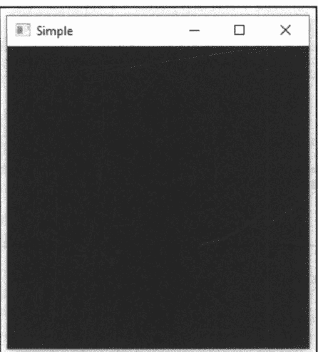

为了在此 OpenGL 窗口中显示绘图组件，我们通过创建一个大小为 25 x 25 像素的正方形矩形来增强 RenderScene() 函数。

我们还添加了一个新的函数 ChangeSize()，该函数会在 GLUT 库在窗口调整大小或重绘时自动调用：

OpenGL_SuperBible_Simple_Rectangle.py

```
from OpenGL.GLUT import *
from OpenGL.GL import *
from OpenGL.GLU import *

def RenderScene():
    # display callback function
    glClear(GL_COLOR_BUFFER_BIT)          # clear window with color defined in SetupRC
    #       R   G   B                     # set drawing color to Red
    glColor3f(1.0, 0.0, 0.0)              # function expects 3 f(loats)
    glRectf(-25.0, 25.0, 25.0, -25.0)     # draw a filled rectangle with above color
    glFlush()                             # flush/execute the OpenGL drawing command(s)

def SetupRC():
    # rendering context setup
    glClearColor(0.0, 0.0, 1.0, 1.0)      # RGBA: R=0.0, G=0.0, B=1.0=white => becomes Blue

def ChangeSize(w, h):
    # callback when window size changes
    if h == 0: h = 1                      # prevent divide by zero
    glViewport(0, 0, w, h)                # set Viewport to Window dimensions
    glMatrixMode(GL_PROJECTION)           # define the viewing volume
    glLoadIdentity()                      # reset coordinate system
    aspectRatio = GLfloat(w).value / GLfloat(h).value  # establish clipping volume
                                          # GLfloat becomes ctypes.c_float
                                          # Use the value attribute before dividing
    if w <= h: glOrtho(-100.0, 100.0, -100.0 / aspectRatio, 100.0 / aspectRatio, 1.0, -1.0)
    else: glOrtho(-100.0 * aspectRatio, 100.0 * aspectRatio, -100.0, 100.0, 1.0, -1.0)
    glMatrixMode(GL_MODELVIEW)
    glLoadIdentity()

def main():
    glutInit()
    glutInitDisplayMode(GLUT_SINGLE | GLUT_RGBA)  # single buffer; RGBA color mode
    glutCreateWindow(b"GLRect")                  # Python 3: bytes instead of string for Title
    glutDisplayFunc(RenderScene)
    glutReshapeFunc(ChangeSize)
    SetupRC()
    glutMainLoop()

====================
main()
```

以下是 resulting 窗口：

OpenGL_SuperBible_Simple_Rectangle.py


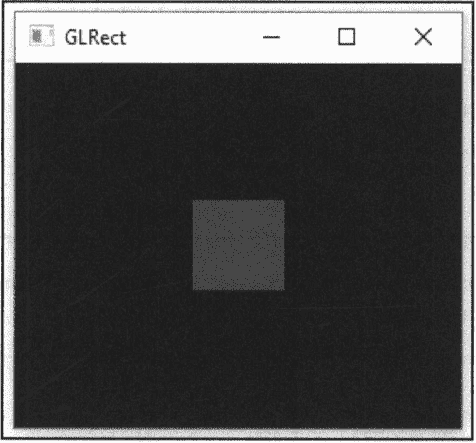

接下来，我们将通过让红色方块在窗口中移动并在每个角落反弹来为其制作动画。为此，我们首先创建一些模块级全局变量：

```
OpenGL_SuperBible_Animation.py
```

```
```python
from OpenGL.GLUT import *
from OpenGL.GL import *
from OpenGL.GLU import *

# initial position and size
x1 = GLfloat(0.0).value
y1 = GLfloat(0.0).value
rect_size = GLfloat(25.0).value

# number of pixels to move each step
xstep = GLfloat(1.0).value
ystep = GLfloat(1.0).value

# initialize bouncing window
windowWidth = GLfloat(133).value      # 800/600 = 1.33
windowHeight = GLfloat(100).value
```
```

在 RenderScene() 函数中，我们现在使用双缓冲：

```
def RenderScene():              # display callback function
    glClear(GL_COLOR_BUFFER_BIT)      # clear window with color defined in SetupRC
    #   R   G   B                  # set drawing color to Red
    glColor3f(1.0, 0.0, 0.0)          # functions expects 3 floats
    glRectf(x1, y1, x1 + rect_size, y1 - rect_size) # draw a filled rectangle with above color
    
    glutSwapBuffers()                 # flush and swap double buffers
```

我们必须稍微更改我们的 main() 以将 GLUT_DOUBLE 传递给 glutInitDisplayMode() 函数：

```
def main():
    glutInit()
    glutInitDisplayMode(GLUT_DOUBLE | GLUT_RGB)      # Double buffer
    glutInitWindowSize(800, 600)                      # window size
    glutCreateWindow(b"Bouncing Red Square")          # Python 3: bytes instead of string for Title
    glutDisplayFunc(RenderScene)
    glutReshapeFunc(ChangeSize)
    glutTimerFunc(33, TimerFunction, 1)
    
    SetupRC()
    
    glutMainLoop()

#================
main()
```

我们创建 TimerFunction() 以传递给 glutTimerFunc()。在此函数中，我们进行一些数学计算来定位红色方块并使其在窗口墙壁上反弹。在函数末尾，我们在 glutTimerFunc() 中递归调用此函数：

```
def TimerFunction(value):
    global x1, xstep, y1, ystep

    # reverse direction left/right
    if ((x1 > windowWidth - rect_size) or (x1 < -windowWidth)):
        xstep = -xstep

    # reverse direction top/bottom
    if ((y1 > windowHeight) or (y1 < -windowHeight + rect_size)):
        ystep = -ystep

    # move the red square
    x1 += xstep
    y1 += ystep

    # check the bounds of the clipping area
    if (x1 > (windowWidth - rect_size + xstep)):
        x1 = windowWidth - rect_size - 1
    elif (x1 < -(windowWidth + xstep)):
        x1 = -windowWidth - 1

    if (y1 > (windowHeight + ystep)):
        y1 = windowHeight - 1
    elif (y1 < -(windowHeight - rect_size + ystep)):
        y1 = -windowHeight + rect_size - 1

    # redraw the scene
    glutPostRedisplay()
    glutTimerFunc(33, TimerFunction, 1)    # recursive call
```

当我们现在运行程序时，红色方块将在蓝色窗口内移动，并在每个角落反弹：

```
OpenGL_SuperBible_Animation.py
```

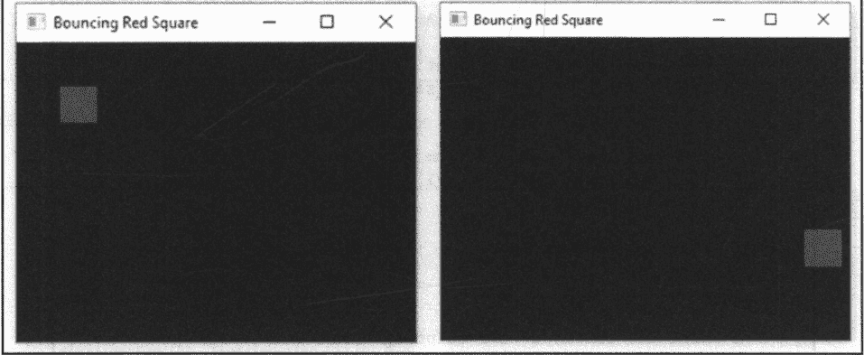

## How it works...

在本教程中，我们直接从 Python 使用 OpenGL 库。我们在不使用任何其他 Python GUI 框架的情况下创建了自己的窗口。我们探索了许多 OpenGL 函数中的一些，并创建了可工作的程序。

有关 OpenGL 的简短介绍以及如何从 Python 使用它，可以在 https://noobtuts.com/python/opengl-introduction 上找到。

## Creating a slide show using tkinter

在本教程中，我们将使用纯 Python 创建一个漂亮的可工作幻灯片放映 GUI。我们将看到核心 Python 内置功能的局限性，然后我们将探索另一个可用的第三方模块 Pillow，该模块扩展了 tkinter 在图像处理方面的内置功能。

虽然名字 `Pillow` 最初听起来可能有点奇怪，但它实际上背后有着丰富的历史。

本书中我们仅使用 Python 3.6 及以上版本。我们不会回到 Python 2。Guido 表达了他有意破坏向后兼容性的决定，并决定 Python 3 是 Python 编程的未来。


对于 GUI 和图像，旧的 Python 2 行有一个非常强大的模块名为 `PIL`，代表 Python Image Library。该库包含非常大量的功能，在 Python 3 非常成功创建后的几年里，这些功能尚未为 Python 3 翻译。

许多开发人员仍然选择使用 Python 2 而不是由 *Python 的仁慈独裁者* 设计的未来，因为 Python 2 仍然有更多可用的库。

这有点令人难过。幸运的是，已经创建了另一个与 Python 3.6 配合使用的成像库，它的名字是 `PIL` 加上某物。

Pillow 与 Python 2 PIL 库不兼容。


## Getting ready

在本教程的第一部分，我们将使用纯 Python。为了改进代码，我们将使用 `pip` 功能安装另一个 Python 模块，因此虽然你可能已经熟悉 `pip`，但了解如何使用它可能会有用。

## How to do it…

首先，我们将创建一个使用纯 Python 在窗口框架内随机播放幻灯片的可工作 GUI。以下是可工作的代码以及运行此代码结果的一些屏幕截图：

```
```python
from tkinter import Tk, PhotoImage, Label
from itertools import cycle
from os import listdir

class SlideShow(Tk):
    # inherit GUI framework extending tkinter
    def __init__(self, mssShowTimeBetweenslides=1500):
```
```

```
# initialize tkinter super class
Tk.__init__(self)

# time each slide will be shown
self.showTime = msShowTimeBetweenSlides

# look for images in current working directory
listOfSlides = [slide for slide in listdir()
                if slide.endswith('gif')]

# cycle slides to show on the tkinter Label
self.iterableCycle = cycle((PhotoImage(file=slide), slide)
                          for slide in listOfSlides)

# create tkinter Label widget which can display images
self.slidesLabel = Label(self)

# create the Frame widget
self.slidesLabel.pack()

def slidesCallback(self):
    # get next slide from iterable cycle
    currentInstance, nameOfSlide = next(self.iterableCycle)

    # assign next slide to Label widget
    self.slidesLabel.config(image=currentInstance)

    # update Window title with current slide
    self.title(nameOfSlide)

    # recursively repeat the Show
    self.after(self.showTime, self.slidesCallback)

#================================
# Start GUI
#================================
win = SlideShow()
win.after(0, win.slidesCallback())
win.mainloop()

SlideShow.py
```

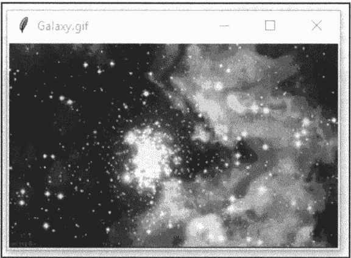

以下是幻灯片放映展开过程中的另一个时刻：

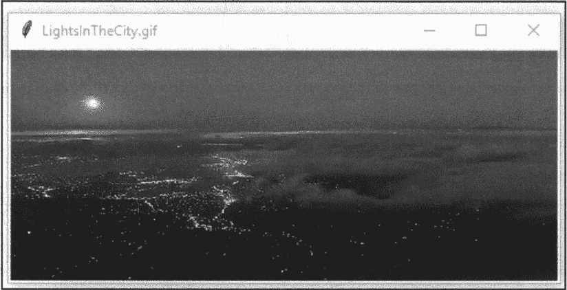

虽然幻灯片滑动效果确实令人印象深刻，但纯 Python tkinter GUI 的内置功能不支持非常流行的 .jpg 格式，因此我们必须求助于另一个 Python 库。为了使用 Pillow，我们首先必须使用 pip 命令安装它。

一次成功的安装如下所示：

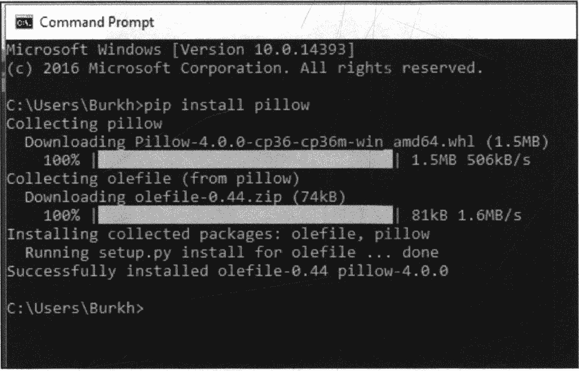

Pillow 支持 `.jpg` 格式，为了使用它，我们必须稍微更改语法。

不使用 Pillow，尝试显示 `.jpg` 图像会产生以下错误：

```
SlideShow_try_jpg.py
```

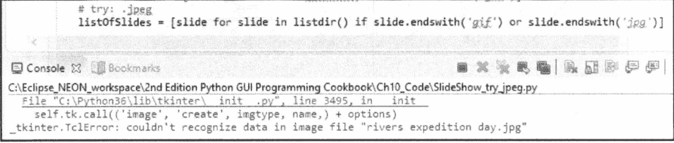

使用 Pillow，我们可以同时显示 `.gif` 和 `.jpg` 文件。在成功安装 Pillow 包后，我们只需要进行一些更改：

```
# using Pillow instead of PIL (2.7) for Python 3.6
# Installation is: >pip install Pillow
from PIL import ImageTk

class SlideShow(Tk):
    # inherit GUI framework extending tkinter
    def __init__(self, msShowTimeBetweenSlides=1500):
        # initialize tkinter super class
        Tk.__init__(self)

        # time each slide will be shown
        self.showTime = msShowTimeBetweenSlides

        # look for images in current working directory where this module lives
        # listOfSlides = [slide for slide in listdir() if slide.endswith('gif')]
        listOfSlides = [slide for slide in listdir() if slide.endswith('gif') or slide.endswith('jpg')]

        # endlessly read in the slides so we can show them on the tkinter label
        # self.iterableCycle = cycle((PhotoImage(file=slide), slide) for slide in listOfSlides)
        self.iterableCycle = cycle((ImageTk.PhotoImage(file=slide), slide) for slide in listOfSlides)
```

我们搜索文件夹中的 .jpg 扩展名，并且不再使用 PhotoImage() 类，而是现在使用 ImageTk.PhotoImage() 类。这使我们能够显示具有不同扩展名的图像：

SlideShow_Pillow.py


## How it works…

Python 是一个很棒的工具，在本菜谱中，我们探索了几种使用和扩展它的方法。

以下是本章 Python 模块的概览：

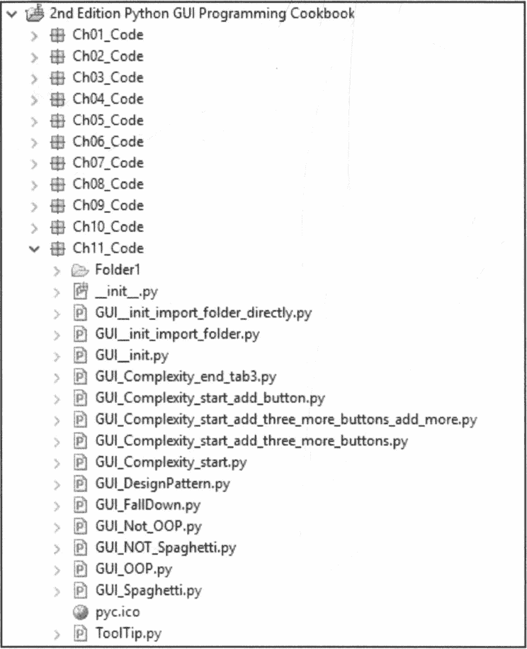

## Avoiding spaghetti code

在本菜谱中，我们将探索一种典型的创建意大利面条代码的方式，然后我们将看到一种避免此类代码的更好方法。

意大利面条代码是指大量功能交织在一起的代码。

## Getting ready

我们将创建一个新的、简单的 GUI，使用内置的 Python `tkinter` 库用 Python 编写。

## How to do it…

在网上搜索并阅读文档后，我们可能会开始编写以下代码来创建我们的 GUI：

```python
GUI_Spaghetti.py

# Spaghetti Code ############################
def PRINTME(me):print(me)
import tkinter
x=y=z=1
PRINTME(z)
from tkinter import *
scrolW=30;scrolH=6
win=tkinter.Tk()
if x:chVarUn=tkinter.IntVar()
from tkinter import ttk
WE='WE'
import tkinter.scrolledtext
outputFrame=tkinter.ttk.LabelFrame(win,text=' Type into the scrolled text control: ')
scr=tkinter.scrolledtext.ScrolledText(outputFrame,width=scrolW,height=scrolH,wrap=tkinter.WORD)
e='E'
scr.grid(column=1,row=1,sticky=WE)
outputFrame.grid(column=0,row=2,sticky=e,padx=8)
lFrame=win
if y:chk2=tkinter.Checkbutton(lFrame,text="Enabled",variable=chVarUn)
WE='WE'
if y==x:PRINTME(x)
lFrame=tkinter.ttk.LabelFrame(win,text="Spaghetti")
chk2.grid(column=1,row=4,sticky=tkinter.W,columnspan=3)
PRINTME(z)
lFrame.grid(column=0,row=0,sticky=WE,padx=10,pady=10)
chk2.select()
try: win.mainloop()
except: PRINTME(x)
chk2.deselect()
if y==x:PRINTME(x)
# End Pasta ###############################
```

运行前面的代码会得到以下 GUI：

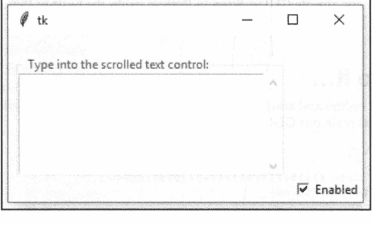

这并不是我们想要的 GUI。我们希望它看起来更像这样：

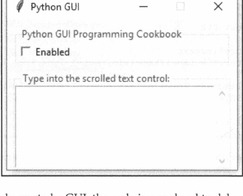

虽然意大利面条代码创建了一个 GUI，但由于代码中混乱太多，很难调试。

以下代码会产生期望的 GUI：

```python
GUI_NOT_Spaghetti.py

#===================
# imports
#===================
import tkinter as tk
from tkinter import ttk
from tkinter import scrolledtext

#===================
# Create instance
#===================
win = tk.Tk()

#===================
# Add a title
#===================
win.title("Python GUI")

#===================
# Disable resizing the GUI
#===================
win.resizable(0,0)

#================================================================
# Adding a LabelFrame, Textbox (Entry) and Combobox
#================================================================
LFrame = ttk.LabelFrame(win, text="Python GUI Programming Cookbook")
LFrame.grid(column=0, row=0, sticky='WE', padx=10, pady=10)

#================================================================
# Using a scrolled Text control
#================================================================
outputFrame = ttk.LabelFrame(win, text=' Type into the scrolled text control: ')
outputFrame.grid(column=0, row=2, sticky='E', padx=8)
scrolW = 30
scrolH = 6
scr = scrolledtext.ScrolledText(outputFrame, width=scrolW,
                    height=scrolH, wrap=tk.WORD)
scr.grid(column=1, row=0, sticky='WE')

#================================================================
# Creating a checkbutton
#================================================================
chVarUn = tk.IntVar()
check2 = tk.Checkbutton(lFrame, text="Enabled", variable=chVarUn)
check2.deselect()
check2.grid(column=1, row=4, sticky=tk.W, columnspan=3)

#========================
# Start GUI
#========================
win.mainloop()
```

## How it works...

在本菜谱中，我们比较了意大利面条代码与良好代码。良好代码相比意大利面条代码有很多优势。它有清晰注释的段落。

以下是意大利面条代码的示例：

```python
def PRINTME(me):print(me)
import tkinter
x=y=z=1
PRINTME(z)
from tkinter import *
```

以下是良好代码的示例：

```python
#====================
# imports
#====================
import tkinter as tk
from tkinter import ttk
```

它有自然的流程，遵循小部件在主 GUI 表单中的布局方式。

在意大利面条代码中，底部的 LabelFrame 在顶部的 LabelFrame 之前创建，并且与 import 语句和一些小部件创建混合在一起。

考虑以下意大利面条代码示例：

```python
import tkinter.scrolledtext
outputFrame=tkinter.ttk.LabelFrame(win,text=' Type into the scrolled text control: ')
scr=tkinter.scrolledtext.ScrolledText(outputFrame,width=scrolW,height=scrolH,wrap=tkinter.WORD)
e='E'
scr.grid(column=1,row=1,sticky=WE)
outputFrame.grid(column=0, row=2, sticky=e, padx=8)
iframe=None
if y:chk2=tkinter.Checkbutton(lFrame,text="Enabled",variable=chVarUn)
wE='WE'
if y==x:PRINTME(x)
lFrame=tkinter.ttk.LabelFrame(win,text="Spaghetti")
```

考虑以下良好代码示例：

```python
#==============================================================
# Adding a LabelFrame, Textbox (Entry) and Combobox
#==============================================================
lFrame = ttk.LabelFrame(win, text="Python GUI Programming Cookbook")
lFrame.grid(column=0, row=0, sticky='WE', padx=10, pady=10)

#==============================================================
# Using a scrolled Text control
#==============================================================
outputFrame = ttk.LabelFrame(win, text=' Type into the scrolled text control: ')
outputFrame.grid(column=0, row=2, sticky='E', padx=8)
```

它不包含不必要的变量赋值，也没有 `print` 函数，该函数在阅读代码时不会执行人们期望的调试操作。

例如，考虑以下意大利面条代码：

```python
def PRINTME(me):print(me)
x=y=z=1
e='E'
WE='WE'
scr.grid(column=1,row=1,sticky=WE)
wE='WE'
if y==x:PRINTME(x)
lFrame.grid(column=0,row=0,sticky=WE,padx=10,pady=10)
PRINTME(z)
try: win.mainloop()
except: PRINTME(x)
chk2.deselect()
if y==x:PRINTME(x)
```

良好代码没有意大利面条代码中提到的任何实例。

`import` 语句只导入所需的模块。它们不会分散在代码各处。没有重复的 `import` 语句。没有 `import *` 语句。

再来看一下意大利面条代码的另一个实例：

```python
import tkinter
x=y=z=1
PRINTME(z)
from tkinter import *
scrollW=30;scrollH=6
win=tkinter.Tk()
if x:chVarUn=tkinter.IntVar()
from tkinter import ttk
WE='WE'
import tkinter.scrolledtext
```

现在，来看一下良好代码：

```python
import tkinter as tk
from tkinter import ttk
from tkinter import scrolledtext
```

所选的变量名非常有意义。没有使用数字 1 而不是 `True` 的不必要 `if` 语句。

以下显示了意大利面条代码：

```python
x=y=z=1
if x:chVarUn=tkinter.IntVar()
WE='WE'
```

以下显示了良好代码：

```python
#========================================
# Using a scrolled Text control
#========================================
outputFrame = ttk.LabelFrame(win, text=' Type into the scrolled text control:')
outputFrame.grid(column=0, row=2, sticky='E', padx=8)
scrollW = 30
scrollH = 6
scr = scrolledtext.ScrolledText(outputFrame, width=scrollW,
                                height=scrollH, wrap=tk.WORD)
scr.grid(column=1, row=0, sticky='WE')
```

我们没有丢失预期的窗口标题，我们的复选按钮也最终位于正确的位置。我们还使围绕复选按钮的 `LabelFrame` 可见。

意大利面条代码：`GUI_Spaghetti.py`


我们丢失了窗口标题并且没有显示顶部的 `LabelFrame`。Check 按钮最终出现在错误的位置。

好的代码：`GUI_NOT_Spaghetti.py`

```python
#====================
# Create instance
#====================
win = tk.Tk()

#====================
# Add a title
#====================
win.title("Python GUI")

#====================================================================
# Adding a LabelFrame, Textbox (Entry) and Combobox
#====================================================================
lFrame = ttk.LabelFrame(win, text="Python GUI Programming Cookbook")
lFrame.grid(column=0, row=0, sticky='WE', padx=10, pady=10)

#====================================================================
# Creating a checkbutton
#====================================================================
chVarUn = tk.IntVar()
check2 = tk.Checkbutton(lFrame, text="Enabled", variable=chVarUn)
check2.deselect()
check2.grid(column=1, row=4, sticky=tk.W, columnspan=3)

#====================
# Start GUI
#====================
win.mainloop()
```

# 使用 `__init__` 连接模块

当我们使用 Eclipse IDE 的 PyDev 插件创建一个新的 Python 包时，它会自动创建一个 `__init__.py` 模块。我们也可以在不使用 Eclipse 的情况下手动创建它。


`__init__.py` 模块通常是空的，因此大小为 0 千字节。

整体 XML 输出是一个 JSON，包含方向、内容列表，每个内容项包含类型、markdown 格式和 bbox 坐标，坐标为相对坐标（0-1 范围）。

```json
{
  "direction": "horizontal|vertical",
  "contents": [
    {
      "type": "paragraph|title|list|table|quote|image|code|header|footer",
      "markdown": "in markdown format",
      "bbox": [0.xmin, 0.ymin, 0.xmax, 0.ymax]
    },
    ...
  ]
}
```

该文件为空但确实存在：

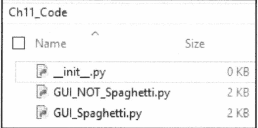

当我们运行以下代码并点击 clickMe 按钮时，我们得到代码后显示的结果。这是一个常规的 Python 模块，尚未使用 __init__.py 模块代码：


`__init__.py` 模块与 Python 类的 `__init__(self):` 方法不同。

```
# GUI__init.py
#=========================
# imports
#=========================
import tkinter as tk
from tkinter import ttk

#=========================
# Create instance
#=========================
win = tk.Tk()

#=========================
# Add a title
#=========================
win.title("Python GUI")

#==================================================================
# Adding a LabelFrame and a Button
#==================================================================
lFrame = ttk.LabelFrame(win, text="Python GUI Programming Cookbook")
lFrame.grid(column=0, row=0, sticky='WE', padx=10, pady=10)

def clickMe():
    from tkinter import messagebox
```

```
messagebox.showinfo('Message Box', 'Hi from same Level.')

button = ttk.Button(lFrame, text="Click Me ", command=clickMe)
button.grid(column=1, row=0, sticky=tk.S)

#========================
# Start GUI
#========================
win.mainloop()
```

运行前面命名为 GUI__init.py 的代码，我们得到以下输出：

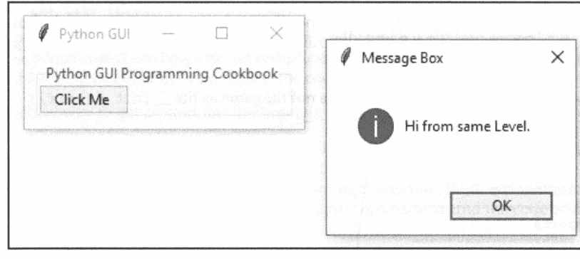

在前面的代码中，我们创建了以下函数，该函数导入 Python 的消息框然后使用它来显示消息框对话框窗口：

```
def clickMe():
    from tkinter import messagebox
    messagebox.showinfo('Message Box', 'Hi from same Level.')
```

当我们将 clickMe() 消息框代码移动到嵌套的目录文件夹中并尝试将其导入到我们的 GUI 模块时，我们可能会遇到一些挑战。

我们在 Python 模块所在位置下方创建了三个子文件夹。然后我们将 clickMe() 消息框代码放入一个新的 Python 模块中，我们将其命名为 MessageBox.py。该模块位于 Folder3 中，在我们的 Python 模块下方三级。

我们需要导入这个 MessageBox.py 模块以便使用该模块包含的 clickMe() 函数。

我们使用 Python 的相对导入语法：

```
from Ch11_Code.Folder1.Folder2.Folder3.MessageBox import clickme
```

导入语句和文件夹结构可以在以下屏幕截图中看到：

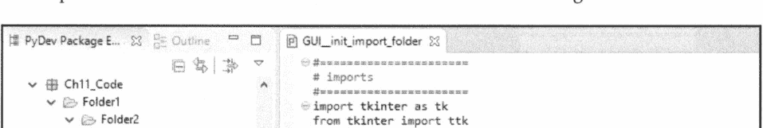

我们已删除本地 clickMe() 函数，现在我们的回调预计使用导入的 clickMe() 函数。这在 Eclipse 中有效。

使用前面的更改运行代码文件 GUI__init_import_folder.py 给出以下结果：

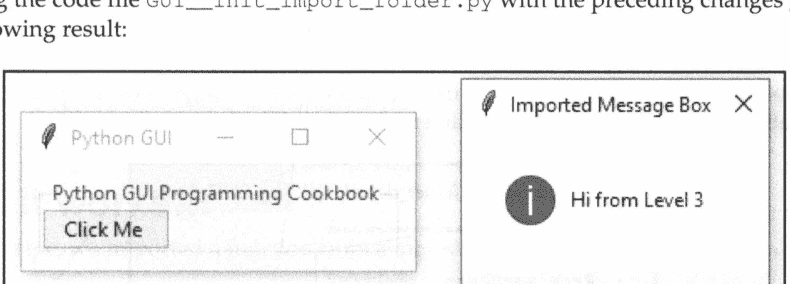

当我们从命令行运行时，我们会得到一个错误：

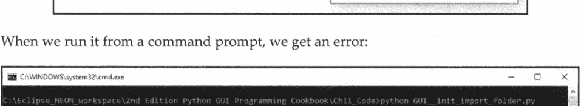

为了解决此错误，我们可以通过向 __init__.py 模块添加以下代码，从 __init__.py 模块内部初始化我们的 Python 搜索路径：

```
print('hi from GUI init\n')
from sys import path
from pprint import pprint
#============================================
# Required setup for the PYTONPATH in order to find all package folders
#============================================
from site import addsitedir
from os import getcwd, chdir, pardir
while True:
    curFull = getcwd()
    curDir = curFull.split('\\')[-1]
    if 'Ch11_Code' == curDir:
        addsitedir(curFull)
        addsitedir(curFull + 'Folder1\Folder2\Folder3')
        break
    chdir(pardir)
pprint(path)
```

在我们导入 clickMe 函数的模块中，我们不再需要指定完整的文件夹路径。我们可以直接导入模块及其函数：

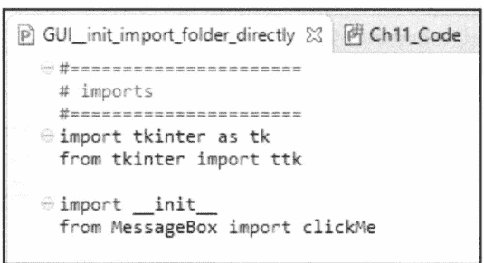

我们必须显式导入 __init__ 才能使此代码正常工作。

当我们现在运行我们的 GUI 代码时，我们得到与之前相同的窗口，但我们已删除了对 Eclipse PYTHONPATH 变量的依赖。

现在，我们可以成功地在 Eclipse PyDev 插件之外运行相同的代码：

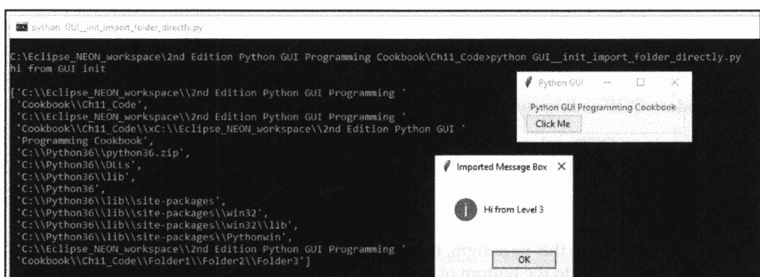

我们的代码变得更 Pythonic 了。

# 如何工作...

在本教程中，我们从嵌套在文件夹结构中的模块导入了一个函数。

我们看到可以使用 __init__.py 模块将文件夹结构添加到 Python 搜索路径。我们通过首先向 __init__.py 模块添加代码，然后显式导入 __init__.py 模块来实现这一点。

在一个循环中，我们搜索目录结构直到找到我们正在寻找的根文件夹。

然后我们获取此文件夹的完整路径并附加三个文件夹。我们没有对整个搜索路径进行硬编码。我们只将已知的文件夹附加到我们的模块所在的位置。

我们添加到 __init__.py 模块的代码使我们能够在 Eclipse 内部以及从命令行成功运行代码。

使用纯 Python 通常是最好的方法。

# 混合瀑布式和 OOP 编码

Python 是一种面向对象编程语言，但并不总是使用 OOP 有意义。对于简单的脚本任务，传统的瀑布式编码风格仍然是合适的。

在本教程中，我们将创建一个新的 GUI，混合使用瀑布式编码风格和更现代的 OOP 编码风格。

我们将创建一个 OOP 风格的类，当我们在使用瀑布式风格创建的 Python GUI 中将鼠标悬停在小部件上时，该类将显示工具提示。


> 瀑布式和瀑布式编码风格是相同的。这意味着我们必须在物理上将代码放在代码之上，然后才能从下面的代码中调用它。在这种范式中，代码在执行时 literally 从程序顶部落到程序底部。

## 准备工作

在本教程中，我们将使用 `tkinter` 创建一个 GUI，这与我们在本书第一章中创建的 GUI 类似。

## 如何操作...

在 Python 中，我们可以通过使用 `self` 命名约定将其变成方法，将函数绑定到类。这真的是 Python 的一个很棒的能力，它使我们能够创建可理解且可维护的大型系统。

有时，当我们只编写短脚本时，OOP 没有意义，因为我们发现自己在很多变量前加上 `self` 命名约定，而代码变得不必要地庞大，而实际上不需要这样。

让我们首先使用 `tkinter` 创建一个 Python GUI，并以瀑布式风格编码。

以下代码 `GUI_FallDown.py` 创建了 GUI：

```python
#========================
# imports
#========================
import tkinter as tk
from tkinter import ttk
from tkinter import messagebox
```


```python
#====================
# Create instance
#====================
win = tk.Tk()

#====================
# Add a title
#====================
win.title("Python GUI")

#============================
# Disable resizing the GUI
#============================
win.resizable(0, 0)

#====================================================================
# Adding a LabelFrame, Textbox (Entry) and Combobox
#====================================================================
lFrame = ttk.LabelFrame(win, text="Python GUI Programming Cookbook")
lFrame.grid(column=0, row=0, sticky='WE', padx=10, pady=10)

#====================================================================
# Labels
#====================================================================
ttk.Label(lFrame, text="Enter a name:").grid(column=0, row=0)
ttk.Label(lFrame, text="Choose a number:").grid(column=1, row=0, sticky=tk.W)

#====================================================================
# Buttons click command
#====================================================================
def clickMe(name, number):
    messagebox.showinfo('Information Message Box', 'Hello ' + name +
                        ', your number is: ' + number)

#====================================================================
# Creating several controls in a loop
#====================================================================
names       = ['name0', 'name1', 'name2']
nameEntries = ['nameEntry0', 'nameEntry1', 'nameEntry2']

numbers       = ['number0', 'number1', 'number2']
numberEntries = ['numberEntry0', 'numberEntry1', 'numberEntry2']

buttons = []

for idx in range(3):
    names[idx] = tk.StringVar()
```

```python
nameEntries[idx] = ttk.Entry(lFrame, width=12, textvariable=names[idx])
nameEntries[idx].grid(column=0, row=idx+1)
nameEntries[idx].delete(0, ttk.END)
nameEntries[idx].insert(0, '<name>')

numbers[idx] = tk.StringVar()
numberEntries[idx] = ttk.Combobox(lFrame, width=14,
                                  textvariable=numbers[idx])
numberEntries[idx]['values'] = (1+idx, 2+idx, 4+idx, 42+idx, 100+idx)
numberEntries[idx].grid(column=1, row=idx+1)
numberEntries[idx].current(0)

button = ttk.Button(lFrame, text="Click Me " + str(idx+1),
                    command=lambda idx=idx: clickMe(names[idx].get(),
                    numbers[idx].get()))
button.grid(column=2, row=idx+1, sticky=tk.W)
buttons.append(button)

#====================
# Start GUI
#====================
win.mainloop()
```

当我们运行这段代码时，会得到如下所示的 GUI：

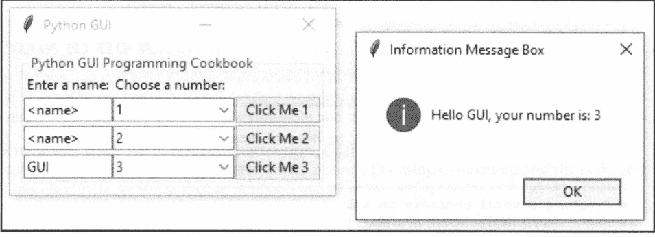

我们可以通过添加工具提示（tooltip）来改进我们的 Python GUI。最好的做法是将创建工具提示功能的代码与 GUI 本身隔离开来。

具体做法是创建一个独立的类，它包含工具提示功能，然后在创建 GUI 的同一个 Python 模块中创建这个类的实例。

使用 Python 时，我们无需将 `ToolTip` 类放在单独的模块中。可以把它放在过程式代码的上方，然后在类代码的下方调用它。

代码如下所示：

```python
#====================
# imports
#====================
import tkinter as tk
from tkinter import ttk
from tkinter import messagebox

#-------------------------------------------------------------------------------
class ToolTip(object):
    def __init__(self, widget):
        self.widget = widget
        self.tipwindow = None
        self.id = None
        self.x = self.y = 0

#-------------------------------------------------------------------------------
def createToolTip(widget, text):
    toolTip = ToolTip(widget)
    def enter(event): toolTip.showtip(text)
    def leave(event): toolTip.hidetip()
    widget.bind('<Enter>', enter)
    widget.bind('<Leave>', leave)

#-------------------------------------------------------------------------------
# further down the module we call the createToolTip function
#-------------------------------------------------------------------------------

for idx in range(3):
    names[idx] = tk.StringVar()
    nameEntries[idx] = ttk.Entry(lFrame, width=12, textvariable=names[idx])
    nameEntries[idx].grid(column=0, row=idx+1)
    nameEntries[idx].delete(0, tk.END)
    nameEntries[idx].insert(0, '<name>')

    numbers[idx] = tk.StringVar()
    numberEntries[idx] = ttk.Combobox(lFrame, width=14,
                                      textvariable=numbers[idx])
    numberEntries[idx]['values'] = (1+idx, 2+idx, 4+idx, 42+idx, 100+idx)
    numberEntries[idx].grid(column=1, row=idx+1)
    numberEntries[idx].current(0)

    button = ttk.Button(lFrame, text="Click Me " + str(idx+1),
                        command=lambda idx=idx: clickMe(names[idx].get(),
```

```python
numbers[idx].get()))
button.grid(column=2, row=idx+1, sticky=tk.W)
buttons.append(button)

#--------------------------------------------------
# Add Tooltips to more widgets
createToolTip(nameEntries[idx], 'This is an Entry widget.')
createToolTip(numberEntries[idx], 'This is a DropDown widget.')
createToolTip(buttons[idx], 'This is a Button widget.')
#--------------------------------------------------
```

运行代码后，当鼠标悬停在控件上时，就会显示出工具提示：

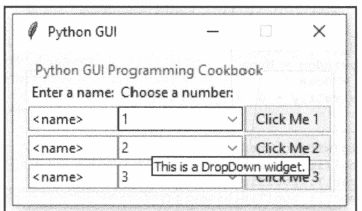

## 工作原理

在本示例中，我们以过程式的方式创建了一个 Python GUI，随后又在模块顶部添加了一个类。

我们可以非常轻松地在同一个 Python 模块中混合使用过程式编程和面向对象编程。

## 使用代码命名约定

本书第一版中的最初几个示例并没有采用结构化的代码命名约定。本示例将向你展示遵循代码命名方案的价值，因为它能帮助我们找到要扩展的代码，同时也能提醒我们程序的设计。

## 准备工作

在本示例中，我们将查看本书第一版第一章中的 Python 模块名称，并将它们与更好的命名约定进行比较。

## 操作步骤

在本书的第一章中，我们创建了第一个 Python GUI。我们通过递增的序号来区分不同的代码模块名称，以此改进我们的 GUI。

以下截图来自本书的第一版。

它看起来是这样的：

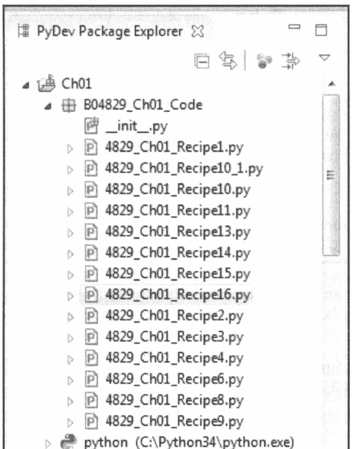

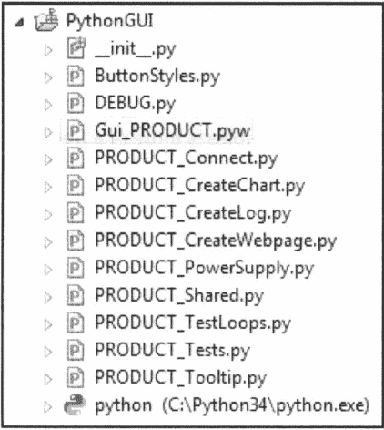

> 将 PRODUCT 一词替换为你当前正在开发的产品名称。

整个应用程序就是一个 GUI。所有部分都是相互连接的。`DEBUG.py` 模块仅用于调试我们的代码。与其他所有模块相比，调用 GUI 的主函数名称采用了相反的命名方式。它以 `Gui` 开头，并以 `.pyw` 扩展名结尾。

它是唯一一个带有这种扩展名的 Python 模块。

根据这一命名约定，如果你对 Python 足够熟悉，就会明白：要运行这个 GUI，你必须双击 `Gui_PRODUCT.pyw` 模块。

所有其他 Python 模块都包含为 GUI 提供功能以及执行业务逻辑（以实现该 GUI 所要达成的目的）的代码。

## 工作原理…

Python 代码模块的命名约定对于保持工作效率和记住我们最初的设计非常有帮助。当我们需要调试和修复缺陷或添加新功能时，它们是首先应该查看的资源。

按数字递增模块名称并不是很有意义，最终还会浪费开发时间。

另一方面，Python 变量的命名则更加自由。Python 会自动推断类型，因此我们不必指定某个变量将是 `<list>` 类型（它可能不是，或者在后续代码中可能变成其他类型）。

命名变量的一个好方法是让它们具有描述性，同时也不要过度缩写。

如果我们希望表明某个变量设计为 `<list>` 类型，那么使用完整的单词 `list` 比 `lst` 更直观。

`number` 和 `num` 也是同样的道理。

虽然为变量取非常具有描述性的名称是个好主意，但有时名称会变得过长。在 Apple 的 Objective-C 语言中，一些变量和函数名称就很极端：

```text
thisIsAMethodThatDoesThisAndThatAndAlsoThatIfYouPassInNIntegers:1:2:3
```

在命名变量、方法和函数时，请运用常识。

## 何时不应使用 OOP

Python 内置了面向对象编程能力，但同时我们也可以编写无需使用 OOP 的脚本。对于某些任务，OOP 并不可取。

本示例将向我们展示何时不应使用 OOP。

## 准备工作

在本示例中，我们将创建一个与前面示例类似的 Python GUI，并比较 OOP 代码与非 OOP 编程方式之间的差异。


## 如何操作...

让我们首先使用 OOP 方法创建一个新的 GUI。以下代码将创建显示的 GUI，代码如下：

```
GUI_Not_OOP.py

import tkinter as tk
from tkinter import ttk
from tkinter import scrolledtext
from tkinter import Menu

class OOP():
    def __init__(self):
        self.win = tk.Tk()
        self.win.title("Python GUI")
        self.createWidgets()

def createWidgets(self):
    tabControl = ttk.Notebook(self.win)
    tab1 = ttk.Frame(tabControl)
    tabControl.add(tab1, text='Tab 1')
    tabControl.pack(expand=1, fill="both")
    self.monty = ttk.LabelFrame(tab1, text=' Mighty Python ')
    self.monty.grid(column=0, row=0, padx=8, pady=4)

    ttk.Label(self.monty, text="Enter a name:").grid(column=0, row=0, sticky='W')

    self.name = tk.StringVar()
    nameEntered = ttk.Entry(self.monty, width=12, textvariable=self.name)
    nameEntered.grid(column=0, row=1, sticky='W')

    self.action = ttk.Button(self.monty, text="Click Me!")
    self.action.grid(column=2, row=1)

    ttk.Label(self.monty, text="Choose a number:").grid(column=1, row=0)
    number = tk.StringVar()
    numberChosen = ttk.Combobox(self.monty, width=12, textvariable=number)
    numberChosen['values'] = (42)
    numberChosen.grid(column=1, row=1)
    numberChosen.current(0)

    scrolW = 30; scrolH = 3
    self.scr = scrolledtext.ScrolledText(self.monty, width=scrolW, height=scrolH, wrap=tk.WORD)
```

```
```python
self.scr.grid(column=0, row=3, sticky='WE', columnspan=3)

menuBar = Menu(tab1)
self.win.config(menu=menuBar)
fileMenu = Menu(menuBar, tearoff=0)
menuBar.add_cascade(label="File", menu=fileMenu)
helpMenu = Menu(menuBar, tearoff=0)
menuBar.add_cascade(label="Help", menu=helpMenu)

nameEntered.focus()
#====================
oop = OOP()
oop.win.mainloop()
```
```

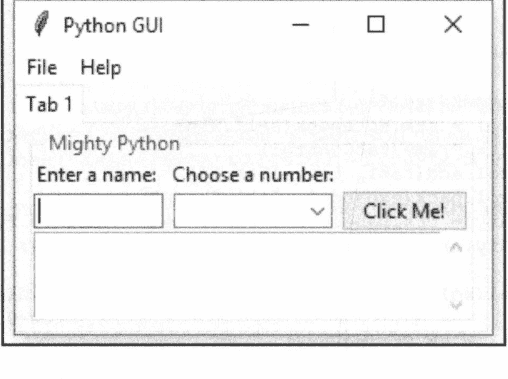

我们可以通过稍微重构代码而不使用 OOP 方法来实现相同的 GUI。首先，我们删除 OOP 类及其 `__init__` 方法。

接下来，我们将所有方法向左移动并删除 `self` 类引用，这会将它们变成非绑定函数。

我们还删除了之前代码中可能存在的任何其他 `self` 引用。然后，我们将 `createWidgets` 函数调用移动到函数声明点下方。我们将其放置在 `mainloop` 调用正上方。

最后，我们实现了相同的 GUI，但没有使用 OOP。

重构后的代码如下所示：

```
```python
import tkinter as tk
from tkinter import ttk
from tkinter import scrolledtext
```
```

```
from tkinter import Menu

def createWidgets():
    tabControl = ttk.Notebook(win)
    tab1 = ttk.Frame(tabControl)
    tabControl.add(tab1, text='Tab 1')
    tabControl.pack(expand=1, fill="both")
    monty = ttk.LabelFrame(tab1, text=' Mighty Python ')
    monty.grid(column=0, row=0, padx=8, pady=4)

    ttk.Label(monty, text="Enter a name:").grid(column=0, row=0, sticky='W')

    name = tk.StringVar()
    nameEntered = ttk.Entry(monty, width=12, textvariable=name)
    nameEntered.grid(column=0, row=1, sticky='W')

    action = ttk.Button(monty, text="Click Me!")
    action.grid(column=2, row=1)

    ttk.Label(monty, text="Choose a number:").grid(column=1, row=0)
    number = tk.StringVar()
    numberChosen = ttk.Combobox(monty, width=12, textvariable=number)
    numberChosen['values'] = (42)
    numberChosen.grid(column=1, row=1)
    numberChosen.current(0)

    scrolW = 30; scrolH = 3
    scr = scrolledtext.ScrolledText(monty, width=scrolW, height=scrolH, wrap=tk.WORD)
    scr.grid(column=0, row=3, sticky='WE', columnspan=3)

    menuBar = Menu(tab1)
    win.config(menu=menuBar)
    fileMenu = Menu(menuBar, tearoff=0)
    menuBar.add_cascade(label="File", menu=fileMenu)
    helpMenu = Menu(menuBar, tearoff=0)
    menuBar.add_cascade(label="Help", menu=helpMenu)

    nameEntered.focus()
#===================
win = tk.Tk()
win.title("Python GUI")
createWidgets()
win.mainloop()
```

## 其工作原理...

Python 使我们能够在有意义时使用 OOP。其他语言如 Java 和 C# 强制我们始终使用 OOP 方法进行编码。在本教程中，我们探索了一个不适合使用 OOP 的情况。

如果代码库增长，OOP 方法会更具可扩展性，但如果确定只需要这段代码，则无需使用 OOP。

## 如何成功使用设计模式

在本教程中，我们将通过使用工厂设计模式为 Python GUI 创建小部件。在之前的教程中，我们要么手动逐个创建小部件，要么在循环中动态创建。使用工厂设计模式，我们将使用工厂来创建小部件。

### 准备工作

我们将创建一个 Python GUI，其中有三个按钮，每个按钮具有不同的样式。

## 如何操作...

在 Python GUI 模块顶部，导入语句下方，我们创建了几个类：

```
import tkinter as tk
from tkinter import ttk
from tkinter import scrolledtext
from tkinter import Menu

class ButtonFactory():
    def createButton(self, type_):
        return buttonTypes[type_]()

class ButtonBase():
    relief  ='flat'
    foreground ='white'
    def getButtonConfig(self):
        return self.relief, self.foreground
```

```
class ButtonRidge(ButtonBase):
    relief  ='ridge'
    foreground ='red'

class ButtonSunken(ButtonBase):
    relief  ='sunken'
    foreground ='blue'

class ButtonGroove(ButtonBase):
    relief  ='groove'
    foreground ='green'

buttonTypes = [ButtonRidge, ButtonSunken, ButtonGroove]

class OOP():
    def __init__(self):
        self.win = tk.Tk()
        self.win.title("Python GUI")
        self.createWidgets()
```

我们创建一个基类，不同的按钮样式类从它继承，并且每个类都覆盖 relief 和 foreground 配置属性。所有子类都从该基类继承 getButtonConfig 方法。该方法返回一个元组。

我们还创建了一个按钮工厂类和一个保存按钮子类名称的列表。我们将该列表命名为 buttonTypes，因为我们的工厂将创建不同类型的按钮。

在模块的更下方，我们使用相同的 buttonTypes 列表创建按钮小部件：

```
def createButtons(self):

    factory = ButtonFactory()

    # Button 1
    rel = factory.createButton(0).getButtonConfig()[0]
    fg  = factory.createButton(0).getButtonConfig()[1]
    action = tk.Button(self.monty, text="Button "+str(0+1),
                       relief=rel, foreground=fg)
    action.grid(column=0, row=1)

    # Button 2
    rel = factory.createButton(1).getButtonConfig()[0]
    fg  = factory.createButton(1).getButtonConfig()[1]
    action = tk.Button(self.monty, text="Button "+str(1+1),
                       relief=rel, foreground=fg)
```

我们可以看到，我们的 Python GUI 工厂确实创建了不同的按钮，每个按钮具有不同的样式。它们在文本颜色和 `relief` 属性上有所不同。

## 其工作原理...

在本教程中，我们使用工厂设计模式创建了具有不同样式的多个小部件。我们可以轻松使用此设计模式创建整个 GUI。

设计模式是我们软件开发工具箱中非常令人兴奋的工具。

## 避免复杂性

在本教程中，我们将扩展我们的 Python GUI 并学习处理软件开发工作日益增长的复杂性的方法。

我们的同事和客户喜欢我们在 Python 中创建的 GUI，并要求添加越来越多的功能。

这会增加复杂性，并可能破坏我们最初的良好设计。

### 准备工作

我们将创建一个新的 Python GUI，类似于之前的教程中的 GUI，并以小部件的形式向其添加许多功能。

## 如何操作...

我们将从一个具有两个选项卡的 Python GUI 开始，其外观如下。运行 GUI_Complexity_start.py 会得到以下结果：

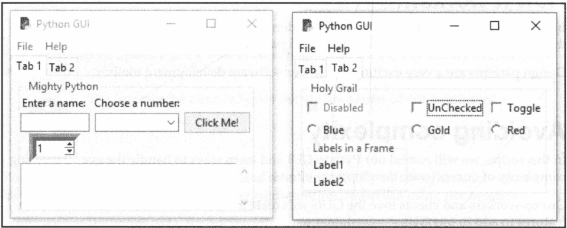

我们收到的第一个新功能请求是为 Tab 1 添加清除 scrolledtext 小部件的功能。

很容易。我们只需在 Tab 1 中添加另一个按钮：

```
# Adding another Button
self.action = ttk.Button(self.monty, text="Clear Text",
command=self.clearScrol)
self.action.grid(column=2, row=2)
```

我们还必须创建回调方法以添加所需的功能，我们在类的顶部、在创建小部件的方法之外定义它：

```
# Button callback
def clickMe(self):
    self.action.configure(text='Hello ' + self.name.get())

# Button callback Clear Text
def clearScrol(self):
    self.scr.delete('1.0', tk.END)
```


现在，我们的 GUI 有了一个新按钮，点击它时，我们会清除 `ScrolledText` 小部件的文本。运行 `GUI_Complexity_start_add_button.py` 会得到这个新按钮：

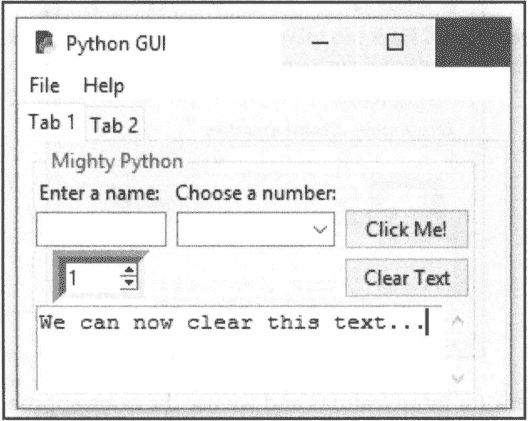

为了添加此功能，我们必须在同一个 Python 模块的两个地方添加代码。

我们在 `createWidgets` 方法中插入了新按钮（未显示），然后创建了一个新的回调方法，我们的新按钮在被点击时会调用它。我们将此代码放在第一个按钮的回调下方。

我们的下一个功能请求是添加更多功能。业务逻辑封装在另一个 Python 模块中。我们通过向 **Tab 1** 添加三个更多按钮来调用此新功能。我们使用循环来执行此操作：

```
```python
# Adding more Feature Buttons
for idx in range(3):
    b = ttk.Button(self.monty, text="Feature" + str(idx+1))
    b.grid(column=idx, row=4)
```
```

运行后，我们的 GUI 现在看起来像这样

```
GUI_Complexity_start_add_three_more_buttons.py:
```

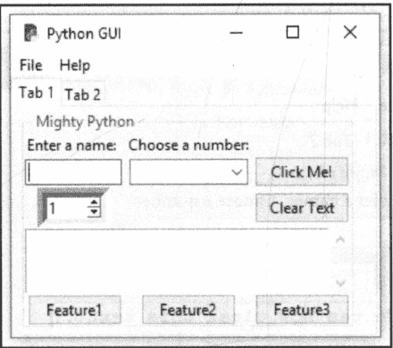

接下来，我们的客户要求更多功能，我们使用相同的方法。我们的 GUI 现在如下所示：

```
GUI_Complexity_start_add_three_more_buttons_add_more.py
```

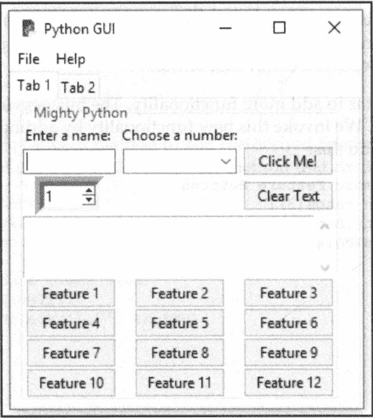

> 这还不算太糟糕。当我们为另外 50 个新功能收到新功能请求时，我们开始怀疑我们的方法是否仍然是最好的方法...

管理 GUI 必须处理的不断增加的复杂性的一种方法是添加选项卡。通过添加更多选项卡并将相关功能放入各自的选项卡中，我们可以控制复杂性并使我们的 GUI 更直观。

以下是代码 `GUI_Complexity_end_tab3.py`，它创建了我们的新 **Tab 3**：

```
```python
# Tab Control 3  ---------------------------------------
        tab3 = ttk.Frame(tabControl)          # Add a tab
        tabControl.add(tab3, text='Tab 3')     # Make tab visible

        monty3 = ttk.LabelFrame(tab3, text=' New Features ')
        monty3.grid(column=0, row=0, padx=8, pady=4)

        # Adding more Feature Buttons
        startRow = 4
        for idx in range(24):
            if idx < 2:
                colIdx = idx
                col = colIdx
            else:
                col += 1
            if not idx % 3:
                startRow += 1
                col = 0

            b = ttk.Button(monty3, text="Feature " + str(idx+1))
            b.grid(column=col, row=startRow)

        # Add some space around each label
        for child in monty3.winfo_children():
            child.grid_configure(padx=8)
```
```

运行上述代码会得到以下新的 Python GUI：

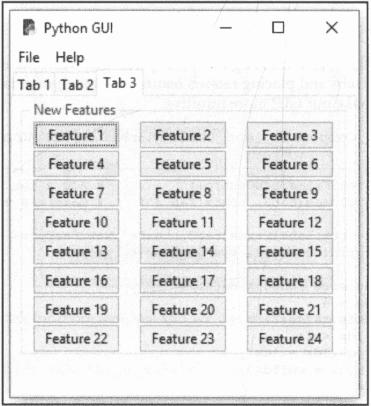

## 如何工作…

在本教程中，我们向 GUI 添加了多个新小部件，以便为我们的 Python GUI 添加更多功能。我们看到，随着越来越多的新功能请求，我们漂亮的 GUI 设计很容易变得不清晰，难以使用 GUI。

> 突然间，小部件占领了世界…

我们看到了通过模块化 GUI 来处理复杂性的方法，即将大型功能分解为更小的部分，并使用选项卡将它们按功能相关区域排列。

虽然复杂性有很多方面，但模块化和重构代码通常是处理软件代码复杂性的非常好的方法。

# 使用多个笔记本进行 GUI 设计

在本教程中，我们将使用多个笔记本创建 GUI。令人惊讶的是，`tkinter` 并未开箱即用地提供此功能，但我们可以轻松设计此类小部件。

使用多个笔记本将进一步降低上一教程中讨论的复杂性。

## 准备工作

我们将创建一个新的 Python GUI，类似于上一教程中的 GUI。这次，我们将使用两个笔记本设计我们的 GUI。为了专注于此功能，我们将使用函数而不是类方法。阅读上一教程将是对本教程的良好介绍。

## 如何操作…

为了在同一个 GUI 中使用多个笔记本，我们首先创建两个框架。第一个框架将容纳笔记本及其选项卡，而第二个框架将作为每个选项卡设计的显示小部件的显示区域。我们使用网格布局管理器来排列这两个框架，将一个放在另一个之上。然后，我们创建两个笔记本并将它们排列在第一个框架内：

```
```python
# --------------------------------------------------
# Create GUI
# --------------------------------------------------
win = tk.Tk()                 # Create instance
win.title("Python GUI")       # Add title
# --------------------------------------------------

win_frame_multi_row_tabs = ttk.Frame(win)
win_frame_multi_row_tabs.grid(column=0, row=0, sticky='W')

display_area = ttk.Labelframe(win, text=' Tab Display Area ')
display_area.grid(column=0, row=1, sticky='NW')

note1 = ttk.Notebook(win_frame_multi_row_tabs)
note1.grid(column=0, row=0)

note2 = ttk.Notebook(win_frame_multi_row_tabs)
note2.grid(column=0, row=1)
```
```

## 最佳实践

接下来，我们使用循环创建五个选项卡并将它们添加到每个笔记本中：

```
```python
# create and add tabs to Notebooks
for tab_no in range(5):
    tab1 = ttk.Frame(note1, width=0, height=0)             # Create a tab for notebook 1
    tab2 = ttk.Frame(note2, width=0, height=0)             # Create a tab for notebook 2
    note1.add(tab1, text='Tab {}'.format(tab_no + 1))      # Add tab notebook 1
    note2.add(tab2, text='Tab {}'.format(tab_no + 1))      # Add tab notebook 2
```
```

我们创建一个回调函数并将两个笔记本的点击事件绑定到此回调函数。现在，当用户点击两个笔记本中的任何选项卡时，此回调函数将被调用：

```
```python
# bind click-events to Notebooks
note1.bind("<ButtonRelease-1>", notebook_callback)
note2.bind("<ButtonRelease-1>", notebook_callback)
```
```

在回调函数中，我们添加逻辑来决定点击选项卡后显示哪些小部件：

```
```python
#--------------------------------------------------
def notebook_callback(event):
    clear_display_area()

    current_notebook = str(event.widget)
    tab_no = str(event.widget.index("current") + 1)

    if current_notebook.endswith('notebook'):
        active_notebook = 'Notebook 1'
    elif current_notebook.endswith('notebook2'):
        active_notebook = 'Notebook 2'
    else:
        active_notebook = ''

    if active_notebook is 'Notebook 1':
        if tab_no == '1': display_tab1()
        elif tab_no == '2': display_tab2()
        elif tab_no == '3': display_tab3()
        else: display_button(active_notebook, tab_no)
    else:
        display_button(active_notebook, tab_no)
```
```

我们添加一个创建显示区域的函数和另一个清除该区域的函数：

注意回调函数如何调用 clear_display_area() 函数。

```
#----------------------------------------
def create_display_area():
    # add empty label for spacing
    display_area_label = tk.Label(display_area, text="", height=2)
    display_area_label.grid(column=0, row=0)

#----------------------------------------
def clear_display_area():
    # remove previous widget(s) from display_area:
    for widget in display_area.grid_slaves():
        if int(widget.grid_info()["row"]) == 0:
            widget.grid_forget()
```

clear_display_area() 函数知道选项卡的小部件正在创建的行和列，并且通过找到第零行，我们就可以使用 grid_forget() 来清除显示。

对于第一个笔记本的选项卡 1 到 3，我们创建新框架来容纳更多小部件。点击这三个选项卡中的任何一个都会导致一个与我们在上一教程中创建的非常相似的 GUI。

这三个选项卡在回调函数中作为 display_tab1()、display_tab2() 和 display_tab3() 被调用，当这些选项卡被点击时。


下面是单击第一个笔记本的标签页3时运行的代码：

```
#----------------------------------------
def display_tab3():
    monty3 = ttk.LabelFrame(display_area, text=' New Features ')
    monty3.grid(column=0, row=0, padx=8, pady=4)

    # Adding more Feature Buttons
    startRow = 4
    for idx in range(24):
        if idx < 2:
            colIdx = idx
            col = colIdx
        else:
            col += 1
        if not idx % 3:
            startRow += 1
            col = 0

        b = ttk.Button(monty3, text="Feature " + str(idx + 1))
        b.grid(column=col, row=startRow)

    # Add some space around each label
    for child in monty3.winfo_children():
        child.grid_configure(padx=8)
```

单击第一个笔记本中前三个标签页之外的任何标签页，都会调用相同的函数 display_button()，该函数会显示一个按钮，并将其 text 属性设置为显示笔记本和标签页编号：

```
#----------------------------------------
def display_button(active_notebook, tab_no):
    btn = ttk.Button(display_area, text=active_notebook + ' - Tab ' + tab_no, \
                     command= lambda: showinfo("Tab Display", "Tab: " + tab_no ))
    btn.grid(column=0, row=0, padx=8, pady=8)
```

单击这些按钮中的任何一个都会弹出一个消息框。

在代码末尾，我们调用 display_tab1() 函数。当 GUI 首次启动时，显示区域中显示的是该标签页的控件：

单击第一个笔记本的**标签页2**会清除标签页显示区域，然后显示在 `display_tab2()` 函数中创建的控件：

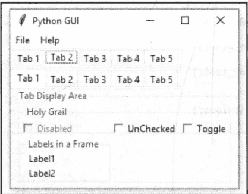

请注意，标签页显示区域会自动调整大小以适应所创建控件的大小。

单击**标签页3**将显示以下 GUI 界面：

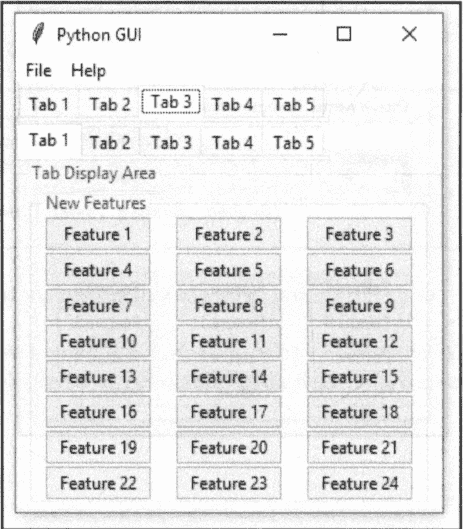

单击第一个或第二个笔记本中的任何其他标签页，都会在标签页显示区域中显示一个按钮：

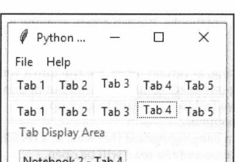

单击这些按钮中的任何一个都会弹出一个消息框：

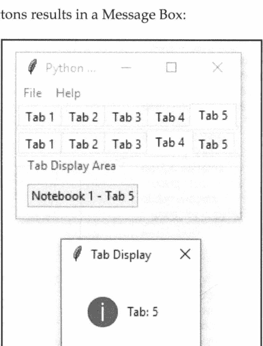

在本技巧中，你学习了如何在同一个 GUI 设计中创建多个笔记本。

创建笔记本的数量没有限制。我们可以根据设计需要创建任意数量的笔记本。

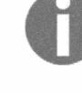

在编程中，有时我们会碰壁并陷入困境。我们不停地用头撞墙，但毫无进展。
有时，我们想要放弃。
奇迹确实会发生……
只要继续撞墙，在某个时刻，墙会倒塌，道路会畅通。
到那时，我们就能在软件世界中留下积极的印记……

# 索引

+   ### 3
+   
+   3D
+   
+   - 使用 wxPython 创建自定义 GUI 345
+   
+   __init__
+   
+   - 用于连接模块 383
+   
+   __main__ 部分
+   
+   - 用于创建自测代码 290, 295

+   ### B
+   
+   位图
+   
+   - 用于创建 GUI 351

+   ### C
+   
+   回调函数
+   
+   - 编写 123, 124, 125
+   
+   画布控件
+   
+   - 使用 99, 100, 101
+   
+   图表
+   
+   - 创建 142, 143
+   - 使用 Matplotlib 创建 132, 133, 134, 135
+   - 放置标签 144, 147, 148, 149
+   - 添加图例 150, 152
+   - 自动调整刻度 156, 157, 158, 159, 160
+   - 缩放 153, 155, 156
+   
+   复选按钮
+   
+   - 创建具有不同初始状态的复选按钮 26
+   
+   类
+   
+   - 编写代码以改进 GUI 117, 118, 122, 123
+   
+   代码命名约定
+   
+   - 使用 394
+   
+   组合框控件
+   
+   - 添加 24, 25, 26
+   
+   复杂性

+   - 避免 405
+   
+   协调世界时（UTC）267
+   增删改查（CRUD）208
+   自定义 GUI
+   
+   - 添加颜色 357
+   - 使用 wxPython 创建 345

+   ### D
+   
+   守护进程 173
+   
+   数据
+   
+   - 从控件获取 111, 112
+   - 使用 urlopen 从网站读取 201, 205
+   - 从 MySQL 数据库检索 240, 244
+   - 从 MySQL 数据库存储 240, 244
+   
+   调试输出级别
+   
+   - 配置 286, 289
+   
+   调试监视
+   
+   - 设置 281
+   
+   设计模式
+   
+   - 使用 402
+   
+   对话框控件
+   
+   - 用于将文件复制到网络 187, 197
+   
+   不要重复自己（DRY）30, 126

+   ### E
+   
+   东部夏令时（EDT）268
+   Eclipse PyDev IDE
+   
+   - 用于编写单元测试 299, 305
+   
+   Eclipse 与 PyDev 插件
+   
+   - 参考链接 285
+   
+   Entry 控件 19, 20
+   异常处理
+   
+   - 参考链接 202

+   ### F
+   
+   fall-down

+   与 OOP 代码混合 390
+   先进先出（FIFO）177
+   fixtures
+     关于 300
+     参考 300
+   Frame 318

# G

+   GLCanvas 更新
+     URL 示例 343
+   网格布局管理器
+     使用 69
+   GUI 语言
+     修改 258, 261
+   GUI 控件
+     通过框架中嵌入框架来对齐 50, 51, 52, 53, 54, 55
+   gui2py
+     URL 351
+   GUI
+     测试代码 277, 281
+     通信 333
+     使用多个笔记本创建 411
+     使用 PyGL GUI 开发框架创建 354
+     使用 PyOpenGL 创建 341
+     使用单元测试创建 295, 299
+     以敏捷方式设计 273, 277
+     本地化 263
+     为国际化做准备 269

# I

+   独立消息框
+     创建 79, 80, 81, 82
+   集成开发环境（IDE）281
+   进程间通信（IPC）162, 308

# L

+   Label 51
+   标签框架控件
+     排列标签 39, 40, 41, 42
+   标签
+     添加到 GUI 窗体 14
+     在标签框架控件中排列 39, 40, 41, 42
+     在图表上放置 144, 147, 148, 149

+   后进先出（LIFO）177
+   图例
+     添加到图表 150, 152
+   循环
+     添加多个控件 34

# M

+   主根窗口
+     修改图标 84, 85
+   Matplotlib
+     使用 pip 和 whl 扩展名安装 135, 136, 137, 138, 140, 141
+     URL 132, 134
+     用于下载的 URL 138
+     用于创建图表 132, 133, 134, 135
+   菜单栏
+     创建 55, 57, 58, 60, 61, 62, 63
+   消息框
+     创建 74, 75, 76, 77, 78
+   mighty 51
+   模块级全局变量
+     使用 113, 115, 116, 117
+   模块
+     传递队列 183, 186
+     多个笔记本
+       用于创建 GUI 411
+   MySQL 数据库
+     配置连接 215, 219
+     检索数据 240, 244
+     存储数据 240, 244
+   MySQL 服务器
+     使用 Python 连接 209
+     使用 Python 安装 209
+     用于安装的 URL 209
+   MySQL Workbench
+     关于 244
+     参考 246
+     使用 244, 250

# O

+   面向对象编程（OOP）
+     关于 93
+     避免 398
+     与 fall-down 混合的代码 390
+   OpenGL

动画 361
URL 368

P
padding
  用于在控件周围添加空间 42, 43, 44, 45
Phoenix 版本 309
pip 模块
  用于通过 whl 扩展名安装 Matplotlib 135, 136, 137, 138, 140, 141
进度条
  添加到 GUI 96, 97, 98, 99
PyGLet GUI 开发框架
  用于创建 GUI 354
Pyglet
  URL 356
PyOpenGL 3.0.2
  URL 342
PyOpenGL
  关于 339
  导入 341
Python 3.6
  URL 9
Python 连接器驱动程序
  参考链接 212
Python 增强提案（PEP）373
  URL 9
Python 扩展包
  URL 342
Python GUI 数据库
  设计 227
Python GUI
  创建按钮 16, 18
  用于更改 text 属性的按钮 16, 18
  创建 9, 10
  设计数据库 220
  添加标签 14
  防止调整大小 12
Python
  连接到 MySQL 服务器 209
  安装 MySQL 服务器 209
  用于控制不同的 GUI 框架 330
  用于创建工具提示 92, 93, 94, 95, 96

Q
队列
  在模块之间传递 183, 186
  使用 177, 183

R
单选按钮控件
  使用 28, 29, 30, 31
红、绿、蓝、Alpha（RGBA）颜色模式 362
回归 281
relief 属性
  使用 89, 90, 91, 92
可复用的 GUI 组件
  创建 125, 126, 127, 128

S
SCHEMAS 249
滚动文本控件
  使用 31, 32, 33
自测代码
  使用 __main__ 部分创建 290, 295
幻灯片
  使用 tkinter 创建 368
意大利面条式代码
  避免 376
微调框控件
  使用 85, 86, 87, 88, 89
SQL DELETE 命令
  使用 236, 240
SQL INSERT 命令
  使用 227, 230
SQL UPDATE 命令
  使用 230, 235
标准时间（EST）268
StringVar()
  使用 105, 108, 109, 110

T
选项卡控件
  创建 63, 64, 65, 66, 67, 68
tcl
  URL 31
TCP/IP
  用于通过网络通信 198


- Test-Driven-Development (TDD) 299
- testing
  - about 277
  - GUI code 277, 281
- textbox widget
  - about 19, 20
  - disabling 21, 22, 23
  - focus, setting 21, 22, 23
- threads
  - creating 163, 167
  - reference link 162
  - starting 167, 173
  - stopping 173, 176
- tkinter GUI code
  - embedding, into wxPython GUI 327
- tkinter widgets
  - reference link 69
- tkinter window form
  - title, creating 83
- tkinter
  - used, for creating slideshow 368
  - wxPython app, embedding 324
- tooltips
  - creating, Python used 92, 93, 94, 95, 96

## U
- unit tests
  - used, for creating GUI 295, 299
  - writing, Eclipse PyDev IDE used 299, 305
- Universal Naming Convention (UNC) 193
- urlopen
  - used, for reading data from websites 201, 205

## W
- whl extension
- Matplotlib, installing pip used 135, 136, 137, 138, 140, 141
- widget text
  - displaying, in different languages 257
- widgets
  - GUI, expanding 45, 47, 48, 50
  - text, displaying in different languages 255
- win 51
- wxDesigner
  - URL 323
- wxPython app
  - embedding, in tkinter app 324
- wxPython GUI
  - controls, adding 318
  - GUI, creating 312
  - tkinter GUI code, embedding 327
  - URL 313
- wxPython library
  - installing 309
  - URL 309
  - URL, for Phoenix Project 311

