## 模块 1

# 学习 QGIS，第三版

使用 QGIS 2.14 创建精美地图并轻松执行地理处理任务的最新指南

## 1

### 开始使用 QGIS

在本章中，我们将安装和配置 **QGIS** 地理信息系统。我们还将熟悉用户界面以及如何对其进行自定义。到本章结束时，您将使 QGIS 在您的机器上运行并准备好开始教程。

### 安装 QGIS

QGIS 运行于 **Windows**、各种 **Linux** 发行版、**Unix**、**Mac OS X** 和 **Android**。QGIS 项目提供即用型软件包以及从源代码构建的说明，网址为 http://download.qgis.org。我们将介绍如何在两个系统 Windows 和 Ubuntu 上安装 QGIS，以及如何避免最常见的陷阱。

> 其他受支持操作系统的进一步安装说明可在 http://www.qgis.org/en/site/forusers/alldownloads.html 获取。

像许多其他开源项目一样，QGIS 为您提供不同版本的选择。对于本书中的教程，我们将使用 **QGIS 2.14 LTR** 版本。以下选项可用：

- **长期发布版 (LTR)：** LTR 版本推荐用于企业和学术用途。它目前每年二月底发布一次。至少提供一年的错误修复更新，且功能和用户界面保持不变。这使其成为培训材料最佳选择，因为不会在几个月后过时。
- **最新发布版 (LR)**：LR 版本包含新开发并经过测试的功能。它目前每四个月发布一次（除非发布 LTR 版本）。如果您想跟上最新发展，包括新功能和用户界面更改，但不习惯使用 DEV 版本，请使用此版本。
- **开发者版本 (DEV、master 或 testing)**：前沿的 DEV 版本包含最新最好的开发成果，但请注意，在某些日子里，它可能不如您希望的那样可靠。

> 您可以在 http://www.qgis.org/en/site/getinvolved/development/roadmap.html#release-schedule 找到有关发布以及未来发布计划的更多信息。要了解发布之间的更改，请查看 http://www.qgis.org/en/site/forusers/visualchangelogs.html 上的视觉更改日志。

#### 在 Windows 上安装 QGIS

在 Windows 上，我们有两种不同的安装 QGIS 的选项，独立安装程序和 **OSGeo4W** 安装程序：

- **独立安装程序** 是一个大文件可供下载（约 280 MB）；它包含 QGIS 发布版、**地理资源分析支持系统 (GRASS)** GIS 以及 **地理科学自动化分析系统 (SAGA)** GIS 在一个软件包中。
- **OSGeo4W 安装程序** 是一个小巧灵活的安装工具，可下载和安装 QGIS 以及许多其他 OSGeo 工具及其所有依赖项。此安装程序相对于独立安装程序的主要优势是使其更新 QGIS 及其依赖项变得非常容易。您可以始终同时访问当前发布版和开发者版本，如果您选择的话，但当然，您永远不会被强制更新。这就是我推荐您使用 **OSGeo4W** 的原因。您可以从 http://osgeo4w.osgeo.org 下载 32 位和 64 位 OSGeo4W 安装程序（或直接从 http://download.osgeo.org/osgeo4w/osgeo4w-setup-x86.exe 下载 32 位版本，或 http://download.osgeo.org/osgeo4w/osgeo4w-setup-x86_64.exe 如果您使用的是 64 位 Windows）。下载与您的操作系统匹配的版本并保留它！将来，每当您想要更改或更新系统时，只需再次运行它即可。

> 💡 无论您选择哪个安装程序，请确保在安装路径中避免使用特殊字符，例如德语变音符号或除默认拉丁字母以外的其他字母表中的字母（详情请参阅 `https://en.wikipedia.org/wiki/ISO_basic_Latin_alphabet`），因为它们以后可能会导致问题，例如在插件安装期间。

当 OSGeo4W 安装程序启动时，我们可以选择 **Express Desktop Install**、**Express Web-GIS Install** 和 **Advanced Install**。要安装 QGIS LTR 版本，我们只需选择 **Express Desktop Install** 选项，下一个对话框将列出可用的桌面应用程序，例如 **QGIS**、**uDig** 和 **GRASS GIS**。我们只需选择 **QGIS**，点击 **Next**，然后通过再次点击 **Next** 确认必要的依赖项。然后下载和安装将自动开始。安装完成后，将为 OSGeo4W 和 QGIS 创建桌面快捷方式和开始菜单条目。

要安装 QGIS LTR（或 DEV），我们需要通过 **Advanced Install** 选项，如下图所示：

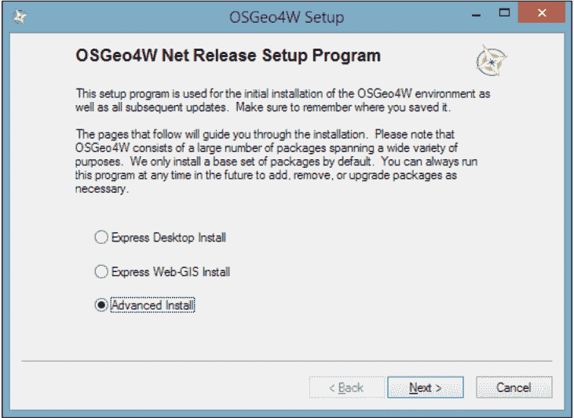

此安装路径提供许多选项，例如 **Download Without Installing** 和 **Install from Local Directory**，可用于在一台机器上下载所有必要软件包，然后在没有 Internet 访问的机器上安装。我们只需选择 **Install from Internet**，如下图所示：

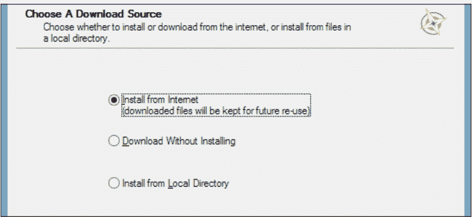

选择安装 **Root Directory** 时，如下图所示，避免在安装路径中使用特殊字符，例如德语变音符号或除默认拉丁字母以外的其他字母表中的字母（如前所述），因为它们以后可能会导致问题，例如在插件安装期间：

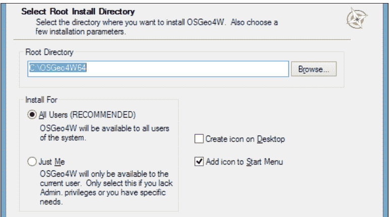

然后您可以指定文件夹（**Local Package Directory**），设置过程将在其中存储安装文件，以及自定义 **Start menu name**。我建议您保留默认设置，类似于此屏幕截图中所示：

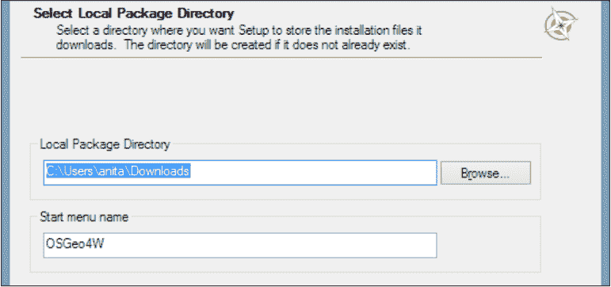

在 Internet 连接设置中，通常无需更改默认设置，但如果您的机器例如隐藏在 **proxy** 后面，您可以在此处指定它：

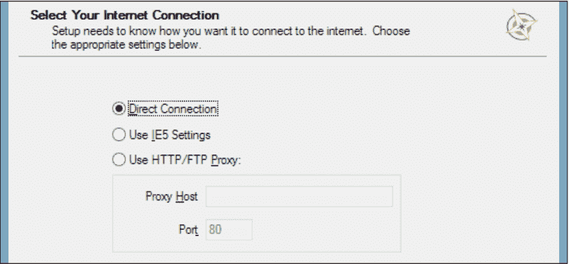


然后我们可以选择下载站点。在撰写本书时，只有一个下载服务器可用，正如你在以下截图中所看到的那样：

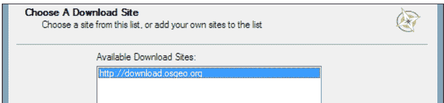

在安装程序从 OSGeo 的服务器获取最新的软件包信息后，我们就可以选择要安装的软件包。QGIS LTR 在桌面类别中列为 qgis-ltr（开发版列为 qgis-dev）。要选择 LTR 版本进行安装，请点击显示为 Skip 的文字，它会改变并显示版本号，如本截图所示：

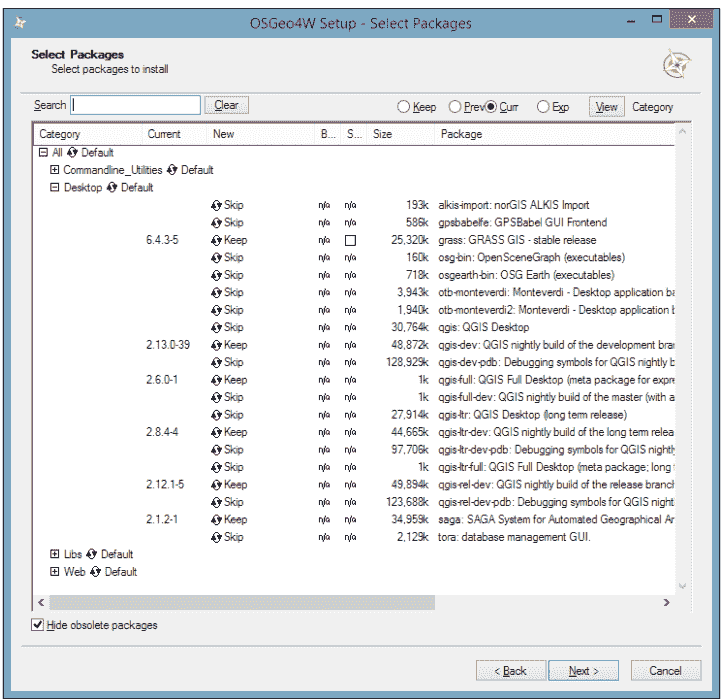

正如你在以下截图中所看到的，安装程序会自动选择所有必要的依赖项（如 GDAL、SAGA、OTB 和 GRASS），因此我们无需担心此事：

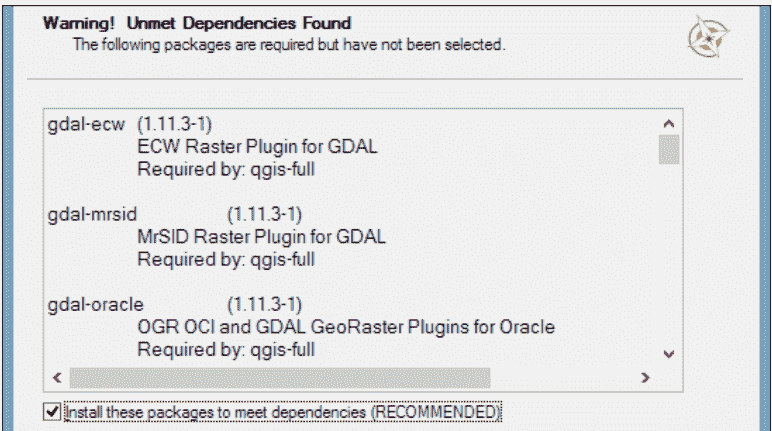

点击 Next 后，下载和安装会自动开始，就像在 Express 版本中一样。

你可能已经注意到其他可用的 QGIS 软件包，称为 qgis-ltr-dev 和 qgis-rel-dev。它们包含最新的更改（分别针对 LTR 和 LR 版本），这些更改将根据发布计划作为错误修复版本发布。如果你在发布版本中遇到问题，而该问题最近已被修复但错误修复版本尚未发布，那么这些软件包是一个不错的选择。

> 如果你尝试运行 QGIS 并弹出提示说，无法在动态链接库 <some-name>.dll 中定位过程入口点 <some-name>，这意味着你在 Windows 系统上遇到了常见的 DLL 冲突问题。此错误很容易修复；只需将错误消息中提到的 DLL 文件从 C:\OSGeo4W\bin\ 复制到 C:\OSGeo4W\apps\qgis\bin\（如有必要请调整路径）。

## 在 Ubuntu 上安装

在 Ubuntu 上，QGIS 项目为 LTR、LR 和 DEV 版本提供软件包。在撰写本书时，支持的 Ubuntu 版本为 Precise、Trusty、Vivid 和 Wily，但你可以从 http://www.qgis.org/en/site/forusers/alldownloads.html#debian-ubuntu 获取最新信息。请注意，你一次只能安装一个版本。这些软件包未列在默认的 Ubuntu 仓库中。因此，我们必须将适当的仓库添加到 Ubuntu 的源列表中，该列表位于 /etc/apt/sources.list。你可以用任何文本编辑器打开该文件。确保你拥有超级用户权限，因为保存修改时需要此权限。一个选择是使用 gedit，它已默认安装在 Ubuntu 中。要编辑 sources.list 文件，请使用以下命令：

```
sudo gedit /etc/apt/sources.list
```

下载示例代码
你可以在 http://www.packtpub.com 上使用你的账户下载本书的示例代码文件。如果你是在其他地方购买本书，可以访问 http://www.packtpub.com/support 并注册以直接收到文件。

请确保只添加以下软件包源选项之一，以避免因不兼容的软件包而产生冲突。你需要添加到源列表中的具体行取决于你的 Ubuntu 版本：

- 1. 第一个选项，也是默认选项，是安装 LR 版本。要在 Trusty 上安装 QGIS LR 发布版，请将以下行添加到你的文件中：
- deb http://qgis.org/debian trusty main
- deb-src http://qgis.org/debian trusty main

如有必要，将 trusty 替换为 precise、vivid 或 wily 以适应你的系统。要获取受支持的 Ubuntu 版本的最新列表，请查看 http://www.qgis.org/en/site/forusers/alldownloads.html#debian-ubuntu。

- 2. 第二个选项是通过添加以下行到你的文件中来安装 QGIS LTR：
- deb http://qgis.org/debian-ltr trusty main
- deb-src http://qgis.org/debian-ltr trusty main

3. 第三个选项是通过添加以下行来安装 QGIS DEV：

```
deb http://qgis.org/debian-nightly trusty main
deb-src http://qgis.org/debian-nightly trusty main
```

> 前述版本依赖于 GDAL 和 proj4 等其他软件包，这些软件包可在 Ubuntu 仓库中找到。值得一提的是，这些软件包通常相当陈旧。

4. 第四个选项是安装带有更新依赖项的 QGIS LR，这些依赖项由 ubuntugis 仓库提供。将以下行添加到你的文件中：

```
deb http://qgis.org/ubuntugis trusty main
deb-src http://qgis.org/ubuntugis trusty main
deb http://ppa.launchpad.net/ubuntugis/ubuntugis-unstable/
ubuntu trusty main
```

5. 第五个选项是带有更新依赖项的 QGIS LTR。将以下行添加到你的文件中：

```
deb http://qgis.org/ubuntugis-ltr trusty main
deb-src http://qgis.org/ubuntugis-ltr trusty main
deb http://ppa.launchpad.net/ubuntugis/ubuntugis-unstable/
ubuntu trusty main
```

6. 第六个选项是带有更新依赖项的 QGIS master。将以下行添加到你的文件中：

```
deb http://qgis.org/ubuntugis-nightly trusty main
deb-src http://qgis.org/ubuntugis-nightly trusty main
deb http://ppa.launchpad.net/ubuntugis/ubuntugis-unstable/
ubuntu trusty main
```

> 为了跟随本书中的教程，建议你安装 QGIS 2.14 LTR 并带有更新的依赖项（第五个选项）。

选择仓库后，我们将把 qgis.org 仓库的公钥添加到 apt 密钥环中。这将避免在从非默认仓库安装时可能出现的警告。在终端中运行以下命令：

```
sudo apt-key adv --keyserver keyserver.ubuntu.com --recv-key 3FF5FFCAD71472C4
```

> 到本书印刷时，密钥信息可能已更改。请参考 http://www.qgis.org/en/site/forusers/alldownloads.html#debian-ubuntu 获取最新更新。

最后，要安装 QGIS，请运行以下命令：

```
sudo apt-get update
```

```
sudo apt-get install qgis python-qgis qgis-plugin-grass
```

## 首次运行 QGIS

安装 QGIS 后，你将获得两个应用程序：QGIS Desktop 和 QGIS Browser。如果你熟悉 ArcGIS，可以将 QGIS Browser 视为类似于 ArcCatalog 的东西。它是一个用于预览空间数据及其相关元数据的小型应用程序。本书其余部分我们将专注于 QGIS Desktop。

默认情况下，QGIS 将使用操作系统的默认语言。为了跟随本书中的教程，我建议你通过 Settings | Options | Locale 将语言更改为英语。

首次运行时，工具栏的排列方式可能会隐藏一些按钮。为了能够高效工作，我建议你重新排列工具栏（为完整起见，我已在 View 菜单中的 Toolbars 中启用了所有工具栏）。我喜欢将一些工具栏放在左右屏幕边框上，以节省垂直屏幕空间，尤其是在宽屏显示器上。

此外，我们将通过导航到 View | Panels | Browser Panel 来激活文件浏览器。它将为我们提供快速访问空间数据的方式。最后，你屏幕上的 QGIS 窗口应类似于以下截图：

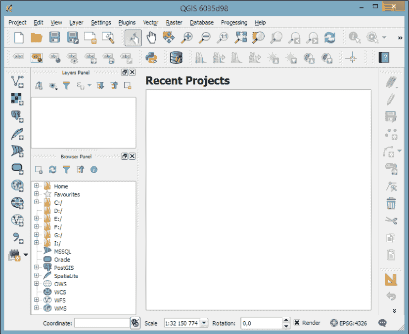

接下来，我们将通过导航到 **Plugins | Manage and Install Plugins** 来激活一些必备插件。插件通过勾选其名称旁边的复选框来激活。起初，我推荐以下插件：

- **Coordinate Capture:** 此插件用于在地图上拾取坐标
- **DB Manager:** 此插件帮助你管理 SpatiaLite 和 PostGIS 数据库
- **fTools:** 此插件提供矢量分析和管理工具
- **GdalTools:** 此插件提供栅格分析和管理工具
- **Processing:** 此插件提供许多有用的栅格和矢量分析工具，以及用于任务自动化的模型构建器

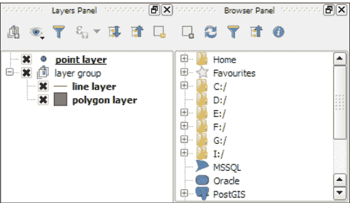

地图下方，我们找到重要信息，例如（从左到右）当前地图坐标、地图比例尺，以及（当前未激活的）项目坐标参考系统（CRS），例如本截图中的 EPSG:4326：

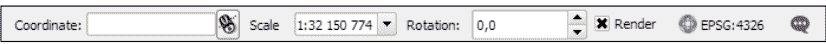

接下来，有多个工具栏可供探索。如果你按上一节所示排列它们，顶行包含以下工具栏：

- **File**: 此工具栏包含创建、打开、保存和打印项目的工具

- **Map Navigation**: 此工具栏包含平移和缩放工具

- **Attributes**: 这些工具用于*识别、选择、打开属性表、测量*等，看起来如下：

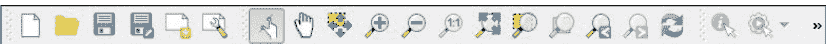

第二行包含以下工具栏：

- **Label**: 这些工具用于添加、配置和修改标签

- **Plugins**: 目前这仅包含 **Python Console** 工具，但会随着安装额外的 Python 插件而填充

- **Database**: 目前，此工具栏仅包含 DB Manager，但其他数据库相关工具（例如 **OfflineEditing** 插件，允许我们离线编辑并与数据库同步）在安装后会出现于此


- **栅格**：此工具栏包含直方图拉伸、亮度和对比度控制
- **矢量**：此工具栏目前仅包含 **坐标捕获** 工具，但将由额外的 Python 插件填充
- **Web**：此工具栏目前为空，但也将由额外的 Python 插件填充
- **帮助**：此工具栏指向下载用户手册的选项，外观如下：

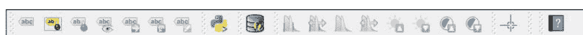

在左侧屏幕边框，我们放置了 **管理图层** 工具栏。此工具栏包含从 *矢量或栅格文件、数据库、网络服务、文本文件添加图层* 或创建新图层的工具：

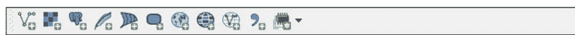

最后，在右侧屏幕边框，我们还有两个工具栏：

- **数字化**：此工具栏中的工具 **启用编辑**、基本要素创建和编辑
- **高级数字化**：此工具栏包含 **撤销/重做** 选项、**高级编辑工具、几何简化工具** 等，外观如下：

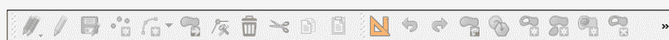

> 所有数字化工具（除 **启用高级数字化工具** 按钮外）目前均处于非活动状态。它们只有在我们开始编辑矢量图层时才会变为活动状态。

工具栏和面板可通过 **视图** 菜单的 **面板** 和 **工具栏** 条目激活和停用，也可通过右键单击菜单或工具栏激活和停用，这将打开一个包含所有可用工具栏和面板的上下文菜单。工具栏上的所有工具也可以通过菜单访问。如果你停用 **管理图层工具栏**，例如，你仍然可以使用 **图层** 菜单添加图层。

正如你现在可能已经猜到的那样，QGIS 具有高度的可定制性。你可以通过前往 **设置 | 配置快捷方式** 为常用工具分配快捷方式来提高生产力。同样，如果你发现自己从不使用某个工具栏按钮或菜单项，可以通过前往 **设置 | 自定义** 来隐藏它。例如，如果你无法访问 Oracle Spatial 数据库，你可能希望隐藏相关按钮以减少杂乱并节省屏幕空间，如以下屏幕截图所示：

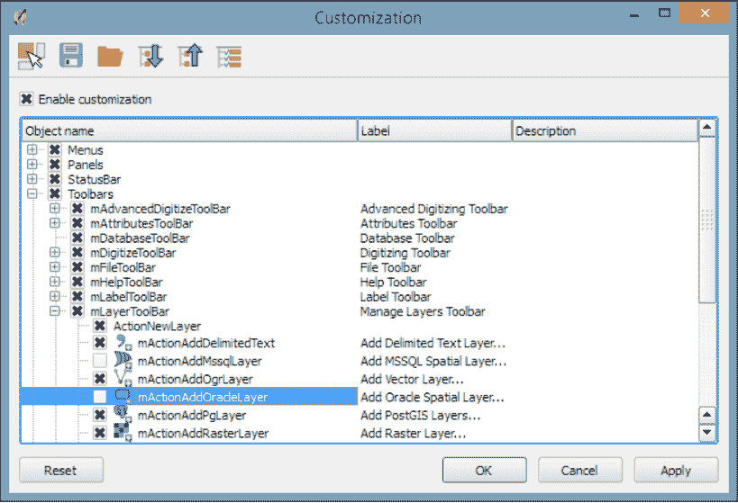

## 查找帮助和报告问题

QGIS 社区提供多种基于社区的支持选项。包括以下内容：

- **GIS StackExchange**：最受欢迎的支持渠道之一是 http://gis.stackexchange.com/。这是一个通用 GIS 问答网站。如果你使用标签 qgis，你将在 http://gis.stackexchange.com/questions/tagged/qgis 上看到所有与 QGIS 相关的问答。
- **邮件列表**：最重要的用户问题邮件列表是 qgis-user。有关可用邮件列表的完整列表和注册链接，请访问 http://www.qgis.org/en/site/getinvolved/mailinglists.html#qgis-mailinglists。为了更舒适地搜索现有的邮件列表线程，你可以使用 Nabble（http://osgeo-org.1560.x6.nabble.com/Quantum-GIS-User-f4125267.html）。
- **聊天**：大量开发者通信通过 IRC 进行。www.freenode.net 上有一个 #qgis 频道。你可以使用例如 http://webchat.freenode.net/?channels=#qgis 的网页界面访问它。

> 在联系社区支持之前，建议先查看 http://docs.qgis.org 上的文档。

如果你更喜欢商业支持，你可以在 http://www.qgis.org/en/site/forusers/commercial_support.html#qgis-commercial-support 上找到提供支持和定制开发的公司列表。

如果你发现了错误，请报告它，因为 QGIS 开发者只能修复他们已知的问题。有关如何报告错误的信息，请访问 http://www.qgis.org/en/site/getinvolved/development/bugreporting.html。

## 摘要

在本章中，我们安装了 QGIS 并通过选择有用的默认值和排列用户界面元素对其进行了配置。然后我们探索了构成 QGIS 用户界面的面板、工具栏和菜单，并学习了如何自定义它们以提高生产力。在下一章中，我们将使用 QGIS 从文件、数据库和网络服务等不同数据源查看空间数据，以便创建我们的第一张地图。

## 2
查看空间数据

在本章中，我们将介绍如何从不同数据源查看空间数据。QGIS 支持许多文件和数据库格式以及标准化的开放地理空间联盟（OGC）网络服务。我们首先介绍如何从这些不同数据源加载图层。然后我们将研究矢量和栅格图层样式的基础知识，并创建我们的第一张地图，你可以在以下屏幕截图中看到：

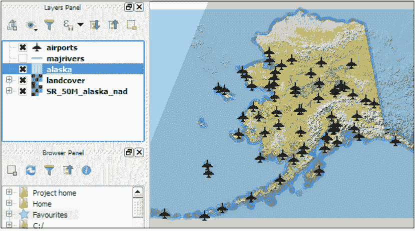

我们将以从在线服务加载背景地图的示例结束本章。

## 查看空间数据

在本章的示例中，我们将使用 QGIS 项目提供的示例数据，可从 `http://qgis.org/downloads/data/qgis_sample_data.zip`（21 MB）下载。下载并解压它。

## 从文件加载矢量数据

在本节中，我们将讨论从 GIS 文件格式（如 **shapefiles**）以及从文本文件加载矢量数据。

我们可以通过前往 **图层 | 添加图层 | 添加矢量图层** 以及使用 **添加矢量图层** 工具栏按钮来加载矢量文件。如果你喜欢快捷方式，使用 *Ctrl + Shift + V*。在 **添加矢量图层** 对话框中，如以下屏幕截图所示，我们会找到一个下拉列表，允许我们指定输入文件的编码。如果我们处理包含特殊字符的文件，例如德语变音符号或与默认拉丁字母不同的字母表中的字母，此选项很重要。

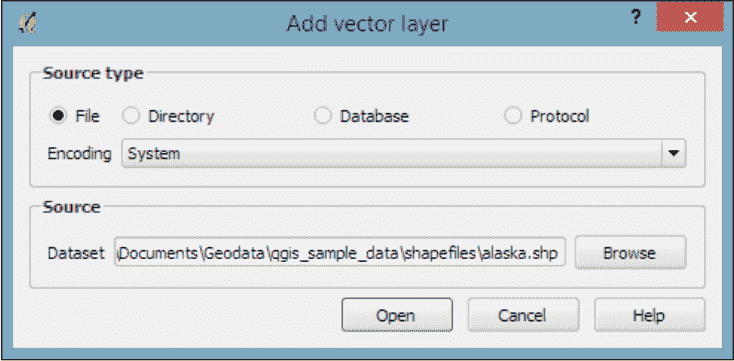

我们现在最感兴趣的是 **浏览** 按钮，它打开文件打开对话框。请注意对话框右下角的文件类型筛选器下拉列表。我们可以打开它以查看支持的矢量文件类型的列表。此筛选器有助于通过隐藏不同类型的文件更快地找到特定文件，但请注意筛选器设置会被保存，并在下次打开文件打开对话框时再次应用。如果以后尝试查找不同文件时它恰好被筛选器隐藏，这可能会导致混淆，因此如果定位文件有困难，请记得检查筛选器设置。

我们可以通过一次选择多个文件（在 Windows/Ubuntu 上按住 *Ctrl* 或在 Mac 上按住 *cmd*）一次加载多个文件。让我们试试：

1. 首先，我们从 shapefiles 示例数据文件夹中选择 `alaska.shp` 和 `airports.shp`。
2. 接下来，我们通过单击 **打开** 确认选择，并返回到 **添加矢量图层** 对话框。
3. 在再次单击 **打开** 后，所选文件将被加载。你会注意到每个矢量图层都以随机颜色显示，这很可能与你在以下屏幕截图中看到的颜色不同。别担心，现在不用担心；我们将在本章后面处理图层样式。

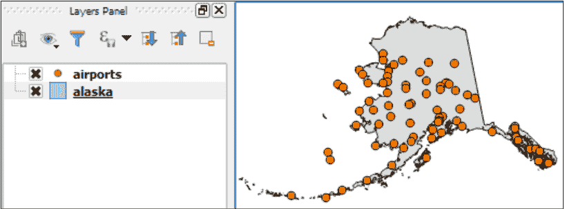

即使我们没有使用任何空间分析工具，这些可视化空间数据集的简单步骤也使我们能够找到，例如，阿拉斯加本土最南端的机场。

> 有多种技巧可以使加载数据更快；例如，你可以简单地将文件从操作系统的文件浏览器拖放到 QGIS 中。
> 
> 快速访问空间数据的另一种方法是使用 QGIS 内置的文件 *浏览器*。如果你已按照 *第 1 章，开始使用 QGIS* 中的说明设置 QGIS，你将在图层列表正下方左侧找到浏览器。导航到你的数据文件夹，你可以再次将文件从浏览器拖放到地图上。
> 
> 此外，你可以通过右键单击文件夹并选择 **添加为收藏夹** 将文件夹标记为 *收藏夹*。这样，你可以更快地访问数据文件夹，因为它们会被添加到浏览器列表顶部 **收藏夹** 部分。


## 查看空间数据

另一种流行的空间数据源是 **分隔文本（CSV）** 文件。QGIS 可以通过菜单项进入 **图层 | 添加图层 | 添加分隔文本图层** 或对应的工具栏按钮，使用 **添加分隔文本图层** 选项加载 CSV 文件。点击 **浏览** 并从示例数据中选择 `elevp.csv`。CSV 文件包含各种分隔符。正如以下截图中所示，插件允许您从最常见的分隔符中选择（**逗号、制表符等等**），但您也可以指定任何其他纯文本或正则表达式分隔符：

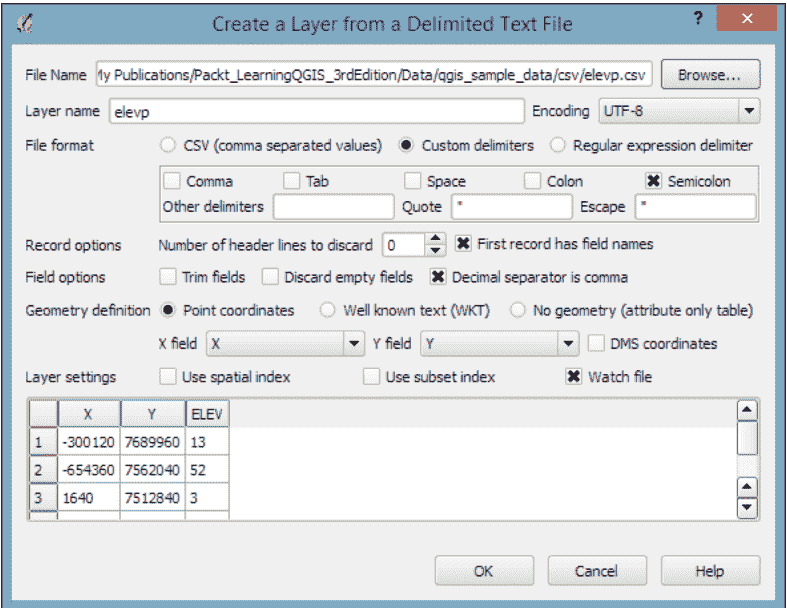

如果您的 CSV 文件包含引号，例如 " 或 '，您可以使用 **引号** 选项将其删除。 **丢弃的标题行数** 选项允许我们跳过文本文件开头可能存在的额外行。以下 **字段选项** 包括从字段值中修剪多余空格或重新定义小数分隔符为逗号的功能。空间信息本身可以提供在包含点 X 和 Y 坐标的两个列中，或使用 **众所周知的文本（WKT）** 格式。WKT 字段可以包含点、线或多边形。例如，一个点可以指定为 `POINT (30 10)`，一条包含三个节点<|message|> 的简单线条将是 `LINESTRING (30 10, 10 30, 40 40)`，而一个包含四个节点的 fio 多边形将是 `POLYGON ((30 10, 40 40, 20 40, 10 20, 30 10))`。

> 请注意，多边形中第一个和最后一个坐标对必须相同。
> WKT 是一种非常有用且灵活的格式。如果您不熟悉该概念，您可以在 http://en.wikipedia.org/wiki/Well-known_text 上找到包含示例的详细介绍。

在我们点击 **确定** 后，QGIS 会提示我们指定图层的坐标参考系统（CRS）。我们将在下一节讨论处理 CRS。

## 处理坐标参考系统

每当我们加载数据源时，QGIS 都会查找可用的 CRS 信息，例如 shapefile 的 `.prj` 文件中。如果 QGIS 找不到任何可用信息，默认情况下，它会要求您手动指定 CRS。此行为可以通过进入 **设置 | 选项 | CRS** 来更改，以始终使用项目 CRS 或默认 CRS。

QGIS **坐标参考系统选择器** 提供了一个过滤器，使查找 CRS 变得更容易。它可以根据名称或 ID（例如 EPSG 代码）进行过滤。只需开始输入，潜在 CRS 的列表就会变短。实际上有两个独立的列表；上面的列表包含我们最近使用的 CRS，而下面的列表更长，包含所有可用的 CRS。对于 `elevp.csv` 文件，我们选择 **NAD27 / Alaska Albers**。使用正确的 CRS 后，`elevp` 图层将显示如下截图中所示：

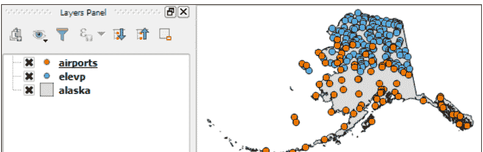

## 查看空间数据

如果我们想检查图层的 CRS，我们可以在图层属性的 **常规** 部分找到此信息，可以通过进入 **图层 | 属性** 或在图层列表中双击图层名称来访问。如果您认为 QGIS 选择了错误的 CRS 或您在指定 CRS 时犯了错误，您可以使用 **指定 CRS** 来更正 CRS 设置。请注意，这不会更改底层数据或对其进行重投影。我们将在 *第 3 章，数据创建和编辑* 中讨论矢量和栅格文件的重投影。

在 QGIS 中，即使每个数据集都使用不同的 CRS 存储，我们也可以从多个图层创建地图。QGIS 通过启用一种称为 **即时重投影** 的机制自动处理必要的重投影，可以通过进入 **项目 | 项目属性** 来访问，如以下截图中所示。或者，您可以点击 QGIS 窗口右下角的 **CRS 状态** 按钮（带有地球符号和旁边的 EPSG 代码）来打开此对话框：

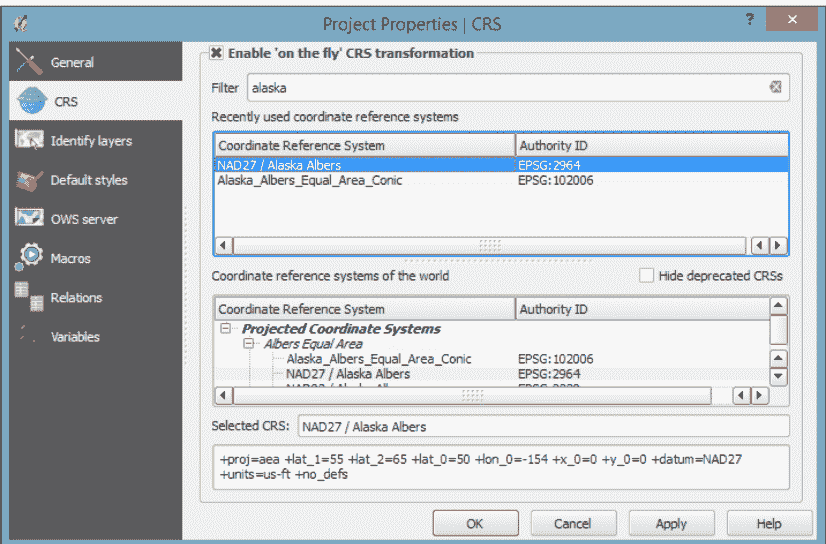

所有图层都会即时重投影到项目 CRS，这意味着 QGIS 会动态计算这些重投影，仅用于渲染地图的目的。这也意味着如果您使用需要重投影的大型数据集，可能会减慢您的机器速度。底层数据不会被更改，空间分析也不会受到影响。例如，下图显示了阿拉斯加在默认的 NAD27 / Alaska Albers 投影中的情况（左侧），即时重投影到 WGS84 EPSG:4326（中间），以及 Web Mercator EPSG:3857（右侧）。尽管地图表示发生了很大变化，但每个版本的分析结果都是相同的，因为即时重投影功能不会更改数据。

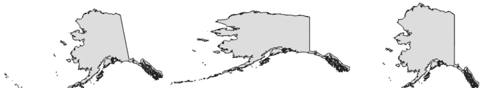

在某些情况下，您可能需要指定一个不在 QGIS CRS 数据库中的 CRS。您可以通过进入 设置 | 自定义 CRS 来添加 CRS 定义。点击 添加新 CRS 按钮创建新条目，为新 CRS 输入名称，并在 参数 输入字段中粘贴 proj4 定义字符串。此定义字符串由 Proj4 投影引擎使用，以确定正确的坐标转换。完成后，只需点击 确定 关闭对话框即可。

> 如果您正在寻找特定的投影 proj4 定义，http://spatialreference.org 是获取此类信息的好来源。

## 加载栅格文件

加载栅格文件与加载矢量文件并没有太大区别。进入 图层 | 添加图层 | 添加栅格图层，点击 添加栅格图层 按钮，或按 Ctrl + Shift + R 快捷键将直接带您到文件打开对话框。同样，您可以检查文件类型过滤器以查看支持的文件类型列表。

## 查看空间数据

让我们试试并从栅格示例数据文件夹加载 `landcover.img`。与矢量文件类似，您可以通过从操作系统或内置文件浏览器将栅格拖放到 QGIS 中来加载栅格。以下截图显示了已加载的栅格图层：

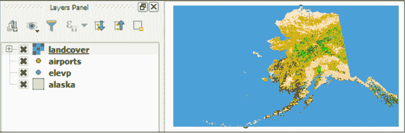

> QGIS 对所有这些不同的矢量和栅格文件类型的支持由强大的 GDAL/OGR 包处理。您可以在 `www.gdal.org/formats_list.html`（栅格）和 `http://www.gdal.org/ogr_formats.html`（矢量）查看完整支持的格式列表。

## 地理配准栅格地图

一些栅格数据源，例如简单的扫描地图，缺乏适当的空间参考，我们必须在 GIS 中使用它们之前对其进行地理配准。在 QGIS 中，我们可以使用 **Georeferencer GDAL** 插件进行栅格地理配准，可以通过进入 **栅格 | 地理配准器** 来访问。（如果您在 **栅格** 菜单中找不到它，请通过 **插件 | 管理和安装插件** 启用它）。

地理配准器插件涵盖以下用例：

- 我们可以为栅格文件创建世界文件，而不更改原始栅格。
- 如果我们有一张包含已知坐标点的地图图像，我们可以设置 **地面控制点（GCPs）** 并输入已知坐标。
- 最后，如果我们不知道地图上任何点的坐标，我们仍然有机会使用同一区域的第二张已地理配准的地图手动放置 GCP。我们可以使用在两张地图上都可见的对象来在我们想要地理配准的地图上选取点，并从参考地图中计算出它们的坐标。

通过进入 **文件 | 打开栅格** 或使用 **打开栅格** 工具栏按钮加载栅格到地理配准器后，我们会被要求指定我们计划添加的地面控制点的 CRS。接下来，我们可以通过进入 **编辑 | 添加点** 开始添加地面控制点。我们可以使用平移和缩放工具进行导航，并通过点击地图放置 GCP。然后会提示我们插入新点的坐标或从主 QGIS 窗口中的参考地图中选取。放置的 GCP 在地理配准器和 QGIS 窗口中都显示为红色圆圈，如以下截图中所示：

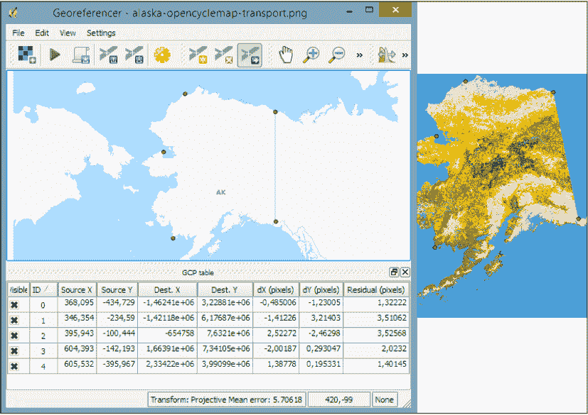

地理配准器显示了 OCM 景观地图的截图 © Thunderforest，数据 © OpenStreetMap 贡献者 (http://www.opencyclemap.org/?zoom=4&lat=62.50806&lon=-145.01953&layers=0B000)

放置 GCP 后，我们可以通过进入 **设置 | 转换设置** 来定义转换算法。您选择的算法取决于输入数据和您希望允许的几何失真程度。最常用的算法是 1 到 3 次多项式。 **一阶多项式转换** 仅允许缩放、平移和旋转。


## 查看空间数据

**二阶多项式变换**可以处理一定的弯曲，而**三阶多项式变换**因此能够应对更高程度的畸变。**薄板样条**算法可以处理地图中的局部变形，因此在处理质量极低的地图扫描件时非常有用。**投影变换**提供坐标的旋转和平移。另一方面，**线性**选项仅用于创建世界文件，如前所述，它实际上并不变换栅格。

**重采样方法**取决于您的输入数据和想要实现的结果。三次重采样会生成平滑的结果，但如果您不想更改栅格值，请选择最近邻法。

在开始地理配准过程之前，我们必须指定输出文件名和目标CRS。确保**完成后在QGIS中加载**选项已激活，并启用**需要时使用0作为透明度**选项，以避免输出图像周围出现黑色边框。然后，我们可以关闭**转换设置**对话框，进入**文件 | 开始地理配准**。配准后的栅格将自动加载到QGIS的主地图窗口中。在下面的截图中，您可以看到使用五个指定的GCP应用投影变换的结果：

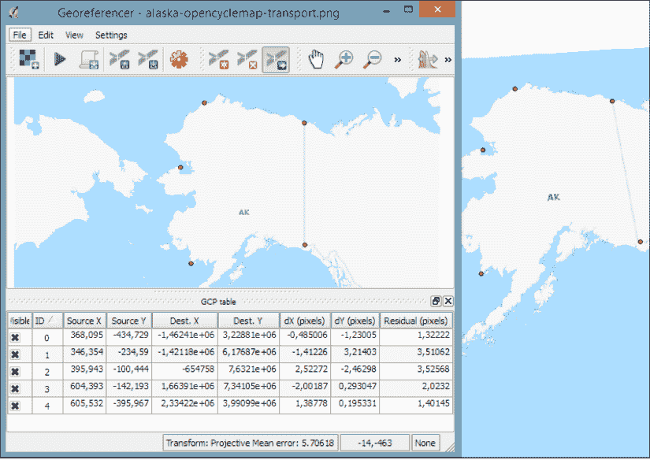

### 从数据库加载数据

QGIS支持PostGIS、SpatiaLite、MSSQL和Oracle Spatial数据库。我们将介绍两种开源选项：SpatiaLite和PostGIS。两者都像QGIS一样支持跨平台。

SpatiaLite是SQLite数据库的空间扩展。SQLite是一个自包含、无需服务器、零配置且支持事务的SQL数据库引擎（www.sqlite.org）。这基本上意味着SQLite数据库（因此也包括SpatiaLite数据库）不需要安装服务器，并且可以像任何普通文件一样被复制和交换。

您可以从www.gaia-gis.it/spatialite-2.3.1/test-2.3.zip（4 MB）下载示例数据库。解压该文件后，您可以通过“图层 | 添加图层 | 添加SpatiaLite图层”菜单，使用“添加SpatiaLite图层”工具栏按钮，或按Ctrl + Shift + L连接它。点击“新建”以选择test-2.3.sqlite数据库文件。QGIS将保存所有连接并将它们添加到顶部的下拉列表中。点击“连接”后，您将看到存储在数据库中的图层列表，如以下截图所示：

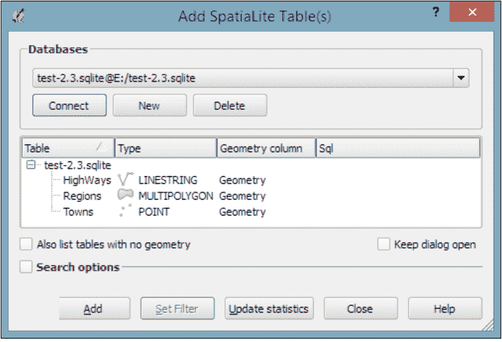

与文件一样，您可以从列表中选择一个或多个表，然后点击“添加”将其加载到地图中。此外，您可以使用“设置过滤器”仅加载特定的要素。

QGIS中的过滤器使用类似SQL的语法，例如，"Name" = 'EMILIA-ROMAGNA' 仅选择名为 EMILIA-ROMAGNA 的区域，或 "Name" LIKE 'ISOLA%' 选择所有名称以 ISOLA 开头的区域。过滤查询会传递给底层数据提供者（例如SpatiaLite或OGR）。基本过滤器查询的提供者语法在不同提供者之间是一致的，但在使用更特殊的功能时可能会有所不同。您可以在 http://www.gdal.org/ogr_sql.html 阅读OGR SQL的详细信息。

在*第4章“空间分析”*中，我们将使用这个数据库来探索如何利用SpatiaLite的空间分析功能。

**PostGIS**是PostgreSQL数据库系统的空间扩展。安装和配置数据库不在本书的讨论范围内，但有适用于Windows的安装程序以及适用于许多Linux发行版和Mac的软件包（详情请访问 http://www.postgresql.org/download/）。要从PostGIS数据库加载数据，请前往**图层 | 添加图层 | 添加PostGIS图层**，使用**添加PostGIS图层**工具栏按钮，或按*Ctrl + Shift + D*。

首次使用数据库时，点击**新建**以建立新的数据库连接。这将打开以下截图所示的对话框，您可以在其中创建新连接，例如连接到名为`postgis`的数据库：

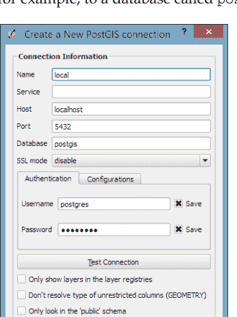

需要填写的字段如下：

- **名称：** 为新连接输入名称。您可以使用任意喜欢的名称。
- **主机：** 在此字段中插入服务器的IP地址。如果PostGIS在本地运行，可以使用`localhost`。
- **端口：** PostGIS默认端口为`5432`。如果连接数据库有困难，建议您检查服务器防火墙对此端口的设置。
- **数据库：** 这是您要连接的PostGIS数据库的名称。
- **用户名和密码：** 为方便起见，您可以告诉QGIS保存这些信息。

连接建立后，您可以加载和过滤表，就像我们讨论SpatiaLite时一样。

### 从OGC Web服务加载数据

越来越多的数据提供商通过符合OGC标准的Web服务提供对其数据集的访问，例如**Web地图服务（WMS）**、**Web覆盖服务（WCS）**或**Web要素服务（WFS）**。QGIS开箱即用地支持这些服务。

> 如果您想了解更多可用的不同OGC Web服务，请访问 http://live.osgeo.org/en/standards/standards.html 查看概览。

您可以通过**图层 | 添加WMS/WMTS图层**菜单、点击**添加WMS/WMTS图层**按钮或按*Ctrl + Shift + W*来加载**WMS**图层。如果您知道WMS服务器，可以点击**新建**并填写名称和URL来连接它。所有其他字段都是可选的。如果您不知道任何WMS服务器，也不用担心，因为您只需点击**添加默认服务器**按钮，即可获得管理员与QGIS项目协作的服务器访问信息。其中一台服务器称为**Lizardtech服务器**。从下拉框中选择**Lizardtech服务器**或任何其他服务器，然后点击**连接**以查看服务器可用的图层列表，如下所示：

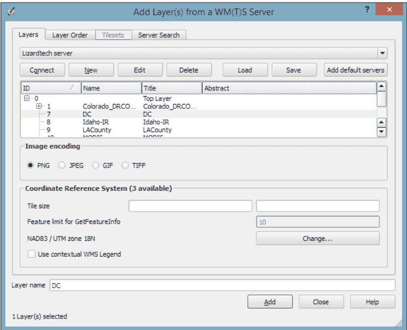

现在，您可以从图层列表中选择一个或多个图层进行下载。值得注意的是，选择图层的顺序很重要，因为图层将在服务器端合并，QGIS只会收到合并后的图像作为结果图层。如果您希望单独使用这些图层，则必须逐一下载。一旦点击**添加**，数据下载随即开始。对话框将保持打开状态，以便您从服务器添加更多图层。

许多WMS服务器以多种不同的CRS提供其图层。您可以通过点击对话框底部的**更改**按钮查看可用CRS列表。这将打开一个CRS选择器对话框，该对话框仅限于WMS服务器的CRS能力。

从**WCS**或**WFS**服务器加载数据的方式相同，但公共服务器相当稀少。少数可靠的公共WFS服务器之一由奥地利维也纳市运营。以下截图显示了如何配置到data.wien.gv.at WFS的连接，以及我们点击**连接**按钮时加载的可用数据集列表：

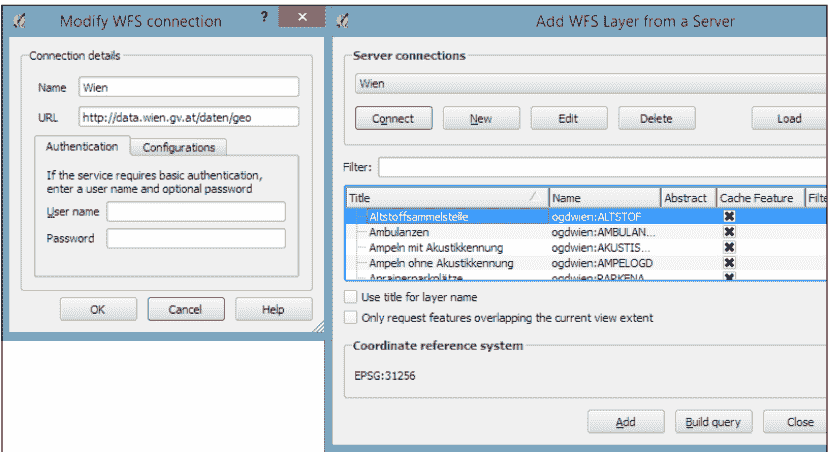

> 使用**WFS**而非**WMS**的主要优势在于，**Web要素服务**返回矢量要素（包括其所有属性），而不仅仅是地图图像。当然，这也意味着WFS图层通常需要更长的下载时间，并给服务器带来更大的负载。

### 栅格图层样式设置

在介绍了数据源之后，我们可以创建第一张地图。我们将自下而上构建地图，首先加载一些背景栅格（山体阴影和土地覆盖），然后在其上叠加点、线和面图层。

让我们首先从`landcover.img`和`SR_50M_alaska_nad.tif`加载土地覆盖和山体阴影，然后打开图层属性中的**样式**部分（通过**图层 | 属性**或双击图层名称）。QGIS会自动为两个栅格图层选择合理的默认渲染类型。除了这些默认值外，栅格图层还可使用以下样式选项：

- **多波段颜色：** 如果栅格具有多个波段，则使用此样式。多波段的卫星图像通常属于这种情况。
- **调色板：** 如果单波段栅格带有索引调色板，则使用此样式。
- **单波段灰度：** 如果栅格既没有多个波段也没有索引调色板（例如，高程模型栅格或山体阴影栅格），则将使用此样式渲染。
- **单波段伪彩色：** 此样式不限于灰度，而是允许我们使用自选的色彩映射来渲染栅格波段。

`SR_50M_alaska_nad.tif`山体阴影栅格以**单波段灰度渲染类型**加载，如下面的截图所示。如果我们想用颜色而非灰度渲染山体阴影栅格，可以将**渲染类型**更改为**单波段伪彩色**。在伪彩色模式下，我们可以手动创建色彩映射，或者选择预制的色彩渐变之一。不过，让我们暂时对山体阴影坚持使用**单波段灰度**。


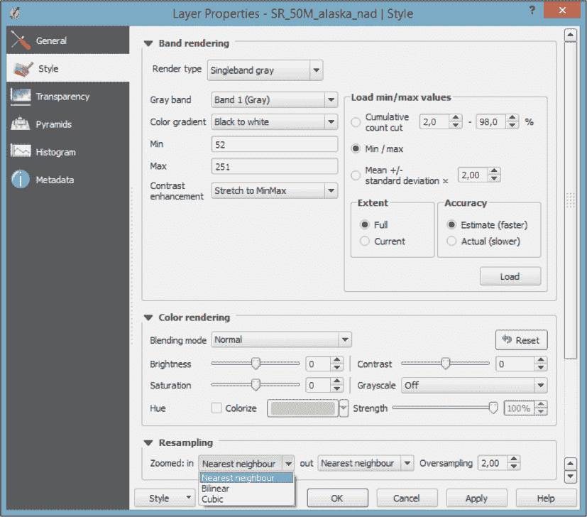

**Singleband gray** 渲染器提供 **Black to white Color gradient** 以及 **White to black gradient**。当我们使用 **Black to white gradient** 时，最小值（在 **Min** 中指定）将被绘制为黑色，最大值（在 **Max** 中指定）将被绘制为白色，中间的所有值则以灰度显示。你可以手动指定这些最小值和最大值，或使用 **Load min/max values** 接口让 QGIS 计算这些值。

> > 请注意，QGIS 提供了从整个栅格（**Full Extent**）或仅当前可见的栅格部分（**Current Extent**）计算值的不同选项。一个常见的困惑来源是 **Estimate (faster)** 选项，它可能导致的值与别处记录的值不同，例如在栅格的元数据中。该选项的明显优势是计算速度更快，因此请谨慎使用！

# Viewing Spatial Data

在颜色设置下方，我们找到一个包含更多高级选项的区域，这些选项控制栅格的 Resampling、Brightness、Contrast、Saturation 和 Hue——这些选项你可能在图像处理软件中见过。默认情况下，重采样设置为快速的 Nearest neighbour 选项。为了获得更美观、更平滑的结果，我们可以改为 Bilinear 或 Cubic 方法。

点击 OK 或 Apply 以确认。在这两种情况下，地图都将使用新的图层样式重绘。如果点击 Apply，图层属性对话框将保持打开状态，你可以继续微调图层样式。如果点击 OK，图层属性对话框将被关闭。

landcover.img 栅格是调色板栅格的一个很好的例子。每个单元格值都映射到特定颜色。要更改颜色，我们只需双击 Color 预览，一个颜色选择器就会打开。调色板栅格的样式部分如下图所示：

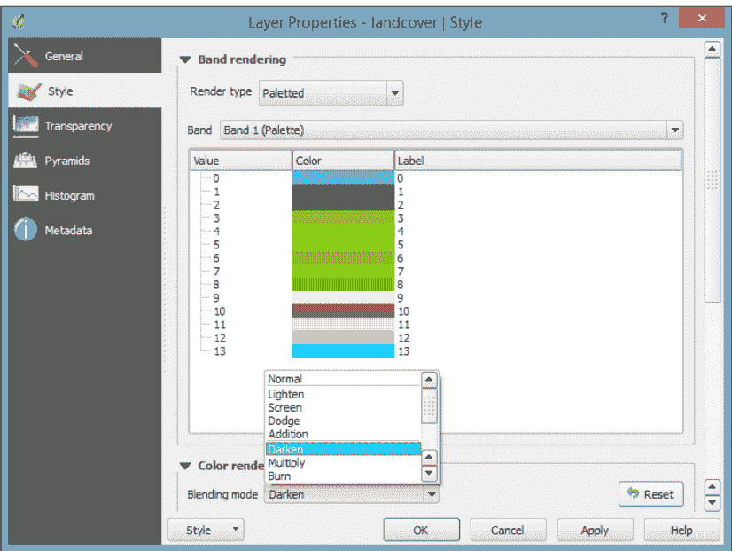

如果我们想将 hillshade 和土地覆盖组合成一个美观的背景，可以使用 **Blending mode** 和图层 **Transparency** 的组合。混合模式是图像处理软件中常见的另一项功能。混合模式相对于透明度的主要优势在于，我们可以避免仅使用透明度组合栅格时通常出现的暗淡、低对比度的外观。如果你没有混合的经验，花点时间尝试不同的效果。对于本示例，我使用了上一个截图中突出显示的 **Darken** 混合模式，并结合了全局图层透明度 **50 %**，如下图所示：

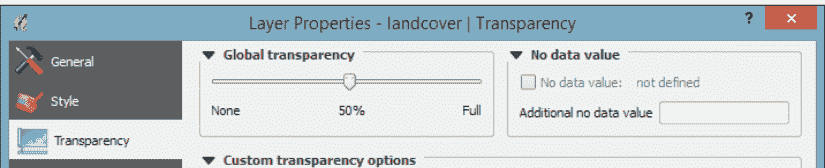

# Styling vector layers

当我们加载矢量图层时，QGIS 使用默认样式和随机颜色渲染它们。当然，我们希望自定义这些样式以更好地反映我们的数据。在以下练习中，我们将对点、线和面图层进行样式设置，你也会熟悉最常见的矢量样式选项。

无论图层的几何类型如何，我们总会在 **Style** 对话框左上角找到一个包含可用样式选项的下拉列表。矢量图层可用的样式选项如下：

- **Single Symbol**：这是最简单的选项。当我们使用 **Single Symbol** 样式时，所有点都将以相同的符号显示。
- **Categorized**：如果图层包含不同类别的点，例如包含不同动物目击地点的图层，这是首选样式。
- **Graduated**：如果我们想可视化数值，例如温度测量值，此样式非常好。
- **Rule-based**：这是最先进的选项。基于规则的样式非常灵活，因为它允许我们为一个图层编写多个规则。
- **Point displacement**：此选项仅适用于点图层。这些样式在需要可视化同一坐标下有多个点的点图层时很有用，例如住在同一地址的学校学生。
- **Inverted polygons**：此选项仅适用于面图层。使用此选项，定义的符号将应用于多边形边界外的区域，而不是填充多边形内部的区域。
- **Heatmap**：此选项仅适用于点图层。它使我们能够创建动态热力图样式。
- **2.5D**：此选项仅适用于面图层。它使我们能够创建 2.5 维的挤出多边形。

# Creating point styles – an example of an airport style

让我们从一个点图层开始！从你的示例数据中加载 `airport.shp`。在 **Style** 对话框左上角，下拉列表下方，我们找到符号预览。在此下方，有一个符号图层列表，显示符号由哪些不同图层组成。右侧提供符号大小和大小单位、颜色和透明度以及旋转的选项。最后，右下角包含一个带有已保存符号的预览区域。

点图层默认使用简单的圆形符号显示。我们希望改用飞机符号。要更改符号，请在对话框左侧的符号图层列表中选择 **Simple marker** 条目。注意对话框右侧如何发生变化。我们现在可以看到简单标记可用的选项：**Colors, Size, Rotation, Form** 等等。然而，我们不是在寻找圆形、星形或方形符号——我们想要一架飞机。这就是为什么我们需要将 **Symbol layer type** 选项从 **Simple marker** 改为 **SVG marker**。许多选项仍然相似，但在底部，我们现在可以从中选择的 SVG 图像集合。滚动列表并选择飞机符号，如下图所示：

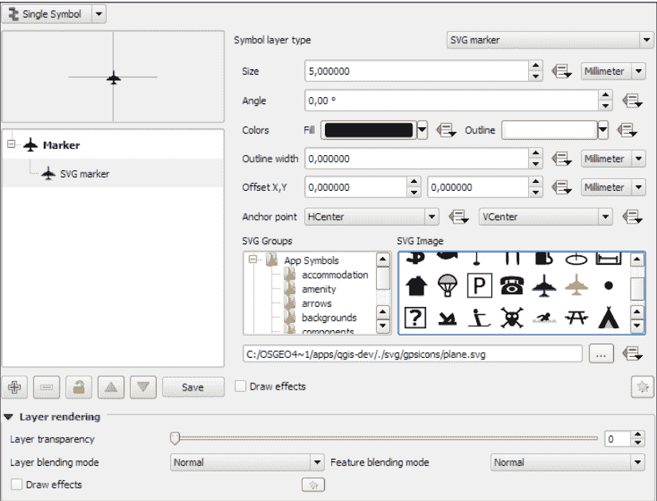

在我们继续进行线条样式之前，让我们先看看点的其他符号图层类型，包括以下内容：

- **Simple marker**：包括几何形状，如圆形、星形和方形
- **Font marker**：提供对你符号字体的访问
- **SVG marker**：每个 QGIS 安装都附带一组默认 SVG 符号；通过前往 **Settings | Options | System | SVG Paths** 添加包含 SVG 图像的你自己的文件夹
- **Ellipse marker**：包括可自定义的椭圆、矩形、十字和三角形
- **Vector Field marker**：这是一个可自定义的矢量场可视化工具
- **Geometry Generator**：这使我们能够使用内置表达式引擎操作几何体，甚至创建全新的几何体

# Viewing Spatial Data

**Simple marker** 图层可以具有不同的几何形状、大小、轮廓和角度（方向），如下图所示，我们创建了一个没有轮廓（使用 **No Pen** 选项）的红色正方形：

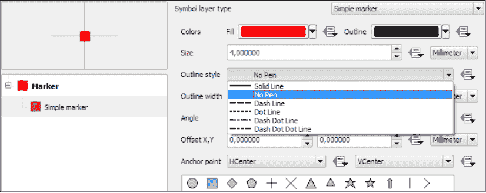

**Font marker** 图层对于添加来自计算机上安装的字体中的字母或其他符号很有用。例如，此屏幕截图显示了如何从 **Wingdings** 字体中添加阴阳符号：

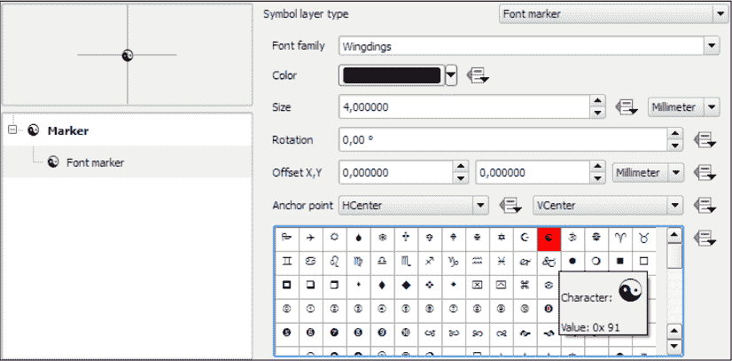

**Ellipse marker** 图层使绘制不同的椭圆、矩形、十字和三角形成为可能，其中宽度和高度可以分别控制。此符号图层类型在与稍后我们将讨论的 *data-defined overrides* 结合使用时尤其有用。以下屏幕截图显示了如何创建一个长 5 毫米、高 2 毫米、旋转 45 度的椭圆：

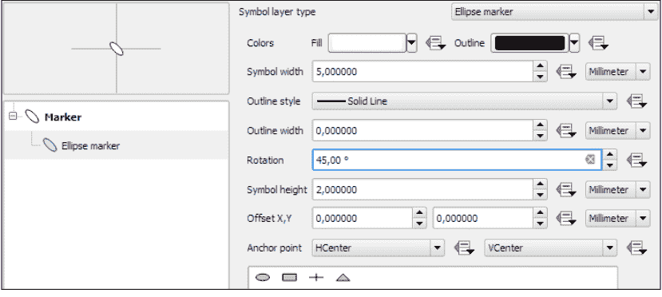

# Creating line styles – an example of river or road styles

在本练习中，我们为示例数据中的 majoriver.shp 文件创建河流样式。目标是创建一个具有两种颜色的线样式：线的中心填充色和轮廓色。这种技术非常有用，因为它也可以用于创建道路样式。

要创建此类样式，我们组合两条简单线条。默认符号是一条简单线条。点击符号图层列表下方左下角的绿色 + 符号以添加另一条简单线条。下方的线条将作为轮廓，上方的线条将作为填充。选择上方的简单线条并将颜色更改为蓝色，宽度更改为 0.3 毫米。接下来，选择下方的简单线条并将其颜色更改为灰色，宽度更改为 0.6 毫米，略宽于另一条线条。检查预览并点击 Apply 以测试样式应用于河流图层时的效果。


你会注意到，样式看起来还不太完美。这是因为每个线要素都是单独绘制的，一个接一个，导致外观看起来相当不连贯。幸运的是，这很容易修复；我们只需启用所谓的符号级别。为此，请在符号图层列表中选择“线”条目，并在“高级”部分的“符号级别”对话框中勾选复选框（样式对话框右下角的按钮），如下面的截图所示。点击“应用”以测试结果。

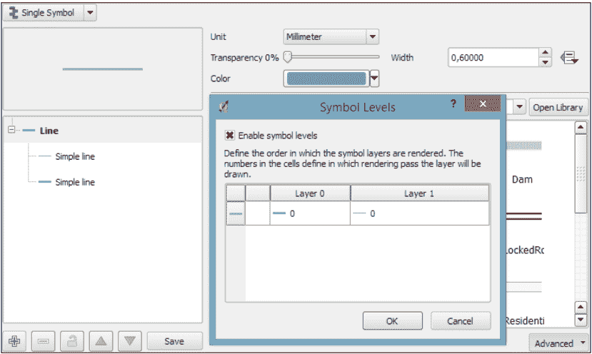

在继续设计多边形样式之前，让我们看看线的其他符号图层类型，包括以下内容：

- **简单线**：这是一种实线或虚线
- **标记线**：该线由位于线顶点或按固定间隔分布的点标记组成
- **几何生成器**：这使我们能够操纵几何图形，甚至使用内置表达式引擎创建全新的几何图形。

每当我们创建了可能要在其他地图中重复使用的符号时，都可以通过单击符号预览区域下方的“保存”按钮来保存它。我们可以为新符号指定名称，保存后，它将添加到右侧的已保存符号预览区域中。

## 创建多边形样式——以陆地块样式为例

在本练习中，我们将为 alaska.shp 文件创建一种样式。目标是创建带蓝色光晕的简单填充。与之前的河流样式示例一样，我们将组合两个符号图层来创建此样式：一个定义主填充颜色（白色）并带有细边框（灰色）的简单填充图层，以及一个用于（浅蓝色）光晕的附加简单线轮廓图层。光晕应具有漂亮的圆角。要实现这些效果，请将“简单线”符号图层的“连接样式”选项更改为“圆角”。与前面的示例类似，我们再次启用符号级别；为了防止此陆地块样式遮挡背景地图，我们选择“正片叠底”混合模式，如下面的截图所示：

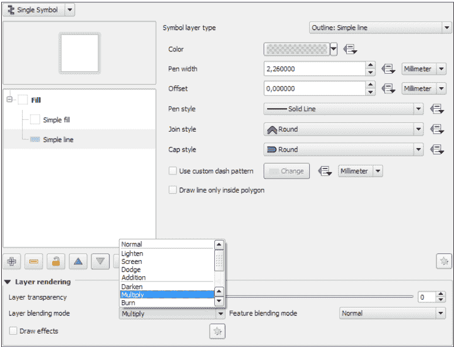

在继续之前，让我们看看多边形的其他符号图层类型，包括以下内容：

- **简单填充**：这定义了填充和轮廓颜色以及基本填充样式
- **质心填充**：这允许我们在多边形的中心放置点标记
- **线/点图案填充**：这支持用户自定义的线和点图案，且间距灵活
- **SVG填充**：使用SVG填充多边形
- **渐变填充**：这允许我们使用线性、径向或圆锥渐变填充多边形
- **形状爆发填充**：这会创建一种从多边形边界开始并向中心流动的渐变
- **轮廓：简单线或标记线**：这可以使用线样式勾勒区域轮廓
- **几何生成器**：这使我们能够操纵几何图形，甚至使用内置表达式引擎创建全新的几何图形。

点图案填充符号图层的一个常见用例是不同植被类型的地形符号，这些符号通常由简单填充图层和点图案填充组成，如下面的截图所示：

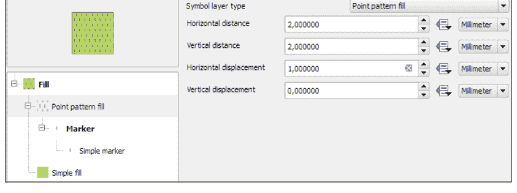

## 查看空间数据

在设计点图案填充时，我们当然不限于简单的标记。我们可以使用任何其他标记类型。例如，下面的截图显示了如何使用**字体**标记图案创建多边形填充样式，该图案显示了来自**Webdings**字体的重复外星人脸：

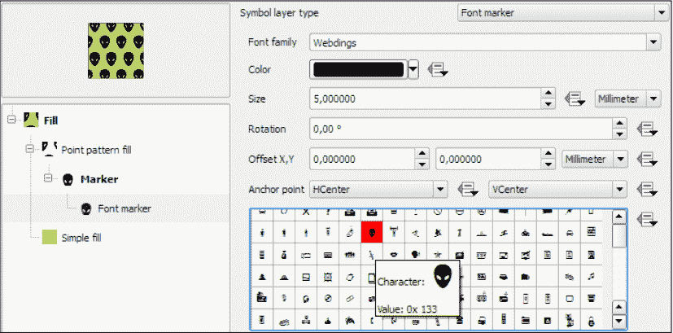

作为仅使用单一颜色的简单填充的替代方案，我们可以创建**渐变**填充符号图层。渐变可以通过**两种颜色**定义，如下面的截图所示，也可以通过包含多种不同颜色的**色带**定义。通常，渐变从上到下运行，但我们可以更改这一点，例如，通过将**角度**设置为270度，使渐变从右到左运行，如下所示：

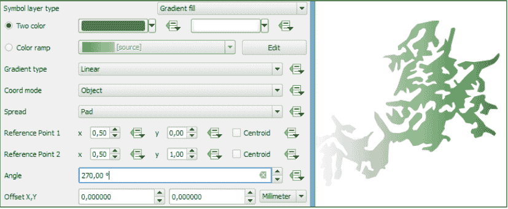

**形状爆发填充**符号图层类型，也称为“缓冲”渐变填充，通常用于样式化水域，使用从多边形边界向内流动的平滑渐变。下面的截图显示了使用**按设定距离着色**选项的固定距离着色。如果我们改为选择**为整个形状着色**，渐变将从多边形边界一直绘制到中心。

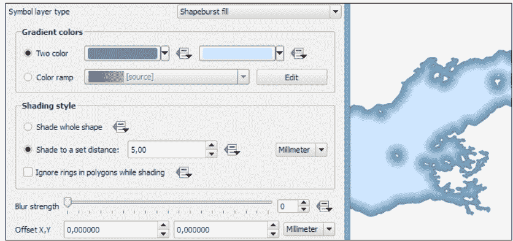

## 加载背景地图

背景地图对于快速检查和提供方向非常有用，尤其是在无法访问任何其他基础图层的情况下。借助**QuickMapServices**插件，添加背景地图很容易。该插件提供了来自不同提供商的卫星地图、街道地图和混合地图。

如果你加载OSM TF Landscape图层，你的地图将如下面的截图所示：

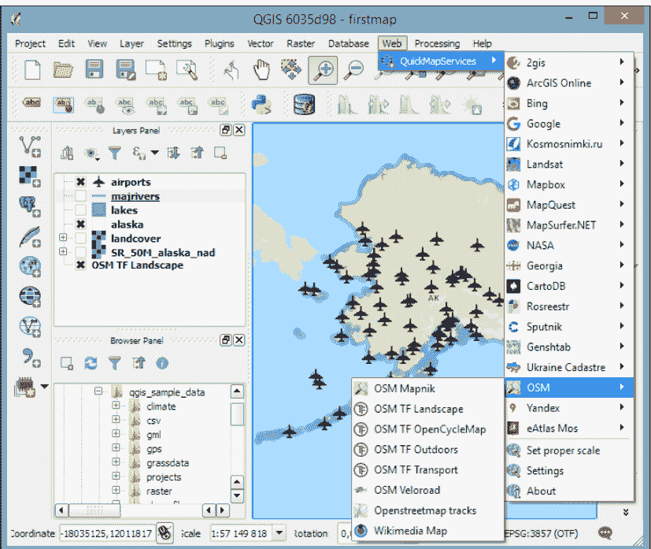

QuickMapServices插件的替代方案是OpenLayers插件，它提供非常相似的功能，但提供的背景地图种类较少。

## 处理项目文件

QGIS项目文件是可读的XML文件，文件名以 .qgs 结尾。你可以在任何文本编辑器（如Windows上的Notepad++或Ubuntu上的gedit）中打开它们，并读取甚至更改文件内容。

当你保存项目文件时，你会注意到QGIS会创建一个同名且以 .qgs~ 结尾的第二个文件，如下一个截图所示。这是项目文件的简单备份副本，内容相同。如果你的项目文件因任何原因损坏，你可以直接复制备份文件，从文件结尾删除 ~，然后继续使用它。

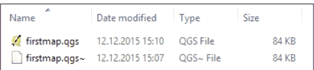

默认情况下，QGIS在项目文件中存储数据集的相对路径。如果你将项目文件（不包括关联的数据文件）移动到其他位置，QGIS将无法再定位数据文件，因此会显示以下“处理错误图层”对话框：

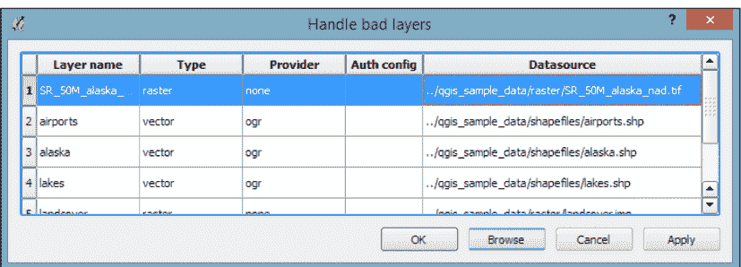

> 如果你处理的数据文件存储在网络驱动器上，而不是本地机器上，那么将存储相对路径改为存储绝对路径可能会很有用。你可以通过转到“项目 | 项目属性 | 常规”来更改此设置。

要修复图层，你需要在**数据源**列中更正路径。这可以通过双击路径文本并输入正确路径来完成，也可以通过单击对话框底部的**浏览**按钮并在打开的文件对话框中选择新文件位置来完成。

> **QConsolidate**插件提供了一种将QGIS项目复制到其他计算机或与其他用户共享QGIS项目及相关文件的便捷方式。该插件收集项目中使用的所有数据集，并将它们保存到一个目录中，然后你可以轻松移动这些文件，而不会破坏任何路径。


## 总结

在本章中，你学习了如何从文件、数据库和Web服务加载空间数据。我们了解了QGIS如何处理坐标参考系统，并介绍了矢量图层和栅格图层的样式设置，我们将在*第5章：创建精美地图*中更详细地讨论这一主题。我们还安装了第一个Python插件——QuickMapServices插件，并使用它将背景地图加载到项目中。最后，我们了解了QGIS项目文件以及如何高效地处理它们。在下一章中，我们将更详细地介绍如何创建和编辑栅格和矢量数据。


# 3

## 数据创建与编辑

在本章中，我们将首先创建一些新的矢量图层并解释如何选择要素和进行测量。随后我们将继续编辑要素几何和属性。之后，我们将对矢量和栅格数据进行重投影并在不同文件格式之间转换。我们还将讨论如何将文本文件和电子表格中的数据连接至我们的空间数据，以及如何使用临时草稿图层进行快速编辑工作。此外，我们还将查看常见的几何拓扑问题以及如何检测和修复它们，然后在本章结束时介绍如何将数据添加到空间数据库。

### 创建新的矢量图层

在本练习中，我们将从头创建一个新图层。QGIS 提供了创建不同图层的广泛功能。图层下的新建菜单列出了创建新的 Shapefile 和 SpatiaLite 图层所需的函数，但我们也可以使用 DB Manager 插件创建新的数据库表。界面略有不同，以便适应每种格式支持的功能。

让我们创建一些新的 Shapefile 来看看其工作原理：

- 1. 新建 Shapefile 图层，可通过前往 图层 | 创建图层 或按 Ctrl + Shift + N 访问，会打开新建矢量图层对话框，其中包含不同几何类型、CRS 和属性的选项。

- 创建新的 Shapefile 非常快速，因为所有必填字段都已有默认值。默认情况下，该工具将在 WGS84（EPSG:4326）CRS 中创建一个新的点图层（除非在 设置 | 选项 | CRS 中另有指定）以及一个名为 id 的整数字段。

- 2. 保持所有默认值不变，我们只需单击 **OK** 并指定文件名即可。这将创建一个新的 Shapefile，新建的点图层会出现在图层列表中。
- 3. 接下来，我们再创建一个线图层和一个面图层。我们将为这些图层添加一些额外字段。除了整数字段（仅用于整数）外，Shapefile 还支持字符串（用于文本）、十进制数字（也称为实数）以及日期（采用 ISO 8601 格式，即 2016-12-24 表示 2016 年平安夜）。
- 4. 要添加字段，我们只需插入名称、选择类型和宽度，然后单击 **Add to fields list。**

> 对于十进制数字，我们还必须定义 **Precision** 值，该值决定小数点后的位数。**Length** 值为 3 且 **Precision** 值为 1 将允许的值范围为 -99.9 到 +99.9。

5. 下一截图左侧显示了用于创建我的示例面图层的 **New Vector Layer** 对话框，我将其命名为 `new_polygons`：

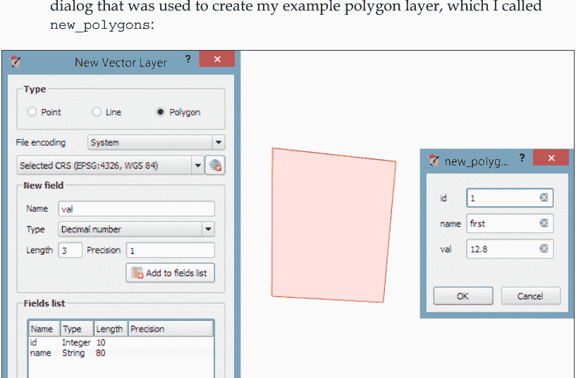

6. 所有新图层目前都是空的，但我们现在将创建一些要素。如果我们想向图层添加要素，首先必须为该特定图层启用编辑。编辑可以通过以下任一方式打开和关闭：前往 **Layer | Toggle editing**，在图层名称上下文菜单中使用 **Toggle editing**，或单击 **Digitizing** 工具栏中的 **Toggle editing** 按钮。


> 你会注意到图层列表中图层的图标会发生变化以反映编辑是否开启或关闭。当我们为图层打开编辑时，QGIS 会自动启用适合该图层几何类型的数字化工具。

7. 现在，我们可以使用编辑工具栏中的 **Add Feature** 工具创建新要素。要放置点，只需在地图上单击即可。然后会提示我们填写属性表单，你可以在上一张截图的右侧看到该表单，一旦我们单击 **OK**，新要素就会被创建。

8. 与点类似，我们可以通过在地图上放置节点来创建新的线和面。要完成线或面，只需在地图上右键单击即可。在每个图层中创建一些要素，然后保存更改。我们可以在即将进行的练习中重用这些测试图层。


> 新要素和要素编辑只有在我们单击 **Digitizing** 工具栏中的 **Save Layer Edits** 按钮后，或在完成编辑并确认要保存更改后才会永久保存。

### 使用要素选择工具

选择要素是任何 GIS 的核心功能之一，在我们进入编辑几何和属性之前，了解它们很有用。根据使用场景，**选择工具** 有多种不同类型。QGIS 提供了三种不同类型的工具，可使用鼠标、表达式或另一个图层来选择要素。

### 使用鼠标选择要素

**Attributes** 工具栏中的第一组工具允许我们使用鼠标在地图上选择要素。以下截图显示了 **Select Feature(s)** 工具。我们可以通过单击来选择单个要素，或通过绘制矩形来选择多个要素。其他工具可用于通过绘制不同形状（多边形、自由手绘区域或圆）围绕要素来选择要素。所有与绘制形状相交的要素都会被选中。

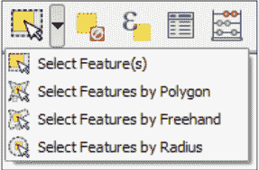

### 使用表达式选择要素

第二种选择工具称为 **Select by Expression**，它也可在 **Attribute** 工具栏中使用。它基于可包含引用和函数的表达式来选择要素，这些引用和函数使用要素属性和/或几何。对话框中央可用函数的列表很长，但我们可以使用列表顶部的搜索框按名称过滤它，更快地找到所需函数。在窗口右侧，我们可以找到函数帮助，解释功能以及如何在表达式中使用函数。函数列表还显示图层属性字段，通过单击 **all unique** 或 **10 samples**，我们可以轻松访问其内容。我们可以选择创建新选择，或向现有选择添加或从中删除。此外，我们还可以选择仅从现有选择中选择要素。让我们看一些示例表达式，你可以基于这些表达式构建并在自己的工作中使用：

- 使用我们示例数据中的 `lakes.shp` 文件，我们例如可以通过使用简单的 `"AREA_MI" > 1000.0` 属性查询来选择面积大于 1,000 平方英里的湖泊，如以下截图所示。或者，我们可以使用几何函数，例如 `$area > (1000.0 * 27878400)`。请注意，`lakes.shp` CRS 使用英尺，因此我们必须乘以 27,878,400 将平方英尺转换为平方英里。

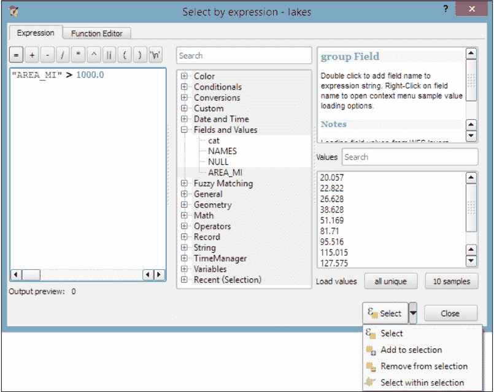

- 我们也可以使用字符串函数，例如查找名称较长的湖泊（例如 length ("NAMES") > 12）或名称中包含 s 或 s 的湖泊（例如 lower ("NAMES") LIKE '%s%'）；该函数首先将名称转换为小写，然后查找 s 的任何出现。

### 使用空间查询选择要素

第三种工具称为 Spatial Query，允许我们根据一个图层中要素相对于第二个图层中要素的位置来选择要素。这些工具可通过前往 Vector | Research Tools | Select by location 和 Vector | Spatial Query | Spatial Query 访问。如果在 Vector 菜单中找不到它，请在插件管理器中启用它。一般来说，我们希望使用 Spatial Query 插件，因为它支持多种空间操作，例如 Crosses、Equals、Intersects、Is disjoint、Overlaps、Touches 和 Contains，具体取决于图层几何类型。

## 数据创建与编辑

让我们使用示例数据中的 `railroads.shp` 和 `pipelines.shp` 测试 Spatial Query 插件。例如，我们可能想要找到所有穿越管道的铁路要素；因此，我们选择 **railroads** 图层、**Crosses** 操作和 **pipelines** 图层。单击 **Apply** 后，插件会向我们展示查询结果。窗口右侧有一个结果要素 ID 的列表，如下一张截图所示。在此列表下方，我们可以勾选 **Zoom to item** 框，QGIS 将放大到属于所选 ID 的要素。此外，插件还提供直接将所有结果要素保存到新图层的按钮：

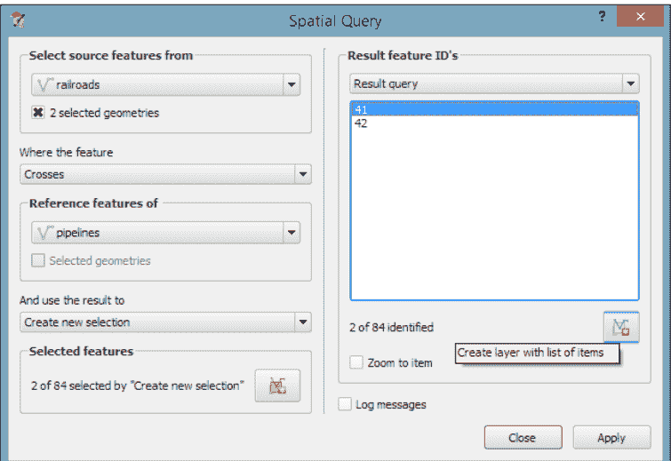


## 编辑矢量几何

既然我们已经知道如何创建和选择要素，现在可以更仔细地研究**数字化**工具栏和**高级数字化**工具栏中的其他工具。

### 使用基础数字化工具

这是基本的数字化工具栏：


数字化工具栏包含用于创建和移动要素与节点，以及删除、复制、剪切和粘贴要素的工具，如下所示：

- “添加要素”工具允许我们通过在地图上放置要素节点来创建新要素，这些节点由直线连接。
- 类似地，“添加圆弧”工具允许我们创建由曲线连接连续节点的要素。
- 使用“移动要素”工具，可以轻松地一次将一个或多个要素拖到新位置。
- 类似地，“节点”工具允许我们移动同一要素的一个或多个节点。第一次单击激活要素，第二次单击选择节点。按住鼠标按键将节点拖到新位置。除了只移动一个节点外，我们还可以通过单击并拖拽线段来移动边。最后，按住 Ctrl 键可以选中并移动多个节点。
- “删除选中”、“剪切要素”和“复制要素”工具仅在一个或多个图层要素被选中时才可用。类似地，“粘贴要素”也仅在要素被剪切或复制之后才生效。

### 使用高级数字化工具

**高级数字化**工具栏提供了非常有用的**撤销**和**重做**功能，以及用于更复杂几何编辑的附加工具，如下面的截图所示：


**高级数字化**工具包括以下内容：

- **旋转要素**使我们能够围绕中心点旋转一个或多个选定的要素。
- 使用**简化要素**工具，我们只需单击要素并在弹出窗口中指定所需的容差，即可简化/概括要素几何形状，如下面的截图所示，在截图中可以看到左侧是原始几何，右侧是简化后的几何：
- 以下工具可用于修改多边形。它们允许我们在现有多边形中添加环（也称为*孔洞*），或为其添加部分。**填充环**工具与**添加环**类似，但它不只是创建一个孔洞，还会创建一个新要素来填充该孔洞。当然，也有用于删除环和部分的工具。
- **重塑要素**工具可用于通过剪切或添加片段来更改要素的几何形状。你可以通过在原要素内部开始绘制新形状来添加片段，或在外部开始绘制来剪切片段，从而控制该行为，如下面的示例图所示：


- **偏移曲线**工具仅适用于线，允许我们按给定的偏移量移动线几何。
- **分割要素**工具允许我们沿剪切线将一个或多个要素分割为多个要素。类似地，**分割部分**允许我们将一个要素分割为多个部分，这些部分仍然属于同一个多多边形或多线段。
- **合并所选要素**工具使我们能够合并多个要素，同时控制输出要素中将保留哪些要素的属性。
- 类似地，**合并所选要素的属性**也允许我们合并多个要素的属性，但不会将它们合并为一个要素。相反，所有原始要素保持原样；只是属性值得到更新。
- 最后，**旋转点符号**仅适用于启用了**旋转字段**功能的点图层（我们将在*第5章 创建精彩地图*中介绍此功能）。

### 使用捕捉来确保拓扑正确的编辑

手动数字化要素时的挑战之一是避免出现不想要的间隙或要素重叠。为了更容易避免这些问题，QGIS 提供了**捕捉**功能。要配置捕捉，我们前往**设置 | 捕捉选项**。下面的截图显示了如何为**当前图层**启用捕捉。类似地，你可以为**所有图层**选择捕捉模式，或选择**高级**模式，在该模式中可以分别控制每个图层的设置。在下面截图的示例中，我们启用了**按顶点**捕捉。这意味着数字化工具将自动捕捉到当前图层中现有要素的顶点/节点。类似地，你可以启用**按线段**或**按顶点和线段**捕捉。在数字化过程中启用捕捉后，每当靠近可以捕捉的顶点或线段时，你都会注意到出现粗体的十字形标记：


### 使用测量工具

任何 GIS 的另一个核心功能由**测量工具**提供。在 QGIS 中，我们可以在**属性**工具栏中找到测量线、面积和角度所需的工具，如下面的截图所示：


当我们绘制测量线、面积或角度时，测量值会不断更新。当我们绘制一条包含多个线段的线时，工具会显示每个线段的长度以及所有线段的总长度。要停止测量，只需右键单击即可。如果我们想将测量单位从米改为英尺，或从度改为弧度，可以通过前往**设置 | 选项 | 地图工具**来完成。

### 编辑属性

属性编辑主要有三种用例：

- 首先，我们可能希望编辑特定要素的属性，例如修正错误的名称。
- 其次，我们可能希望编辑一组要素的属性。
- 第三，我们可能希望更改图层中所有要素的属性。

### 在属性表中编辑属性

这三种用例都可以通过**属性表**提供的功能来满足。我们可以通过前往**图层 | 打开属性表**、使用**属性**工具栏中的**打开属性表**按钮，或通过图层名称的上下文菜单来访问它。

1. 要更改属性值，我们必须首先启用编辑。
2. 然后，我们可以双击属性表中的任意单元格来激活输入模式，如下面的截图上方对话框所示，我正在编辑第一个要素的 NAME_2：


3. 按 Enter 键确认更改，但要永久保存新值，我们还需要单击“保存编辑”按钮或按 Ctrl + S。

除了经典的属性表视图外，QGIS 还支持表单视图，您可以在上图的底部对话框中看到它。您可以使用属性表对话框右下角的按钮在这两种视图之间切换。

> 在属性表中，我们还可以找到用于处理选择的工具（从左到右，从第四个按钮开始）：**删除所选要素**、**使用表达式选择要素**、**取消全选**、**将选择项移到顶部**、**反转选择**、**将地图平移到所选行**、**将地图缩放到所选行**，以及**将所选行复制到剪贴板**。在属性表中选择要素的另一种方法是单击行号。
>
> 接下来的两个按钮允许我们添加和删除列。当我们单击**删除列**按钮时，会出现一个列列表供我们选择。类似地，**新建列**按钮会弹出一个对话框，我们可以使用该对话框指定新列的名称和数据类型。

### 在要素表单中编辑属性

另一种编辑单个要素属性的方法是使用**识别工具**直接单击地图上的要素来打开**属性表单**。默认情况下，**识别工具**以只读模式显示属性值，但我们可以在**识别结果**面板中启用**自动打开表单**选项，如下所示：


在上面的截图中看到的是 QGIS 自动创建的默认要素属性表单，但我们并不局限于这个基本表单。通过前往**图层属性 | 字段**部分，我们可以更详细地配置表单的外观和感觉。**属性编辑器布局**选项（按复杂程度递增）包括**自动生成**、**拖放设计器**以及提供**.ui**文件。这些选项将在下面详细描述。


## 使用自动生成创建要素表单

自动生成是最基本的选项。你可以为每个字段指定特定的编辑控件和别名；这将替换表单中的默认输入字段和标签。在本例中，我们使用以下编辑控件类型：

- **文本编辑**支持插入一行或多行文本。
- **唯一值**创建下拉列表，允许用户选择属性表中已使用过的值之一。如果启用了**可编辑**选项，下拉列表将被替换为支持自动补全的文本编辑控件。
- **范围**为特定范围内的数值创建编辑控件。

> 有关可用编辑控件类型的完整列表，请参阅用户手册：http://docs.qgis.org/2.2/en/docs/user_manual/working_with_vector/vector_properties.html#fields-menu。

## 使用拖放设计器设计要素表单

这样可以更好地控制表单布局。正如下一张截图所示，设计器允许我们在表单内创建选项卡，并且还可以改变表单字段的顺序。工作流程如下：

1. 点击加号按钮添加一个或多个选项卡（例如，一个**区域**选项卡，如下图所示）。
2. 在对话框左侧，选择要添加到表单的字段。
3. 在右侧，选择要添加字段的选项卡。
4. 点击带有指向右侧箭头的图标按钮，将所选字段添加到所选选项卡中。

5. 你可以使用向上和向下箭头按钮重新排序表单中的字段，或者，顾名思义，通过向上或向下拖放字段来重新排序：


## 使用 .ui 文件设计要素表单

这是最高级的选项。它允许你使用 Qt 用户界面，例如使用 Qt Designer 软件设计的界面。这为设计表单布局和行为提供了极大的自由度。

> 创建 .ui 文件超出了本书的范围，但你可以在 http://docs.qgis.org/2.2/en/docs/training_manual/create_vector_data/forms.html#hard-fa-creating-a-new-form 找到更多相关信息。

## 计算新属性值

如果我们想要更改图层中多个或全部要素的属性，通常手动编辑不可行。这正是**字段计算器**的用武之地。我们可以通过属性表中的**打开字段计算器**按钮访问它，或按 *Ctrl + I* 快捷键。在**字段计算器**中，我们可以选择仅更新所选要素或更新图层中的所有要素。除了更新现有字段，我们还可以创建新字段。函数列表与之前通过表达式选择要素时探索的列表相同。我们可以使用该列表中的任何函数和变量来填充新字段或更新现有字段。以下是一些常用示例表达式：

- 我们可以使用 `@row_number` 变量创建一个连续的 `id` 列，它会用行号填充列，如下一张截图所示：


- 另一个常见用例是分别使用 `$length` 和 `$area` 几何函数计算线段的长度或多边形的面积
- 类似地，我们可以使用 `$x` 和 `$y` 获取点的坐标
- 如果我们想获取线段的起点或终点，可以分别使用 `$x_at(0)` 和 `$y_at(0)`，或 `$x_at(-1)` 和 `$y_at(-1)`）

**字段计算器**的替代方案——特别是当你已经知道要使用的公式时——是字段计算器栏，它直接位于**属性表**对话框的工具栏下方。在下一张截图中，你可以看到一个计算所有人口普查区域面积的示例（首先使用**新建字段**按钮添加一个名为 `CENSUSAREA` 的**十进制数字字段**）。此示例使用 `CASE WHEN – THEN – END` 表达式来检查 `TYPE_2` 的值是否为 `Census Area`：

```
CASE WHEN TYPE_2 = 'Census Area' THEN $area / 27878400 END
```

> 另一种替代方案是使用 `if()` 函数。如果你将 `CENSUSAREA` 属性作为第三个参数（该参数定义条件评估为 false 时返回的值），则该表达式将仅更新 `TYPE_2` 为 Census Area 的行，并保持其他行不变：
> 
> ```text
> if(TYPE_2 = 'Census Area', $area / 27878400, CENSUSAREA)
> ```
> 
> 或者，你可以使用 `NULL` 作为第三个参数，这将用 `NULL` 覆盖所有 `TYPE_2` 不等于 Census Area 的行：
> 
> ```text
> if(TYPE_2 = 'Census Area', $area / 27878400, NULL)
> ```

输入公式并点击**更新全部**按钮执行它：


由于无法直接在 Shapefile 或 SpatiaLite 属性表中*更改字段数据类型*，因此字段计算器和计算器栏也用于创建具有所需属性的新字段，然后使用原始列中的值填充它们。

## 重投影和转换矢量及栅格数据

在*第 2 章，查看空间数据*中，我们讨论了 CRS，以及 QGIS 提供即时重投影，从而将存储在不同 CRS 中的空间数据集显示在同一地图上。尽管如此，在某些情况下，我们可能希望永久重投影数据集，例如以便后续进行地理处理。

在 QGIS 中，重投影矢量或栅格图层只需使用新的 CRS 保存即可。我们可以通过转到**图层 | 另存为...**或使用图层名称上下文菜单中的**另存为...**来保存图层。选择目标文件格式和文件名，然后点击 CRS 下拉字段旁边的**选择 CRS**按钮来选取新的 CRS。

除了更改 CRS 外，**保存矢量/栅格图层**对话框的主要用途（如下图所示）是不同文件格式之间的转换。例如，我们可以加载 Shapefile 并将其导出为 GeoJSON、MapInfo MIF、CSV 等，反之亦然。


**保存栅格图层**对话框也是通过边界框裁剪/剪裁栅格的便捷方式，因为我们可以指定要保存的**范围**。

此外，**保存矢量图层**对话框具有**仅保存所选要素**选项，该选项允许我们只保存所选要素，而不是图层中的所有要素（仅当图层中确实存在所选要素时，此选项才会激活）。

> 💡 启用**将保存的文件添加到地图**非常方便，因为这省去了保存后手动加载新文件的麻烦。

## 连接表格数据

在许多实际场景中，我们会以电子表格或文本文件的形式获得额外的非空间数据。好消息是，我们可以通过将 XLS 文件从文件浏览器中拖入 QGIS，或使用**添加矢量图层**来加载它们。不要被这个措辞迷惑！即使文件中没有任何几何数据，它也确实有效。文件甚至可以包含多个表。你将看到以下对话框，它让你选择要加载的表：


QGIS 会自动识别 XLS 表中列的名称和数据类型。这很容易判断，因为数值在属性表中右对齐，如以下截图所示：


我们也可以从带分隔符的文本文件加载表格数据，如我们在第 2 章“查看空间数据”中所见，当时我们从带分隔符的文本文件加载了一个点图层。要加载仅包含表格数据但没有几何信息的带分隔符文本文件，我们只需启用“无几何图形（仅属性表）”选项。

## 在图层属性中设置连接

在从电子表格或文本文件加载表格数据后，我们可以继续将此非空间数据连接到矢量图层（例如，我们示例中的 airports.shp 数据集）。为此，我们进入矢量的图层属性 | 连接部分。在这里，我们可以通过点击绿色加号按钮添加新的连接。我们只需选择表格连接图层和连接字段（来自表格图层），其值将与目标字段（来自矢量图层）中的值匹配。此外，如果需要，我们可以通过启用“选择要连接的字段”选项来选择要连接的字段子集。例如，以下截图中的设置将只添加“some value”字段。此外，我们使用自定义字段名前缀，而不是使用整个连接图层名称（默认选项）。


## 在属性表中检查连接结果

连接添加后，我们可以看到扩展后的属性表，并使用新添加的属性（如以下屏幕截图所示）进行样式设置和标注。QGIS 中连接的工作方式如下：连接图层的属性会被追加到原始图层的属性表中。原始图层中的要素数量不会改变。每当连接字段与目标字段匹配时，属性值会被填入；否则，你会看到 NULL 条目。


你可以使用另存为...永久保存已连接的图层以创建新文件。

## 使用临时草图图层

当你只是想快速在地图上绘制一些要素时，临时草图图层是无需担心临时数据的文件格式和位置即可实现此目的的绝佳方式。转到图层 | 创建图层 | 新建临时草图图层...即可创建新的临时草图图层。如以下屏幕截图所示，我们配置此临时图层所需做的全部就是选择几何图形的类型、图层名称和 CRS。一旦图层创建完成，我们就可以像处理任何其他矢量图层一样添加要素和属性：


顾名思义，临时草图图层是临时的。这意味着在你关闭项目时它们会消失。

如果你想保留临时图层的数据，可以使用另存为...创建文件，或安装 Memory Layer Saver 插件，该插件会使具有内存数据源的图层（如临时草图图层）持久化，以便在关闭并重新打开项目时恢复。内存提供者数据以便携式二进制格式保存，并以 .mldata 扩展名与项目文件一起保存。

## 检查拓扑错误并修复它们

有时，我们从不同来源接收的数据或由一系列空间处理步骤产生的数据可能会存在问题。拓扑错误尤其令人烦恼，因为它们在使用数据进行分析和进一步空间处理时可能导致多种不同的问题。因此，拥有能够检查数据拓扑错误的工具并知道如何修复发现的错误非常重要。

### 使用拓扑检查器查找错误

在 QGIS 中，我们可以使用 **Topology Checker** 插件；它默认已安装，可通过 **Vector** 菜单 **Topology Checker** 条目访问（如果找不到菜单条目，你可能需要在 **Plugin Manager** 中启用该插件）。激活插件后，它会在 QGIS 窗口中添加一个 **Topology Checker Panel**。此面板可用于配置和运行不同的拓扑检查，并列出检测到的错误。

为了演示 **Topology Checker** 的使用，我们创建一个具有多边形几何的临时草图图层并数字化一些多边形，如以下屏幕截图所示。请确保使用捕捉功能创建相触但不重叠的多边形。这些例如可以代表一组排屋。当多边形准备就绪后，我们可以设置想要检查的拓扑规则。点击 **Topology Checker Panel** 中的 **Configure** 按钮打开 **Topology Rule Settings** 对话框。在这里，我们可以管理项目数据的所有拓扑规则。例如，在以下屏幕截图中，你可以看到我们可能为多边形图层配置的规则，包括：

- 多边形 *不得重叠*
- 多边形之间不得有间隙
- 不应有重复的几何图形


设置好规则后，我们可以关闭设置对话框并点击 **Topology Checker Panel** 中的 **Validate All** 按钮开始运行 **topology** 规则检查。如果你创建多边形时足够仔细，检查器将找不到任何错误，**Topology Checker Panel** 底部的状态将显示此消息：**0 errors were found**。让我们通过引入一些 **topology errors** 来改变这种情况。

例如，如果我们移动一个顶点使两个多边形重叠，然后点击 **Validate All**，我们会得到下一张屏幕截图中显示的错误。请注意，错误类型以及受影响的图层和要素会显示在 **Topology Checker Panel** 中。此外，由于启用了 **Show errors** 选项，有问题的几何部分会在地图上以红色高亮显示：


当然，也可以创建描述不同图层中要素之间关系的规则。例如，以下屏幕截图显示了一个点图层和一个多边形图层，其中规则规定每个点都应位于多边形内部，每个多边形都应包含一个点：


### 修复无效几何错误

从面板中的错误列表中选择一个错误，地图会居中到有问题的区域，以便我们可以开始修复它，例如，通过将孤立点移动到空多边形中。

有时，手动修复所有错误可能需要大量工作。幸运的是，某些错误可以自动处理。例如，常见的 **self-intersecting polygons** 错误会导致 *invalid geometry* 错误（如以下屏幕截图所示），通常是由于多边形节点或边相交造成的。这些问题通常可以使用缓冲区工具解决，例如 **Processing Toolbox** 中的 **Fixed distance buffer**，我们将在 *Chapter 4, Spatial Analysis* 中更详细地讨论，缓冲区 **Distance** 设置为 0。缓冲例如会修复以下屏幕截图左侧的自相交多边形，通过移除自相交节点并构建一个带孔的有效多边形（如右侧所示）：


另一个可以自动修复的常见问题是所谓的 **sliver polygons**。这些是面积很小且通常很薄的多边形，可能是空间处理过程（如相交操作）的结果。为了消除这些细长多边形，我们可以使用 **v.clean** 工具，并将 **Cleaning tool** 选项设置为 **rmarea**（意为“移除面积”），该工具也可通过 **Processing Toolbox** 使用。在本屏幕截图所示的示例中，**Threshold** 值 10000 指示工具移除面积小于 10,000 平方米的所有多边形，并将其与具有最长公共边界的相邻多边形合并：


> 有关 **Processing Toolbox** 的全面介绍和更多详细信息，请参阅 *Chapter 4, Spatial Analysis.*

## 向空间数据库添加数据

在 *Chapter 2, Viewing Spatial Data* 中，我们看到了如何查看来自空间数据库的数据。当然，我们也希望能够向数据库中添加数据。这时 DB Manager 插件就派上用场了。DB Manager 默认已安装，你可以在数据库菜单中找到它（如果数据库菜单中看不到 DB Manager，你可能需要在插件管理器中激活它）。

DB Manager 对话框左侧的树形面板列出了迄今为止配置的所有可用数据库连接。由于我们在 *Chapter 2, Viewing Spatial Data* 中添加了对 test-2.3.sqlite SpatiaLite 数据库的连接，因此该连接在 DB Manager 中列出，如下一张屏幕截图所示。

要向此数据库添加新数据，我们只需从可用连接列表中选择该连接，然后转到表 | 导入图层/文件。这将打开导入矢量图层对话框，在此我们可以配置导入设置，例如要创建的表的名称以及其他选项，包括输入数据 CRS（源 SRID 选项）和表 CRS（目标 SRID 选项）。通过启用这些 CRS 选项，我们可以在导入时重投影数据。在以下屏幕截图所示的示例中，我们从 Shapefile 导入城市区域，并将数据从 EPSG:4326（WGS84）重投影到 EPSG:32632（WGS 84 / UTM zone 32N），因为这是已存在表所使用的 CRS：


将数据导入数据库的一个便捷快捷方式是将文件从主窗口的**浏览器**面板直接拖放到**数据库管理器**中列出的数据库。这甚至支持一次拖放多个选中的文件（在Windows/Ubuntu上按住*Ctrl*键，或在Mac上按住*cmd*键，可以在**浏览器**面板中选择多个文件）。将文件拖放到目标数据库后，会出现**导入矢量图层**对话框，您可以在其中配置导入。

## 小结

在本章中，您学习了如何从零开始创建新图层。我们使用了一系列工具，以不同方式创建和编辑要素几何。然后，我们深入探讨了编辑单个要素、要素选择和整个图层的属性。接下来，我们重新投影了矢量和栅格图层，并学习了如何在不同文件格式之间转换。我们还介绍了表格数据以及如何将其加载并连接到空间数据。此外，我们探讨了临时草稿图层的使用，并讨论了如何检查数据中的拓扑错误并修复它们。最后，我们以将新数据导入数据库的示例结束了本章。

在下一章中，我们将充分利用数据，了解如何对栅格和矢量数据执行不同类型的空间分析。我们还将更仔细地了解**处理工具箱**，它在本章中首次出现。您将学习如何使用这些工具并将其组合以创建自动化工作流。

## 空间分析

在本章中，我们将使用 QGIS 执行许多典型的地理处理与空间分析任务。我们将从栅格处理和分析任务开始，例如裁剪和地形分析。我们将介绍栅格与矢量格式转换的基本要素，然后继续讨论常见的矢量地理处理任务，例如生成热力图和计算区域内面积占比。我们还将使用处理建模器创建自动化的地理处理工作流。最后，本章将以示例结束，展示如何利用空间数据库的强大功能在 QGIS 中分析空间数据。

### 分析栅格数据

栅格数据（包括但不限于高程模型或遥感影像）常用于许多分析中。以下练习展示了常见的栅格处理与分析任务，例如裁剪到特定范围或掩膜、从数字高程模型创建晕渲和坡度栅格，以及使用栅格计算器。

### 裁剪栅格

栅格处理中的一项常见任务是使用多边形裁剪栅格。**栅格 | 提取 | 裁剪器**中的**裁剪器**工具可以很好地完成此任务。该工具支持裁剪到指定的**范围**以及使用多边形**掩膜**图层进行裁剪，如下所示：

- **范围**可以手动设置，也可以通过在地图中进行选择来设置。为此，我们只需单击并拖动鼠标，在主 QGIS 窗口的地图区域中绘制一个矩形。
- 掩膜图层可以是项目中当前加载的任何多边形图层，也可以是任何其他多边形图层，可通过**掩膜图层**下拉列表右侧的**选择...**来指定。

如果我们只想将栅格裁剪到某个范围（当前地图视图范围或任何其他范围），还可以使用栅格的**另存为...**功能，如*第3章“数据创建与编辑”*所示。

为了快速练习，我们将使用阿拉斯加 Shapefile（两者均来自我们的示例数据）作为掩膜图层来裁剪山体阴影栅格（`SR_50M_alaska_nad.tif`）。如下图所示，在窗口底部我们可以看到 QGIS 用于裁剪栅格的具体 `gdalwarp` 命令。如果您还想学习如何使用 **GDAL**，这将非常有用。

在*第2章“查看空间数据”*中，我们讨论了 GDAL 是 QGIS 用于读取和处理栅格数据的库之一。您可以在 http://www.gdal.org/gdal_utilities.html 找到 gdalwarp 以及所有其他 GDAL 实用程序的文档。


默认的**无数据值**是输入数据集中使用的无数据值，如果未指定则为**0**，但如有必要我们可以覆盖它。另一个好选项是**创建输出 alpha 波段**，这将把掩膜之外的所有区域设置为透明。这会为输出栅格添加一个额外的波段，用于控制渲染栅格单元的透明度。

一个常见的错误来源是忘记在输出文件路径中添加文件格式扩展名（在我们的示例中，GeoTIFF 使用 .tif）。同样，如果您尝试覆盖现有文件，也可能会出错。在这种情况下，修复错误的最佳方法是选择不同的文件名，或先删除现有文件。

由于我们启用了“完成后加载到画布”选项，生成的图层将自动加载。QGIS 还应自动识别我们创建的 alpha 图层，并且落在阿拉斯加陆地之外的栅格区域应透明，如前面截图的右侧所示。如果由于某种原因 QGIS 无法自动识别 alpha 图层，我们可以使用栅格图层属性“透明度”部分中的“透明度波段”选项手动启用它，如下一张截图所示。此对话框也是指定我们可能想要使用的任何“无数据值”的正确位置：


### 分析高程/地形数据

要使用地形分析工具，我们需要一个高程栅格。如果您手头没有，可以直接从 NASA 航天飞机雷达地形测绘任务（SRTM）使用 http://dwtkns.com/srtm/ 或任何其他 SRTM 下载服务下载数据集。

如果您想精确复现以下练习中的结果，请获取名为 srtm_05_01.zip 的数据集，它覆盖阿拉斯加的一小部分。

虽然晕渲图主要是用于可视化目的的三波段栅格，但坡度栅格则是空间分析工作流中常见的中间步骤。我们现在将创建一个坡度栅格，以便在以下各节的示例工作流中使用。生成的坡度栅格将自动以灰度加载，如以下截图所示：


### 使用栅格计算器

使用栅格计算器，我们可以根据当前 QGIS 项目中加载的一个或多个栅格中的值创建新的栅格图层。要访问它，请转到“栅格 | 栅格计算器”。对话框中左上角的列表中会显示所有可用的栅格波段，格式为 栅格_名称@波段_编号。

继续我们之前创建坡度栅格的练习，例如，我们可以使用以下表达式找到海拔超过 1,000 米且坡度小于 5 度的区域：

```
"srtm_05_01@1" > 1000 AND "slope@1" < 5
```

> 根据您使用的数据集，您可能需要调整这些值。请参阅本章后面的“访问栅格和矢量图层统计信息”一节，了解如何查找栅格中的最小值和最大值。

同时满足高海拔和坡度平缓这两个条件的像元，在生成的栅格中将被赋值为 1，而只要不满足任一条件的像元将被设置为 0。值为 1 的较大区域仅出现在栅格图层的南部。您可以在以下截图的右侧看到结果栅格的一部分（以黑色显示在晕渲图层上）：


另一个典型用例是重分类栅格。例如，我们可能希望重分类示例数据中的 landcover.img 栅格，使所有 landcover 类别为 1 到 5 的区域获得值 100，6 到 10 的区域获得 101，11 以上的区域获得新值 102。我们将使用以下代码：

```
("landcover@1" > 0 AND "landcover@1" <= 6 ) * 100
+ ("landcover@1" >= 7 AND "landcover@1" <= 10 ) * 101
+ ("landcover@1" >= 11 ) * 102
```


前面的栅格计算器表达式包含三个部分，每部分都由一个检查和一个乘法组成。对于每个像元，三个检查中只有一项可以为真，而真表示为 1。因此，如果一个土地覆盖像元的值为 4，则第一个检查为真，表达式的计算结果为 1*100 + 0*101 + 0*102 = 100。

## 结合栅格和矢量数据

某些分析需要栅格和矢量数据的结合。在下面的练习中，我们将同时使用栅格和矢量数据集来说明如何在这些不同数据类型之间转换、如何访问图层和区域统计信息，以及最后如何从点创建栅格热力图。

## 在栅格和矢量之间转换

用于在栅格和矢量格式之间转换的工具可以通过进入 Raster | Conversion 来访问。这些工具称为 Rasterize（矢量转栅格）和 Polygonize（栅格转矢量）。与之前使用的栅格裁剪工具一样，这些工具也基于 GDAL，并在对话框底部显示命令。

Polygonize 将栅格转换为多边形图层。根据栅格的大小，转换可能需要一些时间。处理完成后，QGIS 会通过弹出窗口通知我们。作为快速测试，我们可以例如将重分类的土地覆盖栅格转换为多边形。 resulting 矢量多边形图层包含多个多边形要素，具有一个单一属性，我们将其命名为 lc；它取决于原始栅格值，如以下屏幕截图所示：


使用 **Rasterize** 工具与使用 **Polygonize** 工具非常相似。唯一的区别是我们可以在像素/像元中指定 resulting 栅格的大小。我们还可以指定属性字段，该字段将为栅格像元值提供输入，如下一张屏幕截图所示。在这种情况下，我们的 alaska.shp 数据集的 cat 属性意义不大，但你已经了解了该工具的工作原理：


## 访问栅格和矢量图层统计信息

每当我们获得一个新数据集时，检查图层统计信息以了解其包含的数据，例如最小值和最大值、要素数量等，这很有用。QGIS 提供了多种工具来探索这些值。

**栅格图层统计信息** 在 **图层属性** 对话框中 readily 可用，具体在以下选项卡中：

- **Metadata**：此选项卡显示像元值的最小值和最大值以及像元值的平均值和标准差。

## 空间分析

- **Histogram**：此选项卡呈现栅格值的分布。使用鼠标放大直方图以查看细节。例如，以下屏幕截图显示了我们 `landcover` 数据集直方图的放大版本：


对于 **矢量图层**，我们可以使用 **Vector | Analysis Tools** 中的两个工具获取汇总统计信息：

- **Basics statistics** 对于数值字段非常有用。它计算诸如平均值和中位数、最小值和最大值、要素计数 *n*、唯一值数量等参数，适用于图层的全部要素或仅选定要素。

- **List unique values** 用于获取某个字段的所有唯一值。

在这两个工具中，我们可以轻松使用 *Ctrl + C* 复制结果并粘贴到文本文件或电子表格中。以下图像显示了探索我们的 airports 示例数据集内容的示例：


**Basics statistics** 工具的替代方案是 **Statistics Panel**，你可以通过进入 **View | Panels | Statistics Panel** 来激活它。如以下屏幕截图所示，此面板可自定义以显示你感兴趣的统计信息：


## 计算区域统计信息

与其为整个图层计算栅格统计信息，有时有必要为选定区域计算统计信息。这正是 **Zonal statistics plugin** 的用途。该插件默认已安装，可在 **Plugin Manager** 中启用。

例如，我们可以使用示例数据中的 `srtm_05_01.tif` 和 `airports.shp` 为每个机场周围的区域计算高程统计信息：

- 1. 首先，我们使用 **Vector | Geoprocessing Tools | Buffer(s)** 工具和 10,000 英尺的缓冲区大小在每个机场周围创建分析区域。

- 2. 在使用 **Zonal statistics plugin** 之前，重要的是要注意缓冲区图层和高程栅格使用两种不同的 CRS（**Coordinate Reference System** 的缩写）。如果我们直接进行，结果统计信息将为空或错误。因此，我们需要将缓冲区图层重新投影到栅格 CRS（WGS84 EPSG:4326，有关如何更改图层 CRS 的详细信息，请参阅 *第 3 章，数据创建和编辑* 中的 *重新投影和转换矢量和栅格数据* 部分）。

- 3. 现在我们可以使用 **Zonal Statistics** 工具为分析区域计算统计信息，该工具可通过进入 **Raster | Zonal statistics** 访问。在这里，我们可以配置所需的 **Output column prefix**（在我们的示例中，我们选择了 elev，即 elevation 的缩写）和要计算的 **Statistics**（例如 Mean、Minimum 和 Maximum），如以下屏幕截图所示：


4. 单击 OK 后，所选统计信息将附加到多边形图层属性表中，如以下屏幕截图所示。我们可以看到 Big Mountain AFS 是在我们的高程栅格范围内落入的四个机场中平均高程最高的机场：


## 从点创建热力图

热力图非常适合可视化点的分布。要创建它们，QGIS 提供了简单易用的 Heatmap Plugin，我们需要在 Plugin Manager 中激活它，然后可以通过进入 Raster | Heatmap | Heatmap 访问它。该插件提供多种 Kernel 形状可供选择。核是一个特定大小和形状的移动窗口，它在点区域上移动以计算其局部密度。此外，该插件允许我们控制输出热力图栅格的大小（使用 Rows 和 Columns 设置）以及像元大小。

> Radius 决定了点在其周围产生影响的距离。因此，较小的半径值会导致热力图显示更精细、更小的细节，而较大的值会导致热力图更平滑、细节更少。
> 
> 此外，Kernel shape 控制点的影响随距离增加而减小的速率。Heatmap 插件中可用的核形状列在以下屏幕截图中。例如，Triweight 核比 Epanechnikov 核产生更小的热点。有关核函数的正式定义，请参阅 http://en.wikipedia.org/wiki/Kernel_(statistics)。

以下屏幕截图显示了如何使用核半径为 300,000 层单位创建我们的 airports.shp 示例的热力图，在我们的机场数据的情况下，这以英尺为单位：


默认情况下，热力图输出将使用 Singleband gray 渲染类型进行渲染（栅格值低为黑色，高为白色）。要将其样式更改为与上一张屏幕截图中类似的内容，可以执行以下操作：

- 1. 将热力图栅格图层渲染类型更改为 Singleband pseudocolor。
- 2. 在对话框右侧的 Generate new color map 部分，选择你喜欢的颜色图，例如 PuRd 颜色图，如下一张屏幕截图所示。
- 3. 你可以手动输入颜色图的 Min 和 Max 值，或通过单击 Load in the Load min/max values 部分让其计算。

> 加载栅格 min/max 值时，请注意设置。要获取栅格图层的实际 min/max 值，请启用 Min/max、Full Extent 和 Actual（slower）Accuracy。如果只想获取地图上当前显示的栅格部分的 min/max 值，请改用 Current Extent。


# 空间分析

+   4. 点击**分类（Classify）**，将色带分类添加到对话框左侧的列表中。

+   5. 也可以选择将第一个条目（值为 0）的颜色改为白色（双击列表中的颜色），从而在地图的白色背景与热力图之间实现平滑过渡。


## 使用处理（Processing）进行矢量和栅格分析

最全面的空间分析工具集可通过**处理插件（Processing plugin）**访问，该插件可以在**插件管理器（Plugin Manager）**中启用。启用该插件后，我们会看到一个**处理（Processing）**菜单，在其中可以激活**工具箱（Toolbox）**，如下面的截图所示。在工具箱中，借助顶部的**搜索（Search）**框，按名称查找空间分析工具非常容易。这使得在工具箱中查找工具比在**矢量（Vector）**或**栅格（Raster）**菜单中更容易。熟悉处理工具的另一个优点是，它们可以用 Python 和地理处理模型实现自动化。


在接下来的章节中，我们将介绍一些可用的地理处理工具，并了解如何使用建模器来自动化我们的任务。

## 查找最近邻

查找**最近邻**，例如距离居民点最近的机场，是地理处理中的常见任务。要查找最近邻并创建输入要素与另一图层中其最近邻之间的连接，我们可以使用**“到最近枢纽的距离（Distance to nearest hub）”**工具。

如下一张截图所示，我们将居民点用作**源点图层（Source points layer）**，将机场用作**目标枢纽图层（Destination hubs layer）**。**枢纽图层名称属性（Hub layer name attribute）**将被添加到`result`的属性表中，以标识最近的要素。因此，我们选择`NAME`将机场名称添加到居民点。**输出形状类型（Output shape type）**有两个选项：

- **点（Point）：**此选项创建一个点输出图层，包含源点图层的所有点，并带有最近枢纽要素及其距离的新属性。
- **到枢纽的线（Line to hub）：**此选项创建一个线输出图层，包含源点图层所有点与其对应最近枢纽要素之间的连接。

建议使用**图层单位（Layer units）**作为**测量单位（Measurement unit）**，以避免出现错误测量的潜在问题：


## 点、线和多边形之间的转换

通常需要在点、线和多边形之间进行转换，例如从一系列点创建线，或者提取多边形的节点并从中创建新的点图层。有许多工具涵盖这些不同使用场景。下表概述了处理工具箱中可用于点、线和多边形转换的工具：

| | 转为点 | 转为线 | 转为面 |
|---|---|---|---|
| 从点 | | 点转路径 | 凸包<br>凹包 |
| 从线 | 提取节点 | | 线转多边形<br>凸包 |
| 从面 | 提取节点<br>多边形质心<br>多边形内随机点 | 面转线 | |

通常，将更复杂的表示转换为更简单的表示（面转线、面转点或线转点）比反向转换（点转线、点转面或线转面）更容易。以下是这些工具的简要说明：

- **提取节点：**这是一个非常直接的工具。它接受一个包含线或多边形的输入图层，并创建一个包含所有输入几何节点的点图层。生成的点包含原始线或面要素的所有属性。
- **多边形质心：**此工具为每个多边形或多重多边形创建一个质心。需要注意的是，它并不确保质心位于多边形内部。对于凹多边形、多重多边形和带孔多边形，质心可能落在多边形之外。
- **多边形内随机点：**此工具在多边形内部的随机位置创建指定数量的点。
- **点转路径：**要从点创建线，点图层需要具备标识线的属性（**组字段（Group field）**）以及标识线中点顺序的属性（**顺序字段（Order field）**），如下面的截图所示：


- **凸包：**此工具在输入点或线周围创建凸包。凸包可以想象为包含所有输入点以及输入点之间所有连接的区域。
- **凹包：**此工具在输入点周围创建凹包。凹包是一个表示输入点所占区域的多边形。凹包小于或等于凸包。在此工具中，我们可以通过将**阈值**参数在 0（非常详细）和 1（等效于凸包）之间调整来控制凹包的详细程度。下面的截图显示了我们机场数据周围的凸包和凹包（阈值设置为 0.3）的对比：
- **线转多边形：**最后，此工具可以从包围一个区域的线创建多边形。确保线之间没有间隙，否则它将无法工作。


## 识别其他要素附近的要素

一项常见的空间分析任务是识别某些其他要素附近的要素。例如，查找所有靠近河流的机场。使用示例数据中的 airports.shp 和 majrivers.shp，我们可以通过组合使用固定距离缓冲区（Fixed distance buffer）和按位置选择（Select by location）工具，找到距离河流 5,000 英尺以内的机场。使用搜索框在处理工具箱中查找这些工具。此示例的工具配置如下图所示：


对机场点位置建立缓冲区后，**按位置选择（Select by location）**工具会选择所有与河流相交的机场缓冲区。最终，76 个机场中有 14 个被选中。此信息显示在 QGIS 主窗口底部的信息区域中，如下面的截图所示：


## 在点位置对栅格进行采样

另一项常见任务是在特定点位置对栅格进行采样。使用处理（Processing），我们可以通过名为 v.sample 的 GRASS 工具解决此问题。要使用 GRASS 工具，请确保已安装 GRASS，并在处理 | 选项和配置下正确配置处理。在 OSGeo4W 默认系统上，配置将如下图所示：


在撰写本书时，OSGeo4W 中提供了 GRASS 7.0.3RC1。如前一张截图所示，还支持以前的 GRASS 6.x 版本，并且可以将处理配置为也使用其算法。在工具箱中，您可以在 GRASS GIS 7 命令和 GRASS 命令（适用于 GRASS 6.x）下找到这些算法。

## 空间分析

在本练习中，假设我们要对示例数据机场位置处的**土地覆盖（landcover）**图层进行采样。我们要做的就是指定包含采样点的矢量图层和需要采样的栅格图层。对于此示例，我们可以将所有其他设置保留默认值，如下面的截图所示。该工具不仅对栅格进行采样，还会将点属性与采样后的栅格值进行比较。但在当前示例中，我们不需要这种比较：


## 使用六边形网格绘制密度图

使用六边形网格绘制点密度已成为创建热力图之外颇受欢迎的替代方案。处理为我们提供了一种快速进行此类分析的方法。已经有一个名为**“从图层边界生成六边形网格（Hex grid from layer bounds）”**的预置脚本，可通过处理脚本集合获取，并可借助**“从在线脚本集合获取脚本（Get scripts from on-line scripts collection）”**工具下载。如下面的截图所示，您只需勾选复选框并单击“确定”即可启用脚本：


然后，我们可以使用此脚本创建一个覆盖输入图层中所有点的六边形网格。居民点数据集（popp.shp）是此练习的合适示例数据。网格准备好后，我们可以运行**“统计多边形中的点（Count points in polygon）”**来计算统计数据。如果使用下图所示的设置，点的数量将存储在**NUMPOINTS**列中：


# 计算区域内的面积占比

我们经常遇到的另一个空间分析任务是计算某个区域内的面积占比，例如，某条河流沿线的土地覆盖占比。使用 `majrivers.shp` 和 `trees.shp`，我们可以计算苏西特纳河沿岸 10,000 英尺宽地带内的林地面积占比：

- 1. 我们首先通过选择河流并为其建立缓冲区来定义分析区域。

> QGIS 处理工具默认只对输入图层的选中要素应用缓冲区。此默认行为可以在“处理”|“选项和配置”中，通过禁用“仅使用选中要素”选项来更改。对于以下示例，请保持该选项启用。

要选择苏西特纳河，我们使用“按属性选择”工具。运行该工具后，您应该会看到我们感兴趣的河流被选中并高亮显示。

- 2. 然后，我们可以使用“固定距离缓冲区”工具来获取河流沿线 5,000 英尺范围内的区域。请注意，应启用“融合结果”选项，以确保缓冲区结果是一个连续的单个多边形，如下面的屏幕截图所示：


- 3. 接下来，我们计算河流周围地带的面积。这可以使用“导出/添加几何列”工具完成，该工具会将面积和周长添加到属性表中。
- 4. 然后，我们可以计算河流沿线区域与 `trees.shp` 中林地区域之间的“相交”结果，如下面的屏幕截图所示。此操作的结果是一个仅包含河流缓冲区范围内林地区域的图层。


- 5. 使用“融合”工具，我们可以将相交结果中的所有区域重新组合成一个大的多边形，该多边形代表河流周围的总林地区域。请注意，我们使用唯一 ID 字段 `VEGDESC` 仅合并具有相同植被类型的区域，以免混淆落叶林和混交林。

- 6. 最后，我们可以使用 **高级 Python 字段计算器** 计算最终的林地面积占比。公式 `value = $geom.area() / <area>` 将最终多边形的面积（`$geom.area()`）除以面积属性（`<area>`）中的值，该值是我们之前通过运行 **导出/添加几何列** 创建的。如下面的屏幕截图所示，此计算得出 **落叶林** 的林地占比为 **0.31601**，**混交林** 的林地占比为 **0.09666**。因此，我们可以得出结论：苏西特纳河沿岸总共有 41.27% 的土地被林地覆盖：


# 批量处理多个数据集

有时，我们希望重复运行同一个工具，但使用略有不同的设置。针对这种用例，“处理”提供了“批量处理”功能。让我们使用此工具，通过“随机抽取”工具从机场图层中提取一些样本：

- 1. 要访问批量处理功能，请在工具箱中右键单击“随机抽取”工具，然后选择“作为批处理过程执行”。这将打开“批量处理”对话框。
- 2. 接下来，我们通过单击“...”按钮并选择“从打开的图层中选择”来配置输入图层，如下面的屏幕截图所示：


- 3. 这将打开一个小对话框，我们可以在其中选择机场图层，然后单击“确定”。
- 4. 要自动用相同的输入图层填充其他行，我们可以双击相应列的列标题（显示为“输入图层”）。
- 5. 接下来，我们通过选择“选中要素的百分比”选项并再次双击相应的列标题来自动填充其余行，从而配置“方法”。
- 6. 下一个参数控制“选中要素的数量/百分比”。对于我们的练习，我们配置为 10、20 和 30 个百分点。
- 7. 最后但同样重要的是，我们需要在“提取的（随机）”列中配置输出文件。单击“...”按钮，这将打开一个文件对话框。在那里，您可以选择保存位置和文件名（例如，extract），然后单击“保存”。

- 8. 这将打开“自动填充设置”对话框，它可以帮助我们为每次运行自动创建不同的文件名。使用“使用参数值填充”模式并选择“选中要素的数量/百分比”参数，将自动把我们的参数值（分别为 10、20 和 30）追加到文件名中。这将生成 `extract10`、`extract20` 和 `extract30`，如下面的屏幕截图所示：


- 9. 一切配置完成后，单击“运行”按钮，等待所有批处理指令被处理，并将结果加载到项目中。

# 使用图形化建模器实现自动化地理处理

使用图形化建模器，我们可以将整个地理处理和分析工作流转变为自动化模型。然后，我们可以使用这些模型一键运行涉及多个不同工具的复杂地理处理任务。要创建模型，我们转到“处理”|“图形化建模器”以打开建模器，在其中我们可以为模型选择不同的“输入”和“算法”。

让我们创建一个自动生成六边形热力图的模型！

- 1. 通过双击 **输入** 列表中的 **矢量图层** 条目，我们可以为点图层添加一个输入字段。使用描述性参数名称（例如，用 `hex cell size` 而不是只用 `size` 来控制六边形网格单元的大小）是一个好主意，这样我们可以识别模型中哪个输入在前、哪个在后。在适当的地方限制 **形状类型** 字段也很有用。在我们的示例中，我们将输入限制为 **点** 图层。这将使“处理”能够预先过滤可用的图层，只向我们展示类型正确的图层。

- 2. 我们需要的第二个输入是一个 **数字** 字段，用于指定所需的六边形单元大小，如下面的屏幕截图所示：

- 3. 添加输入后，我们现在可以通过组合算法来继续创建模型。在 **算法** 部分，我们可以使用顶部的过滤器来缩小搜索范围，找到正确的算法。要将算法添加到模型中，我们只需双击算法列表中的条目。这会打开算法对话框，我们必须在其中指定输入以及进一步的算法特定参数。


- 4. 在我们的示例中，我们希望将点矢量图层用作 **输入** 图层，并将数字输入 **hex cell size** 用作 **像元大小** 参数。我们可以通过下拉列表访问可用的输入，如下面的屏幕截图所示。或者，也可以通过在输入字段中键入所需值来硬编码参数（例如像元大小）：


> 在添加以下算法时，务必始终根据上一步处理步骤选择正确的输入图层。我们可以通过建模器自动绘制的模型图中的连接来验证工作流。

- 5. 最终的模型将如下所示：


- 6. 要完成模型，我们需要输入模型名称（例如，Create hexagonal heatmap）和组名称（例如，Learning QGIS）。“处理”将使用组名称把我们创建的所有模型组织到不同的工具箱组中。一旦我们选择了名称和组，就可以保存模型并运行它。

- 7. 关闭建模器后，我们可以像使用任何其他工具一样从工具箱中运行已保存的模型。甚至可以一个模型作为另一个模型的构建模块。

另一个有用的功能是，我们可以指定一个图层样式，该样式会自动应用于处理结果。此默认样式可以在工具箱中右键单击已创建的模型，然后选择 **为输出设置编辑渲染样式** 来设置，如下面的屏幕截图所示：


# 记录和共享模型

模型可以轻松地从一台 QGIS 安装复制到另一台，并与其他用户共享。为了确保模型的可用性，编写简短文档是一个好主意。**处理** 提供了一个方便的 **帮助编辑器**；可以通过单击 **处理建模器** 中的 **编辑模型帮助** 按钮来访问，如下面的屏幕截图所示：


默认情况下，.model 文件存储在你的用户目录中。在 Windows 上，路径为 `C:\Users\<your_user_name>\.qgis2\processing\models`；在 Linux 和 OS X 上，路径为 `~/.qgis2/processing/models`。

你可以复制这些文件并与其他人分享。要从文件加载模型，请使用加载工具，进入 **Processing Toolbox**（处理工具箱），然后选择 **Models | Tools | Add model from file**（模型 | 工具 | 从文件添加模型）。

## 利用空间数据库的强大功能

地理处理的另一种方法是使用空间数据库（如 PostGIS 和 SpatiaLite）提供的功能。在 *Chapter 2, Viewing Spatial Data*（第 2 章，查看空间数据）中的 *Loading data from databases*（从数据库加载数据）部分，我们讨论了如何从 SpatiaLite 数据库加载数据。在本练习中，我们将使用 SpatiaLite 内置的地理处理函数，直接在数据库中进行空间分析，并在 QGIS 中可视化结果。我们将使用在 *Chapter 2, Viewing Spatial Data*（第 2 章，查看空间数据）中从 www.gaia-gis.it/spatialite-2.3.1/test-2.3.zip（4 MB）下载的同一个 SpatiaLite 数据库。

### 在 SpatiaLite 中按位置选择

作为示例，我们将使用 SpatiaLite 的空间函数来获取距离 Firenze 市 1 公里范围内所有高速公路：

1. 为了与数据库交互，我们使用 **DB Manager**（数据库管理器）插件，该插件可以在 **Plugin Manager**（插件管理器）中启用，并且可通过 **Database**（数据库）菜单访问。

> 如果你已经完成了 *Chapter 2, Viewing Spatial Data*（第 2 章，查看空间数据）中的 *Loading data from databases*（从数据库加载数据）部分，你会看到 `test-2.3.sqlite` 列在 **DB Manager**（数据库管理器）对话框左侧树视图中的 SpatiaLite 下面，如下一个屏幕截图所示。如果数据库未列出，请参阅前面提到的部分以设置数据库连接。

2. 接下来，我们可以打开 **Query**（查询）标签页，方法是使用 **SQL window**（SQL 窗口）工具栏按钮，进入 **Database | SQL window**（数据库 | SQL 窗口），或者按 F2 键。以下 **SQL** 查询将选择距离 Firenze 市 1 公里范围内所有高速公路：

```
SELECT *
FROM HighWays
WHERE PtDistWithin(
    HighWays.Geometry,
    (SELECT Geometry FROM Towns WHERE Name = 'Firenze'),
    1000
)
```

介绍 SQL 超出了本书的范围，但你可以在 http://www.gaia-gis.it/gaia-sins/spatialite-cookbook/index.html 找到关于使用 SpatiaLite 的详尽教程。此外，要了解 SpatiaLite 提供的所有空间功能概览，请访问 http://www.gaia-gis.it/gaia-sins/spatialite-sql-4.2.0.html。

3. 输入查询后，我们可以点击 Execute（F5）（执行）来运行查询。查询结果将以表格形式显示在 SQL 查询输入区域下方的结果部分，如下一个屏幕截图所示：


4. 要在地图上显示查询结果，我们需要激活结果表格下方的 **Load as new layer**（作为新图层加载）选项。请确保你选择了正确的 **Geometry column**（几何列）（`Geometry`）。
5. 配置好这些设置后，你可以点击 **Load now!**（立即加载）将查询结果作为新的地图图层加载。正如你在前面的屏幕截图中所见，只有一条高速公路（由宽蓝线表示）位于 Firenze 市 1 公里范围内。

### 在 SpatiaLite 中聚合数据

数据库非常擅长的另一件事是聚合数据。例如，以下 SQL 查询将统计每个地区的城镇数量：

```
SELECT Regions.Name, Regions.Geometry, count(*) as Count
FROM Regions
JOIN Towns
  ON Within(Towns.Geometry,Regions.Geometry)
GROUP BY Regions.Name
```

这可以用于创建一个包含 Count（计数）属性的新地区图层。这显示了该地区内城镇的数量，如下一个屏幕截图所示：


虽然我们在本示例中使用了 SpatiaLite，但这里展示的工具和工作流程同样适用于 PostGIS 数据库。然而，值得注意的是，SpatiaLite 和 PostGIS 经常使用略有不同的函数名称。因此，通常需要根据情况调整 SQL 查询。

## 摘要

在本章中，我们介绍了各种栅格和矢量地理处理与分析工具，以及如何在常见任务中应用它们。我们看到了如何使用 Processing toolbox（处理工具箱）运行单个工具，以及如何利用 modeler（模型器）从多个工具创建复杂的地理处理模型。使用模型器，我们可以自动化工作流程并提高生产力，特别是针对重复性任务。最后，我们还简要了解了如何利用空间数据库的强大功能来进行空间分析。

在下一章中，我们将看到如何将我们所有的知识结合起来，使用高级样式和打印地图构图功能来创建精美的地图。
