## 5 创建出色的地图

在本章中，我们将介绍那些使我们能够创建出色地图的重要功能。我们将首先深入了解高级矢量样式，建立在我们在 *Chapter 2, Viewing Spatial Data*（第 2 章，查看空间数据）中介绍的基础上。然后，你将学习如何对要素进行标注，通过示例了解点标注以及更具先进性的带有道路盾牌图形的道路标注。我们还将介绍如何手动调整标注。接下来，你将了解打印制图仪（print composer）以及如何用它来创建可打印的地图和地图册。最后，我们将解释如何直接在 QGIS 中创建网络地图，以便在线展示我们的结果。

> 如果你想知道使用 QGIS 可以创建什么样的地图，请访问 https://www.flickr.com/groups/qgis/ 上的 QGIS Map Showcase（QGIS 地图展示）Flickr 小组，该小组专门展示使用 QGIS 创建且未经进一步后期处理的地图。

## 高级矢量样式

本节介绍更高级的矢量样式功能，建立在我们在 *Chapter 2, Viewing Spatial Data*（第 2 章，查看空间数据）中介绍的基础之上。我们将介绍如何使用以下功能创建详细的自定义可视化：

- 分级样式
- 分类样式
- 基于规则的样式
- 数据定义样式
- 热力图样式
- 2.5D 样式
- 图层效果

### 创建分级样式

分级样式非常适合可视化分级统计图（choropleth）或类似地图中数值的分布。分级渲染器支持两种方法：

- **Color**（颜色）：此方法根据配置的属性改变要素的颜色
- **Size**（大小）：此方法根据配置的属性改变要素的符号大小（此选项仅对点和线图层可用）

在我们的示例数据中，有一个 `climate.shp` 文件，其中包含位置和平均温度值。我们可以使用分级样式来可视化这些数据，只需为 **Column**（列）字段选择 **T_F_MEAN** 值，然后点击 **Classify**（分类）。使用 **Color**（颜色）方法，如下一个屏幕截图所示，我们可以从相应的下拉列表中选择一个 **Color ramp**（色带）。此外，我们可以使用 **Invert**（反转）选项来反转色带中颜色的顺序：

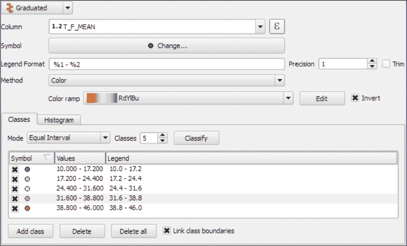

分级样式有不同的分类模式，如下所示：

- **Equal Interval**（等间隔）：此模式通过在指定列中发现的最大值和最小值之间以相等的间隔拆分来创建类别。
- **Quantile (Equal Count)**（分位数（等数量））：此模式创建的类别使得每个类别包含相等数量的要素。
- **Natural Breaks (Jenks)**（自然断点（Jenks））：此模式使用 Jenks 自然断点算法创建类别，通过减少类内方差并最大化类间方差来创建类别。
- **Standard Deviation**（标准差）：此模式使用列值的标准差来创建类别。
- **Pretty Breaks**（美观断点）：此模式是唯一一种不严格创建指定数量类别的分类。相反，其主要目标是创建数值为整数（round numbers）的类别边界。

我们可以通过双击列表中的值并更改类别边界来手动编辑类别值。编辑类别的一种更便捷方式是 **Histogram**（直方图）视图，如下一个屏幕截图所示。切换到 **Histogram**（直方图）标签页，然后点击右下角的 **Load values**（加载值）按钮以启用直方图。你现在可以通过用鼠标移动垂直线来编辑类别边界。你还可以通过添加新的垂直线来添加新类别，这可以通过点击直方图中的空白区域来完成：

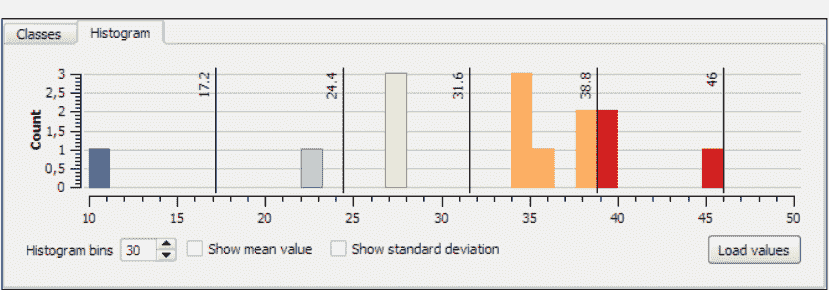

除了地图上绘制的符号外，样式化的另一个重要方面是与其配套的 **legend**（图例）。为了自定义图例，我们可以定义 **Legend Format**（图例格式）以及应显示的 **Precision**（精度，即小数位数）。在 **Legend Format**（图例格式）字符串中，$1 将被替换为类别的下限，$2 将被替换为上限。你可以将此字符串更改为适合你的需求，例如：`from $1 to $2`。如果你激活 **Trim**（修剪）选项，多余的尾部零也将被移除。


当我们使用Size方法时，如下面的截图所示，对话框会略有变化，我们现在可以配置所需的符号尺寸：

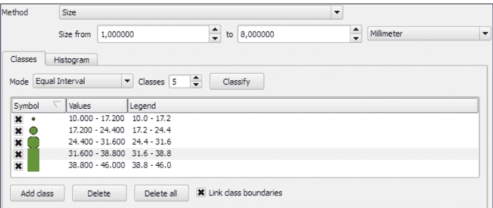

下一个截图显示了使用“分级（Graduated）”渲染器选项，采用“等间隔分类”模式并分为五个类别的结果。左侧显示“颜色”方法的结果（符号颜色根据T_F_MEAN值变化），右侧显示“大小”方法的结果（符号大小根据T_F_MEAN值变化）。

注意每个符号旁边的复选框。它们可用于选择性地隐藏或显示属于相应类别的要素。

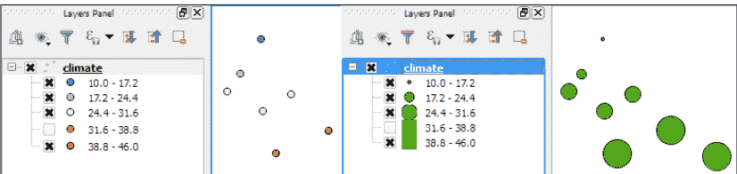

## 创建和使用颜色渐变

在前面的示例中，我们使用现有的颜色渐变来设置图层样式。当然，我们也可以创建自己的颜色渐变。要创建新的颜色渐变，我们可以向下滚动颜色渐变列表到“New color ramp...”条目。我们可以从四种不同的颜色渐变类型中选择：

- **渐变（Gradient）**：使用此类型，我们可以创建包含两种或更多颜色的颜色映射。生成的颜色映射可以是平滑渐变（使用“连续”类型选项）或不同颜色（使用“离散”类型选项），如下面的截图所示：

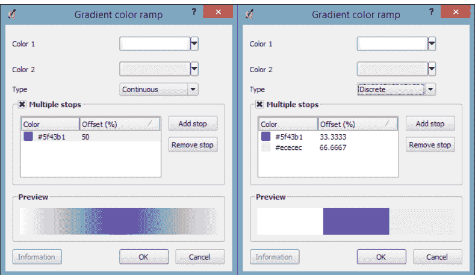

- **随机（Random）**：此类型允许我们创建包含指定数量随机颜色的渐变。

- **ColorBrewer**：此类型提供对ColorBrewer配色方案的访问。

- **cpt-city**：此类型提供对各种预配置配色方案的访问，包括用于排版和水深主题的方案，如下面的截图所示：

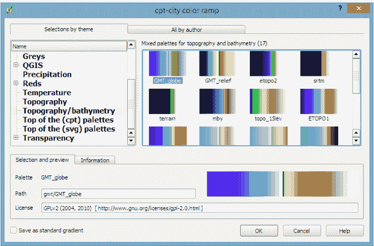

要管理我们所有的颜色渐变和符号，我们可以前往“设置 | 样式管理器”。在这里，我们可以使用对话框右侧相应的按钮添加、删除、编辑、导出或导入颜色渐变和样式，如下面的截图所示：

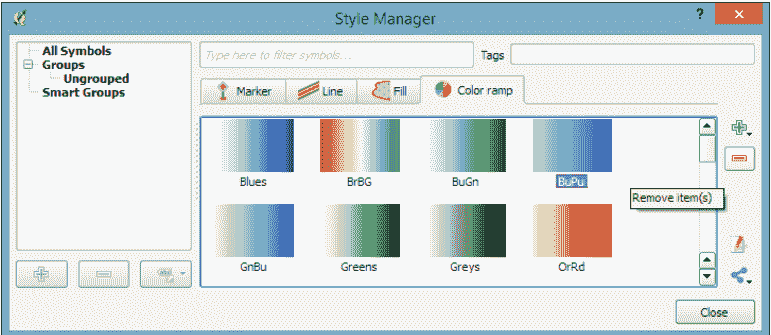

## 使用分类样式处理名义数据

正如分级样式非常适合可视化数值一样，分类样式也非常适合文本值，或者更一般地说，适合名义尺度上的各种值。在我们的示例数据中的trees.shp文件中可以找到这类数据的一个很好的例子。每个区域都有一个VEGDESC值，用于描述该区域发现的森林类型。使用分类样式，我们可以轻松生成一个样式，为VEGDESC列中的每个唯一值分配一个符号，如下面的截图所示。一旦我们点击“确定”，该样式将应用于我们的树木图层，以可视化该地区不同树木类型的分布：

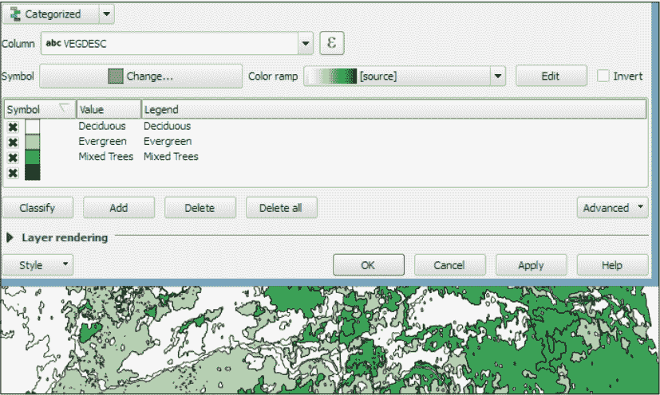

当然，每个符号都是可编辑的，并且可以进行自定义。只需双击符号预览即可打开“符号选择器”对话框，该对话框允许您选择和组合不同的符号。

## 为道路图层创建基于规则的样式

使用基于规则的样式，我们可以创建一个具有规则层次结构的图层样式。规则可以考虑从属性值到比例尺以及诸如面积或长度等几何属性的任何内容。在本示例中，我们将为来自Natural Earth的ne_10m_roads.shp文件创建一个基于规则的渲染器（您可以从http://www.naturalearthdata.com/downloads/10m-cultural-vectors/roads/下载）。正如您在这里看到的，我们的样式将包含主要和次要高速公路的不同道路样式，以及与比例尺相关的样式：

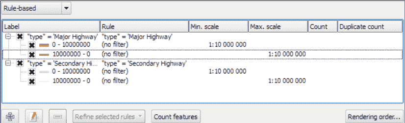

如前面的截图所示，在规则的第一层，我们区分“type”= 'Major Highway' 的道路和“type”= 'Secondary Highway' 的道路。下一层规则处理比例尺依赖性。要添加第二层规则，我们可以使用“细化所选规则”按钮，然后选择“为规则添加比例尺”。我们只需输入一个或多个希望规则拆分处的比例尺值。

> 请注意，第一级规则中没有指定符号。如果我们在第一级也指定了符号，渲染器会在彼此之上绘制两个符号。虽然这在某些情况下可能有用，但我们目前不需要这种效果。符号可以在“规则属性”中停用，可以通过双击规则或单击规则树视图下方的编辑按钮（加号和减号按钮之间的按钮）来访问该属性。

在下面的截图中，我们可以看到基于规则的渲染器和比例尺规则的实际效果。左侧显示较宽的白色道路，带有灰色轮廓，用于次要公路；右侧显示更简单的符号体系，使用细灰色线条：

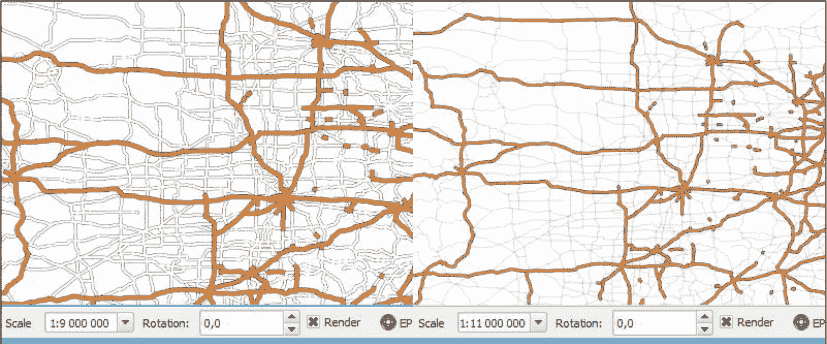

您可以通过转到“设置 | 样式管理器”，单击对话框右下角的共享按钮，然后选择“导入”来下载此样式使用的符号。URL 是 `https://raw.githubusercontent.com/anitagraser/QGIS-resources/master/qgis1.8/symbols/osm_symbols.xml`。将 URL 粘贴到“位置”文本框中，单击“获取符号”，然后点击“全选”，最后点击“导入”。该对话框将如下图所示：

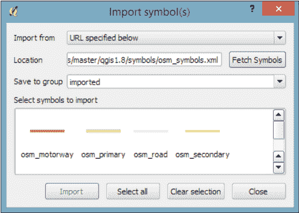

## 创建数据定义的符号体系

在前面的示例中，我们创建了类别或规则来定义要素在地图上的绘制方式。另一种方法是使用图层属性表中的值来定义样式。这可以通过QGIS中称为**数据定义覆盖**的功能来实现。这些覆盖可以通过每个符号属性旁边的相应按钮进行配置，如下面的示例所述。

在本示例中，我们将再次使用来自Natural Earth的`ne_10m_roads.shp`文件。下面的截图显示了一种配置，该配置创建了一种样式，其中线条的**画笔宽度**取决于要素的`scalesrank`，线条**颜色**取决于`toll`属性。要为符号属性设置数据定义覆盖，您需要单击属性旁边的相应按钮，然后选择**编辑**。使用了以下两个表达式：

- CASE WHEN toll = 1 THEN 'red' ELSE 'lightgray' END：此表达式计算`toll`值。如果为1，则线条以红色绘制；否则以灰色绘制。

- 2.5 / scalesrank：此表达式计算**画笔宽度**。由于低的比例尺等级应该用更宽的线条表示，我们使用除法运算而不是乘法。

当数据定义覆盖处于活动状态时，相应的按钮会以黄色高亮显示，并带有ε符号，如下面的截图所示：

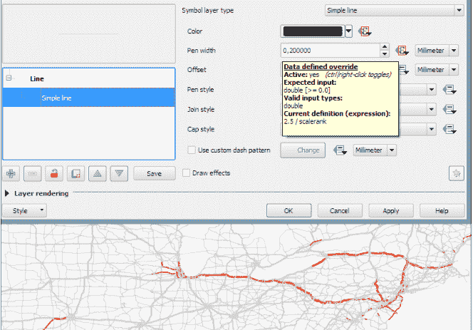

## 创建动态热力图样式

在*第4章“空间分析”*中，您学习了如何创建热力图栅格。但是，如果您只需要一个用于显示目的（而不是用于进一步的空间分析）的热力图，有一种更快、更方便的方法可以达到这种效果——即**热力图**渲染器选项。

下面的截图显示了一个为我们的居民点数据集*popp.shp*设置的**热力图**渲染器。我们可以指定一个颜色渐变，该渐变将应用于结果热力图数值在0到定义的**最大值**之间的部分。如果将**最大值**设置为**自动**，QGIS会自动计算热力图的最大值。与前面讨论的热力图工具一样，我们可以定义点权重以及核**半径**（关于此术语的解释，请参阅*第4章“空间分析”*中的*从点创建热力图*）。最后的**渲染质量**选项控制渲染输出的质量，**最快**选项使用粗糙、较大的栅格单元，而设置为**最佳**时则呈现细粒度的外观：

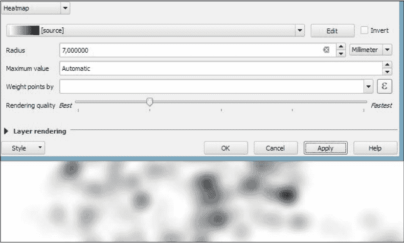


## 创建 2.5D 样式

如果你想创建伪 3D 外观，例如为建筑物要素设置样式或创建专题地图，可以尝试使用 2.5D 渲染器。下一张截图显示了当前的配置选项，包括要素高度（以图层单位为单位）、视角和颜色的控件。由于在编写本书时，此渲染器仍在改进中，因此当你亲眼看到时，可能会在此对话框中看到更多选项。

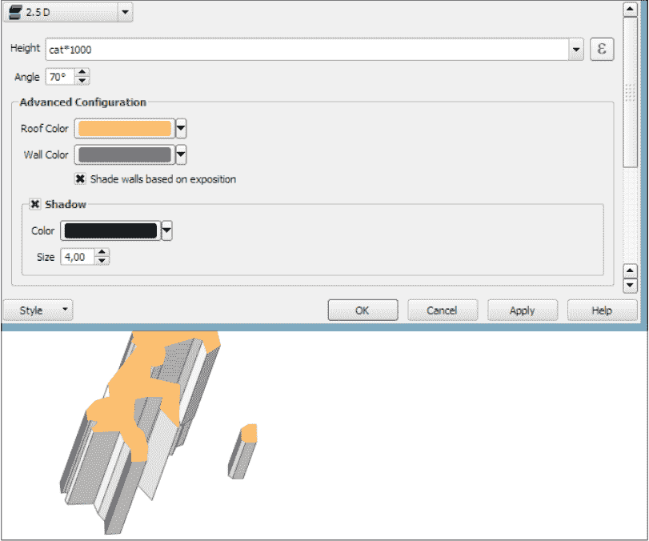

一旦按你的喜好配置好 2.5D 渲染器，就可以切换到另一个渲染器，例如创建分类或分级符号版本。

## 添加实时图层特效

借助**图层特效**，我们可以进一步改变符号的外观。如下面的截图所示，选中符号对话框底部的**绘制效果**复选框，即可添加特效。要配置特效，请单击对话框右下角的星形按钮。**特效属性**对话框提供了多种**特效类型**：

- **模糊（Blur）**：此效果会创建符号的模糊、朦胧版本。
- **着色（Colorise）**：此效果会更改符号的颜色。
- **源（Source）**：这是原始未更改的符号。
- **投影（Drop Shadow）**：此效果会创建阴影。
- **内发光（Inner Glow）**：此效果会创建从符号边界开始向内延伸的发光渐变。
- **内阴影（Inner Shadow）**：此效果会创建仅限于符号内部的阴影。
- **外发光（Outer Glow）**：此效果会创建从符号向外辐射的发光。
- **变换（Transform）**：此效果可用于变换符号。可用的变换包括反射、剪切、缩放、旋转和平移：

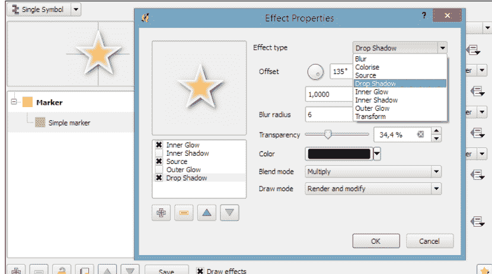

如上面的截图所示，我们可以组合多个图层特效，它们会在**特效属性**对话框左下角的列表中按特效图层组织。

## 使用不同样式

当我们创建精细的样式时，可能希望保存它们，以便在其他项目中重用或与其他用户共享。要保存样式，请单击样式对话框左下角的**样式**按钮，然后转到**保存样式 | QGIS 图层样式文件...**，如下面的截图所示。这将创建一个 .qml 文件，你可以将其保存在任何位置、复制并与他人共享。同样，要使用 .qml 文件，请单击**样式**按钮并选择**加载样式**：

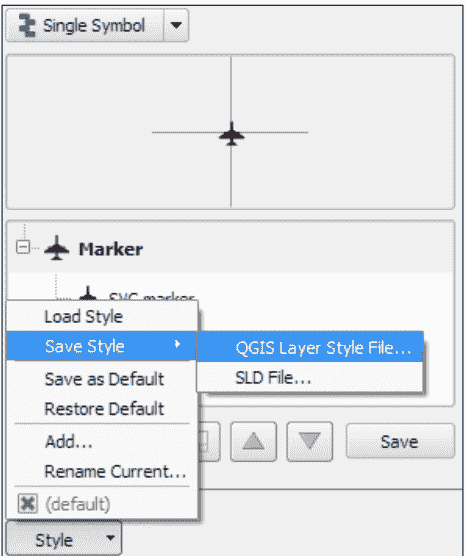

我们还可以为一个图层保存多种不同的样式。例如，对于我们的机场图层，我们可能希望一种样式使用飞机符号显示机场，另一种样式渲染热力图。要实现这一点，可以执行以下操作：

1. 配置飞机符号样式。
2. 单击**样式**按钮，然后选择**添加**，将当前样式添加到该图层的样式列表中。
3. 在弹出的对话框中，为新样式输入名称，例如 `planes`。
4. 通过单击**样式**和**添加**来添加另一种样式，并将其命名为 `heatmap`。
5. 现在，你可以将渲染器更改为**热力图**并对其进行配置。准备好后，单击**应用**按钮。
6. 在**样式**按钮菜单中，你现在可以看到这两种样式，如下一张截图所示。现在，只需从菜单底部的列表中选择两个条目之一，即可在两种样式之间切换：

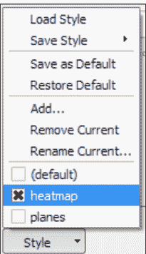

最后，我们还可以通过**图层面板**中图层上下文菜单的**样式**条目访问这些图层样式，如下面的截图所示。该上下文菜单还提供了在图层之间复制和粘贴样式的方法，分别使用**复制样式**和**粘贴样式**条目。此外，该上下文菜单还提供了一个快捷方式，可以通过色轮或从**最近使用的颜色**部分选取颜色来快速更改符号颜色：

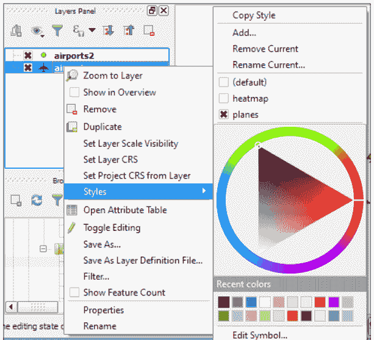

## 标注

我们可以通过转到“图层属性 | 标注”，选中“显示此图层的标注”，并选择要用于标注的属性字段来激活标注。这就是使用默认设置显示标注所需的全部操作。虽然默认标注非常适合快速预览，但在为报告或独立地图创建可视化时，我们通常需要自定义标注。

使用表达式（属性下拉列表旁边的按钮），我们可以根据需要格式化标注文本。例如，示例 airports.shp 文件中的 NAME 字段包含大写文本。为了改以混合大小写显示机场名称，我们可以设置 title(NAME) 表达式，该表达式将以标题大小写重新格式化名称文本。我们还可以使用多个字段创建标注，例如，使用串联运算符 (||) 将名称和括号中的高程组合起来，如下所示：

```
title(NAME) || ' (' || "ELEV" || ')'
```

请注意文本周围使用的单引号（例如 ' ('）和字段名周围使用的双引号（例如 "ELEV"）。对话框将如下面的截图所示：

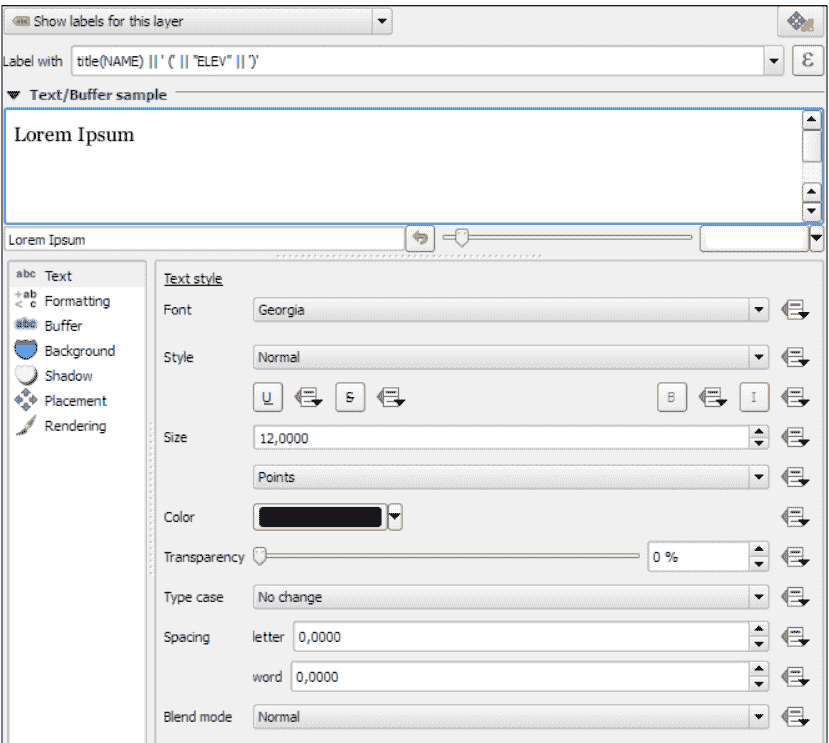

对话框顶部的大预览区标题为“文本/缓冲区示例”，显示当前设置的预览。可以调整背景颜色，以测试在不同背景下的可读性。在预览区域下方，我们可以找到不同的标注设置，这些设置将在后续章节中详细描述。

### 自定义标注文本样式

在**文本**部分（见上一张截图），我们可以配置文本样式。除了更改**字体**、**样式**、**大小**、**颜色**和**透明度**外，我们还可以修改**字母**和**单词**之间的**间距**，以及**混合模式**，其工作原理类似于我们在*第 2 章，查看空间数据*中介绍的图层混合模式。

请注意每个设置右侧的一列按钮。单击这些按钮可以创建数据定义的覆盖，类似于我们在本章开头讨论高级矢量样式时提到的那些覆盖。例如，这些数据定义的覆盖可用于定义不同的标注颜色，或根据单个要素的属性值或表达式更改标注大小。

### 控制标注格式

在**格式**部分（如下面的截图所示），我们可以通过指定**按字符换行**来启用**多行标注**。此外，我们还可以控制**行高**和**对齐方式**。除了典型的对齐选项外，QGIS 标注引擎还提供**跟随标注放置**选项，该选项可确保多行标注与标注所属符号保持同一侧对齐：

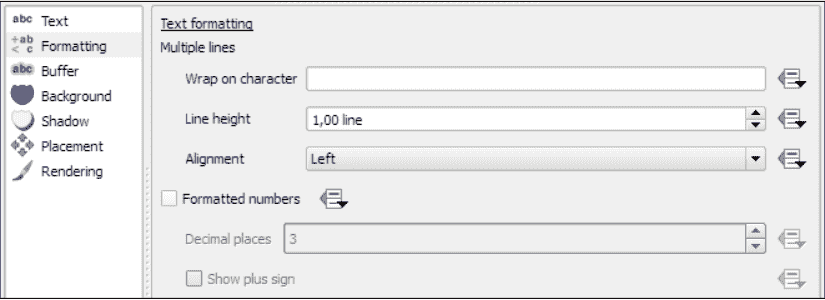

最后，**格式化数字**选项提供了一种快捷方式，可将数值格式化为指定数量的**小数位数**。

按特定字符换行的另一种方法是自动换行函数，该函数可在表达式中使用。它会将输入字符串换行为指定的最大或最小字符数。下面的截图显示了一个示例，将较长的文本每行最多换行 22 个字符：

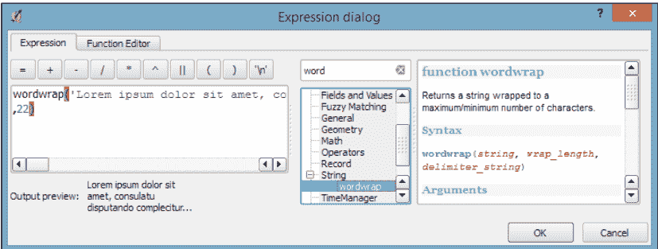

### 配置标注缓冲区、背景和阴影

在缓冲区部分，我们可以调整缓冲区的大小、颜色和透明度，以及笔连接样式和混合模式。通过透明度和混合，我们可以提高标注的可读性，而不会过多遮挡底层地图，如下面的截图所示。

在背景部分，我们可以添加矩形、正方形、圆形、椭圆或 SVG 形式的背景形状。SVG 背景非常适合创建诸如公路标识牌之类的效果，稍后我们将讨论这些效果。

类似地，在阴影部分，我们可以为标注添加阴影。我们可以控制从阴影方向到颜色、模糊半径、缩放和透明度的所有内容。

### 控制标注放置

在放置部分，我们可以配置应使用哪些规则来确定标注的放置位置。可用的自动标注放置选项取决于图层几何类型。


## 配置点标签

对于*点图层*，我们可以从以下选项中选择：

- 灵活的**围绕点**选项通过在不重叠的情况下将标签分布在点周围来寻找标签的最佳位置。正如你在下图中看到的那样，一些标签被放置在点符号的右上角，而其他标签则出现在左侧（例如，**安克雷奇国际机场 (129)**）或右侧（例如，**大湖 (135)**）的不同位置。

- **偏离点**选项强制将所有标签放置在某个特定位置；例如，所有标签都可以放置在点符号的上方。

下图显示了使用**围绕点**方式放置的机场标签，带有 50% 透明度的**缓冲区**和**阴影**。**标签距离**为 1 毫米。

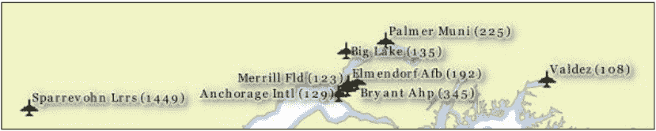

## 配置线标签

对于*线图层*，我们可以从以下放置选项中选择：

- **平行**，用于根据线的方向旋转的直标签

- **弯曲**，用于遵循线形状的标签

- **水平**，用于保持水平方向的标签，无论线的方向如何

为了进一步微调，我们可以定义标签应放置在**线的上方**、**线上**还是**线的下方**，并使用**标签距离**定义其距离上方或下方多远。

## 配置多边形标签

对于*多边形图层*，放置选项如下：

- **偏离质心**使用多边形质心作为锚点，其工作方式类似于点图层的**偏离点**

- **围绕质心**的工作方式类似于**围绕点**

- **水平**将水平标签放置在多边形内的某处，独立于质心

- **自由**将自由旋转的标签放置在多边形内部

- **使用周长**将标签放置在多边形的轮廓上

下图显示了湖泊标签（lakes.shp），使用多行功能在空格字符处换行、居中对齐、字间距为 2，并使用**自由**选项进行定位：

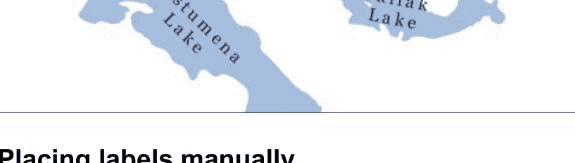

## 手动放置标签

除了自动标签放置外，我们还可以选择使用数据定义的放置方式来精确地将标签定位在我们需要的位置。在标注工具栏中，我们找到了手动移动和旋转标签的工具。这些工具仅对至少设置了 X 和 Y 坐标数据定义放置的图层处于激活和可用状态：

- 要开始使用这些工具，我们只需为例如 airports.shp 文件添加三个新列：label_x、label_y 和 label_rot。我们目前不需要在属性表中输入任何值。标注引擎会检查值，如果它发现属性字段为空，它会自动放置标签。

- 然后，我们可以将指定这些列在标签的**放置**部分中。通过单击 **X 坐标**、**Y 坐标** 和 **旋转** 旁边的按钮来配置数据定义覆盖，如下所示：

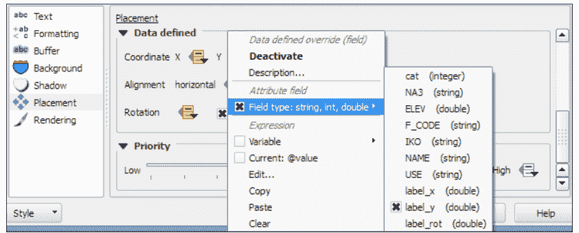

3. 通过指定数据定义的放置，标注工具栏中的工具现在可用（注意必须开启编辑模式），我们可以使用**移动标签**和**旋转标签**工具来操作地图上的标签。更改内容会写回到属性表中。

4. 尝试移动一些标签，特别是那些紧密放置在一起的标签，观察自动放置的标签如何适应你的更改。

## 控制标签渲染

在**渲染**部分，我们可以定义基于比例的显示限制，以仅在特定比例下显示标签，以及基于像素大小的可见性，以隐藏小要素的标签。在这里，我们还可以告诉标注引擎**显示此图层的所有标签**（包括碰撞的标签），这些标签默认情况下是隐藏的。

以下示例显示了带有道路盾牌的标签。你可以从 http://upload.wikimedia.org/wikipedia/commons/c/c3/Blank_shield.svg 下载一个空白道路盾牌 SVG。注意只有州际公路被标注了。这可以通过使用**渲染**部分中的**数据定义显示标签**设置并配合以下表达式来实现：

```
"level" = 'Interstate'
```

标签使用**水平**选项进行定位（在**放置**部分中）。此外，启用了**合并相连线**以避免重复标签以及**抑制小于特定尺寸要素的标注**；例如，设置为 5 毫米有助于避免杂乱的标注，因为它不会标注在当前比例下短于 5 毫米的道路片段。

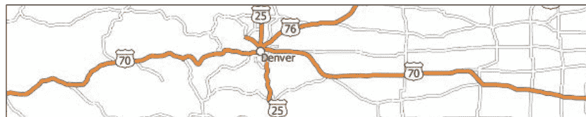

要设置道路盾牌，请前往**背景**部分，并从你下载文件的文件夹中选择空白盾牌 SVG。为了确保标签能很好地适应盾牌内部，我们额外将**大小类型**字段指定为带有 1 毫米**大小**的缓冲区。这使盾牌比它包含的标签稍大一点。

如果你点击**应用**，你会注意到标签没有完全居中于盾牌内部。为了修复这个问题，我们对盾牌位置施加了一个小的 Y 方向**偏移**，如下所示。此外，建议停用任何标签缓冲区，因为它们往往会遮挡盾牌的部分区域，而且我们本来也不需要它们。

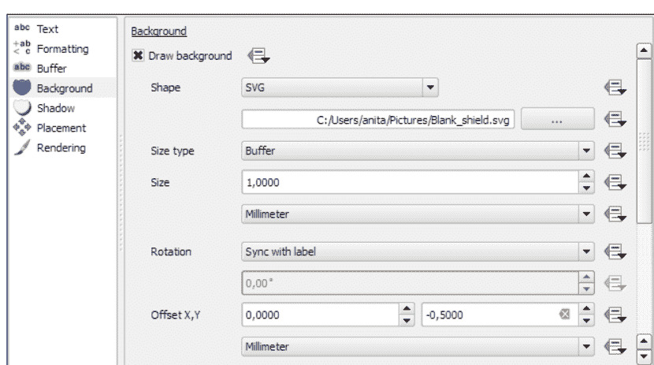

## 设计印刷地图

在 QGIS 中，**印刷地图**是在打印布局器中设计的。一个 QGIS 项目可以包含多个布局器，因此选择一个描述性的名称是有意义的。布局器在每次保存项目时自动保存。要查看项目中所有可用布局的列表，请前往**项目 | 布局管理器**。

我们可以通过前往**项目 | 新建打印布局**或使用*Ctrl + P* 打开一个新的布局。布局窗口包括以下内容：

- 地图组成的预览区域，在创建新布局时显示空白页面
- 用于配置**组成**、**项目属性**和**制图图集生成**的面板，以及用于快速撤销和重做操作的**命令历史**面板
- 用于管理、保存和导出布局的工具栏；在预览区域中导航；以及添加和排列不同的布局项目

一旦你按照意愿设计好了印刷地图，你可以通过前往**布局 | 另存为模板**将模板保存为**布局模板** .qpt 文件，并可以通过前往**布局 | 从模板添加项目**在其他项目中重用它。

## 创建基本地图

在这个示例中，我们将创建一个基本地图，包含比例尺、指北针、一些说明性文字和图例。

当我们启动打印布局时，我们首先在右侧看到**组成**面板。此面板提供了纸张选项，如大小、方向和页数。它也是配置捕捉行为和输出分辨率的地方。

首先，我们使用**添加新地图**按钮或在**布局 | 添加地图**中在纸上绘制地图矩形来将地图项目添加到纸张上。点击纸张，按住鼠标左键并拖动打开矩形。我们可以使用鼠标和**选择/移动项目**工具来移动和调整地图大小。或者，也可以在**项目属性**面板中配置所有地图设置。

## 创建精美地图

**项目属性**面板的内容取决于当前选定的组成项目。如果选中了地图项目，我们可以调整地图的**比例**和**范围**，以及地图项目本身的**位置和大小**工具。在 10,000,000 的**比例**下（CRS 设置为 EPSG:2964），我们基本上可以在 A4 大小的纸张上放置阿拉斯加的地图，如下所示。为了移动地图项目中显示的地理区域并更改地图比例，我们可以使用**移动项目内容**工具。

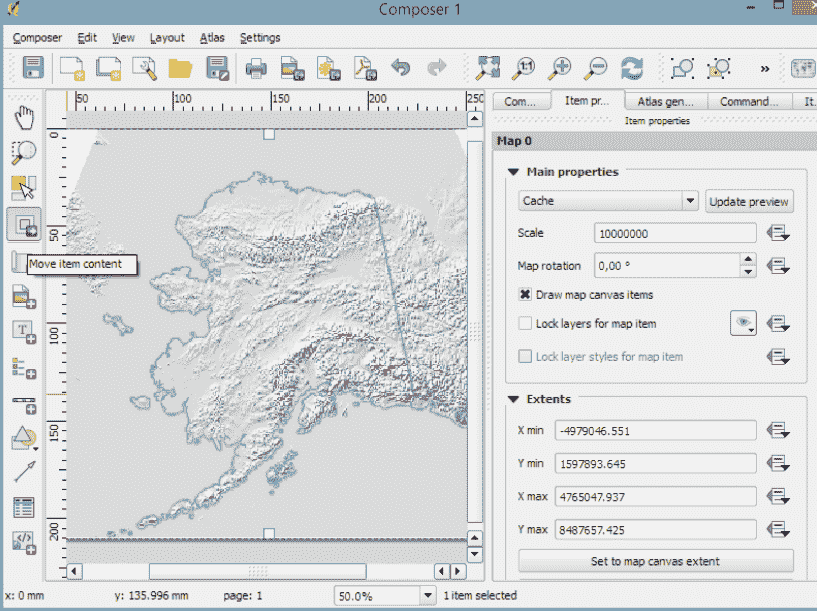


## 添加比例尺

当地图看起来符合我们的要求后，我们可以使用**添加新比例尺**按钮，或通过**布局 | 添加比例尺**并单击地图来添加比例尺。**项目属性**面板现在会显示比例尺的属性，这些属性与下一条截图中的内容相似。由于我们可以向一个构图添加多个地图项目，因此指定比例尺属于哪个地图非常重要。第二个主要属性是比例尺**样式**，它允许我们在不同的比例尺类型之间进行选择，或者选择**数字**类型以进行简单的文本表示，例如 1:10,000,000。使用**单位**属性，我们可以将英尺或米为单位的地图单位转换为更易管理的单位，例如英里或千米。**分段**属性控制比例尺中的分段数量和单个分段的大小。此外，这些属性还控制比例尺的颜色、字体、背景等。

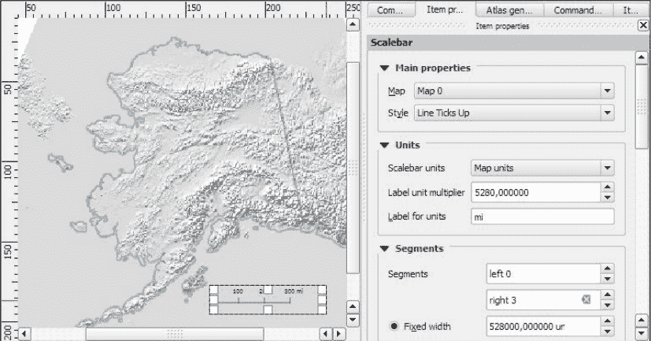

## 添加指北针图片

可以使用**添加图片**按钮，或通过**布局 | 添加图片**并单击纸张来向构图添加指北针。要使用 QGIS 安装中自带的 SVG 之一，请打开**项目属性**面板中的**搜索目录**部分。QGIS 加载 SVG 文件夹中的图片预览可能需要一些时间。您可以从图片列表中选择一个指北针，或者通过单击**图片来源**输入框旁边的按钮选择自己的图片。更多的地图装饰，例如箭头、矩形、三角形和椭圆形，可以使用相应的工具栏按钮添加：**添加箭头**、**添加矩形**等。

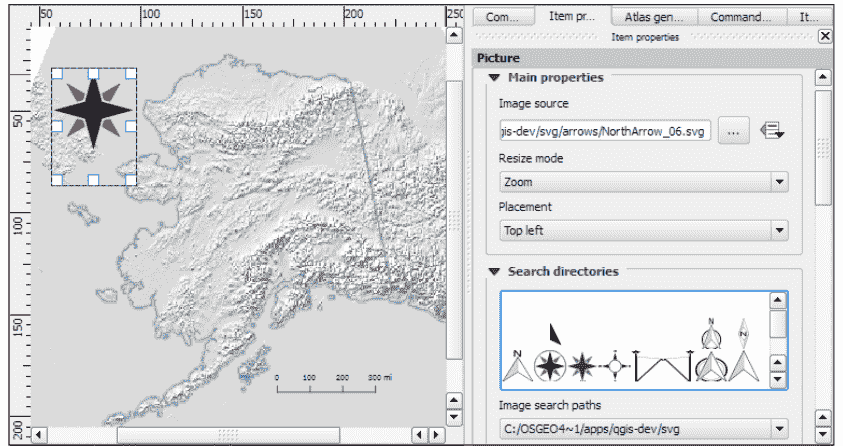

## 添加图例

图例是另一个重要的地图元素。我们可以使用**添加新图例**按钮，或通过**布局 | 添加图例**来添加一个默认图例，其中包含所有当前可见地图图层的条目。图例条目可以在图例项目属性中重新组织（排序或添加到组）、编辑和移除。使用**文本换行**选项，我们可以将长标签拆分为多行。下面的截图显示了允许我们更改条目样式（隐藏、组或子组）的上下文菜单。相应的字体、大小和颜色可在**字体**部分配置。此外，此示例中的图例分为三**列**，如下方截图的右下部分所示。默认情况下，QGIS 会尝试将一个图层的所有条目保留在单列中，但我们可以通过启用**拆分图层**来覆盖此行为。

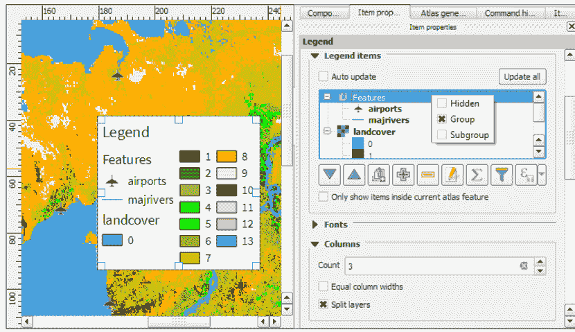

## 向地图添加说明文字

要向地图添加文本，我们可以使用**添加新标签**按钮，或通过**布局 | 添加标签**。简单的标签使用相同的字体显示所有文本。通过启用**渲染为 HTML**，我们可以使用普通的 HTML 标记创建更精细的标签，包含标题、列表、不同颜色以及粗体或斜体高亮。以下是一个示例：

```
<h1>Alaska</h1>
<p>The name <i>"Alaska"</i> means "the mainland".</p>
<ul><li>one list entry</li><li>another entry</li></ul>
<p style="font-size:70%;">[% format_date( $now , 'yyyy-mm-dd' ) %]</p>
```

标签还可以包含如下表达式：

- [% $now %]：此表达式插入当前时间戳，可以使用 format_date 函数格式化，如下面的截图所示
- [% $page %] / [% $numpages %]：此表达式可用于在多页构图中插入页码

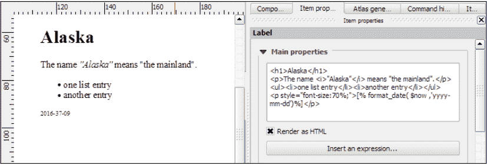

## 添加地图网格和边框

地图的其他常见要素是网格和边框。每个地图项目可以有一个或多个网格。单击**网格**部分中的 + 按钮以添加网格。**间隔**和**偏移**值必须以地图单位指定。我们可以在以下**网格类型**之间进行选择：

- 具有可自定义线条的普通**实线**网格
- 以指定间隔绘制的**十字线**，样式可自定义
- 以指定间隔绘制的可自定义**标记**
- **仅边框和标注**将隐藏网格，同时仍显示边框和坐标标注

对于**网格边框**，我们可以从以下**边框样式**中选择：

- **斑马纹**，具有可自定义的线条和填充颜色，如下面的截图所示
- **内部刻度**、**外部刻度**或**内部和外部刻度**，用于指向地图内部、外部或两个方向的刻度线
- **线框**用于简单的线条边框

使用**绘制坐标**，我们可以用相应的坐标标记网格。标签可以水平或垂直对齐，并放置在边框内部或外部，如下所示：

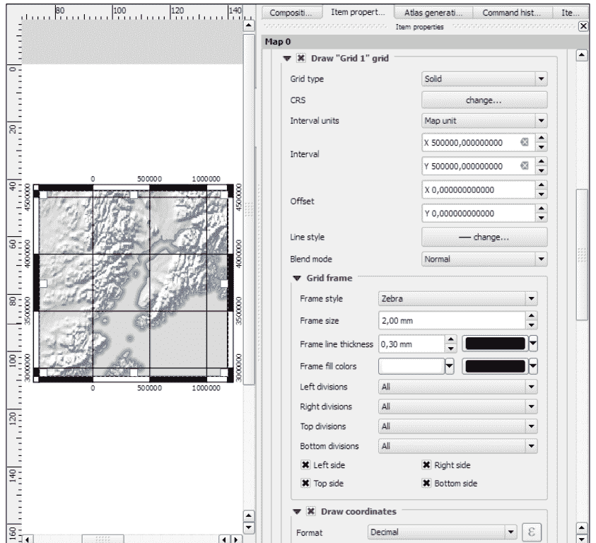

## 创建总览图

显示局部区域的地图通常伴随第二幅地图，告知读者该区域在更大上下文中的位置。要创建这样的总览图，我们添加第二个地图项目，并通过单击**总览**部分中的 + 按钮添加一个总览。通过设置**地图框**，我们可以定义应高亮显示的详细地图的范围。再次单击 + 按钮，我们可以向总览图添加更多地图框。下面的截图显示了一个示例，其中两个详细地图都添加到了总览图中。为了区分这两幅地图，总览高亮使用了颜色编码（通过更改总览**边框样式**），以匹配详细地图边框的颜色。

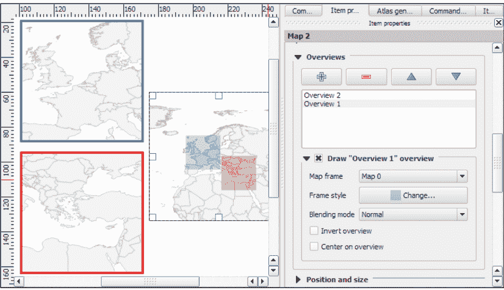

> 构图中的每个地图项目都可以显示不同的图层组合。通常，作曲者中的地图项目与主 QGIS 窗口中的地图同步。因此，如果我们在主窗口中关闭一个图层，它也会从打印作曲者的地图中移除。但是，我们可以通过在地图项目的属性中启用**锁定图层**来停止这种自动同步。

## 使用属性表和 HTML 框架添加更多细节

要向地图插入更多细节，作曲者还提供了使用**添加属性表**按钮或通过**布局 | 添加属性表**向构图添加**属性表**的选项。通过启用**仅显示地图内可见要素**，我们可以过滤表格并仅显示相关结果。可以使用**使用过滤器**选项设置其他过滤表达式。可以通过**属性**按钮进行排序（例如，按名称排序，如下面的截图所示）和重命名列。要自定义具有粗体和居中文本的标题行，请转到**字体和文本样式**部分并更改**表格标题**设置。

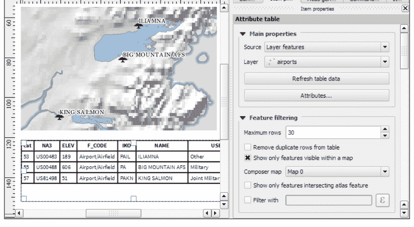

甚至可以使用**添加 HTML 框架**按钮添加更高级的内容。我们可以将项目的 URL 引用指向本地机器或在线上的任何 HTML 页面，其内容（文本和图像，如同在 Web 浏览器中显示的一样）将显示在作曲者页面上。

## 使用 Atlas 功能创建地图系列

使用打印作曲者的 Atlas 功能，我们可以使用一个打印构图创建一系列地图。该工具将为所谓的**覆盖图层**中的每个要素创建一个输出（可以是图像文件、PDF 或一个 PDF 中的多个页面）。

Atlas 可以控制并更新一个构图中的多个地图项目。要为地图项目启用 Atlas，我们必须在地图项目的**项目属性**中启用**由 Atlas 控制**选项。当我们在**由 Atlas 控制**部分使用**固定比例**选项时，所有地图将使用相同的比例渲染。如果我们需要更灵活的输出，我们可以切换到**要素周围边距**选项，该选项会缩放到每个**覆盖图层**要素，并在指定的边距周围区域之外渲染它。

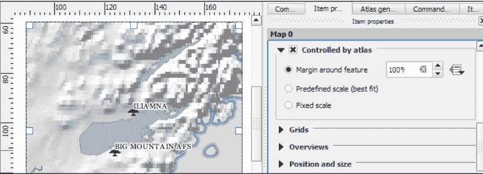

要完成配置，我们切换到**Atlas 生成**面板。如前所述，Atlas 将为**覆盖图层**下拉菜单中配置的图层中的每个要素创建一幅地图。覆盖图层中的要素可以像普通要素一样显示，也可以通过启用**隐藏覆盖图层**来隐藏。向**要素过滤**选项添加表达式或启用**排序依据**选项可以进一步微调结果。**输出**字段可以是每个覆盖图层要素的一幅图像或一个 PDF，或者您可以通过在**作曲者 | 导出为 PDF** 之前启用**尽可能单文件导出**来创建多页 PDF。

一旦这些配置完成，我们可以通过启用**预览 Atlas**按钮来预览地图系列，您可以在下一条截图的左上角看到该按钮。预览按钮旁边的箭头按钮用于在 Atlas 地图之间导航。


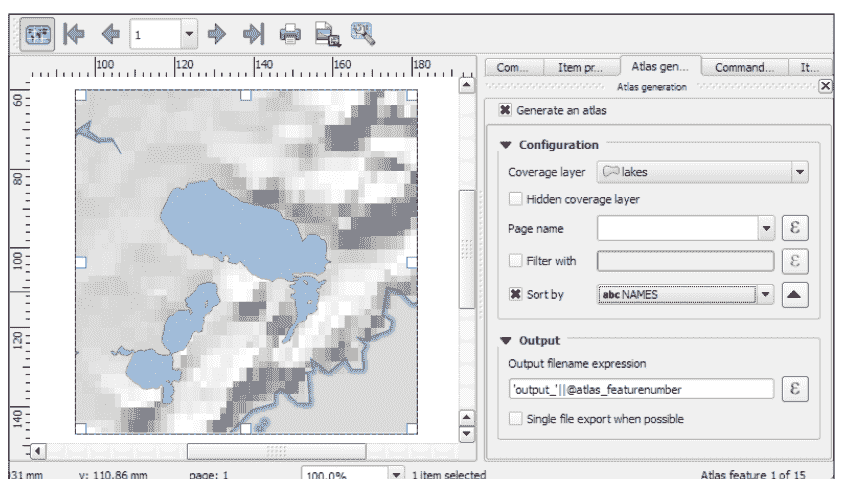

## 在线展示地图

除了印刷地图外，网络地图也是发布地图的另一种流行方式。在本节中，我们将使用不同的 QGIS 插件创建不同类型的网络地图。

### 导出网络地图

要在 QGIS 中创建网络地图，我们可以使用 **qgis2web** 插件，该插件需要通过 **插件管理器** 安装。安装后，转到 **Web | qgis2web | 创建网络地图** 即可启动。**qgis2web** 支持两种最流行的开源网络制图库：**OpenLayers 3** 和 **Leaflet**。

以下屏幕截图显示了我们机场数据集的一个示例。在此示例中，我们使用的是 **Leaflet** 库（如下图所示左下角的配置），因为在撰写本书时，只有 **Leaflet** 支持 SVG 标记：

- 1. 在左上角，您可以配置项目中要在网络地图上显示的图层，以及 **信息弹出内容**，当用户单击或悬停在要素上时（取决于 **悬停时显示弹出窗口** 设置）会显示该内容。
- 2. 在右下角，您可以为网络地图选择背景地图。选择一个并单击 **更新预览** 按钮查看结果。

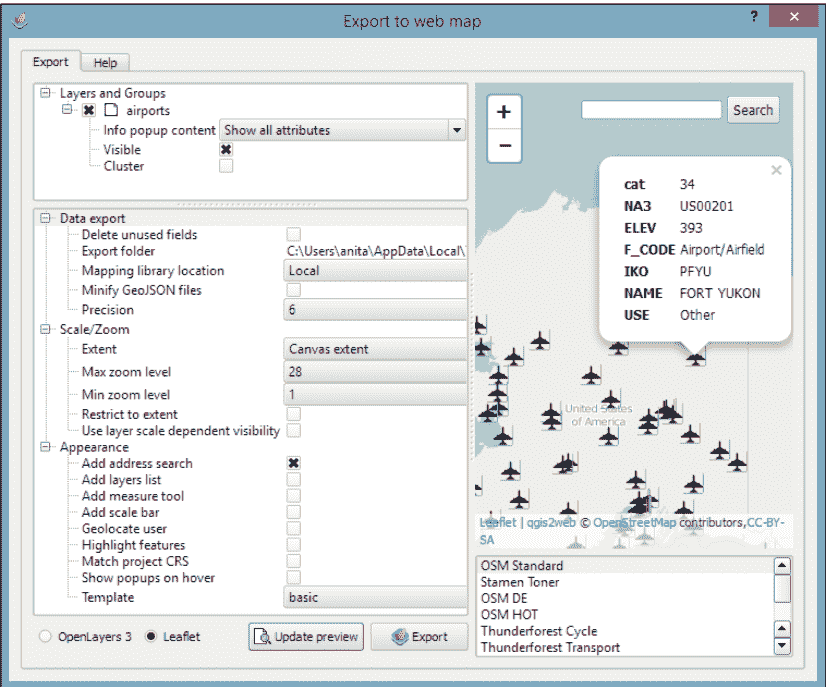

3. 在左下角，您可以进一步配置网络地图。所有可用设置都记录在帮助选项卡中，因此此处不重复其内容。同样，在进行更改时，请不要忘记单击更新预览按钮。

配置满意后，单击导出按钮。这将把网络地图保存到指定为导出文件夹的位置，并在网络浏览器中打开生成的网络地图。您可以将导出文件夹中的内容复制到网络服务器以发布地图。

## 创建地图瓦片

在网络上共享地图的另一种流行方式是 **地图瓦片**。这些基本上只是图像集合。这些图像瓦片通常为 256 × 256 像素，并并排放置以营造出一个非常大、无缝的地图图像的错觉。每个瓦片都有一个 z 坐标来描述其缩放级别，以及 x 和 y 坐标来描述其在该缩放级别的正方形网格中的位置。在缩放级别 0（z0）时，整个世界都适合一个瓦片。从那以后，每个连续的缩放级别都与前一个缩放级别以 4 的幂相关。这意味着 z0 包含 1 个瓦片，z1 包含 4 个瓦片，z2 包含 16 个瓦片，以此类推。

在 QGIS 中，我们可以使用 **QTiles** 插件通过 **插件管理器** 安装来为我们的项目创建地图瓦片。安装后，您可以转到 **插件 | QTiles** 启动它。以下屏幕截图显示了插件对话框，我们可以在其中配置 **输出** 位置、我们要导出为瓦片的地图的 **范围**，以及我们要创建瓦片的 **缩放** 级别。

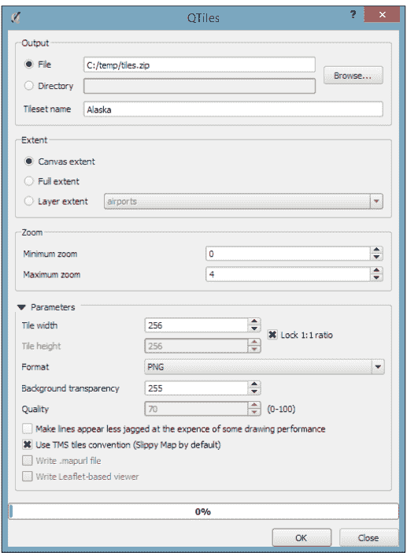

单击确定后，插件将创建一个包含所有瓦片的 .zip 文件。在网络制图库中使用地图瓦片超出了本书的范围。请参阅您使用的网络制图库的文档，了解如何嵌入瓦片的说明。例如，如果您使用 Leaflet，可以参考 https://switch2osm.org/using-tiles/getting-started-with-leaflet 获取详细说明。

## 导出 3D 网络地图

要创建令人惊艳的 3D 网络地图，我们需要 Qgis2threejs 插件，可以通过插件管理器安装。

例如，我们可以使用 srtm_05_01.tif 高程数据集创建阿拉斯加该部分的 3D 视图。以下屏幕截图显示了 Qgis2threejs 对话框中 DEM 层的配置。通过将显示类型选择为地图画布图像，我们进一步定义当前地图图像（在对话框右侧显示）将被覆盖在 3D 表面上：

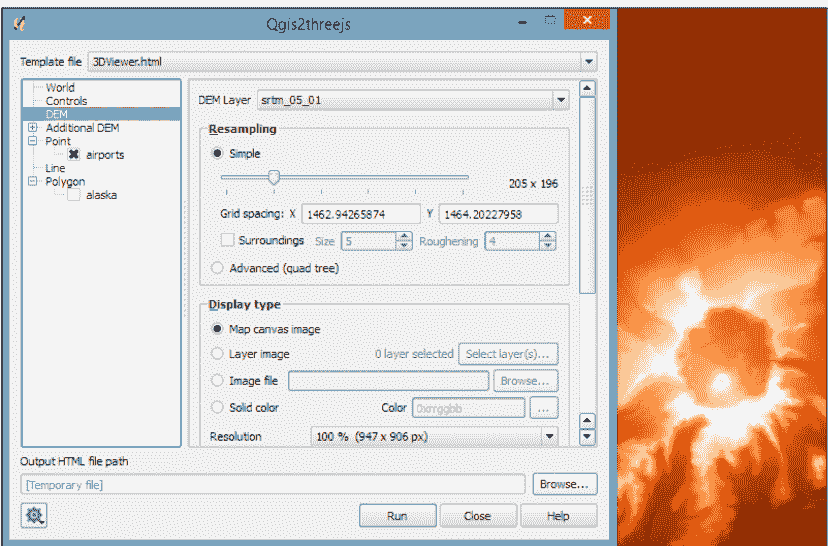

除了创建 3D 表面外，此插件还可以标注要素。例如，我们可以添加我们的机场并用其名称标注它们，如下一张屏幕截图所示。通过将标签高度设置为点高度，我们让插件自动确定标签放置的位置，但当然，您也可以通过更改为固定值或要素属性之一手动覆盖此设置。

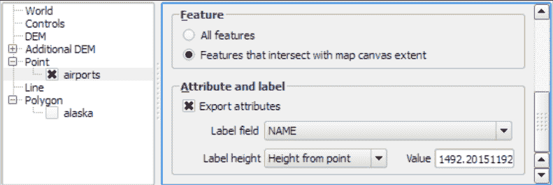

如果单击立即运行，插件将创建导出并在网络浏览器中打开 3D 地图。第一次尝试时，表面看起来过于平坦的可能性很大。幸运的是，这可以通过调整插件配置世界部分中的垂直夸大设置轻松更改。以下示例使用垂直夸大 10 创建：

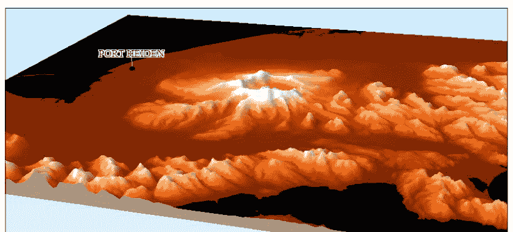

Qgis2threejs 将所有文件导出到输出 HTML 文件路径指定的位置。您可以将该文件夹中的内容复制到网络服务器以发布地图。

## 总结

在本章中，我们更详细地了解了如何使用高级矢量图层样式（例如分类或基于规则的样式）创建更复杂的地图。我们还介绍了 QGIS 中可用的自动和手动要素标注选项。本章还向您展示了如何使用打印布局创建可打印地图，并介绍了用于创建地图集的地图集功能。最后，我们创建了可以在线发布的网络地图。

恭喜！到目前为止的章节中，您已经学习了如何安装和使用 QGIS 来创建、编辑和分析空间数据，以及如何以有效的方式呈现它。在接下来的最后一章中，我们将研究使用 Python 扩展 QGIS 功能。

## 6

## 使用 Python 扩展 QGIS

本章是使用 Python 脚本化 QGIS 的介绍。当然，完整的 Python 教程超出了本书的范围。因此，此处的示例假定您具备使用 Python 的最低熟练程度。Python 是一种非常易于访问的编程语言，即使您刚刚入门，它在开源和专有 GIS 世界中也获得了很大的人气，例如 ESRI 的 ArcPy 或 PyQGIS。QGIS 目前支持 Python 2.7，但计划在即将推出的 QGIS 3.x 系列中支持 Python 3。我们将从介绍操作开始，然后转向 QGIS Python 控制台，然后进入处理工具箱自定义工具的更高级开发，并解释如何创建自己的插件。

## 使用操作添加功能

操作是为 QGIS 添加自定义功能的便捷方式。操作是为特定图层创建的，例如我们的居民点数据集 popp.shp。因此，要创建操作，我们转到图层属性 | 操作。有不同类型的操作，例如以下：

- - **通用操作** 启动外部进程；例如，您运行命令行应用程序，如 ogr2ogr

> ogr2ogr 是一个命令行工具，可用于转换文件格式，同时执行空间或属性选择和重投影等操作。

- - **Python 操作** 执行 Python 脚本

- **打开操作** 使用计算机配置的默认应用程序打开文件，即 `.pdf` 文件的 PDF 查看应用程序或网站的浏览器

- 操作系统（Mac、Windows 和 Unix）操作的工作方式类似于通用操作，但仅限于各自的操作系统

### 配置您的第一个 Python 操作

单击对话框右侧的 **添加默认操作** 按钮，为您的 popp 图层添加一些示例操作。这对于开始使用操作非常方便。例如，名为 **所选字段的值** 的 Python 操作将在我们使用操作工具时显示指定的属性值。在尝试此操作之前，我们需要做的全部工作就是更新它，使其访问图层有效属性。例如，我们可以使其在消息框中显示 popp 图层的 `TYPE` 属性值，如下一张屏幕截图所示：

- 1. 在 **操作列表** 中选择 **所选字段的值** 操作。
- 2. 编辑对话框底部的 **操作代码**。您可以手动输入属性名称或从下拉列表中选择它并单击 **插入字段**。
- 3. 要保存更改，请单击 **更新所选操作**。

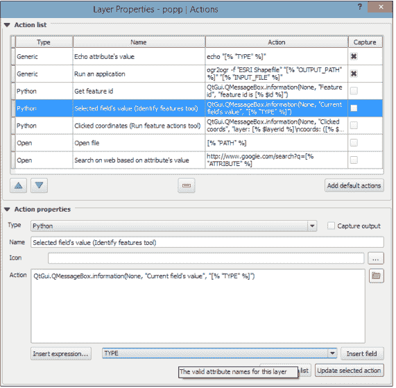


要使用此操作，请关闭**图层属性**对话框，并单击**运行要素操作**按钮旁边的下拉箭头。这将展开可用图层操作列表，如下面的屏幕截图所示：

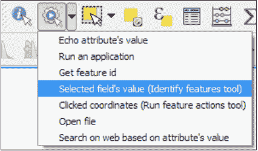

单击**所选字段的值**条目，然后点击一个图层要素。这将打开一个弹出对话框，操作将在其中输出该要素的**TYPE**值。当然，我们也可以让此操作输出更多信息，例如，将其扩展为这样：

```
QtGui.QMessageBox.information(None, "Current field's value",
"Type: [% "TYPE" %] \n[% "F_CODEDESC" %]")
```

这将显示第一行上的TYPE值和第二行上的F_CODEDESC值。

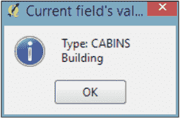

## 使用操作打开文件

要从QGIS内部直接打开文件，我们使用“打开”操作。如果你在之前的练习中添加了默认操作，你的图层将已经有一个打开文件操作。该操作就像[% "PATH" %]一样简单，用于打开图层路径属性中指定的文件路径。由于我们的示例数据集都不包含路径属性，我们现在添加一个来测试此功能。如果你需要了解如何添加新属性的详细信息，请参阅第3章“数据创建与编辑”。例如，下图中添加的路径将分别打开默认图像查看器和PDF查看器应用程序：

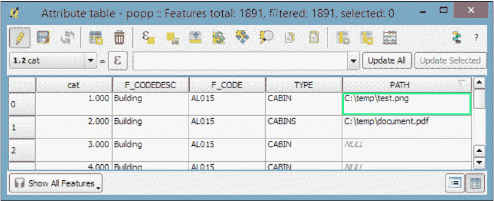

前面的示例使用存储在属性中的绝对路径，但你也可以通过更改操作代码来使用相对路径，以补全存储在属性值中的部分路径；例如，你可以使用C:\temp\[% "TYPE" %].png打开根据TYPE属性值命名的.png文件。

## 使用操作打开网页浏览器

另一种有用的“打开”操作是打开网页浏览器并访问特定网站。例如，考虑此操作：

```
http://www.google.com/search?q=[% "TYPE" %]
```

它将打开你的默认网页浏览器，并使用Google搜索TYPE值；而此操作：

```
https://en.wikipedia.org/w/index.php?search=[% "TYPE" %]
```

将在维基百科上进行搜索。

## 认识Python控制台

与QGIS API（**应用程序编程接口**的缩写）交互最直接的方式是通过**Python控制台**，你可以通过进入**插件 | Python控制台**来打开它。如下面的屏幕截图所示，**Python控制台**显示在地图下方的新面板中：

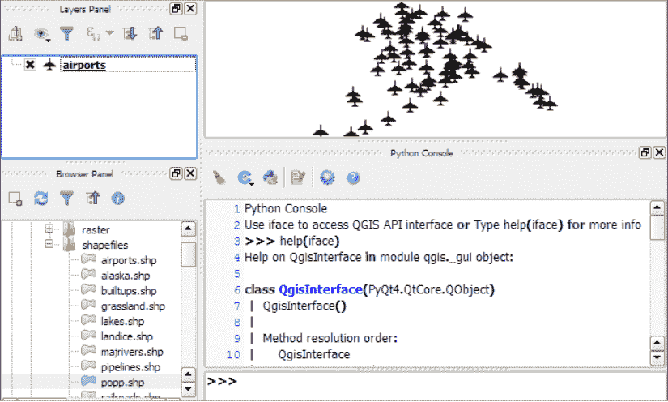

我们与应用程序、项目和数据进行交互的入口是`iface`对象。要获取`iface`可用函数的列表，请键入`help(iface)`。或者，这些信息也可以在线获取，位于**API文档**的`http://qgis.org/api/classQgisInterface.html`。

## 加载和探索数据集

我们首先要做的事情之一就是加载一些数据。例如，要加载矢量图层，我们使用`iface`的`addVectorLayer()`函数：

```
v_layer = iface.addVectorLayer('C:/Users/anita/Documents/Geodata/qgis_sample_data/shapefiles/airports.shp','airports','ogr')
```

你可能已经注意到，attributes()向我们显示了属性值，但我们还不知道字段名。要获取字段名，我们使用以下代码：

```
for field in v_layer.fields():
    print field.name()
```

输出如下：

ID
fk_region
ELEV
NAME
USE

一旦我们知道了字段名，就可以访问特定的要素属性，例如NAME：

```
for feature in v_layer.getFeatures():
    print feature.attribute('NAME')
```

输出如下：

NOATAK
AMBLER
BETTLES
...

例如，要快速求和海拔值，一种解决方案如下：

```
sum([feature.attribute('ELEV') for feature in v_layer.getFeatures()])
```

输出如下：

22758.0

> 在前面的示例中，我们利用了Python允许我们在方括号内编写for循环来创建列表这一特性。这被称为列表推导式，你可以访问https://docs.python.org/2/tutorial/data structures.html#list-comprehensions了解更多信息。


加载栅格数据与加载矢量数据非常相似，可以使用addRasterLayer()来完成：

```
r_layer = iface.addRasterLayer('C:/Users/anita/Documents/Geodata/qgis_sample_data/raster/SR_50M_alaska_nad.tif','hillshade')
r_layer.name()
```

输出如下：

```
u'hillshade'
```

要获取栅格图层的像素大小，我们可以使用width()和height()函数，如下所示：

```
r_layer.width(), r_layer.height()
```

输出如下：

```
(1754, 1394)
```

如果我们想了解更多关于栅格值的信息，可以使用图层的数据提供者（data provider）对象，它提供了对栅格波段统计信息的访问。值得注意的是，我们必须使用bandStatistics(1)而不是bandStatistics(0)来访问单波段栅格（例如我们的山体阴影图层）的统计信息（例如，获取最大值）：

```
r_layer.dataProvider().bandStatistics(1).maximumValue
```

输出如下：

```
251.0
```

其他可以这样访问的值包括minimumValue、range、stdDev和sum。要获取完整列表，请使用以下代码行：

```
help(r_layer.dataProvider().bandStatistics(1))
```

## 设置图层样式

既然我们现在知道如何加载数据，就可以继续设置图层样式了。最简单的选项是加载预先制作好的样式（一个.qml文件）：

```
v_layer.loadNamedStyle('C:/temp/planes.qml')
v_layer.triggerRepaint()
```

请确保调用triggerRepaint()，以确保地图被重新绘制以反映你的更改。

> 你可以通过保存在第2章“查看空间数据”中创建的机场样式来创建planes.qml（通过进入“图层属性 | 样式 | 保存样式 | QGIS图层样式文件”），或者使用你喜欢的任何其他样式。

当然，我们也可以使用代码创建样式。让我们来看一个基本的单一符号渲染器。我们创建一个具有一个图层的简单符号，例如，一个黄色菱形：

```
from PyQt4.QtGui import QColor
symbol = QgsMarkerSymbolV2()
symbol.symbolLayer(0).setName('diamond')
symbol.symbolLayer(0).setSize(10)
symbol.symbolLayer(0).setColor(QColor('#ffff00'))
v_layer.rendererV2().setSymbol(symbol)
v_layer.triggerRepaint()
```

更高级的方法是创建基于规则的渲染器。我们在第5章“创建精美地图”中讨论了基于规则渲染器的基础知识。以下示例创建两个规则：一个用于民用机场，另一个用于所有其他机场。由于此脚本较长，我建议你使用Python控制台编辑器，你可以通过单击“显示编辑器”按钮打开它，如下面的屏幕截图所示：

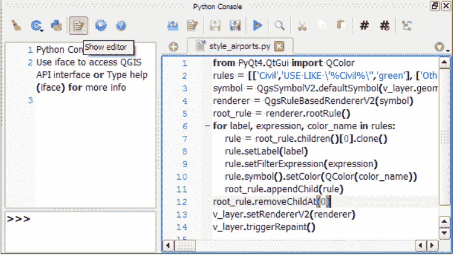

此示例中的每条规则都有一个名称、一个过滤表达式和一个符号颜色。请注意规则是如何附加到渲染器的根规则上的：

```
from PyQt4.QtGui import QColor
rules = [['"Civil" LIKE \'%Civil%\'', 'green'], ['Other', 'USE NOT LIKE \'%Civil%\'', 'red']]
symbol = QgsSymbolV2.defaultSymbol(v_layer.geometryType())
renderer = QgsRuleBasedRendererV2(symbol)
root_rule = renderer.rootRule()
for label, expression, color_name in rules:
    rule = root_rule.children()[0].clone()
    rule.setLabel(label)
    rule.setFilterExpression(expression)
    rule.symbol().setColor(QColor(color_name))
    root_rule.appendChild(rule)
root_rule.removeChildAt(0)
v_layer.setRendererV2(renderer)
v_layer.triggerRepaint()
```

要运行脚本，请单击编辑器工具栏底部的**运行脚本**按钮。

> 如果你有兴趣阅读更多关于设置矢量图层样式的内容，我推荐Joshua Arnott在http://snorf.net/blog/2014/03/04/symbology-of-vector-layers-in-qgis-python-plugins/上的文章。

## 过滤数据

要以编程方式过滤矢量图层要素，我们可以指定一个子集字符串。这等同于在**图层属性 | 常规**部分中定义**要素子集**查询。例如，我们可以选择仅在机场名称以A开头时才显示它们：

```
v_layer.setSubsetString("NAME LIKE 'A%'")
```

要移除此过滤器，只需设置一个空的子集字符串：

```
v_layer.setSubsetString("")
```


# 创建内存图层

创建临时矢量图层的一种好方法是使用所谓的**内存图层**。内存图层是临时分析输出或可视化的一个不错选择。它们是临时草图图层的脚本等价物，我们在 *第 3 章，数据创建与编辑* 中使用过它。与临时草图图层一样，内存图层存在于 QGIS 会话中，并在关闭 QGIS 时被销毁。在下面的示例中，我们创建一个内存图层并向其中添加一个面要素。

基本上，内存图层是一个 `QgsVectorLayer`，与其他图层一样。然而，提供者（第三个参数）不是上一个加载文件示例中的 'ogr'，而是 'memory'。第一个参数不是文件路径，而是一个定义字符串，指定几何类型、CRS 以及属性表字段（本例中为一个名为 `MYNUM` 的整数字段和一个名为 `MYTXT` 的字符串字段）：

```
mem_layer =
QgsVectorLayer("polygon?crs=epsg:4326&field=MYNUM:integer&field=MYTXT:string", "temp_layer", "memory")
if not mem_layer.isValid():
    raise Exception("Failed to create memory layer")
```

一旦我们创建了 `QgsVectorLayer` 对象，我们就可以开始向其数据提供者添加要素：

```
mem_layer_provider = mem_layer.dataProvider()
my_polygon = QgsFeature()
my_polygon.setGeometry(
    QgsGeometry.fromRect(QgsRectangle(16,48,17,49)))
my_polygon.setAttributes([10,"hello world"])
mem_layer_provider.addFeatures([my_polygon])
QgsMapLayerRegistry.instance().addMapLayer(mem_layer)
```

> 注意我们首先创建一个空白的 `QgsFeature`，然后分别使用 `setGeometry()` 和 `setAttributes()` 为其添加几何和属性。当我们将图层添加到 `QgsMapLayerRegistry` 时，图层会在地图上渲染。

# 导出地图图像

保存当前地图的最简单选项是使用与项目下“另存为图像”相同的脚本等价物。这将以 QGIS 应用程序窗口中地图区域相同的分辨率将当前地图导出为图像文件：

```
iface.mapCanvas().saveAsImage('C:/temp/simple_export.png')
```

如果我们想要对导出的图像的尺寸和分辨率有更多控制，则需要几行额外的代码。下面的示例展示了如何创建自己的 QgsMapRendererCustomPainterJob 对象，并使用自定义的 QgsMapSettings 配置尺寸（宽度和高度）、分辨率（dpi）、地图范围和地图图层：

```
from PyQt4.QtGui import QImage, QPainter
from PyQt4.QtCore import QSize
# configure the output image
width = 800
height = 600
dpi = 92
img = QImage(QSize(width, height), QImage.Format_RGB32)
img.setDotsPerMeterX(dpi / 25.4 * 1000)
img.setDotsPerMeterY(dpi / 25.4 * 1000)
# get the map layers and extent
layers = [ layer.id() for layer in iface.legendInterface().layers() ]
extent = iface.mapCanvas().extent()
# configure map settings for export
mapSettings = QgsMapSettings()
mapSettings.setMapUnits(0)
mapSettings.setExtent(extent)
mapSettings.setOutputDpi(dpi)
mapSettings.setOutputSize(QSize(width, height))
mapSettings.setLayers(layers)
mapSettings.setFlags(QgsMapSettings.Antialiasing | QgsMapSettings.UseAdvancedEffects | QgsMapSettings.ForceVectorOutput | QgsMapSettings.DrawLabeling)
# configure and run painter
p = QPainter()
p.begin(img)
mapRenderer = QgsMapRendererCustomPainterJob(mapSettings, p)
mapRenderer.start()
mapRenderer.waitForFinished()
p.end()
# save the result
img.save("C:/temp/custom_export.png","png")
```

## 使用 Python 创建自定义地理处理脚本

在 *第 4 章，空间分析* 中，我们使用 **Processing Toolbox** 的工具来分析数据，但我们并不局限于这些工具。我们可以用自己的脚本扩展 *processing*。*processing* 脚本相对于上一节中看到的普通 Python 脚本的优势如下：

- Processing 会自动为脚本生成图形用户界面以配置脚本参数
- Processing 脚本可用于 **Graphical modeler** 以创建地理处理模型

如下截图所示，**Scripts** 部分最初是空的，除了一些用于添加和创建新脚本的 **Tools**：

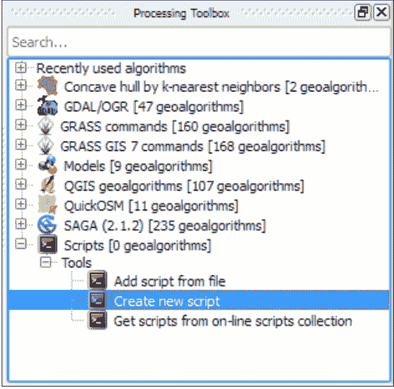

### 编写你的第一个 Processing 脚本

我们将创建第一个简单的脚本；它获取一些图层信息。开始时，双击 Scripts | Tools 中的 Create new script 条目。这将打开一个空的 Script editor 对话框。下面的截图显示了 Script editor，其中包含一个简短的脚本，该脚本会在 Python Console 上打印输入图层的名称：

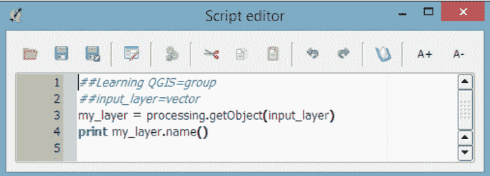

第一行表示我们的脚本将被放入 Learning QGIS 脚本组中，如下截图所示。双哈希（##）是 Processing 语法，表示该行包含 Processing 特定信息而不是 Python 代码。脚本名称由保存脚本时选择的文件名创建。对于本示例，我将脚本保存为 my_first_script.py。第二行定义了脚本输入，本例中为矢量图层。在下一行，我们使用 Processing 的 getObject() 函数来访问输入图层对象，最后图层名称会打印在 Python Console 上。

你可以直接从编辑器中通过点击 Run algorithm 按钮运行脚本，或通过在 Processing Toolbox 中双击条目运行。如果想更改代码，请使用条目上下文菜单中的 Edit script，如此截图所示：

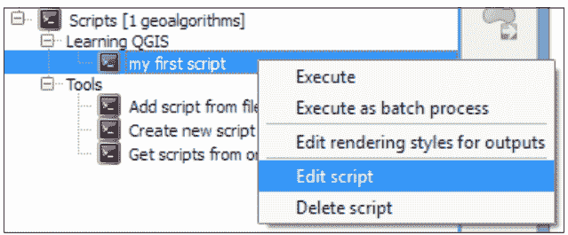

> 学习如何为 Processing 编写自定义脚本的一个好方法是查看现有脚本，例如 https://github.com/qgis/QGIS-Processing/tree/master/scripts。这是官方脚本仓库，你也可以使用 Processing Toolbox 中的内置 **Get scripts from on-line scripts collection** 工具下载脚本。

### 编写具有矢量图层输出的脚本

当然，在大多数情况下，我们不想只在 **Python Console** 上输出内容。因此，下面的示例展示了如何创建矢量图层。更具体地说，脚本会在输入图层中的点周围创建正方形面要素。数值 `size` 输入参数控制输出矢量图层中正方形的大小。自动生成的对话框中显示的默认大小设置为 `1000000`：

```
##Learning QGIS=group
##input_layer=vector
##size=number 1000000
##squares=output vector
from qgis.core import *
from processing.tools.vector import VectorWriter
# get the input layer and its fields
my_layer = processing.getObject(input_layer)
fields = my_layer.dataProvider().fields()
# create the output vector writer with the same fields
writer = VectorWriter(squares, None, fields, QGis.WKBPolygon,
my_layer.crs())
# create output features
feat = QgsFeature()
for input_feature in my_layer.getFeatures():
    # copy attributes from the input point feature
    attributes = input_feature.attributes()
    feat.setAttributes(attributes)
    # create square polygons
    point = input_feature.geometry().asPoint()
    xmin = point.x() - size/2
    ymin = point.y() - size/2
    square = QgsRectangle(xmin,ymin,xmin+size,ymin+size)
    feat.setGeometry(QgsGeometry.fromRect(square))
    writer.addFeature(feat)
del writer
```

在此脚本中，我们使用 VectorWriter 来写入输出矢量图层。创建 VectorWriter 对象的参数为 fileName、encoding、fields、geometryType 和 crs。

> 可用的几何类型为 QGIS.WKBPoint、QGIS.WKBLineString、QGIS.WKBPolygon、QGIS.WKBMultiPoint、QGIS.WKBMultiLineString 和 QGIS.WKBMultiPolygon。你也可以在 Python Console 中输入 VectorWriter.TYPE_MAP 来获取此几何类型列表。

注意我们使用输入图层的字段（my_layer.dataProvider().fields()）来创建 VectorWriter。这确保输出图层具有与输入图层相同的字段（属性表列）。同样，对于输入图层中的每个要素，我们将其属性值（input_feature.attributes()）复制到对应的输出要素中。

运行脚本后，结果图层将被加载到 QGIS 中，并使用输出参数名称列出；本例中图层名为 squares。下面的截图显示了自动生成的输入对话框以及将脚本应用于样本数据集中机场时的输出：


## 可视化脚本进度

尤其是在执行需要花费一段时间才能完成的复杂脚本时，在进度条中显示脚本执行的进度是良好的做法。要为之前的脚本添加进度条，我们可以在遍历输入要素的 for 循环之前和内部添加以下代码行：

```
i = 0
n = my_layer.featureCount()
for input_feature in my_layer.getFeatures():
    progress.setPercentage(int(100*i/n))
    i+=1
```

> 请注意，我们在循环之前初始化 i 计数器，并在使用 `progress.setPercentage()` 更新进度条后在循环内部递增它。

## 开发你的第一个插件

当你想要实现交互式工具或非常特定的图形用户界面时，就该研究插件开发了。在之前的练习中，我们介绍了 QGIS Python API。因此，我们现在可以专注于启动我们第一个 QGIS 插件所需的步骤。创建 QGIS 插件的好处在于，有一个专门用于此的插件！它叫做 Plugin Builder。而且顺便说一下，也安装 Plugin Reloader，它对插件开发者非常有用。因为它让你在每次修改代码时无需每次都重新启动 QGIS 即可快速重新加载插件。当你安装了这两个插件后，你的插件工具栏将如下所示：


在开始之前，我们还需要安装 Qt Designer，这是我们将用来设计用户界面的应用程序。如果你使用的是 Windows，我推荐 WinPython (http://winpython.github.io/) 版本 2.7.10.3（截至本书撰写时 Python 2.7 的最新版本），它提供了 Qt Designer 和 Spyder（Python 的集成开发环境）。在 Ubuntu 上，你可以使用 `sudo apt-get install qt4-designer` 安装 Qt Designer。在 Mac 上，你可以从 http://qt-project.org/downloads 获取 Qt Creator 安装程序（其中包含 Qt Designer）。

## 使用 Plugin Builder 创建插件模板

Plugin Builder 将为我们的插件创建所需的所有文件。要创建插件模板，请按照以下步骤操作：

- 1. 启动 Plugin Builder 并输入基本插件信息，包括：
  - 类名（驼峰命名的一个词；即每个单词以大写字母开头）
  - 插件名称（简短描述）
  - 模块名（插件的 Python 模块名）

当你在 Plugin Builder 对话框中将鼠标悬停在输入字段上时，它会显示帮助信息，如以下屏幕截图所示：


- 2. 点击 Next 进入 About 对话框，在其中可以输入插件功能的更详细描述。由于我们计划仅为学习目的创建第一个插件，我们可以在这里输入一些随机文本，然后点击 Next。

- 3. 现在我们可以选择一个插件 **Template** 并指定 **Text for the menu item** 以及插件应列出的 **Menu**，如以下屏幕截图所示。可用模板包括 **Tool button with dialog**、**Tool button with dock widget** 和 **Processing provider**。在本练习中，我们将创建一个 **Tool button with dialog** 并点击 **Next**：


- 4. 下一个对话框显示复选框，我们可以在其中选择应创建哪些非必要的插件文件。你可以选择提供的任何子集并点击 **Next**。

- 5. 在下一个对话框中，我们需要指定插件的 **Bug tracker** 和代码 **Repository**。同样，由于我们仅为学习目的创建此插件，我在下图中只是编造了一些 URL，但如果你计划将插件公开可用，则应使用适当的跟踪器和代码存储库：


- 6. 点击 **Next** 后，你将被要求选择一个用于存储插件的文件夹。你可以直接保存在 QGIS 插件文件夹中，Windows 上为 `~\.qgis2\python\plugins`，Linux 和 Mac 上为 `~/.qgis2/python/plugins`。

- 7. 选择插件文件夹后，它会显示一个 **Plugin Builder Results** 确认对话框，确认你的插件文件夹位置以及你的 QGIS 插件文件夹位置。如前所述，我直接保存在 QGIS 插件文件夹中，如以下屏幕截图所示。如果你保存在其他位置，现在可以将插件文件夹移入 QGIS 插件文件夹，以确保 QGIS 能找到并加载它：

### Plugin Builder Results

恭喜！你刚刚为 QGIS 构建了一个插件！

你的插件 **MyFirstPlugin** 已创建于：
`C:\Users\anita\.qgis2\python\plugins\MyFirstPlugin`

你的 QGIS 插件目录位于：
`C:\Users\anita\.qgis2\python\plugins`

### What's Next

- 1. 在你的插件目录中，使用 pyrcc4 编译资源文件（如果有 automake，只需运行 **make** 或使用 **pb_tool**）
- 2. 使用 **make test** 测试生成的源代码（或从你的 IDE 运行测试）
- 3. 将包含新插件的整个目录复制到 QGIS 插件目录（见下面的说明）
- 4. 通过在 QGIS 插件管理器中启用它来测试插件

我们仍然需要做的一件事是为插件工具栏准备图标。这需要我们编译 `resources.qrc` 文件，**Plugin Builder** 已自动创建它，以将图标转换为可用的 Python 代码。这是在命令行上完成的。在 Windows 上，我推荐使用 **OSGeo4W shell**，因为它确保环境变量被设置成能够找到必要工具的方式。导航到插件文件夹并运行以下命令：

```
pyrcc4 -o resources_rc.py resources.qrc
```

> 你可以替换默认图标（`icon.png`）以添加你自己的插件图标。之后，你只需如上所示重新编译 `resources.qrc` 即可。

重新启动 QGIS，你现在应该能在插件管理器中看到你的插件，如下所示：


在插件管理器中激活你的插件，你应该能在插件菜单中看到它。当你启动插件时，它会显示一个空白对话框，等待你对其进行自定义。

## 自定义插件 GUI

要自定义空白的默认插件对话框，我们使用 Qt Designer。你可以在插件文件夹中找到对话框文件。在我的例子中，它叫做 `my_first_plugin_dialog_base.ui`（源自我在 Plugin Builder 中指定的模块名）。当你在 Qt Designer 中打开插件的 `.ui` 文件时，你会看到空白对话框。现在你可以从 Qt Designer 窗口左侧的 Widget Box 开始通过拖放添加控件。在以下屏幕截图中，你可以看到我添加了一个标签和一个下拉列表控件（在 Widget Box 中列为 Combo Box）。你可以通过双击默认标签文本将标签文本更改为 Layer。此外，为控件对象分配描述性名称是良好的做法；例如，我将组合框重命名为 `layerCombo`，你可以在这里的右下角看到：


完成对插件对话框的更改后，你可以保存它们。然后你可以返回到 QGIS。在 QGIS 中，你现在可以通过点击插件工具栏中的 Choose a plugin to be reloaded 按钮并选择你的插件来配置 Plugin Reloader。如果你现在点击 Reload Plugin 按钮，然后按下你的插件按钮，你的新插件对话框将被显示。

## 实现插件功能

正如你一定注意到的那样，图层组合框仍然是空的。为了用已加载图层的列表填充组合框，我们需要在 `my_first_plugin.py`（位于插件文件夹中）中添加几行代码。更具体地说，我们扩展 `run()` 方法：

```
def run(self):
    """Run method that performs all the real work"""
    # show the dialog
    self.dlg.show()
    # clear the combo box to list only current layers
    self.dlg.layerCombo.clear()
    # get the layers and add them to the combo box
    layers = QgsMapLayerRegistry.instance().mapLayers().values()
    for layer in layers:
        if layer.type() == QgsMapLayer.VectorLayer:
            self.dlg.layerCombo.addItem( layer.name(), layer )
    # Run the dialog event loop
    result = self.dlg.exec_()
```


```python
# See if OK was pressed
if result:
    # Check which layer was selected
    index = self.dlg.layerCombo.currentIndex()
    layer = self.dlg.layerCombo.itemData(index)
    # Display information about the layer
    QMessageBox.information(self.iface.mainWindow(), "Learning QGIS", "%s has %d features." % (layer.name(), layer.featureCount()))
```
```

你还需要在脚本顶部添加以下导入行，以避免关于 QgsMapLayerRegistry 和 QMessageBox 的 NameError：

```python
from qgis.core import *
from PyQt4.QtGui import QMessageBox
```
```

完成对 my_first_plugin.py 的修改后，你可以保存文件并在 QGIS 中使用 **Reload Plugin** 按钮重新加载插件。现在启动插件时，组合框将被填充为当前 QGIS 项目中的所有图层列表，并且当你点击确定时，将显示一个消息框，显示所选图层中的要素数量。

## 创建自定义地图工具

之前的练习展示了如何创建自定义 GUI 以使用户能够与 QGIS 交互，在本练习中，我们将更进一步，实现我们自己的自定义 **地图工具**，类似于默认的 **识别工具**。这意味着用户可以点击地图，工具会报告地图上被点击的要素。

为此，我们创建另一个名为 MyFirstMapTool 的 **带对话框的工具按钮** 插件模板。对于此工具，我们不需要创建对话框。相反，我们需要编写比前一个示例更多的代码。首先，我们创建自定义地图工具类，我们称之为 IdentifyFeatureTool。除了 __init__() 构造函数之外，此工具还有一个名为 canvasReleaseEvent() 的函数，该函数定义了在释放鼠标按钮时（即在按下鼠标按钮后松开时）工具的动作：

```python
class IdentifyFeatureTool(QgsMapToolIdentify):
    def __init__(self, canvas):
        QgsMapToolIdentify.__init__(self, canvas)
    def canvasReleaseEvent(self, mouseEvent):
        print "canvasReleaseEvent"
        # get features at the current mouse position
        results = self.identify(mouseEvent.x(), mouseEvent.y(),
                                self.TopDownStopAtFirst, self.VectorLayer)
```
```

```python
if len(results) > 0:
    # signal that a feature was identified
    self.emit( SIGNAL("geomIdentified"),
               results[0].mLayer, results[0].mFeature)
```
```

你可以将上述代码粘贴到 my_first_map_tool.py 代码的末尾。当然，我们现在必须让我们的新地图工具发挥作用。在 initGui() 函数中，我们用新的 map_tool_init() 函数替换 run() 方法。此外，我们定义我们的地图工具是可检查的；这意味着用户可以点击工具图标来激活它，再次点击即可停用它：

```python
def initGui(self):
    # create the toolbar icon and menu entry
    icon_path = ': /plugins/MyFirstMapTool/icon.png'
    self.map_tool_action=self.add_action(
        icon_path,
        text=self.tr(u'My 1st Map Tool'),
        callback=self.map_tool_init,
        parent=self.iface.mainWindow())
    self.map_tool_action.setCheckable(True)
```
```

新的 map_tool_init() 函数负责在点击按钮时激活或停用我们的地图工具。在激活期间，它会创建我们自定义 IdentifyFeatureTool 的实例，并且以下行将地图工具的 geomIdentified 信号连接到我们稍后将讨论的 do_something() 函数。同样，当地图工具被停用时，我们断开信号连接并恢复之前的地图工具：

```python
def map_tool_init(self):
    # this function is called when the map tool icon is clicked
    print "maptoolinit"
    canvas = self.iface.mapCanvas()
    if self.map_tool_action.isChecked():
        # when the user activates the tool
        self.prev_tool = canvas.mapTool()
        self.map_tool_action.setChecked( True )
        self.map_tool = IdentifyFeatureTool(canvas)
        QObject.connect(self.map_tool,SIGNAL("geomIdentified"),
                        self.do_something)
        canvas.setMapTool(self.map_tool)
        QObject.connect(canvas,SIGNAL("mapToolSet (QgsMapTool *)"),
                        self.map_tool_changed)
    else:
        # when the user deactivates the tool
```
```

```python
QObject.disconnect(canvas,SIGNAL("mapToolSet (QgsMapTool *)")
    ),self.map_tool_changed)
canvas.unsetMapTool(self.map_tool)
print "restore prev tool %s" %(self.prev_tool)
canvas.setMapTool(self.prev_tool)
```

我们的新自定义 do_something() 函数在我们的地图工具成功识别要素时被调用。对于此示例，我们只是在 Python 控制台上打印要素的属性。当然，你可以在这里发挥创意并添加你想要的自定义功能：

```
def do_something(self, layer, feature):
    print feature.attributes()
```

最后，我们还必须处理用户切换到不同地图工具的情况。这与用户在 map_tool_init() 函数中停用我们的工具的情况类似：

```
def map_tool_changed(self):
    print "maptoolchanged"
    canvas = self.iface.mapCanvas()
    QObject.disconnect(canvas,SIGNAL("mapToolSet (QgsMapTool *)"),
        self.map_tool_changed)
    canvas.unsetMapTool(self.map_tool)
    self.map_tool_action.setChecked(False)
```

你还需要在脚本顶部添加以下导入行，以避免关于 QObject、QgsMapTool 等的错误：

```python
from qgis.core import *
from qgis.gui import *
from PyQt4.QtCore import *
```

准备就绪后，你可以重新加载插件并尝试使用。你应该打开 Python 控制台以便能够跟随插件的输出。当你在工具栏中激活插件时，你会看到它在控制台上打印 maptoolinit。然后，如果你点击地图，它将打印 canvasReleaseEvent，如果你点击要素，它还将显示要素的属性。最后，如果你更改为另一个地图工具（例如平移地图工具），它将在控制台上打印 maptoolchanged，并且插件工具栏中的图标将被取消选中。

## 总结

在本章中，我们介绍了使用操作和 Python 脚本扩展 QGIS 的不同方法。我们从不同类型的操作开始，然后继续到 **Python Console**，它提供了一种直接、交互式的方式与 QGIS Python API 交互。我们还使用了 **Python Console** 面板的一部分编辑器，它为包含循环甚至多个类和函数定义的较长脚本提供了一种更好的工作方式。接下来，我们将 PyQGIS 的知识应用于为 **Processing Toolbox** 开发自定义工具。这些工具受益于 Processing 的自动 GUI 生成功能，并且可以在 **Graphical modeler** 中用于创建地理处理模型。最后但同样重要的是，我们基于 **Plugin Builder** 模板开发了一个基本插件。

有了这些背景知识，你现在可以开始自己的 PyQGIS 实验。有多个网络和印刷资源可供你了解更多关于 QGIS Python 脚本的知识。有关更新的 QGIS API 文档，请查看 http://qgis.org/api/。如果你对更多 PyQGIS 配方感兴趣，请查看 *PyQGIS Developer Cookbook* at http://docs.qgis.org/testing/en/docs/pyqgis_developer_cookbook 以及 *Packt Publishing* 出版的 QGIS 编程书籍，以及 Gary Sherman 的书籍 *The PyQGIS Programmer's Guide, Locate Press.*
