## Module 2

## QGIS Blueprints

使用 QGIS 开发基于位置的分析型 Web 应用

## 1
探索地点 — 从概念到界面

我们如何将我们的想法转变为基于位置的 Web 应用？如果你以前听过这个问题或自己问过这个问题，你就会知道这个看似简单的问题可以有无数种答案。在本书中，我们将通过为其通用适用性而选定的具体用例来考虑 QGIS 的应用。这里提供的蓝图很可能会为你的应用的这个问题及其解决方案带来启发。

在本書中，你将学习如何利用这一生态系统，让现有软件承担繁重的工作，并构建满足你需求的 Web 地图应用。当集成软件在 QGIS 中无缝可用时，太棒了！当它不可用时，我们将看看如何将其引入。

在本章中，我们将查看数据如何从各种来源和格式获取并通过 QGIS 可视化。我们将重点关注我们应用的相对静态的部分：底图。我们将使用以美国城市特拉华州纽瓦克为重点的数据。例如，历史温度按区域、按地址的点数据和历史地图图像等数据集合可用于数字人文项目，如果有人想查看城市某部分观察到的较低温度的历史证据。

在本章中，我们将涵盖以下主题：

- 软件
- 提取、传输和加载
- 地理配准


- 表连接
- 地理编码
- 正射校正
- 空间参考操作
- 空间参考分配
- 投影
- 转换
- 基底地图的创建与配置
- 图层比例依赖
- 标签
- 瓦片创建

## 开发社区与依赖

由于 QGIS 是开源的，没有任何单一实体拥有该项目；它由一个成熟的社区支持。该项目由 QGIS 项目指导委员会（PSC）指导，委员会选出经理来监督开发、测试、打包以及其他基础设施等各个领域，以保持项目的运行。开源地理空间基金会（OSGeo）是软件开发的主要贡献者之一，QGIS 被视为 OSGeo 的官方项目。QGIS 的许多依赖项和互补软件也是 OSGeo 项目，这种集体地位使得可以将其视为一个平台而实现一定程度的集成。开放地理信息系统联盟（OGC）负责审议并制定数据和元数据格式的标准。QGIS 支持一系列 OGC 标准——从网络服务到数据格式。

当 QGIS 处于最佳状态时，这一丰富的平台提供了无缝的功能，其生态系统中的开源或可直接获取的软件随时可供使用。在其他时候，底层依赖项和生态系统软件需要更多关注。由于它是开源软件，贡献始终在进行中，你也可以选择对代码进行自定义甚至贡献！

## 数据格式读写

OSGeo 生态系统通过 **OGR 简单要素库**（OGR，最初用于 OpenGIS 简单要素参考实现）和 **地理空间数据抽象库（GDAL）** 库提供数据格式读写能力，支持约 220 种格式。

## 地理空间坐标转换

坐标所指的地球模型统称为 **坐标参考系统（CRSs）**。系统之间的空间参考转换以及投影——从线性坐标系统到角度坐标系统——由 PROJ.4 库支持，约有 2,700 个系统。这些系统以 PROJ.4 定义的纯文本格式表达，即 **众所周知文本（WKT）**。PROJ.4 WKT 实际上非常易读，包含制图投影学生所熟悉的信息，如子午线、椭球体等。

## 分析

分析，或将算法函数应用于数据，很少能由 QGIS 无缝处理。更常见的是，它是之前列出的依赖项之一的扩展，或由 **系统化地球科学分析系统（SAGA）** 提供。许多其他分析操作由众多 QGIS Python 插件提供。

总体而言，这些库可以无缝地在我们需要的格式之间转换。然而，在某些情况下，需要获取额外的依赖项，并自行构建和配置，或在它们周围构建代码。

## Web 发布

QGIS 能够通过集成和不太直接的方式发布到 Web 主机。

## 安装

OSGeo 项目二进制文件有时会被打包以简化安装过程，鉴于项目之间存在大量相互依赖。本书中的教程基于使用 Windows 的 QGIS 独立安装程序进行安装。

## Linux

QGIS 为 Debian/Ubuntu 主持了最新版本的仓库，并为其他主要 Linux 发行版提供捆绑包；然而，这些仓库通常落后很多版本。你会发现即使使用发行版的额外仓库（例如 RHEL 系列的 EPEL）也是如此。寻找其他仓库是值得的。当然，另一个选择是尝试从头构建；但这可能非常困难。

## Mac

Mac OS 没有捆绑的包安装程序，不过你应该能够仅通过网络上 readily 可用的二进制文件进行一到两次额外安装来安装 QGIS——KyngChaos Wiki 长期以来一直是此方面的首选来源。

## Windows

目前在 Windows 上安装比其他平台更简单。最新版本的 QGIS，连同 GDAL 等基本依赖项，可通过典型的可执行安装程序安装：即“独立”安装程序。此外，OSGeo4W（OSGeo for Windows）包安装程序对于扩展依赖项非常有用。你可能会发现，除了简单安装 QGIS 之外，你会返回此安装程序以添加更多软件，将 QGIS 扩展到其生态系统中。你可以从 Windows 开始菜单中 QGIS 子菜单下的 Setup 快捷方式启动安装程序。

## OSGeo-Live

OSGeo 软件最全面的体现是 OSGeo-Live，即一个预装了所有 OSGeo 软件的 Lubuntu 虚拟机（VM）。它在此单独列出，因为它会启动到自己的操作系统，与主机平台无关。

OSGeo Live 的更新通常与 FOSS4G 同步发布，FOSS4G 是 OSGeo 自 2006 年以来主办的年度全球活动。鉴于这些活动举办不那么规律且与 OSGeo 软件开发不同步，打包版本通常落后几个版本。尽管如此，OSGeo-Live 仍是快速入门的好方法。

现在你已经准备好了本地机器，让我们回到本书将重点关注的通用化 Web 应用的想法。我们可以在开发 Web 制图应用的过程中识别出几个要素。

## 获取地理空间应用的数据

在任何初步规划之后——该步骤应至少仔细考虑我们应用的使用案例——我们必须获取数据。获取不仅涉及数据的物理传输，还包括将数据处理为特定格式并导入我们开发的数据存储方案中。这通常称为提取、转换和加载（ETL）。

尽管 ETL 是开发 Web 应用的第一步，但不应掉以轻心。如同任何基于信息项目一样，数据往往以不可立即使用形式提供给我们——无论是因为格式不统一、元数据不确定，还是字段映射未知。虽然这些都可能影响 GIS 项目，但由于 GIS 围绕制图坐标系统组织，主要关注点通常是数据必须以统一的方式进行空间描述，即由单一 CRS，如前所述。为此，数据通常需要地理配准和空间参考操作。

对于某些数据集，ETL 工作流是不必要的，因为数据已通过 Web 服务提供。使用存储在远程服务器上的托管数据并由你的应用直接从 Web 读取，这纯粹从开发便利性角度看是一个非常有吸引力的选择。然而，你可能需要更改本地数据的 CRS，以及可能的其他格式，以匹配托管数据，因为托管服务很少提供多种 CRS。你还必须考虑托管数据是否提供支持你的应用界面的功能。你可以在本章的操作层部分找到有关此主题的更多信息。

## 通过地理配准生成地理空间数据

通过地理配准，或将我们的数据附加到坐标，我们断言数据中每个对象的地理位置。一旦数据被地理配准，我们就可以称其为地理空间。地理配准是根据数据中的字段和某些地理空间参考源中可用的字段进行的。

最简单的例子是当数据字段实际上与某些现有地理空间数据中的字段匹配时。该数据字段通常是 ID 号或名称。这种地理配准称为表连接。


## 表连接

在本示例中，我们将通过一个表连接来查看一些来自未知来源的温度数据与美国人口普查的人口普查区边界。人口普查的 TIGER/Line 文件通常是查找各种美国全国边界文件（不仅仅是人口普查汇总区）的首选位置。

将通过表连接进行地理参照的温度数据如下所示：

```
tract,date,mean_temp
014501,2010-06-01,73
014402,2010-06-01,75
014703,2010-06-01,75
014100,2010-06-01,76
014502,2010-06-01,75
014403,2010-06-01,75
014300,2010-06-01,71
014200,2010-06-01,72
013610,2010-06-01,68
```

温度数据元数据如下所示：

```
"String","Date","Integer"
```

## 下载示例代码

您可以从 http://www.packtpub.com 在您的账户中下载您购买的所有 Packt 书籍的示例代码文件。如果您在其他地方购买了本书，您可以访问 http://www.packtpub.com/support 并注册以便将文件直接发送到您的电子邮件。

要执行表连接，请执行以下步骤：

- 1. 复制第一个信息框中的代码到一个文本文件并保存为 temperature.csv。

CSVT 格式是与同名 CSV 文件一起提供的元数据文件。它定义了列数据类型。

- 2. 复制第二个信息框中的代码到一个文本文件并保存为 `temperature.csvt`。否则，QGIS 将不知道每列包含什么类型的数据。

> 所有章节的数据都可以在每个章节的数据目录下找到。您可以使用 `c1/data/original` 下包含的数据以及前面给出的文件名。除了选择浏览菜单，您还可以直接将文件从打开的操作系统窗口拖入 **图层** 面板。您可以在每个章节数据目录的输出目录下找到练习期间的数据输出示例。这也是说明中作为输出目录给出的目录。您可能希望为输出创建一个新目录并将数据保存在那里，以避免覆盖包含的参考数据。

- 3. 导航到 **图层 | 添加图层 | 添加矢量图层 | 浏览到**，并选择 `temperature.csv`。

> CSV 数据也可以通过 **图层 | 添加图层 | 添加分隔文本** 添加。这对于在 CSV 中绘制坐标特别有用，如您稍后会看到。

- 4. 下载 **Tract** 边界数据：
  - 1. 访问 http://www.census.gov/geo/maps-data/data/tiger-line.html。
  - 2. 点击您想要查找的年份的选项卡。
  - 3. 下载网络界面。
  - 4. 这将带我们到 http://www.census.gov/cgi-bin/geo/shapefiles2014/main。
  - 5. 导航到 **图层类型 | 人口普查区** 并点击 **提交** 按钮。现在，从 **人口普查区（2010）** 下拉菜单中选择 **特拉华州**。再次点击 **提交**。现在从此页面显示的下拉菜单中选择 **所有县在一个基于州的文件中**，最后点击 **下载**。
  - 6. 解压下载的文件夹。

- 5. 导航到 **图层 | 添加图层 | 添加矢量图层 | 浏览到**，并选择解压目录中的 `t1_2010_10_tract10.shp` 文件。

- 6. 在 **图层** 面板中右键点击 `t1_2010_10_tract10`，然后导航到 **属性 | 连接**。点击带有绿色加号 (+) 的按钮以添加连接。

7. 选择 **temperature** 作为 **连接图层** 选项，**tract** 作为 **连接字段** 选项，**TRACTCE10** 作为 **目标字段** 选项，并点击此处的 **确定** 以及属性对话框中的 **确定**：

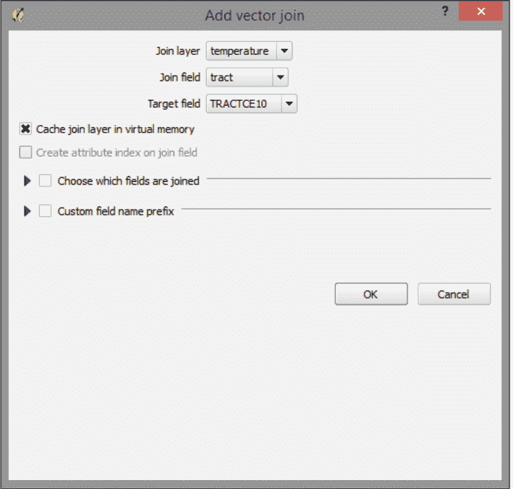

要验证连接是否完成，请打开目标图层的属性表（例如在此案例中的地理空间参考，`tl_2010_10`）并按新的 `temperature_mean_temp` 字段排序。注意连接图层的字段和值现在已包含在目标图层中。

- 1. 从 **图层** 面板中选择目标图层 `tl_2010_10_tract10`。
- 2. 导航到 **图层 | 打开属性表**。
- 3. 点击 `temperature_mean_temp` 列标题按此列对普查区进行排序。您可能需要点击两次以将排序顺序从升序切换到降序。

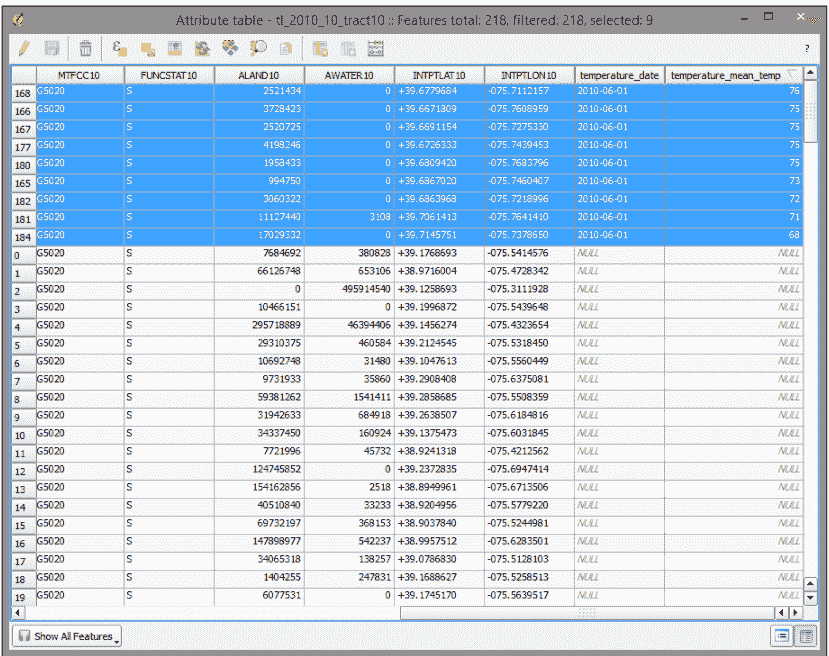

## 地理编码

如果我们的数据以地址、交叉路口或其他众所周知的地点表示，我们可以对其进行地理编码（即与坐标匹配），方法是使用为我们特定字段集配置的本地或远程地理编码器，例如地址中的标准字段。

在本示例中，我们将使用 Google 提供的远程地理编码器进行地理编码。请执行以下步骤：

- 1. 安装 MMQGIS 插件。
- 2. 如果您还没有可用的地址数据，您可以制作一个包含一些标准地址字段的分隔文件，例如街道、城市、州和县（此插件不使用邮政编码）。我使用的数据来自特拉华州纽卡斯尔县的 GIS 网站（http://gis.nccde.org/gis_viewer/）。

- 3. 无论您是下载了地址数据还是自行制作，都请确保创建标题行。否则，MMQGIS 无法进行地理编码。

以下是 MMQGIS 友好的地址数据的示例：

```
id,address,city,state,zip,country
1801300170,44 W CLEVELAND AV,NEWARK,DE,19711,USA
1801400045,85 N COLLEGE AV,NEWARK,DE,19711,USA
1802600068,501 ACADEMY ST,NEWARK,DE,19716,USA
```

- 4. 通过导航到 **MMQGIS | 地理编码 | 使用 Google/OpenStreetMap 地理编码 CSV** 打开 MMQGIS 地理编码对话框。

- 5. 在将您的字段与可用的地址输入字段匹配后，您可以选择 Google Maps 或 OpenStreetMap。Google Maps 通常具有更高的成功率，而 OpenStreetMap 的价值在于没有每天可地理编码地址数量的限制。此时，OSM 地理编码器产生的结果很差，几乎没有用处。

- 6. 您希望手动选择或输入 `notfound.csv` 文件的最终文件系统路径。默认文件位置可能有问题。

- 7. 地理编码完成后，您会看到地理编码地址文本与我们的地理编码参考匹配的程度。您可能希望更改 `notfound.csv` 文件中的地址并再次尝试地理编码这些地址。

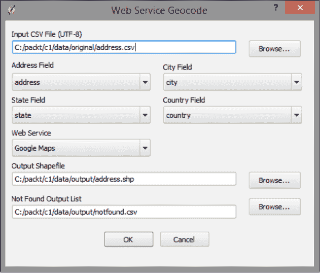

## 正射校正

最后，如果我们的数据是图像或栅格，我们可以将图像中的位置与参考地图中的已知位置匹配。这些配对的配准和随后的栅格变换称为正射校正，有时也称为更通用的术语地理配准（尽管该术语适用于更广泛的操作范围）。

- 1. 添加用作参考的基础地图：
  - 1. 添加 OpenLayers 插件。导航到 **插件 | 管理 | 安装插件**；选择 **OpenLayers 插件** 并点击 **安装**。
  - 2. 导航到 **网络 | OpenLayers 插件**，并选择您选择的基础地图。MapQuest-OSM 是一个不错的选择。

- 2. 获取地图图像：
  - 1. 我已从 David Rumsey 地图收藏、MapRank 搜索（http://rumsey.mapranksearch.com/）下载了一张高分辨率图像（c1/data/original/4622009.jpg），该网站是美国历史地图图像的优秀来源。
  - 2. 按位置搜索，按时间、比例和其他属性进行筛选。您可以通过搜索特拉华州纽瓦克找到我们使用的图像。
  - 3. 找到地图后，导航到它。然后在右上角找到 **导出**，并导出超高分辨率图像。
  - 4. 解压下载的文件夹。

- 3. 使用以下步骤对图像进行正射校正/地理配准：
  - 1. 安装并启用 Georeferencer GDAL 插件。
  - 2. 导航到 **栅格 | 地理配准器 | 地理配准**。
  - 3. 在画布上平移和缩放参考基础地图到您在地图图像中识别的位置。
  - 4. 平移和缩放地图图像。
  - 5. 如果尚未选择，请选择 **添加控制点**。
  - 6. 点击您在第三步中在地图图像中识别的位置。
  - 7. 点击 **铅笔** 图标以从地图画布中选择控制点。
  - 8. 点击参考基础地图中的位置。
  - 9. 点击 **确定**。


## 探索地点——从概念到界面

- 10. 添加这三个控制点，如下图所示：

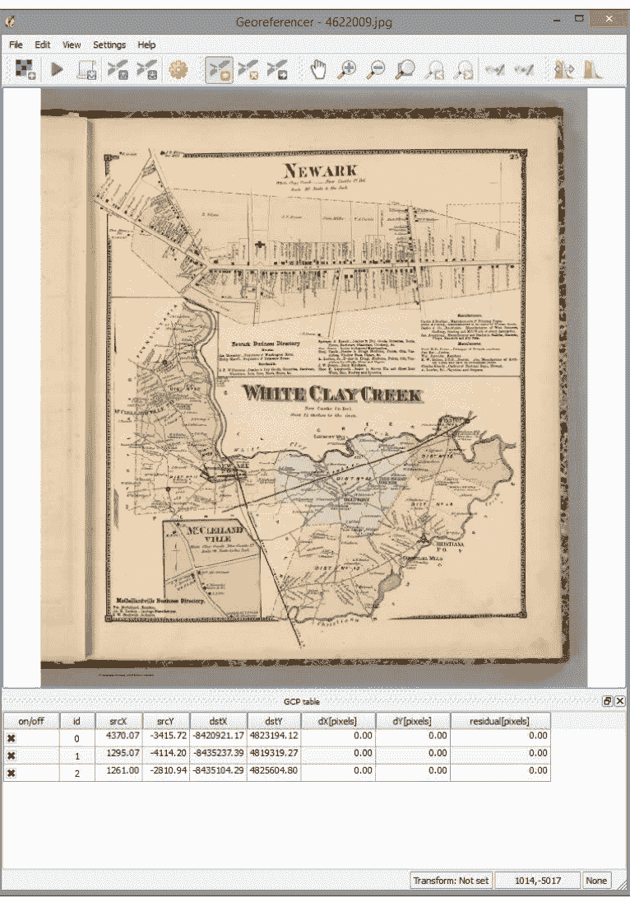

- 11. 点击播放按钮开始地理配准。

- 12. 输入变换设置信息，如下图所示：

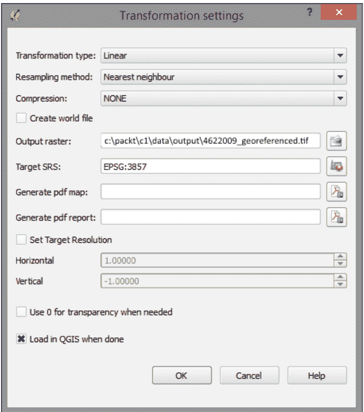

- 13. 现在，再次点击播放按钮开始地理配准。

图像完成地理配准后，您应该会看到它与地图上的其他数据对齐。您可以在 **图层属性** | **透明度** 下调整图层的透明度：

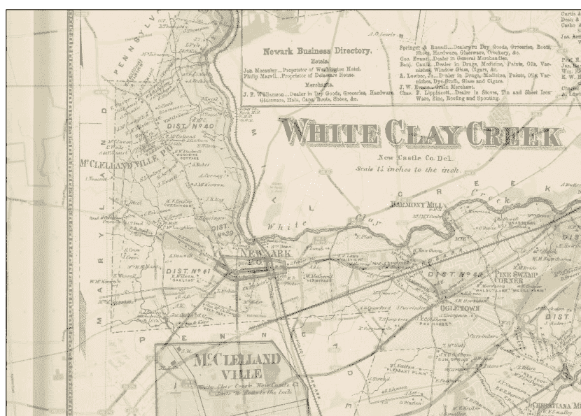

## 空间参考处理——使坐标对齐

QGIS 有时会对添加到画布上的所有数据以项目 CRS（在 **项目 | 项目属性 | CRS** 下定义）进行 **动态 (OTF)** 投影。对于要用于 Web 应用程序的项目，您可能需要禁用 OTF 投影，因为所有图层都应具有独立定义的空间参考，并在需要时转换或投影到相同的 CRS。

### 设置 CRS

当收到的地理空间数据没有描述其坐标的空间参考系统的元数据时，有必要指定一个系统。可以通过右键单击“图层面板”中的图层，选择“另存为”，然后选择新的 CRS 来完成。

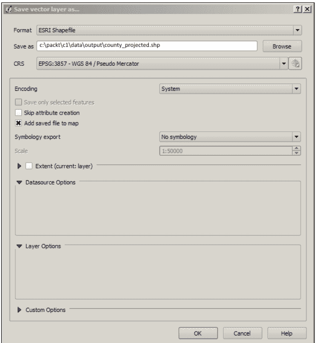

### 变换与投影

在其他情况下，收到的数据可能使用与项目中其他数据不同的 CRS。当 CRS 不同时，应小心考虑是更改新的不符合数据的 CRS，还是更改现有数据的 CRS。当然，我们希望选择一个支持我们精度或范围需求的系统；在其他情况下，当我们已经有合适的底图时，我们会希望操作图层符合底图的系统。当已有合适的底图可供我们的 Web 应用程序使用时，我们通常可以在项目中采用底图的系统。所有主要的第三方底图提供商都使用 Web 墨卡托投影，现在称为 EPSG:3857。

## 探索地点——从概念到界面

您可以将数据从地理坐标投影到投影坐标，或者从一种投影转换到另一种投影。这可以通过与定义投影相同的方式完成：右键单击“图层面板”中的图层，选择“另存为”，然后选择新的 CRS。默认情况下通常会应用适当的变换。

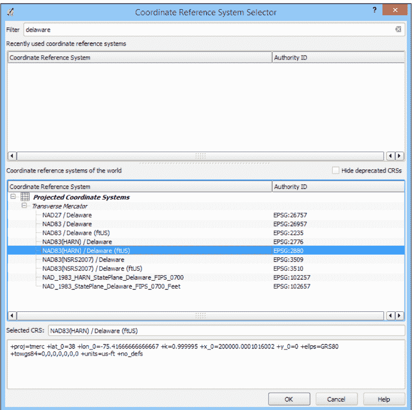

CRS 选择器中有些功能您应该注意。通过从“最近使用的坐标系”中选择，您通常可以轻松地将新 CRS 与工作区中已有的 CRS 匹配。您还可以通过在“过滤器”输入框中输入内容来搜索可用系统。您会在对话框底部看到所选 CRS 的 PROJ.4 WKT 表示。

## 可视化 GIS 数据

虽然数据已通过 ETL 流程添加到 GIS 中，但如果不添加一些可视化增强功能，其价值有限。

### 图层样式

图层样式通过“图层属性”对话框中的“样式”选项卡配置。“单一符号”样式是默认样式类型，它仅使用相同的基本符号显示所有地理图层对象。这种设置除了对象明显的空间特征外，不提供对象之间的任何视觉差异。“分类”和“渐变”样式类型可根据您选择的属性表字段提供不同的样式。“渐变”适用于定量数据，在将颜色和符号大小映射到数值标度方面特别强大。所有这些均通过“图层属性”|“样式”选项卡完成。

要为数据配置简单的渐变图层样式，请执行以下步骤：

- 1. 在“图层属性”|“样式”选项卡下，选择“渐变”作为样式类型。
- 2. 在“列”中选择定量字段（例如 temperature_mean_temp）。
- 3. 点击“分类”将数据分组为指定数量的类别（默认情况下为 5 个），并选择分类模式（默认情况下为“等间距”）：

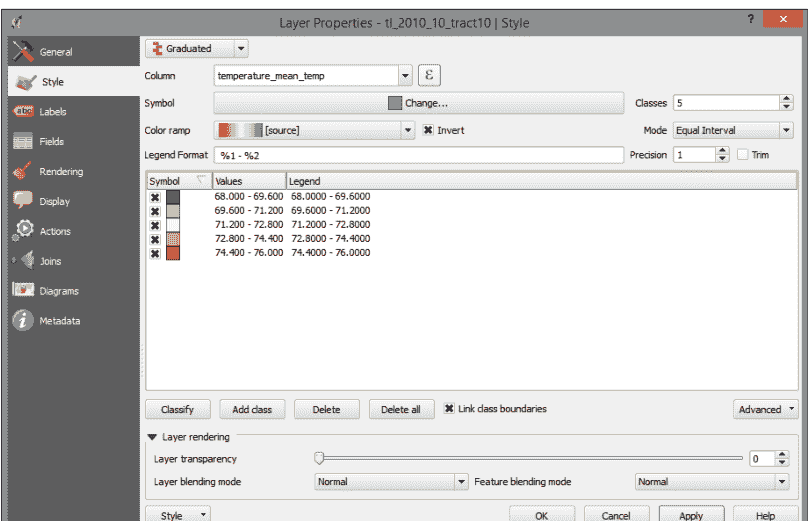

- 4. 现在，点击“应用”。

如果您对已连接的区块/温度图层应用上述步骤，您将看到类似于下图的内容：

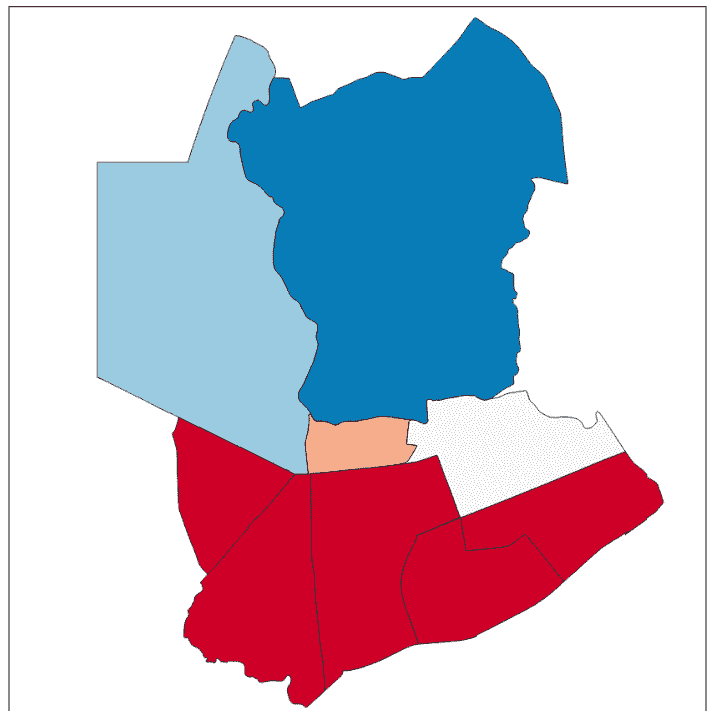

- 5. 如果您想同时查看其他图层，可以在此处添加一些图层透明度。如果该图层要包含在底图中，这将非常合适。

> 您可以使用“图层属性”|“样式”选项卡底部的“样式”菜单来保存和加载图层样式。例如，如果您希望将相同的样式应用于不同的图层，这很有用。

- 6. 现在，点击“确定”。

您现在将看到以下输出：

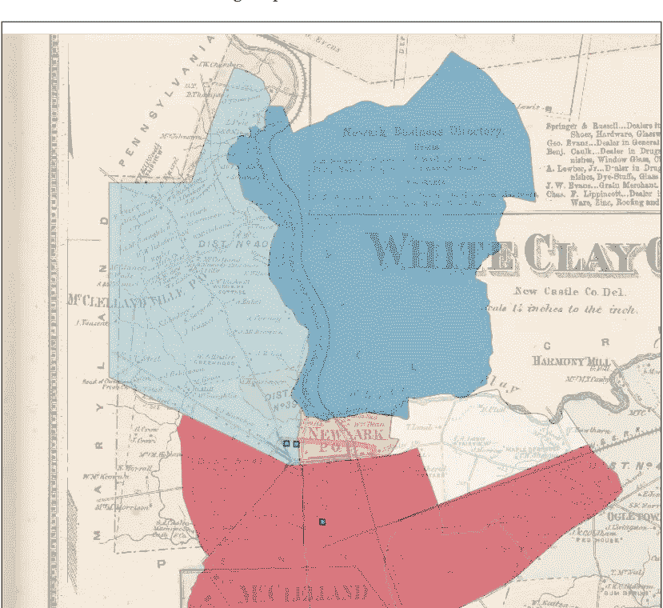

也许城市北部较低的温度与城市其他部分的历史发展有关。

## 标签

标签可以在不需要弹出窗口或图例的情况下在地图中提供重要信息。由于标签由软件自动放置（它们在空间中不具有实际物理位置），因此会遇到特定的放置问题。此外，标签文本过多的地图很快就会变得混乱。有时，可以通过集成的 QGIS 操作轻松地将标签渲染到切片中；其他时候，这需要外部渲染引擎或地图服务器。这些问题将在本章后面讨论。

要为示例中的地址点添加标签，请转到该图层的“图层属性”|“标签”选项卡。执行以下步骤：

- 1. 在“用于标注此图层的字段”中选择 address。请注意，此选择旁边的复选框将被切换。所有其他标签样式选项将保持不变，如下图所示：

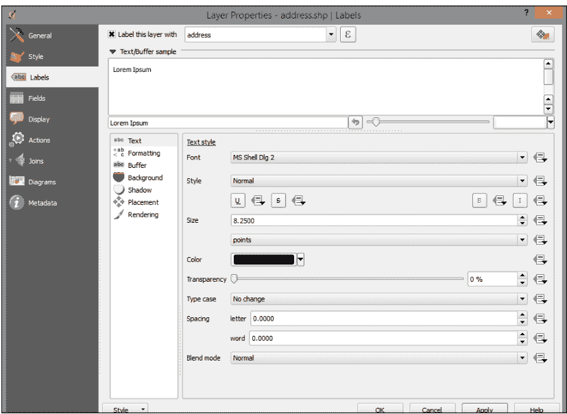

- 2. 打开“缓冲”子选项卡，并切换“绘制文本缓冲”：

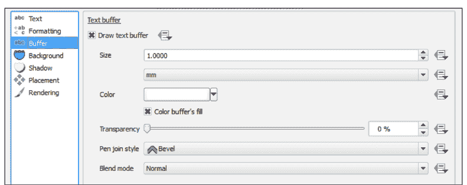

- 3. 点击“确定”后，您将看到类似以下截图的内容：

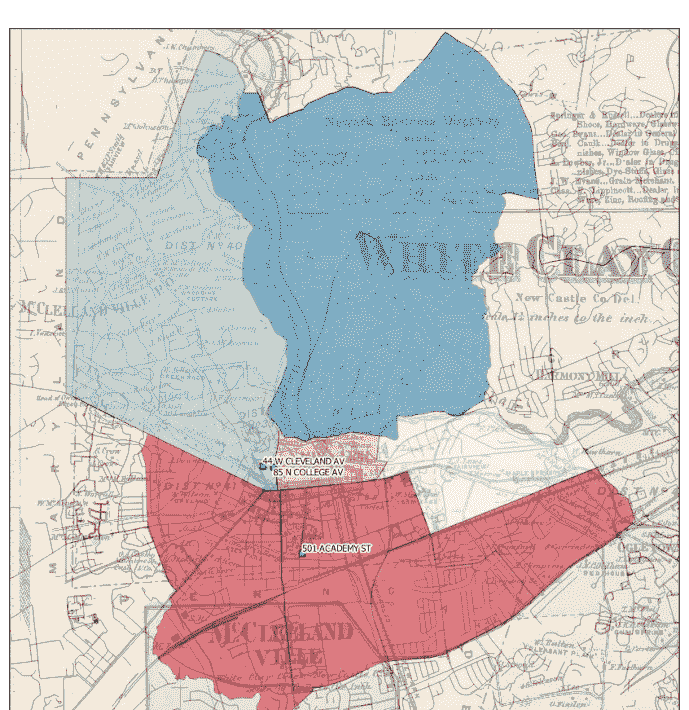

## 底图

在 Web 地图应用程序中，底图的含义有时不同于打印地图中的底图。底图是地图可视化中不变的、通常缓存的图层，往往出现在支持交互的图层后面。在我们的示例中，底图可以是经过地理配准的历史图像，单独使用或与其他图层一起使用。

如果适合您的项目，您应考虑使用公共底图服务。您可以使用 QGIS 中的 OpenLayers 插件浏览其中一些选项。


如果满足以下条件，请使用底图服务：

- 地理要素为操作图层提供足够的上下文
- 范围适合您的地图界面
- 比例级别适合您的地图界面，尤其是最小和最大比例
- 底图标签和符号不遮挡操作图层
- 地图服务提供与预期用途一致的使用条款
- 您不需要在断开互联网时也能查看底图

如果我们的底图不能像示例中那样通过 Web 服务获得，我们就必须将注意力转向其生产。重要的是考虑什么是底图，以及它与操作图层有何不同。

底图中包含的地理参考要素根据地图的预期用途和受众进行选择。通常，这包括某些边界、道路、地形、水系等。


除了这些参考要素之外，如果您不需要以下功能，可将地理对象类别包含在底图中：

- 定期更新几何数据
- 提供样式更改功能
- 允许类别对象的可见性独立于其他数据而变化
- 将类别中的对象暴露给界面控件

假设我们将使用某种缓存机制来存储和提供底图，那么我们将通过在底图中尽可能多地包含对象来优化性能。


## 使用OpenStreetMap作为底图数据

获取底图数据并非一项简单的任务。如果通过Web服务可以获得合适的地图服务，则会大大简化这一任务。否则，您必须从本地系统获取支持数据，并将其渲染为合适的制图格式。

创建底图并使其保持更新所面临的一个挑战是与不同数据提供商的交互。对于不同类别的地理对象，不同的组织往往被认为是首选提供商。由于不同组织的参与，必然会产生不同的数据格式约定。

**OpenStreetMap (OSM)** 是一个用于地理参考数据的开放数据存储库，既提供地图服务，也提供数据。除了OSM自身的地图服务外，该数据存储库还是许多提供免费底图服务的其他项目的来源。

OpenStreetMap 使用比大多数数据提供商更抽象、更具可扩展性的模式。OSM 数据包含一些系统字段，例如 `osm_id`、`user_id`、`osm_version` 和 `way`。`osm_id` 字段对于每个地理对象都是唯一的，`user_id` 对于最后修改该对象的用户是唯一的，`osm_version` 对于该对象的版本是唯一的，而 `way` 是对象的几何形状。

通过允许在之前提到的系统字段之外添加理论上无限数量的键值对，OSM 数据模式可以潜在地容纳任何类型的数据，同时保持合理有序。键是数据编辑者添加到他们上传到存储库的数据中的内容。成熟的键在 OSM 网站上有文档记录，并且与社区制作的渲染样式兼容。如果社区制作的样式不包含您需要或您创建的键，您可以简单地将它添加到自己的渲染样式中。在导入阶段，列不会使本地数据库不堪重负。只有本地配置文件中添加的键才会被添加到数据库模式中并进行填充。

使用 OSM 数据制作高质量地图是一个持续的挑战。CloudMade 以基于云的 OSM 数据渲染编辑器为基础开展业务，尽管该编辑器功能有限，但也能提供地图服务。实际上，CloudMade 是 OSM 数据云服务的优秀来源，并且提供了许多视觉上吸引人的样式。由海德堡大学一个研究小组制作的 OpenMapSurfer 展示了使用 OSM 数据进行高质量制图的一些最佳实践，包括复杂的标注放置、对象级比例依赖、精心选择的颜色，以及带阴影的地形起伏和等深线。

要在本地获取 OpenStreetMap 数据以生成您自己的底图，请执行以下步骤：

1. 如果尚未安装 OpenLayers 和 OSMDownloader QGIS 插件，请先安装它们。
2. 创建一个新的 SpatiaLite 数据库。
3. 打开 OSM：
   1. 导航到 Web | OpenLayers | OpenStreetMap | OpenStreetMap。
4. 浏览您感兴趣的区域。
5. 下载您感兴趣的区域：
   1. 导航到 Vector | OpenStreetMap | Download Data：

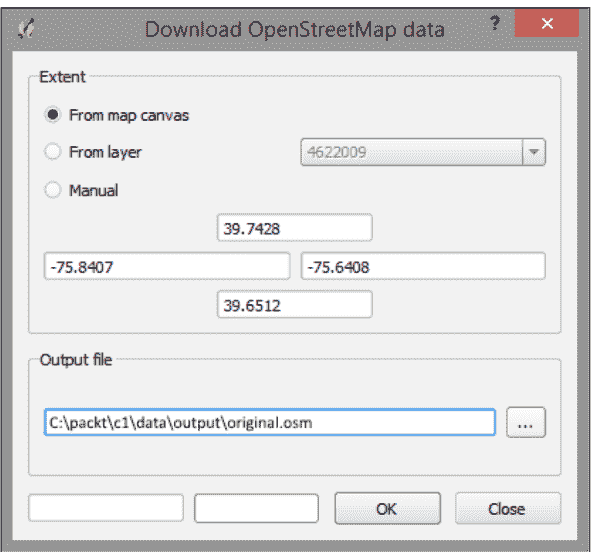

6. 将下载的 XML 数据导入拓扑 SQLite 数据库。该数据库不包含 SpatiaLite 地理对象，而是以表中对象之间的拓扑关系来表达。拓扑关系将在*第4章“找到最佳路线”*和*第5章“展示变化”*中更深入地探讨。
   1. 导航到 **Vector | OpenStreetMap | Import Topology from XML**。

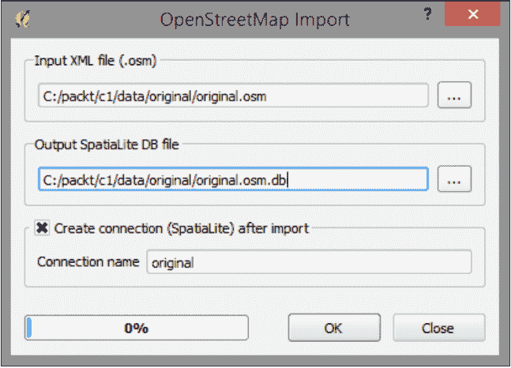

7. 通过以下步骤将拓扑转换为 SpatiaLite 空间表：
   1. 导航到 **Vector | OpenStreetMap | Export Topology to SpatiaLite**。
   2. 选择要导出的点、折线或多边形。
   3. 然后，选择您可能希望用于样式设置目的的字段。您可以通过单击 **Load from DB** 来填充可能字段的列表。
   4. 您可以重复此步骤以导出其他几何类型，如以下屏幕截图所示：

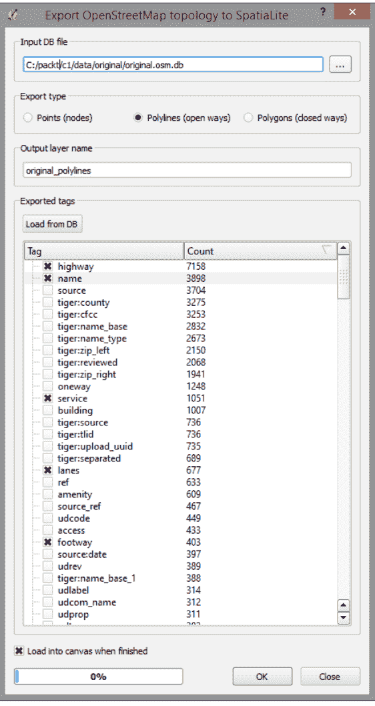

8. 现在，您可以按照自己的喜好为此设置样式，并将其导出为瓦片底图。然后，您可以将其保存为 Mapnik 或 SLD 样式，以便在外部瓦片缓存软件中进行渲染。

以下是一个 OSM 数据以基本的单一符号样式叠加到其他图层上的示例：

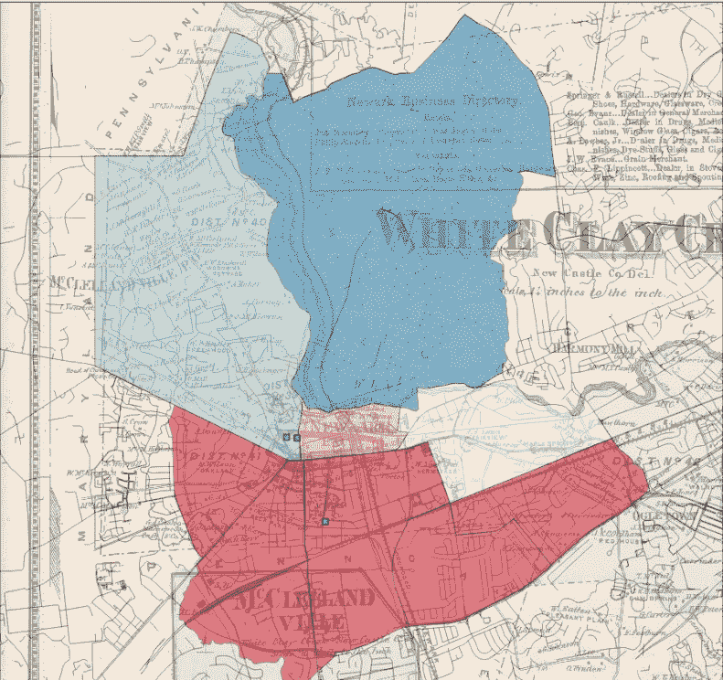

## 避免模糊与混乱

当然，在底图中堆积数据并非没有缺点。除了因设计而造成的功能相对损失外，底图可能很快变得杂乱无章且不清晰。图层和标注的比例依赖关系会动态改变信息的显示，以避免底图地理类别的混淆。

### 图层比例依赖

当某些地理对象类别在特定比例下不需要可视化时，可以使用整个图层比例依赖来隐藏该图层。例如，在上图中，我们可以在较小的比例下看到所有图层，包括地理编码地址，即使它们可能不清晰可见。为了简化信息，我们可以应用图层比例依赖，使该图层不显示这些小比例。

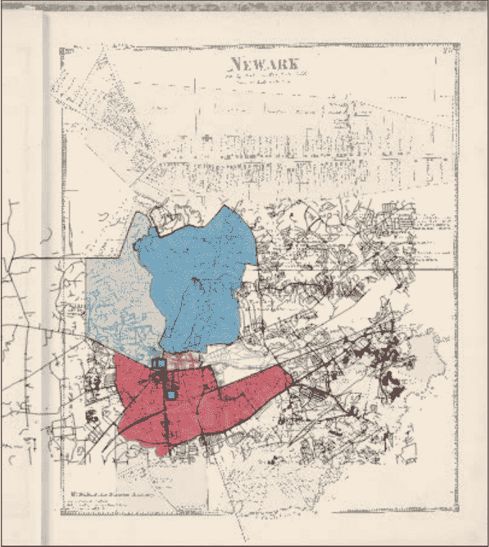

在此比例下，某些对象并不清晰可见。使用图层比例依赖，我们可以让这些对象在此比例下不可见。

还可以在图层内的地理对象级别上通过比例来改变可见性。例如，您可能希望在较小的比例下仅显示主要道路。然而，这通常需要更多的努力来制作。对象级可见性可以由已经存在的属性或专门为比例依赖而创建的属性来驱动。它也可以根据对象的几何特征（例如其面积）来定义。一般来说，较小的要素在较低比例下不应可见。

使用整个图层依赖来实现对象级图层依赖的一种常见方法是选择符合给定条件的对象，并从中创建新图层。比例依赖可以应用于现在包含在此单独图层中的对象类别子集。

您需要按照与常用比例一致的比例比来设置图层比例依赖。这些比例基于一些假设，包括关于瓦片图像分辨率（96 dpi）和瓦片尺寸（256px x 256px）的假设。

| 缩放级别 | 对象范围 | 96 dpi 下的比例尺 |
|------|---------------|-----------------|
| 0 | 整个星球 | 1 : 59165752759.16 |
| 1 |  | 1 : 295,829,355.45 |
| 2 |  | 1 : 147,914,677.73 |
| 3 |  | 1 : 73,957,338.86 |
| 4 |  | 1 : 36,978,669.43 |
| 5 | 国家 | 1 : 18,489,334.72 |
| 6 |  | 1 : 9,244,667.36 |
| 7 |  | 1 : 4,622,333.68 |
| 8 | 州 | 1 : 2,311,166.84 |
| 9 |  | 1 : 1,155,583.42 |
| 10 | 大都市 | 1 : 577,791.71 |
| 11 |  | 1 : 288,895.85 |
| 12 | 城市 | 1 : 144,447.93 |
| 13 |  | 1 : 72,223.96 |
| 14 | 城镇 | 1 : 36,111.98 |
| 15 |  | 1 : 18,055.99 |
| 16 | 次要道路 | 1 : 9,028.00 |
| 17 |  | 1 : 4,514.00 |
| 18 | 人行道 | 1 : 2,257.00 |

### 标注冲突

标注通常与底图图层本身分离。原因之一是，如果标注包含在底图图层中，它们会被显示在其上方的操作图层遮挡。另一个原因是，瓦片缓存有时不能妥善处理标注，导致标注碎片缺失。标注还应该按照其自身的比例依赖来显示，在较小比例下仅过滤出最重要的标注。如果您有许多需要标注的图层和对象，这可能是使用地图服务器或至少像 Mapnik 这样的渲染引擎的一个很好的用例。

### 多边形标注冲突解决

为了在地图输出中实现标注图层之间的冲突解决，我们将把要标注的地理对象转换为质心——即每个对象中间的点——然后与标注字段一起作为标注图层显示。

1. 通过以下步骤将对象转换为点：
   1. 导航到 Vector | Geometry Tools | Polygon Centroids。
   2. 如果多边形存储在数据库中，请创建一个 SQL 视图，其中存储了多边形，如下面的代码所示：
2. 在地图服务器或渲染器中创建一个与标注对应的图层。
3. 通过 SLD 或您将使用的任何样式标记添加调整。GeoServer 实现在解决冲突和改进位置放置方面特别出色。

```
CREATE VIEW AS
SELECT polygon_class.label, st_centroid
    (polygon_class.geography) AS geography
FROM polygon_class;
```

第7章“为企业与社区进行地图绘制”包含一个更详细的蓝图，用于在 GeoServer 中使用 SLD 创建具有制图增强放置和冲突解决的标注图层。

底图的特征将影响地图界面中的交互、平移和缩放范围。您需要一个能够覆盖地图界面上要显示区域范围的底图，并可能将界面限制在感兴趣区域内。这样，查看某个州一角的建筑集合的人就不会在平移时迷失到另一个州的相反角落！当您缓存底图时，您需要指明希望缓存到此范围。同样，可查看的比例尺将在缓存底图时配置，您需要指明哪些比例尺是需要的。这会影响增量步长，即缩放工具增大或减小地图比例尺的步长。


## 瓦片缓存

缓存底图数据以使其快速加载的最佳方法是将其保存为单个图像。无需浏览器对许多几何要素进行可能复杂的渲染，只需将与查看比例和范围相对应的少量图像从客户端快速传输到服务器并显示即可。这些预渲染图像被称为瓦片，因为当请求底图时，这些方形图像将无缝显示。现在，这是准备Web制图数据的标准方法。在本书中，我们将介绍两种创建瓦片缓存的工具：QTiles插件（第1章，探索地点——从概念到界面）和TileMill/MBTiles（第7章，为企业与社区制图）。

|  | 配置时间 | 执行时间 | 视觉质量 | 存储在单个文件中 | 存储为图像目录 | 适合标注 |
|---|---|---|---|---|---|---|
| QTiles插件 | 1 | 3 | 3 | 否 | 是 | 否 |
| GDAL2Tiles.py | 2 | 1 | 2 | 否 | 是 | 否 |
| TileMill/MBTiles | 3 | 2 | 1 | 是 | 否 | 是 |
| GeoServer/GWC | 3 | 2 | 1 | 否 | 否 | 是 |

您需要特别注意所使用的瓦片存储方案。TileMill使用的.mbtiles格式是一个SQLite数据库，需要借助支持它的地图界面（如Leaflet）来读取。QTiles插件和GDAL2Tiles.py使用XYZ瓦片方案，其分层目录分别基于行（X）、列（Y）和缩放级别（Z），原点位于地图左上角。这是最流行的瓦片方案。TMS瓦片方案有时被GeoServer开源地图服务器使用（它支持多种方案/服务规范），OSGeo也接受该方案，两者几乎相同；但原点位于地图左下角。这常常导致一些令人困惑的结果。请注意，缩放级别是根据瓦片方案的瓦片尺寸和分辨率标准化的（例如，256 x 256像素）。

## 生成并测试简单的基于目录的瓦片缓存结构

我们现在将使用QTiles插件生成基于目录的ZYX瓦片方案缓存。执行以下步骤：

- 1. 安装QTiles和TileLayer插件。
  - QTiles列在实验性插件下。您必须修改插件设置以显示实验性插件。导航到“插件 | 管理和安装插件 | 设置 | ‘同时显示实验性插件’”。
- 2. 运行QTiles，创建一个新的mytiles瓦片集，最小缩放级别为14，最大为16。
- 3. 在下一个示例中，您将体会到该目录的价值。

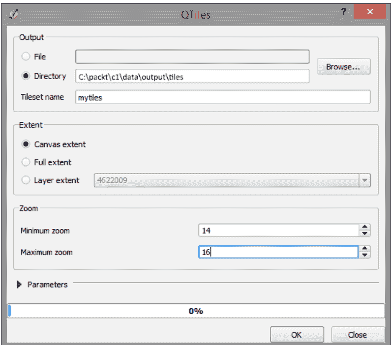

4. 您可以通过查看创建它们的目录来测试并确认瓦片是否已生成。它们位于瓦片方案中由Z、X、Y网格位置指定的编号子目录下。例如，此处有一个瓦片位于`15/9489/12442.png`。即缩放级别15，网格方案中的经度9489，网格方案中的纬度12442。

您现在将看到以下输出：

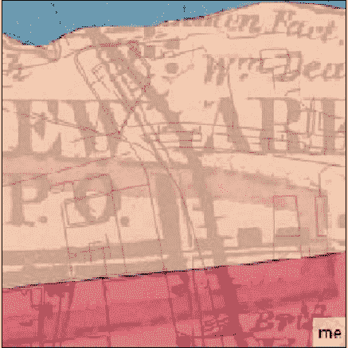

## 为TileLayer插件创建图层描述文件

创建一个扩展名为`tsv`（制表符分隔）且采用UTF-8编码的图层描述文件。这是一种通用文本编码，在Web上广泛使用，有时出于兼容性需要。

> 请注意，后六个参数是可选的，可以避免瓦片缺失。在以下示例中，我只使用与地图缩放级别相关的z参数，即zmin和zmax。

- 1. 将包含所有瓦片参数的以下形式文本添加到新文件：
  
  `title credit url yOriginTop [zmin zmax xmin ymin xmax ymax]`
  
  - 例如，`mytiles me file:///c:/packt/c1/data/output/tiles/mytiles/{z}/{x}/{y}.png 1 14 16.`
  - 在上面的示例中，描述文件引用了一个本地Windows文件系统路径，其中存储了瓦片化的`.png`图像。

- 2. 将mytiles.tsv保存到以下路径：
  [你的主目录]/.qgis2///python/plugins/
  TileLayerPlugin/layers

  对我来说，在Windows上，路径是C:\Users\[user]\ .qgis2\python\plugins\TileLayerPlugin\layers。

> 请注意，.qgis2在某些系统上可能是隐藏目录。请确保显示隐藏的目录/文件。

保存TSV文件的位置路径可以在“Web | TileLayer Plugin | 添加瓦片图层 | 设置 | 外部图层定义目录”下找到或设置。

使用TileLayer插件预览它。您应该能够从TilerLayerPlugin对话框中添加图层。既然图层描述文件已添加到正确位置，让我们前往Web TileLayerPlugin | 添加瓦片图层：

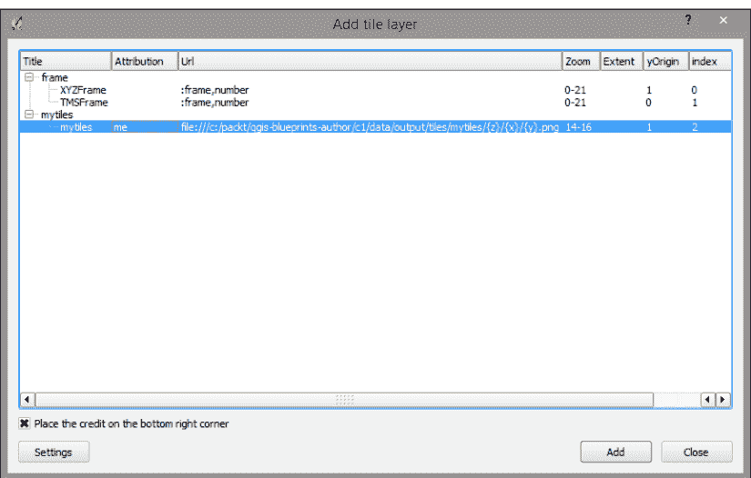

选择图层后，点击**添加**。您的瓦片将类似于下图所示：

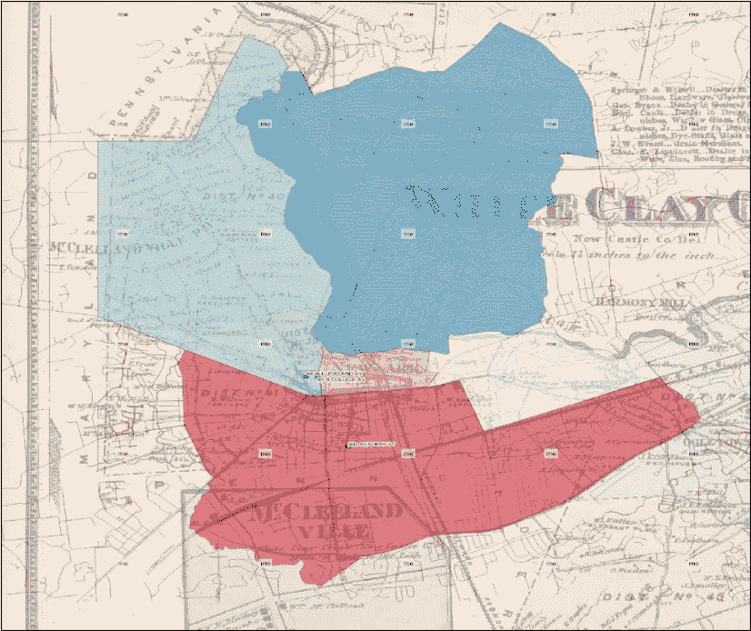

> 请注意每个瓦片右下角的署名值。

## 总结

在本章中，您学习了必要的背景知识，并采取了步骤来启动并运行QGIS。我们对基于位置的数据执行了ETL，以将其与GIS项目进行地理空间集成。您学习了围绕图层样式和标注的基本GIS可视化技术。最后，在考虑底图特性之后，我们生成了一个可以在QGIS中预览的瓦片缓存。在下一章中，我们将使用栅格分析来生成一个操作图层，以便在简单的Web地图应用程序中进行交互。

## 识别最佳地点

在本章中，我们将了解如何对栅格数据进行分析、增强并用于地图制作。具体来说，您将学习如何利用栅格分析和地图代数，根据其他栅格中的标准值生成适宜位置网格。然后，使用该网格，我们将制作一个简单的基于点击的地图。最终结果将是一个具有基于点击发现功能的场地适宜性Web应用程序。我们将研究耕地保护选址的适宜性。

在本章中，我们将涵盖以下主题：

- 用于栅格分析的矢量数据ETL
- 批处理
- 栅格分析概念
- 地图代数
- 累加建模
- 邻近分析
- 用于矢量发布的栅格数据ETL
- 使用qgis2leaf发布Leaflet地图应用程序

## 矢量数据 – 提取、转换和加载

我们的适宜性分析使用地图代数和标准网格，为每个地方的某种活动给出一个适宜性值。这要求数据以栅格（网格）格式表示。因此，让我们执行其他必要的ETL步骤，然后将矢量数据转换为栅格。

我们将执行以下操作：

- 确保我们的数据具有相同的空间参考系统。例如，我们可能使用由州交通部门维护的道路图层，以及由自然资源部门维护的土地利用图层。这些图层必须具有相同的空间参考系统，或者被转换为具有相同的系统。
- 如果我们希望在矢量形式下对地理对象进行操作，则根据某个属性表字段中定义的类别提取地理对象。
- 如果不需要进一步分析，则转换为栅格。

## 加载数据并建立CRS一致性

对于该项目中的图层而言，将其转换或投影到相同的地理或投影坐标系非常重要。这对于准确分析和发布为Web格式是必要的。为此执行以下步骤：

- 1. 如果启用了“即时”投影，请将其禁用。否则，“即时”将自动重新投影您的数据，以便与画布中已有的图层一起显示。
  1. 导航到“设置 | 选项”，然后配置以下屏幕截图中显示的设置：


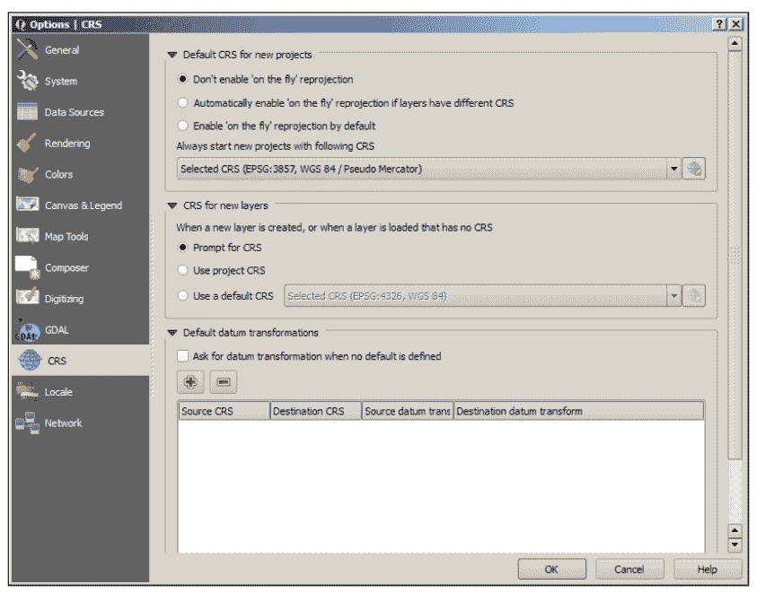

+   2. 添加项目图层：
+      2. 导航到 图层 | 添加图层 | 矢量图层。
+      3. 从 c2/data/original 中添加以下图层。
+         Applicants
+         County
+         Easements
+         Land use
+         Roads

## 确定最佳位置

> 💡 您可以按住 **Shift** 并点击连续文件，或按住 **Ctrl** 并点击非连续文件来选择多个图层添加。

+   3. 从 `c2/data/original/dem/dem.tif` 导入数字高程模型。
+      1. 导航到 **图层 | 添加图层 | 栅格图层**。
+      2. 从 dem 目录中选择 `dem.tif`，然后点击 **打开**。

+   4. 即使图层采用不同的 CRS，QGIS 在这种情况下也不会提醒我们。您必须通过逐个检查每个图层来发现问题。检查 county 图层和另一个图层的 CRS：
+      1. 在 **图层** 面板中高亮显示 county 图层。
+      2. 导航到 **图层 | 属性**。
+      3. CRS 显示在 **常规** 选项卡下的 **坐标参考系统** 部分中：

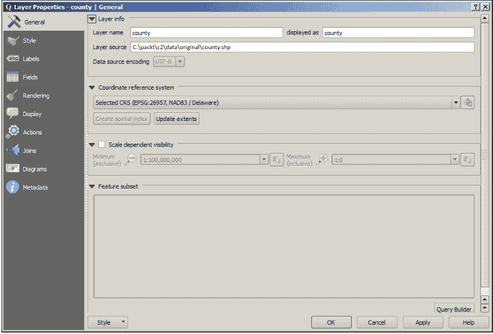

> 🗺️ 请注意，county 图层使用 **EPSG: 26957**，而其他图层使用 **EPSG: 2776**。

+   5. 按照 *第 1 章“探索地点——从概念到界面”* 中的步骤进行变换和投影。我们将把 county 图层从 EPSG:26957 变换为 EPSG:2776。

+   1. 导航到 **图层 | 另存为 | 选择 CRS**。

> 我们将把本章的所有输出保存在 `c2/data/output` 中。

为了准备将图层转换为栅格，我们将为所有图层添加一个通用新列，并用数字 1 填充。这将转换为布尔型栅格，其中栅格所代表对象（例如道路）的存在以值为 1 的单元表示，所有其他单元为 0。请对 applicants、easements 和 roads 图层执行以下步骤：

+   1. 导航到 **图层 | 切换编辑**。

+   2. 然后导航到 **图层 | 打开属性表**。

+   3. 使用 **属性表** 对话框顶部的按钮添加一列。

+   4. 使用 `value` 作为新列的名称，并采用以下数据格式选项：

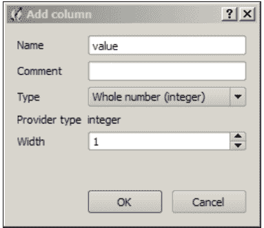

5. 从属性表的下拉菜单中选择新列，并在值框中输入 1：

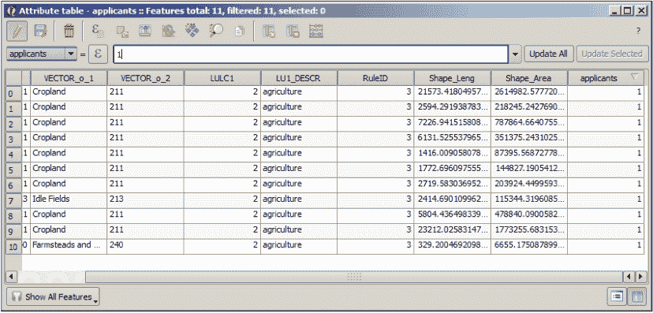

+   6. 点击 更新全部。
+   7. 导航到 图层 | 切换编辑。
+   8. 最后，保存。

## 提取（筛选）要素

假设我们的条件只包括 roads 图层中的一部分要素——主要非限制通行道路（但不包括高速公路），即由分类代码（CFCC）确定的要素子集。为了临时提取这个子集，我们将通过以下步骤执行图层查询：

+   1. 从 roads 图层中筛选出主要道路。
+      1. 高亮显示 roads 图层。
+      2. 导航到 图层 | 查询。
+      3. 双击 CFCC 以将其添加到表达式中。
+      4. 点击 = 运算符以添加到表达式中。
+      5. 在“值”部分下，点击“全部”以查看 CFCC 字段中的所有唯一值。
+      6. 双击 A21 以将其添加到表达式中。
+      7. 对所有小于 A36 的代码重复此操作。包括 A63（用于高速公路上匝道）。

8. 您的选择代码将类似于以下内容：

```
"CFCC" = 'A21' OR "CFCC" = 'A25' OR "CFCC" = 'A31' OR "CFCC" = 'A35' OR "CFCC" = 'A63'
```

9. 点击 确定，如下面的截图所示：

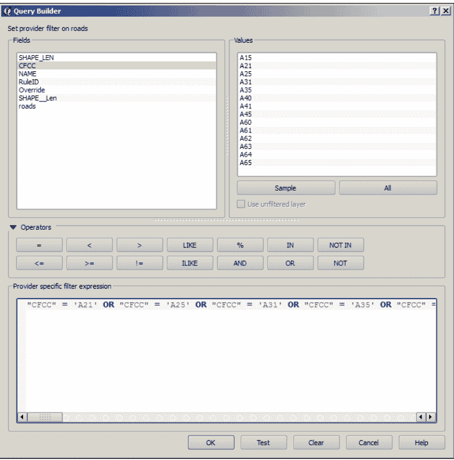

2. 将 roads 图层保存为一个新图层，仅包含所选要素（major_roads），存放到 c2/data/output。

> 要清除图层过滤器，请返回已应用图层的查询对话框（在“图层”窗格中高亮显示该图层；导航到 图层 | 查询，然后点击 清除）。

+   3. 对 `landuse` 图层中的 `developed (LULC1 = 1)` 和 `agriculture (LULC1 = 2)` 土地利用（分别）重复这些步骤。

## 转换为栅格

在本节中，我们将把所有需要的矢量图层转换为栅格。我们将以批处理方式进行转换，这样就可以在多个图层上多次重复相同操作。

## 一次完成更多操作——批处理

QGIS 处理框架提供了在不同数据上多次运行相同操作的功能。这称为**批处理**。批处理过程从**处理工具箱**中某个操作的上下文菜单中调用。批处理对话框要求为每次迭代填充每个图层参数。执行以下步骤：

+   1. 将矢量图层转换为栅格。
+      1. 导航到 **处理工具箱**。
+      2. 从 **处理工具箱** 底部的下拉菜单中选择 **高级界面**（如果未选中，它将显示为 **简单界面**）。
+      3. 输入 `rasterize` 以搜索 **栅格化** 工具。
+      4. 右键点击 **栅格化** 工具，然后选择 **作为批处理过程执行**：

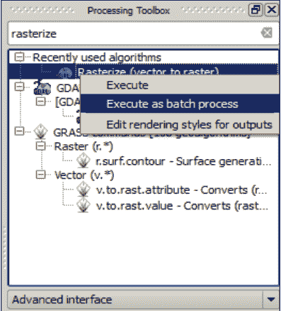

5. 填写批处理对话框，确保指定参数如下：

| 参数 | 值 |
|---|---|
| 输入图层 | （例如，roads） |
| 属性字段 | value |
| 输出栅格大小 | 输出分辨率（地图单位/像素） |
| 水平 | 30 |
| 垂直 | 30 |
| 栅格类型 | Int16 |
| 输出图层 | （例如，roads） |

下图显示了在 QGIS 中的效果：

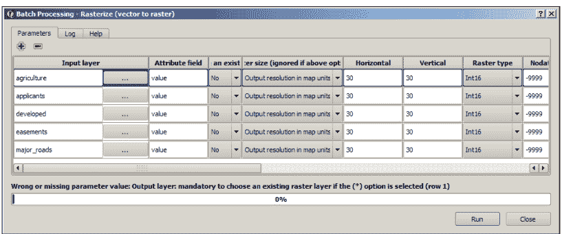

6. 向右滚动以完成参数值的输入。

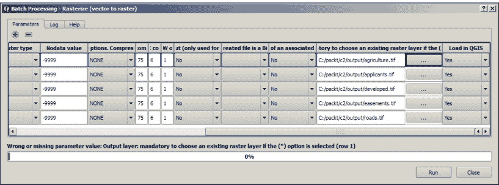

+   2. 组织新图层（可选步骤）。
+     - 批处理有时会因对话框中的某些错误而给出不友好的名称。
+     - 通过以下操作更改批处理创建的每个图层的名称：
+       1. 高亮显示该图层。
+       2. 导航到 **图层 | 属性**。
+       3. 将图层名称更改为用于创建该图层的矢量图层的名称（例如 `applicants`）。您应该能够在图层源（`.tif` 文件的名称）中通过图层属性找到该值的线索。
+       4. 对图层进行分组：
+          在 **图层** 面板中，按住 *Shift* 并点击批处理创建的所有图层以及之前的 `roads` 栅格。
+          右键点击选中的图层，然后点击 **分组所选**。

## 栅格分析

栅格数据通过将数据组织在均匀网格中，有助于分析连续现象或在子对象级别查找某些信息。在本例中，我们将使用连续的高程和邻近度数据，并从子申请者对象级别——即 30 米见方的像元级别——进行查看。您需要根据数据源的分辨率（例如，传感器大约相隔 30 米）、分析的粗糙度（区域还是局部）以及任何硬件限制来选择像元大小。

首先，让我们对栅格数据做几点说明：

+   - Nodata 指的是包含在栅格网格中的像元，因为网格不能有完全未定义的像元；但是，这些像元实际上应被视为*不在图层上*。
+   - QGIS 的栅格渲染器比其专有竞争对手的渲染器更有限。您需要使用**识别**工具以及自定义样式（**单波段伪彩色**）来理解输出。
+   - 在本例中，我们将大量依赖已封装到 QGIS 中的 GDAL 和 SAGA 库。这些库可以直接通过处理框架使用，无需在常规栅格 ETL 之外进行额外准备。如需其他功能，您需要考虑 GRASS 库。这些库也已封装并提供给 QGIS，但需要额外准备 GRASS 工作区。

现在，我们的所有数据都已转换为栅格格式，我们可以着手研究如何从这些图层中提取信息，并将这些信息结合起来，以选择最佳位置。

## 地图代数

地图代数是一种用于处理多个栅格图层和分析步骤的有用概念，它在对齐网格中的像元之间提供算术运算。这些运算会生成一个输出栅格，其中每组像元对应一个算术解的值。在本例中，我们将使用地图代数进行叠加建模。

## 叠加建模

现在，我们的所有数据都已转换为栅格格式，我们可以开始为选址目的进行建模。我们希望根据一组标准找出哪些像元最适合；这些标准要么已按惯例为该领域（例如农业保护区选址）确定，要么在建模时选定。叠加建模指的是将所有标准及相应权重相加，以找到最具价值的最佳区域的过程。

在本例中，我们选择了一些大致已知会影响农业保护区选址的标准，如下表所示：

| 图层 | 标准 | 规则 |
|---|---|---|
| applicants | 是否为申请者 | |
| easements | 邻近度 | < 2000 m |
| landuse (agriculture) | 土地利用，邻近度 | < 100 m |
| dem | 坡度 | >= 2 且 <= 5，平均值 |
| landuse (developed) | 土地利用，邻近度 | > 500 m |
| roads | 邻近度 | > 100m |

## 邻近度

邻近度网格工具将生成一个像元图层，每个像元的值等于其距另一个网格中最近的非 nodata 像元的距离。距离值以另一个网格的 CRS 单位给出。它还会生成方向网格和分配网格，其中包含最近 nodata 像元的方向和 ID。


# 创建与地役权网格的邻近关系

执行以下步骤：

+   1. 导航到 **Processing Toolbox**。
+   2. 在此工具箱中搜索 `proximity`。确保已选择 **Advanced Interface**。
+   3. 找到 **SAGA** 下的 **Proximity** 网格工具后，双击运行它。
+   4. 为 **Features** 字段选择 **easements**。
+   5. 为 **Distance** 指定输出文件为 `c2/data/output/easements_prox.tif`。
+   6. 对其他两个输出取消选中 **Open output file after running algorithm**，如下图所示：

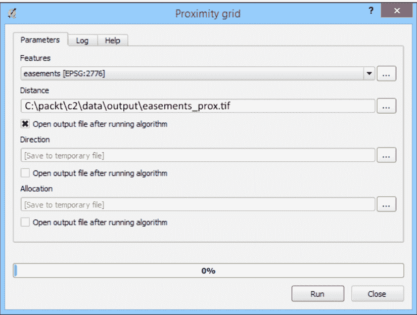

生成的网格为到最近地役权单元的距离。

4. 将输出保存在 c2/data/output 中。你可以保持其他输入为默认值。

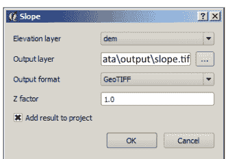

5. 输出将是每个单元的坡度，以垂直高程相对于水平距离的百分比表示（“上升/运行”）。

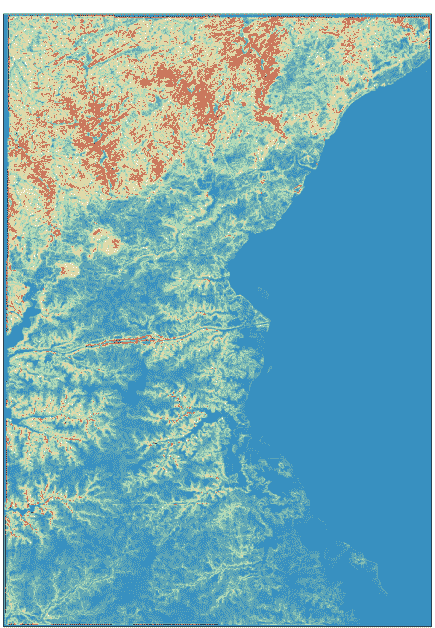

# 使用 Map Calculator 组合标准

1. 确保所有标准网格（proximity、agriculture、developed、road 和 slope）都出现在图层面板中。如果没有，请添加它们。

+   2. 打开栅格计算器对话框。
+     1. 导航到 Raster | Raster calculator

+   3. 输入地图代数表达式。

+   - 通过在栅格波段选择区域中双击它们来添加栅格图层
+   - 通过键入或点击运算符区域中的按钮来添加运算符
+   - 输入的表达式应如下所示：

```
("slope@1" < 8) + ("applicants@1" = 1) +
  ("easement_prox@1"<2000) + ("roads_prox@1">100) +
  ("developed_prox@1" > 500) + ("agriculture@1" < 100)
```

> [ 💡 @1 指栅格的第一个也是唯一一个波段。 ]

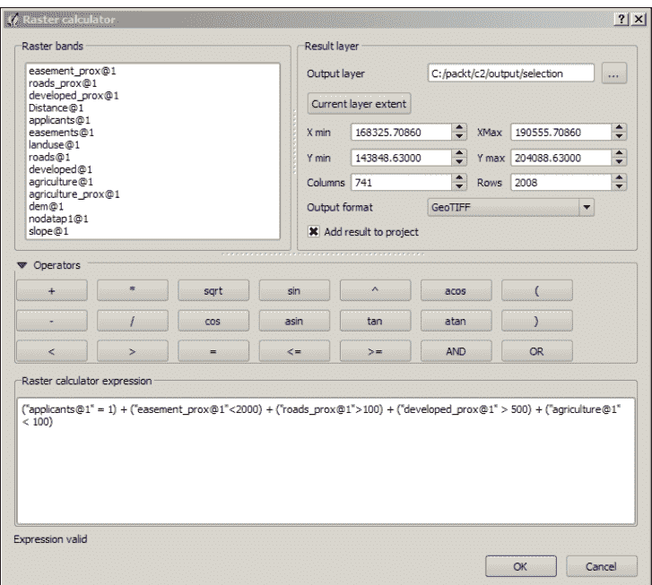

+   4. 为输出文件添加名称和路径并按 *Enter*。
+   5. 如果似乎什么都没发生，你可能需要设置样式。默认情况下，非零值设置为白色显示（与我们的背景颜色相同）。

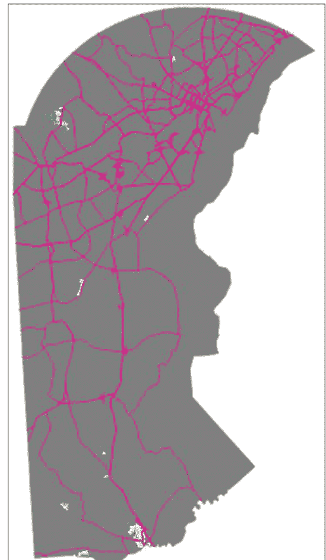

以下是前面地图图像的特写，以便你可以看到适宜性变化：

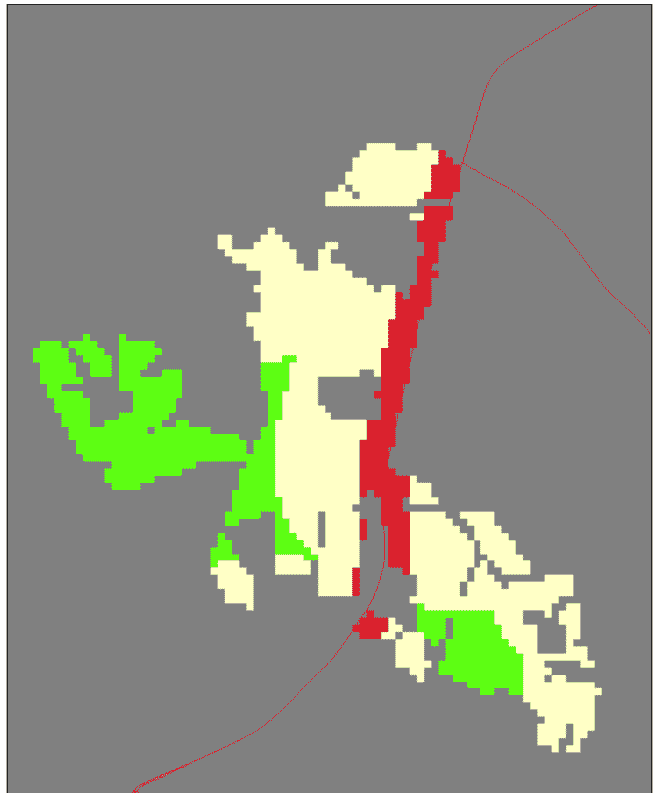

在前面的屏幕截图中，单元的评分如下：

+   - Green = 5（高）
+   - Yellow = 4（中）
+   - Red = 3（低）

+   4. 创建一个 `rank` 字段，根据区域统计步骤创建的 `_mean` 字段手动编辑每个值。这是每个单元平均适宜性的度量。我们将使用此字段作为标签，向普通受众传达相对适宜性；因此，我们需要排名而不是粗略的平均值。

+   5. 现在，标记图层。

+   1. 在 **Layer Properties** 下，激活 **Labels** 选项卡。
+   2. 选择 `rank` 字段作为要标记的字段。
+   3. 添加其他格式，例如标签放置和缓冲区（光晕），使用标签选项卡对话框内的内部选项卡，如下图所示：

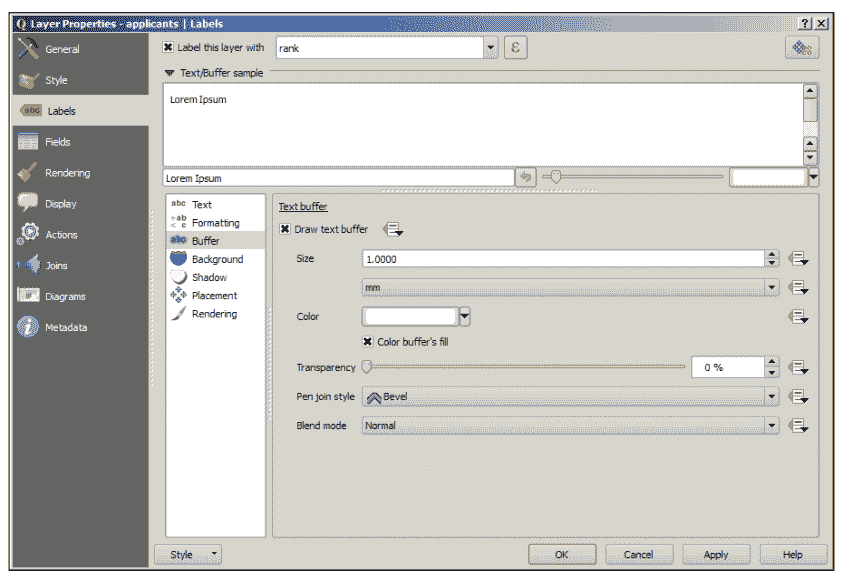

# 识别最佳地点

6. 为图层添加样式。

+   1. 选择 **Graduated** 样式。
+   2. 选择合适的颜色渐变、分类数量和分类类型。
+   3. 点击 **Classify** 按钮，如下图所示：

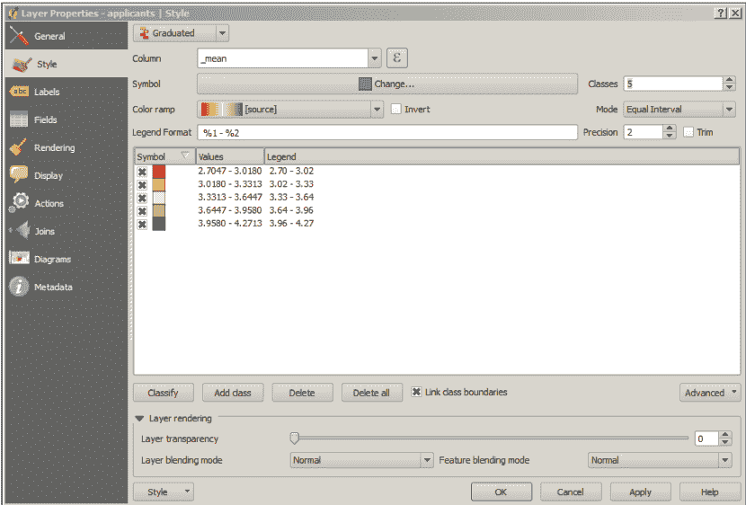

完成这些步骤后，你的地图将看起来类似于以下内容：

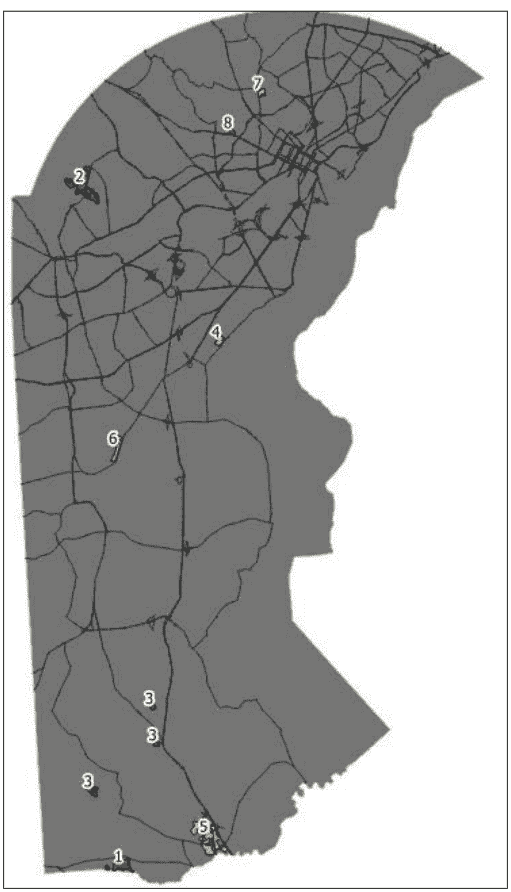

# 将结果作为 Web 应用程序发布

现在我们已经完成了农田保护选址的建模，让我们采取步骤将其发布到 Web。

# qgis2leaf

qgis2leaf 允许我们使用 Leaflet 地图 API 将 QGIS 地图导出为 Web 地图格式（JavaScript、HTML 和 CSS）。Leaflet 是一个非常轻量、可扩展且响应迅速（且时尚）的 Web 映射界面。

qgis2leaf 将我们所有的矢量图层转换为 GeoJSON，这是表达地理 JavaScript 对象的最常见文本方式。由于我们的操作图层位于 GeoJSON 中，Leaflet 的点击交互得到支持，我们可以通过点击访问图层中的信息。它是一个完全可编辑的 HTML 和 JavaScript 文件。你可以自定义并上传到可访问的 Web 位置，如后续章节中所述。

只要到目前为止图层已正确准备（例如关于 CRS），qgis2leaf 就非常简单易用。它在为我们的 Leaflet Web 地图创建良好的起始应用程序，包括 GeoJSON、HTML 和 JavaScript 方面也非常强大。执行以下步骤：

+   1. 如果尚未安装，请确保安装 qgis2leaf 插件。
+   2. 导航到 Web | qgis2leaf | Exports a QGIS Project to a working Leaflet webmap。
+   3. 点击 Get Layers 按钮，将当前显示的图层添加到 qgis2leaf 将导出的集合中。

+   4. 选择底图并在需要时输入其他详细信息。
+   5. 选择 **Encode to JSON**。

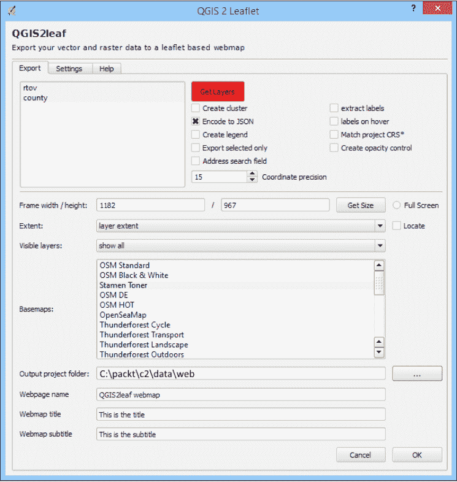

# 识别最佳地点

这些步骤将生成一个类似于以下内容的地图应用程序。我们将在下一章中查看如何恢复标签：

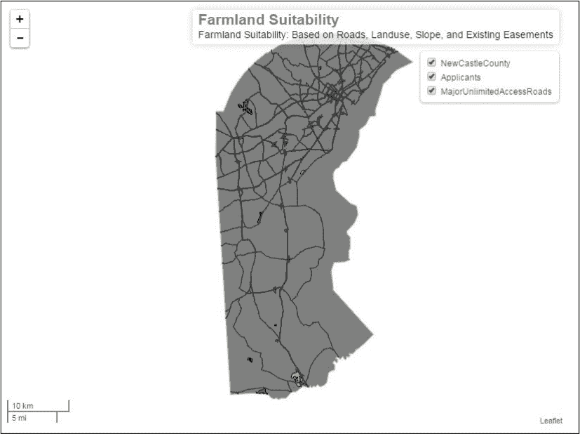

# 总结

在本章中，使用选址示例，我们涵盖了基本矢量数据 ETL、栅格分析和 Web 地图创建。我们从矢量数据开始，在统一 CRS 后准备属性表。然后我们使用批量处理对其进行筛选并转换为栅格网格。我们还在应用邻近和地形分析时考虑了一些基本的栅格概念。通过地图代数，我们组合了这些结果用于加性建模选址。我们准备了结果，这需要转换为矢量、样式化和标记。最后，我们使用 qgis2leaf 将准备好的矢量输出发布为简单的 Leaflet Web 地图应用程序，为扩展奠定了坚实的基础。在下一章中，你将通过水文建模示例了解更多关于栅格分析和 Web 应用程序发布的内容。

# 3
## 发现物理
## 关系

在本章中，我们将为栅格物理建模示例创建一个应用程序。首先，我们将使用栅格分析对一些基本水文分析的物理条件进行建模。接下来，我们将使用模型自动化工具重做这些步骤。然后，我们将栅格值附加到矢量对象，以便在 Web 应用程序中高效查找。最后，我们将使用云平台实现从客户端应用程序代码进行动态查询。我们将查看一个环境规划案例，提供能力让利益相关者发现上游有毒地点。

在本章中，我们将涵盖以下主题：

+   - Hydrological modeling
+   - Workflow automation with graphical models
+   - Spatial relationships for a performant access to information
+   - The NNJoin plugin
+   - The CartoDB cloud platform
+   - Leaflet SQLQueries using an external API:CartoDB

此功能在某些版本的 Mac OS QGIS 中不可用。

**Clip by mask layer** 工具的输出，显示裁剪到县多边形的网格，将看起来类似于以下图像（黑白颜色渐变或映射到空值的映射可能被反转）：

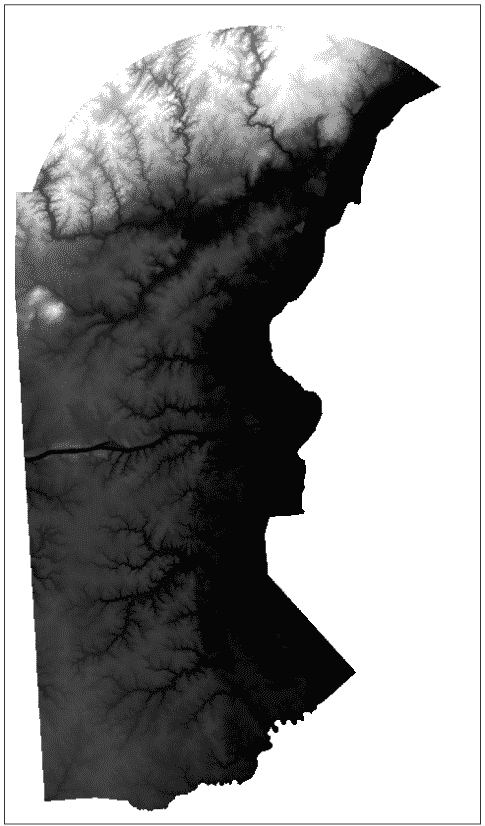

# 基于高程建模水文网络

现在我们的高程网格已经准备好，是时候真正建模水文网络位置和方向了。为此，我们将使用 **Channel network and drainage basins**，它只需要一个输入：已填充和裁剪的高程模型。该工具将使用 Strahler Order 阈值生成水文线，这与返回的河流的分层级别有关（例如，排除非常小的沟渠）。默认值为 5，对我们的目的来说是完美的，包括足够的水文线但不过多。结果看起来非常逼真。该工具还生成许多其他相关的网格，我们在本项目中不需要。执行以下步骤：

+   1. 导航到 **Processing Toolbox (Advanced Interface)**。
+   2. 搜索 **Channel network and drainage basins**（在 **SAGA | Terrain Analysis | Hydrology** 下）。
+   3. 运行 **Channel network and drainage basins** 工具。
+   4. 在 **Elevation** 字段中，输入已填充和裁剪的 DEM，即上一节中的输出。
+   5. 在 **Threshold** 字段中，保持默认值（5.0）。
+   6. 在 **Channels** 字段中，输入 `c3/data/output/channels.shp`。确保选中 **Open output file after running algorithm**
+   7. 对所有其他输出取消选择 **Open output file after running algorithm**。


8. 点击 **Run**，如下图所示：

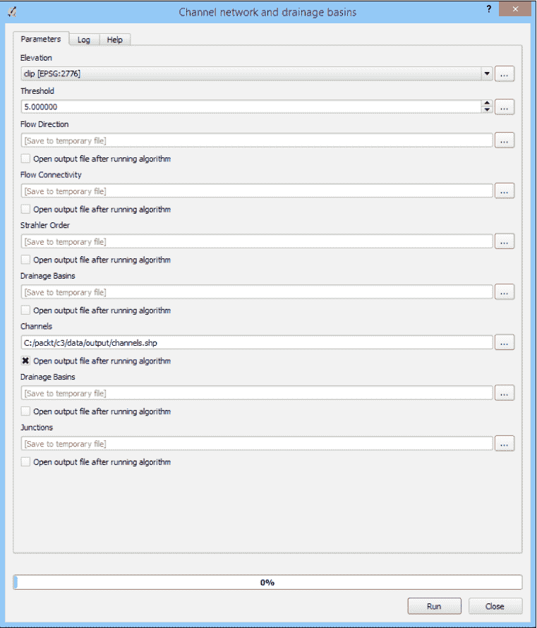

**Channel network and drainage basins** 的输出，显示水文线位置，将类似于以下图像：

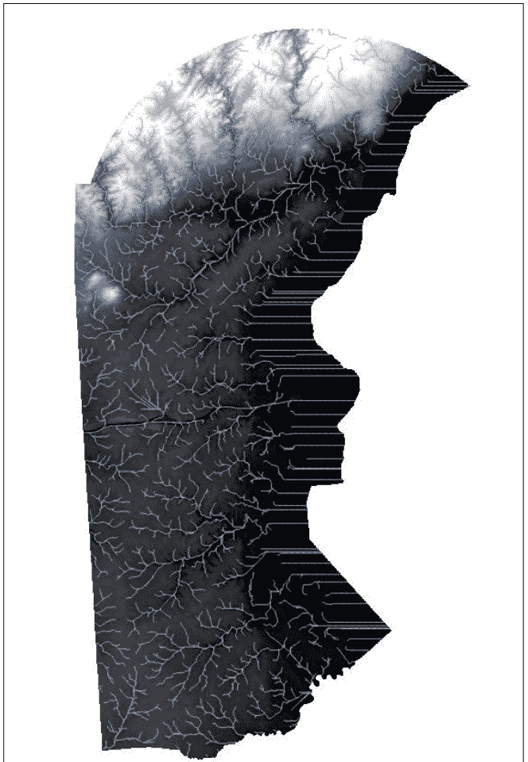

## 使用图形模型进行工作流自动化

Graphical Modeler 是 QGIS 中的一个工具，用于建模和自动化工作流。它与批处理不同之处在于，你可以将许多独立的操作连接成一个处理序列。它被视为处理框架的一部分。Graphical Modeler 对于包含许多需要重复的步骤的工作流特别有用。

通过构建图形模型，我们可以将水文建模过程操作化。这提供了以下几个好处：

- 我们的建模过程以图形方式记录并得以保留
- 模型可以在几乎无需交互的情况下整体重新运行
- 模型可以重新分发
- 模型是参数化的，因此我们可以在不同的数据图层上重新运行相同的过程

## 创建图形模型

- 1. 从 Processing 菜单调出 Graphical Modeler 对话框。
  - 1. 导航到 Processing | Graphical Modeler。
- 2. 输入模型名称和组名称。
- 3. 将你的模型保存到 `c3/data/output/c3.model` 下。
- 该对话框是模态的，在关闭之前你无法返回 QGIS 中的其他工作，因此尽早保存会很有用。

## 添加输入参数

你模型算法的一些输入将是其他模型算法的输出；对于其他输入，你需要添加相应的输入参数。

## 添加栅格参数 – 高程

我们将向模型添加第一个数据输入参数，以便模型算法可以使用它。它是我们原始的 DEM 高程数据。请执行以下步骤：

- 1. 从 Processing 模型器显示的左下角选择 Inputs 选项卡。
- 2. 将 Raster layer 从参数列表拖到模型器窗格中。此参数将代表我们的高程网格（DEM）。

3. 为 **Parameter name** 输入 `elevation`。

4. 点击 **OK**，如下图所示：

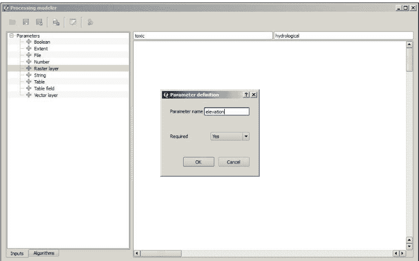

## 添加矢量参数 – 范围

我们将向模型添加下一个数据输入参数，以便模型算法可以使用它。它是我们矢量县数据，也是我们研究的范围。

- 1. 为我们的范围多边形（县）添加一个矢量图层。确保选择 **Polygon** 作为类型，并将此参数命名为 `extent`。

4. 为 DEM 参数选择 **elevation** 并点击 **OK**，如下图所示：

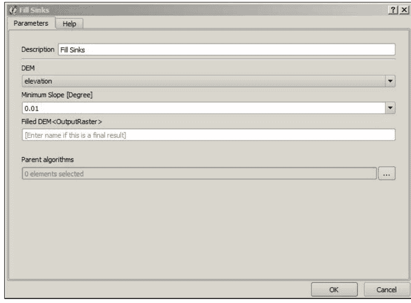

## 裁剪栅格

我们将添加的下一个算法是 **Clip raster by mask layer**，我们已使用它来限制后续栅格处理的范围。请执行以下步骤：

- 1. 使用搜索输入定位 **Clip raster by mask layer**。
- 2. 从算法 '**Fill Sinks**' 中选择 '**Filled DEM**' 作为 **Input layer** 参数。
- 3. 为 **Mask layer** 参数选择 **extent**。

4. 点击 OK，接受其他参数默认值，如下图所示：

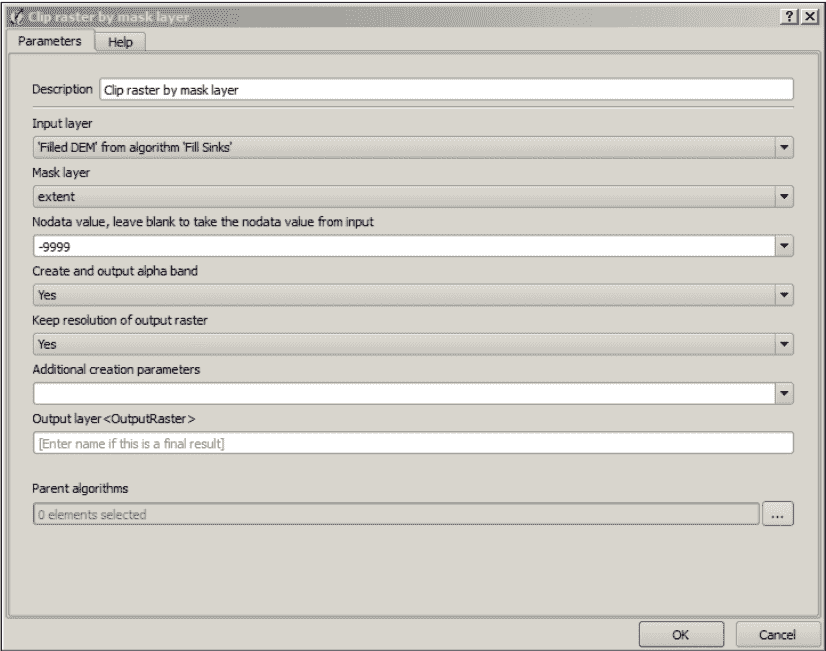

## 河道网络和流域

我们将添加的最后一个算法是 Channel network and drainage basins，它生成我们水文网络的模型。请执行以下步骤：

- 1. 使用搜索输入定位 Channel network and drainage basins。
- 2. 从算法 'Clip raster by mask layer' 的 'Output Layer' 选择作为 Elevation 参数。
- 3. 点击 OK，接受其他参数默认值。

2. 你将被提示为之前定义的高程和范围输入图层参数选择值。分别选择 dem 和 county 图层作为这些输入，如下图所示：

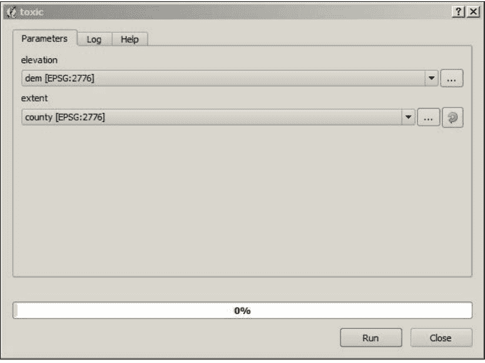

3. 在你定义并运行模型后，你之前定义的所有输出都将被生成。这些将位于你在参数对话框中或模型算法本身中定义<|message|> 的路径。

> 如果你未指定输出目录，数据将保存到处理框架的临时目录，例如：
> C:\Users\[YOURUSERNAME]\AppData\Local\Temp\processing\

现在我们已完成水文建模，我们将查看一种为输出准备以实现动态 Web 交互的技术。

## 用于高效操作图层交互的空间连接

空间连接基于地理对象之间的某种地理关系，永久关联两个地理对象图层。以这种方式执行空间连接并在可能时保存到磁盘是明智的，因为空间查询会显著增加数据库请求的时间。这对于记录数量庞大的表或你的请求涉及多个空间或聚合函数时尤其如此。在本例中，我们执行空间连接，以便最终用户可以根据其选择的地点查询水文数据。

QGIS 对空间连接条件的选项比 ArcGIS 少。QGIS 中默认的空间连接方法可通过 Vector | Data Management Tools | Join attributes by location 访问。然而，在撰写本文时，此操作仅限于相交要素，并且不提供附近要素的功能。NNJoin 插件 – NN 代表最近邻 – 实现了我们想要的功能；它根据它们彼此最近的标准，将两个图层中的地理对象连接起来。

## NNJoin 插件

请执行以下步骤：

- 1. 安装 NNJoin 插件。
- 2. 从 Vector 菜单打开 NNJoin 插件（导航到 Vector | NNJoin）。
- 3. 指定以下参数：
  - Input vector layer: 选择此项为 toxic – 有毒站点图层。
  - Join vector layer: 选择此项为 Channels – 水文线。
  - Output layer: 选择此项为 toxic_channels。此操作仅支持输出到内存。你需要在运行后点击 Save as 将其保存到磁盘。

4. 点击 OK，如下图所示：

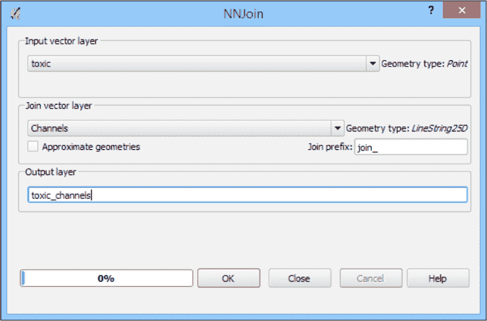

现在，在 **Layers** 面板中，右键单击新创建的 **toxic_channels** 图层，然后点击 **Save as**。你应将此新文件保存到以下路径：

```
c3/data/output/toxic_channels.shp
```

这些步骤的结果将是 toxic 图层的副本，其中包含 channels 图层中最近要素的列。

我们现在已完成所有数据处理步骤。现在是时候查看我们将如何使用外部云平台托管此数据以实现动态 Web 查询。

## CartoDB 平台

**CartoDB** 是一个基于云的 GIS 平台，提供数据管理、查询和可视化功能。CartoDB 后端基于 Postgres/PostGIS，其最令人兴奋的功能之一是通过 URL 和 HTTP API 使用 PostGIS 语法传递空间查询的能力。

## 发布数据到 CartoDB

要将数据发布到 CartoDB，你首先需要建立一个账户。你可以使用 Google 单点登录轻松完成此操作，或使用用户名和密码创建自己的账户。CartoDB 提供免费账户，可无限期使用。你最多可存储 50 MB 的数据，并且所有发布的数据都可公开查看。注册后，你可以上传上一节中生成的图层。请执行以下步骤：

- 1. 将 shapefile 相关文件 `c3/data/output/channels.*` 和 `c3/data/output/toxic_channels.*` 压缩，以便上传到 CartoDB。
- 2. 如果尚未登录，请在 `https://cartodb.com/login` 登录。
- 3. 登录后你应被重定向到你的仪表板页面。从此页面选择 **New Map**。
- 4. 点击 **Create New Map** 从头开始创建新地图。
- 5. 在 **Add dataset** 下点击 **Connect dataset** 以添加来自本地计算机的数据集。
- 6. 浏览 `c3/data/output/channels.zip` 和 `c3/data/output/toxic_channels.zip` 并将它们添加到地图。
- 7. 选择你想要添加到地图的数据集。
- 8. 选择 **Create Map**。


## 准备 CartoDB SQL 查询

SQL 是数据库查询的通用语言，通过它你可以完成从过滤、空间操作到操纵数据库中数据的一切操作。不同数据库系统之间 SQL 的工作方式略有差异。CartoDB SQL 查询使用有效的 Postgres/PostGIS 语法。有关 Postgres/PostGIS SQL 的更多信息，请参阅 Postgres 手册中的参考章节（http://www.postgresql.org/docs/9.4/interactive/reference.html）以了解一般函数，以及 PostGIS（http://postgis.net/docs/manual-2.1/reference.html）以了解空间函数。

有几种不同的方式可以针对 CartoDB 测试你的查询——每种方式的输入便利性不同，并产生不同类型的结果。

### 生成测试数据

我们的 SQL 查询只需要一个我们事先不知道的参数：用户所选点击位置的坐标。为了在 QGIS 中模拟这种交互并生成一个坐标对，我们将使用 Coordinate Capture 插件。请执行以下步骤：

1. 如果尚未安装 Coordinate Capture 插件，请先安装。
2. 从 Vector 菜单中显示 Coordinate Capture 面板（导航到 Vector | Coordinate Capture | Coordinate Capture）。
3. 从 Coordinate Capture 面板中选择 Start capture。
4. 在地图上点击一个你期望看到上游结果的位置。换句话说，基于高程表面，选择一条水文线附近的低洼点；其他水文对象应汇入该点，如下图所示：


5. 记录 Coordinate Capture 面板中显示的坐标，如下一个截图所示：


### CartoDB SQL 视图选项卡

现在，我们将返回 Web 浏览器中的 CartoDB 来运行我们的第一次测试。

虽然这种方法在数据输入方面可能是最直接的，但它仅限于通过地图产生结果。除了错误之外，不会产生任何文本结果，这限制了你的测试和调试能力。请执行以下步骤：

1. 在地图上，点击与 **toxic_channels** 图层对应的选项卡。这通常可以在右侧标记为 2 的选项卡上访问。
2. 你应该会看到默认显示的 SQL 视图选项卡，其中有一个 SQL 输入区域。
3. 下一节给出的 SQL 查询从我们的连接表中选择所有记录，该表包含有毒地点的位置及其最近的水文流域和河流等级，这些记录基于我们传递的坐标满足以下条件：
   - 与传递的坐标位于同一水文流域。
   - 其水文河流等级低于距离传递坐标最近的河流。

回想一下，我们在上一步中使用 **Coordinate Capture** 插件生成了要传递的测试坐标。在 SQL 区域中输入以下内容。该查询将使用各种子查询、连接和空间操作，通过通配符 (*) 选择 **toxic_channels** 中的所有字段。最终结果将显示其流域中位于点击点上游的所有有毒地点（代码在 `c3/data/original/query1.sql` 中）。执行以下代码：

```sql
SELECT toxic_channels.* FROM toxic_channels
INNER JOIN channels
ON toxic_channels.join_BASIN = channels.basin
WHERE toxic_channels.join_order <

(SELECT channels._order
FROM channels
WHERE
st_distance(the_geom, ST_GeomFromText
('POINT(-75.56111 39.72583)',4326))
IN (SELECT MIN(st_distance(the_geom,
ST_GeomFromText('POINT(-75.56111 39.72583)',4326)))
FROM channels x))

AND toxic_channels.join_basin =

(SELECT channels.basin
FROM channels
WHERE
st_distance(the_geom, ST_GeomFromText
('POINT(-75.56111 39.72583)',4326))
IN (SELECT MIN(st_distance(the_geom,
ST_GeomFromText('POINT(-75.56111 39.72583)',4326)))
FROM channels x))
GROUP BY toxic_channels.cartodb_id
```

4. 选择 Apply Query 以运行查询。

如果查询成功运行，你应该会看到类似于以下图片的输出：


以下错误可能会妨碍你通过 CartoDB SQL 选项卡进行调试和测试：

- 语句末尾出错：分号虽然是有效的，但在此接口中会导致错误。
- 不包含 cartodb_id：语句必须显式包含 cartodb_id 字段，以免产生此错误。但是，此错误通常不会影响通过 API 或 URL 参数的使用。
- 不包含 the_geom：语句必须显式包含对 the_geom 列的引用，即使该列在你的 cartodb 表中不可见，以便映射结果。

有时，SQL 输入区域会“粘滞”。如果发生这种情况，只需“清除视图”。

### QGIS CartoDB 插件

接下来，让我们在 QGIS 中使用 QGIS CartoDB 插件测试 SQL。请执行以下步骤：

1. 安装 QGIS CartoDB 插件，即 QGIS CartoDB。
2. 打开 SQL CartoDB 对话框，并导航到 **Web | CartoDB Plugin | Add SQL CartoDB Layer**。
3. 建立与你的 CartoDB 账户的连接：
   1. 点击 **New**。
   2. 在浏览器中从你的账户中找到并输入你的用户名和 API 密钥。你之前运行的查询将被保存，因此如果你在打开的选项卡中（如果它仍然打开），可以直接在这里操作。否则，导航回到 **CartoDB**。当你登录 CartoDB 时，你的账户名可以在 URL 中找到，用户名位于 `username.cartodb.com/*` 中。你可以通过点击仪表板上的头像并选择 **Your API keys** 来找到你的 API 密钥。
   3. 点击 **Save**，如下一个截图所示：
4. 现在，你已经连接到你的 CartoDB 账户，从 CartoDB SQL Layer 对话框加载表。


5. 在 SQL Query 区域输入前面的 SQL 语句。你可以使用 Add CartoDB SQL Layer 对话框的 Tables 部分查看查询中的字段名称和数据类型。


6. 点击 Test Query 以针对 CartoDB 测试语法。请参阅前面测试部分中的信息框，了解你使用 CartoDB SQL 接口时可能遇到的一些常见易混淆错误。

7. 点击 Add Layer 将结果添加到 QGIS。

通过这些步骤添加的图层将为你提供所选坐标上游有毒地点的位置。如果你根据上游/下游等级用星号和小溪对这些位置进行符号化，你会看到类似于下图的内容：


### CartoDB SQL API

如果你想查看 CartoDB SQL 查询以 JSON 格式返回的实际内容，最好的方法是将你的 SQL 语句发送到位于 http://[YOURUSERNAME].cartodb.com/api/v2/sql 的 CartoDB SQL API 端点。这对于调试与 Web 应用程序的交互问题尤其有用。

浏览器字符串使用编码后的 URL，它会用字符序列替代某些特殊字符。例如，你可以使用一个在 Web 上容易找到的 URL 编码器/解码器来生成这样的字符串。

使用以下说明查看 CartoDB 针对特定 SQL 查询返回的结果 JSON。URL 字符串也包含在 `c3/data/original/url_query1.txt` 中。

1. 在浏览器中输入以下 URL 字符串，将 [USERNAME] 替换为你的 CartoDB 用户名，将 [APIKEY] 替换为你的 API 密钥：

```
http://[USERNAME].cartodb.com/api/v2/sql?q=%20SELECT%20toxic_channels.*%20FROM%20toxic_channels%20INNER%20JOIN%20channels%20ON%20toxic_channels.join_BASIN%20=%20channels.basin%20WHERE%20toxic_channels.join_order%20%3C%20(SELECT%20channels._order%20FROM%20channels%20WHERE%20st_distance(the_geom,%20ST_GeomFromText(%20(%27POINT(-75.5611%2039.72583)%27,4326))%20IN%20(SELECT%20MIN(st_distance(the_geom,%20ST_GeomFromText(%27POINT(-75.5611%2039.72583)%27,4326))%20FROM%20channels%20x))%20AND%20toxic_channels.join_basin%20=%20(SELECT%20channels.basin%20FROM%20channels%20WHERE%20st_distance(the_geom,%20ST_GeomFromText(%20(%27POINT(-75.5611%2039.72583)%27,4326))%20IN%20(SELECT%20MIN(st_distance(the_geom,%20ST_GeomFromText(%27POINT(-75.5611%2039.72583)%27,4326))%20FROM%20channels%20x))%20GROUP%20BY%20toxic_channels.cartodb_id%20&api_key=[APIKEY]
```

2. 提交浏览器请求。

3. 你将看到类似于以下内容的结果：

```
{'rows': [{'the_geom':'0101000020E61000005699AA6A64352C0B23A9C05D48B4340', 'id':13, 'join_segme':1786, 'join_node':1897, 'join_nodl':1886, 'join_basin':98, 'join_order':2, 'join_ord_1':5, 'join_lengt':1890.6533221, 'distance':150.739169156001, 'cartodb_id':14, 'created_at':'2015-05-06T21:52:52Z', 'updated_at':'2015-05-06T21:52:52Z', 'the_geom_webmercator':'010100002010F00000B1E9E3DB30A60C18DCB53943D765241', 'the_geom':'0101000020E61000001144805EA1B652C0ECE7F9AB65E64340', 'id':3, 'join_segme':1710, 'join_node':1819, 'join_nodl':1841, 'join_basin':98, 'join_order':1, 'join_ord_1':5, 'join_lengt':769.46323073, 'distance':50.1031572450681, 'cartodb_id':4, 'created_at':'2015-05-06T21:52:52Z', 'updated_at':'2015-05-06T21:52:52Z', 'the_geom_webmercator':'010100002010F000008181DA045730D60C1F35490178D735241', 'the_geom':'0101000020E61000009449A70AFCF052C0F916D0D41D3449905D48B4340', 'id':17, 'join_segme':1098, 'join_node':1188, 'join_nodl':1131, 'join_basin':98, 'join_order':1, 'join_ord_1':5, 'join_lengt':1320.8328273, 'distance':260.02935238383, 'cartodb_id':18, 'created_at':'2015-05-06T21:52:52Z', 'updated_at':'2015-05-06T21:52:52Z', 'the_geom_webmercator':...
```


## Leaflet 与外部 API：CartoDB SQL

在第一部分中，我们使用 Leaflet 和包含图层的本地 GeoJSON 文件创建了一个 Web 应用程序。在本部分中，我们将使用 Leaflet 来显示来自外部 API – CartoDB SQL API 的数据。请执行以下步骤：

-   **1.** 打开 **qgis2leaf Export** 对话框（导航至 **Web** | **qgis2leaf** | **Exports**）。
-   **2.** 在 **qgis2leaf** 对话框中，你可以保持输入项为默认值。由于我们将大量修改输出代码，所以这部分并不那么重要。你可以选择添加一个底图；MapQuest Open OSM 对此是一个不错的选择。
-   **3.** 注意输出位置。
-   **4.** 点击 **OK**。
-   **5.** 在输出目录中找到 `index.html`。
-   **6.** 用以下代码替换 `index.html` 的内容（也可在 `c3/data/web/index.html` 中找到）。这段代码与现有的 `index.html` 相同，但有一些修改。第 25 行之后的所有行以及关闭 `script`、`body` 和 `html` 标签下方的行已被删除。添加了 `getToxic` 函数及其调用。查找此函数以用你的 CartoDB 账户名和 API 密钥替换现有的填充文本。此函数执行我们的 CartoDB SQL 查询并显示结果。我们将注释掉第二个函数调用，你可能希望测试它，以查看基于传入的不同坐标对产生的不同结果，如下所示：

```html
<!DOCTYPE html>
<html>
    <head>
        <title>QGIS2leaf webmap</title>

        <meta charset="utf-8" />
        <link rel="stylesheet" href="http://cdnjs.cloudflare.com/ajax/libs/leaflet/0.7.3/leaflet.css" /> <!-- we will use this as the styling script for our webmap-->
        <link rel="stylesheet" href="css/MarkerCluster.css" />
        <link rel="stylesheet" href="css/MarkerCluster.Default.css" />
        <link rel="stylesheet" type="text/css" href="css/own_style.css"/>
        <link rel="stylesheet" href="css/label.css" />
        <script src="http://code.jquery.com/jquery-1.11.1.min.js"></script> <!-- this is the javascript file that does the magic-->
        <script src="js/Autolinker.min.js"></script>
    </head>
    <body>
        <div id="map"></div> <!-- this is the initial look of the map. in most cases it is done externally using something like a map.css stylesheet where you can specify the look of map elements, like background color tables and so on.-->
        <script src="http://cdnjs.cloudflare.com/ajax/libs/leaflet/0.7.3/leaflet.js"></script> <!-- this is the javascript file that does the magic-->
        <script src="js/leaflet-hash.js"></script>
        <script src="js/label.js"></script>
        <script src="js/leaflet.markercluster.js"></script>

        <script src='data/exp_toxicchannels.js' ></script>

        <script>
            var map = L.map('map', { zoomControl:true }).fitBounds([[39.4194805496,-75.8685268698],[39.9951967581,-75.2662748017]]);
            var hash = new L.Hash(map); //add hashes to html address to easily share locations
            var additional_attrib = 'created with <a href="https://github.com/geolicious/qgis2leaf" target="_blank">qgis2leaf</a> by <a href="http://www.geolicious.de" target="_blank">Geolicious</a> & contributors<br>';
            var feature_group = new L.featureGroup([]);

            var raster_group = new L.LayerGroup([]);

            var basemap_0 = L.tileLayer('http://otile1.mqcdn.com/tiles/1.0.0/map/{z}/{x}/{y}.jpeg', {
                attribution: additional_attrib + 'Tiles Courtesy of <a href="http://www.mapquest.com/">MapQuest</a> &mdash; Map data: &copy; <a href="http://openstreetmap.org">OpenStreetMap</a> contributors,<a href="http://creativecommons.org/licenses/by-sa/2.0/">CC-BY-SA</a>'
            });
            basemap_0.addTo(map);
            var layerOrder=new Array();
            function pop_toxicchannels(feature, layer) {
            }
            });
            feature_group.addLayer(exp_toxicchannelsJSON);

            layerOrder[layerOrder.length] = exp_toxicchannelsJSON;
            for (index = 0; index < layerOrder.length; index++) {
                feature_group.removeLayer(layerOrder[index]);
                feature_group.addLayer(layerOrder[index]);
            }

            //add comment sign to hide this layer on the map in the initial view.
            exp_toxicchannelsJSON.addTo(map);
            var title = new L.Control();
            title.onAdd = function (map) {
                this._div = L.DomUtil.create('div', 'info'); // create a div with a class "info"
                this.update();
                return this._div;
            };
            title.update = function () {
                this._div.innerHTML = '<h2>This is the title</h2> This is the subtitle'
            };
            title.addTo(map);
            var baseMaps = {
                'MapQuestOpen OSM': basemap_0
            };
            L.control.layers(baseMaps,{"toxicchannels": exp_toxicchannelsJSON},{collapsed:false}).addTo(map);
            L.control.scale({position: 'bottomleft',maxWidth: 100,metric: true,imperial: false,updateWhenIdle: false}).addTo(map);

            /* we've inserted the following after the existing index.html line 83, to handle query to cartodb */

            function getToxic(lon,lat)
            {
                var toxicLayer = new L.GeoJSON();

                $.getJSON(
                "http://YOURCARTODBACCOUNTNAMEHERE.cartodb.com/api/v2/sql?q=%20SELECT%20toxic_channels.*%20FROM%20toxic_channels%20INNER%20JOIN%20channels%20ON%20toxic_channels.join_basin%20=%20channels.basin%20WHERE%20toxic_channels.join_order%20%3C%20(SELECT%20channels._order%20FROM%20channels%20WHERE%20st_distance(the_geom,%20ST_GeomFromText(%27POINT(" + lon + "%20" + lat + ")%27,4326))%20IN%20(SELECT%20MIN(st_distance(the_geom,%20ST_GeomFromText(%27POINT(" + lon + "%20" + lat + ")%27,4326)))%20FROM%20channels%20x))%20AND%20toxic_channels.join_basin%20=%20(SELECT%20channels.basin%20FROM%20channels%20WHERE%20st_distance(the_geom,%20ST_GeomFromText(%27POINT(" + lon + "%20" + lat + ")%27,4326))%20IN%20(SELECT%20MIN(st_distance(the_geom,%20ST_GeomFromText(%27POINT(" + lon + "%20" + lat + ")%27,4326)))%20FROM%20channels%20x))%20GROUP%20BY%20toxic_channels.cartodb_id%20&api_key=YOURCARTODBAPIKEYHERE&format=geojson&callback=?",
                function(geojson) {
                    $.each(geojson.features, function(i, feature)
                    {
                        toxicLayer.addData(feature);
                    })
                });
                map.addLayer(toxicLayer);
            }

            getToxic(-75.56111,39.72583);

            //getToxic(-75.70993,39.69099);
        </script>
    </body>
</html>
```

你的结果应该类似于以下图片：


## 摘要

在本章中，我们通过一个物理栅格分析示例：水文分析，创建了一个动态 Web 应用程序。为此，我们首先准备用于水文分析的栅格高程数据，然后执行了分析。我们探讨了如何使用模型器工作流自动化工具来自动化该工作流。接下来，我们使用 NNJoin 在一些水文输出之间创建空间连接，以生成适合 Web 交互和查询的数据源。最后，我们将这些数据发布到外部云平台 CartoDB，并在 JavaScript 函数中实现其 SQL API，以根据 Leaflet Web 客户端交互，查找位于某地点上游的有毒站点。在下一章中，我们将使用网络分析和众包交互来创建一个 Web 应用程序。
