## 4 寻找最佳路径

在本章中，我们将探索正式的类网络地理矢量对象关系。拓扑关系在地理数据管理和分析中有很多用途，但也许最重要的应用是最优路径搜索。具体来说，你将学习如何创建与最优路径相关的几个可视化：等时圈多边形和累积交通线。以这些视觉元素为背景，我们将在我们的 Web 地图应用程序中通过 Twitter 融入社交媒体反馈。最终结果将是一个能与利益相关者就安全上学路线进行双向交流的应用程序。

在本章中，我们将涵盖以下主题：

- 下载 OpenStreetMap 数据
- 空间查询
- 安装 Postgres/PostGIS/pgRouting
- 构建拓扑网络
- DB 管理器
- 使用最短路径插件测试拓扑
- 生成到达每个路段的代价
- 创建等时圈等高线
- 生成所有学生的最短路径
- 通过 Python 添加 Twitter 数据


# Postgres、PostGIS 与 pgRouting

基于矢量的 GIS——即便不是按定义，至少在实际操作中——是围绕地理对象数据库来组织的，存储其几何定义、地理元数据、对象关系及其他属性。Postgres 是领先的开源关系数据库平台。与 SQLite 不同，它不是基于文件的系统，而是需要在可用机器（如 localhost 或可访问的服务器）上运行服务。Postgres 的空间扩展 PostGIS 提供了围绕地理空间数据的所有功能，如空间参考、地理变换、空间关系等。最近，PostGIS 已开始支持拓扑——几何对象之间的正式关系。pgRouting 是一个围绕最优路径查找构建的拓扑分析引擎。方便的是，PostGIS 现在已捆绑 pgRouting。以下内容适用于 Postgres 9.3。

## 安装 Postgres/PostGIS/pgRouting

在 Windows 上，您可以使用 Postgres 安装程序将 PostGIS 和 pgRouting 与 Postgres 一起安装。在 Mac 上，您可以使用 http://www.kyngchaos.com/software/postgres 上提供的 Kyngchaos 二进制安装程序。在 Linux 上，您可以参考 http://postgis.net/install/ 上针对您的发行版的 PostGIS 安装文档。

Windows 的安装说明如下：

- 1. 从 http://www.postgresql.org/download/windows/ 下载 Postgres 安装程序并启动它。
- 2. 按照提示操作；选择一个密码。
- 3. 在退出时点击 Launch Stack Builder，然后点击 Finish。
- 4. 在 Stack Builder 中，选择刚创建的 PostgreSQL 实例。
- 5. 在 Spatial Extensions 下勾选 PostGIS 2.1 Bundle。
- 6. 在 Choose Components 对话框中选择 PostGIS 和 Create spatial database。
- 7. 完成安装，跳过容易失败的数据库创建步骤。

## 创建新的 Postgres 数据库

现在我们已经安装了 Postgres 数据库服务器，以及 PostGIS、pgRouting 扩展和 pgAdmin III 客户端程序，接下来要创建一个可以使用的数据库。请执行以下步骤：

- 1. 打开 pgAdmin III 程序。
- 2. 右键单击 **Servers** 树中的 **Databases** 部分，然后点击 **New Database...** 创建数据库，如下面的截图所示：

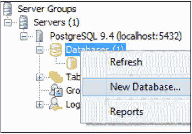

- 3. 输入新数据库的名称 **packt**，然后点击 **OK**。

## 注册 PostGIS 和 pgRouting 扩展

接下来，我们需要告诉 Postgres，我们要在新数据库中使用 PostGIS 和 pgRouting 扩展。请执行以下步骤：

- 1. 如果尚未打开 pgAdmin III，请打开它。
- 2. 导航到 **Tools | Query**。
- 3. 在 **SQL Editor** 区域输入以下 SQL：

```
CREATE EXTENSION postgis;
CREATE EXTENSION pgrouting;
```

- 4. 从 **Query** 菜单中选择 **Execute**。

## 用于拓扑的 OpenStreetMap 数据

拓扑网络指定了几何对象之间的正式关系，要在实际物理空间中发挥作用，需要真实的地理数据。因此，接下来我们将获取一些地理数据，以构建一个遵循网络内嵌入的某些规则、提供物理空间各点之间最短路径的网络。一个适合此目的以及许多其他用途的绝佳数据源是 OpenStreetMap。

## 下载 OSM 数据

现在，让我们回到 QGIS 获取 OpenStreetMap 数据，我们将用这些数据创建拓扑网络：

- 1. 导航到 Vector | OpenStreetMap | Download Data。
- 2. 选择 newark_boundaries 文件作为 From layer extent。
- 3. 输入 c4/data/output/newark_osm.osm 作为 Output file，然后点击 OK，如下面的截图所示：

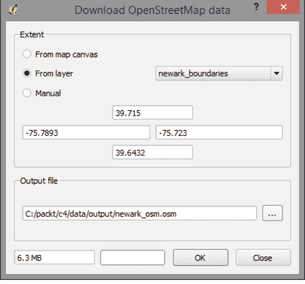

## 将数据添加到地图

必须将下载的数据添加到 QGIS 项目中，以验证其已成功下载，并方便在 QGIS 中进一步处理该数据。请执行以下步骤：

- 1. 导航到 **Layer** | **Add Layer** | **Add Vector Layer**。
- 2. 选择 `c4/data/output/newark_osm.osm` 作为 **Source**。
- 3. 在 **Select vector layers...** 对话框中点击 **Select All**。
- 4. 点击 **OK**。
- 5. 现在您应该会看到数据显示出来，类似于下图：

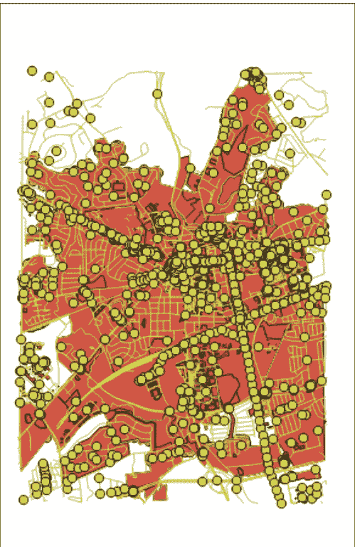

## 投影 OSM 数据

我们将把 OSM 数据投影到项目中其他数据（即学生位置）所使用的投影上。我们希望这两个数据集使用相同的投影系统；否则，在构建拓扑网络和分析网络时会出现问题。请执行以下步骤：

- 1. 从 **Layers** 面板中选择 **lines** 图层。
- 2. 前往 **Layer | Save as**。
- 3. 输入以下参数：
  - 1. **Save as:** `c4/data/output/newark_osm.shp`。
  - 2. 选择 **CRS EPSG:2880**（Delaware Ft/HARN）。
  - 3. 点击 **OK**。

## 在交点处分割所有线

必须使要创建的拓扑边与地理数据顶点共端点。这称为**拓扑正确**的数据集。我们将使用 **Split lines with lines** 来满足这一要求。请执行以下步骤：

- 1. 在 **Processing Toolbox** 面板中搜索 **Split lines with lines**。
- 2. 选择投影后的 OSM 线文件 `c4/data/output/newark_osm.shp`，同时作为 **Input layer** 和 **Split layer**。
- 3. 点击 **Run**，如下面的截图所示：

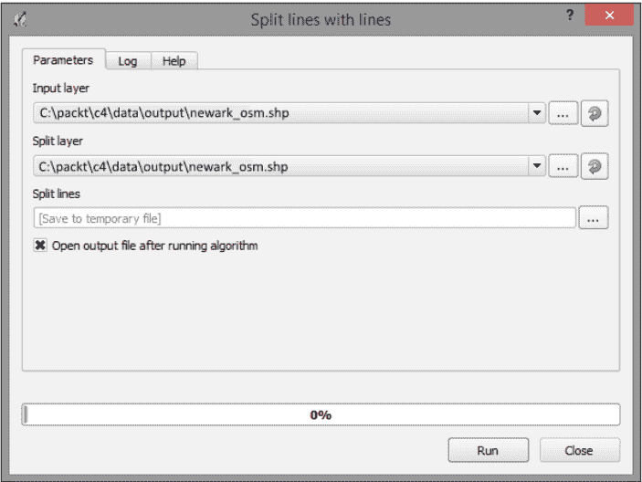

## 数据库导入与拓扑关系

既然我们已经准备好了 OSM 数据，就需要将其实际加载到数据库中。在这里，我们可以基于 PostGIS 确定的地理关系生成拓扑关系。

## 连接数据库

虽然在 QGIS 中处理数据库时我们会在 Database Manager 中工作，但首先需要通过常规的 “Add Layer” 对话框连接到数据库。请执行以下步骤：

- 1. 导航到 **Layer** | **Add Layer** | **Add PostGIS Layers**。
- 2. 点击 **New**。

## 使用 DB Manager 导入 PostGIS

添加数据库连接后，DB Manager 就是我们将与数据库交互的地方。DB Manager 通过 SQL 语法提供查询访问，也提供将结果添加为虚拟（内存中，而非磁盘上）图层的功能。必要时，我们还可以使用 DB Manager 将数据导入数据库或从数据库导出。请执行以下步骤：

- 1. 转到 **Database | DB Manager | DB Manager.** 
- 2. 您可能需要导航到 **Database | Refresh** 以使新数据库出现。
- 3. 选择要更新的数据库（例如，*packt_c4*）。以下是 Database Manager 和表的图像，这些表是在您创建新的 PostGIS 数据库时生成的：
- 4. 导航到 **Table | Import layer/file.** 

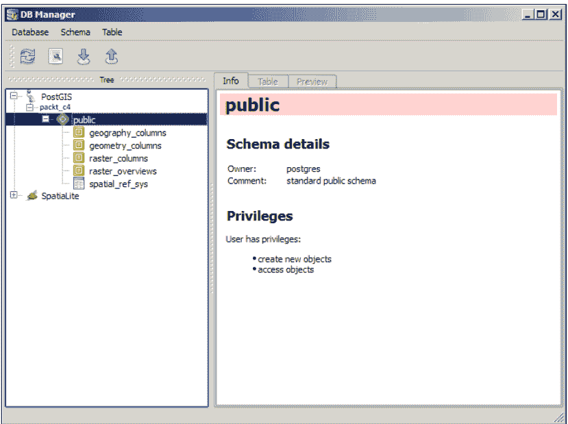

对 **students** 图层重复这些步骤：

- 1. 从 c4/data/original/students.shp 添加 **students** 图层。
- 2. 对 **students** 图层重复之前的 **Import vector layer** 步骤，如下面的截图所示：

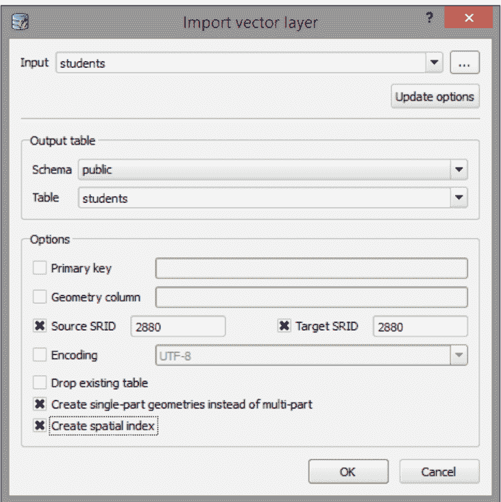

## 创建拓扑网络数据

接下来，运行一个查询，向 newark_osm 表添加必要字段，用拓扑信息更新这些字段，并创建网络顶点的相关表 newark_osm_vertices。pgRouting 所期望的这些字段名称和类型由 alter 查询添加，并由 pgr_createTopology pgRouting 函数填充。length_m 字段通过使用 st_length 函数（这里还使用 st_transform 来控制空间参考）的更新查询填充线段长度。该字段将用于帮助确定最短路径（最低成本）路由的成本。请执行以下步骤：

- 1. 导航到 Database | DB Manager | DB Manager。
- 2. 选择要更新的数据库。
- 3. 转到 Database | SQL window。输入以下代码：

```
alter table newark_osm add column source integer;
alter table newark_osm add column target integer;
select pgr_createTopology('newark_osm', 0.0001, 'geom', 'id');

alter table newark_osm add column length_m float8;
update newark_osm set length_m = st_length
  (st_transform(geom,2880));
```

## 备选工作流：使用 osm2po 构建拓扑

osm2po 程序可以执行许多拓扑数据集准备任务，否则这些任务可能需要更长的工作流——例如前述任务。顾名思义，它专门用于 OpenStreetMap 数据。必须从 osm2po 网站 http://osm2po.de 单独下载并安装 osm2po 程序。程序安装后，使用方法如下：

```
[..] > cd c:\packt\c4\data\output
c:\packt\c4\data\output>java -jar osm2po-5.0.0\osm2po-core-5.0.0-signed.jar cmd=tj
  sp newark_osm.osm
```

该命令将创建一个 .sql 文件，您可以在数据库中运行该文件，将拓扑表添加到数据库中，生成的结果与我们在上一节中所做的非常相似。


## 使用 pgRouting Layer 插件进行测试

让我们使用 pgRouting Layer 插件来测试到目前为止我们执行的操作是否生成了一个可工作的拓扑网络，以便查找最短路径。我们将查找网络上两个任意点 1 和 1000 之间的最短路径。请执行以下步骤：

- 1. 安装 pgRoutingLayer 插件。
- 2. 如果未显示最短路径面板，请在 视图 | 面板 | pgRouting Layer 下将其打开。
- 3. 输入以下参数：
  - 数据库：packt_c4。
  - 确保您已连接到数据库，如上一节所示。您可能需要重启 QGIS 才能在此处显示新的数据库连接。
  - edge_table：newark_osm
  - geometry：geom
  - id：id
  - source：source
  - target：target
  - cost：length_m
  - source_id：1
  - target_id：1000

您的输出将类似于以下图像：

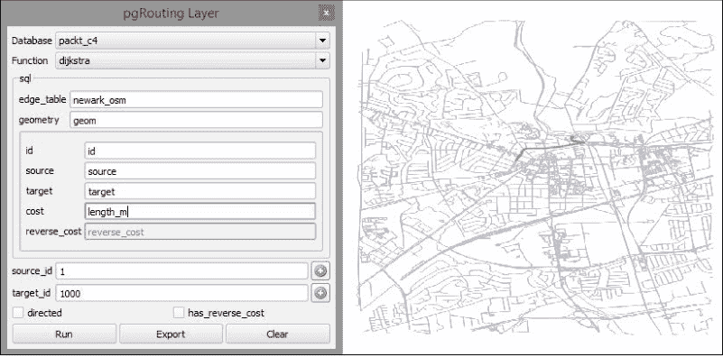

## 寻找到达目的地的最佳方式

8. 点击 **Load now!** 按钮，如下图所示：

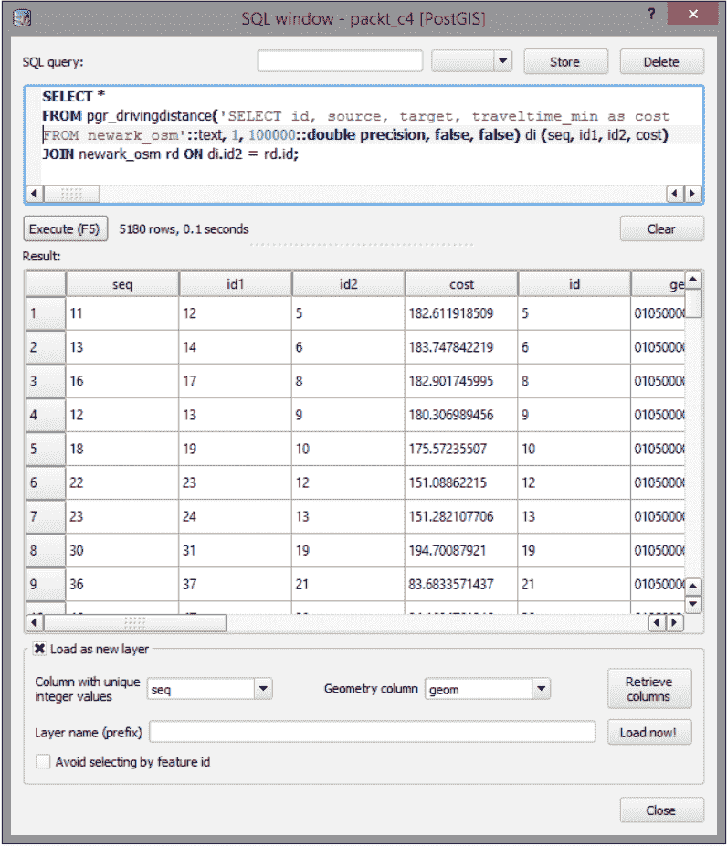

现在，您可以按照从该位置到学校所需的时间对线段进行符号化。为此，请使用 `traveltime_min` 字段配合 **Graduated**（分级）样式类型。您将看到，数值较低的线段（表示通行速度较快）更接近顶点 1，而数值较高的线段则相反。该方法受网络对真实条件建模程度的限制；例如，铁路会与其他的路段一起显示通行时间。然而，铁路可能会在我们的网络中造成不连续性——因为学生上学时无法“通行”铁路。

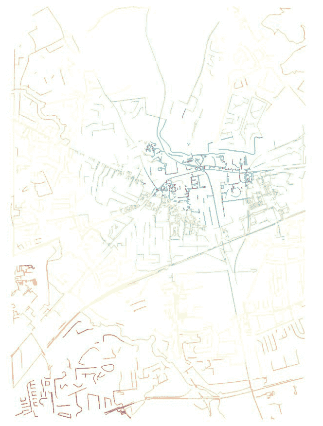

## 创建等时线多边形

接下来，我们将创建多边形以可视化学生可以在特定时间范围内步行到达学校的区域。我们可以使用此技术来表征一般的通行时间，同时隐藏学生的具体位置。

### 将通行时间线转换为点

我们需要首先利用多边形作为中间步骤，将当前的基于线的通行时间图层转换为点（质心）。请执行以下步骤：

- 1. 将查询图层保存为 shapefile：`c4/data/output/newark_isochrone.shp`。
- 2. 导航至 **Vector | Geometry Tools | Line to polygons**（矢量 | 几何工具 | 线转面）。输入以下参数：
  - **输入线矢量图层：** isochron lines
  - **输出多边形 shapefile：** `c4/data/output/isochron_polygon.shp`
  - 点击 **OK**
- 3. 导航至 **Vector | Geometry Tools | Polygons to centroid**（矢量 | 几何工具 | 面转质心）。输入以下参数：
  - **输入多边形矢量图层：** `c4/data/output/isochron_polygon.shp`
  - **输出点 shapefile：** `c4/data/output/isochrons_centroids.shp`
  - 点击 **OK**

### 选择点中的通行时间范围并创建凸包

接下来，我们将为每个时间区间创建实际的等时线多边形。我们必须使用过滤表达式为三个时间段选择每组通行时间点：15 分钟或更短、30 分钟或更短，以及 45 分钟或更短。然后，我们将对每个选集运行 **Concave hull**（凹包）工具。这将在每组点周围创建一个多边形特征。

对于每个三个断点值（15、30 和 45），您都需要执行以下三个步骤：

- 1. 从 **Layers**（图层）面板中选择 **isochron_centroids**。
- 2. 导航至 **Layer | Query**（图层 | 查询）。
- 3. 如果查询对话框的过滤表达式字段中已显示过滤表达式，请点击 **Clear**（清除）。
- 4. 提供特定的字段表达式：`cost < [break value]`（例如，`cost < 15`）。
- 5. 点击 OK 以选择图层中匹配该表达式的对象。
- 6. 导航至 **Processing Toolbox | Concave hull**（处理工具箱 | 凹包）。
- 7. 输入 **Concave hull** 的以下参数。其他所有参数均可保持默认值：
  - **输入点图层：isochron_centroids**
  - 选择 **Split multipart geometry into singleparts geometries**（将多重几何拆分为单一部分几何）
  - **Concave hull**（输出文件）可以是 `c4/data/output/isochrone45.shp`
  - 点击 Run（运行），如下图所示：

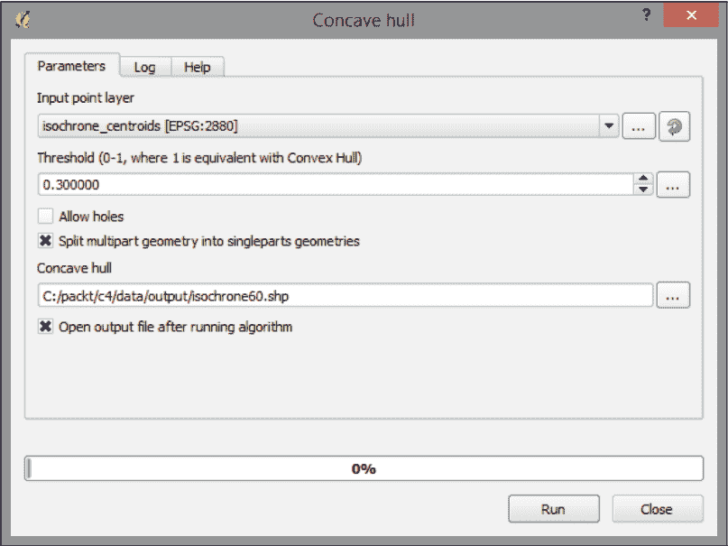

显示所有凹包时，其外观将类似于以下图像。凹包的“尖刺程度”反映了用于计算这些通行时间多边形的道路线段（点）相对较少：

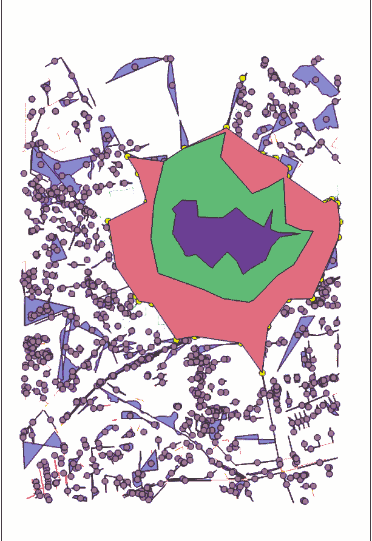

## 为所有学生生成最短路径

到目前为止，我们只查看了城市中所有给定道路线段之间的最短路径。现在，给定学生位置，让我们看看学生流量会累积在哪里。

### 查找与学生位置相关的线段

通过以下步骤，我们将把最近道路线段的属性——包括相关的拓扑和通行属性——合并到每个学生位置中。请执行以下步骤：

- 1. 安装 NNJoin 插件。
- 2. 导航至 **Plugins | NNJoin | NNJoin**（插件 | NNJoin | NNJoin）。
- 3. 输入以下参数：
  - **输入矢量图层：** **students**
  - **连接矢量图层：** **newark_osm**
  - **输出图层：** `students_topology`
- 4. 点击 **OK**。
- 5. 使用 Database Manager（数据库管理器）将 `students_topology` 导入 `packt_c4` 数据库。

以下图像显示了输入到 NNJoin 插件中的参数：

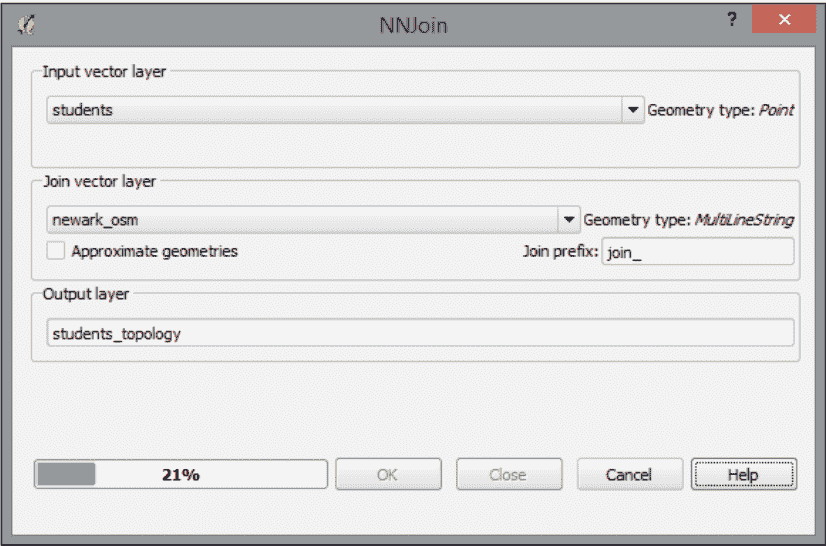

### 按线段计算累积最短路径

我们要找出给定学生位置、网络特征和学校位置的情况下，哪些路线最热门。以下步骤将生成沿每个网络线段的学生流量累积计数：

- 1. 转到 **Database | DB Manager | DB Manager**（数据库 | DB Manager | DB Manager）。
- 2. 选择要更新的数据库。
- 3. 导航至 **Database | SQL window**（数据库 | SQL 窗口）。
- 4. 我们要运行一个 SQL 命令，为每个学生执行最短路径计算，并找到在每条道路线段上通行的学生总数。此查询可能非常慢。输入以下代码：
```
SELECT id, geom, count(id1)
FROM
(SELECT *
    FROM pgr_kdijkstraPath(
'SELECT id, source, target, traveltime_min as cost FROM newark_osm',
    1, (SELECT array_agg(join_target) FROM students_topology),
    false, false
) a,
    newark_osm b
WHERE a.id3=b.id) x
GROUP BY id, geom
```
- 5. 选择 Load as new layer（作为新图层加载）选项。
- 6. 选择 id 作为具有唯一整数值列，geom 作为几何列，如下图所示：

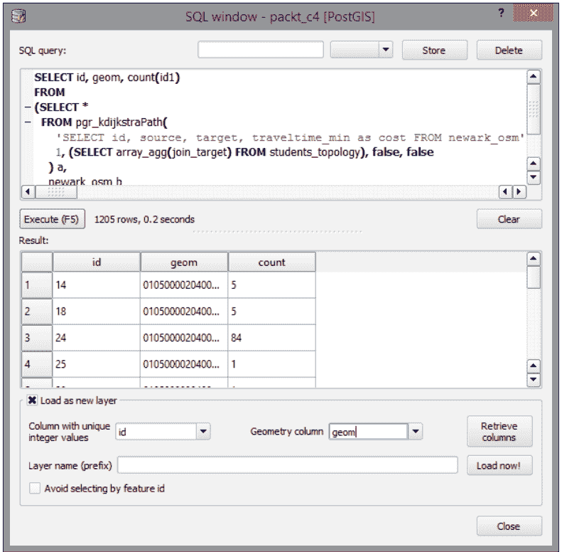

## 流量符号化

我们希望以一种真正突出显示学生数量较多的线段的方式来可视化每条线段上的学生人数。使用符号化表达式来实现这一点效果很好。这会产生与其他 GIS 软件包中常见的分级符号。请执行以下步骤：

- 1. 导航至 **Layer | Properties | Style**（图层 | 属性 | 样式）。
- 2. 点击 **Simple line**（简单线）以访问符号化表达式，如下图所示：
- 3. 在 **Pen width**（笔宽）部分，点击高级菜单以编辑符号化表达式。

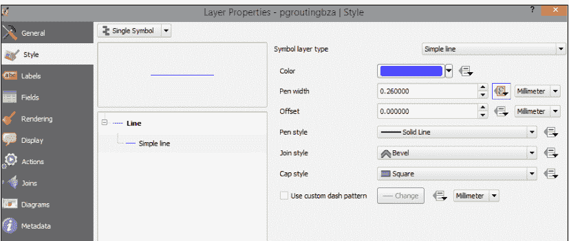

4. 对数函数（Natural log）是一个很好的函数，当数值呈指数增长时，它有助于获得更线性的增长率。这有助于我们产生一种视觉上更美观的符号化变化方式。在 **Expression** 字符串构建器对话框中输入以下表达式：

```
ln("count")
```

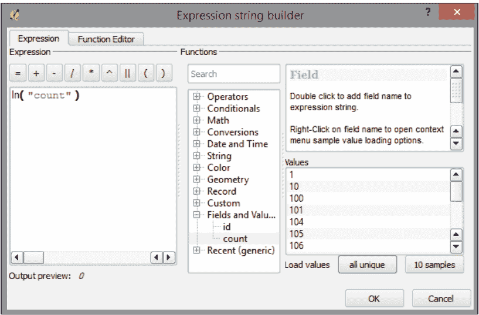


既然我们已经将可变大小的符号映射为每条路段上学生数量的自然对数，就能看到学生沿每条道路路段“流动”的悦目可视化效果。学生图层显示了学生位置，与流动图一同展示，以便更好地说明流动可视化所呈现的内容。

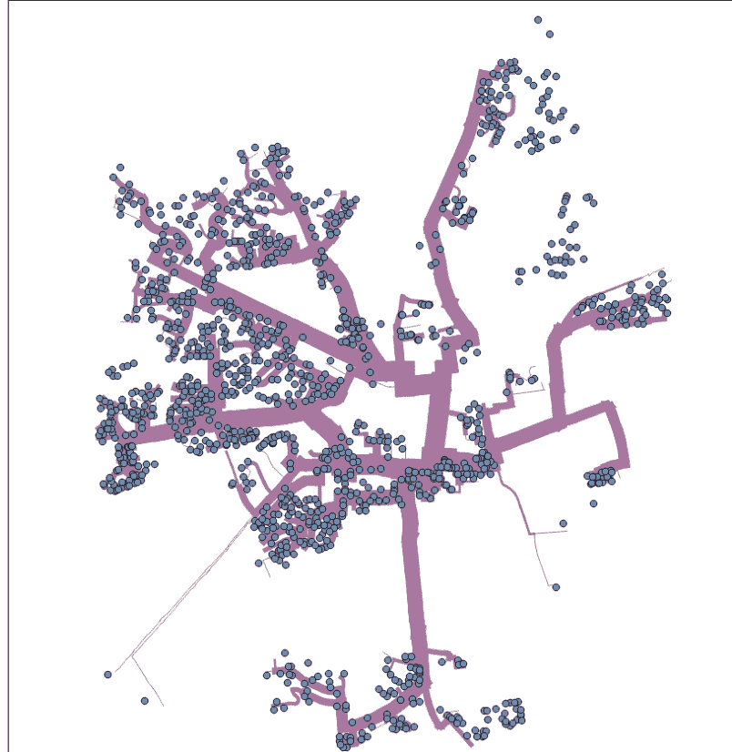

### Web 应用——创建安全通道

决策者可以利用累积的最短路径输出来识别通往学校最繁忙的路径。他们可以利用这些信息与监护人沟通，告知哪些路线对孩子最安全。

规划者还可以更进一步，为最常用的路径投资建设安全基础设施。例如，规划者可以利用查询图层中的“count”属性（及可视化）和newark_osm中的“highways”属性，识别跨越高速公路的繁忙交叉口。

当然，与利益相关者的沟通理想情况下应是双向过程。为实现这一目标，规划者可以为家长和学生建立社交媒体账号（如 Twitter 账号），让他们报告步行路线的问题或特色。规划者很可能也会查看这些数据，以便根据问题点或便利设施调整安全路线。这个高度简化的模型还应根据数据中可捕获并建模的其他变量（如高交通流量道路等）进行调整。

#### 注册 Twitter 账号并获取 API 访问权限

以下说明将指导你如何在浏览器中设置新的 Twitter 账号，并让社区发布带地理标记的推文：

1. 为此目的创建一个 Twitter 账号（非个人账号）。该账号需要绑定一个唯一的手机号和邮箱。如果你的邮箱和手机号已经绑定了其他账号，下一节会提供一些解决提示。

2. 访问 https://apps.twitter.com/ 并创建一个新应用。

3. 如果你的手机号已注册到另一个账号，你需要注销该手机号（Twitter 会对此发出警告）。

4. 在“Application Settings”中，找到“manage keys and access tokens”。在这里，你将找到你的 consumer key 和 secret。

5. 你还必须通过点击“Create my Access Token”来创建访问令牌。

6. 希望其推文被添加到系统中的用户，应被引导使用你的 Twitter 用户名（@YOURNAME）。转发你希望添加到地图中的推文。若想采用更被动的方式，你也可以关注所有你想抓取的用户；不过，你需要找到某种方法来过滤掉他们不相关的推文。

#### 设置 Twitter Tools API

现在，我们必须下载并安装基于 Python 的 Twitter Tools，它利用了 Twitter API。这将允许我们从 Twitter 账号拉取 GeoJSON。执行以下步骤：

1. 从 GitHub 下载 Twitter Tools API：https://github.com/sixohsix/twitter。

2. 通过上下文菜单使用 **以管理员身份运行** 命令打开 OSGeo4W shell，或者如果你使用的是 Mac 或 Linux，请使用 `sudo` 以完整权限运行。你的操作系统账号必须具有管理员权限。导航到 `C:\Program Files\QGIS Wien\OSGeo4W.bat`。

3. 解压 Twitter Tools API 代码，并使用以下命令行将目录更改（`cd`）到你解压到的目录（例如，`C:\Users\[YOURUSERNAME]\Downloads\twitter-master\twitter-master`）：

```
> cd C:\Users\[YOURUSERNAME]\Downloads\twitter-master\twitter-master
```

4. 在命令行中运行以下命令以安装 Twitter Tools 软件及其依赖项：

```
> python setup.py install
> twitter
```

5. 接受命令行工具的授权。你需要将浏览器中给出的 PIN 码复制并粘贴到命令行中。

6. 退出命令行 shell，并在你的普通账号下启动另一个 OSGeo4W shell。

7. 你可以使用 `twitter --help` 查看更多选项。在命令行中执行以下操作：

```
> twitter --format json 1> "C:\packt\c4\data\output\twitter.json"
> cd c:\packt\c4
> python
```

> 在包含 `setup.py` 文件的目录中运行 `python setup.py install`（该目录路径中包含 Python 可执行文件）是构建（安装）Python 程序的常规方式。你需要事先安装 `setuptools` 模块。相关安装说明可访问此网站：https://pypi.python.org/pypi/setuptools。

8. 在解释器中运行以下内容（有关非交互式运行，请参阅下一节）：

```
import json
f = open('./output/twitter.json', 'r')
jsonStr = f.read()
f.close()
jpy = json.loads(jsonStr)
geojson = ''
for x in jpy['safe']:
    if x['geo'] :
        geojson += '{"type": "Feature","geometry": {"type": "Point", "coordinates": [' + str(x['geo']['coordinates'][1]) + ',' + str(x['geo']['coordinates'][0]) + ']}', "properties": {"id": "' + str(x['id']) + '", "text": "' + x['text'] + '"}}',
geojson = geojson[:-1]
geojson += '}'
geojson = '{"type": "FeatureCollection","features": [' + geojson
f = open('./data/output/twitter.geojson', 'w')
f.write(geojson)
f.close()
```

或者运行以下命令：

```
> python twitterJson2GeoJson.py
```

以下是 GeoJSON 格式输出的示例：

```
{"type": "FeatureCollection","features": [{"type": "Feature","geometry": {"type": "Point", "coordinates": [-75.75451,39.67434]}, "properties": {"id": "606454366212530177", "text": "Hello world"}},{"type": "Feature","geometry": {"type": "Point", "coordinates": [-75.73968,39.68139]}, "properties": {"id": "606454626456473600", "text": "Testing"}},{"type": "Feature", "geometry": {"type": "Point", "coordinates": [-75.76838,39.69243]}, "properties": {"id": "606479472271826944", "text": "Test"}}]}
```

用文本编辑器将其保存为 c4/output/twitter.geojson，并将该文件作为矢量图层导入 QGIS，以便与其他图层一起预览。当这些图层符号化后，你可能会看到类似于下图的内容：

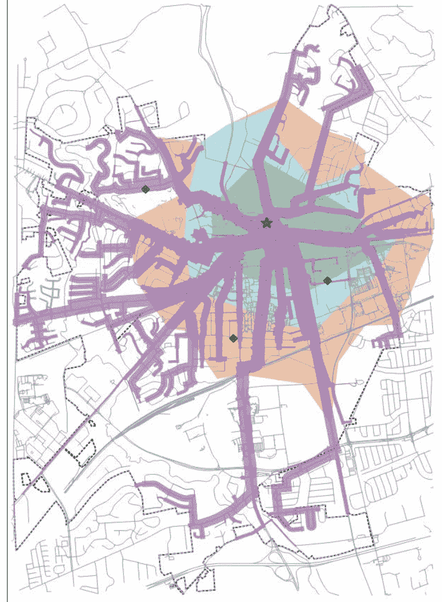
