## 5 展示变化

在本章中，我们将探讨地点与时间之间、以及地点本身之间关系的可视化与分析技术。

从时间和空间关系中得出的数据，有助于更深入地了解我们正在研究的地理对象——从水文要素到人口单元。当感兴趣的地理对象没有直接可用的数据时尤其如此：无论是某个变量、某个特定时间，还是完全没有任何数据。

在本示例中，我们将把美国人口普查的人口统计数据应用于州众议院选区，以服务选举目的。民选官员通常希望了解其选区内的社区在人口统计上如何变化。他们的选民是变得更年轻还是更富裕？失业率是否在上升？人口统计因素可用于预测潜在选民可能关心的问题，从而可用于竞选活动的宣传目的。

在本章中，我们将涵盖以下主题：

- 利用空间关系来利用数据
- 为静态生产准备数据关系
- 矢量简化
- 使用 TopoJSON 减小矢量数据大小并提高性能
- 用于 API 的 D3 数据可视化
- 动态时间序列地图

### 利用空间关系

到目前为止，我们已经研究了利用栅格数据的网格连续性或拓扑网络数据的几何规范性的分析方法。

对于普通矢量数据，我们需要一种更抽象的分析方法，即基于几何对象空间排列中的条件建立形式化关系。

在本节的大部分内容中，我们将以熟悉的方式收集和准备数据。当我们开始准备边界数据时，即利用人口普查区中的州众议院选区数据，我们将触及新的领域——使用空间关系为给定地理单元构建数据。

### 收集数据

首先，我们将从美国人口普查网站的各部分收集数据。虽然这个工作流对于处理美国人口统计数据的人特别有用，但对于处理与地理边界相关的任何类型数据的人也有指导意义。

首先，获取带有唯一标识符的边界数据。完成后，获取具有相同唯一标识符的表格数据，然后基于该标识符进行连接。

#### 边界

从美国人口普查网站 https://www.census.gov/geo/maps-data/data/tiger-line.html 下载 2014 TIGER/Line 人口普查区和州国会选区数据。

1. 在显示的选项卡中选择 2014；这应该是默认年份。

2. 点击“Download”手风琴标题，然后点击“Web interface”。

3. 在“Select a layer type”下，选择“Census Tracts”并点击提交；在“Census Tract”下，选择“Pennsylvania”并点击“Download”。


+   4. 如有必要，使用后退箭头选择 **State Legislative Districts**，然后点击 **submit**；为 **State Legislative Districts - Lower Chamber (current)** 选择 **Pennsylvania** 并点击 **Download**。
+   5. 将两个目录都移动到 `c5/data/original` 并解压它们。

> 我们仅为本次练习下载了一份边界数据集。由于边界每年并不一致，在实际项目中你需要下载并进一步处理每个单独的年度边界文件。

## Tabular data from American FactFinder

美国社区调查 FactFinder 网站上提供了许多不同的人口统计数据集。这些数据集与前面提到的 TIGER/Line 数据相辅相成，为 TIGER/Line 地理边界提供了属性数据。主要技巧是选择属性数据与地理边界数据之间匹配的地理边界层级和范围。请执行以下步骤：

+   1. 前往美国人口普查局 American FactFinder 网站 http://factfinder.census.gov。
+   2. 点击 **ADVANCED SEARCH** 选项卡。
+   3. 在 **topic or table name** 输入框中输入 `White` 并在建议选项中选择 **B02008: WHITE ALONE OR IN COMBINATION WITH ONE OR MORE RACES**。然后，点击 **GO**。
+   4. 从侧边栏中，在 **Geographies** 部分的 **Select a geographic type:** 下拉菜单中，选择 **Census Tract - 140**。
+   5. 在 **select a state** 下，选择 **Pennsylvania**；在 **Select a county** 下，选择 **Philadelphia**；在 **Select one or more geographic areas and click Add to Your Selections;** 下，选择 **All Census Tracts within Philadelphia County, Pennsylvania**。然后，点击 **ADD TO YOUR SELECTIONS**。
+   6. 从侧边栏进入 **Topics** 部分。在此，在 **Year** 下的 **Select Topics to add to 'Your Selections'** 中，点击从 **2009** 到 **2013** 的每个可用年份，将其逐一添加到 **Your Selections** 以便后续下载。

## Demonstrating Change

7. 检查 **Search Results** 选项卡下提供的五个数据集。所有已勾选的数据集都会被添加到待下载的选择中，如以下屏幕截图所示：

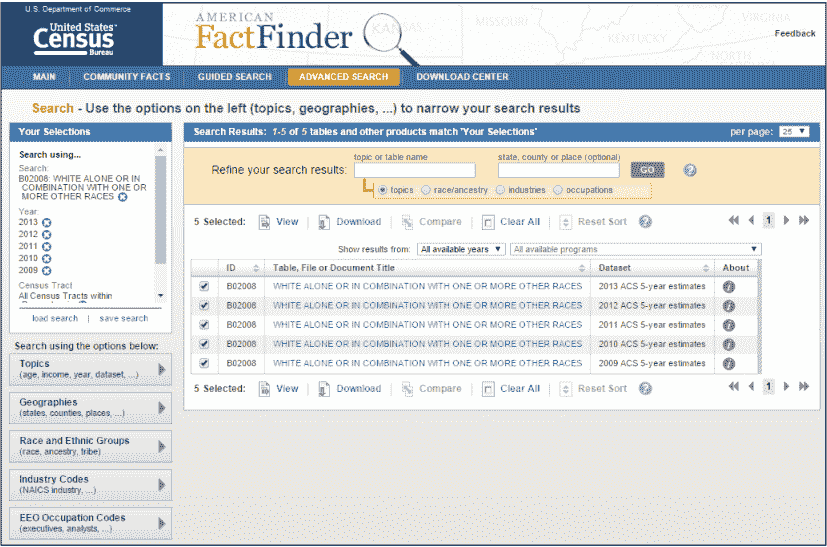

8. 现在，从页面左上角显示选择的搜索筛选器中移除 **B02008: WHITE ALONE OR IN COMBINATION WITH ONE OR MORE OTHER RACES**。

9. 在 **topic or table name** 字段中输入 **total**，从建议的数据集中选择 **B01003: TOTAL POPULATION**，然后点击 **GO**。

10. 选择 2009 至 2013 年的总人口 5 年估计值，然后点击 GO。

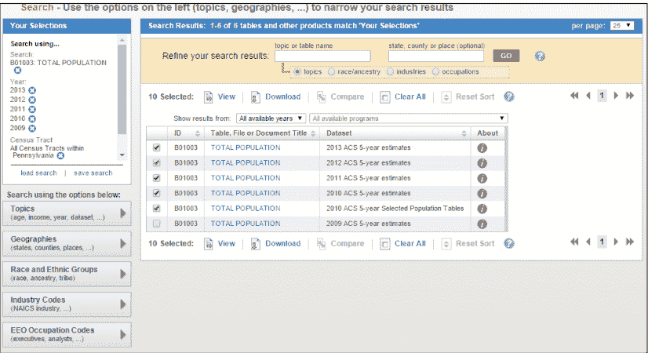

11. 点击 Download 下载这 10 个数据集，如前一屏幕截图所示。

12. 一旦看到 Your file is complete 消息，再次点击 DOWNLOAD 下载文件。这些文件将作为 aff_download.zip 目录下载。

13. 将此目录移动到 c5/data/original 然后解压它。

## Preparing and exporting the data

首先，我们将介绍表格数据准备和导出的步骤，这与我们之前做过的步骤相当相似。接下来，我们将介绍边界数据准备的步骤，这将更为新颖。我们需要基于图层之间的空间关系来准备此数据，这需要使用 SQLite，因为这无法通过 QGIS 的开箱即用或插件功能轻松完成。

## The tabular data

我们的表格数据是人口普查区白人人口。我们只需要在此数据中具有可解析的经纬度字段以便稍后绘图，因此可以将其保留在此通用表格格式中。

## Combining it yearly

要将此年度数据合并，我们可以在 QGIS 中基于共同的 GEO ID 字段连接每个表。请执行以下步骤：

+   1. 打开 QGIS 并导入所有边界 shapefile（普查区和州众议院边界）以及数据表（所有下载的人口普查区年份）。单个边界 shapefile 将在其解压目录中，扩展名为 .shp。数据表将命名为类似 x_with_ann.csv 的格式。你需要以与之前相同的方式添加它们，即通过图层菜单下的 Add Vector Layer。以下是要添加的所有文件列表：
+      - t1_2014_42_tract.shp
+      - ACS_09_5YR B01003_with_ann.csv
+      - ACS_10_5YR B01003_with_ann.csv
+      - ACS_11_5YR B01003_with_ann.csv
+      - ACS_12_5YR B01003_with_ann.csv
+      - ACS_13_5YR B01003_with_ann.csv
+   2. 从图层面板中选择普查区边界 shapefile，t1_2014_42_tract。
+   3. 导航到 Layers | Properties。
+   4. 对于每个白人人口数据表（以 x_B02008_with_ann 结尾），执行以下步骤：
+      1. 在 Joins 选项卡上，点击绿色加号 (+) 添加连接。
+      2. 选择数据表作为 Join layer。
+      3. 在 Join field 选项卡中选择 GEO.id2。
+      4. Target field: GEO ID

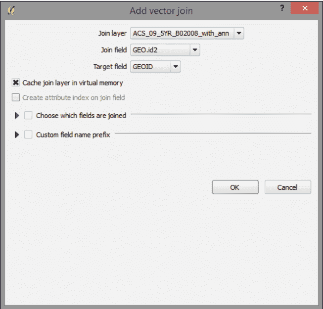

连接所有表后，你会在属性表中发现许多包含空值的行。如果对它们按年份排序，你会发现我们为较近年份填充的行数与费城普查区图层中的行数相同。然而，2009 年（ACS_09_5YR_B01003_with_ann.csv）有许多行无法填充，这是由于 2014 边界数据中使用的唯一标识符发生了变化所致。因此，我们将从分析中排除 2009 年。你可以从已连接的表中移除 2009 年数据表，这样以后就不会出现问题。

## Demonstrating Change

现在，将已连接的图层导出为新的 DBF 数据库文件，我们需要这样做以便进行最后的更改：

+   1. 确保仅在普查区图层中选择了具有填充数据列的行。归因于该表（你可以通过在该字段上对属性表进行排序来完成，例如）。
+   2. 从 **Layers** 面板中选择普查区图层。
+   3. 导航到 **Layer | Save as**，满足以下参数：
+      - **Format: DBF File**
+      - Save only the selected features
+      - Add the saved file to the map
+      - **Save as:** `c5/data/output/whites.dbf`
+      - 将其他选项保持为默认设置

## Updating and removing fields

QGIS 允许我们计算地理要素的坐标并将其填充到属性字段中。在新 DBF 图层的图层上，按预期格式计算经纬度字段并通过执行以下步骤消除不必要的字段：

+   1. 打开 whites DBF 图层的 **Attribute table** 并点击 **Open Field Calculator** 按钮。
+   2. 计算新的 lon 字段并满足以下参数：
+      - **Output field name:** `lon`
+      - **Output field type:** Decimal number (real).
+      - **Output field width:** 10.
+      - **Precision:** 7.
+      - **Expression:** `"INTPLON"`. 你可以从 **Functions** 面板下 **Fields and Values** 部分的树中选择此项。

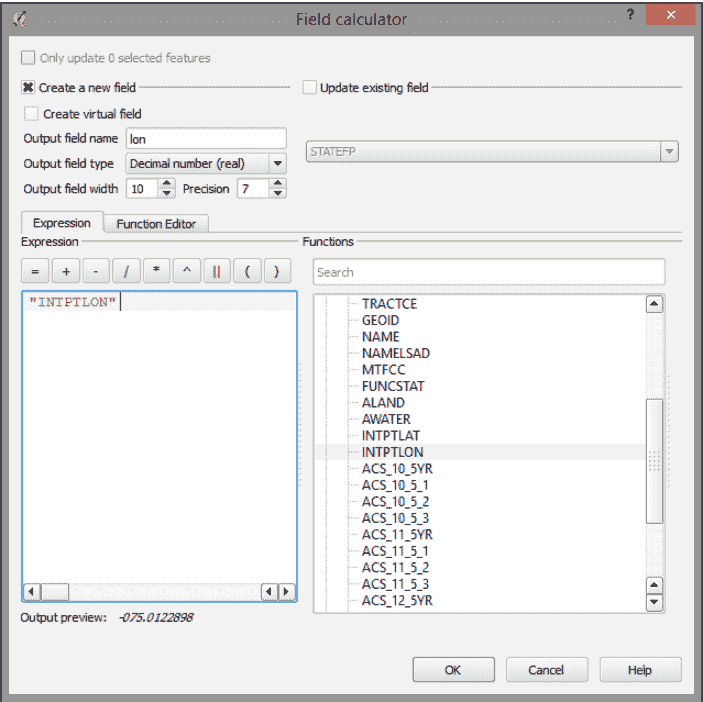

3. 重复这些步骤处理纬度，从 INTPLAT 创建 lat 字段。

4. 使用字段计算器和右侧的表达式创建以下字段：

+   - Output field name: name; Output field type: Text; Output field width: 50; Expression: NAMESLAD
+   - Output field name: Jan-11; Output field type: Whole number (integer); Expression: "ACS_11_5_2" - "ACS_10_5_2"
+   - Output field name: Jan-12; Output field type: Whole number (integer); Expression: "ACS_12_5_2" - "ACS_11_5_2"
+   - Output field name: Jan-13; Output field type: Whole number (integer); Expression: "ACS_13_5_2" - "ACS_12_5_2"

## Demonstrating Change

+   5. 移除所有旧字段（除 name、Jan-11、Jan-12、Jan-13、lat 和 lon 外）。这将从表中移除所有不必要的标识字段和误差范围字段。

+   6. 切换编辑模式并在提示时保存。

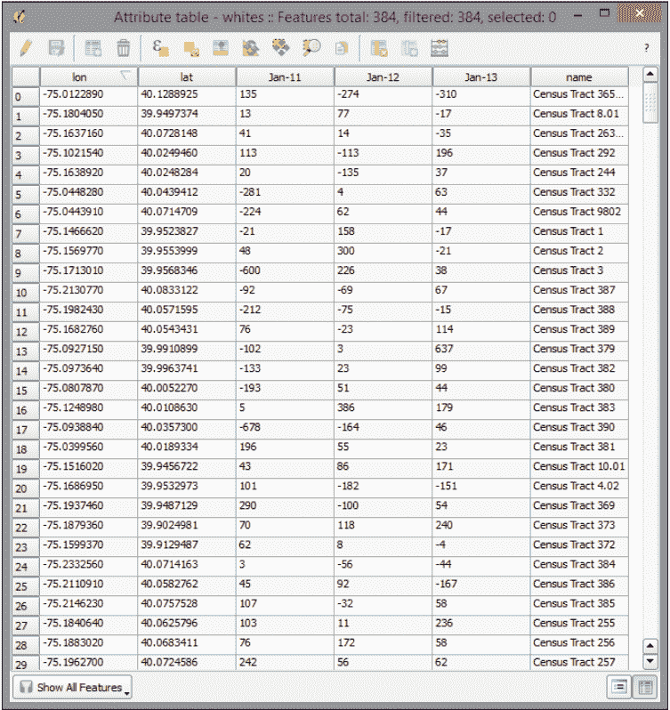


最后，将修改后的表导出为一个新的 CSV 数据表，我们将从该表创建地图可视化。执行以下步骤：

- 1. 从图层面板中选择 whites DBF 图层。
- 2. 导航到图层 | 另存为，并填写以下参数：
  - 格式：逗号分隔值 [CSV]
  - 另存为：c5/data/output/whites.csv
  - 其他选项保持默认

## 边界数据

虽然我们拥有普查区的边界数据，但我们的应用只对可视化州众议院选区感兴趣。我们的利益相关者希望可视化这些选区的变化。然而，由于我们没有按种族划分的边界单元人口数据，更不用说按年度人口了，我们需要利用州众议院选区与普查区之间的空间关系来推导这一信息。当你的数据所处的层级与你希望可视化或查询的地理单元不同时，这是一个有用的工作流程。

## 计算每个普查区的平均白人人口变化

现在，我们将构建一个字段，其中包含 2010 年至 2013 年间白人人口的平均年度变化。执行以下步骤：

- 1. 如前所述，将总人口表（以 B01003_with_ann 结尾）连接到已连接的普查区图层 t1_2014_42_tract，连接字段分别使用新总人口表中的 GEO.id2、GEO 字段以及普查区图层中对应的字段。不要连接 2009 年的表，因为我们发现该表的仅白人版本在连接字段中有许多空值。
- 2. 像之前一样，在属性表中选择具有已填充连接列的 384 行。只保存选中的行，将保存的 shapefile 数据集命名为 tract_change，并将其添加到地图中。
- 3. 打开属性表，然后打开字段计算器。
  - 创建一个新字段。
  - 输出字段名：avg_change。
  - 输出字段类型：十进制数（实数）。
  - 输出字段宽度：4，精度：2。

## 演示变化

- 以下表达式是每一年相对于前一年的差值除以前一年的值，以求得分数变化。然后将其除以三，得到三年间的平均值，最后乘以 100 得到百分比，如下所示：

```text
((("ACS_11_5_2" - "ACS_10_5_2") / "ACS_10_5_2") +
 (("ACS_12_5_2" - "ACS_11_5_2") / "ACS_11_5_2") +
 (("ACS_13_5_2" - "ACS_12_5_2") / "ACS_12_5_2")) / 3 * 100
```

- 4. 之后，点击**确定**。

## SpatiaLite 中的空间连接

现在，我们已经有了按普查区划分的白人人口平均变化值，接下来将其附加到我们关注的单元——州众议院选区。我们将通过空间连接来实现这一点，具体而言，将所有与我们的众议院选区边界相交的记录连接到该选区。由于每个州众议院选区会与多个普查区相交，因此我们需要聚合相交普查区的属性数据，以匹配普查区将连接到的单个选区。

我们将使用 SpatiaLite 来完成这一操作。与 Postgres 的 PostGIS 类似，SpatiaLite 是 SQLite 的空间扩展。它是基于文件的；不需要持续监听连接的服务器，数据库存储在文件中，客户端程序直接连接。此外，SpatiaLite 随 QGIS 开箱即用，非常易于使用。与 PostGIS 一样，SpatiaLite 提供了丰富的空间关系函数，当现有插件不支持我们试图建模的关系时，它是一个很好的选择。

> SpatiaLite 通常不会作为实时网站的后端数据库，因为它在多用户事务方面存在一些限制——这就是 CartoDB 使用 Postgres 作为其后端数据库的原因。

## 创建 SpatiaLite 数据库

为此，请执行以下步骤：

- 1. 创建一个新的 SpatiaLite 数据库。
- 2. 导航到**图层 | 创建图层 | 新建 SpatiaLite 图层**。
- 3. 使用省略号按钮（...），浏览到并创建一个数据库，位于 `c5/data/output/district_join.sqlite`。
- 4. 点击**保存**后，您会收到一个新数据库已注册的通知。现在您已创建了一个新的 SpatiaLite 数据库。现在可以关闭此对话框了。

- 6. 选中**创建空间索引**。
- 7. 点击**确定**完成将表导入数据库（您可能需要再次点击刷新按钮，以显示表已导入）。

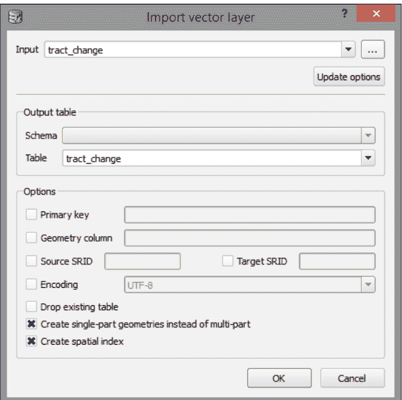

现在，对州众议院选区图层（t1_2014_42_s1d1）重复这些步骤，并取消选中**创建单部件几何而不是多部件**，因为该选项似乎会导致此文件出错，可能是由于多部件要素的某些部分无法在 SpatiaLite 数据要求下独立存在。

## 从 DB 管理器查询并加载 SpatiaLite 图层

接下来，我们使用 DB 管理器查询 SpatiaLite 数据库，并将结果添加到 QGIS 图层面板中。

这里我们将使用 MBRIntersects 条件，它只检查范围（边界框）的相交情况，因此比常规的 Intersects 函数更有性能优势。在本例中，我们处理的要素数量少、复杂度有限，并且不是在网络请求期间动态完成的，因此这种捷径不会带来显著优势——我们在这里这样做是为了演示它在更复杂数据集上的用法。

- 1. 如果尚未打开，请打开 DB 管理器。
- 2. 导航到数据库 | SQL 窗口。

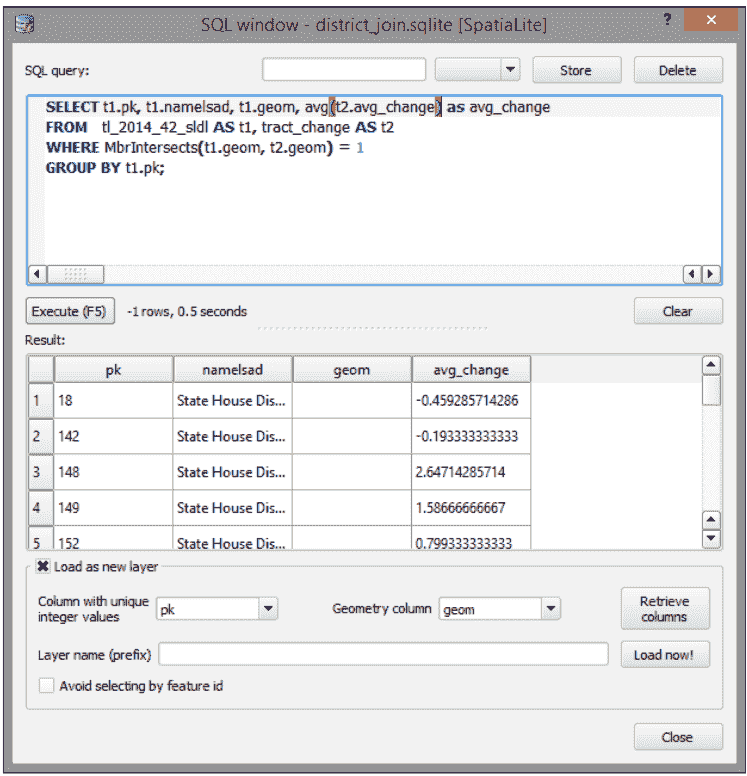

在 SQL 查询对话框中填写相应的输入字段：

## 演示变化

- 以下 SQL 查询从 `tract_change` 和 `tl_2014_42_sldl`（州立法选区）表中选择相互重叠区域的字段。它还按覆盖普查区边界的州立法选区对变化进行聚合（平均）：

```text
SELECT t1.pk, t1.nameIsad, t1.geom, avg(t2.avg_change)*1.0 as avg_change
FROM tl_2014_42_sldl AS t1, tract_change AS t2
WHERE MbrIntersects(t1.geom, t2.geom) = 1
GROUP BY t1.pk;
```

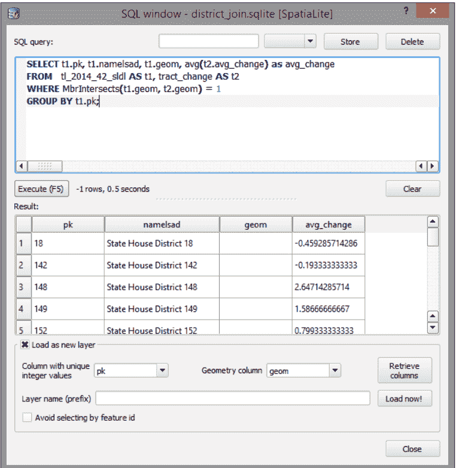

- 3. 然后，点击“立即加载!”。

- 4. 系统会提示您为**具有唯一整数值的列**字段选择一个值。为此，请选择**pk**。
- 5. 系统还会提示您为**几何列**字段选择一个值；为此，请选择**geom**。

空间关系连接的结果符号化后，显示州众议院选区与普查区相交部分在4年期间的白人人口平均变化，看起来将与下图类似：

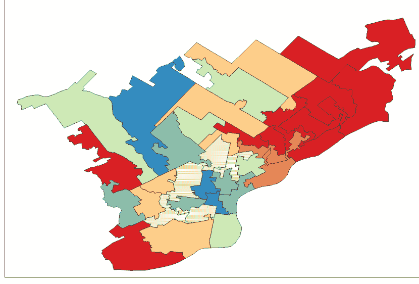

## TopoJSON

接下来，我们将继续为 Web 及其时空可视化准备这种数据关系。

TopoJSON 是 JSON 的一种变体，它利用几何要素之间的拓扑关系来大幅减小矢量数据的体积，从而提升浏览器的渲染性能，并降低数据传输延迟的风险。

## GeoJSON 示例

以下代码是 GeoJSON 的一个示例，显示了我们两个州众议院选区。该格式是熟悉的——基于我们之前使用 JSON 的经验——由一组组坐标定义多边形区域并组合在一起。重复部分用省略号（...）标示。

```text
{
  "type": "FeatureCollection",
  "crs": { "type": "name", "properties": { "name": "urn:ogc:def:crs:OGC:1.3:CRS84" } },
  "features": [
    { "type": "Feature", "properties": { "STATEFP": "42", "SLDLST": "181", "GEOID": "42181", "NAMELSAD": "State House District 181", "LSAD": "LL", "LSY": "2014", "MTFCC": "G5220", "FUNCSTAT": "N", "ALAND": 8587447.000000, "AWATER": 0.000000, "INTPTLAT": "+39.9796799", "INTPTLON": "-075.1533540" }, "geometry": { "type": "Polygon", "coordinates": [ [ [ -75.176782, 39.987337 ], [ ... ] ] ] } },
    {...}]
}
```

## TopoJSON 示例

以下代码是前文讨论过的同样的两个州众议院选区在 TopoJSON 中的对应表示。

尽管此示例使用了与之前相同的坐标系（WGS84/EPSG:4326），但它被表示为简单的抽象空间坐标对。最终，这些坐标利用数据 transform 部分中的 scale 和 translate 数据转换为 WGS 坐标系。


通过利用几何对象之间共享的拓扑关系，数据量可以从 21K 急剧减少到 7K。这减少了 2/3！你将在下面的代码中看到，每个多边形本身并不是单独明确表示的，而是通过这些拓扑关系表示的。重复的部分用省略号 (...) 标记。

```
{"type":"Topology","objects":{"geojson":{"type":"GeometryCollection","crs":{"type":"name","properties":{"name":"urn:ogc:def:crs:OGC:1.3:CRS84"}},"geometries":[{"type":"Polygon","properties":{"STATEFP":"42","SLDLST":"181","GEOID":"42181","NAMELSAD":"State House District 181","LSAD":"LL","LSY":"2014","MTFCC":"G5220","FUNCSTAT":"N","ALAND":8587447,"AWATER":0,"INTPTLAT":+39.9796799,"INTPTLON":-075.1533540},"arcs":[[[0,1]]]},{"type":"Polygon","properties":{"STATEFP":"42","SLDLST":"197","GEOID":"42197","NAMELSAD":"State House District 197","LSAD":"LL","LSY":"2014","MTFCC":"G5220","FUNCSTAT":"N","ALAND":8251026,"AWATER":23964,"INTPTLAT":+40.0054726,"INTPTLON":-075.1405813},"arcs":[[-1,2]]}]},"arcs":[[[903,5300],[...]]],"transform":{"scale":[0.000006659365936593659349884,0.00000665943594359435944118],"translate":[-75.176782,39.961088]}}
```

## 向量简化

与 TopoJSON 类似，向量简化会移除线或多边形图层中的节点，并且通常会极大地提高浏览器的渲染性能，同时减少文件大小和网络传输时间。

由于向量形状可以具有无限的复杂程度，理论上，简化方法可以在仍保留几何形状可感知形状的情况下将复杂程度降低超过 99%。实际上，感知开始显著受影响的复杂程度几乎永远不会这么高；然而，在 90% 的复杂程度损失下获得非常可接受的感知变化是很常见的。更复杂的简化方法效果更好。

## 简化方法

有多种简化方法被广泛使用，每种方法对特定数据特征和结果都有优势。如果一种方法没有产生良好的结果，你可以随时尝试另一种。除了方法本身之外，你通常还会被要求定义一个阈值参数，用于可接受的复杂程度损失量，按复杂程度损失的百分比、面积或其他度量来定义。

- Douglas-Peucker：在这种方法中，阈值影响原始线和多边形边缘允许变化的距离。这在需要简化的节点密集分布时很有用，但可能导致“尖锐”的简化结果。
- **Visvalingam / 有效面积：** 在这种方法中，形成与两个相邻点面积最小的三角形的点将被移除。阈值影响该标准的适用次数。这已被 Mike Bostock，即 TopoJSON 等的创建者之一，描述为以最小感知变化为标准的简化。
- **Visvalingam / 加权面积：** 在这种方法中，形成顶点角度最尖锐的点将被移除。阈值影响该标准的适用次数。该方法提供了“最平滑”的结果，因为它专门针对“尖峰”。

Visvalingam 有效面积方法是我们在使用的 TopoJSON 命令行工具中提供的唯一简化方法。Mapshaper 是一款我们将要查看的基于网络的工具，它提供了这三种方法，但默认使用加权面积方法。

## 其他选项

影响数据大小的其他选项通常与简化方法一起提供。

- **修复相交：** 此选项将修复导致线或多边形边缘相交的简化。
- **防止形状移除：** 此选项将防止导致（通常较小的）多边形形状被移除的简化。
- **量化：** 量化控制坐标的精度。当我们处理线性单位中的坐标时，这更容易理解。出于明显的原因，你可能希望将精度扩展到每英里 1/5000 —— 获得近似英尺精度。同样明显的是，较高的精度会带来更大的数据大小，因此你不应在应用程序或源不支持此类精度的情况下过度量化。

## 为 TopoJSON 简化

我们将使用的 Web 和桌面 TopoJSON 转换工具都支持这些简化选项。这样，你就可以在通过拓扑关系表示法减少数据大小的同时简化多边形。

## 为其他输出简化

如果你希望生成除 TopoJSON 之外的其他数据，你需要找到另一种简化方法。

QGIS 原生提供简化几何功能（导航至 Vector | Geometry Tools | Simplify Geometries），它执行 Douglas-Peucker 简化。虽然它是流行的方法，但可能不是最有效的方法（请参阅下一节了解更多信息）。

Simplify 插件除了 Douglas-Peucker 外还提供 Visvalingam 方法。

## 转换为 TopoJSON

有几种编写 TopoJSON 的选项。我们将查看一个桌面选项，需要软件安装，以及一个通过网络浏览器进行的选项。正如你可能想象的那样，桌面选项在以自定义方式执行任何操作时更稳定，网络浏览器不支持此功能，并且在处理更复杂的特征集时也更稳定。网络浏览器具有无需安装的优势。

## Web mapshaper

你可以使用基于网络的 mapshaper 软件从 http://www.mapshaper.org/ 将 shapefile 和其他格式转换为 TopoJSON，反之亦然。执行以下步骤将州立法区 shapefile 转换为 TopoJSON：

- 1. 打开浏览器并导航到 mapshaper 网站。
- 2. 可选，选择不同的简化方法或尝试其他选项。这对本示例不是必需的。
- 3. 浏览以选择你本地计算机上的费城州立法区 shapefile（c5/data/original/tl_2014_42_sldl/tl_2014_42_sldl.shp）或拖入文件。正如页面所示，Shapefile、GeoJSON 和 TopoJSON 都受支持。
- 4. 可选，从滑块栏中选择一个简化比例（同样，这对本示例不是必需的）。
- 5. 通过点击顶部导出按钮导出为 TopoJSON。

你将在浏览器中看到以下屏幕：

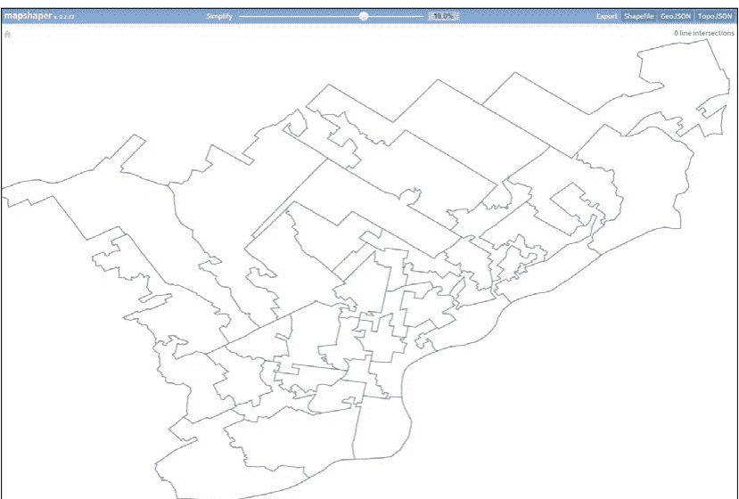

## 命令行工具

命令行工具在处理更大或更复杂的数据集时很有用。缺点是它需要你安装 Node.js，因为它是一个 node 包。对于我们的目的，Node.js 类似于 Python。它是 JavaScript 的解释器环境，允许用 JavaScript 编写的程序在本地运行。此外，它还包括一个包管理器来安装所需的依赖项。它还包括一个 Web 服务器——本质上是将 JavaScript 作为服务器端语言运行。

执行以下步骤：

- 1. 从 https://nodejs.org/ 安装 Node.js。
- 2. 打开你的操作系统命令行（例如，在 Windows 上运行 cmd）。
- 3. 在命令行中输入以下内容：
  >npm install -g topojson
- 4. 导航到 cd c:\packt\c5\data\output 并输入以下内容：
  >topojson -p -o house_district.json house_district.shp

你现在将得到以下输出：

```
c:\packt\c5\data\temp>topojson -p -o house_district.json house_district.shp
bounds: -75.463053 39.848782 -74.869303 40.22473499999995 (spherical)
pre-quantization: 0.0660m (5.94e-7°) 0.0418m (3.76e-7°)
topology: 105 arcs, 16475 points
post-quantization: 6.60m (0.0000594°) 4.18m (0.0000376°)
prune: retained 105 / 105 arcs (100%)
```

Mapshaper 也有一个命令行工具，我们在此未评估。

## D3 数据可视化库

D3 是一个用于从所有现代网络浏览器中存在的文档对象模型（DOM）构建可视化的 JavaScript 库。

## 什么是 D3？

更详细地说，D3 将 DOM 操作为抽象的矢量可视化组件，其中一些已进一步定制为特定可视化类型，例如地图。它为我们提供了从一些常见数据源解析并绑定到 SVG 和 canvas 元素的能力，这些元素设计用于矢量图形操作。

## 一些基础知识

在开始之前，有几个 D3 的基本方面对你理解很有用。由于 D3 不是专门为地理数据构建的，而是为通用数据可视化构建的，它倾向于更抽象地看待地理数据可视化。数据必须从其原始格式解析为 D3 对象并渲染为图形空间中的 SVG 或 canvas 元素矢量形状类型。然后必须使用图形空间与地理坐标系统之间的相对映射对其进行投影，相对于图形空间和地理范围进行缩放，并绑定到 Web 对象。所有这些都必须相对于某种 D3 游标完成，该游标处理 D3 当前正在工作的范围，使用诸如“begin”和“end”之类的关键字。

## 解析

我们将通过 d3.json 和 d3.csv 方法进行解析。我们使用这些方法的回调来包装我们希望在外部数据解析为 JavaScript 对象后执行的代码。


## 比例尺

比例尺允许你将真实数据的定义域映射到值域，例如，假设你有一组 1 到 100 的值，以及一个可能取值的范围，并希望将所有值映射到 1 到 5 的数字。比例尺在映射中最有用的用途是将一组数值与一组颜色关联起来。以下代码将一组值映射到一组颜色，并将中间值映射为过渡颜色：

```
var color = d3.scale.linear()
    .domain([- .5, 0, 2.66])
    .range(["#FFEBEB", "#FFFFFF", "#E6FFFF"]);
```

## 绑定

数据对象被解析到 DOM 后，可以通过其 `data` 或 `datum` 属性绑定到 D3 对象。

## Select、Select All、Enter、Return、Exit、Insert 和 Append

为了选择可能已存在的元素，你将使用 Select 和 Select All 关键字。然后，根据你预期元素是否已经存在，你将使用 Enter（如果尚不存在）、Return（如果已存在）以及 Exit（如果你希望移除它）关键字来改变与元素的交互。

以下是一个使用 Enter 关键字的 Select All 示例。来自此前解析过的 house_district JSON 的数据，通过 path 元素的 `d` 属性加载，并赋给路径形状生成器。此外，在 `fill` 属性上设置了一个函数，该函数从线性颜色比例尺返回一种颜色：

```
map.selectAll("path")
    .data(topojson.feature(phila, phila.objects.house_district)
        .features)
    .enter()
    .append("path")
    .attr("vector-effect","non-scaling-stroke")
    .style("fill", function(d) { return color
        (d.properties.d_avg_change); })
    .attr("d", path);
```

## main.js

以下所有 JavaScript 代码都位于 `./js/main.js` 中。我们对此代码的所有自定义都将在该文件中完成：

```
var width = 960,
    height = 600;

//sets up the transformation from map coordinates to DOM
  coordinates
var projection = d3.geo.mercator()
    .center([-75.166667,40.03])
    .scale(60000);

//the shape generator
var path = d3.geo.path()
    .projection(projection);

var svg = d3.select("#map-container").append("svg")
    .attr("width", width)
    .attr("height", height);

var g = svg.append("g");

g.append( "rect" )
    .attr("width",width)
    .attr("height",height)
    .attr("fill","white")
    .attr("opacity",0)
    .on("mouseover",function(){
      hoverData = null;
      if ( probe ) probe.style("display","none");
    })

var map = g.append("g")
    .attr("id","map");

var probe,
    hoverData;

var dateScale, sliderScale, slider;

var format = d3.format(",");

  var months = ["Jan"],
```

```
```javascript
.append("div")
.attr("id","loader")
.style("top",d3.select("#play").node().offsetTop + "px")
.style("height",d3.select("#date").node().offsetHeight +
    d3.select("#map-container").node().offsetHeight + "px");

//load and parse whites.csv
d3.csv("csv/whites.csv",function(data){
  var first = data[0];
  // get columns
  for ( var mug in first ){
    if ( mug != "name" && mug != "lat" && mug != "lon" ){
      orderedColumns.push(mug);
    }
  }

  orderedColumns.sort( sortColumns );

  // draw city points
  for ( var i in data ){
    var projected = projection([ parseFloat(data[i].lon),
      parseFloat(data[i].lat) ])
    map.append("circle")
      .datum( data[i] )
      .attr("cx",projected[0])
      .attr("cy",projected[1])
      .attr("r",1)
      .attr("vector-effect","non-scaling-stroke")
      .on("mouseover",function(d){
        hoverData = d;
        setProbeContent(d);
        probe
          .style({
            "display" : "block",
            "top" : (d3.event.pageY - 80) + "px",
            "left" : (d3.event.pageX + 10) + "px"
          })
      })
      .on("mouseout",function(){
        hoverData = null;
        probe.style("display","none");
      })
  }
})
```
```

```
createLegend();

dateScale = createDateScale(orderedColumns).range([0,3]);

createSlider();

d3.select("#play")
    .attr("title","Play animation")
    .on("click",function(){
        if ( !isPlaying ){
            isPlaying = true;
            d3.select(this).classed("pause",true).attr
                ("title","Pause animation");
            animate();
        } else {
            isPlaying = false;
            d3.select(this).classed("pause",false).attr
                ("title","Play animation");
            clearInterval( interval );
        }
    });

drawMonth( orderedColumns[currentFrame] ); // initial map

window.onresize = resize;
    resize();

d3.select("#loader").remove();
    })
});
```

## 输出

最终产品——你可以在网络浏览器中打开 `index.html` 来查看——是一个由时间线控制的动态点集，展示了按人口普查区划分的白人人口变化。该数据叠加显示在众议院选区之上，其颜色根据每年白人人口的变化从冷色到暖色渐变，并在三个变化时期（2010-11、2011-12 和 2012-13）上取平均值。我们的地图应用输出带有时间线动画，效果类似于下图：

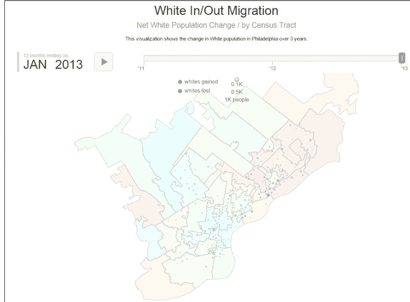

## 6

## 估计未知值

在本章中，我们将使用插值方法，根据其他位置的已知值来估计某一位置的未知值。

插值是一种完全基于未知位置与已知位置之间的地理关系来估计未知值的技术。由于空间可以被无限精度地测量，数据测量总是受到数据收集者有限资源的制约。插值和其他更复杂的空间估计技术，可用于估计那些尚未被测量位置的值。在本章中，你将学习如何对气象站数据中的值进行插值，这些值将被评分并用于一个针对特定农业条件——霉病——的脆弱性模型中。我们将气象数据做了一个子集，以提供一年中历史上脆弱性通常较高的月份。最终用户可以使用此应用对模型进行地面真值验证，即将预测的高或低脆弱性与霉病存在与否进行匹配。如果模型扩展到历史数据或接近实时，该应用可用于观察脆弱性随时间的趋势，或提示种植者需要采取行动预防霉病。包括降水量、相对湿度和温度在内的参数，已被选用于预测田间和作物霉病脆弱性的实际模型中。

在本章中，我们将介绍以下主题：

- 从 MySQL 添加数据
- 使用 NetCDF 多维数据格式
- 插值未知值以用于可视化和报告
- 应用简单的代数风险模型
- 使用 Python GDAL 包装器通过 SQLite 查询进行过滤和更新
- 插值
- 地图代数建模
- 用网格点图层对栅格网格进行采样
- Python CGI 托管
- CGI 开发过程中的测试与调试
- Python SpatiaLite/SQLite3 包装器
- 使用 QGIS 插件生成 **OpenLayers3 (OL3)** 地图
- 为 OL3 地图添加 AJAX 交互
- OL3 像素弹出窗口中的动态响应

## 导入数据

通常，用于高度交互式动态 Web 应用的数据存储在企业现有数据库中。尽管这些并非通常意义上的空间数据库，但它们包含坐标位置，可以很容易地在空间应用中被利用。

## 在 QGIS 中连接并从 MySQL 导入

以下部分仅作为演示提供——数据库安装和设置对于简短的使用演示来说过于耗时。

> 如果你确实希望安装并设置 MySQL，可以从 http://dev.mysql.com/downloads/ 下载。MySQL Community Server 在开源 GPL 许可下免费提供。你可能需要安装 MySQL Workbench 和 MySQL Utilities，它们也可在此位置获得，以便与新的 MySQL Community Server 实例进行交互。然后，你可以使用 MySQL Workbench 中的数据导入/恢复命令，并配合提供的备份文件（c6/original/packt.sql）来恢复本演示所用的数据库。


要将 MySQL 数据库中的数据连接到你的 QGIS 项目并添加数据，需要执行以下操作（再次说明，仅用于演示，不需要数据库安装和设置）：

1. 导航到 **图层 | 添加图层 | 添加矢量图层**。
   - **源类型：数据库**
   - **类型：MySQL**，如下图所示：

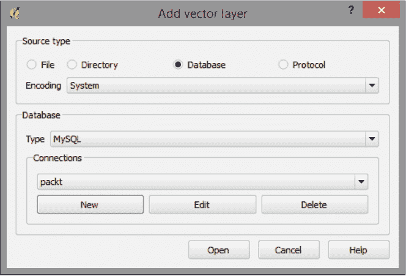

2. 一旦你表明希望添加 MySQL 数据库图层，你将有创建新连接的选项。在 **连接** 中，点击 **新建**。在打开的对话框中，输入以下参数，这些参数是我们创建 MySQL 数据库并导入 packt 架构的 `.sql` 备份时最初设置的：
   - **名称：** packt
   - **主机：** localhost
   - **数据库：** packt
   - **端口：** 3306
   - **用户名：** packt
   - **密码：** packt

如下图所示：

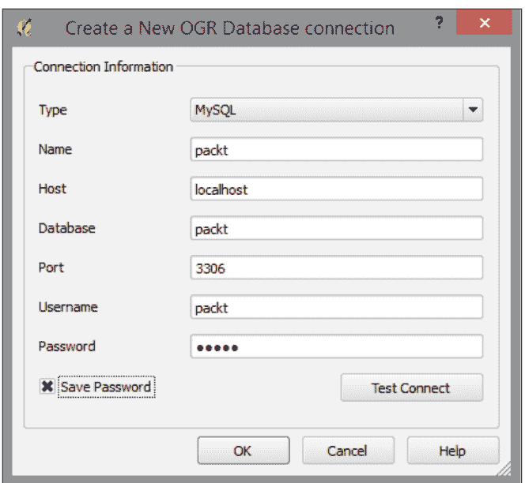

3. 点击 **测试连接**。
4. 点击 **确定**。
5. 点击 **打开**，**选择要添加的矢量图层** 对话框将会出现。
6. 从 **选择矢量图层** 对话框中，点击 **全选**。这包括以下图层：
   - fields
   - precipitation
   - relative_humidity
   - temperature
7. 点击 **确定**。

来自 MySQL 数据库的图层（实际上只是数据表）现在将出现在你的项目 QGIS 图层面板中。

## 估算未知值

现在，要导入包含被识别为地理空间数据的坐标字段的 CSV 并绘制位置，请执行以下步骤：

1. 从图层菜单导航到 **添加图层 | 添加分隔文本图层**。
2. 在 **从分隔文本文件创建图层** 对话框中，执行以下步骤：
   1. 点击 **浏览...** 按钮浏览你之前保存 `fields.csv` 文件的位置（例如，`c6/data/output/fields.csv`）。
   2. 其他所有参数应默认正确填充。查看以下图像。
   3. 点击 **确定** 在你的 QGIS 项目中创建新图层。

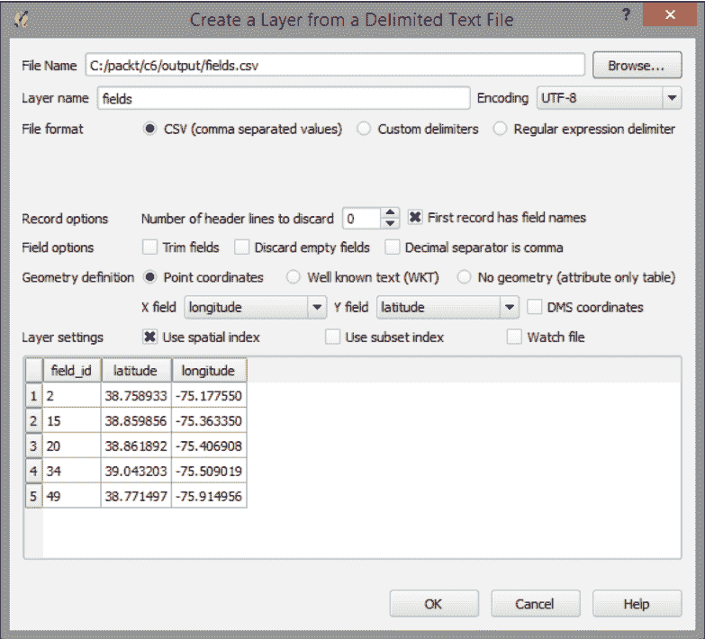

你将收到一条通知，提示由于此文件中未检测到坐标系统，已分配 WGS 1984。这是我们情况下正确的坐标系统，因此无需进一步干预。关闭此消息后，你将看到字段位置绘制在地图上。如果没有，请右键单击新图层并选择 **缩放至图层**。

请注意，此新图层不会在文件系统中反映为新文件，而仅存储在此 QGIS 项目中。现在是保存项目的合适时机。

最后，使用每个表的 `field_id` 字段一次一个地将其他表（`precipitation`、`relative_humidity` 和 `temperature`）连接到新绘制的图层（fields）。有关如何执行此操作的复习，请参阅 *第 1 章，探索地点 – 从概念到界面* 的 *表连接* 部分。要将每个图层导出为单独的 shapefile，请右键单击每个（`precipitation`、`relative_humidity` 和 `temperature`），点击 **另存为**，填充你想要保存的路径，然后保存它们。

## 图层/表关系

QGIS 的较新版本支持图层/表关系，这将允许我们模拟位置与其抽象测量类之间的一对多关系，该类将包含所有参数。然而，表关系的用途仅限于对图层对象与表之间关系的初步探索。图层/表关系不被任何处理函数识别。执行以下步骤以探索多对多图层/表关系：

1. 通过导航到 **项目 | 项目属性 | 关系** 添加关系。建立了与三个表的关联后，你将看到以下图像：

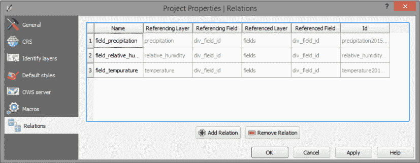

2. 要添加关系，请在 **引用图层（子）** 字段中选择一个非图层表（例如，**precipitation**），并在 **被引用图层（父）** 字段中选择一个位置表（例如，**fields**）。使用公共 Id 字段（例如，`field_id`）将表关联起来，该字段引用图层。名称字段可以任意填写，如下图所示：

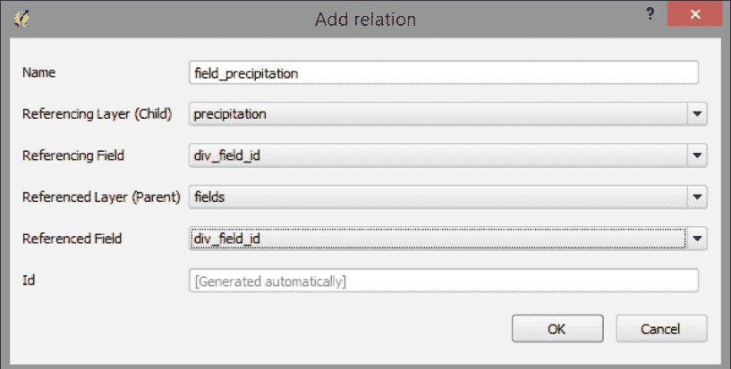

3. 现在，要使用关系，请使用识别工具点击父图层中的地理对象（你需要在识别工具选项面板中勾选 **自动打开表单**）。你将看到与此对象连接的所有子实体（行）。

## NetCDF

网络通用数据格式（NetCDF）是一种标准且强大的环境数据格式，例如气象数据。NetCDF 的优势在于保存多维数据。凭借其抽象的维度概念，NetCDF 可以以同样的方式处理纬度、经度和时间的维度，就像处理其他通常物理的、连续的和序数数据尺度，例如气压层。

## *估算未知值*

对于本项目，我们使用了 1901-2010 年的月度全球网格化高分辨率站点（陆地）空气温度和降水数据，NetCDF 大学特拉华大学作为与 NOAA 合作的一部分维护。你可以从 `http://www.esrl.noaa.gov/psd/data/gridded/data.Udel_AirT_Precip.html` 此来源下载更多数据。

### 在 QGIS 中查看 NetCDF

虽然有插件可用，但 NetCDF 可以直接在 QGIS 中、通过命令行 GDAL 以及在 QGIS Python 控制台中查看。执行以下步骤：

1. 导航到 **图层 | 添加栅格图层**。
2. 浏览到 `c6/data/original/air.mon.mean.v301.nc` 并添加此图层。
3. 使用路径 **栅格 | 杂项 > 信息** 查找波段中的值范围。在初始对话框中，点击 **确定** 进入信息对话框，然后查找 `air_valid_range`。你可以在以下图像中看到此信息高亮显示。虽然 QGIS 的分类器会为你计算范围，但它通常会被数值 nodata 值干扰，这通常会使范围偏向低端。

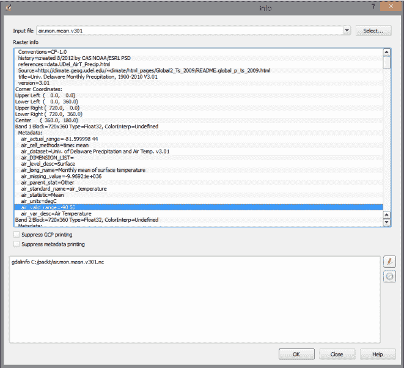

4. 将范围信息（-90 到 50）输入到 **图层属性** 选项卡的 **样式** 选项卡中。
5. 点击 **反转** 以显示从少到多的冷到热的颜色，就像温度预期那样。
6. 点击 **分类** 根据数量和颜色范围创建新的分箱。以下屏幕截图显示了理想的分箱和颜色选择的外观：

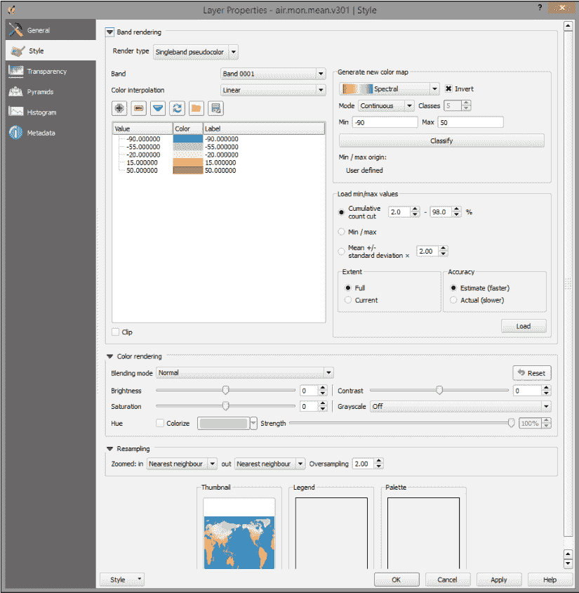

7. 点击 **确定**。最终结果将类似于以下图像：

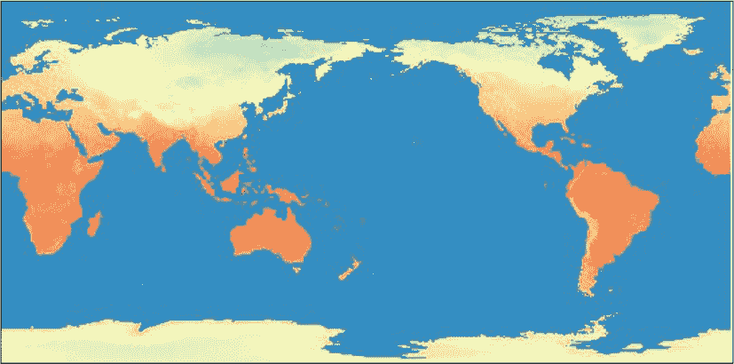

为了使网格化 NetCDF 数据可供某些模型、数据库和网络交互访问，你可以在对每个时间段的网格值进行采样并将其附加到点之后编写类似以下的工作流程序。

## 插值模型值

在本节中，我们将介绍从之前提到的 MySQL 数据库中获得的有限气象站数据创建新的全州、基于点的脆弱性指数数据。

### Python 用于工作流自动化

凭借 Python 大量且不断增长的包装器，允许独立的（通常用 C 编写并编译的）库直接调用到 Python 中，它是与其它软件通信的自然选择。除了直接的 API 和库使用外，Python 还提供对系统自动化任务的访问。

### 了解你的环境

在用 Python 开发时，一个看似简单却具有欺骗性的挑战是知道哪些路径和依赖项已加载到你的开发环境中。


要输出你的路径，请在 QGIS Python 控制台（导航到**插件 | Python 控制台**）或 QGIS 随附的 OSGeo4W Shell 中键入以下内容：

```
import os
try:
    user_paths = os.environ['PYTHONPATH'].split(os.pathsep)
except KeyError:
    user_paths = []
print user_paths
```

为了列出所有模块，以便我们知道哪些已经可用，请键入以下内容：

```
import sys
sys.modules.keys()
```

一旦我们知道哪些模块可供 Python 使用，我们就可以查找这些模块及其可能公开的可编程对象的文档。

> 请记住，在您使用的任何文本编辑器或 IDE 中查看所有特殊字符（包括空白）。Python 对代码块的缩进很敏感！您可以将文本编辑器设置为默认输入一定数量的空格来代替制表符。例如，当我按一次制表符缩进时，我将得到四个空格，而不是一个特殊的制表符字符。


## 为每个时间段生成参数栅格

现在，我们将转入非评估代码。您可能希望借此机会退出 QGIS，尤其是在您一直在 Python 命令窗格中工作时。如果我已在命令窗格中工作，我喜欢使用 Python 语法退出，代码如下：

```
quit()
```

退出后，重新启动 QGIS。Python 控制台可以在**插件 | Python 控制台**下找到。

通过在 Python 中运行下一个代码片段，您将生成一段命令行代码，我们将依次运行该代码来为这个 Web 应用程序生成中间数据。

## 这段代码的作用

我们将运行一段 Python 代码来生成一个更详细的脚本，该脚本将执行一个冗长的工作流程。

- 对于每个参数（因子），它将遍历日期范围内的每一天。该范围实际上将限制为 06/10/15 至 06/30/15，因为模型需要 10 天的回溯期。
- 我们将通过 ogr2ogr——GDAL 强大的矢量数据转换工具——运行它，并使用 SQLite 语法，根据相对时间段选择适当的聚合值（计数、总和和平均值）。
- 它将根据阈值将每个结果转换为用于计算霉病易感性的分数。换句话说，利用数据中的一些（可能是任意的）断点，我们将真实测量值转换为与我们的研究相关的较小整数分数。
- 它将对分数进行插值，生成整数栅格。

## 在 Python 中运行代码

将以下行复制并粘贴到 Python 解释器中。如果粘贴后代码未执行，请按*回车*键。该代码还假定数据位于以下位置硬编码的位置（C:/packt/c6/data/prep/ogr.sqlite）中。如果这些文件不在给定位置，您可能需要移动这些文件或更改代码。您还需要根据您的文件系统修改以下代码；以下代码使用 Windows 文件系统约定：

```python
# first variable to store commands
strCmds = 'del /F C:\\packt\\c6\\data\\prep\\ogr.* \\n'
# list of factors
factors = ['temperature','relative_humidity','precipitation']
# iterate through each factor, appending commands for each
for factor in factors:
    for i in range(10, 31):
        j = i - 5
        k = i - 9
        if factor == 'temperature':
            # commands use ogr2ogr executable from gdal project
            # you can run help on this from command line for more
            # information on syntax
            strOgr = 'ogr2ogr -f sqlite -sql "SELECT div_field_, GEOMETRY, AVG(o_value) AS o_value FROM (SELECT div_field_, GEOMETRY, MAX(value) AS o_value, date(time_measu) as date_f FROM {2} WHERE date_f BETWEEN date(\\'2013-06-{0:02d}\\') AND date(\\'2013-06-{1:02d}\\') GROUP BY div_field_, date(time_measu)) GROUP BY div_field_" -dialect sqlite -nln ogr -dsco SPATIALITE=yes -lco SPATIAL_INDEX=yes -overwrite C:/packt/c6/data/prep/ogr.sqlite C:/packt/c6/data/prep/temperature.shp \\n'.format(j,i,factor)
```

```
strOgr += 'ogr2ogr -sql "UPDATE ogr SET o_value = 0 WHERE o_value <=15.55" -dialect sqlite -update C:/packt/c6/data/prep/ogr.sqlite C:/packt/c6/data/prep/ogr.sqlite \n'
    strOgr += 'ogr2ogr -sql "UPDATE ogr SET o_value = 3 WHERE o_value > 25.55" -dialect sqlite -update C:/packt/c6/data/prep/ogr.sqlite C:/packt/c6/data/prep/ogr.sqlite \n'
    strOgr += 'ogr2ogr -sql "UPDATE ogr SET o_value = 2 WHERE o_value > 20.55 AND o_value <= 25.55" -dialect sqlite -update C:/packt/c6/data/prep/ogr.sqlite C:/packt/c6/data/prep/ogr.sqlite \n'
    strOgr += 'ogr2ogr -sql "UPDATE ogr SET o_value = 1 WHERE o_value > 15.55 AND o_value <= 20.55" -dialect sqlite -update C:/packt/c6/data/prep/ogr.sqlite C:/packt/c6/data/prep/ogr.sqlite \n'
    elif factor == 'relative_humidity':
        strOgr = 'ogr2ogr -f sqlite -sql "SELECT GEOMETRY, COUNT(value) AS o_value, date(time_measu) as date_f FROM relative_humidity WHERE value > 96 AND date_f BETWEEN date(\'2013-06-{0:02d}\') AND date(\'2013-06-{1:02d}\') GROUP BY div_field" -dialect sqlite -nln ogr -dsco SPATIALITE=yes -lco SPATIAL_INDEX=yes -overwrite C:/packt/c6/data/prep/ogr.sqlite C:/packt/c6/data/prep/relative_humidity.shp \n'.format(j,i)
    strOgr += 'ogr2ogr -sql "UPDATE ogr SET o_value = 0 WHERE o_value <= 1" -dialect sqlite -update C:/packt/c6/data/prep/ogr.sqlite C:/packt/c6/data/prep/ogr.sqlite \n'
    strOgr += 'ogr2ogr -sql "UPDATE ogr SET o_value = 3 WHERE o_value > 40" -dialect sqlite -update C:/packt/c6/data/prep/ogr.sqlite C:/packt/c6/data/prep/ogr.sqlite \n'
    strOgr += 'ogr2ogr -sql "UPDATE ogr SET o_value = 2 WHERE o_value > 20 AND o_value <= 40" -dialect sqlite -update C:/packt/c6/data/prep/ogr.sqlite C:/packt/c6/data/prep/ogr.sqlite \n'
    strOgr += 'ogr2ogr -sql "UPDATE ogr SET o_value = 1 WHERE o_value > 10 AND o_value <= 20" -dialect sqlite -update C:/packt/c6/data/prep/ogr.sqlite C:/packt/c6/data/prep/ogr.sqlite \n'
    strOgr += 'ogr2ogr -sql "UPDATE ogr SET o_value = 1 WHERE o_value > 1 AND o_value <= 10" -dialect sqlite -update C:/packt/c6/data/prep/ogr.sqlite C:/packt/c6/data/prep/ogr.sqlite \n'
    elif factor == 'precipitation':
        strOgr = 'ogr2ogr -f sqlite -sql "SELECT GEOMETRY, SUM(value) AS o_value, date(time_measu) as date_f FROM precipitation WHERE date_f BETWEEN date(\'2013-06-{0:02d}\') AND date(\'2013-06-{1:02d}\') GROUP BY div_field" -dialect sqlite -nln ogr -dsco SPATIALITE=yes -lco SPATIAL_INDEX=yes -overwrite C:/packt/c6/data/prep/ogr.sqlite C:/packt/c6/data/prep/precipitation.shp \n'.format(k,i)
    strOgr += 'ogr2ogr -sql "UPDATE ogr SET o_value = 0 WHERE o_value < 25.4" -dialect sqlite -update C:/packt/c6/data/prep/ogr.sqlite C:/packt/c6/data/prep/ogr.sqlite \n'
    strOgr += 'ogr2ogr -sql "UPDATE ogr SET o_value = 3 WHERE o_value > 76.2" -dialect sqlite -update C:/packt/c6/data/prep/ogr.sqlite C:/packt/c6/data/prep/ogr.sqlite \n'
```

## 估算未知值

```
strOgr += 'ogr2ogr -sql "UPDATE ogr SET o_value = 2 WHERE o_value > 50.8 AND o_value <= 76.2" -dialect sqlite -update C:/packt/c6/data/prep/ogr.sqlite C:/packt/c6/data/prep/ogr.sqlite \\n'
strOgr += 'ogr2ogr -sql "UPDATE ogr SET o_value = 1 WHERE o_value > 30.48 AND o_value <= 50.8" -dialect sqlite -update C:/packt/c6/data/prep/ogr.sqlite C:/packt/c6/data/prep/ogr.sqlite \\n'
strOgr += 'ogr2ogr -sql "UPDATE ogr SET o_value = 1 WHERE o_value > 25.4 AND o_value <= 30.48" -dialect sqlite -update C:/packt/c6/data/prep/ogr.sqlite C:/packt/c6/data/prep/ogr.sqlite \\n'
strGrid = 'gdal_grid -ot UInt16 -zfield o_value -l ogr -of GTiff C:/packt/c6/data/prep/ogr.sqlite C:/packt/c6/data/prep/{0} Integer{1}.tif'.format(factor,i)
strCmds = strCmds + strOgr + '\\n' + strGrid + '\\n' + 'del /F C:\\packt\\c6\\data\\prep\\ogr.*' + '\\n'

print strCmds
```

## 在 Windows 命令控制台中运行打印的命令

通过将上一部分输出的代码复制并粘贴到 Windows 命令控制台中来运行它。您还可以在 `c6/data/output/generate_values.bat` 中找到要复制的代码输出。

## subprocess 模块

subprocess 模块允许您使用相关的命令行语法打开系统上的任何可执行文件。

虽然我们也可以通过 subprocess 模块来运行刚刚生成的代码，但在这种情况下，直接在命令行中运行更为简单。对于较短、顺序性较弱的过程，您绝对应该使用 subprocess。

要使用 subprocess，只需（最好）在程序开头导入它，然后使用 Popen 方法调用您的命令行代码。执行以下代码：

```
import subprocess
...
subprocess.Popen(strCmds)
```


## 计算脆弱性指数

GDAL_CALC 使用栅格数据作为变量来评估代数表达式。换句话说，你可以使用这个 GDAL 工具来运行地图代数或栅格计算器类型的表达式。在这里，我们将使用 GDAL_CALC 根据插值的阈值分数生成我们的脆弱性指数值网格。

在 QGIS 中打开 Python 控制台（导航到 **Plugins | Python Console**）并复制/粘贴/运行以下代码。同样，你可能希望在运行此代码之前退出 Python（使用 `quit()`）并重新启动 QGIS/Python，这将为我们的应用程序生成中间数据。这用于控制在 Python 会话中保留的意外变量和导入模块。

在将以下行粘贴到 Python 解释器后，如果尚未执行，请按 *Enter*。此代码与前一个代码类似，会生成一个脚本，其中包含一系列附加到文件名的数字。它将通过 `gdal_calc` 运行地图代数表达式，使用范围内的相应数字。执行以下操作：

```
strCmd = ''

for i in range(10, 31):
    j = i - 5
    k = i - 9
    strOgr = 'gdal_calc --A C:/packt/c6/data/prep//temperatureInter{0}.tif -B C:/packt/c6/data/prep/relative_humidityInter{0}.tif -C C:/packt/c6/data/prep/precipitationInter{0}.tif --calc="A+B+C" --type=UInt16 --outfile=C:/packt/c6/data/prep/calc{0}.tiff'.format(i)

    strCmd += strOgr + '\n'

print strCmd
```

现在，在 Windows 命令控制台中运行此代码的输出。你可以在 `c6/data/output/calculate_index.bat` 下找到输出代码。

## 创建规则点

由于动态网络地图界面通常不擅长查询栅格输入，我们将创建一个中间位置集——点——用于与用户点击事件进行交互。**Regular points** 工具将在彼此之间以规则距离创建一组点。最终结果几乎就像一个网格，但由点组成。执行以下步骤：

- 1. 如果尚未添加，请将 `c6/data/original/delaware_boundary.shp` 添加到你的地图项目中。
- 2. 在 **Vector** 中，导航到 **Research Tools | Regular points**。
- 3. 使用 **delaware_boundary** 作为 **Input Boundary Layer**。
- 4. 使用 .05 的点间距（目前以十进制度为单位）。
- 5. 保存为 `c6/data/output/sample.shp`。

以下图像显示了这些参数的填充情况：

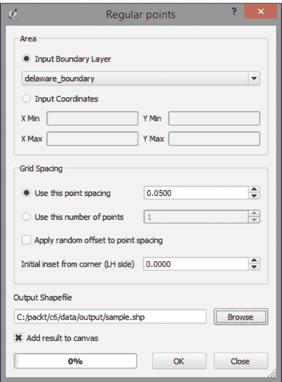

输出将类似于此：

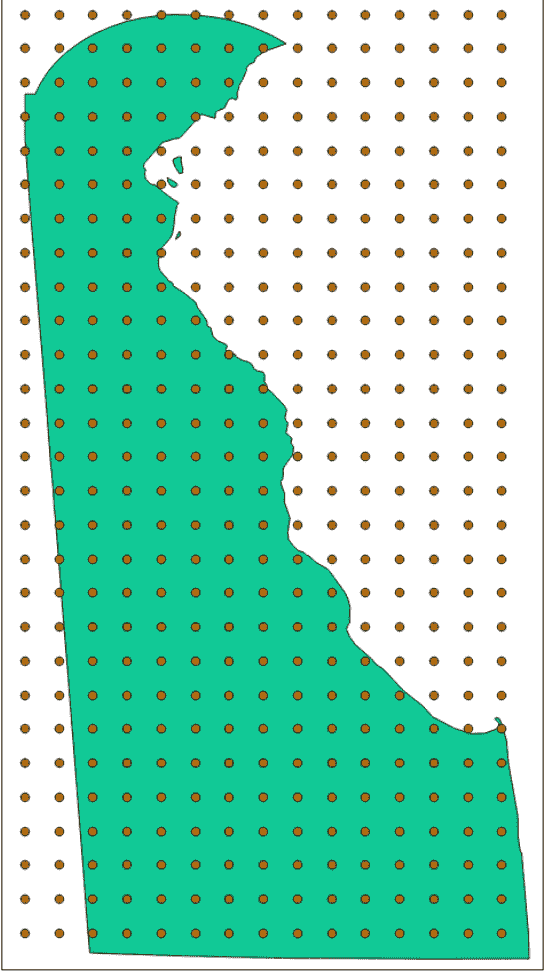

## 估计未知值

## 通过点采样指数网格

现在我们有了规则点，可以使用以下步骤将网格值附加到它们上：

- 1. 如果尚未添加，请将所有计算的网格添加到地图中（`calc10` 到 `calc30`）（导航到 **Layer | Add Layer | Add Vector Layer**）。
- 2. 在 **Processing Toolbox** 面板下搜索 **points**。确保从面板底部的下拉菜单中选择了 **Advanced Interface**。
- 3. 导航到 **SAGA | Shapes - Grid | Add grid values to points**。
- 4. 选择我们刚刚创建的规则点的 **sample layer**。以下是此操作的屏幕截图，你需要执行以下代码：

```
Select all grids (calc10-calc30)
```

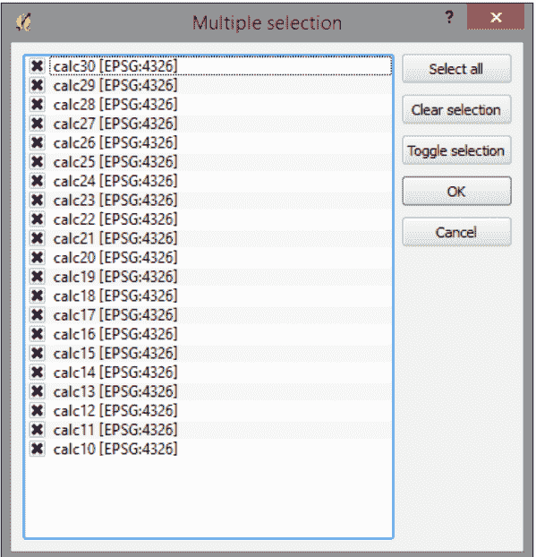

- 5. 将输出结果保存到 `c6/data/output/sample_data.shp`。

6. 点击 Run，如以下屏幕截图所示：

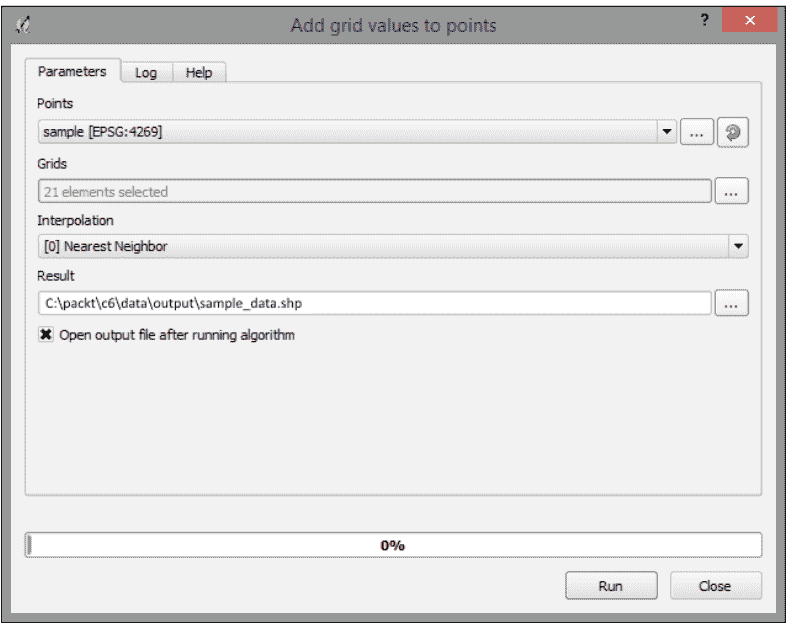

# 创建 SQLite 数据库并导入

接下来，在 c6/data/web/cgi-bin/c6.sqlite 创建一个 SpatiaLite 数据库（参考第 5 章《Demonstrating Change》中创建 SpatiaLite 数据库部分）并使用 DB Manager 导入 sample_data shapefile。

DB Manager 看不到未直接通过 Add Layer 命令创建的 SpatiaLite 数据库（我们迄今为止所做的；例如，在第 5 章《Demonstrating Change》中），因此最好以这种方式进行，而不是通过上一步输出对话框直接将其保存为 SpatiaLite 数据库。

执行以下步骤以测试我们的最近邻结果是否正确：

- 1. 使用坐标捕获根据 sample_data 层中的点获取测试坐标。
- 2. 使用第 5 章《Demonstrating Change》中的步骤创建 SpatiaLite 数据库（导航到 Layer | Create Layer）。
- 3. 打开 DB Manager（**Database | DB Manager**）。
- 4. 导入 `sample_data` 层/shapefile。
- 5. 在 DB Manager SQL 窗口中运行以下查询，将第 1 步中获得的坐标替换为用空格分隔的坐标（例如，75.28075 39.47785）：
  ```
  SELECT pk, calc10, min(Distance(PointFromText('POINT (- 75.28075 39.47785)'),geom)) FROM vulnerability
  ```

使用识别工具，单击你选择的坐标最近的点，以检查查询是否产生正确的最近邻。

# 一个动态 Web 应用程序 – OpenLayers AJAX 与 Python 和 SpatiaLite

在本节中，我们将制作我们的 Web 应用程序，与迄今为止的任何应用程序不同，它涉及客户端和服务器之间的动态交互。我们还将使用不同的 Web 地图客户端 API——OpenLayers。OpenLayers 长期以来一直是 Web 制图的领导者；然而，最近它已被 Leaflet 等较小的客户端所掩盖。随着最新版本 OpenLayers 3 的发布，OpenLayers 已精简，但仍在大多数领域保留了相对于其更新同行的功能优势。

# 服务器端 – CGI in Python

**Common Gateway Interface (CGI)** 也许是运行动态 Web 使用的服务器端代码的最简单方法。这使其非常适合进行概念验证学习。CGI 最典型的用途是在数据处理和通过 HTTP POST 从 Web 表单接收后将其传递到数据库。最常见的攻击向量是 SQL 注入。再进一步，类似 CGI 的动态处理通常通过最小框架实现，例如 Bottle、CherryPy 或 Flask，以处理路由和有时模板等常见任务，从而提供更安全的环境。

不要忘记 Python 对缩进敏感。缩进始终以空格表示，每个层级使用统一数量。例如，if 块可能包含以四个空格为前缀的行。如果 if 块位于 for 循环内，同一行应以 8 个空格为前缀。

## Python CGI 开发

接下来，我们将通过单独的 Windows 控制台会话启动一个 CGIHTTPServer 主机实例。然后，我们将通过 QGIS Python 控制台主要进行服务器端代码的开发。

### 启动 CGI 主机

启动 CGI 会话很简单——你只需直接使用 Python 的 -m 命令行开关，它会像加载脚本一样加载模块。以下代码在端口 8000 启动 CGIHTTPServer。当前工作目录将被作为公共 Web 目录提供服务；在本例中，这是 `C:\packt\c6\data\web`。

在新的 Windows 控制台会话中运行以下命令：

```
cd C:\packt\c6\data\web
python -m CGIHTTPServer 8000
```

### 测试 CGI 主机

Python（.py）CGI 文件只能从名为 cgi 或 cgi-bin 的目录中运行。这是确保我们有意将此目录中的文件设为可公开执行的一项预防措施。

为此，在 `c6/data/web/cgi-bin/simple_test.py` 创建一个文件，内容如下：

> 第一行是我们的 shebang，它允许此文件通过 Unix 系统路径中列出的解释器独立执行。虽然这对 Windows 系统没有影响，在 Windows 系统中执行通过文件关联处理，但我们仍将其保留在此处以实现互操作性。

```
#!/usr/bin/python

# Import the cgi, and system modules
import cgi, sys

# Required header that tells the browser how to render the HTML.
print "Content-Type: text/html\n"
print "Hello world"
```

现在，当你在浏览器中访问 `http://localhost:8000/cgi-bin/simple_test.py` 时，你应该会看到 "Hello world" 消息。为了在客户端进行调试，请确保你使用基于浏览器的 Web 开发视图、插件或扩展，例如 Chrome 的 Developer Tools 工具栏或 Firefox 的 Firebug 扩展。


## 调试服务器端代码

以下是在 Python CGI 开发过程中进行调试的几种方式：

- 使用 QGIS 中的 Python 控制台（导航至**插件 | Python 控制台**）。你可以直接在此处运行 Python CGI 脚本中的代码；但是，对于依赖 HTTP 传递信息的脚本，这种方式可能会失败，但你至少可以捕获语法错误，也可以用预期的值填充这些变量，以便与在浏览器中获得的结果进行比较。有时，你需要退出 QGIS 以清除 Python 解释器的内存。
- 更快捷的方式是在命令行中使用 `-d`（详细调试）参数运行脚本。这样可以捕获交互式使用中可能不会出现的问题，避免可能在同一交互会话中无意设置的变量（将 `index.py` 替换为你的 Python 脚本名称）。在命令行 shell 中运行以下命令：
  `python -d C:\packt\c6\data\web\cgi-bin\index.py`
- 如果你的 Python CGI 脚本与数据库交互，一定要通过 DB Manager SQL 窗口（或你喜欢的任何数据库接口）测试查询。通常，将预期值填充到查询中会有帮助。
- 在浏览器中访问以下地址（将 `index.py` 替换为你的 Python 脚本名称）：
  `localhost:8000/cgi-bin/index.py`

## 我们的 Python 服务器端数据库驱动代码

现在，让我们来创建一个 Python 代码，为我们的 SQLite 数据库提供动态 Web 访问。

### PySpatiaLite

PySpatiaLite 模块提供对 SpatiaLite 数据库的 dbapi2 访问。Dbapi2 是与 Python 数据库交互的标准库。这非常幸运，因为如果您仅使用 sqlite3 模块中的 dbapi2 连接器，任何使用空间类型或函数的查询都会失败。sqlite3 模块并非为支持 SpatiaLite 而构建。

将以下内容添加到前面的代码中。这将执行以下功能：

- 导入 PySpatiaLite 模块并连接到我们的 sqlite3/SpatiaLite 数据库。
- 使用连接作为上下文管理器，该管理器会自动提交已执行的查询，并在出错时回滚。
- 若要测试连接是否有效，请在 `SELECT` 查询中使用 `SQLITE_VERSION()` 函数并打印结果。

以下代码追加到前面的代码中，可以在 `c6/data/web/cgi-bin/db_test.py` 找到。请确保代码中 SQLite 数据库文件的路径与您系统上的实际位置一致。

```python
# Import the pySpatiaLite module
from pySpatiaLite import dbapi2 as sqlite3
conn = sqlite3.connect('C:\packt\c6\data\web\cgi-bin\c6.sqlite')

# Use connection handler as context
with conn:
    c = conn.cursor()
    c.execute('SELECT SQLITE_VERSION()')

    data = c.fetchone()
    print data
    print 'SQLite version:{0}'.format(data[0])
```

您可以在浏览器中通过 `http://localhost:8000/cgi-bin/db_test.py` 查看以下结果。

```
(u'3.7.17',) SQLite version:3.7.17
```

第一次打印数据时，该数据以 `u` 为前缀，并用单引号括起来。这表示这是一个 unicode 字符串（因为我们的数据库使用 unicode 编码）。如果我们访问此字符串中的元素 0，则会得到一个不带引号的结果。

### 通过 JSON 实现 SQLite 的 Web 访问的 Python 代码

以下代码执行以下功能：

- 它连接到数据库。
- 它发出查询，以在给定指定位置和日期的情况下，查找最小距离的位置和字段。
- 它根据数据库结果字段的名称和值，返回带有字段/值对的 JSON。

您可以在 `c6/data/web/cgi-bin/get_json.py` 找到该代码：

```python
#!/usr/bin/python

import cgi, cgitb, json, sys
from pyspatialite import dbapi2 as sqlite3

# Enables some debugging functionality
cgitb.enable()

# Creating row factory function so that we can get field names
# in dict returned from query
def dict_factory(cursor, row):
    d = {}
    for idx, col in enumerate(cursor.description):
        d[col[0]] = row[idx]
    return d

# Connect to DB and setup row_factory
conn = sqlite3.connect('C:\\packt\\c6\\data\\web\\cgi-bin\\c6.sqlite')
conn.row_factory = dict_factory

# Print json headers, so response type is recognized and correctly
# decoded
print 'Content-Type: application/json\n\n'

# Use CGI FieldStorage object to retrieve data passed by HTTP GET
# Using numeric datatype casts to eliminate special characters
fs = cgi.FieldStorage()
longitude = float(fs.getfirst('longitude'))
latitude = float(fs.getfirst('latitude'))
day = int(fs.getfirst('day'))

# Use user selected location and days to find nearest location
# (minimum distance) and correct date column
query = 'SELECT pk, calc{2} as index_value, min(Distance(PointFromText(\'POINT ({0} {1})\'),geom)) as min_dist FROM vulnerability'.format(longitude, latitude, day)

# Use connection as context manager, output first/only result row as json
with conn:
    c = conn.cursor()
    c.execute(query)
    data = c.fetchone()
    print json.dumps(data)
```

您可以通过注释掉上述代码中从 HTTP 请求获取参数的部分，并任意设置这些参数来测试上述代码。

完整代码位于 `c6/data/web/cgi-bin/json_test.py`：

```python
# longitude = float(fs.getfirst('longitude'))
# latitude = float(fs.getfirst('latitude'))
# day = int(fs.getfirst('day'))
longitude = -75.28075
latitude = 39.47785
day = 15
```

如果您浏览到 `http://localhost:8000/cgi-bin/json_test.py`，您将在浏览器中看到打印出的字面 JSON。您也可以浏览包含这些参数的以下 URL 来完成相同的操作： `http://localhost:8000/cgi-bin/get_json.py?longitude=-75.28075&latitude=39.47785&day=15`。

```
{"pk": 260, "min_dist": 161.77454362713507, "index_value": 7}
```

## OpenLayers/jQuery 客户端代码

现在我们的后端代码和依赖都已就绪，是时候将其集成到我们的前端界面中了。

### 使用 QGIS 导出 OpenLayers 3 地图

QGIS 帮助我们开始项目，它允许我们生成一个可工作的 OpenLayers 地图，其中包含所有依赖项、基本 HTML 元素和交互事件处理程序功能。当然，与 qgis2leaf 一样，可以扩展此功能以包含地图项目图层和交互元素的其他利用方式。

以下步骤将生成一个 OpenLayers 3 地图，我们将修改它以生成我们的数据库交互式地图应用程序：

1. 新建一个 QGIS 地图或从当前地图中移除所有图层。
2. 将 `delaware_boundary.shp` 添加到地图中。如果 QGIS 未自动执行此操作，请平移并缩放到特拉华州地理边界对象。
3. 通过导航至**矢量 | 几何工具 | 面转线**，将 `delaware_boundary` 面图层转换为线。**导出到 OpenLayers** 不支持未填充的多边形。下图显示了这些输入的填充情况：

   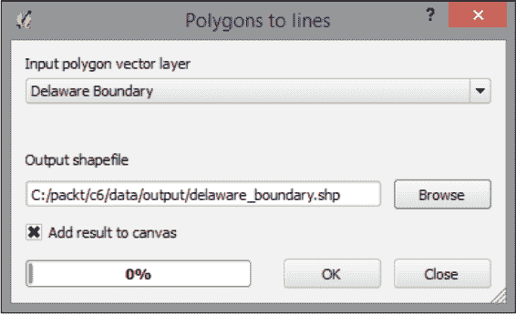

4. 添加线边界后，请加亮它们并增大线宽。单击此边界以外的任何地方可能不会返回有效结果。在**图层**面板中将该图层重命名为 **Delaware Boundary**。
5. 如果尚未安装“Export to OpenLayers 3”插件，请安装它。
6. 导航至**Web | Export to OpenLayers | Create OpenLayers Map**。
7. 在**Export to OpenLayers 3**对话框中，使用以下参数值（参考下图以进一步说明）：
   - 确保您在步骤 4 中创建的样式化特拉华线边界已勾选并可见，且没有弹出窗口。否则，这可能会遮蔽我们将创建的交互。
   - 删除未使用的字段。这是重要的一步，所以请取消选中。否则，您可能会看到错误。
   - 如果您已将画布缩放和平移到**Delaware Boundary**图层，则可以忽略**范围**参数。否则，将范围参数设置为**适应图层范围**。
   - **最大缩放级别：** 14。
   - **最小缩放级别：** 8。
   - 选择**限制在范围内**。


- 取消选择“使用按图层比例依赖的可见性”。
- 基础图层：MapQuest，如以下屏幕截图所示：

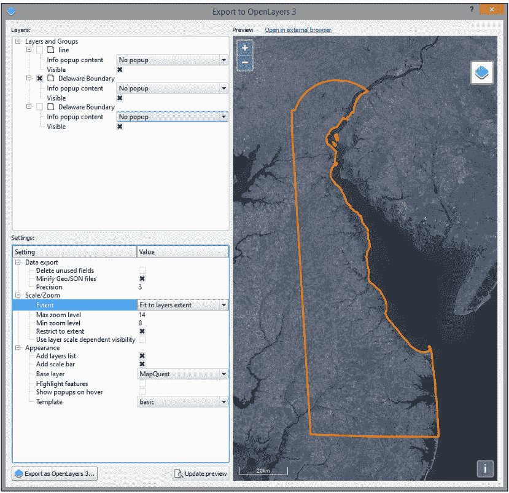

## 修改导出的 OpenLayers 3 地图应用程序

现在我们已经有了地图应用程序的基础代码和依赖项，我们可以继续修改代码，使其与后端交互，在点击交互时提供所需的信息。

## 估算未知值

请记住，后端脚本将响应所选日期和位置，通过查找最近的“常规点”并计算该日期的插值指数。

## 添加一个交互式 HTML 元素

将以下内容添加到 `c6/data/web/index.html` 的 body 中，位于 `div#id` 元素正上方。

这是 `select` 元素的 HTML，它将传递一个日期。你可能希望更改这里的代码以适应你的应用程序——这个例子仅限于一个月中的几天（并且由于需要 10 天的回顾数据，因此仅限于 6/10 到 6/30 的日期）：

```
```html
<select id="day">
    <option value="10">2013-06-10</option>
    <option value="11">2013-06-11</option>
    <option value="12">2013-06-12</option>
    <option value="13">2013-06-13</option>
    <option value="14">2013-06-14</option>
    <option value="15">2013-06-15</option>
    <option value="16">2013-06-16</option>
    <option value="17">2013-06-17</option>
    <option value="18">2013-06-18</option>
    <option value="19">2013-06-19</option>
    <option value="20">2013-06-20</option>
    <option value="21">2013-06-21</option>
    <option value="22">2013-06-22</option>
    <option value="23">2013-06-23</option>
    <option value="24">2013-06-24</option>
    <option value="25">2013-06-25</option>
    <option value="26">2013-06-26</option>
    <option value="27">2013-06-27</option>
    <option value="28">2013-06-28</option>
    <option value="29">2013-06-29</option>
    <option value="30">2013-06-30</option>
</select>
```
```

此后该元素将通过 `div#id` 引用由 jQuery 访问。

## AJAX – 前端与后端之间的粘合剂

AJAX 是一个松散的术语，特指使用 XML 对象在客户端和服务器软件之间进行异步交互。这使得可以在不使用经典的提交按钮交互的情况下从服务器检索数据，而该交互会带你进入基于结果构建的页面。如今，AJAX 通常使用 JSON 而不是 XML 来实现相同的效果；它不需要生成新页面来捕获服务器端处理的结果。

jQuery 是一个 JavaScript 库，提供了许多有用的跨浏览器实用工具，尤其侧重于 DOM 操作。jQuery 以发送、接收和渲染 AJAX 调用的结果而闻名。AJAX 调用过去可以在 OpenLayers 中实现；然而，在 OpenLayers 3 中，需要外部库。幸运的是，jQuery 已包含在 QGIS 导出的基础 OpenLayers 3 Web 应用程序中。

## 向 singleclick 事件处理程序添加 AJAX 调用

要在我们的 CGI 脚本中添加 jQuery AJAX 调用，请将以下代码添加到 SingleClick 上的 "singleclick" 事件处理程序中。这是当用户点击前端地图时触发的自定义函数。

此 AJAX 调用引用 CGI 脚本 URL。data 对象包含我们希望传递给服务器的所有参数。jQuery 将负责将 data 对象编码为 URL 查询字符串。执行以下代码：

```
jQuery.ajax({
    url: http://localhost:8000/cgi-bin/get_json.py,
    data: {"longitude": newCoord[0], "latitude": newCoord[1], "day":
    day}
})
Add a callback function to the jquery ajax call by inserting the
following lines directly after it.
.done(function(response) {
popupText = 'Vulnerability Index (1=Least Vulnerable, 10=Most
Vulnerable): ' + response.index_value;
```

## 从回调函数填充并触发弹出窗口

现在，要在点击后将脚本响应显示在弹出窗口中，请注释掉以下行：

```
/* var popupField;

var currentFeature;
var currentFeatureKeys;
map.forEachFeatureAtPixel(pixel, function(feature, layer) {
    currentFeature = feature;
    currentFeatureKeys = currentFeature.getKeys();
    var field = popupLayers[layersList.indexOf(layer) - 1];
    if (field == NO_POPUP) {
    }
    else if (field == ALL_FIELDS) {
        for ( var i=0; i<currentFeatureKeys.length;i++) {
            if (currentFeatureKeys[i] != 'geometry') {
```

```
popupField = currentFeatureKeys[i] + ': ' +
    currentFeature.get(currentFeatureKeys[i]);
    popupText = popupText + popupField + '<br>';
}
}
}
else{
    var value = feature.get(field);
    if (value){
        popupText = field + ': ' + value;
    }
}
}); /*
```

最后，将实际触发弹出窗口的部分复制并粘贴到 .done 回调函数中。.done 回调在 AJAX 调用返回服务器的数据响应时触发（数据响应存储在 response 对象变量中）。执行以下代码：

```
.done(function(response) {
    popupText = 'Vulnerability Index (1=Least Vulnerable, 10=Most Vulnerable): ' + response.index_value;
    if (popupText) {
        overlayPopup.setPosition(coord);
        content.innerHTML = popupText;
        container.style.display = 'block';
    } else {
        container.style.display = 'none';
        closer.blur();
    }
}
```

## 测试应用程序

现在，应用程序应该已完成。你可以在浏览器中通过 http://localhost:8000 查看它。

你需要通过从选择菜单中选择一个日期并点击地图上的不同位置来进行测试。你将看到类似以下图像的内容，显示研究范围（特拉华州）内地图上任何位置的易感性评分。

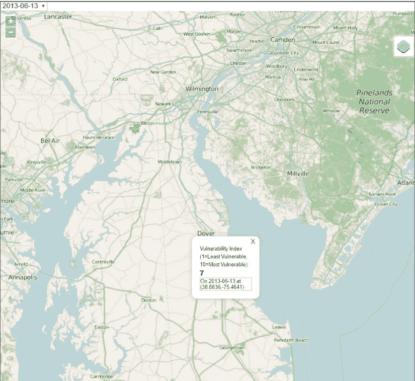

## 总结

在本章中，使用农业脆弱性建模示例，我们介绍了插值和使用空间查询的动态后端处理。最终的应用程序允许最终用户点击研究区域内的任何位置，并查看从插值点数据和代数模型计算得出的评分，该模型使用动态 Python CGI 代码查询 SQLite 数据库。在下一章中，我们将继续探索动态网站，并举例说明提供简单的客户端编辑功能以及使用切片和 UTFGrid 方法来提高复杂数据集性能。

## 7
