## 面向企业和社区的制图

在本章中，我们将使用多种 Web 服务来提供可编辑的协作数据系统。

虽然迄今为止我们所看到的可视化和数据查看功能是触达受众的有力手段，但我们可以利用受众——无论是组织成员、社区利益相关者，还是网络上的感兴趣人士——为我们的地理对象贡献改进的几何和属性数据。在本章中，你将学习如何为大学社区构建提供这些功能的 Web 服务系统。就可编辑系统而言，这属于较为简单的一端。使用诸如 GeoServer 之类的地图服务器，你可以根据复杂的用户访问管理扩展更广泛的几何编辑功能。

在本章中，我们将涵盖以下主题：

- Google Sheets 用于协作数据管理和服务
- AJAX 用于 Web 服务处理
- OpenStreetMap 用于协作数据贡献
- MBTiles 和 UTFGrid 数据格式
- 通过 Mapbox 进行交互式数据托管
- 将 JSON 解析并映射到对象
- 混合 Web 服务数据
- 使用 Vagrant 设置 Ubuntu 虚拟机
- TileStream 用于本地 MBTiles 托管

## Google Sheets 用于数据管理

Google Sheets 为我们提供了一个基本数据管理平台所需的一切——它是基于 Web 的，可通过电子表格界面轻松编辑，具有细粒度的编辑控制和 API 选项，并且可通过简单的 JSON Web 服务使用——在大多数情况下是免费的。

## 创建新的 Google 文档

要创建新的 Google 文档，你需要在 https://accounts.google.com 注册一个 Google 账户。执行以下步骤：

- 1. 在 https://docs.google.com/spreadsheets 创建一个新的 Google Sheets 文档。
- 2. 从 Excel 文件导入数据。
  - 1. 导航到 文件 | 导入。
  - 2. 然后，导航到 上传 | c7/data/original/building_export.xlsx。

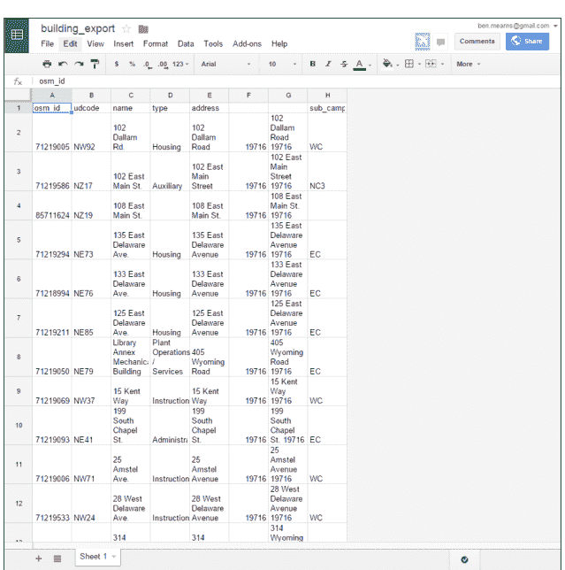


## 在网络上发布 Google Sheets

默认情况下，Google Sheets 不会公开可见。此外，没有暴露任何网络服务源。要使我们的网络应用程序能够访问由 Google Sheets 托管的数据，我们必须发布该表格。请执行以下步骤：

- 1. 导航到 **File | Publish to the web**。
- 2. 复制并粘贴 URL（在点击 **Published** 后出现）到你可以稍后参考的位置（例如，你喜欢的文本编辑器中）。
- 3. 如果尚未选中，请选中 **Automatically republish when changes are made** 复选框，如以下屏幕截图所示：

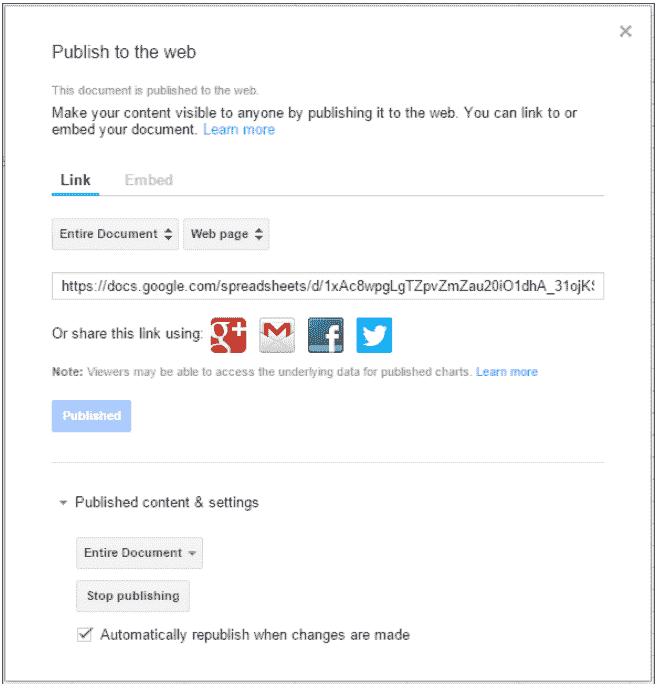

你需要 d/ 之后的部分（这里以 1xAc8w 开始）。这是唯一标识你的表格的标识符（或在文档中有时被称为 "key"）。

## 预览 JSON

现在我们已经发布了表格，我们的源以 JSON 形式暴露。我们可以通过将 KEY 替换为我们的工作表唯一标识符的 URL 格式 https://spreadsheets.google.com/feeds/list/KEY/1/public/basic?alt=json 来查看 JSON 源。例如，它看起来类似于以下 URL：

```
https://spreadsheets.google.com/feeds/list/1xAc8wpgLgTZpvZmZau2o1O1dhA_31ojKS1BmlG6FMzQ/1/public/basic?alt=json
```

这会产生以下 JSON 响应。为简洁起见，响应在第一个建筑对象后被截断：

```
{"version":"1.0","encoding":"UTF-8","feed":{"xmlns":"http://www.w3.org/2005/Atom","xmlns$openSearch":"http://a9.com/-/spec/opensearch/1.0/","xmlns$gssx":"http://schemas.google.com/spreadsheets/2006/extended","id":{"$t":"https://spreadsheets.google.com/feeds/list/19xiRHxZE4jOnVcMDXFxlpPyir4fXVGisW0c8guWTo2A/od6/public/basic"},"updated":{"$t":"2012-04-06T13:55:10.774Z"},"category":[{"scheme":"http://schemas.google.com/spreadsheets/2006","term":"http://schemas.google.com/spreadsheets/2006#list"}],"title":{"type":"text","$t":"Sheet 1"},"link":[{"rel":"alternate","type":"application/atom+xml","href":"https://docs.google.com/spreadsheets/d/19xiRHxZE4jOnVcMDXFxlpPyir4fXVGisW0c8guWTo2A/pubhtml"},{"rel":"http://schemas.google.com/g/2005#feed","type":"application/atom+xml","href":"https://spreadsheets.google.com/feeds/list/19xiRHxZE4jOnVcMDXFxlpPyir4fXVGisW0c8guWTo2A/od6/public/basic"},{"rel":"http://schemas.google.com/g/2005#post","type":"application/atom+xml","href":"https://spreadsheets.google.com/feeds/list/19xiRHxZE4jOnVcMDXFxlpPyir4fXVGisW0c8guWTo2A/od6/public/basic"},{"rel":"self","type":"application/atom+xml","href":"https://spreadsheets.google.com/feeds/list/19xiRHxZE4jOnVcMDXFxlpPyir4fXVGisW0c8guWTo2A/od6/public/basic?alt\u003djson"}],"author":[{"name":{"$t":"Ben.Mearns"},"email":{"$t":"ben.mearns@gmail.com"}}],"openSearch$totalResults":{"$t":"293"},"openSearch$startIndex":{"$t":"1"},"entry":[{"id":{"$t":"https://spreadsheets.google.com/feeds/list/19xiRHxZE4jOnVcMDXFxlpPyir4fXVGisW0c8guWTo2A/od6/public/cokwr"},"updated":{"$t":"2012-04-06T13:55:10.774Z"},"category":[{"scheme":"http://schemas.google.com/spreadsheets/2006","term":"http://schemas.google.com/spreadsheets/2006#list"}],"title":{"type":"text","$t":"71219005"},"content":{"type":"text","$t":"udcode: NW92, name: 102 Dallam Rd., type: Housing, address: 102 Dallam Road, _ciyn3: 19716, _ckd7g: 102 Dallam Road 19716, subcampus: WC"},"link":[{"rel":"self","type":"application/atom+xml","href":"https://spreadsheets.google.com/feeds/list/19xiRHxZE4jOnVcMDXFxlpPyir4fXVGisW0c8guWTo2A/od6/public/basic/cokwr"}]}, ...}]}
```

## 解析 JSON 数据

要处理来自此网络服务的数据，我们将使用 jQuery 的 AJAX 功能。利用 JSON 元素的属性，我们可以查看数据作为简单网页在 HTML 中呈现的方式。

## 启动服务器

在 Windows 命令行上，使用以下命令在端口 8000 上为 c:\data\web 启动 SimpleHTTPServer：

```
cd c:\packt\c7\data\web
python -m SimpleHTTPServer 8000
```

## 使用 jQuery 测试解析

你可以在文件系统上查看以下代码（位于 c7\data\web\gsheet.html）来测试我们解析 JSON 数据的能力：

```
<html>
<body>
<div class="results"></div>
</body>
<script src="http://code.jquery.com/jquery-1.11.3.min.js">
</script>
<script>
// ID of the Google Spreadsheet
var spreadsheetID = "1xAc8wpgLgT2zpvZmZau2oiOIuhA_31ojKSI8miL6FM6Mzq";
// Make sure it is public or set to Anyone with link can view
var url = "https://spreadsheets.google.com/feeds/list/" + spreadsheetID + "/1/public/values?alt=json";
$.getJSON(url, function(data) {
var entry = data.feed.entry;
$(entry).each(function() {
// Column names are name, type, etc.
$('.results').prepend('<h2>'+$this.gs$x$name.$t+'</h2><p>'+$this.gs$x$type.$t+'</p>');
});
});
</script>
```

你可以在网络浏览器中预览 http://localhost:8000/gsheet.html。你将看到建筑名称后跟类型，如以下图像所示：

Christiana East Tower
Residence Hall

77 East Main St.
Instruction

Kirkbride Lecture Hall
Instruction

Purnell Hall
Instruction

Munroe Hall
Instruction

Rodney Commons A/B
Student Activities

Rodney Hall C
Residence Hall

Rodney Dining Hall
Dining Hall

Fred Rust Ice Arena

## 推广

现在让我们看看如何将此系统运营化以实现协作数据编辑。

## 为其他用户分配权限

在表格中，点击右上角的蓝色 **Share** 按钮。或者，从 Drive 中，选择文件并点击它，然后点击看起来像带加号的人的图标。确保任何人都可以找到并查看文档。最后，添加你希望能够编辑文档的人的地址并赋予他们编辑权限，如以下屏幕截图所示：

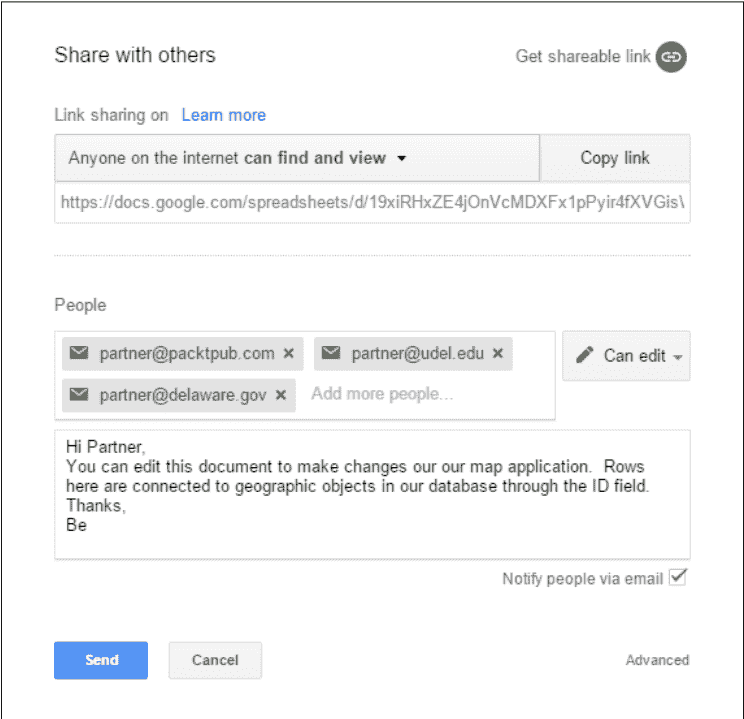

## 编辑工作流程

现在你的协作者收到了编辑表格的邀请，他们只需使用其 Google 凭据登录并对表格进行更改——更改将自动保存。当然，如果他们没有 Google 凭据，他们需要创建一个帐户。


要进入表格，你的协作者只需点击 Open in Sheets。表格现在也应出现在其 Drive 的“与我共享”下。

你可以根据需要通过修订历史记录回滚更改。请执行以下步骤：

- 1. 进入你的表格。
- 2. 导航到 **File | See revision history**。
- 3. 你可以按默认颜色编码查看所有更改，如以下屏幕截图所示：

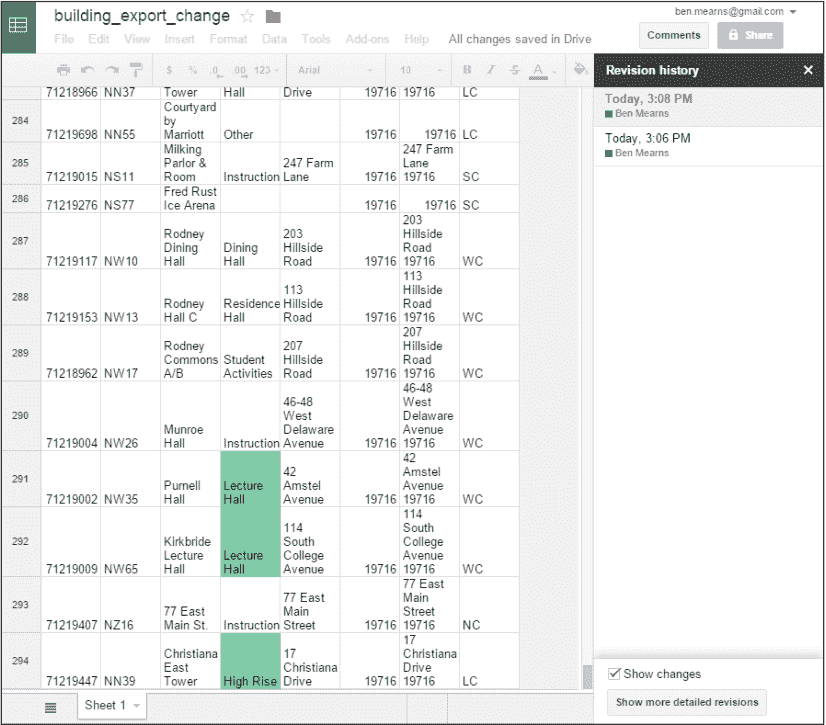

4. 如果你点击某个特定更改，你将有选项恢复到该点的修订，如以下屏幕截图所示：

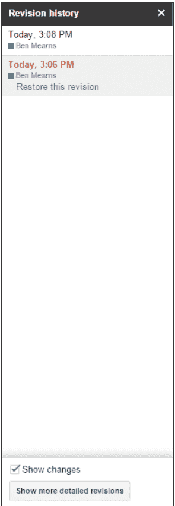

## 在你的 JSON 源中查看更改

再次访问 `http://localhost:8000/gsheet.html` 以查看对表格的更改如何影响你的 JSON 源。注意以下图像中我们对 **Christiana East Tower**、**Kirkbride Lecture Hall** 和 **Purnell Hall** 的 type 字段所做的更改：

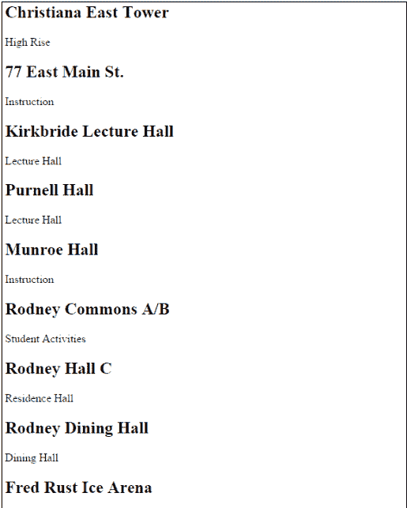

在本章的最后一节中，我们还将看看如何在地图界面中预览此内容。

### 地理空间数据的制图渲染 – MBTiles 和 UTFGrid

到目前为止，你可能会想，地图呢？到目前为止，我们还没有包含任何地理空间数据或可视化。我们将把管理和提供地理空间数据和服务的部分工作外包给 OpenStreetMap——我们最喜欢的公共开源地理空间数据存储库！

- 为什么我们使用 OpenStreetMap？
  
  - OSM 已经为基地图中的快速复制提供了镜像地图服务
  - OSM 为校园中可能找到的地理特征提供了一个非常广泛且可扩展的模式
  - 各种网络、移动和桌面客户端已经编写用于与 OSM API 交互
  - OSM 提供数据库和其他基础设施，因此我们不必提供
  - OSM 有一种细粒度且可靠的方式来跟踪更改，使用 `osm_version` 和 `osm_user` 字段，这与 `osm_id` 唯一 ID 字段相辅相成

## OpenStreetMap 到 SpatiaLite

要使用 OSM 数据，我们需要将其转换为可与其他 GIS 软件组件互操作的格式。一个快速而强大的解决方案是将 OSM 数据存储在 SQLite SpatiaLite 数据库实例中，如果你还记得的话，这是一个具有完整空间和 SQL 功能的单个文件。

要使用 QGIS 下载并将 OSM 转换为 SQLite，请执行以下步骤：

- 1. 以我们在 *Chapter 4, Finding the Best Way to Get There* 中所做的方式获取 OSM 数据。使用 OpenLayers 插件放大 Newark, DE（或使用范围 `39.7009,-75.7195,39.6542,-75.7784`，从对话框顶部顺时针开始，在下一步中）：
  - 1. 导航到 **Vector | OpenStreetMap | Download Data** 以下载此范围的 OSM 数据。

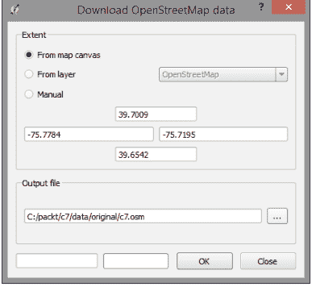


- **2.** 接下来，将 `.osm` 文件中的 XML 数据导出到拓扑 SQLite 数据库中。这可能可用于路由；不过，在这里我们不会这样做。
  - **1.** 导航到 **Vector | OpenStreetMap | Import Topology from XML**。

  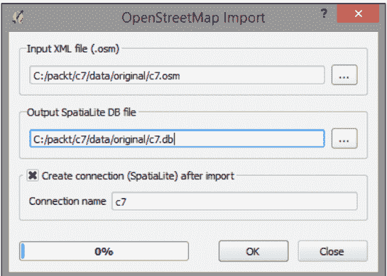

- **3.** 接下来，将拓扑数据导出为普通地理空间数据——本例中为多边形。
  - **1.** 导航到 **Vector | OpenStreetMap | Export topology to SpatiaLite**。
  - **2.** **Export type: Polygons (closed ways)**。
  - **3.** 点击 **Load from DB** 以填充数据中的字段列表。选择字段 **amenity, building, name,** 和 **leisure**，如下图所示：

  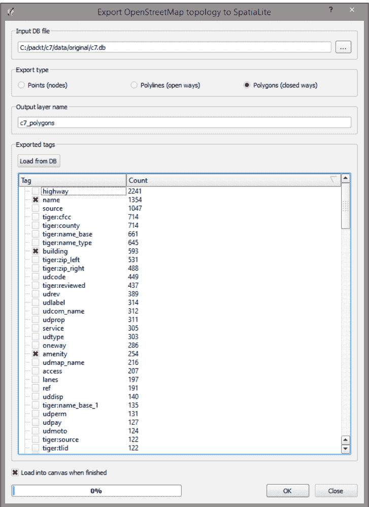

- **4.** 使用 DB Manager 显示大学建筑。
  - **1.** 导航到 Database | DB Manager | DB Manager。
  - **2.** 突出显示 c7 SQLite 数据库。
  - **3.** 执行以下查询，确保选择了 **Load as new layer**：

```sql
SELECT * FROM c7_polygons WHERE building = 'yes' and amenity = 'university'
```

  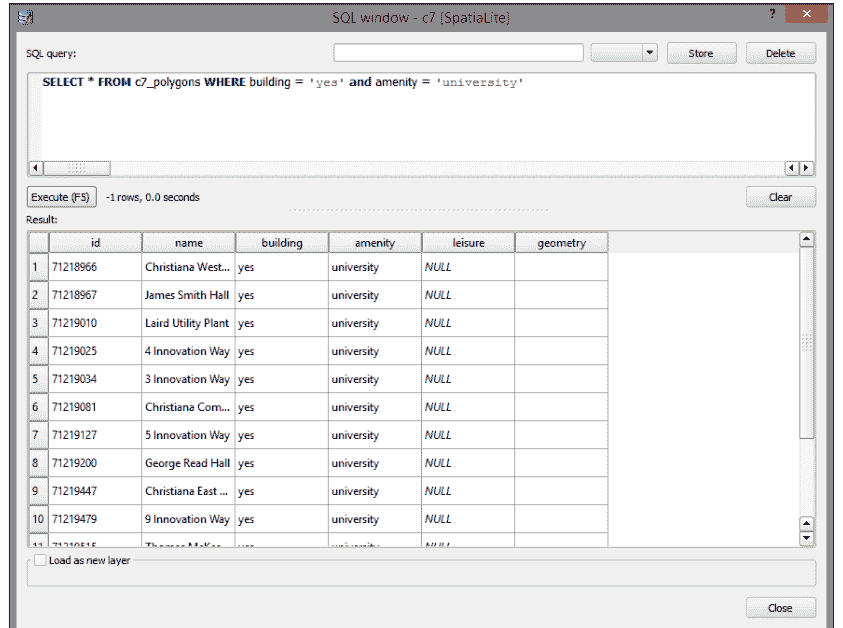

- **5.** 将查询图层导出到 `c7/data/original/delaware-latest-3875/buildings.shp`，投影为 EPSG:3857。

## To tile and use UTFGrid with TileMill

尽管 TileMill 已不再由其创建者 Mapbox 积极生产，但它仍然可用于我们使用 CartoCSS 和 UTFGrid 交互图层通过 Mapnik 渲染的 MBTiles 瓦片图像。

### Preparing a basemap from OSM

TileMill 要求所有数据一起渲染和切片，因此仅支持矢量数据输入，包括 JSON、shapefile、SpatiaLite 和 PostGIS。

在以下步骤中，我们将作为 `.mbtiles`（基于单文件）瓦片缓存渲染出一个地图学上令人愉悦的地图：

- **1.** 安装并打开 TileMill。
- **2.** 从 Geofabrik OSM 提取站点的北美部分下载特拉华州数据（`http://download.geofabrik.de/north-america.html`）作为 shapefile。或者，你也可以直接从 `http://download.geofabrik.de/north-america/us/delaware-latest.shp.zip` 下载。确保在下载后将 zip 归档解压并复制到你的项目目录中。
- **3.** 将所有数据从 EPSG:4326 重投影到 EPSG:3875。如果你还记得，QGIS 可以像其他 **Processing Toolbox** 算法一样批量执行此操作，就像你在 *Chapter 2, Identifying the Best Places* 中学到的那样，使此过程更快一些。
  - 将所有图层输出到 `c7/data/original/delaware-latest-3875`。

  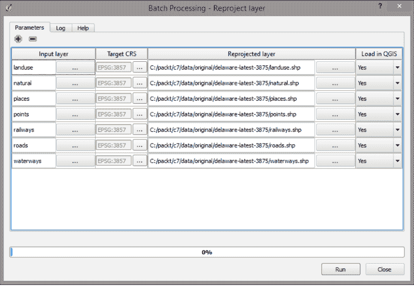

- **4.** 将 DC 示例复制到新项目中。
  - 你可以在 `C:\Program Files (x86)\TileMill-v0.10.1\tilemill\examples\open-streets-dc` 找到它
  - 复制到 `C:\Users\[YOURUSERNAME]\Documents\MapBox\project\c7`
- **5.** 删除 **layers** 目录中的所有文件。
- **6.** 复制并解压 `c7/data/original/delaware-latest-3875` 中的所有 shapefiles 到项目目录 `c7` 的 layers 目录中，可在 `C:\Users\[YOURUSERNAME]\Documents\MapBox\project\c7\layers` 找到。
- **7.** 编辑 `project.mml` 文件。
  - **1.** 将所有 `open-streets-dc` 字符串的实例更改为 `c7`。
  - **2.** 将 `Open Streets, DC` 的单个实例更改为 `c7`。
  - **3.** 替换以下 bounds 和 center：

```json
"bounds": [
    -75.7845,
    39.6586,
    -75.7187,
    39.71
],
"center": [
    -75.7538,
    39.6827,
    14
],
```

  - **4.** 将以下图层引用更改为文件：
    - land uses: 将此图层从 `osm-landusages.shp` 更改为 `landuse.shp`
    - ocean: 删除此图层或忽略
    - water: 将此图层从 `osm-waterareas.shp` 更改为 `waterways.shp`
    - tunnels: 将此图层从 `osm-roads.shp` 更改为 `roads.shp`
    - roads: 将此图层从 `osm-roads.shp` 更改为 `roads.shp`
    - mainroads: 将此图层从 `osm-mainroads.shp` 更改为 `roads.shp`
    - motorways: 将此图层从 `osm-motorways.shp` 更改为 `roads.shp`
    - bridges: 将此图层从 `osm-roads.shp` 更改为 `roads.shp`
    - places: 将此图层从 `osm-places.shp` 更改为 `places.shp`
    - road-label: 将此图层从 `osm-roads.shp` 更改为 `roads.shp`
- **8.** 打开 TileMill 并从 Projects 对话框中选择 c7 项目，如下图所示：

  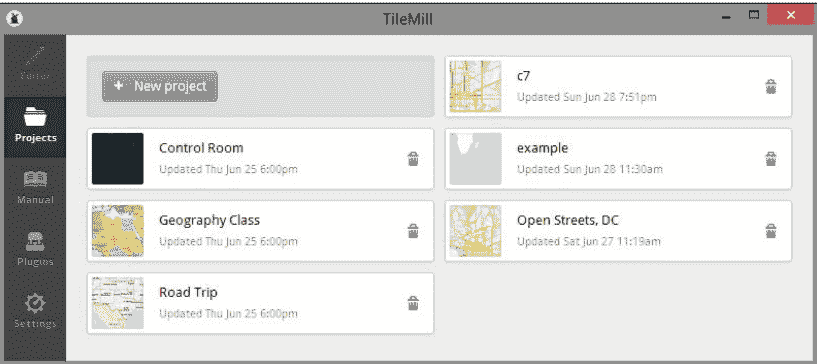

### Preparing the operational layer in TileMill

- **1.** 从左下角最底部的按钮打开 Layers 面板。参考下一张图片。
- **2.** 点击 + Add layer。
- **3.** 使用以下值填充参数：
  - ID: buildings.
  - Datasource: c7/data/original/delaware-latest-3875/buildings.shp.
  - 点击 Save & Style。你可以稍后通过在 Layers 面板中点击 Editor 按钮（铅笔图标）旁边的 #c7 图层返回此对话框，如下一张图片所示。
- **4.** 如果你还没有看到图层，请确保在右侧标签中为图层定义了一些样式（默认情况下应已填充最小样式）。然后，点击右上角的 Save。
- **5.** 使用 CartoCSS 语法更改 style.mss 中的样式。TileMill 提供了一个颜色选择器，我们可以通过点击 CartoCSS/style 面板底部颜色样本访问。更改颜色后，你可以在那里查看十六进制代码。只需选择一种颜色，将十六进制代码放在你的 CartoCSS 中并保存它。例如，考虑以下代码：

```css
#buildings {
  line-color:#eb8f65;
  line-width:0.5;
  polygon-opacity:1;
  polygon-fill:#fdedc9;
}
```

- **6.** 点击主屏幕右上角的 Save（铅笔图标），位于 CartoCSS 输入框上方，以查看更改，如下图所示：

  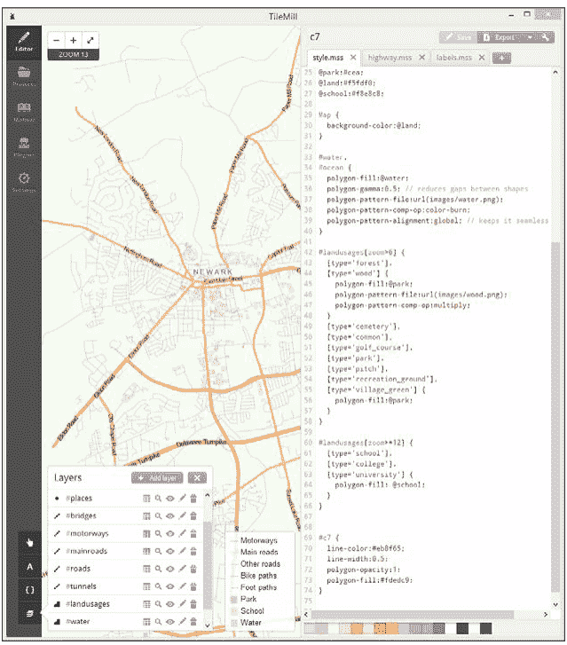

- **7.** 通过点击左下角最上面的按钮进入 **Templates** 标签，并更改 **Teaser** 和 **Full** 交互类型以使用来自 buildings 的 `{{ {id} }}`，如下图所示：

  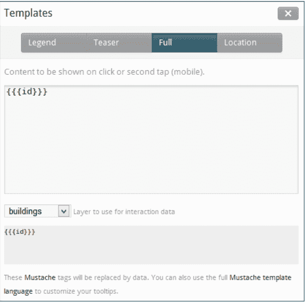

## Exporting MBTiles

MBTiles 是 Mapbox 开发的一种格式，用于存储地理信息。此格式除了与 Mapbox 开发的小而令人印象深刻的一套软件和服务交互外，还有两个引人注目的方面：首先，MBTiles 将整个瓦片存储保存在单个文件中，易于传输和维护，其次，此格式启用了 UTFGrid，即使用 UTF 字符进行高性能数据交互。

### Uploading to Mapbox

执行以下步骤：

- **1.** 在 mapbox.com 创建一个账户。
- **2.** 从右上角的 **Export** 按钮访问 **Export** 对话框。从此菜单中选择 **Upload**。
- **3.** 通过点击对话框顶部的按钮登录到你的 Mapbox 账户。
- **4.** 按住 *Shift*，点击并拖动以在地图上定义一个范围。
- **5.** 缩放到比你预期最小缩放高一级的级别以预览范围。
- **6.** 在导出对话框中填写描述信息。
  - **Name:** c7
  - **Zoom:** 11 to 16
- **7.** 点击地图以建立 **Center** 坐标。
- **8.** 选择 **Save settings to project**。
- **9.** 上传，如下图所示：

  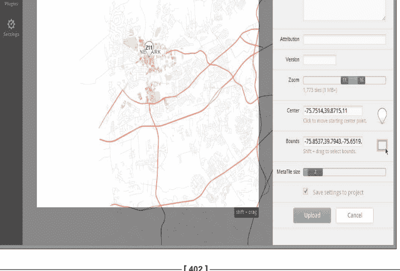

### The MBTiles file

导出直接到 MBTiles 文件的步骤与之前的程序类似。此格式可以上传到 mapbox.com 或使用支持该格式的软件（如 TileStream）提供。当然，无需登录。

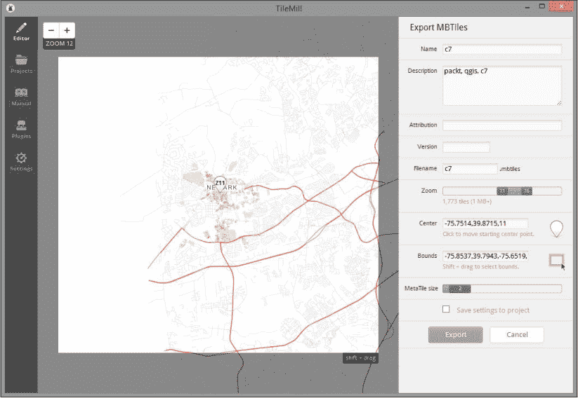

### Interacting with Mapbox services

在上一节的最后一部分，我们以 MBTiles 格式将渲染的地图上传到 Mapbox。

要查看 Mapbox 为我们的 MBTiles 生成的 HTML 页面，请导航到 Export | View Exports。你会在那里找到上传。点击 View 在网络浏览器中打开它。


例如，考虑以下 URL：http://a.tiles.mapbox.com/v3/bmearns.c7/page.html#11/39.8715/-75.7514。

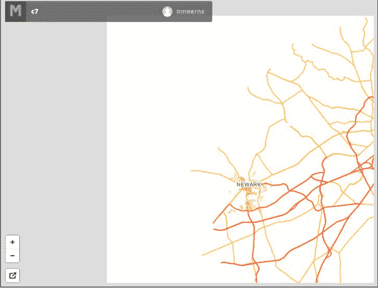

你可能还想预览连接到你数据的 TileJSON 网络服务。你可以通过在你的网络地图 ID 后添加 .json 来实现；例如，这在 http://a.tiles.mapbox.com/v3/bmearns.c7.json 中完成，它执行以下操作：

```
{"attribution":"","bounds":[-75.8537,39.7943,-75.6519,39.9376],"center":[-75.7514,39.8715,11],"description":"packt, qgis, c7","download":"http://a.tiles.mapbox.com/v3/bmearns.c7.mbtiles","embed":"http://a.tiles.mapbox.com/v3/bmearns.c7.html","filesize":15349760,"format":"png","grids":["http://a.tiles.mapbox.com/v3/bmearns.c7/{z}/{x}/{y}.grid.json","http://b.tiles.mapbox.com/v3/bmearns.c7/{z}/{x}/{y}.grid.json"],"id":"bmearns.c7","legend":"","maxzoom":16,"minzoom":11,"modified":1435689144009,"name":"c7","private":true,"scheme":"xyz","template":"{{#_location_}}{{/ _location_}}{{#_teaser_}}{{{id}}}{{/ _teaser_}}{{#_full_}}{{{id}}}{{/ _full_}}","tilejson":"2.0.0","tiles":["http://a.tiles.mapbox.com/v3/bmearns.c7/{z}/{x}/{y}.png","http://b.tiles.mapbox.com/v3/bmearns.c7/{z}/{x}/{y}.png"],"version":"1.0.0","webpage":"http://a.tiles.mapbox.com/v3/bmearns.c7/page.html"}
```

## 将本地应用与托管服务连接

现在我们可以通过 Mapbox 生成的 HTML 和 JSON 查看瓦片服务器，让我们看看如何将其与我们可以自定义的本地 HTML 连接起来。

### API 令牌

首先，你需要从 Mapbox 获取 API 令牌。令牌标识你的 Web 应用与 Mapbox，并启用你创建的 Web 服务的使用。由于你将把此令牌添加到应用的前端代码中，它将是公开的并且容易被滥用。鉴于 Mapbox 每月的视图使用限制，你可能希望考虑定期进行令牌轮换（包括创建、代码修改和删除）。这也是考虑使用类似 TileStream 的东西在本地托管你的服务的一个好理由，该内容在以下 *更进一步 – 使用 TileStream 进行本地 MBTiles 托管* 部分中介绍。

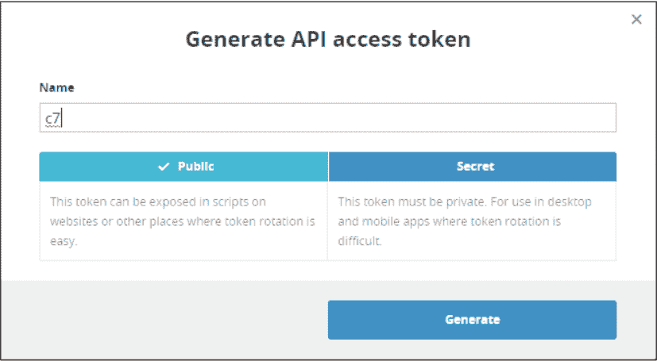

### Mapbox.js

Mapbox.js 是 Mapbox 开发的用于与其服务交互的地图库。由于其核心是 Leaflet，代码看起来会很熟悉。我们将查看对你可以从 https://www.mapbox.com/mapbox.js/example/v1.0.0/utfgrid-data-popup/ 获取的创建弹出窗口的 UTFGrid 数据示例应用代码所做的修改。

## 简单的 UTFGrid 修改

在下面的示例中，我们将仅修改直接引用示例数据的代码部分。当然，我们希望将这些部分更改为引用我们的数据：

```
<!DOCTYPE html>
<html>
<head>
<meta charset=utf-8 />
<title>Creating a popup from UTFGrid data</title>
<meta name='viewport' content='initial-scale=1,maximum-scale=1,user-scalable=no' />
<script src='https://api.tiles.mapbox.com/mapbox.js/v2.2.1/mapbox.js'></script>
<link href='https://api.tiles.mapbox.com/mapbox.js/v2.2.1/mapbox.css' rel='stylesheet' />
<style>
body { margin:0; padding:0; }
#map { position:absolute; top:0; bottom:0; width:100%; }
</style>
</head>
<body>
<div id='map'></div>
<script>
// changed token and center coordinate pair/zoom below
L.mapbox.accessToken = 'YOURMAPBOXTOKEN';
var map = L.mapbox.map('map', 'mapbox.streets')
.setView([39.87240,-75.75367], 15);

// change variable names as appropriate (optional)
// changed mapbox id to refer to our layer/service
var c7Tiles = L.mapbox.tileLayer('bmearns.c7').addTo(map);
var c7Grid = L.mapbox.gridLayer('bmearns.c7').addTo(map);

// add click handler for grid
// changed variable name in tandem with change above
c7Grid.on('click', function(e) {
if (!e.data) return;
var popup = L.popup()
.setLatLng(e.latLng)
// changed to refer to a field we have here, as seen in
tilemill interaction tab
.setContent(e.data.id)
.openOn(map);
```

```
}});
</script>
</body>
</html>
```

## 预览简单的 UTFGrid 修改

前面的代码将产生以下地图视图和网格交互。请注意，id 属性的值在点击时显示：

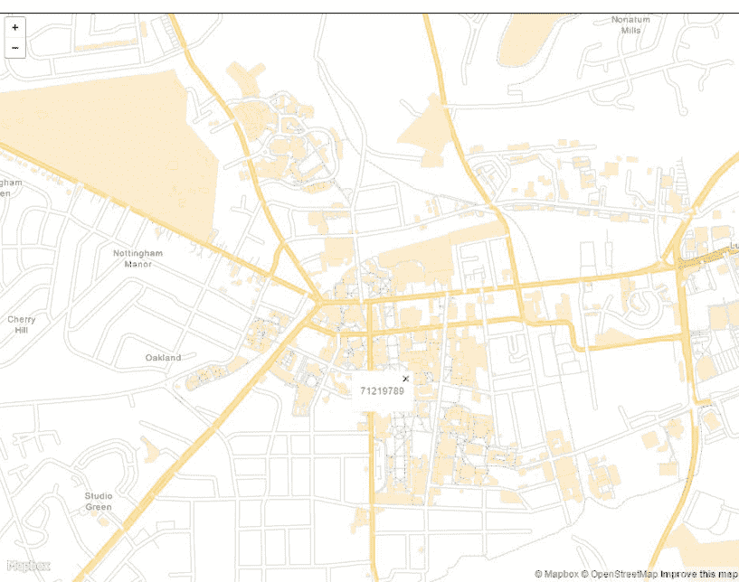

## OpenLayers

OpenLayers 项目提供了一个 UTFGrid Web 地图示例，位于 http://openlayers.org/en/v3.2.1/examples/tileutfgrid.html。

## 代码修改

以下是针对我们数据修改后的示例代码。删除了对 OpenLayers 示例的引用（例如函数名称），并替换为通用名称。以下示例演示了一种鼠标悬停类型的事件触发器（c7/data/web/utfgrid-ol.html）：

```
<!DOCTYPE html>
<html>
<head>
<title>TileUTFGrid example</title>
<!-- dependencies -->
<script src="https://code.jquery.com/jquery-1.11.2.min.js">
</script>
<link rel="stylesheet" href="https://maxcdn.bootstrapcdn.com/bootstrap/3.3.4/css/bootstrap.min.css">
<script src="https://maxcdn.bootstrapcdn.com/bootstrap/3.3.4/js/bootstrap.min.js"></script>
<link rel="stylesheet" href="https://cdnjs.cloudflare.com/ajax/libs/ol3/3.6.0/ol.css" type="text/css">
<script src="https://cdnjs.cloudflare.com/ajax/libs/ol3/3.6.0/ol.js"></script>
</head>
<body>
<!-- html layout -->
<div class="container-fluid">
<div class="row-fluid">
<div class="span12">
<div id="map" class="map"></div>
</div>
</div>
<div style="display: none;">
<!-- Overlay with target info -->
<div id="info-info">
<div id="info-name">&nbsp;</div>
</div>
</div>
</div>
<script>
// new openlayers tile object, pointing to TileJSON object
from our mapbox service
var mapLayer = new ol.layer.Tile({
```

```
source: new ol.source.TileJSON({
  url: 'http://api.tiles.mapbox.com/v3/bmearns.c7.json?
    access_token=YOURMAPBOXTOKENHERE'
});
// new openlayers UTFGrid object
var gridSource = new ol.source.TileUTFGrid({
  url: 'http://api.tiles.mapbox.com/v3/bmearns.c7.json?
    access_token=YOURMAPBOXTOKENHERE'
});

var gridLayer = new ol.layer.Tile({source: gridSource});

var view = new ol.View({
  center: [-8432793.2,4846930.4],
  zoom: 15
});

var mapElement = document.getElementById('map');
var map = new ol.Map({
  layers: [mapLayer, gridLayer],
  target: mapElement,
  view: view
});

var infoElement = document.getElementById('info-info');
var nameElement = document.getElementById('info-name');

var infoOverlay = new ol.Overlay({
  element: infoElement,
  offset: [15, 15],
  stopEvent: false
});
map.addOverlay(infoOverlay);

// creating function to register as event handler, to
// display info based on coordinate and view resolution
var displayInfo = function(coordinate) {
  var viewResolution = /** @type {number} */
    (view.getResolution());
  gridSource.forDataAtCoordinateAndResolution(coordinate,
    viewResolution,
    function(data) {
```

```
// If you want to use the template from the TileJSON,
//   load the mustache.js library separately and call
//   info.innerHTML = Mustache.render(gridSource.
    getTemplate(), data);
mapElement.style.cursor = data ? 'pointer' : '';
if (data) {
    nameElement.innerHTML = data['id'];
}
infoOverlay.setPosition(data ? coordinate : undefined);
});
};

// registering event handlers
map.on('pointermove', function(evt) {
    if (evt.dragging) {
        return;
    }
    var coordinate = map.getEventCoordinate(evt.original
        Event);
    displayInfo(coordinate);
});

map.on('click', function(evt) {
    displayInfo(evt.coordinate);
});
</script>
```

## 把所有东西整合起来

现在，我们将 Google Sheets 订阅源与我们的 Mapbox 瓦片服务在最终应用中连接起来。

### 解析 sheets JSON 订阅源

之前，我们使用 jQuery 解析 JSON 订阅源并为每个循环打印两个属性值。现在，我们将重新映射订阅源到一个对象，我们可以用它来查找 UTFGrid 中触发的地理对象的相关数据。查看以下代码，了解这是如何完成的：

```
// Create a data object in public scope to use for mapping
// of JSON data, using id for key
var d = {};

// url variable is set with code from previous section
```


// url contains public sheet id

$.getJSON(url, function(data) {
    var entry = data.feed.entry;
    var title = '';

    $(entry).each(function(index, value){
        // Column names are name, type, etc.
        $('.results').prepend('<h2>'+this.gsx$name.$t+'</h2><p>'+this.title.$t+'</p>'+'<p>'+this.gsx$type.$t+'</p>');
        title = this.title.$t;
        $.each(this, function(i, n){
            if(!d[title]){
                d[title] = {};
            }
            d[title][i] = n.$t;
        });
    });
});

## 完成应用

最后，要完成这个应用，我们需要在 jQuery AJAX 调用中添加事件处理函数，放到处理 feed 的代码中。这样可以将映射后的数据变量保留在用户触发事件相关的作用域内。以下代码位于 c7/data/web/utfgrid-mb.html：

```
<!DOCTYPE html>
<html>
    <head>
        <meta charset=utf-8 />
        <title>A simple map</title>
        <meta name='viewport' content='initial-scale=1,maximum-scale=1,user-scalable=no' />
        <script src="http://code.jquery.com/jquery-1.11.3.min.js"></script>
        <script src='https://api.tiles.mapbox.com/mapbox.js/v2.2.1/mapbox.js'></script>
        <link href='https://api.tiles.mapbox.com/mapbox.js/v2.2.1/mapbox.css' rel='stylesheet' />
        <style>
            body { margin:0; padding:0; }
            #map { position:absolute; top:0; bottom:0; width:100%; }
        </style>
    </head>
    <body>
        <div id='map'></div>
```

```
<script>
    // ID of the Google Spreadsheet
    var spreadsheetID = "1gDP1mvEX0P4raMvTJzcVNT3JVhtL3eK1XjqE7u9u4W4";
    // Mapbox ID
    L.mapbox.accessToken = 'pk.eyJ1IjoiYm1lYXJucyIsImEiOi1i1NTJhYWZjNmI5Y2IxNDM5M2M0N2M4NWQyMGQ5YzQyMiJ9.q8-B7BXtuizGRBcn pREeWw';

    var map = L.mapbox.map('map', 'mapbox.streets')
        .setView([39.87240,-75.75367], 15);

    c7tiles = L.mapbox.tileLayer('bmearns.c7').addTo(map);
    c7grid = L.mapbox.gridLayer('bmearns.c7').addTo(map);

    // Setup click handler, Google spreadsheet lookup
    var d = {};
    // Make sure it is public or set to Anyone with link can view
    var url = "https://spreadsheets.google.com/feeds/list/" + spreadsheetID + "/od6/public/values?alt=json";
    $.getJSON(url, function(data) {

        var entry = data.feed.entry;
        var title = '';

        // loops through each sub object from the data feed using json each function, constructing html from the object properties for click handler
        $(entry).each(function(index, value){
            // Column names are name, type, etc.
            $('.results').prepend('<h2>'+this.gsx$name.$t+'</h2><p>'+this.title.$t+'</p>'+'<p>'+this.gsx$type.$t+'</p>');
            title = this.title.$t;
            $.each(this, function(i, n){
                if(!d[title]){
                    d[title] = {};
                }
                d[title][i] = n.$t;
            });
        });
        // register click handler, displaying html constructed from object properties/loop
        c7grid.on('click', function(e) {
            if (!e.data) return;
            key = e.data.id;
            content = d[key].content
```

## 深入探索：使用 TileStream 进行本地 MBTiles 托管

尽管 Mapbox 托管因其相对简便而颇具吸引力，但你可能希望托管自己的 MBTiles，例如为了降低成本。TileStream 是 Mapbox 托管服务的开源基础。它运行在 Node.js 环境下。

虽然 TileStream 在技术上可以通过 Node.js 安装在 Windows 上，但有些依赖项可能无法安装。建议你在 Linux 环境中执行以下安装。如果你的组织服务器已经运行 Linux，那就太好了！你可以直接跳到安装 Node.js 和 TileStream 的部分。幸运的是，借助 Virtual Box 和 Vagrant，可以在 Windows 系统上搭建一个 Linux 虚拟机。

### 设置 Vagrant 虚拟 Linux 实例

- 1. 安装 Virtual Box。你可以从 https://www.virtualbox.org/wiki/Downloads 下载 Virtual Box。
- 2. 安装 Vagrant。你可以从 https://www.vagrantup.com/ 下载 Vagrant。
- 3. 为你的 Vagrant 实例创建一个新目录（例如 c:\packt\c7\vagrant）。
- 4. 在 Windows 命令行中运行以下命令：
  `cd c:\packt\c7\vagrant`
- 5. 在 Windows 命令行中运行以下命令来创建你的 vagrant 实例：
  `vagrant init hashicorp/precise32`
  `vagrant up`
- 6. 现在，你应该会在 Windows 命令行的当前工作目录中看到一个名为 Vagrantfile 的文件（例如 c:\packt\c7\vagrant）。Vagrantfile 是控制 Vagrant 配置的纯文本文件。请在 Vagrantfile 中添加以下行，将（尚未创建的）Node.js 端口转发到你的 Windows localhost：
  `config.vm.network "forwarded_port", guest: 8888, host: 8088`
- 7. 在 Windows 命令行中运行以下命令来重新加载 Vagrant：
  `vagrant reload`
- 8. 通过 Windows SSH 客户端连接到 Vagrant 实例。

- - 如果 PATH 环境中已有 SSH 客户端，`vagrant ssh` 命令应该会启动它并连接到此目录中的实例。
- - 如果没有，你只需在自选的 Windows SSH 客户端（如 Putty）中设置以下连接参数：
  **主机：** `127.0.0.1`
  **端口：** `2222`
  **用户名：** `vagrant`
  **密码（如果需要）：** `vagrant`
  **私钥：** `c:/packt/c7/vagrant/.vagrant/machines/default/virtualbox/private_key`

## 安装 Node.js 和 TileStream

使用以下命令从 `chris-lea` 软件包存档安装 Node.js。这是 Mapbox 推荐的 Node.js 源。前面的 Vagrant 设置步骤可以确保 apt 等依赖项按需配置完成。否则，你可能需要自行安装一些其他依赖项。另外请注意，在不支持 GNU/Debian 的系统上，这种方法行不通；你需要在 yum 上搜索相关仓库、查找 RPM，或者从源代码构建。不过，我不确定这些方法是否都能行得通。

请注意，以下所有命令都需要在 Linux 实例中运行。如果你遵循了前面的步骤，你需要通过 SSH 客户端（如 Putty）来运行这些命令：

```
sudo apt-add-repository ppa:chris-lea/node.js
sudo apt-get update
sudo apt-get install nodejs
```

安装 Git，并将 TileStream 源代码克隆到一个新目录。运行以下命令行：

```
git clone https://github.com/mapbox/tilestream.git
cd tilestream
npm install
```

## 设置并启动 TileStream

你必须将自己的 MBTiles 文件放到 `/home/vagrant/Documents/MapBox/tiles` 下。你可以使用自己习惯的文件传输客户端来完成；我喜欢用 WinSCP。只需使用你之前用于 SSH 的相同连接信息即可。

最后，启动 TileStream：

```
./index.js
```

现在，你可以在 http://localhost:8088 预览 TileStream 服务。

点击 info 按钮获取 PNG 瓦片的地址。你可以修改这个地址：移除对 x、y、z 瓦片的引用，并添加 .json 扩展名，即可获得 TileJSON，例如 http://localhost:8088/v2/c7_8b4e46.json。

现在，只需修改 OpenLayers 示例，使其引用这个 .json 地址而不是 Mapbox，你就拥有了完全不依赖 Mapbox 的 MBTiles 用法。

演示此用法的代码位于 http://localhost:8000/utfgrid-ts.html。

## 小结

在最后一章中，我们研究了一个基于 Web 服务构建的 Web 应用，它为我们的用户提供了编辑能力。这在协作式地理数据系统中属于较简单的一端，但借助 TileMill（以及 Mapnik）提供的出色制图渲染能力，以及通过 MBTiles 和 UTFGrid 实现的高性能数据发布能力，它仍然颇具吸引力。

## 模块 3

## QGIS 2 Cookbook

成为 QGIS 高级用户，掌握 QGIS 数据管理、可视化和空间分析技术。


# 1

## 数据输入与输出

在本章中，我们将介绍以下配方：

- 在计算机上查找地理空间数据
- 描述数据源
- 从文本文件导入数据
- 导入 KML/KMZ 文件
- 导入 DXF/DWG 文件
- 打开 NetCDF 文件
- 保存矢量图层
- 保存栅格图层
- 重投影图层
- 批量格式转换
- 批量重投影
- 将矢量图层加载到 SpatiaLite
- 将矢量图层加载到 PostGIS

## 引言

如果你想使用 QGIS，第一件事就是需要空间数据。无论你想制作精美的地图布局还是进行空间分析，都需要打开一些数据来工作。本章介绍基本的数据输入和输出命令，这将使你能够使用多种不同格式的数据，并在需要将其用于不同应用程序或与他人共享时导出到最方便的格式。

本食谱中看到的许多操作都可以通过自动化实现。本章包含一些使用自动化处理一组输入文件的配方。

## 在计算机上查找地理空间数据

本配方展示了如何使用 QGIS 浏览器定位和打开空间数据。

### 准备工作

开始工作之前，请确保你已将示例数据集复制到文件系统并已定位。

### 操作方法...

有几种方法可以定位并在 QGIS 中打开数据文件，但其中最方便的是 QGIS 浏览器：

- 1. 要启用它，请转到 View | Panels 菜单并启用其中的 Browser 复选框。浏览器默认会显示在 QGIS 窗口的左侧，如以下屏幕截图所示：

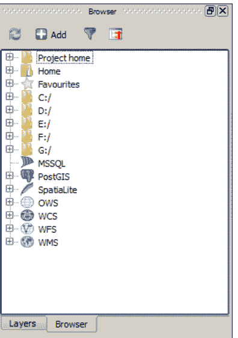

浏览器包含一个包含所有可用空间数据源的树。这包括文件系统中的数据文件、数据库和远程服务。

- 2. 导航到你复制示例数据集的文件夹，你将看到可用数据文件的列表，如以下屏幕截图所示：

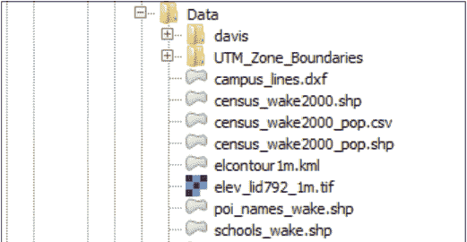

> 并非所有文件都显示，只有被识别为有效数据源的文件才会显示。

- 3. 要将文件添加到项目中，只需右键单击它并选择 Add Layer：

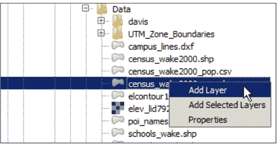

- 4. 允许多选。在这种情况下，选择 **Add selected layer** 菜单。

另一种打开文件的方法是直接将其拖放到 QGIS 画布中。同样允许拖放多个文件，如以下屏幕截图所示：

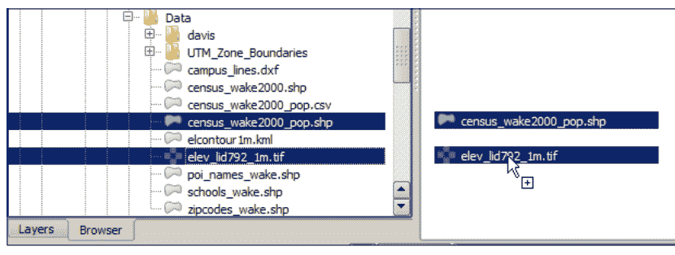

### 工作原理...

浏览器充当直接链接到 QGIS 的文件资源管理器，它只显示有效的数据文件，并且可以轻松地将它们添加到 QGIS 项目中。

### 还有更多...

与本配方相关的还有一些你需要了解的事情。它们在以下各节中进行了说明。

### 使用图层菜单添加图层

作为浏览器的替代方案，**Layer** 菜单包含一组条目。它们中的每一个都处理不同类型的数据。它们为你提供了一些额外的选项，并且可能允许你使用浏览器不支持的格式。

### 将文件夹添加到收藏夹

导航到数据所在的文件夹可能很麻烦。如果你经常使用某个文件夹，可以右键单击它并选择 **Add as favorite**。该文件夹将出现在浏览器树顶部的 **Favorites** 部分。

### 非文件数据源

浏览器还显示非文件数据，例如远程服务。服务必须在浏览器相应部分出现之前定义。要添加服务，请右键单击服务名称并选择 New connection.... 将出现一个对话框来定义服务连接参数。

例如，尝试使用浏览器中的 WMS 条目添加以下 WMS 服务，如以下屏幕截图所示：

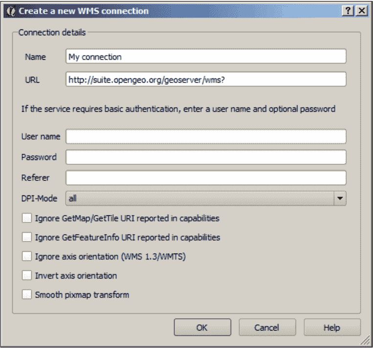

将出现一个新条目，其中包含服务提供的图层，如以下屏幕截图所示：

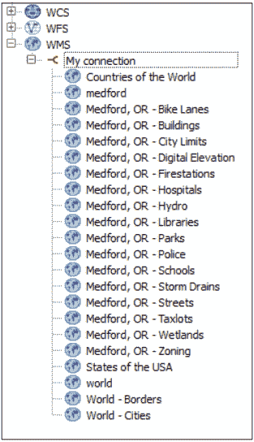

## 描述数据源

在打开数据文件之前，你可以获取有关其附加信息。本配方展示了如何探索数据来源的属性。

### 准备工作

开始工作之前，请确保你已将示例数据集复制到文件系统并已定位。

### 操作方法...

- 1. 在 QGIS 浏览器中，导航到包含示例数据集的文件夹。选择 `elev_lid792_1m` 文件并右键单击它。在上下文菜单中选择 **Properties**。将出现如下屏幕截图中的对话框：

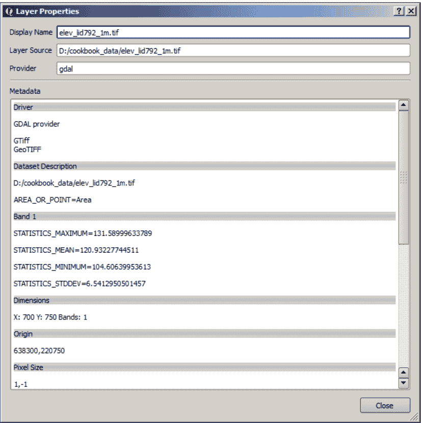

此对话框显示栅格图层的属性。

2. 现在，让我们选择一个矢量图层。选择 elev_lid792_randpts.shp 文件，右键单击它并选择 Properties。信息对话框将如下所示：

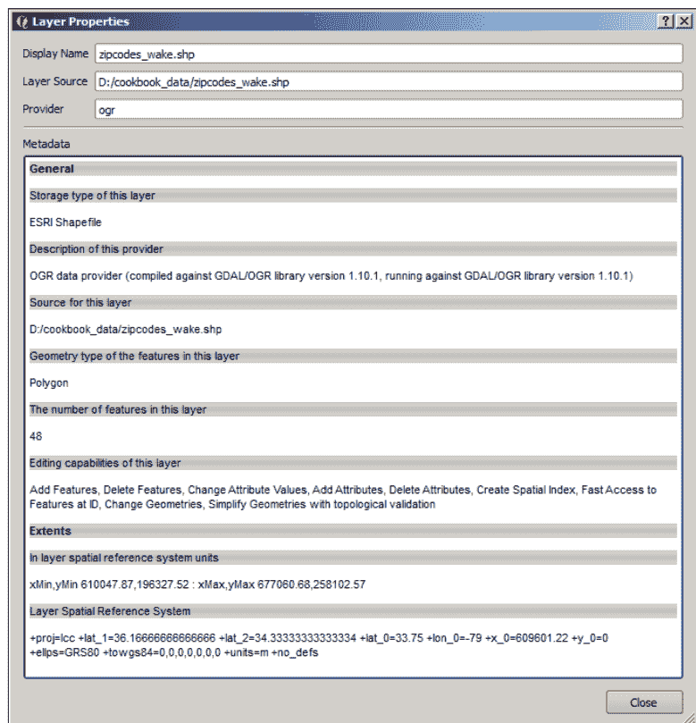

### 工作原理...

在描述窗口的上部，你会看到一个名为 Provider 的字段。Provider 定义数据类型或数据来源以及谁负责读取数据并将其传递给 QGIS。对于栅格图层，你会看到 Provider 为 gdal。对于大多数基于文件的矢量图层，ogr 将是出现的提供者。它们指的是 GDAL 和 OGR 库，这两个开源库被许多 GIS 程序用于访问栅格和矢量数据。

### 还有更多...

如果数据已加载到 QGIS 中，你可以在图层的 **Properties** 部分访问有关其的信息（右键单击图层名称以在上下文菜单中选择 **Properties** 条目）。在左侧显示的部分中，选择 **Metadata** 部分。你将看到一个框，其中包含与图层数据来源对应的所有信息：

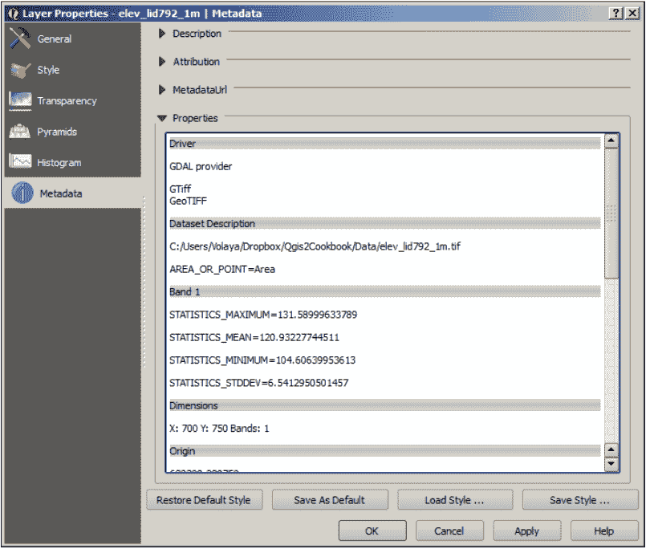

## 数据输入与输出

GDAL 库提供的功能（前面提到过，它充当栅格图层的提供者）也在 Raster 菜单中可用。这包括处理和数据分析方法，但也包括用于描述栅格数据源的信息工具。你可以通过导航到 Raster | Miscellaneous | Info 找到它：

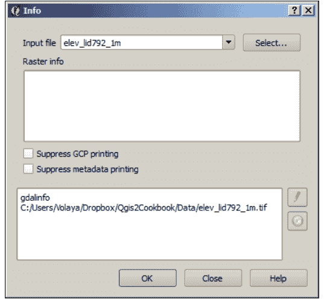

### 另请参阅

- 这是一种更复杂的方式来检索属性，因为你可以通过调整参数以更详细的方式调用工具以获取附加信息。要了解更多信息，请查看 http://www.gdal.org/gdalinfo.html 上的 gdalinfo 帮助页面。

## 从文本文件导入数据

数据可以从文本文件导入，提供有关几何信息如何在文本中存储的一些附加信息。本配方展示了如何基于文本文件创建新的点图层。

### 操作方法...

- 1. 从 **Layer** 菜单中选择 **Add delimited text layer** 菜单项。你将看到如下对话框：

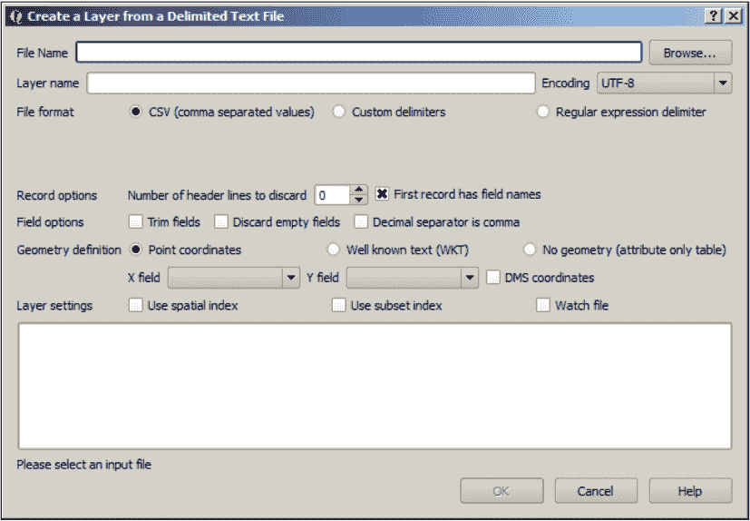

- 2. 在上部字段中，输入示例数据集中 `elev_lid792_randpts.csv` 文件的路径。该文件包含作为文本的点图层。

## 数据输入与输出

- 3. 一旦你输入文件路径或通过单击 **Browse** 按钮打开的文件浏览器中选择它，对话框下半部分中的字段将被填充，如以下屏幕截图所示：

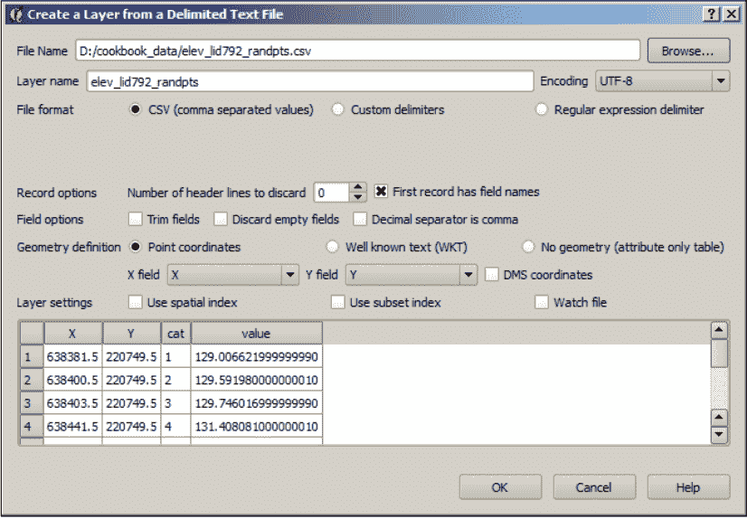

> 我们使用的是以逗号分隔值的 CSV 文件，因此你必须在 **Format** 字段中选择 **CSV** 选项。

**X field** 和 **Y field** 下拉列表将填充可用字段，这些字段在文本文件的第一行中描述。选择 **X** 作为 **X field**，选择 **Y** 作为 **Y field**。现在，QGIS 知道如何创建几何图形，并且有足够的信息从文本文件创建新图层。


4. 在**图层名称**字段中输入图层名称，然后点击**确定**。该图层将被添加到QGIS项目中，如以下截图所示：

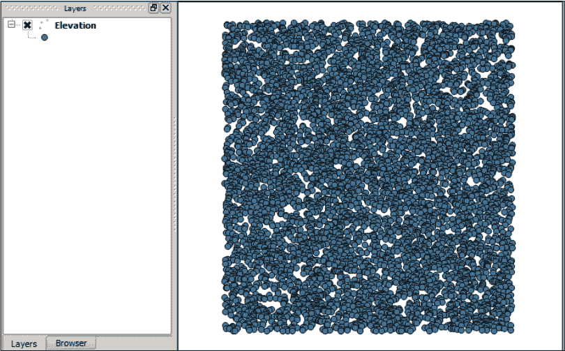

5. 文本文件中不包含有关CRS的信息，也未在参数对话框中输入，因此必须手动添加。在本例中，使用的CRS是EPSG:3358。要将此设置为图层的CRS，请右键单击图层名称并选择“设置图层CRS”：

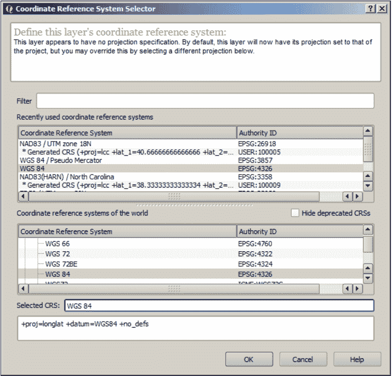

6. 在CRS选择对话框中，选择EPSG:3358 CRS并点击**确定**。该图层现在具有正确的CRS。

## 工作原理...

从文本文件中读取数据并处理以创建几何图形。表中的所有字段（文本文件中一行的所有数据）也会被添加，包括用于创建几何图形的字段，您可以通过右键单击图层并选择“打开属性表”来查看，如以下截图所示：

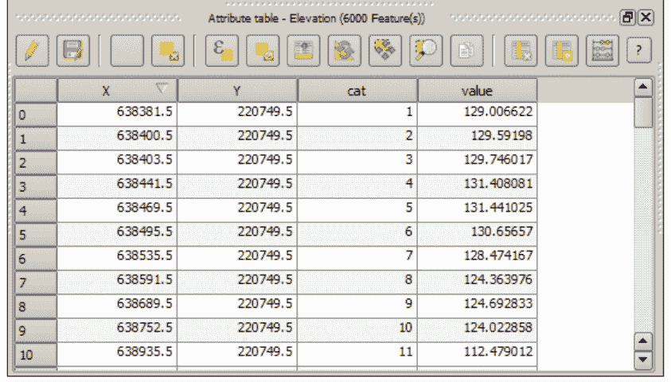

与CSV文件一起，此文件可能包含一个CSVT文件，该文件描述了字段的类型。QGIS使用它来为图层的属性表设置适当的类型。如果CSVT文件缺失（如本例所示），QGIS将尝试根据每个字段的值来确定类型。

## 更多内容...

从文本文件创建的图层不仅限于点文件。可以从文本数据创建任何几何图形。但是，如果不是点，则不能选择两列，而必须将所有几何信息放在一个列中，并输入几何图形的文本表示。QGIS使用熟知文本（WKT）格式（一种用于矢量几何图形的文本标记语言）将几何图形描述为字符串。以下是一个非常简单的CSV文件示例，其中包含线要素和两个属性：

```
geom,id,elevation
LINESTRING(0 1, 0 2, 1 3),1,50
LINESTRING(0 -1, 0 -2, 1 -3),2,60
LINESTRING(0 1, 0 3, 5 4),3,70
```

## 另请参阅

- 要了解有关WKT格式的更多信息，您可以访问 http://en.wikipedia.org/wiki/Well-known_text

## 导入KML/KMZ文件

KML和KMZ文件由Google Earth使用和生成，是一种流行的格式。本教程向您展示如何使用QGIS打开它们。

## 操作步骤...

- 1. 要打开KML图层，请选择**图层/添加矢量图层...**。在打开的对话框中，点击**浏览**按钮打开文件选择对话框。选择**Keyhole标记语言（KML）**格式，然后选择要加载的文件。在示例数据集中，您可以找到多个KML文件。选择`elcontour1m.kml`文件。在矢量图层选择对话框中点击**确定**，该图层将被添加到您的项目中，如以下截图所示：

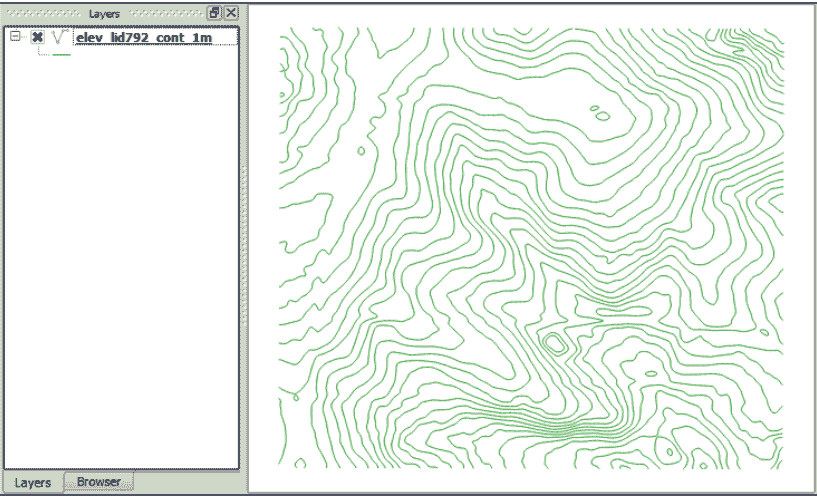

> KMZ文件也可以在QGIS中打开。

- 2. 转到**图层 | 添加矢量图层...**。在打开的对话框中，点击**浏览**按钮打开文件选择对话框。选择**所有文件**选项以查看所有文件，然后选择`elcontourlm.kmz`文件。QGIS中没有定义KMZ文件类型，但QGIS支持它，因为底层的OGR库也可以读取KMZ文件。
- 3. 在打开图层对话框中点击**确定**以打开所选图层。

从KMZ文件包含的图层中，您必须选择一个。在本例中，`elcontourlm.kmz`文件中只包含一个图层，因此它会自动加载。该图层将被添加到您的QGIS项目中。

## 工作原理...

KMZ文件是包含一组图层的压缩文件。当您选择它时，OGR库将解压缩此文件的内容，然后打开其中包含的图层。

如果只包含一个图层，您将不会看到图层选择对话框。QGIS将自动打开KMZ文件中唯一的图层。

## 更多内容...

由于KMZ不被识别为受支持的格式，KMZ文件不会出现在QGIS浏览器中。但是，浏览器支持压缩文件，而KMZ文件实际上是一个包含KML文件的压缩文件。将其解压缩到文件夹中，然后您就可以使用QGIS浏览器打开其中包含的图层。

## 导入DXF/DWG文件

CAD文件（如DXF和DWG文件）可以使用QGIS打开。本教程向您展示如何操作。

## 操作步骤...

- 1. 要打开DXF图层，请在**图层**菜单中选择**添加矢量图层...**。在打开的对话框中，点击**浏览**按钮打开文件选择对话框。选择**Autocad DXF**格式，然后选择要加载的文件。

2. 在示例数据集中，您可以找到多个DXF文件。选择`wake_ ApproxContour_100.dxf`文件。在矢量图层选择对话框中点击**确定**，该图层将被添加到您的项目中，如以下截图所示：

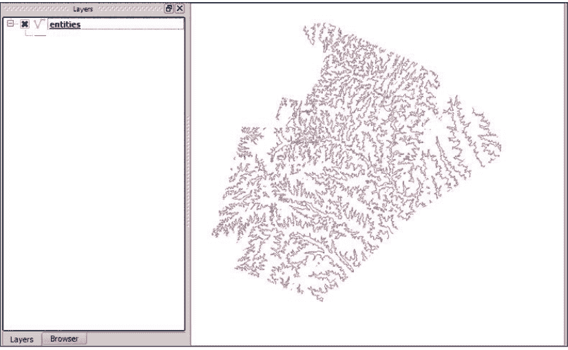

## 工作原理...

DXF文件作为普通矢量图层读取，尽管它们与常规矢量图层的结构不同，因为它们不允许向每个几何图形添加任意属性。

## 更多内容...

您打开的示例DXF文件只包含一种类型的几何图形。但是，DXF文件可以包含多种几何图形：在这种情况下，它们无法在一个图层中添加到QGIS。发生这种情况时，QGIS将要求您选择要打开的几何图形类型。

在示例数据集中，您会找到一个名为`css-SITE-CIV.dxf`的文件。打开它，您将看到以下对话框：

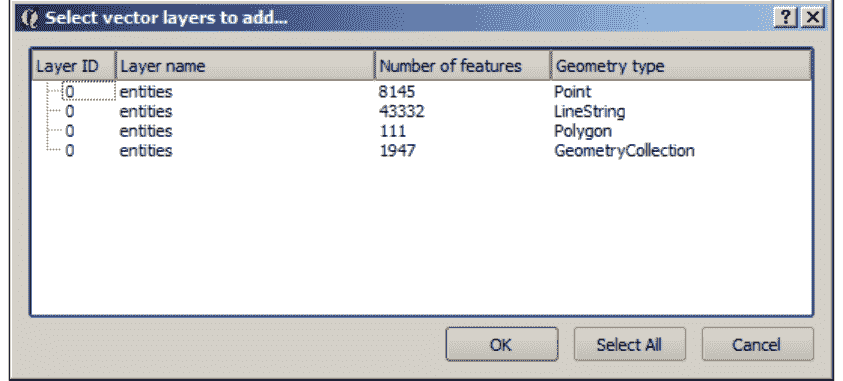

选择可用的几何图形之一，一个图层将被添加到您的QGIS项目中。

## 打开DWG文件

DWG是Autodesk的封闭格式。这意味着该格式的规范不可用。因此，与其他开源应用程序一样，QGIS不支持DWG文件。要在QGIS中打开DWG文件，您需要对其进行转换。将其转换为DXF文件是一个不错的选择，因为这样可以让您毫无问题地在QGIS中打开文件。有许多工具可以做到这一点。Teigha转换器可以在 http://opendesign.com/guestfiles/TeighaFileConverter 找到，它是一个流行且可靠的选择。

另一种选择是使用Autodesk提供的免费服务，称为Autocad 360，可以在 https://www.autocad360.com/ 找到。

## 打开NetCDF文件

NetCDF数据是一种数据格式，设计用于面向数组的科学数据，并且经常用于气候或海洋数据等。本教程向您展示如何在QGIS中打开NetCDF文件。

## 操作步骤...

NetCDF文件是栅格文件，可以使用“添加栅格图层”菜单打开。在您将看到的文件选择对话框中，选择“NGMT NetCDF Grid for CDF”作为文件格式，然后从示例数据集中选择`rx5dayETCCDI_yr_MIROC5_rcp45_r2i1p1_2006-2100.nc`文件。点击**确定**。

## 工作原理...

该NetCDF文件包含一个单个变量，该变量作为常规栅格图层打开。

## 更多内容...

一个NetCDF文件可以包含多个图层。在这种情况下，QGIS将提示您从指定文件包含的图层中选择要添加的图层。

当只有一个图层可用时，它会直接打开，如前面描述的示例所示。

## NetCDF浏览器插件

打开NetCDF文件的另一种方法是使用NetCDF浏览器插件。选择**管理并安装插件...**菜单以打开插件管理器。转到**未安装**部分，并在搜索字段中输入`netcdf`以筛选可用插件列表。选择**NetCDF浏览器**插件并点击**安装插件**进行安装。关闭插件管理器。

该插件现已安装，您可以通过在**插件**菜单中选择**NetCDF浏览器**来打开它：

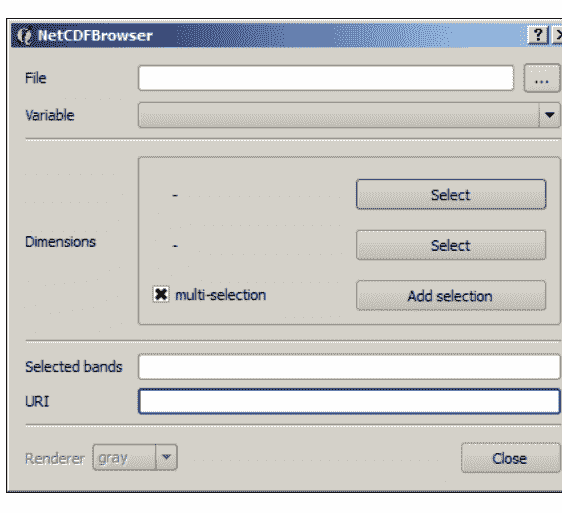

在上方字段中选择**NetCDF**文件。其他字段将更新为所选文件的内容。从可用图层中选择一个图层，然后点击**添加**将该图层添加到您的QGIS项目中。

## 保存矢量图层

QGIS支持多种格式，不仅用于读取矢量图层，还可以保存它们。本教程向您展示如何导出矢量图层，并将其转换为不同格式。

## 准备工作

在本教程中，您将使用名为`poi_names_wake.shp`的图层。确保它已加载到您的QGIS项目中。

## 操作步骤...

- 1. 在QGIS图层列表中右键单击点图层的名称，然后选择**另存为...**菜单。您将看到以下窗口：

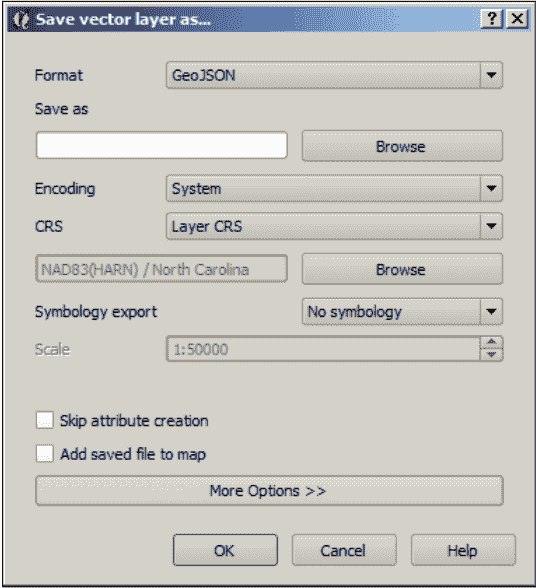


## 数据输入与输出

- 2. 假设您希望使用此图层创建一个网络地图。Leaflet 或 OpenLayers 3 等库支持的一种流行格式是 GeoJSON 格式。在格式字段中选择 **GeoJSON**，并在 **另存为** 字段中键入路径和文件名。

- 3. 在 **另存为** 对话框中，点击 **确定**。GeoJSON 文件将被创建。

## 工作原理...

QGIS 用于读取和打开文件的 OGR 库也用于写入文件。并非所有支持读取的格式都支持写入。

您可以将原本不是基于文件的图层导出到文件中，例如来自 PostGIS 数据库或 WFS 连接的图层。只需在目录中选中该图层，然后按照上述说明操作即可。

## 更多信息...

**另存为** 对话框允许进行比本食谱示例中展示的更多额外配置。

## 微调导出操作

根据您选定的导出图层格式，有可供配置图层导出方式的不同选项。

点击 **更多选项** 按钮即可显示这些选项。选择 **GeoJSON** 作为导出格式，然后显示该特定格式的选项。**坐标精度** 选项控制写入输出 GeoJSON 文件中的小数位数。对于几乎所有情况，默认的精度都太高了，大多数时候，拥有三或四个小数位就足够了。将精度设置为 4，键入有效的路径和文件名，然后点击 **确定** 导出图层。您的点图层现在将保存在一个较小的 GeoJSON 文件中。您可以使用文本编辑器打开该文件，以验证坐标是否以选定的精度表示，或者将其大小与未指定精度值时创建的文件进行比较。

## 创建后打开图层

如果您希望在创建图层后对其进行操作，请勾选 **将保存的文件添加到地图** 复选框。输出图层将被打开并添加到您当前的 QGIS 项目中。

## 保存栅格图层

栅格图层可以导出到不同的文件。导出过程可用于裁剪图层或执行重采样，从而创建修改后的图层。本食谱向您展示如何执行此操作。

## 准备工作

在您的 QGIS 项目中打开 `elev_lid792_1m` 图层。

## 操作步骤...

- 1. 在 QGIS 目录中右键单击栅格图层的名称，然后选择 **另存为...** 菜单。您将看到如下窗口：
- 2. 在 **分辨率** 字段中，将两个值都替换为 2。正如您在之前的食谱中所见，原始分辨率（单元格大小）为 1。
- 3. 在 **另存为** 字段中键入输出文件路径。
- 4. 点击 **确定**。图层将以比原始分辨率更粗的分辨率保存。

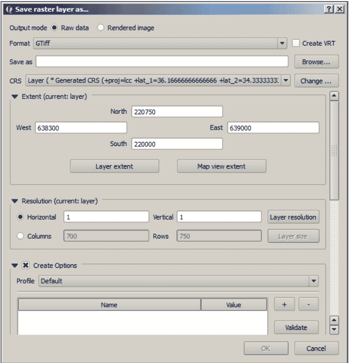

## 数据输入与输出

## 工作原理...

保存文件时使用的是 GDAL 库。并非所有支持输入格式都支持输出，但大多数常见格式都支持这两种操作。

## 更多信息...

图层可以导出为范围缩减的版本。在 QGIS 画布中，缩放至栅格图层的一小部分。然后打开 **另存为** 对话框。在 **范围** 部分，点击 **地图视图范围** 按钮。当前地图视图的边界坐标将被填入四个坐标字段中。

键入保存文件的路径并点击 **确定**。将导出一个范围缩减的图层，仅覆盖地图视图中显示的区域。

## 重投影图层

图层的坐标参考系统（CRS）可能并非最适合特定任务的 CRS。尽管 QGIS 在渲染时支持即时重投影，但其他任务，如执行空间分析，可能要求使用特定的 CRS 或要求所有输入图层使用相同的 CRS。本食谱向您展示如何重投影矢量图层。

## 准备工作

从示例数据集中打开名为 `Davis_DBO_centerline.shp` 的图层。

## 操作步骤...

`Davis_DBO_centerline.shp` 图层使用以英尺为单位的 CRS，这使得它不适合某些操作。我们计划在未来的食谱中使用此图层来计算路线并工作在公制单位下，因此将其包含在公制 CRS 中是一个更好的选择：

- 1. 在目录中右键单击图层名称，然后选择 **另存为...**
- 2. 在下拉列表中选择 **所选 CRS**，以指定不同的输出 CRS。点击 **浏览** 按钮选择 CRS。您将看到 **CRS 选择器** 对话框。
- 3. 您将把点转换到 **EPSG:26911** CRS。使用过滤框在可用 CRS 列表中查找并选择它。然后点击 **确定**。
- 4. 在 *另存为* 对话框中点击 **确定** 以创建图层。将创建一个包含投影线的新 shapefile。

## 工作原理...

重投影由 OGR 库在保存文件时执行，因为这是它支持的选项之一。

## 更多信息...

栅格图层可以以类似的方式重投影：

- 1. 在 *另存为* 对话框中，对于栅格图层，您可以找到一个带有 **浏览** 按钮的 CRS 字段。
- 2. 点击它以打开 CRS 选择器，并选择目标 CRS。
- 3. 当您点击 **确定** 时，栅格图层将使用选定的 CRS 而不是原始 CRS 导出。

## 批量格式转换

*另存为* 对话框可用于转换单个图层的格式。当需要转换多个图层时，使用一些自动化手段是更好的想法。本食谱向您展示如何轻松转换任意数量的图层。

## 准备工作

无需之前的准备工作。批量转换不是基于打开的图层执行的，而是直接基于文件执行的，因此无需在转换之前在 QGIS 中打开图层。

## 操作步骤...

- 1. 通过在 **处理** 菜单中选择 **工具箱** 来打开 **处理工具箱** 菜单。**处理工具箱** 菜单是 QGIS 处理框架的主要元素，用于调用其算法：

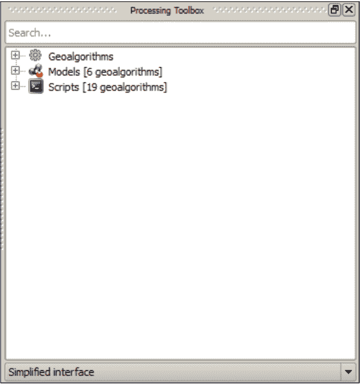

- 5. 在第一个字段中选择 **使用参数值填充**，在第二个字段中选择 **输入图层**。点击 **确定**。表格中的所有行现在都将具有一个输出值，该值是使用输入文件名作为前缀，后跟输入图层名称创建的。

- 6. 为了避免在创建后加载图层，请将 **加载到 QGIS** 列中的第一个单元格设置为 **否**。然后，双击列标题以自动将此值复制到下方的所有行。

- 7. 当表格已经完整时，您可以通过点击 **运行** 启动批量转换过程。GeoJSON 文件将在指定路径中创建。

## 工作原理...

转换由 QGIS 处理框架中的一个算法执行。处理算法可以作为单个算法运行，或者在本例中，作为批量过程运行。

处理算法的输出可以创建为 QGIS 支持的所有格式。格式通过使用文件名中相应的扩展名来选择，与保存单个图层的情况不同，无需在字段或列表中进行选择。使用 `.geojson` 作为输出文件的扩展名，您告诉处理程序您希望生成此格式的文件。

尽管该算法仅保存图层中选定的要素，但如果没有任何选择，它将使用图层的所有要素。这是处理中所有算法的默认行为。由于您所转换的图层中没有选择，因此其所有要素都将被使用。

以这种方式转换文件时，**另存为** 对话框中的附加选项不可用，并且使用默认配置值。

## 更多信息...

您还可以使用 **处理工具箱** 菜单中另一个更复杂的算法来转换矢量图层，该算法允许您输入由底层负责该过程的 OGR 库使用的配置参数。它被称为 **导出矢量**。在工具箱中找到它，右键单击并选择 **作为批量过程执行**：


## 如何操作...

- 1. 在 **Processing Toolbox** 菜单的过滤框中，输入 `Reproject` 以过滤可用算法的列表。找到 **Reproject layer** 算法，右键单击它并选择 **Execute as batch process**。将显示批处理界面，如下所示：

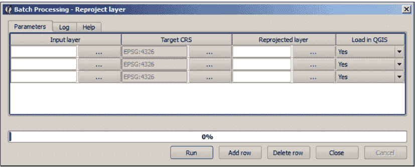

- 2. 在 **Input layer** 列的上方单元格中，单击 ... 按钮并选择 **Select from filesystem**。文件选择对话框将会出现。选择数据集中的 `davis` 文件夹的内容并将文件添加到表格中。

- 3. 在 **Target CRS** 列的第一个单元格中，单击 ... 按钮。将会出现一个 CRS 选择器。选择 `EPSG:26911` CRS，就像你在之前将单个图层转换时的配方中所做的那样。通过双击列标题将该值复制到该列的其余行中。

- 4. 设置 **Reprojected layer** 列中的所有值。选择第一个单元格中的文件，然后使用 **Fill with parameter value** 选项自动填充其余行。

- 5. 表格完成后，单击 **Run** 以重新投影图层。

## 其工作原理...

重投影算法是 Processing 框架的一部分，因此你可以通过更改输出文件扩展名来选择输出格式。你可以用此方法不仅重新投影一组输入图层，还可以在单一步骤中转换其格式。

## 还有更多...

栅格图层也可以使用 **Processing Toolbox** 菜单中的另一个名为 **Warp (reproject)** 的算法进行重投影。这些输入与用于矢量图层的重投影工具中的输入相当相似，但有一些额外的特定于栅格图层的参数。选择该算法，右键单击它并选择 **Execute as batch process** 以运行它并转换一组栅格图层。

## 将矢量图层加载到 SpatiaLite

**SpatiaLite** 是一个单文件关系数据库，建立在广为人知的 SQLite 数据库之上。它可以存储多种类型的图层，包括非空间表。对该格式的接口也允许运行各种空间查询。这是一种高度灵活且便携的格式，非常适合日常使用，尤其是在处理独立项目或一次只有一个用户时。SpatiaLite 的工作方式与 PostGIS 相似，但无需配置或运行数据库服务器。

## 准备工作

选择一个矢量图层并在 QGIS 中加载它。此步骤是可选的，因为你可以在后面的对话框中从文件系统中选择源图层。

## 如何操作...

- 1. 如果你还没有，请创建一个 SpatiaLite 数据库并将其命名为 `cookbook.db`。最简单的方法是使用 **Browser** 选项卡，如以下屏幕截图所示：

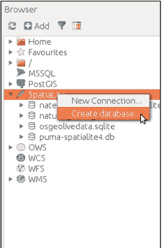

- 2. 然后，选择以下方法之一导入你的数据。第一个选项更快，但第二个选项可以让你更好地控制导入设置：

### 导入方法 1——快速方法

- 1. 在 QGIS Browser 选项卡中，找到你想要复制到数据库的图层。

- 2. 将此图层拖放到 Spatialite DB 条目上。

如果你列出了很多文件，这会相当困难，因为在拖动操作期间浏览器不会滚动。你可以 optionally 打开第二个浏览器窗口并跨窗口拖动图层。另外，请注意这默认为多类型几何。如果需要控制选项，请使用下一种方法。

### 导入方法 2——标准方法

- 1. 从 Database 菜单打开 DB Manager。

- 2. 展开 Spatialite 项目以列出你的数据库。展开你想要连接的数据库。

- 3. 单击以下导入图层图标：


- 4. 将弹出一个对话框，提供导入选项。

SQL 数据库通常不区分大小写，因此你可以使用全小写字符。另外，永远不要在表名中使用空格或特殊字符；这只会导致以后出现麻烦。偶尔使用下划线是可以的。

- 5. 从下拉列表中选择要导入的图层。

- 6. 为新表填写一个名称。

- 7. 在大多数情况下，剩下的唯一要做的事情是选中 Create spatial index 复选框。

- 8. 如果这有效，很好。现在，你可以将图层加载到地图上并验证它是否与输入相同。

这种方法更类似于传统的数据库导入，并且与本章后面 PostGIS 配方非常相似。

## 其工作原理...

QGIS 将你的几何图形转换为与 SpatiaLite 兼容的格式并插入它，同时插入属性表。之后，它会更新 SpatiaLite 中的元数据表以注册几何列并在其上构建空间索引。这两个后处理步骤使数据库表对 QGIS 来说表现为一个空间图层，并在平移和缩放时加快从表中加载数据的速度。

## 还有更多...

导入对话框包含了一些通常有用的其他功能。你可以在导入过程中重新投影数据，如果你愿意的话，或者如果你 QGIS 未能正确检测到，你可以指定投影。你还可以将几何列命名为不同于默认的 geom 的名称；例如，utmZ10n8（这通常不推荐）。你可以在文本未正确处理的情况下指定文本的字符编码。

你甚至可以使用该对话框将数据追加到现有表中；例如，你有多个具有相同数据结构的县，它们作为两个单独的文件出现，但你希望它们都在一个图层中。

如果由于某种原因图层没有按你想要的方式导入，请删除它并重新导入。如果删除图层，请务必学习如何真空数据库以恢复文件中现在空闲的空间并缩小其总大小（这不是自动的）。


> 在许多图形工具中查找 **Vacuum** 选项作为按钮。如果看不到它也没关系，只需运行 SQL，`VACUUM;`。

如果失败会怎样？数据库有时真的很挑剔。以下是一些常见问题和解决方案：

- 它可能是字符编码（重音符号，非拉丁语言），这需要你指定编码。
- 它可能挑剔混合多图层和常规图层。多图层是指一个记录中包含多个独立几何图形。例如，夏威夷实际上是许多岛屿。因此，如果你只有一行代表夏威夷，你需要将所有岛屿多边形塞进一个几何字段中。然而，如果你将其与仅为多边形的北达科他州混合，导入将失败。如果你有这个问题，你需要使用命令行使用 `ogr2ogr` 并使用其较新的功能 `-nlt PROMOTE_TO_MULTI` 进行导入，该功能将所有单项转换为多项以修复此问题。
- 根据你的原始来源，你可能有点的、线的和多边形的混合。你要么需要将其转换为几何集合，要么需要将每种类型的几何图形拆分为单独的图层。几何集合目前在许多 GIS 查看器中支持较差，因此这仅推荐给高级用户。

## 另请参阅

如果你需要更高级的设置或无法让 QGIS 工具工作，你可能需要使用 QspatialLite 插件（使用 Plugins 菜单下的 Manage Python Plugins 安装此插件），spatialite-gui（从 https://www.gaia-gis.it/fossil/spatialite_gui/index 下载此应用程序），或 ogr2ogr 命令行（此随 QGIS 一起提供，在 Windows 上是 OSGeo4w shell 的一部分，或 Mac 或 Linux 上的终端）。

## 将矢量图层加载到 PostGIS

PostGIS 是流行的 PostgreSQL 数据库的空间扩展。它是一种服务器风格的数据库，具有身份验证、权限、模式和同时用户处理。当你想要存储大量矢量数据并高效查询它们时，尤其是在多计算机网络环境中，请考虑 PostGIS。这对于小数据也很好，但许多用户发现其配置工作太多，而 SpatiaLite 可能更合适。

## 准备工作

选择一个矢量图层并在 QGIS 中加载它。你还需要有一个正在运行的 Postgres/PostGIS 副本、一个创建的 PostGIS 数据库，以及允许创建表的帐户。

> BostonGIS 维护了一个关于 Windows 安装的体面教程，以及为每个人设置 PostGIS。你可以在 http://www.bostongis.com/?content_name=postgis_tut01#316 找到它。

你应该配置 QGIS 以了解你的数据库及其连接参数，通过在 PostGIS 加载对话框中创建新的数据库项，或通过在 Browser 选项卡中右键单击 PostGIS 并选择 New Connection 来完成：

你可以在 http://docs.qgis.org/2.8/en/docs/user_manual/working_with_vector/supported_data.html#postgis-layers 找到有关 PostGIS 的更多信息。

## 如何操作...

现在你已经可以连接到 PostGIS 数据库，你就可以尝试导入数据了：

- 1. 从 Database 菜单打开 DB Manager。
- 2. 展开 PostGIS 项目以列出你的数据库。展开你想要连接的数据库，如果你没有在设置中保存密码，则会提示你进行身份验证。
- 3. 展开列表并选择 Public 模式。


一般而言，除非你在执行高级操作并且了解 Postgres 模式（schema）的工作原理，否则请将图层放在 **public** 模式中。这是所有人都期望的默认设置。

+   4. 点击以下导入图层图标：


+   5. 将弹出一个对话框，为你提供导入选项。

SQL 数据库通常不区分大小写，因此你可以全部使用小写。此外，切勿在表名中使用空格或特殊字符；否则以后只会带来麻烦。偶尔使用下划线是可以的。

+   6. 从下拉列表中选择要导入的图层。
+   7. 为新表填写一个名称。
+   8. 检查 **schema** 是否设置为 **public**。
+   9. 在大多数情况下，剩下要做的唯一事情就是勾选 **创建空间索引** 复选框：

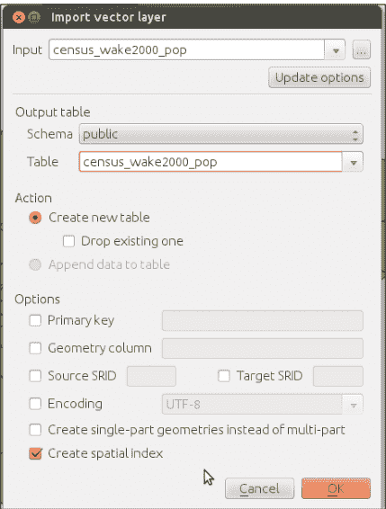

## 另请参阅

有关 PostGIS 安装和设置的更多信息，请参阅 `http://postgis.net/install`。

如需更深入地了解 PostGIS 的使用，有许多相关书籍可供参考，包括 Packt Publishing 出版的 *PostGIS Cookbook*。
