## 2
数据管理

在本章中，我们将介绍以下操作：

+   - 连接图层数据
+   - 清理属性表
+   - 配置关系
+   - 在数据库中连接表
+   - 在 SpatiaLite 中创建视图
+   - 在 PostGIS 中创建视图
+   - 创建空间索引
+   - 栅格地理配准
+   - 矢量图层地理配准
+   - 创建栅格概览（金字塔）
+   - 构建虚拟栅格（目录）

## 简介

使用 QGIS 的原因之一是其众多功能，这些功能使你能够以可视化方式管理和分析空间数据。本章重点介绍用户为使数据可用于其他用途（如分析、制图或输入到其他程序）而需要执行的常见操作。

在本章中，你将找到管理矢量数据和栅格数据的操作方法。这些操作涵盖了处理来自文件和数据库源的数据。

## 连接图层数据

我们经常以不同格式获取数据，并且信息分散在多个文件中。因此，一项重要的技能是知道如何连接来自不同图层的属性数据。连接数据是一种基于共同值（如 ID 或类别）将多个表中的数据组合起来的方法。

本练习演示如何使用 **图层属性** 中的连接功能将地理人口普查区数据连接到表格形式的人口数据，以及如何将结果保存到新文件。

### 准备工作

要完成本练习，请使用 **添加矢量图层** 加载 `census_wake2000.shp`（你也可以将 shapefile 从文件浏览器拖放到 QGIS 中），并使用 **添加分隔文本图层** 加载 `census_wake2000_pop.csv` 人口数据。


> 你也可以使用 **添加矢量图层** 加载 `.csv` 文本文件，但这会将所有数据加载为文本列，因为 `.csv` 文件没有附带用于指定数据类型的 `.csvt` 文件。相反，**添加分隔文本图层** 工具会扫描数据并为每列确定最合适的数据类型。

### 操作步骤...

要连接两个图层，必须存在一个两个图层共同拥有的值/ID 列。如果我们检查刚加载的两个图层的属性表，我们会发现两者都有 `STFID` 字段。因此，要将人口数据连接到人口普查区，请执行以下步骤：

+   1. 打开 `census_wake2000` 图层的 **图层属性** 选项（例如，双击 **图层** 列表中的图层名称）并转到 **连接**。
+   2. 要设置新的连接操作，请按对话框左下角的绿色 **+** 按钮。
+   3. 以下截图显示了 **添加矢量连接** 对话框，你可以通过选择 **连接图层**（即要用于连接人口普查区的图层）以及包含共同值/ID 的列（**连接字段** 和 **目标字段**）来配置连接：

默认情况下，新列的名称由连接图层名称、下划线以及连接图层列名组成。例如，`census_wake2000_pop` 的 `STATE` 列将变为 `census_wake2000_pop_STATE`。你可以通过启用 **自定义字段名前缀** 选项来更改此默认行为，如上面的截图所示。使用这些设置，`STATE` 列将变为 `pop_STATE`，这明显更短，因此更容易处理。

### 扩展...

你现在创建的连接仅存在于内存中。原始文件均未被更改。但是，可以从已连接的图层创建新文件。为此，只需使用 **图层** 菜单或 **上下文** 菜单中的 **另存为...**。你可以选择多种数据格式，包括 ESRI shapefile、Mapinfo MIF 或 GML。

Shapefile 是一种非常常见的选择，因为它仍然是事实上的标准 GIS 数据交换格式，但如果你熟悉 GIS 数据格式，你会注意到连接列的名称对于 shapefile 格式的 10 个字符名称长度限制来说太长了。QGIS 确保导出的 shapefile 中的所有列在名称被缩短为仅 10 个字符后仍具有唯一名称。为此，QGIS 会在原本重复的列名末尾添加递增数字。如果你将此示例中的连接保存为 shapefile，你会看到列名被修改为 `census_w_1`、`census_w_2` 等。当然，这些名称对于继续处理数据来说并不理想。如本操作的 *工作原理...* 中所述，连接列的名称是连接图层名称和列名的组合。因此，如果我们想从连接结果创建 shapefile，可以使用以下技巧：我们可以缩短图层名称。只需在图层列表中重命名图层即可。你甚至可以使用完全空的图层名称！如果将连接图层名称更改为空字符串，连接列名称将变为 `_STATE`、`_COUNTY` 等，而不是 `census_wake2000_pop_STATE` 和 `census_wake2000_pop_COUNTY`。无论如何，记录数据并在元数据中提供属性表列的描述是一种良好的做法。

无论如何，你很可能希望清理新数据集的属性表，这正是我们将在下一个练习中要做的事情。

## 清理属性表

我们时常需要清理属性表的原因有很多。可能是因为我们从外部来源接收到结构不良或命名不佳的数据，也可能是因为数据处理（例如我们在上一个练习中执行的图层连接）需要一些后期处理。本操作向我们展示了如何使用属性表和 **Table Manager** 插件来重命名、删除和重新排序列，以及如何使用 **字段计算器** 在不同数据类型之间进行转换。

### 准备工作

如果你已执行了上一个操作，请将连接后的图层保存为一个新的 shapefile；否则，加载 `census_wake2000_pop.shp`。无论如何，你会注意到数据集包含大量重复信息，并且列名也需要一些优化。要完成本操作，你还应通过导航到 **插件 | 管理并安装插件** 来安装并启用 **Table Manager** 插件。

### 操作步骤...

+   1. 清理此数据集的第一步是删除重复的信息。从所有可用列中，我们只想保留 `_STATE`、`_COUNTY`、`_TRACT`、`FIPSSTCO`、`TRT2000`、`STFID`、`_POP2000`、`AREA` 和 `PERIMETER`。
+   
+   2. 要删除其他列，请使用属性表左上角的 **切换编辑模式** 按钮启用编辑，或按 *Ctrl + E*。这将激活 **删除列** 按钮。
+   
+   3. 或者，你也可以按 *Ctrl + L* 打开 **删除属性** 对话框。此对话框允许你一次删除多列。只需选择所有要删除的列，按 **确定**，QGIS 就会显示缩减后的属性表。


> 值得注意的是，只有当你使用 **保存编辑** 按钮或禁用编辑模式并确认要保存更改时，更改才会永久生效。

+   4. 接下来，我们将重命名列，以删除某些列名中的前导下划线。这可以使用 **Table Manager** 插件完成。
+   
+   5. 当你启动该插件时（应禁用编辑模式），你将看到图层列的列表。该插件允许你更改列的顺序，以及重命名、插入、克隆和删除列。
+   
+   6. 要重命名列，只需在列表中选择它并按 **重命名** 按钮。然后系统会要求你提供新名称。继续删除 `_STATE`、`_COUNTY`、`_TRACT` 和 `_POP2000` 中的前导下划线。
+   
+   7. 最后，使用 **上移** 和 **下移** 按钮，你还可以将列顺序重新排列为更直观的顺序。我们建议将 `STFID` 移到第一位，并将 `AREA` 和 `PERIMETER` 移到最后。
+   
+   8. 如果按 **保存**，更改将保存回图层源文件。或者，你也可以使用 **另存为...** 创建新文件。


## 配置关系

在 *连接图层数据方法* 中，我们讨论了连接仅向现有要素追加额外列（1:1或n:1关系）。因此，使用连接无法建模1:n关系，例如“一个邮政编码区域包含n所学校”。这些类型的关系可以使用关系（relations）来建模。本方法介绍关系的概念，并展示如何使用它们。

### 准备工作

要跟随本练习，请从 `zipcodes_wake.shp` 和 `schools_wake.shp` 加载邮政编码区域和学校。

### 操作方法...

关系在 **项目属性** 中配置。该对话框与连接对话框非常相似：

1. 定义两个图层（**引用/子图层** 和 **被引用/父图层**），以及包含公共值/ID的字段。由于您想要建模“一个邮政编码区域包含n所学校”，邮政编码数据集是父图层，学校数据集是子图层。两个数据集之间的连接基于邮政编码字段（**ADDRZIPCOD** 和 **ZIPNUM**）建立，如以下截图所示：

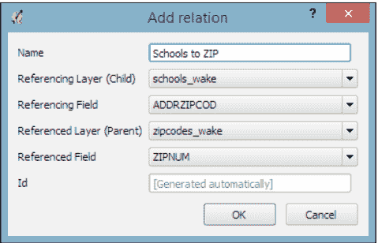

2. 要验证关系已设置并正常工作，您可以检查表单视图中的属性表（右下角的按钮），如以下截图所示，或打开单个要素表单。您会发现关系信息已追加到表单的末尾：

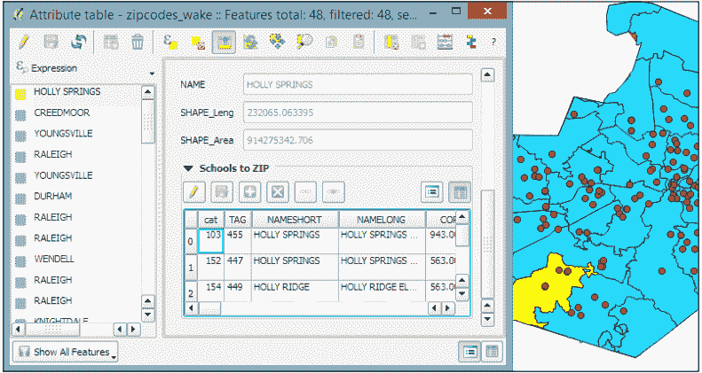

如上图所示，设置此关系使您能够非常方便地访问特定邮政编码内的所有学校。如编辑按钮所示，您甚至可以从此视图编辑学校数据。您可以直接在表视图中编辑值。您可以使用 + 和 X 按钮从数据集中添加和删除学校。接下来的两个按钮使您能够快速向关系添加新条目或从关系中移除它们。

### 工作原理...

在此示例中，从数据集中移除学校效果很好，但通过此对话框添加学校意义不大，因为您无法通过此过程创建点几何。

如果您按下按钮添加到关系，您将看到一个对话框，允许您选择要添加的现有学校。在后台，学校的 ADDRZIPCOD 值会更新为与我们刚分配的邮政编码匹配。

同样，如果您选择一所学校并按下按钮移除关系，实际发生的是该学校的 ADDRZIPCOD 值被设置为 NULL。

## 在数据库中连接表

如果您使用数据库（SpatiaLite 或 PostGIS）存储数据（矢量和非空间），那么您还可以选择使用数据库和 SQL 来执行表连接。此方法的主要优点包括能够在加载到地图之前过滤数据、执行多表连接（三个或更多），以及通过查询完全控制连接的细节。

### 准备工作

您需要在 SpatiaLite 或 PostGIS 数据库中至少有两个图层。这两个图层至少需要一个公共列，并且公共列在至少一个表中应包含唯一值。在本例中，我们使用 `census_wake_2000` 多边形图层和 `census_wake_2000_pop.csv`。

### 操作方法...

1. 打开 QGIS 自带的 **DB Manager** 插件。您可以在 **数据库** 菜单中找到它。
2. 从左侧树中选择您的数据库，使用 **SpatiaLite** 中的 `cookbook.db`（在 *第1章，数据输入与输出* 中创建）。
3. 现在，打开 SQL 窗口（插件窗口顶部工具栏左起第二个图标）。
4. 输入以下 SQL 代码来查询和连接表：

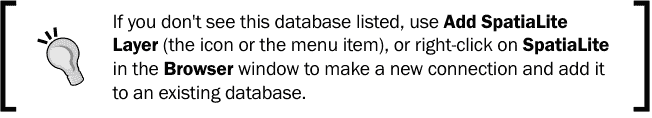

```sql
SELECT *
FROM census_wake2000 AS a
JOIN census_wake2000_pop AS b
ON a.stfid = b.stfid;
```

### 工作原理...

SELECT 列出您想要从源表中获取的所有列；在本例中，* 表示所有内容。FROM 是第一个（左）表，a 是别名，用于减少后续输入。JOIN 是第二个（右）表，ON 指示要在两个表之间匹配哪些列。关于关系数据库理论的其余内容，最好在其他书籍中解释。

### 更多内容...

在数据库中，连接类型不止一种。您可以执行仅保留两个表中匹配项的内连接，或者保留左（第一个表）所有内容以及右表匹配项的外连接。您还可以控制一对多关系的汇总方式，或选择特定记录而不是聚合。

如果要保存查询结果，您有两个选项。您可以创建视图（view）或新表（table）。视图是您查询的已保存副本。每次打开它时，都会重新运行查询。如果您的数据发生变化，这非常有用，因为它始终是最新的，并且不占用额外的磁盘空间。另一方面，表类似于保存新文件；它是结果的静态新副本。这对于重复访问相同答案很有用，并且通常使用更快，尤其是对于大型表。

### 另请参阅

- 参考本章的 *在 SpatiaLite 中创建视图* 和 *在 PostGIS 中创建视图* 部分，了解如何创建查询结果的视图。
- 有关编写 SQL 查询的更多通用信息，请参阅 http://sqlzoo.net/
- 参考 *第1章，数据输入与输出,* 关于使用 `cookbook.db` 数据库

## 在 SpatiaLite 中创建视图

在数据库中，视图是存储的查询。每次打开它时，查询都会运行并生成新结果。要将视图用作 QGIS 中的图层，需要几个步骤。

### 准备工作

对于本方法，您需要一个返回包含几何结果的查询。我们将使用的示例是来自 *在数据库中连接表* 方法（上一个方法）的查询，其中普查多边形与人口 CSV 之间进行了1:1属性连接。建议使用 QSpatiaLite 插件来完成本方法。

### 操作方法...

GUI 方法如下：

1. 使用 **QspatialLite** 插件（如果您已激活它，它位于 **数据库** 菜单中）输入以下查询：

```sql
SELECT *
FROM census_wake2000 as a
JOIN census_wake2000_pop as b
ON a.stfid = b.stfid;
```

2. 从 Option 下拉菜单中选择最后一项 Create Spatial View & Load in QGIS，并将 Geometry field 框的值设置为空间图层中的几何字段名称。在此示例中，这是 geom。

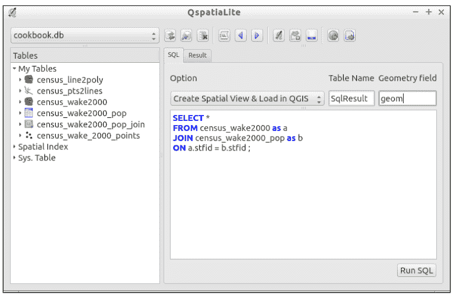

> 您可以在左侧浏览数据表字段，以检查所需字段的名称。

SQL 方法如下：

1. 在 数据库 | DB Manager 中，打开 SQL 窗口。
2. 编写查询。在本例中，这是上一个方法中的连接查询。
3. 通过添加 CREATE VIEW <名称> as SELECT 将此查询转换为视图：

```sql
CREATE VIEW census_wake2000_pop_join AS
SELECT *
FROM census_wake2000 as a
JOIN census_wake2000_pop as b
ON a.stfid = b.stfid;
```

4. 使用后续查询在 SpatiaLite 元数据后端注册视图。此函数区分大小写：

```sql
INSERT INTO views_geometry_columns
(view_name, view_geometry, view_rowid, f_table_name,
f_geometry_column,read_only)
VALUES ('census_wake2000_pop_join', 'geom', 'rowid',
'census_wake2000', 'geom',1);
```

5. 模式是（'视图名称'，'视图几何字段名称'，'唯一ID'，'视图获取几何的原始表名称'，'原始表中的几何字段名称'，'只读(1)或可写(0)'）。

6. 运行第二个查询后，您应该能够在 QGIS 中加载该视图，并看到与连接查询相同的字段。

### 工作原理...

视图实际上存储在数据库中，并在您加载时被触发。这样，如果您更改原始数据表，视图将始终是最新的。相比之下，创建新表会复制现有数据，存储在新位置，或创建该时刻值的快照或冻结。它还会通过复制数据来增大数据库的大小。而视图只是 SQL 文本本身，不存储任何额外数据。

QGIS 读取 SpatiaLite 的元数据表，以确定哪些图层包含空间数据、它们包含哪种空间数据，以及哪一列包含几何定义。如果不在元数据中创建条目，表将显示为普通 SQLite 表，您只能加载没有空间表示的属性数据。

由于它是视图，实际上是从原始表读取几何。因此，对原始表的任何编辑都会显示出来。SpatiaLite 4.x 系列中的新功能使创建可写视图更加容易。如果您使用 spatialite-gui 独立应用程序，它会注册所有必要的数据库触发器以使其工作，所做的更改将影响原始表。


## 数据管理

- 3. 现在，通过点击 **执行 (F5)** 按钮来执行查询：

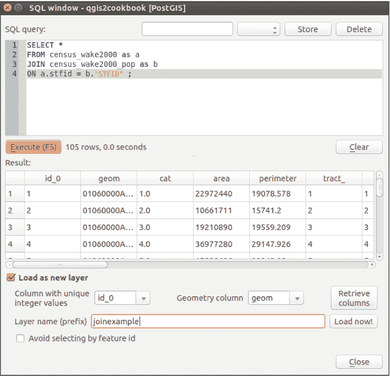

- 4. 执行查询后，若要将其加载到地图中，请勾选 **作为新图层加载** 复选框，这将展开一些额外的选项。在 **包含唯一整数值列** 中选择一个唯一的整数 (id_0)，并在 **几何列** 中选择一个 geom。在 **图层名称 (前缀)** 文本框中命名你的结果，然后点击 **立即加载！**

> 如果你只需要在这个特定的 QGIS 项目中查看这些数据，你可以在此处停止。为了让数据库为其他项目和用户存储此查询，请继续执行此食谱。

- 5. 通过添加 `CREATE VIEW <name> AS SELECT:` 将此查询转换为视图：

```sql
CREATE VIEW census_wake2000_pop_join AS SELECT *
FROM census_wake2000 as a
JOIN census_wake2000_pop as b
ON a.stfid = b."STFID";
```

- 6. 返回 **数据库管理器**，点击 **刷新** 按钮（在左侧）。此时你应该能看到新的视图被列出，并且可以将其添加到地图中。

## 工作原理...

QGIS 通过读取 PostGIS 的元数据表或视图来确定哪些图层包含空间数据、它们包含何种类型的空间数据，以及哪一列包含几何定义。如果不创建元数据条目，表格将显示为普通的 PostgreSQL 表，你只能加载属性数据而无法显示空间表示。

由于这是一个视图，它实际上是从原始表中读取几何图形。因此，对原始表的任何编辑都会显示出来。

## 更多知识...

QGIS 对于 PostGIS 表和视图拥有唯一 ID 的要求非常严格。有几个技巧可以确保其始终有效工作。始终包含一个数字型唯一 ID（推荐作为第一列，但不是必须的，ID 必须是整数列，通常是 int4，但现在 int8 也应该有效）。自增 ID 是个好主意。当你没有一个来自底层表的 ID 字段可供使用时，你可以使用以下方法即时添加一个 ID：

```
SELECT row_number() OVER() AS id_qgis, <在此添加你想要使用的其他字段> FROM table;
```

缺点是，你现在必须列出想要在视图中使用的所有字段，而不是使用 *。在创建表时，如果你计划添加记录，最好将这个 id_qgis 字段转换为自增字段。

另一个主要的陷阱是，如果你通过操纵现有几何图形来创建新的几何图形，QGIS 并不总能意识到结果。在之前的示例中，几何图形从原始表到视图保持不变地传递，因此它在 PostGIS 的 geometry_columns 元数据中正确注册。然而，新几何图形不存在于原始表中，所以技巧是对几何图形结果进行类型转换，如下所示：

```
CREATE VIEW census_wake2000_4326 AS
SELECT id_0,
stfid,tractid,ST_Transform(geom,4326)::geometry(GeometryZ, 4326)
AS geom
FROM census_wake2000;
```

QGIS 并不总是认为这是一个有效的空间图层，但将其添加到画布应该可以正常工作。


> 你指定的越具体越好。如果你不确定是什么类型的几何图形，或者是否有 3D（即 Z），请检查 `geometry_columns` 视图中的条目。

此外，请密切关注 Postgres 的一项相对较新的特性，称为物化视图。这是一种缓存视图结果的方法，这些结果不会自动更新，但它们也不需要全新的表。

## 参见

- 关于 PostGIS 手册的更多细节可以在 http://postgis.refractions.net/docs/using_postgis_dbmanagement.html#Manual_Register_Spatial_Column 阅读。此食谱与之前的一个极其相似，并展示了如果你了解细微差异，这两个是多么可以互换。
- 有关 *物化视图* 的更多信息，请参阅 http://www.postgresql.org/docs/9.3/static/rules-materializedviews.html

## 创建空间索引

空间索引是加速几何图形查询的方法。这包括加速 QGIS 中数据库图层的显示当你放大查看时（它对于查看整个图层没有影响）。

此食谱适用于 SpatiaLite 和 PostGIS 数据库。如果你创建了一个新表，或者导入了某些数据而没有创建空间索引，通常是一个好主意来添加它。

> 你也可以为 shapefile 图层创建空间索引。查看 **图层属性 | 常规** 中的 **创建空间索引** 按钮。这将创建一个 .qix 文件，可与 QGIS、Mapserver、GDAL/OGR 和其他开源应用程序配合使用。参考 https://en.wikipedia.org/wiki/Shapefile。

## 准备工作

你需要一个 SpatiaLite 和一个 Postgis 数据库。为了方便，从提供的示例数据中导入矢量图层，并在导入时不选择 **创建空间索引** 选项。（不确定如何导入数据？请参阅 *第 1 章，数据输入和输出*，了解如何操作。）

## 具体步骤...

使用 **数据库管理器** 插件（在 **数据库** 菜单中），执行以下步骤：

- 1. 检查索引是否存在。在 **数据库管理器** 中，打开数据库，然后打开你要检查的表。查看右侧的属性，你应该会在 **字段** 上方看到一条消息，如下所示：

⚠ 未定义空间索引（创建它）

## 数据管理

当运行涉及位置的查询时，会对框进行比较，这是一种简单的数学比较。然后，选择与相关区域匹配的框所在的行，以便基于其真实几何图形进行深入测试以进行精确匹配。这种查找交集的方法比逐个测试复杂几何图形更快，因为它可以迅速排除明显不在感兴趣区域附近的项。

## 更多知识...

空间索引对于加速 QGIS 中数据库空间图层的加载时间非常重要。它们在空间查询（如 intersects）的速度中也起着关键作用。注意，如果存在空间索引，PostGIS 会自动使用它。SpatiaLite 需要你编写查询以有意调用特定的空间索引（请参考《SpatiaLite 烹饪书》中的 Haute Cuisine 示例）。

此外，请记住，单个查询中只能使用每表的一个空间索引。如果你碰巧有超过一个空间列，或者在不同于几何图形的投影中创建空间索引，这一点将真正发挥作用（参阅 Packt Publishing 出版的《PostGIS 烹饪书》以获取更多信息）。

> 如果你计划向具有现有空间索引的表中插入大量记录，你可能希望在导入完成后禁用或删除该索引并重新创建它。否则，索引将在每次插入行后重新计算。这也适用于非空间索引。

你想一次检查很多表吗？你可以一次性列出 PostGIS 中的所有 GIST 索引：

```
SELECT i.relname as indexname, idx.indrelid::regclass as
    tablename,
    am.amname as typename,
ARRAY(SELECT pg_get_indexdef(idx.indexrelid, k + 1, true)
    FROM generate_subscripts(idx.indkey, 1) as k
    ORDER BY k
    ) as indkey_names
FROM pg_index as idx
JOIN pg_class as i  ON  i.oid = idx.indexrelid
JOIN pg_am as am  ON  i.relam = am.oid
JOIN pg_namespace as ns  ON  ns.oid = i.relnamespace
AND ns.nspname = ANY(current_schemas(false))
Where am.amname Like 'gist';
```

要在 SpatiaLite 中做类似的事情，请使用以下方法：

```
SELECT * FROM geometry_columns WHERE spatial_index_enabled = 1;
```

## 参见

- 关于 SpatiaLite 空间索引实现的信息可以在 https://www.gaia-gis.it/fossil/libspatialite/wiki?name=SpatialIndex 找到
- 有关使用空间索引的更多细节可以在 https://www.gaia-gis.it/fossil/libspatialite/wiki?name=SpatialIndex 找到
- 关于 PostGIS 实现的信息位于 http://postgis.net/docs/manual-2.0/using_postgis_dbmanagement.html#gist_indexes
- 你还可以查看 Packt Publishing 出版的 PostGIS 烹饪书的第 10 章“维护、优化和性能调优”。

## 栅格地理参考

有时，你有一张纸质地图、一张来自互联网的地图图像，甚至是一个包含投影数据的栅格文件。在处理这些类型的数据时，你需要做的第一件事是将它们参考到现有的空间数据，以便它们能与你的其他数据和 GIS 工具一起工作。此食谱将引导你完成参考你的栅格（图像）数据的过程，称为地理参考。

## 准备工作

你需要一个缺乏空间参考信息的栅格；也就是说，根据 QGIS，其投影未知。你还需要一个已知且可用于参考点的第二图层（参考地图）。例外情况是，如果你有一张标记了坐标的纸质地图，或者一个没有附带参考文件但你恰好知道其 CRS/SRS 定义的空间数据集。在 QGIS 中加载你的参考地图。

本书的数据包括一张扫描的美国地质调查局（USGS）地形图，该图缺少其 o38121e7.tif 投影信息。此地图来自加利福尼亚州戴维斯市，因此示例数据中有许多其他可能的参考图层你可以使用，例如，街道是一个很好的选择。

> 实际上，世界文件只是被重命名为 o38121e7.tfw.orig，以便 QGIS 不会检测到它。你可以稍后使用它来比较你的地理参考质量。


## 操作方法...

在栅格菜单中，打开地理配准工具，并执行以下步骤：

1. 使用文件对话框在地理配准工具中打开你的未知地图。
2. 在你的起始坐标和结束坐标之间创建一个地面控制点（GCP）匹配。
3. 使用 GCP 添加（+）按钮在你的未知地图上添加一个点。现在你可以输入坐标（即，如果这是一张标有已知坐标的纸质地图），或者你可以从主 QGIS 窗口的参考图层中选择一个匹配点。
4. 重复此过程以找到至少四个匹配点。如果你想获得很好的拟合效果，请建立 10 到 20 个匹配点。
5. （可选）将你的 GCP 保存为文本文件，以便日后参考和故障排除：

> 建筑物的角落、街道交叉口，以及线状要素相交处或主要边缘特征所在的位置。

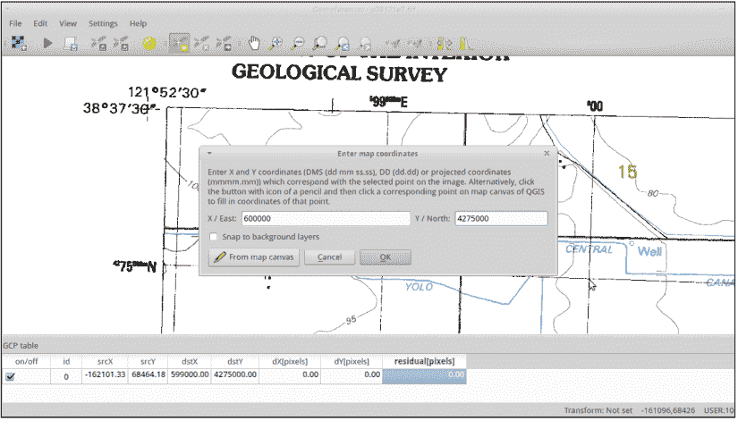

> 尽量分散你的控制点，以确保对整张地图有良好的覆盖范围。关键在于对差异进行平均化。

6. 现在，选择**变换设置**，如下所示：
7. 这里有一个选择。通常，你希望使用二次多项式（Polynomial 2）。如果你为一阶设置了 4 个以上的点，为二阶设置了 6 个以上的点，为三阶设置了 10 个以上的点，那么二阶是目前推荐的。这将在本食谱的*更多内容...*部分中讨论。
8. 将**目标 SRS** 设置为与参考图层相同的投影（在这种情况下，这是**EPSG:26910 UTM Zone 10N**）。
9. **输出栅格** 应使用与原始文件不同的名称，以便你 easily 识别它。

> 将你的 GCP 列表保存到文件。如果你对结果不满意，请回来尝试不同的算法或更改使用的 GCP 数量。如果你需要参考进行比较，请查看本书数据文件夹中的文本文件 `o381216.tif.points`。

10. 当你满意你的 GCP 列表时，点击**文件**中的**开始地理配准**，或点击绿色三角形按钮。

## 工作原理...

基于你两组点之间的差异创建一个数学函数。然后，该函数应用于整个图像，通过拉伸来尝试使其贴合。这基本上是从一个坐标系到另一个坐标系的转换或投影。

## 更多内容...

选择变换类型可能有点棘手；QGIS 中的列表目前是按字母顺序排列的，而不是推荐顺序。二次多项式（Polynomial 2）和薄板样条（Thin-plate-spline, TPS）可能是两种最常见的选择。当只有轻微的平移、缩放（比例）和旋转时，一次多项式（Polynomial 1）非常好。当你在一致的投影中拥有古老的、制作精良的地图时，这将应用最少的变化。二次多项式从这里开始处理一致的失真。这两种方法都会提供误差估计，即残差或 **RMSE（均方根误差）**。TPS 处理可变失真，围绕每个控制点改变其校正。这几乎总是会产生最佳拟合，至少通过你提供的 GCP 来看。然而，由于它在每个 GCP 位置都变化，因此无法计算误差估计，并且实际上可能会过度拟合（产生新的失真）。TPS 最适合手绘地图、非平面扫描地图或具有可变失真的其他来源。多项式方法适用于具有高准确度和参考标记的来源。

### 数据管理

如果你真的想要一个好的匹配，一旦你拥有了所有的点，请检查表格底部的 RMSE 值。通常，你希望这个值接近或小于 1。如果有一个点的值很大，请考虑删除或重新执行它。你可以移动现有的点，并且会沿估计误差的方向画一条线。所以，回到高值，放大得非常近，并使用 GCP 移动选项。

有时，仅仅改变你的变换类型会有帮助，如下面比较同一组 GCP 的一次多项式和二次多项式的截图所示：

| 开/关 | id | srcX | srcY | dstX | dstY | dX[像素] | dY[像素] | 残差[像素] |
|---|---:|---:|---:|---:|---:|---:|---:|---:|
| ✓ | 0 | -162100.01 | 68464.42 | 599000.00 | 4275000.00 | -1.27 | 1.65 | 2.08 |
| ✓ | 1 | -161099.60 | 68430.25 | 600000.00 | 4275000.00 | -2.41 | 0.22 | 2.42 |
| ✓ | 2 | -154113.88 | 68203.95 | 607000.00 | 4275000.00 | 0.76 | -1.33 | 1.53 |
| ✓ | 3 | -161493.07 | 56413.39 | 600000.00 | 4263000.00 | 1.82 | -1.25 | 2.20 |
| ✓ | 4 | -153496.71 | 56161.93 | 608000.00 | 4263000.00 | -2.87 | 1.67 | 3.32 |
| ✓ | 5 | -159301.27 | 62357.43 | 602000.00 | 4269000.00 | 1.16 | -0.79 | 1.40 |
| ✓ | 6 | -156178.82 | 66267.28 | 605000.00 | 4273000.00 | 2.81 | -0.16 | 2.81 |

一次多项式

注意切换到二次多项式时残差值的变化（假设你拥有使用二次多项式所需的最少点数）：

| 开/关 | id | srcX | srcY | dstX | dstY | dX[像素] | dY[像素] | 残差[像素] |
|---|---:|---:|---:|---:|---:|---:|---:|---:|
| ✓ | 0 | -162100.01 | 68464.42 | 599000.00 | 4275000.00 | 0.79 | 0.36 | 0.87 |
| ✓ | 1 | -161099.60 | 68430.25 | 600000.00 | 4275000.00 | -0.96 | -0.43 | 1.05 |
| ✓ | 2 | -154113.88 | 68203.95 | 607000.00 | 4275000.00 | -0.58 | -0.26 | 0.63 |
| ✓ | 3 | -161493.07 | 56413.39 | 600000.00 | 4263000.00 | 0.19 | 0.09 | 0.21 |
| ✓ | 4 | -153496.71 | 56161.93 | 608000.00 | 4263000.00 | -0.05 | -0.02 | 0.05 |
| ✓ | 5 | -159301.27 | 62357.43 | 602000.00 | 4269000.00 | -0.74 | -0.33 | 0.81 |
| ✓ | 6 | -156178.82 | 66267.28 | 605000.00 | 4273000.00 | 1.34 | 0.60 | 1.46 |

二次多项式

> 重采样方法也会严重影响输出外观。一些方法更激进地尝试平滑失真。如果你不确定，请坚持使用默认的最近邻法。这会将原始最近像素的值复制到输出中的新方形像素中。

## 另请参阅

- 在需要非常准确地理配准的设置中（如科学和测量），你应该阅读不同的变换以及适合你数据类型的良好 RMSE 值。请查阅一般的 GIS 或遥感教科书以获取更多详细信息。
- 有关 QGIS 地理配准器所有功能的详细信息，请参考在线手册 [http://docs.qgis.org/2.8/en/docs/user_manual/plugins/plugins_georeferencer.html](http://docs.qgis.org/2.8/en/docs/user_manual/plugins/plugins_georeferencer.html)。
- QGIS 文档包含一些关于如何选择变换类型的基本信息，位于 [http://docs.qgis.org/2.8/en/docs/user_manual/plugins/plugins_georeferencer.html#available-transformation-algorithms](http://docs.qgis.org/2.8/en/docs/user_manual/plugins/plugins_georeferencer.html#available-transformation-algorithms)。

## 矢量的地理配准

由于各种原因，有时你会有一个缺乏投影信息的矢量图层。这在仅以局部坐标创建的 CAD 图层中很常见。在可能的时候，请尝试追溯原始的投影信息。作为最后的手段，你可以尝试使用这里描述的食谱将矢量图层扭曲以匹配已知的参考图层。

### 准备工作

你可以打开两个 QGIS 实例（或者使用一个，因为你会经常来回缩放）。在一个实例中，加载一个参考图层，该图层的投影是你希望你的数据所在的投影。从**插件管理**菜单中激活**坐标捕获插件**。

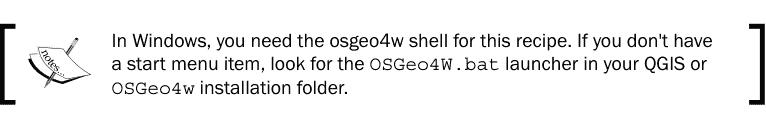

此示例使用 `cad-lines-only.shp`，这是从 `CSS-SITE-CIV.dxf` 文件中提取的线图层。该文件是位于北卡罗来纳州韦克县凯里市学院街（Academy St.）设计方案的 CAD 渲染图。

### 操作方法...

1. 在你的未知图层（`cad-lines-only.shp`）和参考图层（`CarystreetsND83NC.shp`）之间创建一组 GCP 匹配列表。

2. 以下是一些具体的调整，以帮助将 `cad-lines-only.shp` 参照到 `CarystreetsND83NC.shp`。这将更容易在两个图层之间找到匹配点：

   1. 加载 `cad-lines-only.shp`，并使用基于规则的风格调整其样式属性。使用“图层”= 'C-ROAD-CNTR' 规则，这将只显示街道中心线。
   2. 在你的另一个 QGIS 会话中，加载 `CarystreetsND83NC.shp` 以查找匹配区域，打开属性表，并应用以下选择表达式："Street" LIKE '%N ACADEMY%' OR "Street" LIKE '%S ACADEMY%' OR "Street" LIKE '%CHATHAM%'。这里的筛选器突出显示了原始项目的三条主要街道，这些街道位于镇中心 Chatham 和 N/S Academy 街道的交叉口。这可能也有助于更改选中要素的颜色，以便更容易找到。项目两端的交通环岛是很好的地标：

   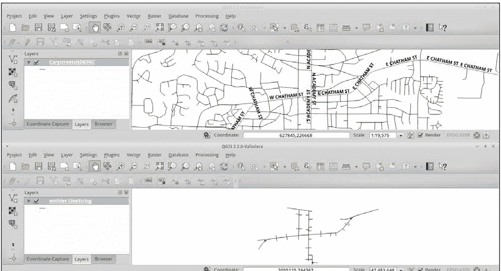

3. 寻找一个易于识别且在两个图层中都匹配的特征（街道交叉口）。


+   4. 使用坐标捕获插件复制两层中该点的 x,y 值。
+   5. 在工作时将坐标保存到文本编辑器中。
+   6. 重复此过程，直到你至少有四对点。尽量选择分布在整个图层上的点：

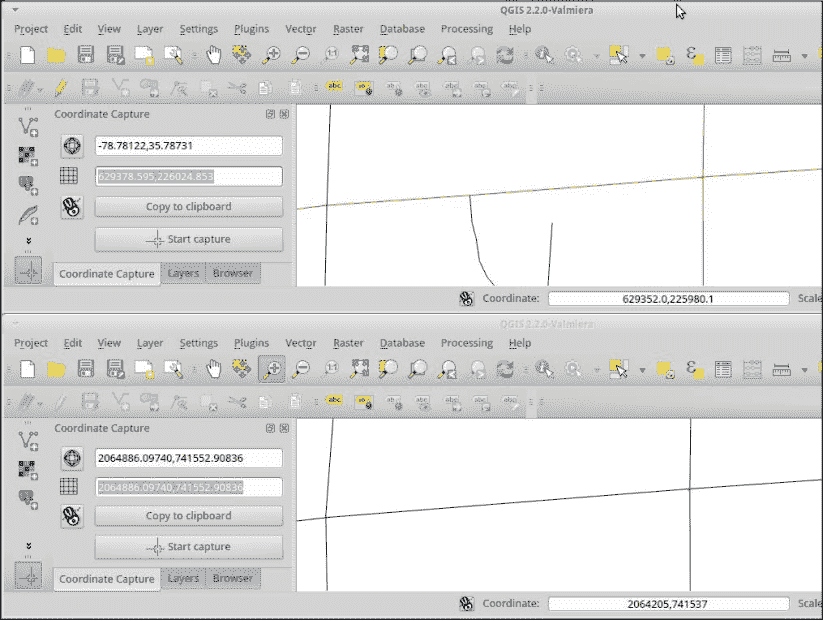

> 目前 QGIS 中没有用于下一步的图形界面，该步骤使用随 QGIS 提供的 OGR 库。获取点列表后，使用 ogr2ogr 命令行，你将把 GCP 应用到未知图层。

+   3. 每组坐标对将如下所示：
+   
+      `-gcp sourceX sourceY destinationX destinationY`

+   4. 打开终端（Mac 或 Linux）或 OSGeo4w shell（Windows）。

5. 切换到存放数据的目录（提示：cd /home/user/Qgis2Cookbook/）：

```
ogr2ogr -a_srs EPSG:3358 -gcp 2064886.09740 741552.90836 629378.595 226024.853 -gcp 2066610.97021 741674.39817 629903.420 226064.049 -gcp 2064904.46214 743055.63847 629384.784 226485.725 -gcp 2062863.85707 741337.65243 628762.587 225960.900 cad_lines_nd83nc.shp cad-lines-only.shp
```

-a_srs 是参考图层的投影代码。

命令模式为 ogr2ogr <options> <destination> <source>。

> 其他有用的高级选项包括 -order <n> 来指示多项式级别（默认为基于 GCP 数量）或 -tps 使用 Thin-plate-spline 而不是多项式。更多选项请参考 http://www.gdal.org/ogr2ogr.html。

6. 现在，在同一个项目中加载你的新 cad_lines_nd83nc.shp 文件，作为 CarystreetsND83NC.shp。它们应该在无需启用投影即时重投影的情况下对齐：

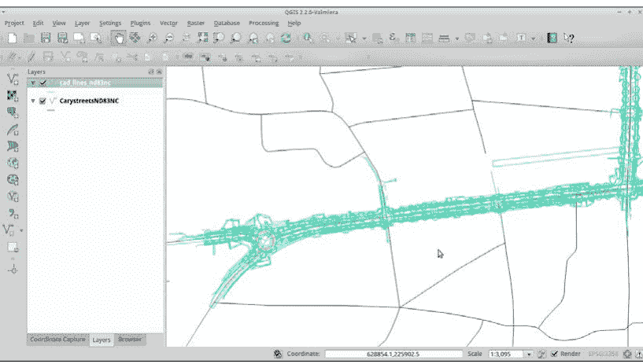

## How it works...

给定输入坐标列表和匹配的输出坐标，将推导出一个在两组之间转换的数学公式。然后该公式应用于原始数据中的所有点。其结果是将数据集从未知投影重投影到已知投影。

> 原始数据实际上是 EPSG:102719，但我们假装我们没有这条信息以演示此示例。

## There's more...

选择参考图层时，尽量选择你希望用于地图和分析的投影中的图层。这样你只需重投影一次，因为每次额外的转换都可能增加误差。完成此任务的方法不止一种，包括手动移动数据。

在此特定示例中，转换是根据 GCP 点对的数量自动选择的。4-5 个为一次多项式，6-9 个为二次多项式，10+ 个为三次多项式。请参考本章之前的配方了解更多信息。

一个相关主题是 *Affine transformations*，当你只是想按已知量平移或旋转矢量图层时。QgsAffine 插件很棒，如果你已经知道参数，或大致知道想要旋转和移动矢量图层的距离，因为它只需要一些数学运算即可获得参数。

> 也许等你读到这里时，这里所有的困难事情都将在插件中实现。保持关注，并尝试实验性插件 Vector Bender、vectorgeoref 和 Affine Transformations。

## See also

+   - 此方法与 *Georeferencing Rasters* 配方非常相似，许多相同的提示也适用于两者。
+   - 如果你想了解我们最初是如何将 CAD 文件导入为 SHP 的，请查看 *Chapter 1, Data Input and Output* 中的 *Importing DXF/DWG files*
+   - 请参阅 *Chapter 10, Cartography Tips* 中的 *Using Rule Based Rendering* 配方，了解如何通过应用基于属性的规则过滤更好地可视化生成的 CAD 导入的提示

+   ▸ 太懒得做数学了？你也可以直接使用 GvSig 来做数学并制作世界文件；请参考 http://foss4gis.blogspot.com/2011/05/computing-and-applying-affine.html
+   ▸ 如果你想自己做数学运算，请参阅 http://press.underdiverwaterman.com/rotating-a-point-grid-in-qgis/

## Creating raster overviews (pyramids)

概览或金字塔以及重采样都是关于在地图画布中缩放和平移时使栅格图层加载更快，通过在未完全缩放时减少加载的数据量。

## Getting ready

你需要一个大的栅格图像。

> 通常，你希望复制数据，因为如果选择创建“内部”金字塔，此方法可能会更改原始文件（很容易意外发生）。

## How to do it...

+   1. 在 QGIS 中加载你的栅格。elev_lid792_1m.tif 对于此示例效果很好。
+   2. 右键单击图层名称并打开属性。
+   3. 在左侧转到金字塔项：

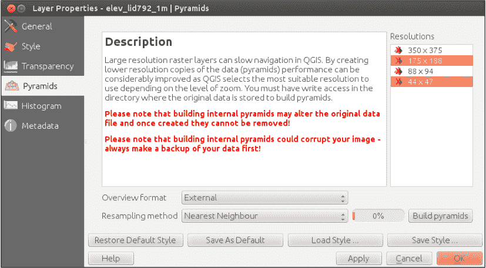

+   4. 选择你想要创建金字塔的图像尺寸：
+      - 可选，选择是否存储在外部（更安全）或内部（文件更少）。
+      - 可选，选择重采样算法；**Nearest Neighbor** 最简单，但其他方法可能看起来更平滑，但代价是更多的数据处理和计算时间。
+   5. 单击 **Build pyramids**。
+   6. 完成后，你会注意到你选择的尺寸上的红色 X 现在显示为金字塔。

## How it works...

生成金字塔本质上是为不同缩放级别制作原始数据的副本。随着你缩小缩放，原始数据会被重采样以适应屏幕大小。金字塔做同样的事情，但它们让你决定使用什么重采样方法并提前生成此概览。通过提前生成，QGIS 在更改缩放级别时可以更快地加载图像。

## There's more...

重采样是说在每个缩放级别上，现在的 1 个像素来自原始数据的多个像素，因此它们需要以某种方式平均并将结果分配给现在可用的 1 个像素。每种不同的方法都使用不同的数学公式来决定新值以及如何用相邻像素平滑该值（使其在视觉上令人愉悦）。这与你缩小图片以便通过电子邮件发送给朋友的概念相同。

如果你选择外部保存，你的概览存储在 `elev_lid792_lm.tif.ovr` 中。一些其他程序将相同的内容存储在 `.aux` 文件中；然而，金字塔格式在 GIS 应用程序之间并不通用。

## See also

+   - 这与使用 GDAL `gdaladdo` 命令的效果相同；请参考 `http://gdal.org/gdaladdo.html`
+   - 可以在 `https://docs.qgis.org/2.8/en/docs/user_manual/working_with_raster/raster_properties.html` 找到 QGIS 文档中的更多详细信息

## Building virtual rasters (catalogs)

当你有很多栅格（而不是一个大栅格）并且它们都是同一数据集的一部分（通常彼此相邻），你不想单独加载每个文件然后对其进行样式设置。加载一个文件并将其视为一个图层要容易得多。此配方让你在不实际创建单个庞大栅格的情况下做到这一点，这可能难以处理。

## Getting ready

你需要两个或更多具有相邻范围或仅在边缘部分重叠并且使用相同投影的栅格文件。理想情况下，文件应为相同类型，例如全部为高程、全部为空中照片等。对于此配方，OSGeo EDU（北卡罗来纳州）数据集中的高程栅格将适用。

## How to do it...

+   1. （可选）将高程栅格加载到当前地图中。
+   2. 转到 **Raster Menu | Miscellanous | Build Virtual Raster (Catalog)**。
+   3. 勾选 **Use visible raster layers** 复选框或选择 **SELECT**，浏览到示例数据并选择全部四个。

+   4. **SELECT** 并使用 `.vrt` 扩展命名输出文件。

+   5. （可选）如果想立即查看结果，请勾选 **Load into canvas when finished** 复选框：

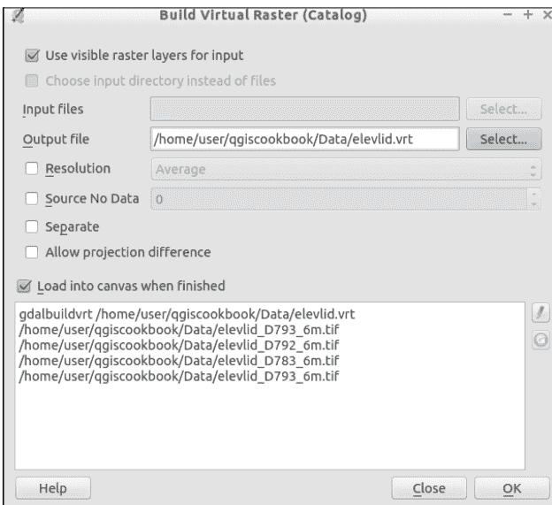

> GDAL 命令行等效：<command> <output.vrt>
> <list of inputs... space between each...>
> 例如，gdalbuildvrt elevlid.vrt elevlid_D782_6.tif elevlid_D783_6m.tif elevlid_D792_6m.tif elevlid_D793_6m.tif。

## How it works...

GDAL VRT 格式是一个 XML 文件，定义了每个栅格文件相对于锚定文件的位置。它使用栅格的现有空间范围信息来确定它们彼此之间的位置，然后将该集合锚定在给定的坐标系统中。


## 更多内容...

使用虚拟栅格（VRT）旨在节省时间。当您为某个特定数据集拥有数百个栅格文件时，可以将它们合并为一个文件。然而，这个文件可能过于庞大，以至于几乎无法处理。这是一种快速将这些文件用作无缝背景图层的方法。如果您需要执行分析，很可能需要要么合并图层，要么逐个循环处理它们。

您还可以生成**瓦片索引**（也在**杂项**菜单中），它会生成一个包含栅格外轮廓的shapefile，并将栅格的ID和路径放入属性表中。这样，您就可以确定要为给定地图加载哪个影像，而无需加载所有影像。

最后，如果您确实希望将所有文件合并为一个大文件，可以使用上下文菜单（右键单击加载的VRT图层并选择**另存为**）。如果您有重叠、更复杂的情况，或者希望在不加载文件的情况下进行合并，请先使用**合并**工具（也在**杂项**菜单中）。如果您的文件重叠，这可能会很棘手，您需要决定如何处理重复数据。

## 另请参阅

- * 有关另一个示例，请参阅 `http://manual.linfiniti.com/en/rasters/data_manipulation.html#basic-fa-create-a-virtual-raster`
- * GDAL的gdalbuildvrt是底层工具；其文档可在 `http://gdal.org/gdalbuildvrt.html` 找到。
