## 第3章
常见数据
预处理步骤

在本章中，我们将介绍以下食谱：

- - 将点转换为线、多边形，再转回 – QGIS
- - 将点转换为线、多边形，再转回 – SpatiaLite
- - 将点转换为线、多边形，再转回 – PostGIS
- - 裁剪栅格
- - 剪裁矢量
- - 提取矢量
- - 将栅格转换为矢量
- - 将矢量转换为栅格
- - 构建日期时间字符串
- - 地理标记照片

## 简介

在处理其他人的数据时，其格式往往并非特定用途所需的精确格式。本章主要介绍如何获取现有数据并将其转换为实际所需的数据。内容涵盖不同类型矢量（点、线和多边形）之间的转换、矢量与多边形之间的转换，以及仅裁剪出所需部分。将从获得的数据转换为工作需要的数据格式和布局通常被称为“数据预处理”。

## 常见数据预处理步骤

## 将点转换为线、多边形，再转回 – QGIS

有时您的数据采用矢量格式（点、线或多边形），但对于特定类型的分析而言，它并非正确的矢量类型。或者您可能需要以特定方式拆分矢量，以促进某些分析或制图。幸运的是，所有矢量格式都是相关的：线是两个或多个相连的点，多边形是首尾点相同的线，多多边形是同一记录的多个多边形，环是嵌套多边形，其中内部多边形勾勒出要排除的区域。本食谱将介绍如何使用QGIS内置方法在不同矢量类型之间进行转换。

## 准备工作

要将点转换为线或多边形，您需要一个shapefile，其ID列具有同一线或多边形各点之间共享的单一值。在以下示例中，我们将使用 `census_wake_2000_points.shp`。

您还需要安装并激活Points2One插件。有关如何安装插件，请参阅以下网站：`http://docs.qgis.org/2.8/en/docs/user_manual/plugins/plugins.html`。

## 操作方法...

以下说明根据起始数据和最终数据类型展示了四种不同的转换方法。所有工具都在**矢量**菜单中：

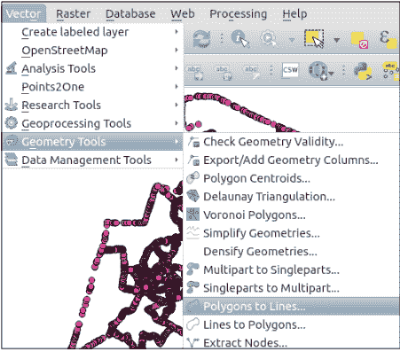

首先加载 `census_wake_2000_points.shp` 图层。

## 将点转换为线（或多边形）

- 1. 转到 **矢量 | Points2One**。
- 2. 选择创建线或多边形。
- 3. 选择分组ID；在本例中为STFID。
- 4. 创建输出文件名：`census_wake_2000_pt2lines.shp`：

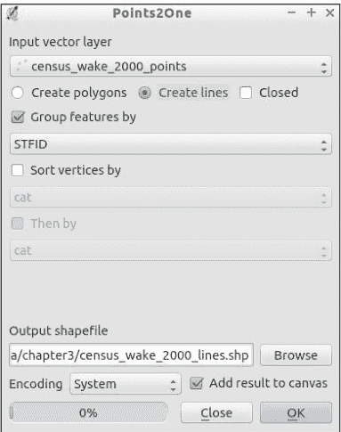

## 将线转换为多边形

- 1. 转到 **矢量 | 几何工具 | 线转多边形**。
- 2. 创建输出文件名：`census_wake_2000_lines2poly.shp`。

## 将多边形转换为线

- 1. 转到 **矢量 | 几何工具 | 多边形转线**。
- 2. 创建输出文件名：`census_wake_2000_poly2lines.shp`。

## 将多边形或线转换为点

- 1. 转到 **矢量 | 几何工具 | 提取节点**。
- 2. 创建输出文件名：`census_wake_2000_poly2pts.shp`。

## 工作原理...

在简单情况下，从较复杂的类型转换为较简单的类型相当直接。线只是多个点连接在一起，多边形是起点和终点相同的线。因此，很容易理解如何将一种几何体分解为更简单的几何体。

但从点构建起来，会稍微棘手一些。在具有三个或更多点的线中，您需要确保它们的顺序正确；否则，最终会得到一条弯曲的线。当转换为多边形时，这可能会带来更大的问题，导致生成自相交的无效多边形。因此，按它们将合并的顺序对源表中的点进行排序非常重要。重新排列数据可能有些棘手。Points2One插件现在包含排序选项；要使用此功能，请确保属性表包含一个数字列，指定每个组内点的顺序（可以为每个不同的分组从1开始重新编号）。

## 更多内容...

您还可以使用**单部分转多部分**和**多部分转单部分**命令来拆分或合并多多边形。

当情况变得非常棘手时，您可能需要转为手动编辑形状或使用自定义脚本。一个很好的例子是当您想要一个中间有孔的多边形时。如果您选择手动编辑，请务必启用捕捉，以便您的线自动捕捉到现有点。有关捕捉的官方文档可在 http://docs.qgis.org/2.8/en/docs/user_manual/working_with_vector/editing_geometry_attributes.html#setting-the-snapping-tolerance-and-search-radius 找到。

**编辑**和**高级编辑**工具栏以及额外的编辑相关插件，提供了逐一处理特别棘手几何体的能力，如果您需要的话。

## 将点转换为线、多边形，再转回 – SpatiaLite

本食谱的目标与上一食谱相同，但介绍如何在SpatiaLite数据库中处理数据。您将把点转换为线，并将线转换为多边形。

并非所有方法都可用；对于不可用的方法，您可以使用上一食谱。它也适用于数据库图层；只是不会将结果保存到数据库。因此，结果完成后需要导入到数据库中。

## 准备工作

您需要加载一个点矢量图层，其中包含指示顺序的数字ID，以及一个标识唯一线或多边形的标识符，该标识符在同一几何体的各点之间共享。例如，您可以使用加载到SpatiaLite中的 `census_wake_2000_points`，其几何字段名为geom。

## 操作方法...

使用**DB Manager插件**（随QGIS提供，位于**数据库**菜单中）、**QspatiaLite**插件或替代的SpatiaLite SQL应用（命令行或GUI），以下SQL示例将执行矢量类型之间的转换。

## 点转线

- 1. 创建一个按公共ID分组点的表：

```
--Create table grouping points with shared stfid into lines
CREATE Table census_pts2lines AS
SELECT stfid,Make_Line(geom) as geom
FROM census_wake_2000_points
GROUP BY stfid;
```

以下截图显示了屏幕的外观：

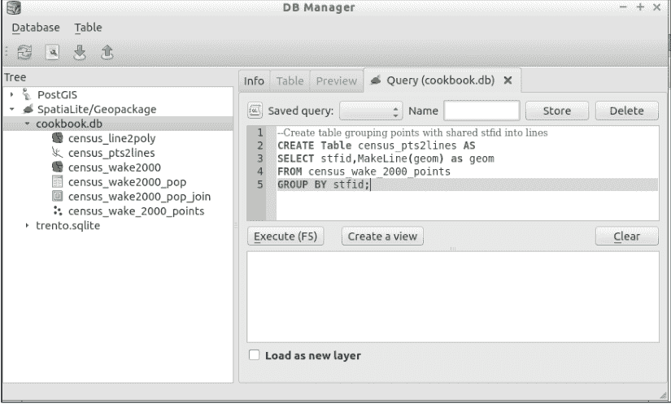


## 从线到多边形

- 1. 创建一个表，按公共 ID 分组线：
- 2. 将新表注册为空间表：

```
--Create table grouping lines with shared stfid into polygons
CREATE Table census_line2poly AS
SELECT stfid,ST_Polygonize(geom) as geom
FROM census_pts2lines
GROUP BY stfid;
```

```
--Register the new table's geometry so QGIS knows its a spatial layer
SELECT
RecoverGeometryColumn('census_line2poly','geom',3358,'POLYGON',2);
```

> 某些 SQL 接口可以一次运行多条 SQL 语句，语句之间用分号分隔。然而，也有许多接口一次只能执行一个查询。通常，除非你确定自己的软件支持多条查询，否则请一次运行一个查询；否则，这可能会失败或只在静默中运行第一个查询。

> 双破折号（--）是 SQL 中注释行的标志字符。它用于添加描述性文本，这些文本在查询中会被忽略。

## 工作原理...

根据 GROUP BY 中指定的公共标识符，SQL 语句将多个点聚合为指定类型的新几何体。创建新几何体并将结果保存到表后，注册空间元数据可使 Spatialite 和 QGIS 识别该表为空间图层。

```
--Register the new table's geometry so QGIS knows its a spatial layer
SELECT
RecoverGeometryColumn('census_pts2lines','geom',3358,'LINESTRING',2);
```

2. 将新表注册为空间表：

## 更多内容...

在第二个示例中，线被转换为多边形。你也可以使用 ST_Polygonize(ST_MakeLine(geom)) 直接从点生成多边形。

在当前版本的 SpatiaLite 中，仅完全支持向更高级别的聚合。如果你希望拆分几何体，可以使用上一节中的 QGIS 矢量工具。

## 另请参阅

- SpatiaLite 确实具有按第一个、最后一个或 ID 逐一导出指定点的函数。详情请参阅在线函数索引（参考指南）：https://www.gaia-gis.it/fossil/libspatialite/index
- 本章中的“将点、线、多边形互相转换 – QGIS”一节提供了非数据库方法。

## 将点、线、多边形互相转换 – PostGIS

本节的目标与前两节完全相同，但介绍如何使用 PostGIS 数据库中的数据执行该过程。你将用它把点转换为线，把线转换为多边形。

并非所有方法都可用；对于不可用的方法，可以使用上一节。它同样适用于数据库图层；只是不会将结果保存到数据库。因此，完成后需要将结果导入数据库。

## 准备工作

你需要加载一个点矢量图层，其中包含表示顺序的数字 ID，以及同一几何体的点之间共享的唯一线或多边形标识符。例如，可以使用加载到 PostGIS 的 census_wake_2000_points，其几何字段名为 geom。（请参阅第 1 章“数据输入与输出”中的“将矢量数据加载到 PostGIS”一节，了解如何将数据加载到 PostGIS。）

请以单一几何体而非多几何体导入。否则，你需要在查询中执行一些额外的步骤来拆分多几何体，然后才能进行转换。

## 常见数据预处理步骤

## 如何操作...

使用 **DB Manager 插件**（QGIS 自带，位于**数据库**菜单中）或其他 PostGIS SQL 应用程序（命令行——psql 或 GUI——pgAdmin III），以下 SQL 示例将在矢量类型之间执行转换。

## 将点转换为线

- 1. 运行以下查询：

```
CREATE VIEW pts2line AS
SELECT ROW_NUMBER() over (order by census_wake_2000_points.stfid) as id, ST_MakeLine(geom) as geom
FROM census_wake_2000_points
GROUP BY stfid;
```

以下截图展示了屏幕显示效果：

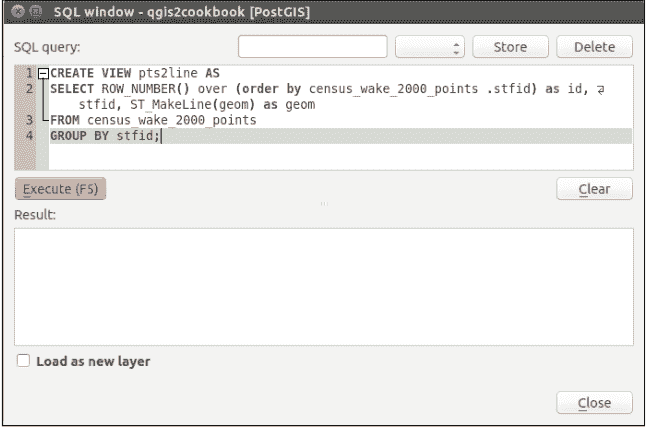

> 要测试新几何体的创建，请按照第 2 章“数据管理”中的演示，将查询封装在 `CREATE VIEW` 中。如果数据量较大或对结果满意，可以改用 `CREATE TABLE` 创建一个新表，以进行更持久地存储。

## 将线转换为多边形

运行以下查询：

```
CREATE VIEW line2poly AS
SELECT id,stid,ST_MakePolygon(geom) as geom
FROM pts2line;
```


> 想直接从点生成多边形？试试 ST_MakePolygon(ST_MakeLine(geom))；其余步骤如第一个示例（点转线查询）所示。

## 将线或多边形转换为点

运行以下查询：

```
CREATE VIEW pts AS
SELECT ROW_NUMBER() over (order by a.id_0) as id,id_0 as grid,(a.a_geom).path[2] as path,
ST_GeometryType((a.a_geom).geom), ((a.a_geom).geom) as geom
FROM (SELECT id_0, (ST_DumpPoints(geom)) as a_geom FROM "census_wake2000") as a;
```


> ROW_NUMBER() 有什么用？这是确保每一行都有唯一整数的技巧。如果没有它，某些工具会报错；例如，DB Manager 将无法预览或加载图层，尽管在 QGIS 中直接加载没有问题。

## 工作原理...

根据 GROUP BY 中指定的公共标识符，SQL 语句将多个点聚合为指定类型的新几何体。

当把几何体转储为点时，PostGIS 实际转储的是一个包含 ID 信息的数组。这就是示例查询实际上是一组嵌套查询的原因。第一个查询用于转储几何信息数组，第二个查询用于以我们想要的格式提取结果的相关部分。

## 更多内容...

PostGIS 有几个用途不同的转储函数。拆分几何体对数据库来说显然是一个困难的概念，因为聚合通常是函数在逻辑上唯一可行的方向。有些人认为，拆分与 SQL 的概念工作方式相悖，需要非 SQL 逻辑。

## 另请参阅

- 有关 PostGIS 转储函数（`ST_Dump`、`ST_DumpPoints` 和 `ST_DumpRings`）的更多详情，请参阅 PostGIS 手册：http://postgis.net/docs/manual-2.1/reference.html
- 非数据库方法请参阅本章中的“将点、线、多边形互相转换 – QGIS”一节。

## 裁剪栅格

有时，某个主题的栅格数据远大于研究区或地图的实际范围。或者，对于扫描地图，边缘周围会有额外的非地图信息。在这些情况下，你需要裁切出栅格的一部分。

## 准备工作

你需要一个想要裁切一部分的栅格文件。在本示例中，我们将使用北卡罗来纳州全州高程模型（`elev_state_500m.tif`），并使用 Wake 县的轮廓（`county_wake.shp`）进行裁切。在新建的 QGIS 项目中加载这两个文件。

## 如何操作...

最简单的方法是使用多边形掩膜图层。矢量掩膜可以是矩形，但不一定非得是矩形。不过，使用单个多边形的轮廓效果最好。


另一种方法是使用“捕获坐标”工具确定所需范围的边界框（bbox）坐标，或直接在地图上绘制矩形。

- 1. 转到 **栅格 | 提取 | 裁剪器**。
- 2. 将**输入文件（栅格）**设置为 `elev_state_500m.tif`。
- 3. 使用**选择**按钮设置**输出文件**，选择一个目录，并将输出命名为 `elev_wake_500m.tif`。
- 4. 将**无数据值**设置为 **-9999**。

> 为什么是 -9999？将**无数据值**设置为一个不可能的值，以后对其他用户来说会更明显。0 的值确实是个糟糕的选择，因为数据中完全可能合法地包含零。由于某些栅格格式只支持数字，尤其是整数，所以一个大的负数通常是常见选择。

- 5. 现在将**裁剪模式**更改为**掩膜图层**，并选择 `county_wake.shp` 作为**掩膜图层**：

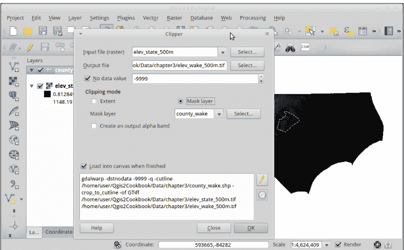

## 工作原理...

掩膜的形状和源数据中栅格单元的大小将决定结果栅格的像素化程度。放大结果并将新栅格的边缘与县的矢量轮廓进行比较。你会注意到，由于像素宽度为 500 米，很难用完整像素精确匹配县的边缘。

请注意，此工具与 GDAL 工具菜单中的所有其他工具一样，实际上是 GDAL 命令行工具的图形界面。


### 更多内容……

你会发现，在这个特定示例中，将栅格转换为非矩形形状时会出现一个问题：边缘相对于矢量来说呈锯齿状。如果你需要它非常平滑，有几种选择。你可以减小像素尺寸，使用 `-tr` 选项将当前像素拆分为多个像素。与其他栅格工具一样，你可以使用铅笔图标覆盖 GDAL 命令行选项，以添加界面中未包含的功能。在这种情况下，`-tr` 选项已内联在其余格式化命令中：

```
gdalwarp -tr 100 100
```

这将使每个像素变为 100 x 100 单位，而不是当前的 500 x 500。


> 使用 GDAL 保存 TIFF 文件时需要记住的一些重要选项包括数字类型（整数与浮点数）和压缩。这两者都会对最终文件大小产生很大影响。请参阅本章后面的“将矢量转换为栅格”配方中的示例。此外，如果你有多核 CPU，请添加 `-multi` 以利用 CPU 核数来加速大多数栅格操作的处理。

### 另请参阅

- 有关 gdalwarp 选项的完整列表，请参阅 http://gdal.org/gdalwarp.html

## 裁剪矢量

与栅格一样，有时你只需要矢量数据覆盖某个研究区域（感兴趣区域）。同样，与栅格类似，你可以使用一个图层来定义范围，仅选择矢量图层的一部分来创建新图层。用于此任务的工具是 Clip（裁剪）；也就是“饼干模具”，因为结果看起来就像被模具切过一样。

### 准备工作

在本配方的示例中，我们将使用 `geology.shp`，并使用 `census_wake2000.shp` 将其裁剪到 Wake County 的范围。任何包含覆盖整个县的聚合多边形的矢量图层都可以。

### 操作步骤……

1. 加载两个图层：`geology.shp` 和 `census_wake2000.shp`。
2. 从 **矢量 | 地理处理工具 | 裁剪** 打开裁剪工具：

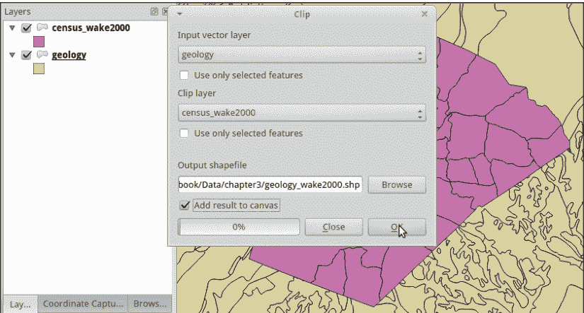

3. 输入图层是要被切割的图层，这里是 `geology.shp`。
4. 裁剪图层定义了要切割的边界。

   > 裁剪图层不要求是连续的。你可以切割任意想要的形状组合，圆形、正方形、三角形等。它们只需要是多边形。

5. （可选）勾选 **将结果添加到画布**，以便立即查看结果。
6. 点击 **确定** 运行工具：

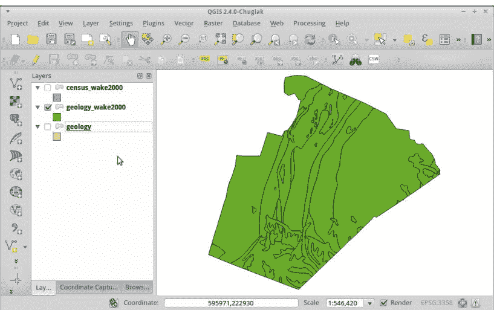

### 工作原理……

所有裁剪都基于相交要素的原理。对于输入中的每个要素，工具会检查其是否与裁剪图层的整体形状相交。如果相交，算法会检查是否有任何部分落在相交区域之外。如果有部分落在外部，就会被切掉。

### 更多内容……

使用裁剪时必须小心。如果原始表格中包含面积、周长等测量值的列，这些值会从原始数据中复制过来。因此，它们可能无法反映被切割后的新尺寸和形状。

通常，所有几何操作和分析都应在相同投影的图层上进行，以确保结果一致。此外，许多工具并不感知投影，也不会补偿两个源图层处于不同投影的情况。

创建对象相交结果的工具（例如 PostGIS 和 SpatiaLite 中的 `ST_Intersection`）可以为你提供类似的结果。但是，你可能需要执行多个步骤：先进行相交，然后通过包含或相交来选择以消除不需要的数据。

### 另请参阅

如果你想在不改变原始空间数据的情况下限制要素，请参阅本章的下一个配方。

## 提取矢量

裁剪很好用，但如果你不想改变原始几何，例如想选择重叠要素时，它就不适用了。或者在其他情况下，你只想根据非空间属性筛选几何。要实现这两种结果，你可以利用选择工具结合 **图层另存为...** 来仅提取感兴趣的要素。本配方使用空间选择方法提取原始多边形的一个子集，而无需更改它们。

### 准备工作

我们将使用与上一个配方相同的数据：`geology.shp` 和 `census_wake2000.shp`。

### 操作步骤……

1. 通过导航到 **矢量 | 研究工具 | 按位置选择**，从 `geology.shp` 中选择与 Wake County（`census_wake2000.shp`）重叠的多边形。
2. 选择 **geology** 中的要素。
3. 与 `census_wake2000` 中的要素相交。
4. 通过创建新选择来修改当前选择。
5. 点击 **确定**：

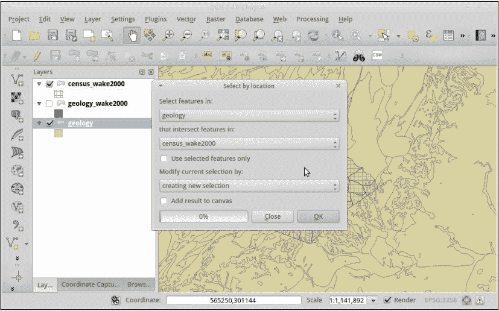

6. 现在，你会看到匹配的要素被高亮显示（默认是黄色）：

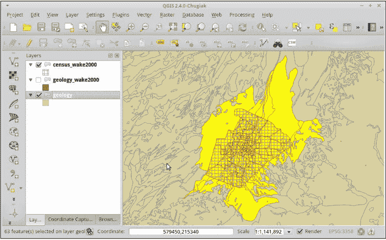

7. 如果选择看起来没问题，使用 **图层上下文菜单**（右键单击）并点击 **另存为...** 来创建一个仅包含所选要素的文件。

> 在 **另存为...** 对话框中（如 *第1章，数据输入与输出* 所述），确保勾选 **仅保存所选要素** 复选框。

### 工作原理……

这实际上回到了大多数矢量分析所依赖的相交这一基本概念。当你能够测试两个要素是否重叠时，基于答案可以有多种不同的操作。你可以选择、取消选择，或者像上一个配方那样，先选择再裁剪以适配。在这些情况下，每个多边形都会被测试是否存在至少部分相交，然后匹配的要素会作为结果被高亮显示。

### 更多内容……

虽然本配方演示了如何基于位置选择数据子集，但你也可以通过属性表上的查询，基于要素的属性来做同样的事情。或者，你可以在图形上组合基于属性的选择、空间选择以及手动选择——任何你想要的组合选择都可以另存为新图层。

你可能还会注意到，在 **按位置选择** 工具中，矢量也可以添加到现有选择或从现有选择中移除，以防你需要执行涉及多种条件类型的更复杂操作。

### 另请参阅

- 有关如何在 PostGIS 中使用 SQL 执行类似操作的文档，请参阅 PostGIS、SpatiaLite 或 Packt Publishing 出版的《PostGIS Cookbook》（SpatiaLite 查询非常相似）。

## 将栅格转换为矢量

有时，你需要将原本是栅格格式的数据转换为矢量格式，以便执行基于矢量的分析方法。一般来说，由于栅格是连续数据集，将它们转换为多边形比转换为线或点更为常见。

### 准备工作

你需要一个栅格图层，最好是具有相邻相同值像素群组的图层。在本示例中，我们将使用 `geology_30m.tif`，因为 30 米 x 30 米的像素应该能给出不错的结果。

> 像素越小，缩小后生成的矢量边缘看起来越平滑。

### 操作步骤……

1. 加载 `geology_30m.tif`。
2. 转到 **栅格 | 转换 | 多边形化**：

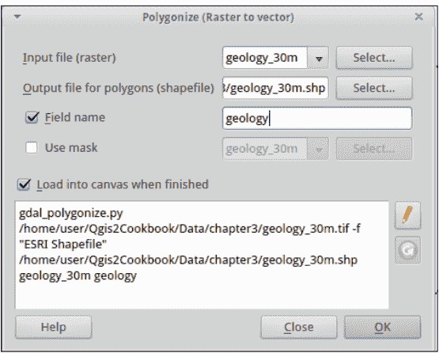

3. 将输出命名为 `geology_30m.shp`。
4. （可选）将输出列命名为 `geology`、`class` 或 `value`。
5. 点击 **确定** 运行该过程。
6. 比较结果（颜色相近但比例略有不同）：

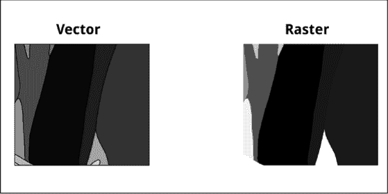

### 工作原理……

对于每个像素，系统会将其值与相邻像素进行比较（存在不同的相邻算法）。当相邻两个像素具有相同值时，它们会被合并为一个多边形。周围同值的像素会继续被添加到该多边形中，直到遇到不同值的像素。由于这是基于像素的，结果的边缘通常会沿着像素轮廓，形成锯齿状边缘。这个边缘可以通过附加选项或其他工具（如 QGIS 平滑工具）平滑为直线。

### 更多内容……

可以改变生成多边形所需的最小像素数，或者可被计为相同的最大允许值差异，以便丢弃孤立像素或允许一定范围的值被合并计数。

请注意，如果每个像素与其相邻像素相比都是唯一值，那么最终每个像素只会生成一个多边形。或者，如果你的栅格足够大且变化多样，此过程可能需要数天时间。你可能需要重新考虑是否真的需要转换，或者你的分析是否可以在栅格中完成。另一个选择是先将栅格重采样或重分类为更大的像素，以降低数据密度。或者，你可能需要研究遥感类工具，这些工具会基于相似性执行分类，将像素分组为相关的群组。

如果你想把栅格数据转换为点，那么你可能需要使用点采样工具。如果你想将栅格的某些部分转换为线，那么你可能需要更复杂的特征提取工具，例如在 SAGA 和 GRASS 中找到的那些工具，可以通过处理工具箱或作为独立软件使用。或者，你甚至可能需要结合像素提取和手动数字化。


# 另请参阅

- 有关更多栅格方法，请参阅第 7 章“栅格分析 I”和第 8 章“栅格分析 II”

# 将矢量转换为栅格

有时，您需要将矢量转换为栅格，以便使用诸如栅格计算器等栅格分析工具。

# 准备工作

您需要一个矢量图层；它可以是点、线或面图层。通常，从面图层获得的最佳结果最多。我们将使用 `geology_wake2000reclass.shp`。该文件是之前“矢量裁剪”食谱的结果，并添加了新列，将地质类型编码为整数。作为参考，您还将使用 `elev_wake_500m.tif` 作为感兴趣区域的匹配栅格。

# 操作步骤

为了在分析中发挥作用，这里有一个检查清单：

- 1. 矢量数据是否与其余栅格分析数据具有相同的投影？如果没有，请先对其进行重投影。查看以下网址以获取帮助，`https://docs.qgis.org/2.8/en/docs/training_manual/vector_analysis/reproject_transform.html`。
- 2. 将矢量数据裁剪到分析范围。您可能需要将栅格转换为面掩膜以进行裁剪（请参阅本章之前提到的矢量裁剪食谱）。
- 3. 加载 `geology_wake2000reclass.shp` 和 `elev_wake_500m.tif`。

> 由于栅格格式每个单元仅存储一个数值，因此只能选择数值字段作为栅格格式。为了保留您想要的属性，您可能需要使用字段计算器创建一个新的字段，将文本类别重新分类为数值方案（例如，1 = 水，2 = 陆地等），然后再执行转换。如果您将唯一 ID 复制为属性，随后的一些工具允许您将原始属性表作为值属性表重新连接（请参阅 **处理工具箱** 中的 GRASS 函数）。


- 4. 打开 `elev_wake_500m.tif` 的 **属性**：
  1. 在 **元数据** 部分，向下滚动到 **尺寸**。您需要匹配尺寸或分辨率，以便您的新栅格能够与现有的高程数据像素相匹配。
  2. 请注意，**尺寸** 为 X: **134**, Y: **124**，**波段** 为 **1**。分辨率为 499.637,-498.342 像素大小。
  3. 关闭对话框。

- 5. 现在，通过导航到 **栅格 | 转换 | 栅格化** 打开转换对话框，并按照以下步骤操作：
  1. 输入文件为 `geology_wake2000reclass`。
  2. 将输出命名为 `geology_wake.tif`（您会收到设置尺寸或分辨率的警告）。
  3. 设置栅格大小：**宽度** 为 **134**，**高度** 为 **124**。
  4. 点击 **确定** 运行该过程。

以下屏幕截图显示了屏幕的外观：

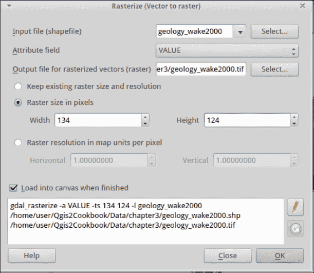

# 常见的数据预处理步骤

# 工作原理...

在指定的宽度、高度和范围内创建像素网格。对于每个单元，都会执行与底层矢量图层的交集运算。如果单元的 50% 以上与矢量相交，则其指定属性会被分配给该单元。

# 更多内容...

在转换为栅格之前，匹配投影和范围非常重要。如果您未能做到这一点，那么不同栅格图层中的像素将无法完美对齐，工具要么无法工作，要么会引入重采样误差。如果这对于您来说看起来像素化（方形）过头了，请考虑以更高的像素密度创建栅格。

如果您将矢量版本与新栅格进行比较，您会注意到中间的区域呈现出相似的色调。这是由于用于分类的值所致，地质类型以相同的主成分开始时被赋予了相同的起始值（例如，PZ 都以 40 开始，最后一个数字根据 PZ 后面的字母而变化）。

查看新图层并想要去除真实数据周围的黑色？该区域是无数据，请参阅 *第 8 章，栅格分析 II*。

# 另请参阅

- 还有其他方法可以计算像素的新值，以便在多个多边形位于同一像素时进行平滑过渡或中间值。请参阅处理工具箱中的 GRASS 和 SAGA 方法，了解更多更精细的替代方案。

# 构建 DateTime 字符串

日期和时间数据以各种方式存储。其中一个令人沮丧的问题是，某些常见的 GIS 格式（如 Shapefiles）无法在同一字段中存储日期和时间，除非将其作为字符串。这对于视觉显示没问题，但对于使用 DateTime 作为其功能基础的工具（如 TimeManager 插件，请参阅 *第 4 章，数据探索*）来说则非常糟糕。

# 准备工作

使用 `datetime-example.shp`，其中包含各种日期和时间表示形式供您操作。

# 操作步骤

- 1. 加载 `datetime-example.shp`。
- 2. 打开 `datetime-example` 的属性表。
- 3. 创建一个新字段。由于这是 shapefile，我们需要使用长度为 30 的字符串（或者可以使用名为 `calculated` 的空字段）。
- 4. 开启图层编辑（这是铅笔图标，位于窗口工具栏左侧的第一个图标）。
- 5. 从下拉列表中，选择 **计算**。
- 6. 现在按下 **计算** 按钮。

> 在旧版本的 QGIS 中，您需要打开字段计算器，这在较新的版本中也起作用，但步骤稍微多一些。

7. 在计算器中，我们将使用 `substr` 字符串操作（即子字符串）并结合 `||` 连接符来重新排列现有字段中的值，以形成有效的 `DateTime`：

- 1. 最简单的变体只是将 `shpDate` 与 `Time` 结合，并在中间加一个空格：
  
  `"shpdate" || ' ' || "Time"`

- 2. 为了多一点挑战，使用 `Date`：
  
  `substr("Date",7,4) || '-' || substr("Date",1,2) || '-' || substr("Date",4,2) || ' ' || "Time"`

> 注意使用单引号 ('') 来表示字符串，而双引号 (") 则表示字段名。

8. 尝试这些公式，通过底部的计算器预览检查结果。满意后，选择确定，然后点击更新所有按钮：

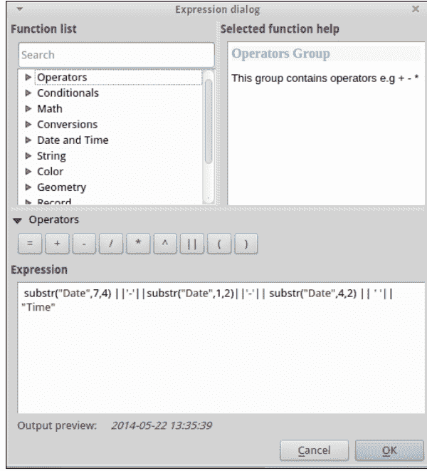

9. 如果您对结果满意，保存编辑；如果不满意，关闭编辑并选择不保存并关闭。

# 工作原理...

Substr 接受三个参数：字段名、起始位置以及要包含的紧随其后的字符数。位置索引从 1 开始。

# 更多内容...

通过字符串操作，我们将多个字段组合成了 ISO 标准的 DateTime 格式，其他工具可以识别并利用这一格式。

此示例数据中包含的字段如下：

| 字段 | 类型 | 说明 |
|---|---|---|
| `Time` | String | 这是 24 小时制的时间：时:分:秒。 |
| `datetime` | String | 这是来自典型 GPS GPX 文件的 DateTime 字符串。 |
| `calculated` | String | 这是一个足够长的字符串，可以容纳带填充字符和时区 UTC 偏移的日期和时间。 |
| `Date` | String | 这是从电子表格中输出的典型日期格式。 |
| `shpdate` | Date | 这是 shapefile 内部 `Date` 类型的日期格式，它无法容纳时间。 |

# 另请参阅

- 如果使用数据库图层，这一切都可以使用 SpatiaLite 或 PostGIS 中的 SQL 来执行。ISO 日期时间标准是 8601，可以在 `http://en.wikipedia.org/wiki/ISO_8601` 找到。

# 为照片添加地理标签

具有内置 GPS 的新款相机和手机可以是数据采集的绝佳工具，因为它们有助于精确跟踪照片拍摄的具体地点和时间。然而，并非所有相机都具备内置 GPS。您可以稍后添加地理标签，可以使用单独 GPS 单元的 GPS 日志，或者仅使用参考地图以及您的记忆或笔记。

# 准备工作

对于这个食谱，您需要一些照片以及 GPS 日志（`*.gpx`）、参考矢量、参考栅格或坐标。我们已在 geotag 文件夹中提供了 `centerofcalifornia.jpg`，坐标既在图像本身中，也作为点包含在 `centerofcalifornia.shp` 中。

您还需要 Geotag photos 插件，该插件要求系统上安装 exiftool 程序。如果 exiftool 未随您的安装附带，您可以轻松地通过 Web 在 `http://www.sno.phy.queensu.ca/~phil/exiftool/` 或软件包仓库（Linux）获取它。


## 常见数据预处理步骤

### 如何操作...

此插件按文件夹分配位置，因此文件夹中的所有照片将获得相同的坐标。这非常适合批量分配通用坐标：

1. 首先加载你的 GPS 日志，或创建一个新的矢量图层并数字化你想要分配给照片的点。在本例中，加载 `centerofcalifornia.shp`。


> 没有很多位置或只是手写了坐标？ 你可以在没有现有图层的情况下手动将信息输入到插件界面。

2. （可选）加载一个背景参考图层。

3. 现在你有了要与照片关联的图层，在 **Vector | Geotag and import photos | Geotag photos** 中打开插件。

4. 选择图层，然后选择要用作标签的字段（位置）。

5. 现在，点击 **Populate Table**。 界面中应该已添加一行。

6. 现在，通过点击要分配的行中 **Path to Folder** 下方的空白框来选择照片：

   1. 你可以输入路径或点击 **...** 浏览。
   2. 选择 `geotag` 文件夹。
   3. 确保在返回主屏幕后按 **Enter** 或点击框外：

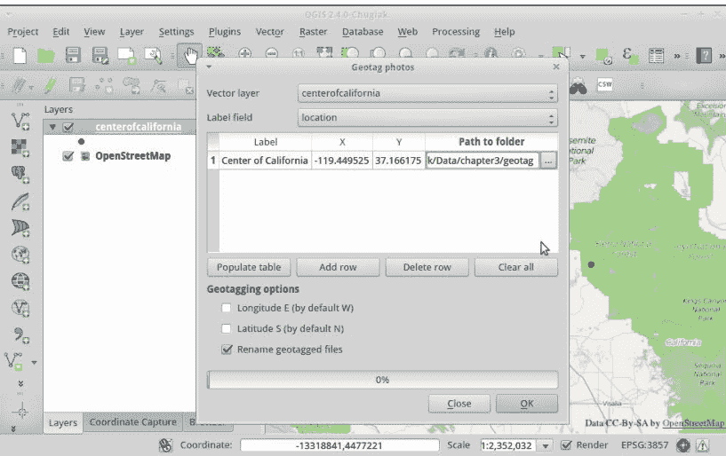

7. （可选）如果希望地理标记的版本是文件的全新副本而不是修改原始文件，请勾选重命名地理标记文件的复选框（务必保留原始备份）。

8. 点击确定。

### 其工作原理...

ExifTool 将写入图像文件的内置元数据中的一个部分，称为 EXIF。 在摄影中，将额外数据存储在照片中是标准做法，许多软件管理工具可以轻松读取。 WGS 84 坐标中的纬度和经度是 EXIF 部分中编码 GPS 数据的标准方法。

### 还有更多...

现在你有了地理标记的照片，你可以将其上传到 Flickr 等网站，该网站会将其显示在地图上，或者跳到第 4 章《数据探索》中的食谱《Viewing Geotagged Photos》，了解如何在 QGIS 中制作地图的方法。

此插件非常手动，并且按文件夹分配位置，因为它是为了专门与相机陷阱一起使用而创建的。 相反，如果你在每张照片位置之间移动并且有 GPS 日志，还有其他非 QGIS 工具可以帮助你将 GPS 点与照片匹配。 Digikam（摄影管理工具）具有根据时间戳匹配进行地理标记的功能。

### 另请参阅

- OpenStreetMap wiki 在 http://wiki.openstreetmap.org/wiki/Geotagging_Source_Photos 列出了其他免费和付费选项
