## 4 数据探索

在本章中，我们将介绍以下食谱：

- 列出列中的唯一值
- 探索列中数值分布
- 使用 Time Manager 探索时空数据
- 使用 Time Manager 创建动画
- 设计时间依赖样式
- 使用 QuickMapServices 插件加载底图
- 使用 OpenLayers 插件加载底图
- 查看地理标记照片

### 引言

本章重点介绍食谱，这些食谱将帮助你直观检查并更好地理解你的数据。 本章中的食谱包括基于空间和时间属性对数据进行汇总、检查、过滤和样式化的方法，以便在执行分析之前让你更好地了解数据。 主要目标是创建一些数据可视化或摘要，让你作为人类能够利用大脑识别感兴趣模式的能力。 你对数据的理解越好，后续选择合适的分析方法就越容易。

### 列出列中的唯一值

在调查新数据集时，能够快速检查列包含哪些值非常有帮助。 在本食谱中，我们将使用 GUI 和 Python 控制台的两种不同方法来列出我们示例 POI 数据集中 POI 类别的唯一值。

#### 准备工作

要遵循本食谱，请加载 poi_names_wake.shp。

#### 如何操作...

如果你只是寻找基于 GUI 的解决方案，List unique values 工具同时可在 Vector | Analysis Tools 以及 Processing Toolbox 菜单中使用。 你可以使用其中任何一个来获取列中唯一值的列表。 该工具在 Processing Toolbox 菜单中可用，这使得它可以包含在处理模型中，从而实现流程自动化。 以下列出唯一值的步骤使用 Processing Toolbox 菜单：

1. 从 Processing Toolbox 菜单启动 List unique values。
2. 选择 poi_names_wake 图层作为输入图层，并将 class 属性作为目标字段。
3. 点击运行并等待工具完成。 结果将显示在结果视图中，结果视图将自动打开。

如果你想进一步自定义此任务，例如统计该数据集中值的出现次数，是时候启动 Python 控制台了：

1. 启动 Python Console，你可以在插件菜单中找到它，并点击显示编辑器按钮（在 Python 控制台左侧的工具栏中）打开编辑器窗口。
2. 将以下简短脚本粘贴到编辑器中，保存它，然后点击运行脚本按钮。 （确保在图层列表中选择了 POI 图层。）它遍历活动图层中的所有要素并创建一个字典对象，其中包含所有唯一值和相应的计数：

```python
import processing
layer = iface.activeLayer()
classes = {}
features = processing.features(layer)
for f in features:
    attrs = f.attributes()
    class_value = f['class']
    if class_value in classes:
        classes[class_value] += 1
    else:
        classes[class_value] = 1
print classes
```

以下屏幕截图显示了屏幕的样子：

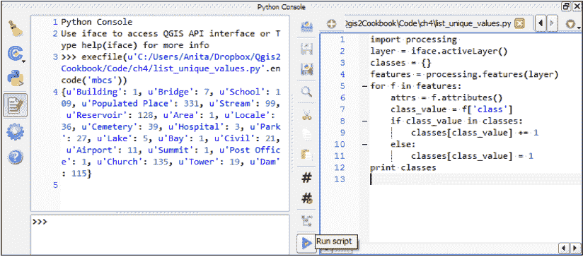

#### 其工作原理...

在第一行，我们使用 `import processing`，因为它提供了一个非常方便且实用的函数 `processing.features()` 来访问图层要素，我们在第 7 行使用它。 值得注意的是，如果存在选择，`processing.features()` 只会返回所选要素的迭代器。

第 3 行获取当前活动图层对象。 第 5 行创建空的字典对象，我们将用唯一值和相应计数填充它。

从第 5 行开始的 `for` 循环遍历图层的所有要素。 对于每个要素，我们获取分类字段中的值（第 7 行）。 你可以更改列名以分析其他列。 然后，我们只需要检查该值是否已存在于 `classes` 字典中（第 8 行），还是需要添加它（第 11 行）。

#### 还有更多...

如果你使用的是 SQL 数据库，例如 Spatialite 或 PostGIS，你可以使用 COUNT 和 GROUP BY 函数的查询来实现类似结果，以按类别统计要素或记录的数量：

```sql
SELECT class, COUNT(*)
FROM poi_names_wake
GROUP BY class
```

### 探索列中数值的分布

在本食谱中，我们将了解如何探索数值列的属性。 我们将查看 QGIS 提供的工具并将其应用于分析我们示例 POI 数据集中的高程值。

#### 准备工作

要遵循本食谱，请加载 `poi_names_wake.shp`。 如果你遵循了之前的食谱 *Listing unique values in a column*，你可以直接继续。

#### 如何操作...

了解数值列属性的第一印象的好方法是使用 **Vector** 中的 **Basic Statistics** 工具。 这允许你计算统计值，例如最小值和最大值、平均值和中位数、标准差和总和。

如果你想检查高程值的分布，有方便的 Statist 插件。 Statist 生成值分布的交互式直方图表示：

1. 使用 **Plugin Manager** 安装 **Statist**。
2. 从 **Vector** 菜单启动 **Statist**。
3. 指定 **Input vector layer** 和你想要分析的属性（**Target field**），然后点击 **OK** 计算统计信息。
4. 使用图表下方的按钮，你可以缩放和平移图表，以及保存图表图像。
5. 你甚至可以通过更改标题和轴标签及范围来自定义图表。 只需使用最右边的绿色勾号按钮打开自定义对话框即可：


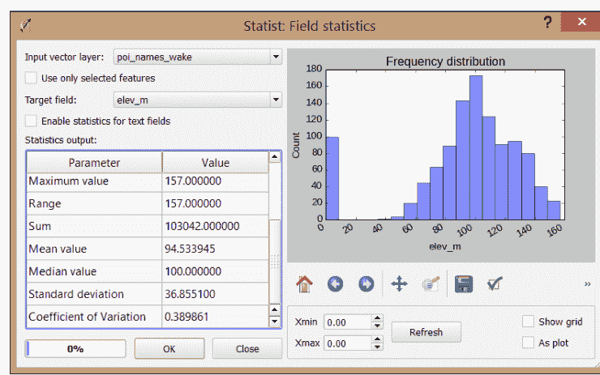

## How it works...

得益于 **Python Console** 和编辑器，我们并不局限于现有的工具和插件。相反，我们可以创建自己的专用脚本，例如以下脚本。该脚本使用 HTML 和 Google Charts Javascript API 创建一份简短的图层统计报告 [有关更多信息和 API 文档请参考 `https://developers.google.com/chart/`]，然后在 `QWebView` 窗口中显示该报告。当然，你也可以使用任何其他 JavaScript 图表 API。 [注意：此脚本需要连接到互联网才能工作，因为它必须下载 Javascript。] 我们建议使用上一条食谱中介绍的编辑器。不要忘记在图例中选择图层：

```
import processing
from PyQt4.QtWebKit import QWebView
layer = iface.activeLayer()
values = []
features = processing.features(layer)
for f in features:
    values.append( f['elev_m'])
myWV = QWebView(None)
html='<html><head><script type="text/javascript"'
html+=' src="https://www.google.com/jsapi"></script>'
html+='<script type="text/javascript">'
html+='google.load("visualization","1",{packages:["corechart"]});'
html+='google.setOnLoadCallback(drawChart);'
```

```
html+='function drawChart() { '
    html+='var data = google.visualization.arrayToDataTable([ '
        html+='["%s"],' % (field_name)
        for value in values:
            html+='[%f],' % (value)
    html+='] );'
    html+='var chart = new google.visualization.Histogram('
        html+='document.getElementById("chart_div"));'
    html+='chart.draw(data, {title: "Histogram"});</script></head>'
    html+=' <body><h1>Layer: %s</h1>' % (layer.name())
    html+=' <p>Values for %s range from: ' % (field_name)
    html+='%d to %d</p> ' % (min(values),max(values))
    html+='<div id="chart_div"style="width:900px; height:500px;">'
    html+='</div></body></html>'
    myWV.setHtml(html)
    myWV.show()
```

当然，这样的自定义报告非常适合添加更多细节。例如，我们可以为每个 POI 类创建单独的直方图，或添加其他类型的图表，例如散点图：

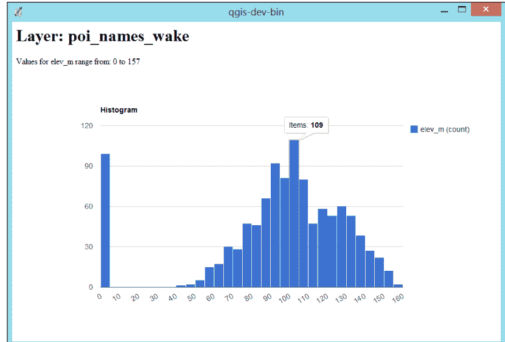

第一部分 [第 1 至 12 行] 与上一条食谱中解释的脚本非常相似，*Listing unique values in a column:* 我们获取活动图层并将所有高程值收集到 values 列表中。

第 14 行创建的 `QWebView` 使我们能够显示 HTML 内容，我们随后在下一节 [第 16 至 34 行] 中生成该内容。首先，我们加载 Google Charts Javascript。真正的魔力发生在第 21 行开始的 `drawChart()` 函数中。第 22 至 26 行创建 data 对象，该对象用来自 `values` 列表的高程值填充。函数的最后三行 [第 27 至 29 行] 最终创建并绘制直方图。最后，第 30 至 34 行包含 HTML 正文定义，其中包含标明图层名称的标题和一段简短的介绍文字，说明最小和最大高程值。

## See also

- 对于想要进行更高级的图形和数值分析的人来说，可以考虑使用 matplotlib python 库，或将数据源读入 R。SpatialLite 或 PostGIS 中的聚合函数也可以为你提供最小值、最大值、平均值、总和和其他汇总函数。对于 PostGIS，请参考 `http://www.postgresql.org/docs/9.1/static/functions-aggregate.html`。

## Exploring spatiotemporal vector data using Time Manager

在本食谱中，我们将使用 Time Manager 插件探索时空矢量数据。我们将使用来自 **ACLED [Armed Conflict Location and Event Data Project]** 的事件数据，网址为 `http://www.acleddata.com/about-acled/`。

## Getting ready

要遵循本食谱，请加载 `ACLED_africa_fatalities_dec2013.shp`。你在以下屏幕截图中看到的图层样式由 50% 透明度的简单圆形标记组成，数据定义的尺寸设置为事件的死亡人数。 [你可以在 Packt Publishing 出版的 *Chapter 10, Cartography Tips, and Learning QGIS* 书中阅读有关样式的更多信息。] 如果你想要一些额外的地理背景信息，还可以加载 `NE_africa.shp`，其中包含非洲的轮廓。

## Data Exploration

## How to do it...

加载数据后，所有事件位置都将显示出来。默认的过滤事件方式，例如仅查看 12 月 1 日的事件，是使用 Layer | Query 并输入过滤表达式或查询，例如以下内容：

```
"EVENT_DATE" >= '2013-12-01' AND "EVENT_DATE" < '2013-12-02'
```

- 1. 很容易看出，手动为每一天更新此查询并不是探索时空数据的一种方便方式。因此，我们将使用 Time Manager 插件 [使用插件管理器安装]。
- 2. 插件安装后，Time Manager 面板将添加到 QGIS 窗口底部。点击 **Settings** 按钮打开 **Time manager settings** 对话框。我们可以在此处配置 Time Manager。
- 3. 点击 **Add Layer** 打开 **Select layer and column(s)** 对话框。
- 4. 选择 **ACLED_africa_fatalities_dec2013** 图层和 **EVENT_DATE** 作为开始时间，然后点击 **OK** 将事件点图层添加到受管理的图层列表中，如以下屏幕截图所示：

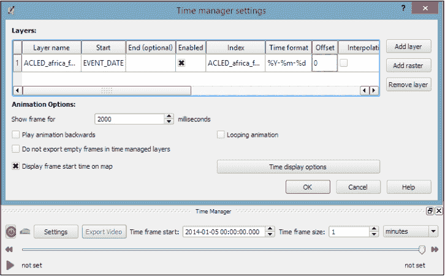

> 可选地，你可以启用 **display frame start time on map** 以在渲染的地图上添加一个带有相应时间戳的小标签。

5. 完成后点击 **OK**。此时，Time Manager 会将时间过滤器应用于数据集，这可能需要一些时间，具体取决于所使用数据集的大小。

6. 默认情况下，在添加第一个图层后，Time Manager 将显示数据集中第一天发生的所有事件。可以通过更改 **Time frame size** 设置轻松调整过滤器。你可以增加应显示的天数，或更改为其他时间单位，包括秒、分钟、小时、周和月，如以下屏幕截图所示：

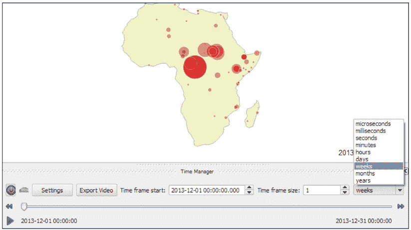

7. 一旦对设置满意，你有多种浏览时间的方式：

- 点击 Time Manager 面板左下角的播放按钮开始自动动画
- 像在视频或音乐播放器应用程序中一样，将时间滑块移动到面板中央以进行导航
- 点击滑块两侧的前进或后退按钮，按一个时间帧前进或后退
- 当然，你也可以直接编辑 **Time frame start** 设置

## Data Exploration

## How it works...

出于性能原因，Time Manager 依赖于 QGIS 的图层查询/过滤表达式功能。这带来了以下限制：

- Time Manager 只能与支持图层查询或过滤表达式的数据源一起使用。最值得注意的是，这意味着它不能与分隔文本图层一起使用。
- 由于图层查询或过滤表达式必须使用字符串工作，因此必须能够使用文本排序正确排序日期时间值。因此，值必须存储在以下格式之一中：

```
%Y-%m-%d %H:%M:%S.%f
%Y-%m-%d %H:%M:%S
%Y-%m-%d %H:%M
%Y-%m-%dT%H:%M:%S
%Y-%m-%dT%H:%M:%SZ
%Y-%m-%dT%H:%MZ
%Y-%m-%d
%Y/%m/%d %H:%M:%S.%f
%Y/%m/%d %H:%M:%S
%Y/%m/%d %H:%M
%Y/%m/%d
%H:%M:%S
%H:%M:%S.%f
%Y.%m.%d %H:%M:%S.%f
%Y.%m.%d %H:%M:%S
%Y.%m.%d %H:%M
%Y.%m.%d
%Y%m%d%H%M%S
```

> 如果你的数据使用另一种格式，但也能正确排序，你可以将其添加到 `timevectorlayer.py` 或使用字段计算器更改格式。

## See also

- 以下食谱将向你展示如何使用 Time Manager 创建视频和更复杂的时变样式。

## Creating animations using Time Manager

在本食谱中，我们将使用 Time Manager 插件从我们的时空 QGIS 项目中创建图像序列，并将其转换为视频，该视频可使用易于获得且免费的工具上传到 Youtube 或添加到演示文稿中。


## 准备工作

要按照本教程操作，建议你先完成上一教程 *使用 Time Manager 探索时空矢量数据*，以设置本项目。

要将 Time Manager 导出的图像序列转为视频，我们可以使用外部程序，例如命令行工具 Mencoder，或免费的 Windows Movie Maker。

Mencoder 是一个非常有用的命令行视频编码工具，可从许多 Linux 发行版的仓库中获得，也适用于 Mac。Windows 用户可以从 Gianluigi Tiesi 的网站 http://oss.netfarm.it/mplayer-win32.php 下载。

如果你使用 Windows，也可以使用免费的 Windows Movie Maker 应用程序创建视频，可从 http://windows.microsoft.com/en-us/windows/get-movie-maker-download 下载。

### 如何操作...

在开始导出之前，最好先检查所有设置，如下所示：

- 1. 时间滑块应移动到时间线的开头，并设置合适的 **Time frame size**。
- 2. 此外，如果你在上一教程中尚未启用，可以启用 **display frame start time on map**（请参考上一教程中的截图），否则导出的动画帧将不包含显示事件的时间信息。
- 3. 当你为数据集找到最佳设置后，点击 **Export Video** 按钮。将会打开一个对话框，允许你选择要导出视频的文件夹。点击 **Select Folder** 按钮后，Time Manager 将自动开始导出视频帧。如 **Export video** 信息弹出窗口所示，你现在应等待导出完成。完成后会出现另一个弹出窗口，其外观如下图所示：

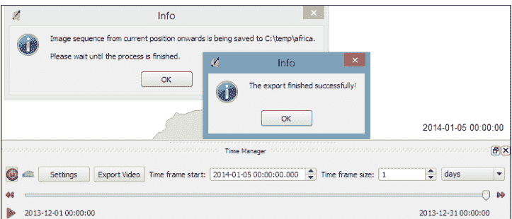

- 4. 如果打开 `export` 文件夹，你会看到 Time Manager 刚刚创建的动画帧。
- 5. 这是如何使用 Mencoder 从当前工作目录中的所有 `.png` 图像创建 `.avi` 视频。请确保在运行以下命令前已进入包含图像的文件夹：
```
mencoder "mf://*.png" -mf fps=10 -o output.avi -ovc lavc -lavcopts vcodec=mpeg4
```
- 6. 你可以使用每秒帧数 (`fps`) 参数控制动画速度。数值越高，动画越快。

如果你使用 Windows Movie Maker，请执行以下步骤：

- 1. 加载动画帧图像。
- 2. 要调整动画速度，请转到 **Video Tools | Edit**，并减小 **Duration** 值。注意，如果你想同时对所有图像应用相同的持续时间，应先选中所有图像。
- 3. 要保存动画，只需转到 **File | Save Movie** 并选择你喜欢的分辨率和质量。

### 工作原理...

Time Manager 的 Export Video 功能使用 `QgsMapCanvas.saveAsImage()` 函数导出图像序列。这意味着图像的大小将与你在点击 **Export Video** 按钮时 QGIS 窗口中地图画布的大小相同。

## 设计时态依赖样式

在本教程中，我们将使用 Time Manager 提供的 `animation_datetime()` 函数，为动画创建时态依赖样式。该样式将表示事件要素的年龄：事件标记的填充颜色会随着事件变老而逐渐淡为灰色。

## 准备工作

要按照本教程操作，请加载 `ACLED_africa_fatalities_dec2013.shp` 并按 *使用 Time Manager 探索时空矢量数据* 教程中的说明配置 Time Manager，唯一例外是：在将图层添加到 Time Manager 时，将 **End time** 值设置为 `FOREVER` 属性。

### 如何操作...

要创建时态依赖样式，我们使用简单标记的 Data defined properties 选项：

- 1. 在 *使用 Time Manager 探索时空矢量数据* 教程中，我们提到已使用 FATALITIES 属性来缩放标记大小。对于时态依赖样式，我们将按以下截图所示，为 Fill color 属性添加新的定义：

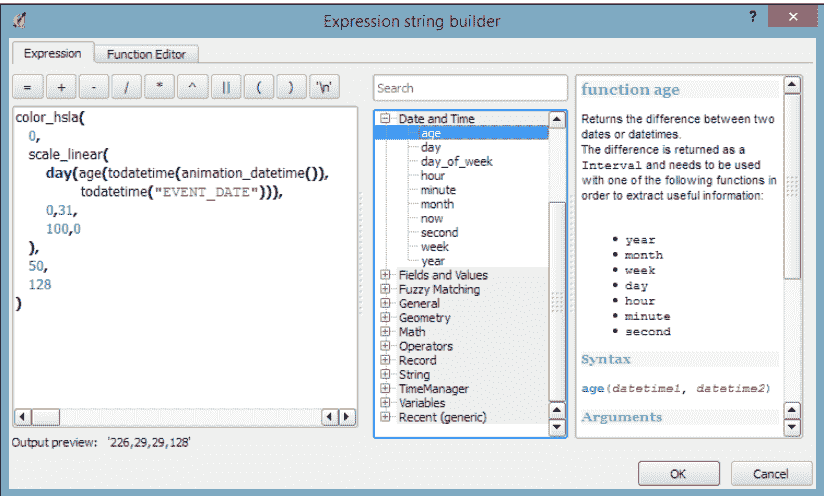

- 2. 确认更改并启动动画以观看效果。

### 工作原理...

以下是我们的颜色表达式的详细说明：

```
color_hsla(
    0,
    scale_linear(
        day(age(todatetime(animation_datetime()),
        todatetime("EVENT_DATE"))),
        0,31,
```

```
color_hsla(
  100,
  50,
  128
)
```

该表达式由多个部分组成，如下所示：

- - `day(age(todatetime(animation_datetime()),todatetime("EVENT_DATE")))`: 这计算了由 `animation_datetime()` 给出的当前动画时间与 `EVENT_DATE` 计算之间的天数
- - `scale_linear`: 这将年龄值（0 到 31 天之间）转换为 100 到 0 之间的值，适用于以下颜色函数的饱和度参数
- - `color_hsla`: 这是 QGIS 中可用于创建颜色的众多函数之一。它返回颜色的字符串表示，基于其色相（0 等于红色）、饱和度（根据我们的年龄函数在 0 到 100 之间）、亮度（50 等于中等亮度）和 alpha（128 等于 50% 透明度）属性

你可以通过将 `scale_linear` 参数 `domain_max` 从 31 天减小到更小的值，例如 7，来加快淡出效果，以在一周内完全淡为灰色。

## 另请参阅

- - 如果你有兴趣了解更多关于颜色模型的信息，例如本教程中使用的 HSL 颜色模型，我们推荐阅读 Wikibook 上的颜色模型章节 `http://en.wikibooks.org/wiki/Color_Models:_RGB,_HSV,_HSL`

## 使用 QuickMapServices 插件加载底图

在探索数据时，你可能会感到有些迷失。没有已知世界的上下文，图层看起来就像漂浮在空间中的信息块。通过添加地图集风格的地图、航空照片或其他底图，你可以开始了解你的数据如何融入实地现实。然而，添加此类图层通常需要大量的预处理工作；有时，你只是不想在确定需要之前就进行这些操作。解决方案是什么？使用预制的图层，最好是快速加载的瓦片，从网络服务获取。

### 工作原理...

QuickMapServices 插件是一个基于网络的工具。所有底图都来自互联网，随着你的平移和缩放加载；没有任何数据来自你的计算机或 QGIS 本身。

使用 QuickMapServices 插件时，有几件事需要谨慎。它的对齐并不总是完全正确，尤其是在放大到大区域时。首先，检查你的其他图层的投影是否定义正确，然后尝试通过稍微平移地图来重置地图。需要记住的关键点是，瓦片服务通常仅存在于 EPSG:3857 且在非常特定的比例尺集上。QGIS 会尝试选择最接近匹配的比例尺并重新采样比例尺以使其适配。这也解释了为什么加载此类图层有时会很慢。

### 还有更多...

要添加更多受限服务，例如 Google、Bing 等，请执行以下步骤：

- 1. 转到 **Web** | **QuickMapServices** | **Settings** | **Contributed Services**。
- 2. 点击 **Get contributed pack** 按钮：

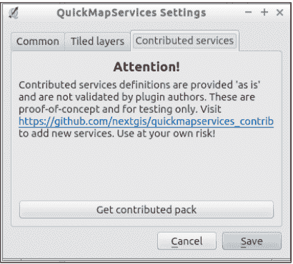

虽然查看地图在大多数情况下可能是合法的，但根据所选图层，基于它们数字化地图、打印它们或以其他方式将其保存以供离线使用可能并不合法。许可因数据源而异。因此，请务必通过在线访问其网站并阅读其服务条款来检查你想要使用的来源。如果你的用例超出了一般快速参考的查看范围，你可能需要花费一些时间获取使用许可或授权。


## 数据探索

基于 OpenStreetMap 的数据源通常是不错的选择，因为其许可证通常仅要求署名且对使用没有限制。插件自带的图层之所以存在，是因为它们具有更宽松的许可证。

最后，你可能会想知道 QuickMapServices 与下一节食谱中提到的 OpenLayers 插件有何不同。首先，这个插件更新且目前仍在支持。它还解决了长期存在的问题，尤其是在打印方面。还有一个贡献图层 GitHub 仓库，这应该会让人们更容易贡献新的图层定义。

## 另请参阅

- 可以通过修改插件代码或使用 GDAL TMS 图层来添加额外的瓦片服务（请参阅 *第 9 章，QGIS 与 Web*）。你也可以用 WMS 服务替代，以发挥类似作用而没有瓦片的一些限制。请参阅 *第 9 章，QGIS 与 Web*，了解有关创建自己的 Web 服务的信息。

## 使用 OpenLayers 插件加载底图

在探索数据时，你常常会感到有些迷失。没有已知世界的上下文，一层数据看起来就像漂浮在空间中的信息块。通过添加地图集风格的地图、航拍照片或其他底图，你就可以开始了解你的数据如何融入实地现实。然而，添加此类图层通常需要大量的预处理工作；有时，你只是不想在确定需要之前就进行这些操作。解决方案是什么？使用来自 Web 服务的预制图层。

> 本食谱几乎与上一食谱相同。QuickMapServices 是 OpenLayers 插件的替代品，后者已被弃用（已废弃）。我们保留本食谱是因为它仍然是一个常被提及的插件，并且工作方式略有不同。但是，请考虑使用 QuickMapServices。

## 准备工作

Openlayers 插件在你有另一个想要提供额外上下文的数据集时效果最佳。首先加载此类图层，然后放大到其范围。

你需要以下内容：

- 一个感兴趣的图层用于叠加（你可以使用 `Davis_DBO_Centerline-ugs84.shp`）
- 一个活跃的互联网连接（在企业代理后面可能无法工作）
- 你需要安装并激活 OpenLayers 插件

## 如何操作...

从一个新 QGIS 项目开始，按照以下说明使用 Openlayers 插件从 Web 加载底图：

- 1. 首先加载你的本地地图图层。
- 2. 验证 QGIS 是否正确识别了投影定义。

> 插件会为你设置并打开动态投影。在 QGIS 中大多数瓦片服务能够工作时，必须启用并设置为 EPSG:3857 伪/网络/流行墨卡托的动态投影。如果其投影未被 QGIS 定义或正确读取，其他数据将无法对齐。

- 3. 转到 Vector | OpenLayers Plugin 并选择一个要从 Web 加载的图层。等待几秒钟让瓦片加载。
- 4. （可选）暂时禁用渲染（底部面板中的复选框），以避免在重新排列图层顺序时不断重绘。
- 5. 重新排列你的图层，将新的 OpenLayers 添加的图层移到底部的图层列表。
- 6. 放大到你原始图层的范围。
- 7. （可选）如果你关闭了渲染，现在重新激活渲染。

> 东西没有对齐？尝试再放大一点或稍微平移一下。最重要的是要有耐心！根据你的互联网连接，检索瓦片可能需要一段时间。

## 数据探索

以下屏幕截图显示了屏幕的外观：

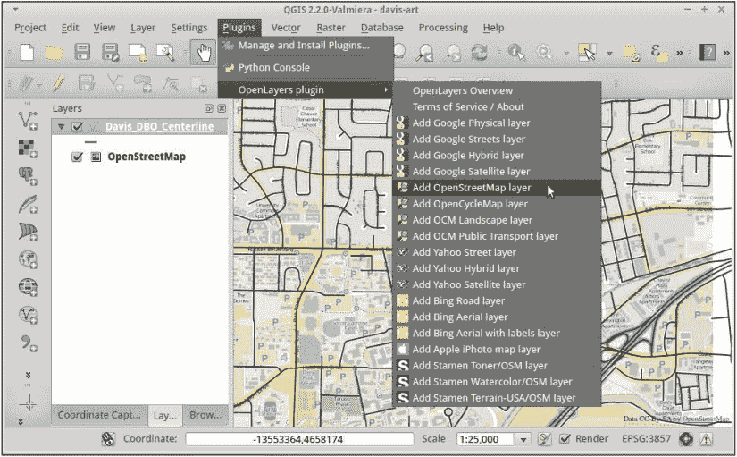

## 工作原理...

OpenLayers 插件是一个基于 Web 的工具，基于同名 OpenLayers 库在互联网浏览器中创建基于 Web 的地图。然而，与其在浏览器中显示地图，该插件将其渲染到活动 QGIS 画布中（即地图）。

使用 OpenLayers 插件时，有几件事需要谨慎。它并不总是完全对齐，尤其是在放大到大区域时。首先，检查你的其他图层的投影是否定义正确，然后尝试通过稍微向侧面平移来重置地图。需要记住的关键思想是，瓦片服务通常仅存在于 EPSG:3857 且在非常特定的比例尺集上。QGIS 会尝试选择最接近匹配的比例尺并重新采样比例尺以使其适配。这也解释了为什么加载此类图层有时会很慢。

## 还有更多...

虽然查看地图可能是合法的，具体取决于所选图层，但基于它们进行数字化、打印或以其他方式保存以供离线使用可能是不合法的。许可证因数据源而异。因此，请务必通过在线访问其网站并阅读其服务条款来检查你想要使用的来源。如果你的用例超出了一般快速参考的查看范围，你可能需要花一些时间获得使用许可或授权。基于 OpenStreetMap 的数据源通常是不错的选择，因为其许可证通常仅要求署名。

## 另请参阅

- 可以通过修改插件代码或使用 GDAL TMS 图层来添加额外的瓦片服务（请参阅 Chapter 9, QGIS and the Web）。你也可以用 WMS 服务替代，以发挥类似作用而没有瓦片的一些限制。请参阅 Chapter 9, QGIS and the Web，获取有关创建自己的 Web 服务的信息。

## 查看地理标记照片

通过位置跟踪照片可以是一个非常有用的工具，使你能够轻松调出某个地点和时间的相关照片。它们为同一地点收集的其他数据提供了本地上下文，并且可以让办公室工作人员看到实地人员所见。你可以将其视为你自己的个人街景，只是比 Google 的版本更专注。

## 准备工作

对于本食谱，你需要一组地理标记照片。我们已在本书的数据中包含了一组照片供你学习。这是来自戴维斯市中心的照片集，突出了几个街区内公共艺术的密度和多样性。

本食谱还利用了多个插件，如下：

- 安装并激活 Photo2Shape
- 激活核心插件 eVis（事件可视化）
- （可选）安装并激活 OpenLayers Plugin

## 数据探索

## 如何操作...

按照以下步骤在 QGIS 中查看地理标记照片位置：

- 1. 在 QGIS 项目中，启用 *Getting ready* 部分中列出的插件。
- 2. （可选）加载参考图层以帮助你看到本地上下文（`Davis_DBO_Centerline.shp` 和/或通过 OpenLayers Plugin 的 OpenStreetMap/Google Streets。）

> 请记住，GPS 位置和地理标记照片几乎总是在纬度和经度 WGS84 坐标中（即 EPSG:4326）。因此，你需要打开动态投影以使它们与参考图层对齐。

- 3. 转到 **Vector** 菜单或在工具栏上找到 **Photo2Shape** 的图标：

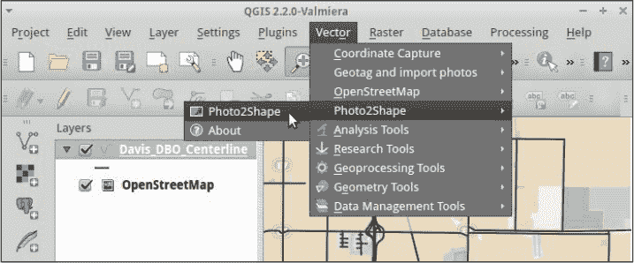

- 4. 这将要求你选择包含地理标记照片的目录并设置输出 shapefile。（使用 `davis-art` 文件夹作为输入目录。）
- 5. 你现在应该得到一个包含照片点位置的新 shapefile 加载到地图中。使用 **Zoom to Layer Extent** 放大到这些位置。你应该在每张照片的位置看到一个相机图标。

6. 查看属性表，你可以看到提取到表中的有关照片的所有信息，包括照片在你计算机上的路径：

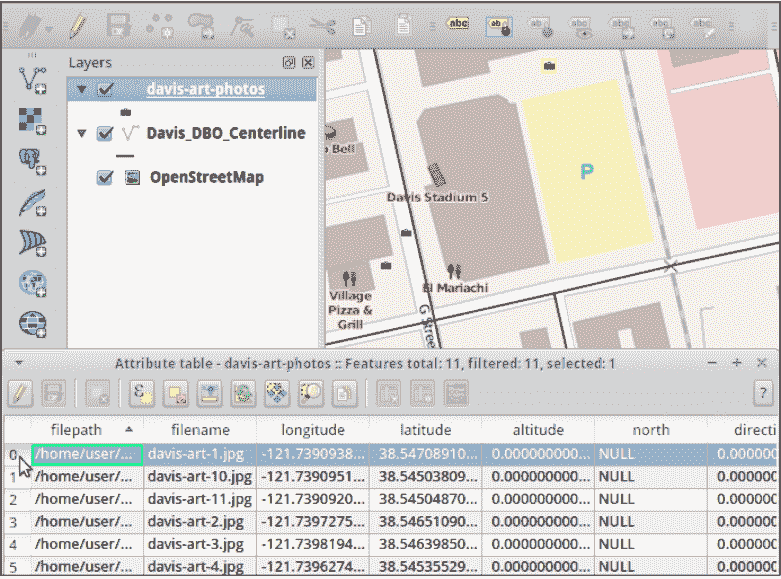

## 再进一步

如果你想在 QGIS 中看到实际照片而不只是位置，请继续执行下一节步骤：

- 1. 启用 **eVis** 插件。
- 2. 激活后转到 **Database | eVis | eVis Event Browser**。
- 3. 在弹出的新窗口中，你可以在底部框中看到照片的属性：
- 1. 如果此为空，请转到 **Options** 选项卡并检查是否已为照片路径选择了正确的字段，在本例中为 **filepath**。


# 数据探索

2. 为了让工具记住此更改，请勾选**记住此选项（Remember This）**复选框，并点击底部的**保存（Save）**按钮：

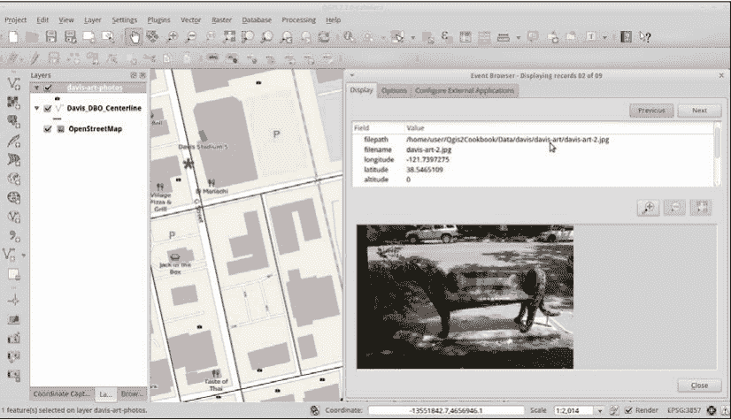

## 工作原理...

在摄影领域，大多数相机会写入一种名为 Exif 的标准元数据格式，该格式作为图像文件格式的一部分存储。通常，所有图像都会存储时间戳、相机型号、相机设置以及其他关于图像的常规信息。当你使用带有 GPS 功能的相机拍照时，相机会将纬度和经度写入照片的元数据中。其他支持元数据的程序可以随时读取这些信息。如果你碰巧对这些照片进行修饰，请确保告诉你的软件保留或复制原始照片中的元数据，以便保留位置信息。

## 扩展内容...

没有带内置地理标记功能的相机或手机？这不是问题。有很多方法可以自行添加位置信息。其中一种方法是使用**地理标记并导入照片（Geotag and import photos）**插件，它允许你将照片数据与已知位置关联起来，该插件可在 http://hub.qgis.org/projects/geotagphotos/wiki 找到。

如果你需要更复杂的工具，还有很多其他选择。Digikam 是一个开源照片管理程序，它包含一个地理标记工具，该工具会根据时间戳，尝试将来自 GPS 的 GPX 文件与你的照片自动匹配。

许多在线照片服务也支持带地理标记的照片，因此你可以轻松浏览已上传照片的地图。Flickr 可能是其中最知名的，它还引入了地理围栏的概念，你可以通过它排除某些不希望被公开的位置。

另一方面，如果你不想在在线分享照片时暴露其位置，你现在也知道了如何从照片中移除地理标签。

## 另请参阅

-   除了 eVis 之外，还有其他在地图中查看照片的方法，包括 HTML 地图提示。请参阅 Nathan 的博客：http://nathanw.net/2012/08/05/html-map-tips-in-qgis/。
-   有关使用 Digikam 进行地理标记的更多信息，请访问 http://docs.kde.org/development/en/extragear-graphics/kipi-plugins/geolocation.html。
-   你也可以使用 Flickr 对图像进行地理标记并重新导出，或者使用其 API 创建在线地图混搭。

# 经典矢量分析

在本章中，我们将介绍以下操作指南：

-   选择最佳位置
-   非密度制图
-   计算区域统计量
-   使用热力图估算密度
-   基于样本估算数值

## 简介

本章将向你介绍一些最常见的 GIS 分析用例。这些操作指南侧重于分步说明，并详细解释用于实现预期分析结果的工具。本章包括最佳位置选择、使用插值法、创建热力图以及计算区域统计量的操作指南。

## 选择最佳位置

最佳位置选择是一个相当常见的问题，例如，在规划商店或仓库位置，或寻找新公寓时。在本操作指南中，你将学习如何使用**处理工具箱（Processing Toolbox）**中的工具手动执行最佳位置选择，同时也会了解如何通过创建处理模型来自动化此工作流程。

在本操作指南的最佳位置选择中，我们将结合不同的矢量分析工具，以查找韦克县（Wake County）中符合以下标准的潜在位置：

-   位置靠近大湖（500 米以内）
-   位置靠近小学（500 米以内）
-   位置与高中的距离合理（2 公里以内）
-   位置距离主干道至少 1 公里

### 准备工作

要执行此练习，请加载以下数据集：`lakes.shp`、`schools_wake.shp` 和 `roadsmajor.shp`。

由于我们测试数据中的所有数据集已使用相同的 CRS，因此我们可以直接开始分析。如果你使用不同的数据，则可能需要先将所有数据集转换为相同的 CRS。在这种情况下，请参阅第 1 章“数据输入与输出”。

### 操作步骤...

以下步骤向你展示如何使用**处理工具箱**选项执行最佳位置选择：

1.  首先，我们必须过滤湖泊图层以找出大湖。为此，我们使用处理工具箱中的**按表达式选择（Select by expression）**工具，选择湖泊图层，并在**表达式**文本框中输入 `"AREA" > 1000000 AND "FTYPE" = 'LAKE/POND'`，如下面的截图所示：

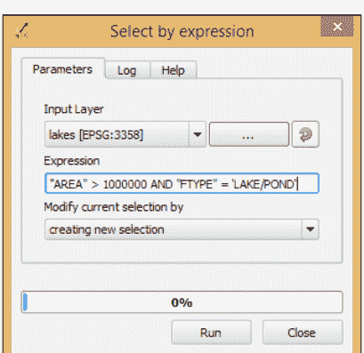

2.  接下来，我们创建表示湖泊、学校和道路周围邻近区域的缓冲区。使用**处理工具箱**选项中的**固定距离缓冲区（Fixed distance buffer）**创建以下缓冲区：

-   对于湖泊，选择**距离（Distance）**为 500 米，并通过勾选复选框来设置**融合结果（Dissolve result）**，如下面的截图所示。通过融合结果，我们可以确保重叠的缓冲区区域合并为一个多边形。否则，每个缓冲区都将作为结果图层中的独立要素保留：

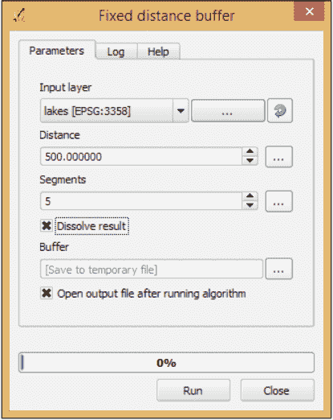

> 你可以选择通过指定输出文件来永久保存缓冲区结果，也可以将**缓冲区输出文件**字段留空，仅使用临时文件。

-   要创建小学缓冲区，首先像我们为湖泊缓冲区所做的那样，使用**按表达式选择（Select by Expression）**工具仅选择 `"GLEVEL" = 'E'` 的学校。然后，像刚才为湖泊缓冲区所做的那样使用缓冲区工具。
-   对于高中，重复该过程，使用 `"GLEVEL" = 'H'` 和 2,000 米的缓冲区距离。
-   最后，对于道路，创建距离为 1,000 米的缓冲区。

3.  准备好所有这些缓冲区后，我们现在可以组合它们以满足以下规则：
    1.  对小学和高中周围的缓冲区使用**处理工具箱**选项中的**交集（Intersection）**工具，以获取靠近两种学校类型的区域。
    2.  对湖泊周围的缓冲区以及上一步的结果使用**交集**工具，将结果限制在湖滨区域。使用**差异（Difference）**工具，从上一步（交集）结果中移除主要道路（即缓冲后的道路图层）周围的区域。

4.  检查结果图层，查看符合我们之前指定的所有标准的潜在位置。你会发现，只有一个靠近**韦克菲尔德小学（WAKEFIELD ELEMENTARY）**和**韦克菲尔德高中（WAKEFIELD HIGH）**的区域符合要求，如下面的截图所示：

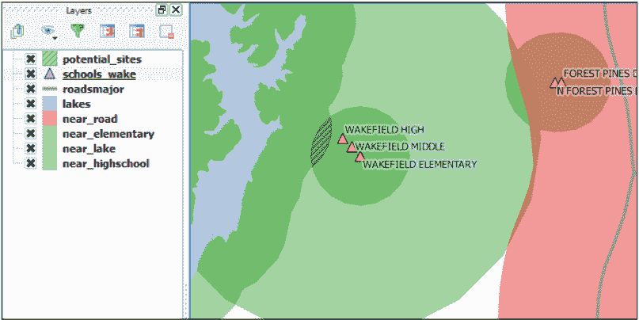

## 工作原理...

在第 1 步中，我们使用**交集**来模拟我们的首选位置需要同时靠近小学和高中这一要求。随后在第 3 步中，**差异**工具使我们能够移除靠近主要道路的区域。下图概述了可用于类似分析的各种矢量分析工具。例如，**并集（Union）**可用于模拟诸如“靠近至少一所小学或高中”的要求。另一方面，**对称差异（Symmetrical Difference）**将得出“靠近一所小学或高中，但不能同时靠近两者”的结果，如下图所示：

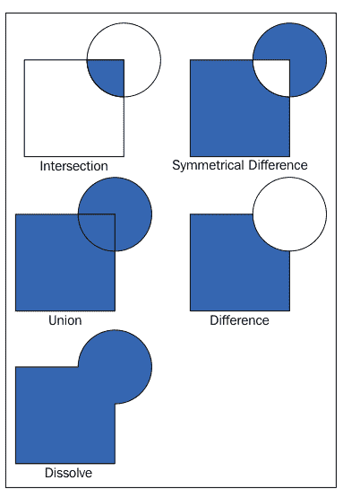

## 扩展内容...

我们很幸运地找到了一个符合所有标准的潜在位置。当然，情况并非总是如此，你需要尝试调整你的标准，以找到匹配的位置。可以想象，使用不同的设置一遍又一遍地重复这些步骤会非常繁琐且耗时。因此，创建一个处理模型来自动化此任务是个好主意。

该模型（如下面的截图所示）基本上包含我们手动过程中使用的相同工具，具体如下：

-   使用两个“按表达式选择”实例来选择小学和高中。如下面的截图所示，我们使用描述 `Select "GLEVEL" = 'E'` 和 `Select "GLEVEL" = 'H'` 来命名这些模型步骤。
-   对于小学，计算 500 米的固定距离缓冲区。此步骤称为 `Buffer "GLEVEL" = 'E'`。
-   对于高中，计算 2,000 米的固定距离缓冲区。此步骤称为 `Buffer "GLEVEL" = 'H'`。
-   使用“按表达式选择”来选择大湖（请参阅“Select big lakes”步骤），并使用 500 米的固定距离缓冲区对其进行缓冲（请参阅“Buffer lakes”步骤）。


## 经典矢量分析

- 使用**固定距离缓冲**对道路进行缓冲（参考**缓冲道路**步骤）。缓冲区大小由名为**road_buffer_size**的数值模型输入控制。你可以将这种通过额外输入控制模型参数的方法扩展到本模型中所有其他缓冲步骤。（我们选择只展示一个示例，以保持模型截图的清晰度。）
- 使用**相交**获取学校附近的区域（参考**相交：学校附近**步骤）。
- 使用**相交**获取学校和湖泊附近的区域（参考**相交：学校和湖泊**步骤）。
- 使用**差集**移除道路附近的区域（参考**差集：避开道路**步骤）。

最终模型如下所示：

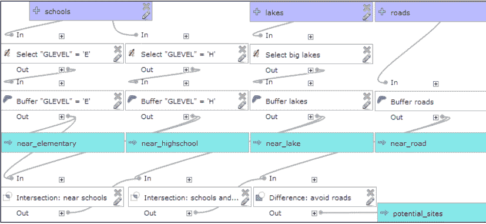

你可以从**处理工具箱**选项中运行此模型，甚至可以在其他模型中将其用作构建模块。值得注意的是，该模型会以缓冲结果（near_elementary、near_highschool 等）的形式生成中间结果。虽然这些中间结果在开发和调试模型时很有用，但你最终可能希望移除它们。这可以通过编辑缓冲步骤并移除**缓冲 <OutputVector>**名称来实现。

## 分区密度制图

分区密度制图是一种常用于改进人口分布地图的技术。默认情况下，人口数据使用人口普查数据来显示，这些数据通常按地理单元（如人口普查区）提供，而后者的边界不一定反映实际的人口分布。为了更好地模拟人口分布，分区密度制图使我们可以根据土地利用来绘制人口密度。例如，按人口普查区组织的人口数量可以通过从人口普查区中移除无人居住的区域（如水体或空地）来更准确地进行分布。

在本教程中，我们将使用有关已有人口居住的城市区域以及水体的数据来改进我们的人口普查区人口数据。

### 准备就绪

要完成本练习，请从 `census_wake2000_pop.shp` 加载人口数据（我们在第2章“数据管理”中创建的文件），以及从 `urbanarea.shp` 加载城市区域，从 `lakes.shp` 加载湖泊数据。

由于示例数据中的所有数据集已经使用相同的 CRS，我们可以直接开始分析。如果你使用不同的数据，则可能需要先将所有数据集转换为相同的 CRS。在这种情况下，请参阅第1章“数据输入与输出”了解详细信息。

### 操作步骤...

要创建一幅新的、改进后的人口分布图，我们首先从人口普查区中移除无人居住的区域。然后，我们重新计算人口密度值，以反映区域几何形状的变化，具体步骤如下：

1. 对人口普查区和城市区域图层使用**处理工具箱**选项中的**裁剪**（如果你更喜欢此选项，也可以通过导航到**矢量 | 地理处理工具**来使用**裁剪**——结果完全相同），以创建一个新数据集，其中仅包含人口普查区位于城市区域内的部分。
2. 使用差集工具进一步移除水体（湖泊图层），以细化上一步的结果。下面的截图显示了目前的结果：

   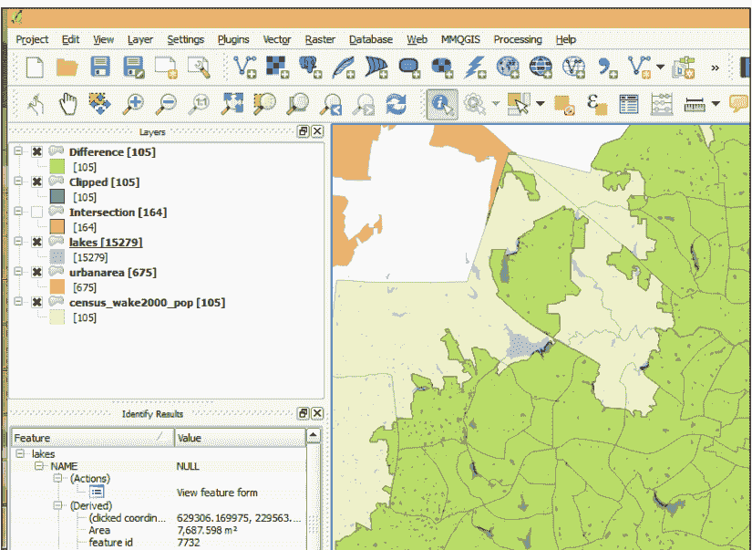

3. 现在，我们可以按如下所示计算所得区域的人口密度：

   1. 启用编辑。
   2. 打开字段计算器。
   3. 使用公式 **"_POP2000" / ($area / 1000000)** 计算新的人口密度（每平方千米居民数）。

      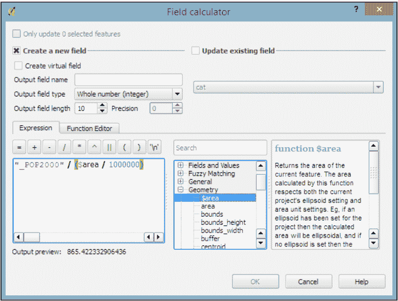

   4. 禁用编辑并保存更改。

> 值得注意的是，你不一定非要新建一列。如果只想将密度值用于样式设置，也可以直接在样式配置中输入该表达式。另一方面，如果你创建新列，则可以在属性表中检查密度值、导出或进一步分析它们。

完成后，你现在可以使用分级渲染器可视化结果，例如使用自然间断点（Jenks）分类模式。Jenks 自然间断点分类法旨在通过最大化不同类别之间的方差，同时减小所生成类别内部的方差，将值划分为“自然”类别。下图显示了基于原始人口普查数据的人口密度（左侧）以及经过分区密度制图后的结果（右侧）：

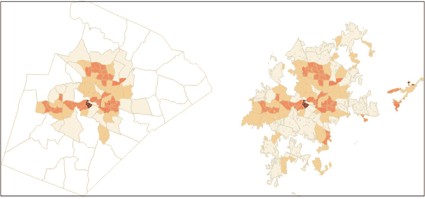

### 工作原理...

在本教程的第一步中，我们使用了裁剪操作。你很可能已经注意到，裁剪操作的结果与本章节上一个教程“选择最佳位置”中使用的相交工具结果非常相似。比较两者结果，你会发现以下差异：

- 相交操作生成的图层包含两个输入图层的属性，而裁剪操作的结果仅包含第一个输入图层的属性。
- 这也意味着使用裁剪时图层顺序很重要，但这不会改变相交操作的输出（属性表中的属性顺序除外）。
- 相交操作的结果也很可能比裁剪操作结果包含更多要素（如果使用我们的示例数据人口普查区和城市区域，则为164个而不是105个）。这是因为相交工具需要为人口普查区和城市区域相交的每一种组合创建一个新要素，而裁剪工具仅移除人口普查区中不位于任何城市区域内的部分。

关于裁剪操作，一个常见的理解方式是将一个图层想象成饼干模具，将另一个图层想象成饼干面团。

## 计算区域统计

另一种经典的空间分析任务是计算区域内特定类型的面积，例如，一个县内被某些土地利用类型覆盖的面积，或在特定城市种植的不同作物的份额。

在本教程中，我们将计算邮政编码区域的地质数据统计。具体而言，我们将计算每个邮政编码区域内每种岩石类型的总面积。

### 准备就绪

要学习本教程，请从示例数据中加载 `zipcodes_wake.shp` 和 `geology.shp`。此外，使用插件管理器安装并激活 Group Stats 插件。

### 操作步骤...

使用以下步骤，我们可以计算每个邮政编码区域中某些岩石类型的面积：

1. 使用**处理工具箱**选项中的**相交**工具或从**矢量**菜单中计算邮政编码区域与地质区域之间的交集。
2. 现在，使用 **Group Stats** 插件，可以按岩石类型和邮政编码区域计算总面积，如下所示：
   1. 选择**相交**结果图层作为输入**图层**。
   2. 将 **ZIPCODE** 字段拖到**行**输入区域，将 **GEO_NAME** 字段拖到**列**输入区域。
   3. 将求和函数和 **Area** 值拖到**值**输入区域。
   4. 点击**计算**开始计算。

下面的截图显示了完整的配置以及结果：

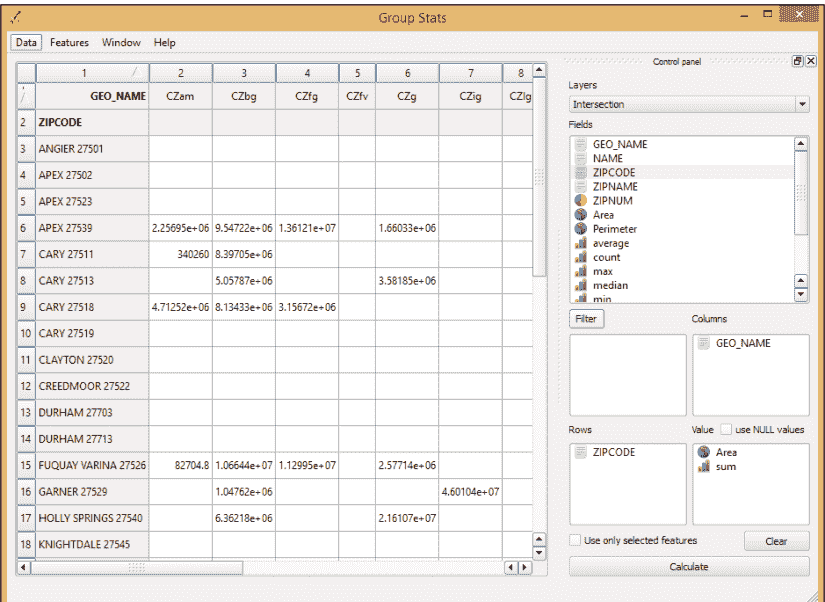

### 工作原理...

Group Stats 插件为 QGIS 带来了通常称为数据透视表的功能。数据透视表是一种数据汇总工具，常见于电子表格或商业智能软件等应用程序中。如本示例所示，数据透视表可以聚合来自输入表的数据。此外，Group Stats 插件还提供了扩展的几何函数，例如用于多边形输入图层的面积和周长，或用于线图层的长度。这使得使用该插件更加方便，因为不必先使用字段计算器将这些几何值添加到属性表中。


值得注意的是，你始终需要在 **Value** 输入区域中填入以下两个条目：

- 一个聚合函数，例如 sum、average 或 count
- 一个值字段（来自输入图层的属性表）或几何函数，该值需要被聚合

## 估算密度热力图

无论是动物目击地点、事故位置，还是一般兴趣点，许多点数据集都可以通过使用热力图可视化点密度来更轻松地解读。在本教程中，我们将估算 Wake 县中 POI 的密度，以找到密度较高的区域。

## 准备工作

从示例数据中加载 `poi_names_wake.shp` POI 数据集。确保默认随 QGIS 一起提供的 **Heatmap** 插件已在 **Plugin Manager** 中启用。

## 如何操作...

使用以下步骤，我们可以计算 POI 热力图：

1. 从 **Raster** 菜单启动 **Heatmap** 插件。
2. 确保 **poi_names_wake** 已被选为 **Input point layer**。
3. 为 **Output raster** 选择位置和文件名。你无需指定文件扩展名，因为这将根据所选的 **Output format** 自动添加。GeoTIFF 通常是首选。
4. 选择搜索 **Radius** 为 `1000` 米。
5. **Add generated file to map** 选项应默认处于激活状态。点击 **OK** 以创建默认热力图。
6. 默认情况下，热力图图层将使用 **Singleband gray** 渲染类型进行渲染。将渲染类型更改为 **Singleband pseudocolor** 并应用你喜欢的颜色渐变以改善可视化效果，如下图所示：

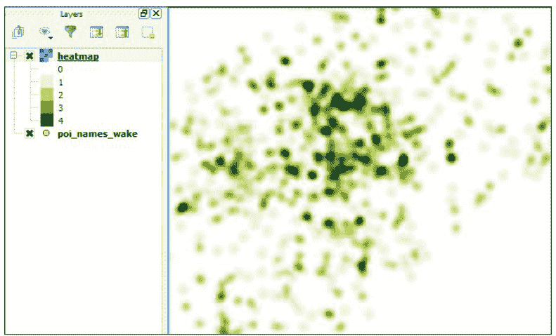

> 如果你想控制输出栅格的大小，只需启用 **Advanced** 部分并相应地调整 **Rows** 和 **Columns** 或 **Cell size X** 和 **Cell size Y**。请注意，更改行和列会自动重新计算单元格大小，反之亦然。

## 其工作原理...

搜索半径，也称为核带宽，决定了热力图看起来有多平滑，因为它设置了每个点周围的影响范围。因此，较小的半径值会导致热力图显示更精细的细节，而较大的值则会导致更平滑的热力图。

除了核带宽之外，还有不同的核形状可供选择。核形状控制着点的影响力随距离点增加而下降的速率。Heatmap 插件中可用的核形状如下图所示。例如，Triweight 核（底部第一行第一个）比 Epanechnikov 核（底部第二行第二个）产生的热点更小，因为 Triweight 形状使特征在更接近点的距离上具有更高的影响力：

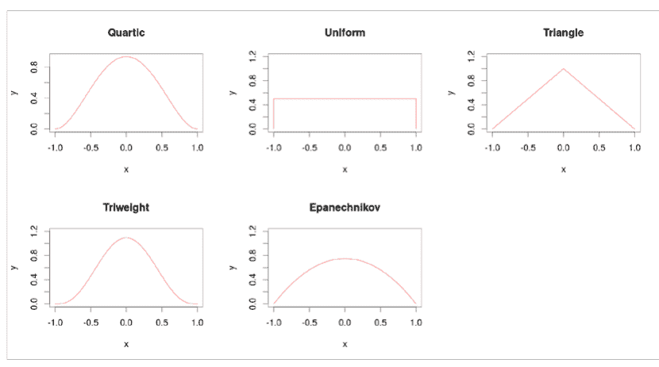

三角核形状还可使用 Decay ratio 设置进一步调整。在前一图中，你可以看到比率为 0（实心红线）、0.5（虚线黑线）和 1（点线黑线）的形状，后者等于均匀核形状。你甚至可以指定大于 1 的值。在这种情况下，特征的影响力会随着距离点的增加而增加。

## 基于样本估算值

插值是指在已知一组值的情况下，可以根据这些已知值的邻近程度来估算额外点的数值。本教程将展示如何使用点位置的已知值来创建连续的表面（栅格）值估算。经典示例包括基于气象站数据（例如气温或降雨量地图）的天气数据估算、基于田间采样部分的作物产量估算，以及像本教程示例中一样，基于采样点的海拔估算。

## 准备工作

通过 Plugin Manager 激活 Interpolation Plugin。

加载包含数值列的点图层，表示感兴趣的特征。对于本教程，使用 `poi_names_wake.shp`，以及 `elev_m` 列，其中包含每个点的以米为单位的海拔。

## 如何操作...

1. 首先加载 `poi_names_wake`。
2. 缩放到图层范围。
3. 通过导航到 **Raster** | **Interpolation** | **Interpolation** 打开 Interpolation 工具。
4. 为 **Input** 选择 `poi_names_wake`。
5. 为 **Interpolation attribute** 选择 `elev_m`。
6. 点击 **Add** 按钮，你的选择应出现在左侧的框中。
7. 为 **Interpolation Method** 选择 **Inverse Distance Weighted (IDW)**。
8. 现在，设置 **Extent** 和 **Cell Size** 属性。在 **Cellsize X** 和 **Cellsize Y** 中输入 100 和 100。这会强制输出单元为当前投影的 100x100 单位。
9. 点击中间的 **Set to current extent** 按钮。
10. 在 **Output file box** 旁边，点击标有 ... 的按钮以设置保存结果的输出路径：
11. 选择文件夹并输入一个名称且不带文件扩展名，例如 `idw100m`（结果将是 ASCII 栅格 `.asc` 文件），如下图所示：

> 是的，它在 **Raster** 菜单上；源数据必须是矢量，但结果是栅格。

> 通常，如果这是用于分析，你会尝试匹配感兴趣区域或其他栅格图层。在本例中，我们只是希望获得合理大小的单元。由于地图使用 UTM，我们希望单元为代表公制单位的整数；100 米乘 100 米使结果解释更容易。

## 其工作原理...

基本思路是，在给定单元处，你取所有附近点的平均值，并按其与单元的距离加权，以估算当前位置的值。**Inverse Distance Weighted (IDW)** 在此基础上更进一步，对更接近给定单元的值给予更大权重，对更远的值给予更小权重。该函数使用指数因子 *P* 以大幅提高近点相对于远点的作用。

## 更多内容...

结果与预期不符？有一些参数可以调整；主要的是 *P* 值和单元大小。如果这样仍然达不到你想要的效果？在 Processing 下的 SAGA、GRASS 和 GDAL 工具箱中还有其他几种插值工具，可让你操作更多公式参数以优化结果。

最后，取决于你的数据，IDW 可能无法很好地进行插值。在这里的示例中，你实际上可以看到孤立点周围有明显的圆圈。这通常不是一个好的结果，需要更平滑地过渡到附近点。如果你在最初进行野外采样时有任何控制权，请记住，规则间隔的网格通常会提供更好的结果。

你无法控制源数据或没有得到好的结果？那么，你可能需要研究其他更复杂的公式，以补偿偏差、强方向性、障碍物和样本非规则间距，例如 Spline 或 Kriging，或 **Triangulated Irregular Networks (TINs)**。这些方法背后有大量的科学和统计知识，以及确定最佳参数的诊断工具。这对于本教程来说过于复杂，但已在地统计学书籍中得到充分介绍。

## 另请参阅

- `http://docs.qgis.org/2.2/en/docs/user_manual/plugins/plugins_interpolation.html`
- `http://en.wikipedia.org/wiki/Inverse_distance_weighting`

# Classic Vector Analysis
