## 6
网络分析

在本章中，我们将介绍以下教程：

- 创建简单的路由网络
- 使用 Road graph 插件计算最短路径
- 在 Road graph 插件中使用单向街道进行路由
- 使用 QGIS 网络分析库计算最短路径
- 路由点序列
- 使用批处理自动化多条路线计算
- 将点匹配到最近的线
- 为 pgRouting 创建网络
- 在 QGIS 中可视化 pgRouting 结果
- 为方便使用 pgRoutingLayer 插件
- 从 OSM 获取网络数据

## 简介

本章重点介绍与网络内路由相关的常见用例。迄今为止，用于路由的最常见网络是街道网络。其他较少见的情况包括室内路由网络，即在建筑物内部房间之间，或航运路线网络。


Networks and routing are in no way a GIS-only topic. You will find a lot of math literature related to this, called **Graph Theory**. In this chapter, we will use the following terms to talk about networks:

- A **network** (also known as **graph**) is a collection of connected objects
- These objects are called **nodes** (also known as vertices)
- The connections between nodes are called **links** (also known as **edges**)

The following figure explains these terms:

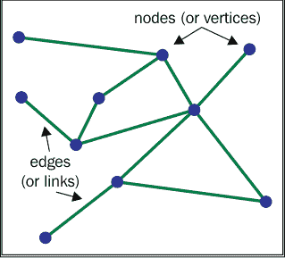

The two routing tools that are commonly used with QGIS are as follows:

- The Road graph plugin, which is one of the QGIS core plugins; that is, this plugin is available in every QGIS installation, but you may have to activate it in Plugin Manager
- The PostGIS extension pgRouting, which can be used directly through the QGIS DB Manager, or more comfortably through the pgRoutingLayer plugin, which can be installed from the QGIS plugin repository using Plugin Manager

## Creating a simple routing network

In this recipe, we will create a routing network from scratch using the QGIS editing tools. Even though more and more open network data is available, there will still be numerous use cases where necessary network data does not exist or is not available for use. Therefore, it is good to know how to create a network and what to pay attention to in order to avoid common pitfalls.

For the task of network creation, the main difference between the Road graph plugin and pgRouting is that pgRouting needs a network node (that is, link start or end node) at each intersection while the Road graph plugin will also use intermediate link geometry nodes to infer intersections if two links share a node. In this recipe, we will create a network, which can be used in both tools.

### Getting ready

To follow this recipe, you only need a new empty QGIS project. Additionally, make sure you have the **Digitizing** toolbar enabled (as shown in the following screenshot). We will create an imaginary network, but if you want you can load a background map and digitize this:


### How to do it...

Before we can start to create the network, there are a few things that need to be set up first:

- 1. Create a new shapefile line layer for the network. You don't need to add any extra attributes besides the default ID attribute yet.

> You can read more about creating new shapefiles in the *Learning QGIS* book by Packt Publishing and the QGIS user guide at `http://docs.qgis.org/2.2/en/docs/user_manual/working_with_vector/editing_geometry_attributes.html#creating-a-new-shapefile-layer`.

- 2. To ensure that we can digitize the network with valid topology, we'll activate snapping next. Go to **Settings | Snapping Options** and activate snapping for your line layer by enabling the checkbox to the left of it. Additionally, set the mode to **to vertex** and choose a tolerance of at least **5.00000** pixels:

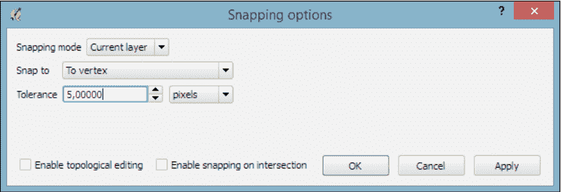

- 3. Now, we can enable editing for the line layer and then select the **Add Feature** tool from the **Digitizing** toolbar to start digitizing.

- 4. Create the first line feature now, and give it the ID number 1. The line can have as many nodes as you wish. We'll create a line with four nodes, as shown in the following screenshot:


- 5. To draw the second line feature, start at the first or the last node of line 1. As we have activated snapping, you will see that the node is being highlighted if you hover over it with the mouse cursor. Draw a second line and give it the ID number 2.

> The line in the preceding screenshot is drawn with a style that has circles on the starting and ending points. You can reproduce this style by adding the Marker line symbol levels to the line style or load network_links.qml from our sample data. For more details about styling features, please refer to Chapter 10, Cartography Tips.

- 6. Draw a few more lines (around 12 in total) forming a network. Make sure to pay attention to the snapping and assign link IDs:

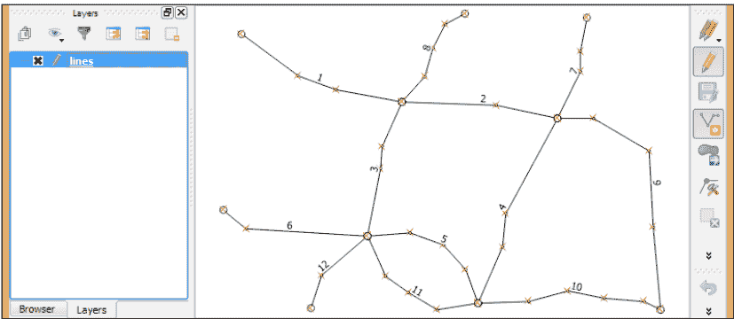

- 7. Disable editing, and confirm that you want to save the changes.

We will use this basic network as a starting point for the remaining recipes in this chapter.

### How it works...

By setting the snapping mode to **to vertex**, we made it possible to digitize the line network in a way that ensures that lines, which should be connected, really contain a node at the exact same position.

### There's more...

You can validate the network topology by running the Topology Checker plugin, which is installed with QGIS by default (you can read more about Topology Checker in Chapter 12, *Up and Coming*):

- 1. Start **Topology Checker** from the **Vector** menu.
- 2. Click **Configure** to set up a topology rule, as shown in the following screenshot, and click on **Add Rule** to add it to the list of rules to check. Then, close the settings by clicking on **OK**:

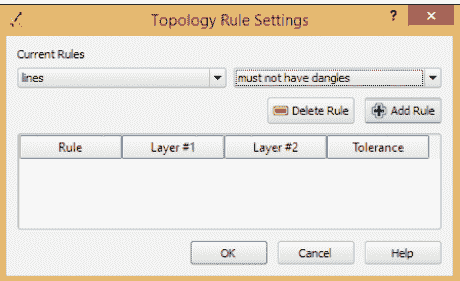

- 3. Once this tool is configured, click on **Validate All** (the button with the checkmark) to initiate the check. You will see the list of discovered errors displayed in the list above the buttons, as shown in the following screenshot. Additionally, the dangling ends are highlighted in red in the map:

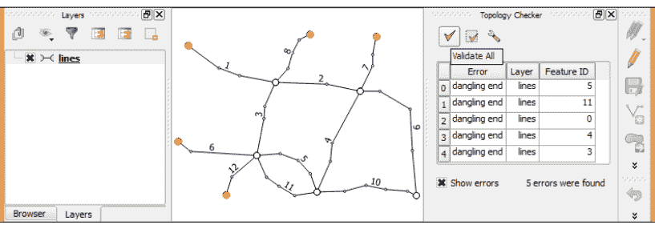

- 4. You can select the error entries in the list to jump to the line features that failed the check. In our network, only lines with dead-ends should be listed. If you see an error at an intersection, you should zoom closer and try to correct the node positions.

## Calculating the shortest paths using the Road graph plugin

This recipe shows you how to use the built-in Road graph plugin to calculate the shortest paths in a network.

### Getting ready

To follow this recipe, load network_pgr.shp from the sample data. Additionally, make sure that the Road graph plugin is enabled in Plugin Manager.

### How to do it...

The Road graph plugin enables us to route between two points that are selected on the map. Before we can use this, we have to configure it first, as follows:

- 1. Enable the Shortest path panel by navigating to View | Panels. This should add the plugin panel to the user interface.
- 2. Go to Vector | Road graph | Settings to get to the configuration dialog. For now, the default settings, as shown in the following screenshot, should be fine. Note that the network layer is selected as Transportation layer. Click on OK to confirm the settings:

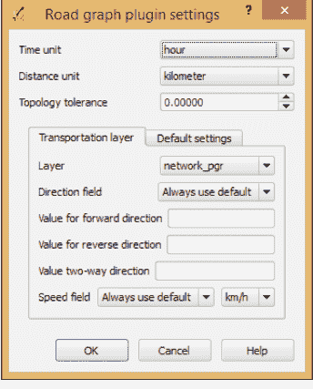

- 3. Once the settings are configured, we can calculate our first route. Select the **Start** and **Stop** locations using the buttons marked with crosshair icons. Activate the crosshair button and then click in the map to select a location. This location will be marked on the map, and the coordinates will be automatically inserted into the **Start** or **Stop** input field.
- 4. Click on **Calculate** to initiate route computation. Depending on the size of the network used, this step will either be very fast or it can take much more time. The route will be highlighted in the map, and the route length and travel time will be displayed, as shown in the following screenshot:

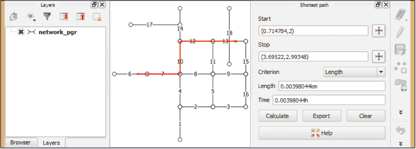

- 5. If you want to store the computed shortest path, click on **Export** and you will be able to choose whether you want to create a new layer for the path or add the route to an existing line layer.
- 6. To compute a new route, simply change the start and stop locations and click on **Calculate** again.
- 7. Click on **Clear** to remove the route highlights when you are done.

### How it works...

The Road graph plugin uses the QGIS network analysis library, which implements Dijkstra's algorithm. For a given starting node, the algorithm finds the path with the lowest cost (that is, the shortest path if the cost criterion is length or the fastest path if the cost criterion is time) between this node and every other node in the network. This can also be used to find costs of the shortest paths from a start node to a destination node by stopping the algorithm once the shortest path to the destination node has been determined.


与许多简单的路由工具不同，Road graph 插件能够自动构建网络拓扑。由于我们的网络数据集在拓扑上是健全的（即网络边相交处没有细小的间隙），我们可以将 Road graph 插件设置中的 **Topology tolerance** 设置为 0。如果您使用的是来自其他来源的网络，则可能没有以同样的细致程度创建，您可能需要增加 **Topology tolerance** 才能使路由工作。

## See also
- 如果您有兴趣了解更多关于此算法的信息，可以从 `http://wiki.gis.com/wiki/index.php/Dijkstra's_algorithm` 开始

## Routing with one-way streets in the Road graph plugin

在车辆路由方面，通常有必要进行更详细的考虑并考虑驾驶限制，例如单行道。本教程将向您展示如何使用单行道信息通过 Road graph 插件进行路由。

### Getting ready

要遵循本教程，请从示例数据中加载 `network_pgr.shp`。此外，请确保在插件管理器中启用了 Road graph 插件。

### How to do it...

为了演示使用单行道信息进行路由，我们将首先可视化单行道值，然后配置 Road graph 插件以使用单行道信息，具体如下：

- 1. 在开始使用单行道信息进行路由之前，可视化单行道会很有帮助。值得注意的是，单行道方向将取决于链接几何的方向（即链接数字化时的方向）。可视化链接方向的最佳方式是分配箭头符号，如以下屏幕截图所示。您可以从我们的示例数据中加载 `network_pgr.qml` 来获取样式：

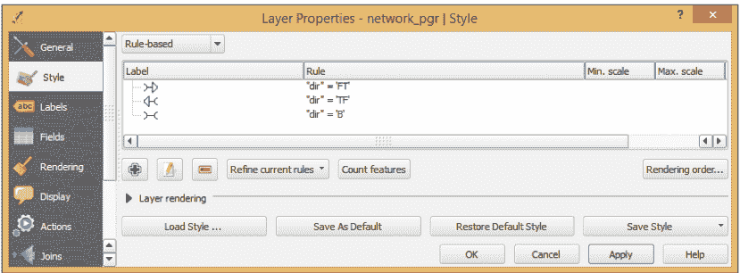

编码单行道信息的方式有很多种。在我们的数据集中，正向方向编码为 FT 表示“from-to”，反向方向编码为 TF 表示“to-from”，双向编码为 B 表示“both”。

- 2. 然后，我们可以配置 Road graph 插件以使用单行道信息。为此，我们必须选择 dir 属性作为 Direction field，并输入正向（在链接几何中）和反向（与链接几何相反）方向的值：

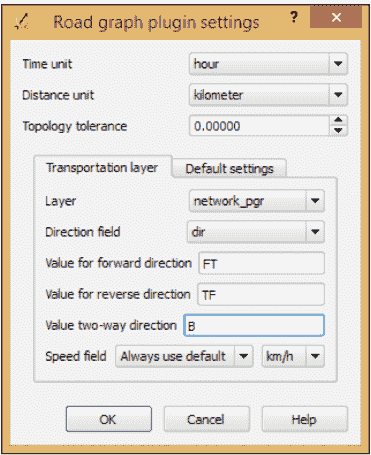

3. 配置插件后，您可以按照上一教程 Calculating the shortest paths using the Road graph plugin 中描述的方法计算最短路径。您将看到生成的路线与正常（无单行道限制）路径不同，如以下屏幕截图所示，其中算法避开了直线上的一段单行道链接，而是选择了更长的路线：

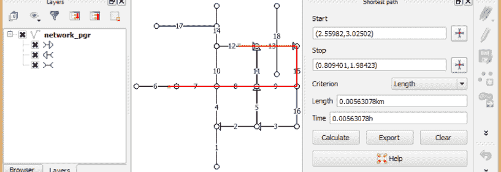

### How it works...

当我们使用默认的双向设置时，每个网络链接都被解释为从起始节点到结束节点的连接，以及从结束节点到起始节点的连接。通过添加单行道限制，这会发生变化，链接现在仅被解释为一个连接。

除了 **FT**、**TF** 和 **B** 之外，编码单行道的另一种常见方式是 **1** 表示链接方向内，**-1** 表示与链接方向相反，**0** 表示双向。在 OpenStreetMap 中，您会找到 **yes** 表示链接方向内，**no** 表示双向以及 **-1** 表示与链接方向相反（有关更多详细信息，请参阅 `http://wiki.openstreetmap.org/wiki/Key:oneway`）。

## Calculating the shortest paths with the QGIS network analysis library

如教程 Calculating the shortest paths using the Road graph plugin 中所述，QGIS 附带了一个网络分析库，可以从 Python 控制台、插件、处理脚本以及您能想到的任何其他地方使用。在本教程中，我们将介绍如何在 Python 控制台中使用网络分析来计算最短路径。

### Getting ready

要遵循本教程，请从示例数据中加载 network_pgr.shp。

### How to do it...

我们建议不要直接在 Python 控制台中键入或复制以下脚本，而是使用 Python 控制台左侧的 Show editor 按钮打开 Python 控制台编辑器：

- 1. 将以下脚本粘贴到编辑器中：

```
import processing
from processing.tools.vector import VectorWriter
from PyQt4.QtCore import *
from qgis.core import *
from qgis.networkanalysis import *

# create the graph
layer = processing.getObject('network_pgr')
director = QgsLineVectorLayerDirector(layer,-1,'','', '',3)
director.addProperter(QgsDistanceArcProperter())
builder = QgsGraphBuilder(layer.crs())
from_point = QgsPoint(2.73343,3.00581)
to_point = QgsPoint(0.483584,2.01487)
tied_points = 
    director.makeGraph(builder,[from_point,to_point])
graph = builder.graph()

# compute the route from from_id to to_id
from_id = graph.findVertex(tied_points[0])
to_id = graph.findVertex(tied_points[1])
(tree,cost) = QgsGraphAnalyzer.dijkstra(graph,from_id,0)

# assemble the route
route_points = []
curPos = to_id
while (curPos != from_id):
    in_vertex = graph.arc(tree[curPos]).inVertex()
    route_points.append(graph.vertex(in_vertex).point())
    curPos = graph.arc(tree[curPos]).outVertex()
route_points.append(from_point)
```

```
```python
# write the results to a Shapefile
result = 'C:\\temp\\route.shp'
writer = VectorWriter(result,None,[],2,layer.crs())
fet = QgsFeature()
fet.setGeometry(QgsGeometry.fromPolyline(route_points))
writer.addFeature(fet)
del writer
processing.load(result)
```
```

- 2. 如果您使用的是自己的网络数据集而不是随本书提供的 `network_pgr.shp`，请调整 `from_point` 和 `to_point` 的坐标以对应路线的起点和终点。
- 3. 根据您的操作系统更改结果图层的路径。
- 4. 确保网络图层已加载并在 QGIS 图层列表中被选中。
- 5. 保存脚本并运行它。

### How it works...

第 8 行，我们创建了一个 `QgsLineVectorLayerDirector` 对象（http://qgis.org/api/classQgsLineVectorLayerDirector.html），其中包含网络配置。构造函数（`QgsLineVectorLayerDirector(layer,-1,'','','',3)`）参数如下：

- 网络线图层
- 方向字段的 ID：我们将其设置为 -1，因为此脚本不考虑单行道
- 以下三个参数是链接方向内的值：反向链接方向和双向
- 最后一个参数是默认方向：1 表示链接方向内，2 表示反向方向，3 表示双向

第 10 行创建了 `QgsGraphBuilder`（http://qgis.org/api/classQgsGraphBuilder.html）实例，该实例将在第 14 行用于创建路由图。

第 11 行和第 12 行，我们定义了路线的起点和终点。为了能够在这两个点之间路由，它们必须与最近的网络链接匹配。这发生在第 13 行的 `makeGraph()` 函数中，该函数返回所谓的 `tied_points`。

实际的路线计算发生在第 18 行的 `QgsGraphAnalyzer.dijkstra()`（http://qgis.org/api/classQgsGraphAnalyzer.html）函数中。

从第 22 行开始的 while 循环是脚本遍历 Dijkstra 算法创建的树以收集路径上的所有顶点并将它们添加到 route_points 列表中的位置，该列表在第 31 行成为生成的路线几何。

输出路线线图层的写入器在第 29 行创建，我们传递文件路径、None 表示默认编码、[] 表示空字段列表，以及 2 表示几何类型，等同于线以及结果图层 CRS。接下来的第 30 到 32 行创建路线要素并将其添加到写入器中。

最后，最后一条语句加载生成的 shapefile，并在地图上显示，如以下屏幕截图所示：

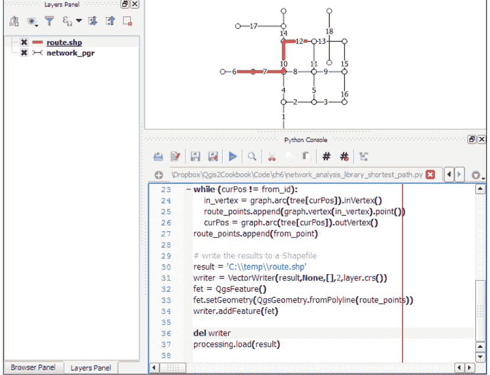

## See also

您可以在 PyQGIS Developer Cookbook 中在线阅读有关 QGIS 网络分析库的更多信息，网址为 http://docs.qgis.org/testing/en/docs/pyqgis_developer_cookbook/network_analysis.html。


## 路由点序列

在之前的配方中，我们从一个起点路由到一个目的地。另一个用例是当我们想要计算连接一系列点的路线时，例如 GPS 轨迹中的点。在本配方中，我们将使用点图层路由处理脚本来为点序列计算路线。其核心使用的是在上一配方《使用 QGIS 网络分析库计算最短路径》中介绍的相同思路，但这里是依次计算多条最短路径。

### 准备工作

要遵循本配方，请加载 network_pgr.shp 和 sample_pts_for_routing.shp，其中包含应从示例数据集中路由的点图层。

此外，您需要从 https://raw.githubusercontent.com/anitagraser/QGIS-Processing-tools/master/2.6/scripts/point_layer_to_route.py 获取点图层路由脚本并将其保存到 Processing 脚本文件夹中，该文件夹在 Windows 上默认为 C:\Users\youruser\qgis2\processing\scripts，在 Linux 上默认为 /home/youruser/.qgis2/processing/scripts，在 Mac 上默认为 /Users/youruser/.qgis2/processing/scripts。或者，将点图层路由保存到 Processing 菜单下选项 | 脚本 | 脚本文件夹 中配置的文件夹。

### 操作方法...

要计算输入点之间的路线，您需要执行以下任务：

- 1. 加载网络和点图层。
- 2. 如果您使用的是自己的数据，请确保两个图层使用相同的 CRS。如果它们使用不同的 CRS，您需要在继续之前重新投影它们（例如，使用 Processing 工具箱选项中的重投影图层工具）。
- 3. 从 Processing 工具箱选项启动点图层路由工具。
- 4. 选择点和网络输入图层，确保已激活运行算法后打开输出文件选项，然后单击运行开始路线计算。生成的路线图层将自动加载：

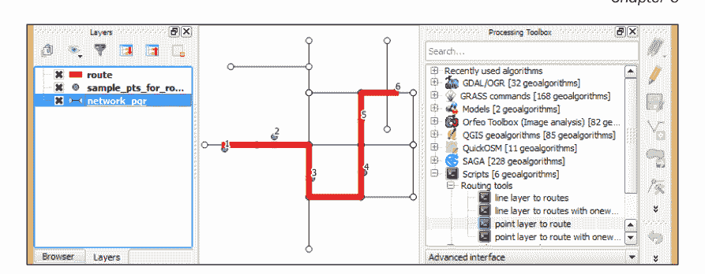

### 工作原理...

**点图层路由** 工具使用 QGIS 网络分析库。我们已在上一配方 *使用 QGIS 网络分析库计算最短路径* 中讨论过该库的基本用法。主要区别在于我们现在必须处理多于两个点。因此，脚本从输入点图层获取所有点并将它们绑定或匹配到图上：

```
points = []
features = processing.features(point_layer)
for f in features:
    points.append(f.geometry().asPoint())
tiedPoints = director.makeGraph(builder, points)
```

对于每对连续点，脚本然后像在 *使用 QGIS 网络分析库计算最短路径* 配方中那样计算两点之间的路线：

```
point_count = point_layer.featureCount()
for i in range(0,point_count-1):
    # compute the route between two consecutive points
```

生成的路线线图层包含每个连续点对的一个线要素。

### 还有更多...

当然，您也可以使用 **点图层路由** 工具在仅两个点之间进行路由。

### 另请参阅

还有一个脚本版本，可考虑单向信息，网址为 https://raw.githubusercontent.com/anitagraser/QGIS-Processing-tools/master/2.2/scripts/point_layer_to_route_with_oneways.py。

## 使用批处理自动化多条路线计算

如果您有多个输入点图层，可以使用 Processing 的批处理功能来加快处理速度。在本配方中，我们将同时为两个输入点图层计算路线，但同样的方法可以应用于更多图层。

### 准备工作

要遵循本配方，请加载 network_pgr.shp 和两个点图层，sample_pts_for_routing.shp 和 sample_pts_for_routing2.shp。

### 操作方法...

首先，在 Processing 工具箱选项中右键单击点图层路由工具并选择作为批处理执行。然后执行以下步骤：

- 1. 在 points 列中，单击 ... 按钮并使用从打开图层中选择选项选择 sample_pts_for_routing 和 sample_pts_for_routing2。
- 2. 使用对话框底部的删除行按钮选择并删除第三行。
- 3. 在 network 列中，单击 ... 按钮并使用从打开图层中选择选项选择 network_pgr。您可以通过双击表头项（其中显示 network）来避免重复选择文件。这将使用相同的网络文件路径自动填充所有行。
- 4. 在 routes 列中，您需要为生成的路线文件选择一个路径。在单击 ... 按钮时打开的另存为文件对话框中，您可以指定一个基本文件名并单击保存。以下自动填充设置对话框让您指定是否以及如何填充行。使用自动填充模式用数字填充，Processing 将自动在您指定的文件名后附加递增编号。您可以在以下屏幕截图中看到一个示例，其中我们将 route 指定为基本文件名。

5. 单击运行以执行批处理。两条路线都将被计算并自动加载：

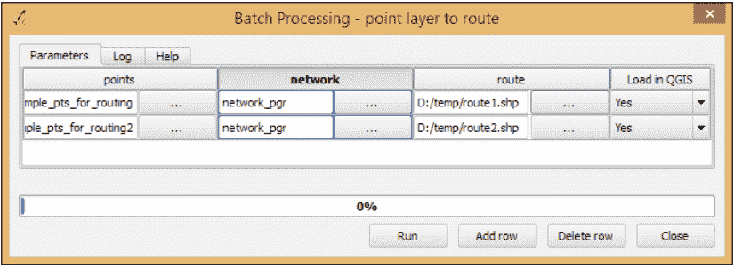

## 将点匹配到最近的线

在本配方中，我们将使用 Python 控制台中的 QGIS 网络分析库将点匹配到最近的线。这是也称为地图匹配的最简单形式。

### 准备工作

要遵循本配方，请从示例数据加载 network_pgr.shp。

### 操作方法...

以下脚本将匹配三个点，QgsPoint(3.63715,3.60401)、QgsPoint(3.86250,1.58906) 和 QgsPoint(0.42913,2.26512)，到网络上：

- 1. 打开 Python 控制台及其编辑器，然后加载或粘贴以下 network_analysis_match_points.py 脚本：

```
import processing
from processing.tools.vector import VectorWriter
from PyQt4.QtCore import *
from qgis.core import *
from qgis.networkanalysis import *

layer = processing.getObject('network_pgr')
director = QgsLineVectorLayerDirector(layer,-1,'','','',3)
director.addProperter(QgsDistanceArcProperter())
builder = QgsGraphBuilder(layer.crs())
additional_points =
[QgsPoint(3.63715,3.60401),QgsPoint(3.86250,1.58906),QgsPoint(0.42913,2.26512)]
```

```
tied_points = director.makeGraph(builder,additional_points)

result = 'C:\\temp\\matched_pts.shp'
writer = VectorWriter(result,None,[],1,layer.crs())
fet = QgsFeature()

for pt in tied_points:
    fet.setGeometry(QgsGeometry.fromPoint(pt))
    writer.addFeature(fet)

del writer
processing.load(result)
```

- 2. 确保网络图层在图层列表中被选中。
- 3. 运行脚本。结果应自动加载。

### 工作原理...

此脚本使用 QGIS 网络分析库的 makeGraph() 函数将点匹配到线的能力。生成的 tied_points 列表包含最接近输入点的网络上点的坐标。

第 15 行上的 1 选项指定输出图层为点类型。

for 循环最后遍历 tied_points 列表中的所有点并创建点要素，然后将它们添加到结果写入器中。

## 为 pgRouting 创建路由网络

本配方向您展示如何将线图层导入 PostGIS 并从中创建一个可路由网络，该网络可被 PostGIS 的路由库 pgRouting 使用。有关 pgRouting 的详细信息，请访问项目网站 http://docs.pgrouting.org。

此处不会详细介绍 PostGIS 和 pgRouting 的安装，因为不同操作系统的说明可在项目网站 http://docs.pgrouting.org/2.0/en/doc/src/installation/index.html 上找到。

如果您使用 Windows，PostGIS 和 pgRouting 都可以直接从 Stack Builder 应用程序安装，该应用程序由标准 PostgreSQL 安装提供，如 http://anitagraser.com/2013/07/06/pgrouting-2-0-for-windows-quick-guide/ 中所述。


## 准备工作

要跟随本练习，你需要一个启用了 pgRouting 的 PostGIS 数据库。在 QGIS 中，你应该使用 **Add PostGIS Layers** 对话框中的 **New** 按钮设置到数据库的连接。此外，你还应从示例数据中加载 `network_pgr.shp`。

## 如何操作...

以下步骤将在你的 PostGIS 数据库中创建一个可路由的网络表：

- 1. 通过导航到 **Database | DB Manager** 打开 **DB Manager**。
- 2. 在对话框左侧的 **Tree** 中，选择你想要加载网络的数据库。
- 3. 转到 **Table | Import Layer/File** 以将 `network_pgr`图层加载到你的数据库中，如以下截图所示：

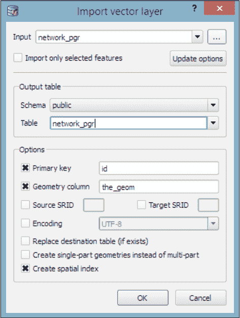

## 网络分析

- 4. 在 `network_pgr` 成功导入后，通过按 *F2*、点击相应的工具栏按钮，或在 **Database** 菜单中打开 DB Manager 的 SQL 窗口。
- 5. pgRouting 在列数据类型方面有点挑剔。当你看到 **Error, columns 'source', 'target' must be of type int4, 'cost' must be of type float8.** 时就会注意到这一点。当我们使用 QGIS 的 DB Manager 导入 `network_pgr` 时，它会将 cost 列创建为 numeric。由于 pgRouting 不接受 numeric，我们将使用 **Table | Edit Table in DB Manager** 来编辑 cost 列。点击 **Edit column** 按钮并将 **Type** 从 *numeric* 改为 *double precision*（相当于所需的 float8）。
- 6. 现在数据已加载并就绪，我们可以构建网络拓扑。这将创建一个新的 `network_pgr_vertices_pgr` 表，其中包含计算出的网络节点。

```
SELECT pgr_createTopology('network_pgr',0.001);
```

- 7. 一旦拓扑就绪，我们可以通过计算从节点编号 16 到节点编号 9 的简单最短路径来测试网络：

```
SELECT pgr_dijkstra('SELECT id, source, target, cost
  FROM network_pgr', 16, 9, false, false);
```

这将得到以下结果：

```
(0,16,6,1)
(1,17,7,1)
(2,5,8,1)
(3,6,9,1)
(4,11,15,1)
(5,9,-1,0)
```

## 其工作原理...

前面的 `pgr_dijkstra` 查询由以下几部分组成：

- `'SELECT id, source, target, cost FROM network_pgr'`: 这是一个 SQL 查询，返回包含以下列的行集：
- `id`: 这是唯一的边 ID（类型 int4）
- `source`: 这是边源节点的 ID（类型 int4）
- `target`: 这是边目标节点的 ID（类型 int4）
- `cost`: 这是边遍历的成本（类型 float8）
- `16, 9`: 这些是路线源节点和目标节点的 ID（类型 int4）
- `false`: 如果图是有向的，则为 `true`
- `false`: 如果为 `true`，则 SQL 生成的行集的 `reverse_cost` 列将用于边反向遍历的成本

`pgr_dijkstra` 的结果包含我们的路线从起点到目的地所使用的网络链路列表。结果行中的四个值如下：

- `seq`: 这是序列号，告诉我们路线中链路的顺序，从 0 开始
- `id1`: 这是节点 ID
- `id2`: 这是边 ID
- `cost`: 这是链路的成本（可以是距离、行驶时间、货币价值或你选择的任何其他度量）

## 另请参阅

在接下来的配方 *Visualizing pgRouting results in QGIS* 中，我们将看到如何使用 `pgr_dijkstra` 的结果在地图上可视化路线。

如果你对更多 pgRouting SQL 配方感兴趣，你可以在 Packt Publishing 出版的 *PostGIS Cookbook* 中找到关于此主题的整整一章。

## 在 QGIS 中可视化 pgRouting 结果

在之前的配方 *Creating a routing network for pgRouting* 中，我们导入了网络图层，构建了拓扑，并最终测试了路由。在这些结果的基础上，本配方将向你展示如何在 QGIS 中将路由结果可视化到地图上。

## 准备工作

你应该先完成之前的配方 *Creating a routing network for pgRouting*，以设置必要的 PostGIS 表。或者，你也可以使用自己的网络表，但请注意，如果你的表使用不同的列名，你可能需要更改一些 SQL 语句。

## 如何操作...

要在 QGIS 中可视化结果，我们可以使用 DB Manager SQL 窗口，如以下截图所示。我们在此使用的扩展查询将路由结果连接回原始网络表，以获取我们想要在地图上显示的路线链路几何：

- 1. 通过导航到 Database | DB Manager 打开 DB Manager。
- 2. 在对话框左侧的 Tree 中，选择你想要加载网络的数据库。
- 3. 打开 DB Manager 的 SQL 窗口并按以下截图所示进行配置：

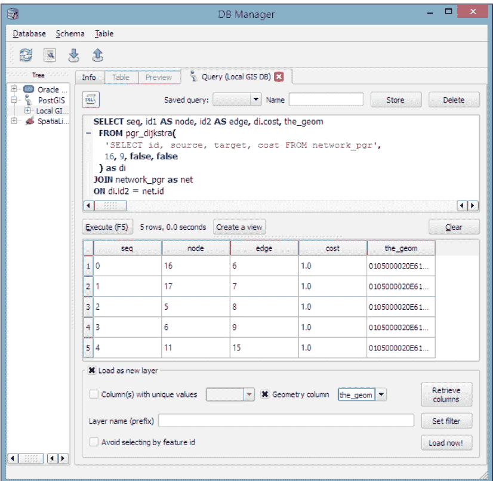

> 💡 请注意，SQL 语句末尾不能有分号。否则，将结果加载为新图层将失败。

- 4. 确保 **Geometry** 列已正确选择，然后点击 **Load now!** 按钮将查询结果加载为新图层，如以下截图所示：

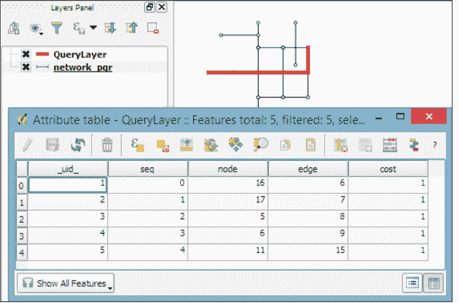

## 其工作原理...

由于 pgr_dijkstra 只返回路线边 ID 的列表，我们需要从原始网络表中获取边几何以便在地图上显示路线。因此，我们将路由结果与网络表在 id2（包含边 ID）和网络表的 id 列上进行连接。

## 另请参阅

为了更方便地在 QGIS 中使用 pgRouting，pgRoutingLayer 插件提供了一个 GUI 来访问 pgRouting 的许多函数。你可以在 *Using the pgRoutingLayer plugin for convenience* 配方中找到该插件的介绍。

## 使用 pgRoutingLayer 插件以提高便利性

之前的配方 *Visualizing pgRouting results in QGIS* 向你展示了如何手动将 pgRouting 结果添加到地图。在本章中，我们将使用 pgRoutingLayer 插件更方便地访问 pgRouting 提供的函数，包括我们迄今为止使用过的基本算法，如 Dijkstra 算法，以及更复杂的算法，如 `drivingDistance` 和 `alphashape`，可用于可视化服务区，也称为服务范围。

## 准备工作

你应该先完成之前的配方 *Creating a routing network for pgRouting*，以设置必要的 PostGIS 表。或者，你也可以使用自己的网络表，但请注意，如果你的表使用不同的列名，你可能需要更改一些 SQL 语句。

此外，从 Plugin Installer 安装 pgRoutingLayer 插件。你需要启用实验性插件才能查看它。

## 如何操作...

pgRoutingLayer 插件在 QGIS GUI 中添加了一个新面板，允许方便地访问可用的路由函数。以下步骤向你展示如何使用此插件：

- 1. 首先，你应该从 **Database** 字段中选择一个包含路由网络表的数据库。下拉列表包含所有配置的 PostGIS 连接。
- 2. 接下来，你可以从 **Function** 字段中选择想要使用的函数。让我们先尝试 Dijkstra 算法；选择 `dijkstra` 函数。你会从之前的配方中认出这些参数，我们在其中手动编写了 pgRouting SQL 查询。
- 3. 指定网络表 (`edge_table`) 的参数以及 **geometry**、**id**、**source**、**target** 和 **cost** 列，如以下截图所示：

## 网络分析

## 其工作原理...

当我们点击 **Run** 按钮时，查询结果会作为临时覆盖层可视化在地图上。如果你想永久保存输出，可以点击 **Export** 按钮。目前，**Export** 按钮仅适用于路由函数，而不适用于服务区函数。

## 另请参阅

有关 pgRouting 算法的详细文档，请参阅项目文档网站 `http://docs.pgrouting.org/2.0/en/doc/index.html`。

## 从 OSM 获取网络数据

一个流行的真实世界路由应用数据源是 **OpenStreetMap (OSM)**。本配方向你展示如何使用 osm2po 命令行工具为 pgRouting 准备 OSM 数据，将 OSM 数据转换为 PostGIS 的插入脚本。最后，我们将使用 pgRoutingLayer 插件测试数据导入。

## 准备工作

从 `http://osm2po.de` 下载 osm2po 并解压下载内容。请注意，osm2po 要求你的机器上安装了 Java。

你还需要一个启用了 pgRouting 的数据库来跟随本配方。

此外，你应该安装并启用 pgRoutingLayer 插件，因为我们将使用它来测试 OSM 数据导入。

你可以使用我们示例数据中的 `wake.pbf` OSM 文件，或从 `http://download.geofabrik.de` 等服务下载自己的数据。

## 如何操作...

打开命令行执行以下步骤。如果你正在 Windows 上工作，我们建议使用 osgeo4W Shell：

- 1. 进入 `osm2po` 文件夹并在文本编辑器中打开 `osm2po.config`。查找以下配置行并删除行首的 `#` 以激活 pgRouting 导出：
- `postp.0.class = de.cm.osm2po.plugins.postp.PgRoutingWriter`


2. 现在使用 osm2po 将 OSM .pbf 文件转换为 SQL。请针对你的系统调整文件路径，如下所示：

```text
D:\osm2po-5.1.0>java -jar osm2po-core-5.1.0-signed.jar prefix=wake
"C:\tmp\OSM_NorthCarolina\wake.pbf"
```

3. 当 osm2po 运行完成后，你应该会看到以下内容：

```text
INFO Services started. Waiting for requests at
http://localhost:8888/osm2poService
```

4. 现在你应该会在 osm2po 文件夹内找到一个以前缀（即 wake）命名的文件夹。其中包含一个日志文件，该文件又提供了一个用于将 OSM 网络导入 PostGIS 的命令行模板：

```text
INFO command line template:
psql -U [username] -d [dbname] -q -f
"D:\osm2po-5.1.0\wake\wake_2po_4pgr.sql"
```

5. 使用这个模板，我们可以轻松地将 .sql 文件导入现有数据库，如下所示：

```text
D:\osm2po-5.1.0\wake>psql -U [username] -d cookbook -q -f D:\
osm2po-5.1.0\wake\wake_2po_4pgr.sql
```

6. 现在，数据已准备好可以在 QGIS 中使用。当我们连接到 cookbook 数据库时，可以看到 wake_2po_4pgr 表：

7. 最后，我们可以使用 **pgRouting Layer** 插件，通过计算 **43679**（**source_id**）源节点编号周围 **0.1** 小时（**distance** 值）的服务区来测试 OSM 数据导入：

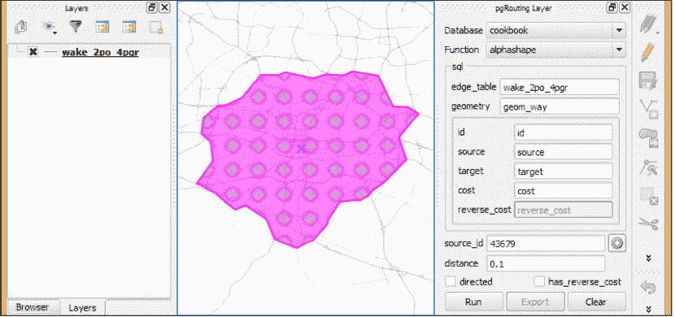

## 工作原理...

osm2po 创建的网络表包含以下有用的列（以及其他列）：

- `km`：这是网络边的长度
- `kmh`：这是边上的速度，取决于街道等级和 osm2po 配置中指定的值
- `cost`：这是使用 km/kmh 计算出的行驶时间

# 7