## 栅格分析 I

在本章中，我们将介绍以下内容：

- 使用栅格计算器
- 准备高程数据
- 计算坡度
- 计算山体阴影图层
- 分析水文
- 计算地形指数
- 使用图形建模器自动化分析任务

# 引言

栅格分析是 GIS 分析中的一个经典领域。本章将向你展示栅格分析中一些最重要且常见的任务。高程数据通常以栅格图层形式存储，而这种格式特别适合进行多种分析。因此，地形分析传统上一直是栅格分析的主要领域之一，我们将向你展示一些与数字高程模型（DEM）相关的常见操作，从简单的分析（如坡度计算）到更复杂的分析（如排水网络勾画或流域提取）。

# 使用栅格计算器

栅格计算器是 QGIS 中最灵活、最通用的工具之一。它允许你基于栅格图层执行代数运算，并计算新图层。本操作指南将向你展示如何使用它。

# 准备工作

打开 `catchment_area.tif` 文件。该文件应类似于以下截图：

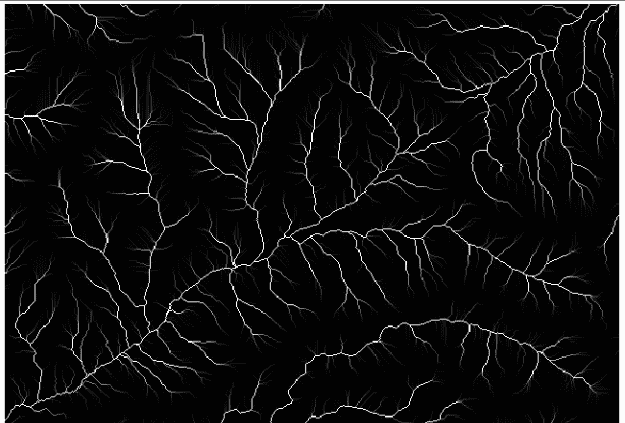

# 操作步骤...

1. 打开 **处理工具箱** 选项，通过搜索框搜索名为 **栅格计算器** 的算法。双击该算法项以执行它，如下面的截图所示：

这个界面类似于真正的计算器，更加直观和用户友好。另一方面，它缺少处理工具箱栅格计算器中可用的许多函数（例如，我们之前计算的对数不可用）。它也不能用于自动化过程，如脚本或图形模型，这些只能用于处理算法。

另一方面，QGIS 内置计算器支持多波段图层，而处理工具箱中的计算器仅限于单波段图层。

# 另请参阅

- QGIS 栅格计算器在 QGIS 手册中有更详细的描述，请参见 http://docs.qgis.org/2.8/en/docs/user_manual/working_with_raster/raster_calculator.html

# 准备高程数据

在本操作指南中，我们将向你展示如何在 QGIS 中执行地形分析。地形分析算法假定用作输入的 DEM 具有某些特征，因此了解这些特征并在需要时准备这些 DEM 非常重要。本操作指南将向你展示如何做到这一点。

# 准备工作

打开 `dem_to_prepare.tif` 图层。该图层包含一个 EPSG:4326 坐标系中的 DEM，且高程数据以英尺为单位。这些特征不适合运行大多数地形分析算法，因此我们将修改该图层以获得合适的图层。

# 操作步骤...

1. 使用右键单击图层名称后出现的上下文菜单中的 **另存为...** 条目，将图层重新投影到 EPSG:3857 坐标系。
2. 打开生成的已重新投影的图层。
3. 打开处理栅格计算器，在 **输入图层** 字段中将重新投影后的图层作为唯一的栅格输入。在 **公式** 字段中输入 `* 0.3048`。运行该算法。

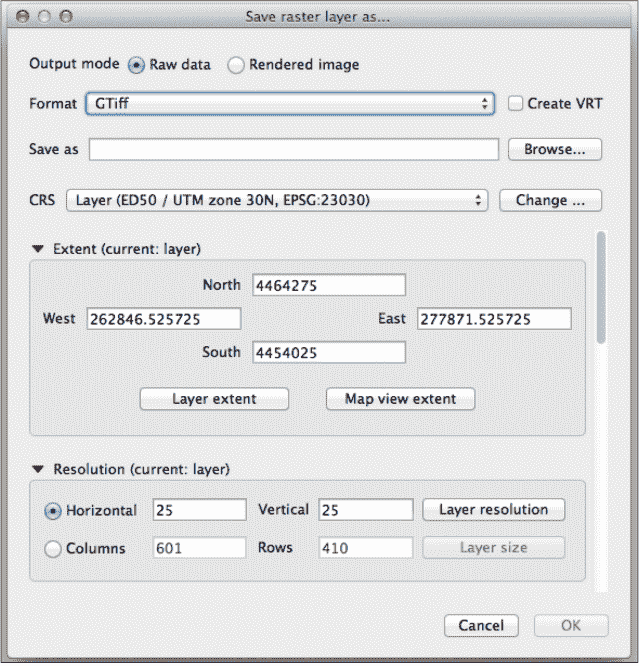

# 计算坡度

坡度是可以通过 DEM 派生的最基础参数之一。它对应于 DEM 的一阶导数，表示高程的变化率。它的计算方法是分析每个单元格的高程，并将其与周围单元格的高程进行比较。本操作指南将向你展示如何在 QGIS 中计算坡度。

## 准备工作

打开我们在上一个操作指南中准备的 DEM。

# 栅格分析

# 操作步骤...

1. 在 **处理工具箱** 选项中找到 **坡度** 算法，双击打开它：

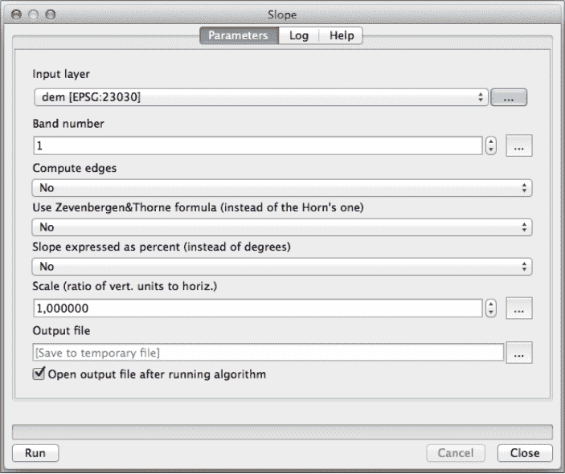

2. 在 **输入图层** 字段中选择 DEM。
3. 点击 **运行** 运行算法。

坡度图层将被添加到 QGIS 项目中。

# 工作原理...

坡度是通过分析某个单元格周围的单元格，从 DEM 高程模型中计算得出的。
该分析由 GDAL 库中的坡度算法执行。

# 更多内容...

在 QGIS 中使用坡度算法有几种方法。这里有一些关于此的评论和想法。

# 使用高程值的比率

如果高程单位与水平单位不同，你可以使用栅格计算器进行转换，如上一个操作指南中那样。但是，坡度模块包含一个选项，可以在 **比例** 字段中输入转换因子来实时转换它们。请注意，此选项在我们将要使用的其他地形分析模块中不可用，因此创建具有正确单位的图层仍然是一种良好的实践，可以在无需任何进一步处理的情况下使用。

# 其他坡度算法

处理框架包含依赖于多个外部应用程序和库的算法。这些库有时包含类似的算法，因此对于给定的分析，有不止一种选择。

如果你使用下拉列表底部的选项将工具箱的显示模式从“简化”切换为“高级”，然后在搜索框中输入 slope，你会看到类似下面的截图：

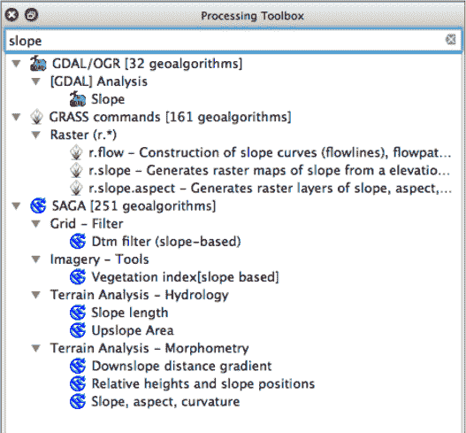

# 计算坡度

尝试使用 GRASS 或 SAGA 算法来计算坡度。它们每个都有不同的参数和选项，但都执行类似的计算并创建坡度图层。

除了处理框架之外，你还可以使用栅格地形分析插件进行分析。

2. 在 **输入图层** 字段中选择 **DEM**。将其余参数保留为默认值。
3. 点击 **运行** 运行算法。

山体阴影图层将被添加到 QGIS 项目中，如下所示：

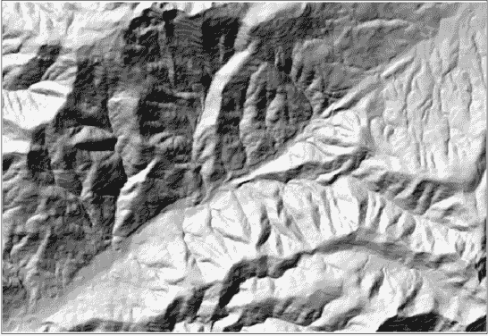

# 工作原理...

与坡度的情况一样，该算法是 GDAL 库的一部分。你会看到参数与坡度的情况非常相似。这是因为坡度用于计算山体阴影图层。该算法基于每个单元格中的坡度和坡向，并使用由 **方位角** 和 **高度角** 字段定义的太阳位置，计算该单元格将接收的照明。这是基于焦点分析，因此不考虑阴影，也不是真实的照明值，但它们可用于渲染和显示地形的地形起伏。

你可以尝试更改这些参数的值来改变图层的外观。

# 更多内容...

与坡度的情况一样，还有其他选项可以计算山体阴影。**处理工具箱** 选项中的 SAGA 算法有一个值得一提的功能。

SAGA 山体阴影算法包含一个名为 **方法** 的字段。该字段用于选择计算山体阴影值的方法，以及可用的最后一种方法。**光线追踪** 与其他方法不同，因为它模拟了光的真实行为，进行的分析不是局部的，而是使用 DEM 的完整信息。相反，因为它考虑了周围地形投射的阴影。这会生成更精确的山体阴影图层，但处理时间可能会显著增加。

## 使用山体阴影图层增强地图视图

您可以将山体阴影图层与其他图层组合，以增强其外观。

由于您使用DEM计算了山体阴影图层，因此它应该已经与山体阴影本身一起位于QGIS项目中。然而，由于Processing生成的新图层会添加到图层列表中的现有图层之上，DEM将被山体阴影覆盖。将其移动到图层列表顶部，以便您可以看到DEM（而不是山体阴影图层），并对其进行样式设置，使其类似于以下屏幕截图：

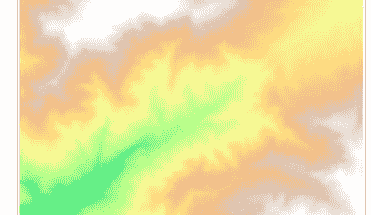

让我们看看使用山体阴影图层增强地图视图的步骤：

- 1. 在图层的**属性**对话框中，进入**透明度**部分，并将**全局透明度**值设置为**50%**，如下面的屏幕截图所示：

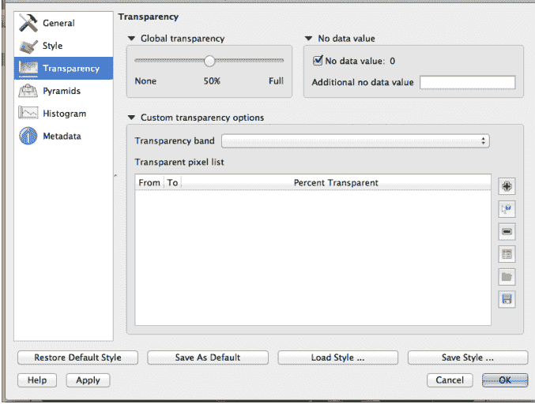

## 如何操作...

- 1. 在**处理工具箱**选项中，找到**填洼**算法并双击打开它：

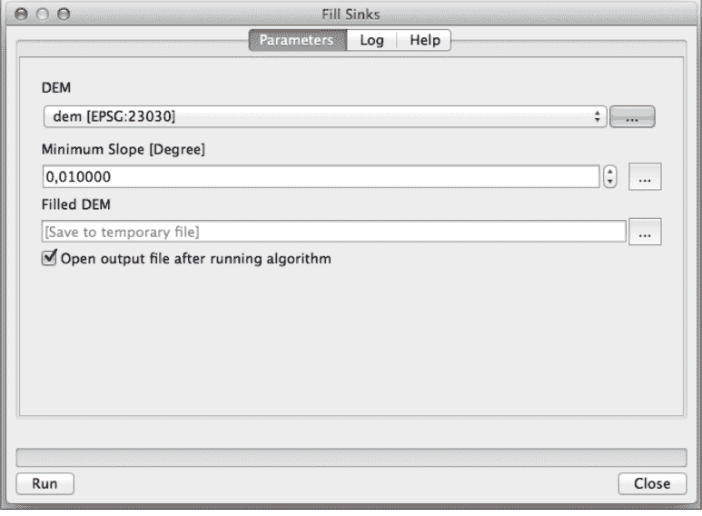

- 2. 在**DEM**字段中选择DEM并运行该算法。这将生成一个新的过滤后的DEM图层。从现在开始，我们将只使用这个DEM，而不是原始DEM。

3. 打开**汇水面积**，并在**高程**字段中选择过滤后的DEM：

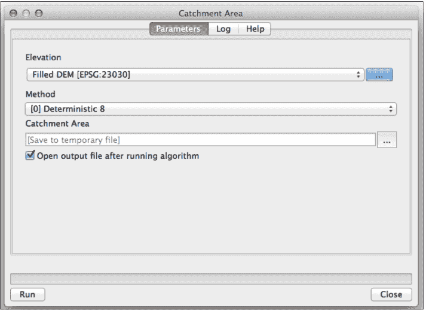

4. 运行该算法。这将生成一个汇水面积图层：

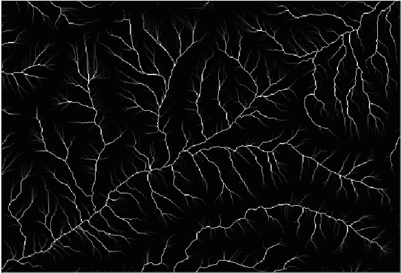

5. 打开**河网**算法并填写，如下面的屏幕截图所示：

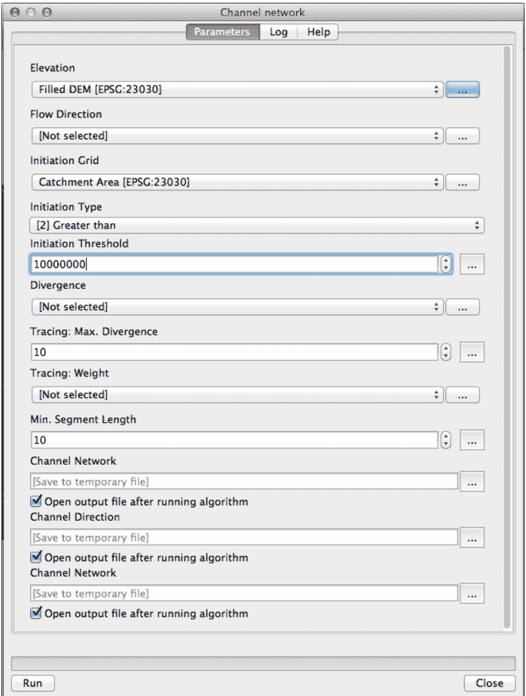

6. 运行该算法。这将基于汇水面积从DEM中提取河网，然后将其生成为栅格图层和矢量图层：

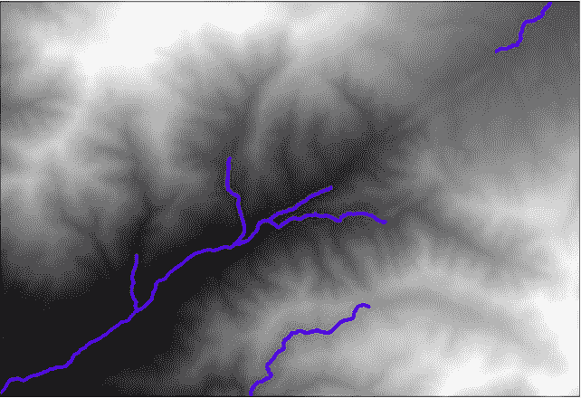

7. 打开**流域盆地**算法并填写，如下面的屏幕截图所示：

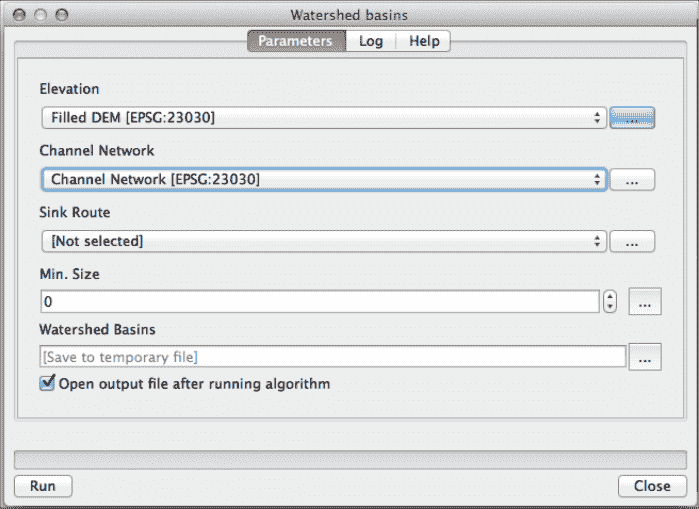

## 栅格分析 I

8. 运行该算法。这将生成一个栅格图层，其中流域是根据DEM和河网计算出来的。每个流域是一个水文单元，代表流入由河网定义的汇流点的区域：

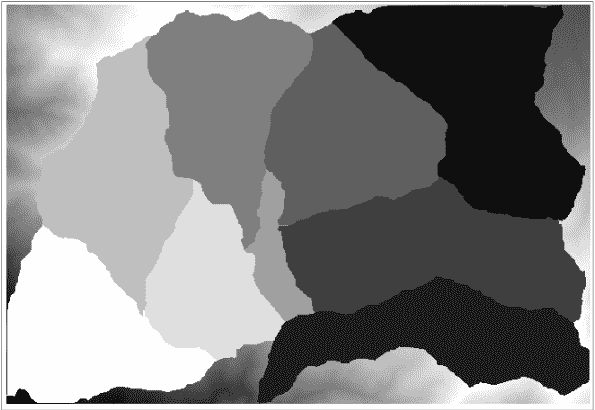

## 工作原理...

从DEM开始，前面的步骤遵循了水文分析的典型工作流程：

- 首先，填洼。每当您计划进行水文分析时，这是必需的准备。DEM可能包含无法计算流向的洼地，这对模拟水流穿过这些单元的运动来说是一个问题。移除这些洼地可以解决此问题。
- 汇水面积是从DEM计算的。汇水面积图层中的值代表每个单元上游的区域。也就是说，如果水滴落在该区域内，最终将流过该单元。
- 汇水面积值高的单元可能包含河流，而值较低的单元则会有坡面流。通过设置汇水面积值的阈值，我们可以将河流单元（高于阈值的单元）与其余单元分开，并提取河网。
- 最后，我们计算与上一步提取的河网中每个汇流点相关联的流域。

## 扩展...

前面工作流程中的关键参数是汇水面积阈值。如果使用较大的阈值，较少的单元将被视为河流单元，生成的河网将更稀疏。由于流域是基于河网计算的，这将导致流域数量减少。

您可以使用不同的汇水面积阈值自行尝试。在下图中，您可以看到阈值等于1,000,000时的结果：

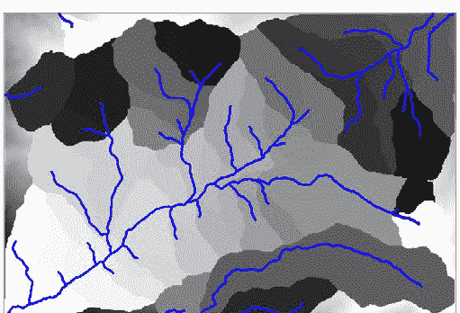

已添加河网，以帮助您理解结果流域集合的结构。

在下图中，您可以看到阈值为50,000,000时的结果：

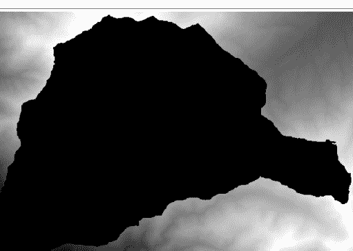

## 栅格分析 I

请注意，在最后一种情况下，由于阈值更高，结果图层中只有一个流域。

阈值以汇水面积的单位表示，由于假设单元格大小为米，因此单位为平方米。

## 计算地形指数

由于地形定义并影响了给定地形中发生的大多数过程，因此可以使用DEM提取许多不同的参数，这些参数为我们提供了有关这些过程的信息。本教程向您展示如何计算一个流行的参数，即地形湿度指数，它基于地形估算土壤湿度。

### 准备工作

打开我们在*准备高程数据*教程中准备的DEM。

### 如何操作...

- 1. 使用**处理工具箱**选项中的SAGA的**坡度、坡向、曲率**算法计算坡度图层。使用**处理工具箱**选项中的**汇水面积**算法计算汇水面积图层。请注意，您必须使用无洼地的DEM，例如我们在上一步骤中使用**填洼**算法生成的DEM。
  
- 打开**处理工具箱**选项中的**地形湿度指数**算法并填写，如下面的屏幕截图所示：

## 工作原理...

该指数结合了影响土壤湿度的两个参数：坡度和汇水面积。如果汇水面积值高，这意味着更多的水将流入该单元，从而增加其土壤湿度。低坡度值也会产生类似效果，因为流入该单元的水不会很快流出。

该算法期望坡度以弧度表示。这就是为什么必须使用**坡度、坡向、曲率**算法的原因，因为它的坡度输出以弧度为单位。您会发现的另一个基于GDAL库的**坡度**算法创建的坡度图层值以度为单位。如果您使用栅格计算器转换其单位，则可以使用该图层。

## 扩展...

在**处理工具箱**选项中的不同算法中可以找到其他基于相同输入图层的指数。水流动力指数和LS因子也都使用坡度和汇水面积作为输入，并且它们可能与潜在侵蚀有关。

## 使用图形建模器自动化分析任务

大多数分析任务涉及使用多个算法。使用不同的数据集或不同的输入参数重复相同的分析需要逐一使用它们，这使得任务繁琐且容易出错。您可以使用Processing图形建模器自动化分析工作流，该建模器允许您以图形方式定义工作流并将其封装在单个算法中。本教程介绍建模器的主要思想，并创建一个简单模型作为示例。

## 准备工作

本教程无需QGIS中的特殊准备，但请确保您已阅读了之前关于计算地形指数的教程。本教程将基于该教程中的工作流创建模型，因此理解它非常重要。

## 栅格分析

3. 单击**确定**将输入添加到画布：

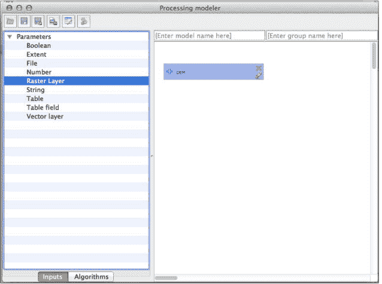

4. 切换到**算法**选项卡。双击**坡度、坡向、曲率**算法并设置算法定义，如下面的屏幕截图所示：

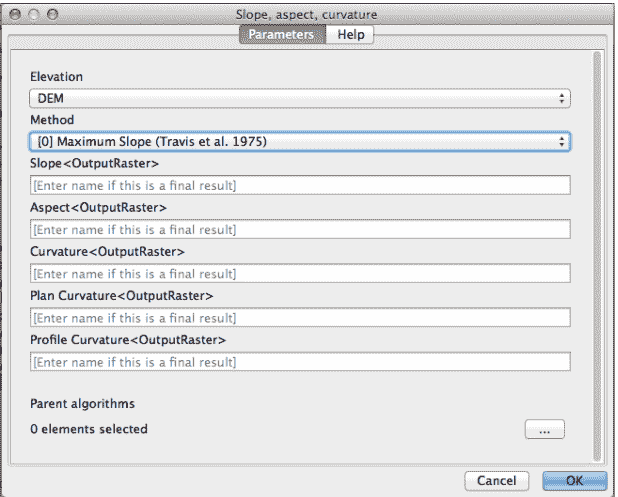

5. 单击“确定”按钮关闭对话框。该算法将被添加到建模器画布中，如下所示：

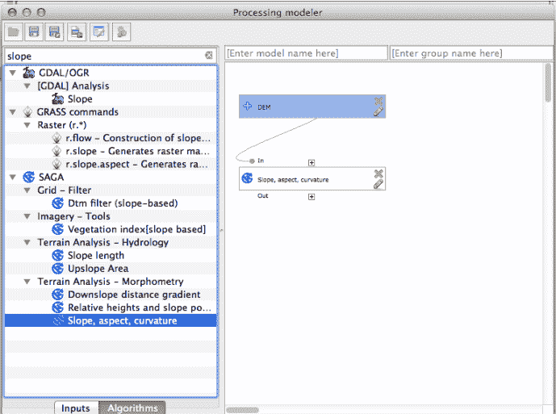

6. 在算法列表中双击“集水区”算法并填写对话框，将其添加到模型中，如以下截图所示：

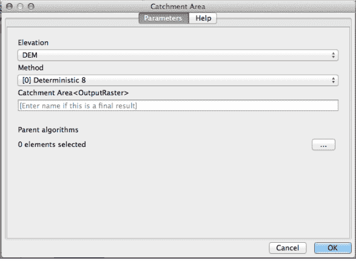

7. 最后，添加“地形湿度指数”算法，并按以下截图所示进行定义：

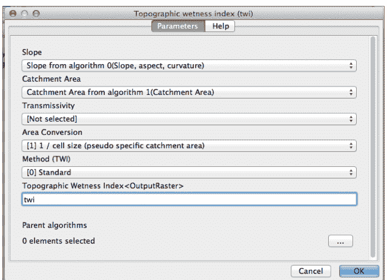

8. 最终模型应类似于以下截图：

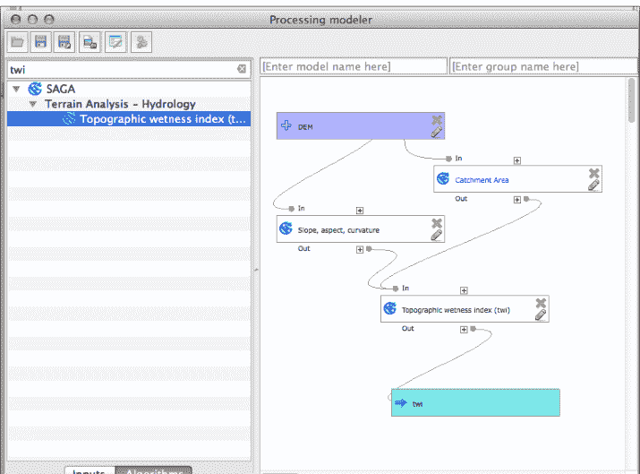
