# 8

# 栅格分析 II

在本章中，我们将介绍以下操作步骤：

- 计算 NDVI
- 处理空值
- 使用掩膜设置范围
- 对栅格图层进行采样
- 可视化多光谱图层
- 修改并重分类栅格图层中的值
- 对栅格图层执行监督分类

## 简介

继上一章之后，本章将介绍一些额外的栅格分析技术。本章将展示如何处理图像、如何修改栅格值并进行分类，以及如何将栅格图层与矢量图层结合使用，从而扩展上一章操作步骤中引入的工具集。

## 计算 NDVI

**归一化差分植被指数**是一种非常流行的植被指数，它能为我们提供关于活绿色植被存在与否的有用信息。

### 准备工作

NDVI 的计算使用一个具有红色光谱反射率值的波段，以及另一个具有近红外反射率值的波段。在示例数据集中，您会找到两个名为 `red.tif` 和 `nir.tif` 的图像文件，可用于计算 NDVI。还有一个名为 `ndvi.qgs` 的项目，其中包含这两个图层以及与该区域对应的 landsat 影像。请打开此项目。

### 如何操作...

1. 打开“处理工具箱”菜单，找到名为“植被指数[基于坡度]”的算法。双击该算法项以执行它：

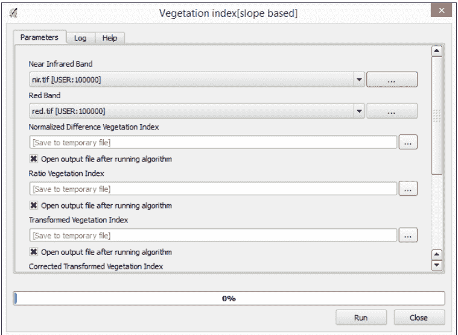

2. 在“红波段”字段中选择 `red.tif` 图层，在“近红外波段”字段中选择 `nir.tif` 图层。单击“运行”以运行该算法。

3. 该算法将生成一组包含不同植被指数的图层，NDVI 就在其中：

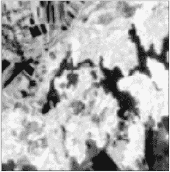

### 工作原理...

该算法计算的所有植被指数都基于红光与近红外反射率之间的关系。叶片细胞会散射近红外波段的太阳辐射，并吸收红光波段的辐射，因此可根据这两个值预测健康绿色植被的位置。

NDVI 使用下一节给出的公式计算。

### 更多内容...

由于 NDVI 的公式相当简单，您无需使用特定算法，只需打开栅格计算器即可计算。您可以使用处理框架中集成的栅格计算器，或 QGIS 内置的栅格计算器。以下截图显示了如何基于两个示例图层，在 QGIS 栅格计算器中填写参数以计算 NDVI：

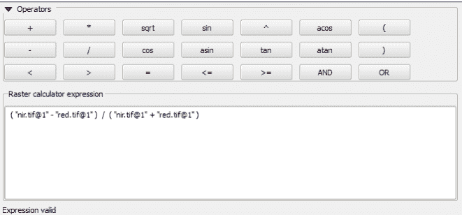

## 提取波段

植被指数算法要求红光和红外值位于两个独立的图层中，且每个图层都是单波段。然而，通常它们会出现在同一幅多波段影像中。为了使用这些波段，您必须将它们分离，提取到两个独立的文件中。

这可以使用 GDAL 的 Translate（转换）算法来完成。项目中包含一幅名为 `landsat.tif` 的多波段影像，其中红波段位于第 3 波段，红外波段位于第 4 波段：

1. 在“处理工具箱”菜单中打开“Translate（转换）”算法。
2. 按照以下截图所示填写其参数，以导出红外波段：

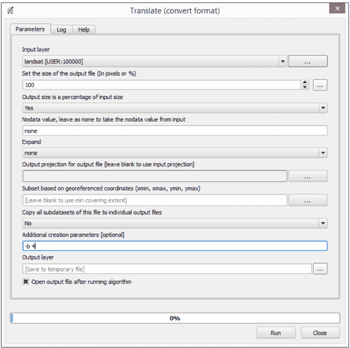

3. 再次运行，如以下截图所示，以导出红波段：

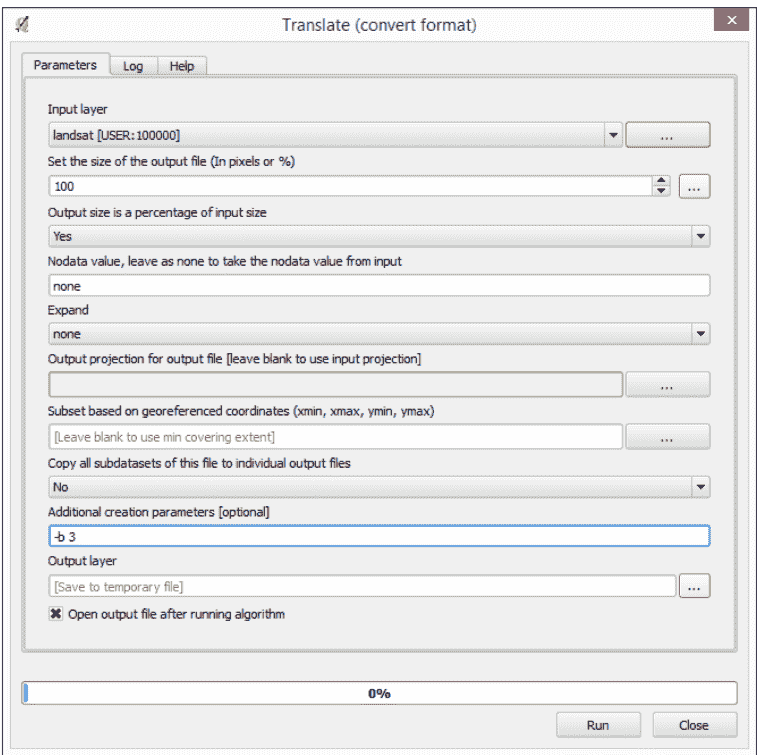

Translate（转换）算法底层使用 GDAL 库。您也可以从控制台将该库作为独立工具使用。在算法对话框的下方，您会看到一个文本字段，其中会显示与当前算法配置等价的控制台调用。

## 处理空值

空值是一种特殊的值，用于表示给定图层中未定义值的像元。理解如何使用空值非常重要，既可以避免在分析时得到错误结果，也可以将其作为一种工具来获得更好、更正确的结果。本操作步骤解释了栅格图层中空值的一些基本概念。

### 如何操作...

`watershed.tif` 图层包含一个流域的范围。流域内部的像元是水最终会流入流域出口点的像元。其余像元属于另一个流域。要使用流域掩膜对 DEM 进行掩膜，请按照以下步骤操作：

1. 打开 `watershed.tif` 图层。
2. 打开识别工具，检查属于流域的像元值是否为 1，而外部的像元值是否为 `no data`。
3. 尝试在流域内部和外部单击；在**识别结果**对话框中，您将看到结果，如以下截图所示：

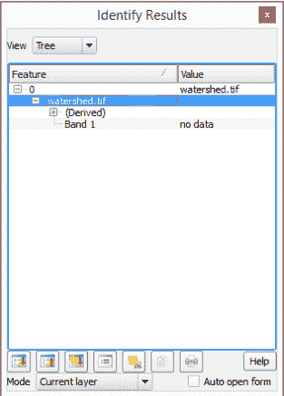

4. 现在，让我们计算栅格图层的一些统计数据。在**处理工具箱**菜单中打开**栅格图层统计**算法。
5. 在**输入图层**字段中选择流域图层，并单击**确定**运行该算法。结果是一段简短的文本输出，类似于以下截图：

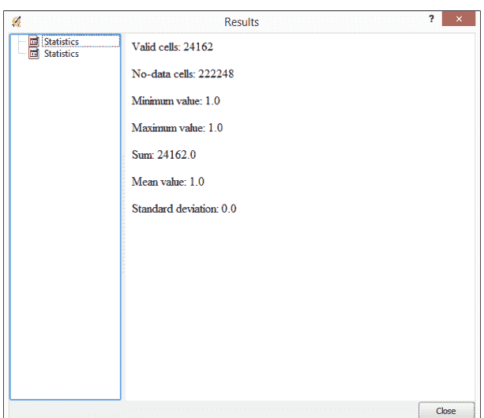

仅考虑了值为 1 的像元，图层中的平均值等于 1。

该图层有 610 列和 401 行，但有效像元的总数远低于 610 × 410。这些有效像元才是用于计算统计数据的像元。

### 工作原理...

栅格图层总是覆盖一个矩形区域。然而，在某些情况下，图层所代表的地物对象可能不是矩形的。这可能是纯粹的地球物理原因（想象一个包含非水体像元的水温图层）、政治原因（一个国家 DEM 图层，而邻国没有可用数据），或其他许多原因。无论如何，这些像元都需要一个值来指示没有可用数据。于是选择并使用一个任意值。因此，该值通常是一个对于图层中存储的变量来说不合逻辑和/或不可行的值。

以示例图层为例，使用的值是 -99999，这是为无数据值设置的默认值。这意味着，当识别工具显示 `no data` 时，它实际上在这种情况下选择了 -99999 这个值。

处理框架中的算法会系统地忽略无数据像元，不使用它们的值。您可以在前面的示例中清楚地看到这一点。图层中大部分像元的值为 1（属于流域的像元），但其中许多像元的值为 -99999。因此，像元的平均值本应不等于 1，但由于 -99999 被定义为无数据值，所有值为该值的像元都会被忽略。因此，图层的平均值等于 1。

### 更多内容...

空值不仅在执行分析时需要考虑，在我们只是想要渲染包含空值的图层时也需要考虑。

## 控制空值的渲染

在渲染栅格图层时，空值也会被单独考虑。您可以选择使用给定颜色（由当前调色板设置）来显示它们，或者完全不渲染它们。要使所有空值像元透明，请打开图层属性并转到“透明度”部分。确保“无数据值”复选框已勾选，如以下截图所示：

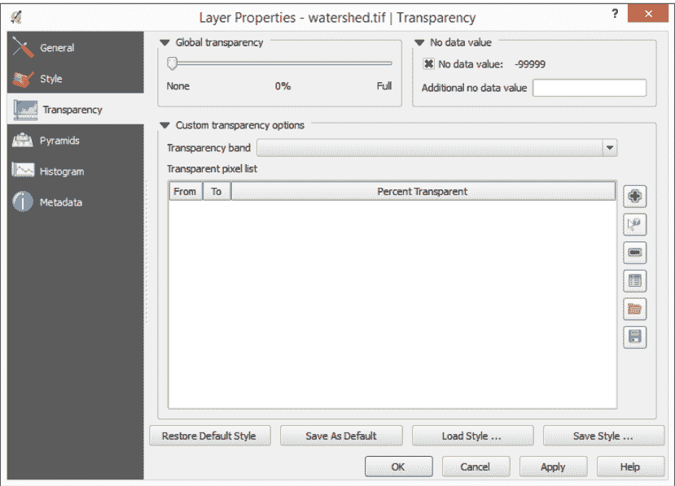

## 使用掩膜设置范围

可以使用第二个图层作为掩膜来设置图层的范围。本教程将向您展示如何操作。

## 如何操作...

要使用流域掩膜对 DEM 进行掩膜，请按照以下步骤操作：

- 1. 打开 `watershed.tif` 图层和 `dem.tif` 图层。
- 2. 打开 **Processing Toolbox** 菜单中的 **Raster Calculator** 算法。
- 3. 在 **Main input layer** 中选择 DEM，并在 **Additional layers** 字段中选择流域图层。
- 4. 在 **Formula** 字段中输入公式 a*b。
- 5. 点击 **Run** 运行算法。您将得到一个被掩膜的 DEM，如下所示：

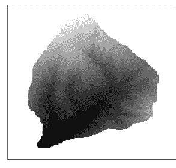

## 其工作原理...

使用栅格计算器时，涉及无数据值的任何运算都会产生另一个无数据值。这意味着，当将 DEM 图层和掩膜图层相乘时，在掩膜图层中包含无数据值的单元格中，结果图层中的值将为无数据值，无论该单元格在 DEM 图层中的高程值是多少。

由于掩膜图层中流域内的单元格值为 1，因此结果是一个具有流域单元格高程值且其余单元格为无数据值的图层。

## 还有更多...

以下是有关掩膜的一些额外思路。

## 将分析限制在给定区域

一旦我们对感兴趣的区域进行了掩膜，例如本例中的流域，我们执行的所有分析都将限制在此范围内。例如，让我们计算流域的平均高程：

- 1. 打开 **Basic statistics for raster layers** 算法。
- 2. 在 **Input layer** 字段中选择被掩膜的 DEM，然后点击 **Run** 运行算法。您将在 **Results** 窗口中获得统计信息：

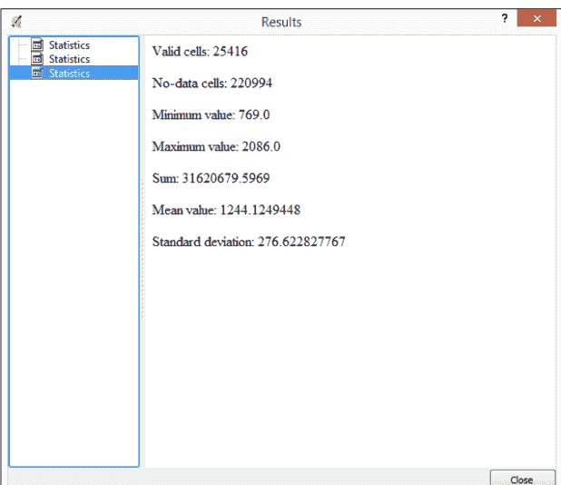

这些值仅使用有效单元格值计算，并忽略无数据值，这意味着它们指的是流域而不是栅格图层的完整范围。

## 移除多余的无数据值

有时，栅格图层中可能存在比所需更多的无数据值，就像所提出的流域图层的情况一样。为了减小图层的范围并仅保留覆盖有效数据的最小范围，您可以使用 Crop to data 算法：

- 1. 在 Processing Toolbox 菜单中打开 Crop to data 算法。
- 2. 在 Input layer 字段中输入被掩膜的 DEM，然后点击 Run 运行算法。禁用无数据值的透明度后，结果图层应如下所示：

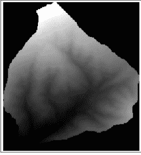

> 请注意，如果您选择将无数据单元格渲染为透明像素，则原始图层和裁剪后的图层在视觉上将没有区别。

## 使用矢量掩膜进行掩膜

栅格图层也可以使用多边形矢量图层进行掩膜。watershed.shp 文件包含一个多边形，其中包含我们已用于掩膜 DEM 的流域区域。以下是如何在不使用栅格掩膜的情况下使用它来掩膜该 DEM 的方法：

- 1. 打开 Clip grid with the polygon 算法。
- 2. 在 Input 字段中选择 DEM。
- 3. 在 Polygons 字段中选择矢量图层。
- 4. 点击 Run 运行算法。裁剪后的图层将被添加到 QGIS 项目中。

在这种情况下，clip 算法会自动将输出图层的范围减少到由多边形图层定义的最小范围，因此之后无需再运行 Crop to data 算法。

## 采样栅格图层

可以通过查询点坐标处图层的值，将栅格图层的数据添加到点图层中。此过程称为采样，本教程将解释如何执行此操作。

## 准备工作

打开 `dem.tif` 栅格图层和 `dem_points.shp` 矢量图层：

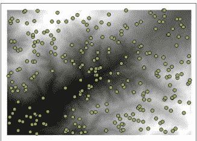

## 如何操作...

- 1. 在 **Processing Toolbox** 菜单中，找到 **Add grid values to points** 算法并双击打开它：

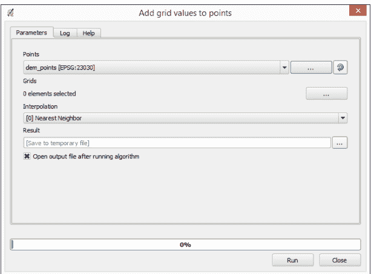

## Raster Analysis II

## 还有更多...

这里您可以找到有关在不同情况下如何组合栅格和矢量图层的一些思路。

## 其他栅格-矢量数据传输操作

来自栅格图层的数据也可以添加到其他类型的矢量图层中。对于包含多边形的矢量图层，可以使用 **Grid statistics for polygons** 算法，方法如下：

- 1. 打开我们在上一教程中使用的 `watershed.shp` 文件。
- 2. 打开 **Grid** statistics in the **Polygons** field。
- 3. 在 **Grids** 字段中选择要裁剪的栅格图层。
- 4. 在 **Polygons** 字段中选择带有掩膜的多边形图层。
- 5. 从剩余参数中选择要计算的统计信息。例如，要仅计算平均高程，请保留 **Mean** 字段选中并取消选中其他字段。
- 6. 点击 **Run** 运行算法。

结果图层是一个新的多边形图层，其中包含流域，并在属性表中添加了一个字段，其中包含每个多边形的平均高程值。

如果选择更多统计信息，结果将添加更多附加字段，每个新计算的参数和每个选定的栅格各一个。

## 可视化多光谱图层

多光谱图层可以根据波段的使用方式以不同方式渲染。本教程将向您展示如何操作并讨论其背后的理论。

## 准备工作

打开 `landsat.qgs` 项目。

## 如何操作...

- 1. Landsat 影像在默认配置下打开时，看起来类似于以下屏幕截图：

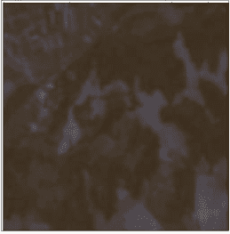

- 2. 双击图层打开其属性并移动到 **Style** 部分：
  - 1. 在 **Red band** 字段中选择波段号 4。
  - 2. 在 **Green band** 字段中选择波段号 3。
  - 3. 在 **Blue band** 字段中选择波段号 2。

您的样式配置应如下所示：

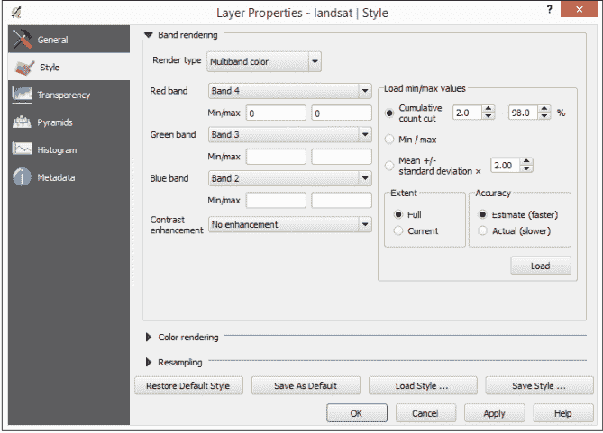

- 3. 点击 **OK**。

## Raster Analysis II

图像现在应如下所示：

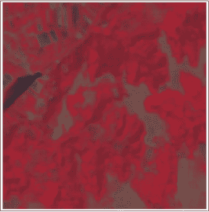

## 其工作原理...

表示给定像素的颜色使用 RGB 颜色空间定义，需要三个不同的分量。普通图像，例如从数码相机获得的图像，具有包含这三个分量强度——红、绿、蓝——的三个波段。

多光谱波段，例如本教程中使用的波段，具有超过三个波段，并在电磁谱的不同区域提供更多细节。为了可视化这些波段，需要从可用波段总数中选择三个波段，并将其强度用作基本红、绿、蓝分量的强度，尽管它们可能对应于不同的光谱区域，甚至超出可见范围。这被称为 *假彩色图像*。

根据所使用的波段组合，结果图像将传达不同类型的信息。所选组合经常用于植被研究，因为它可以区分针叶林和阔叶林，并提供有关植被健康的信息。

在此情况下，该组合应用于 Landsat 7 影像，该影像使用 ETM+ 传感器拍摄。每个波段覆盖的波长如下所示，单位为微米：

- **Band 1:** 0.45 - 0.515
- **Band 2:** 0.525 - 0.605
- **Band 3:** 0.63 - 0.69
- **Band 4:** 0.75 - 0.90
- **Band 5:** 1.55 - 1.75
- **Band 6:** 10.40 - 12.5
- **Band 7:** 2.09 - 2.35

## 还有更多...

Landsat 图层经常使用不同的组合。其中之一如下：

- 在 **Red band** 字段中选择波段号 3
- 在 **Green band** 字段中选择波段号 2
- 在 **Blue band** 字段中选择波段号 1

这是一种自然色组合，因为用于 **R**、**G** 和 **B** 分量的波段实际上具有对应于颜色 **红**、**绿** 和 **蓝** 的波长：

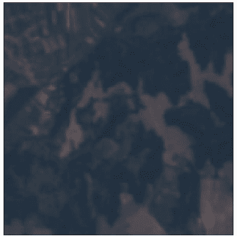

如果您使用的是非 Landsat 7 影像，每个波段将具有不同的含义，使用相同的波段号组合会产生不同的结果。必须检查每个波段的含义以了解渲染图像所显示的信息。

## 另请参阅

- Landsat 数据可免费获取。如果您想下载对应于给定区域的 Landsat 数据，请访问 http://landsat.gsfc.nasa.gov/。在这里，您可以找到有关在哪里以及如何下载它的更多信息。

## 修改和重新分类栅格图层中的值

处理栅格数据时非常有用的技术之一是更改其值或将其分组到类别中。在本教程中，我们将了解如何执行此操作。

### 准备工作

打开我们在之前教程中使用的 DEM 文件。

### 操作方法...

我们将把高程分为三组：

- 低于 1,000m
- 在 1,000 到 2,000m 之间
- 高于 2,000m

为此，请按照以下步骤操作：

1. 从 **Processing Toolbox** 菜单打开 **Change grid values** 算法。将 **Replace condition** 参数设置为 **Low Value <= Grid Value < High Value**。
2. 点击 **Lookup table** 参数中的按钮并填写出现的表格，如以下屏幕截图所示：

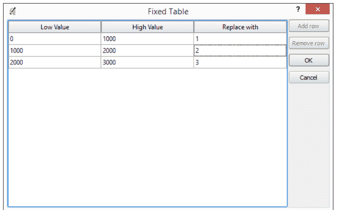

3. 运行算法。这将创建重新分类的图层：

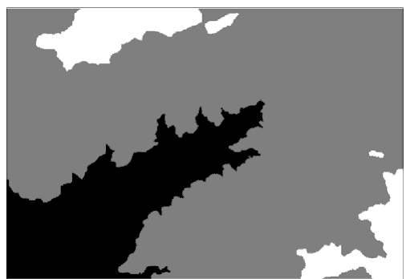

### 工作原理...

每个单元的值都会与查找表中的范围限制进行比较，并考虑指定的比较条件。每当某个值落入给定范围时，该范围指定的类别值将被用于输出图层。

### 还有更多...

可以使用其他策略来自动化重新分类，尤其是在这涉及将栅格图层值划分为具有某些恒定属性的类别时。在此，我们展示其中两种情况。

#### 重新分类为等振幅类别

重新分类的典型情况是将图层值的总范围划分为给定数量的类别。这类似于将其切片，如果应用于 DEM，例如我们的示例数据，其结果将类似于以规则间隔定义等高线的结果（尽管在这种情况下结果不是具有线的矢量图层，而是新的栅格图层）。

要按等间隔重新分类，请按照以下步骤操作：

1. 从 Processing Toolbox 菜单打开 Raster calculator。
2. 选择 DEM 作为唯一要使用的图层。
3. 输入公式，int((a-514)/(2410-514) * 5)。

重新分类的图层将如下所示：

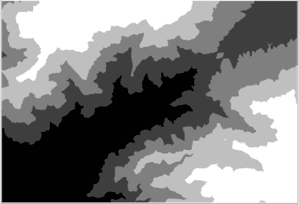

公式中的数值对应于图层的最小值和最大值。您可以在图层的属性窗口中找到这些值。

要创建不同数量的类别，只需在公式中使用 5 以外的其他值即可。

#### 重新分类为等面积类别

没有工具可以将栅格重新分类为 *n* 个类别，使得每个类别占据相同的面积，但可以使用其他算法获得类似的结果。为了向您展示如何操作，让我们将 DEM 重新分类为五个面积相同的类别：

1. 打开 **Sort grid** 算法并输入 DEM 作为输入图层。点击 **Run** 运行算法。

   生成的图层按 DEM 中的值对单元进行排序，因此值为 1 的单元代表最低高程值，2 是第二低，依此类推。

2. 使用前面描述的程序将排序后的图层重新分类为五个等振幅类别。最终图层应如下所示：

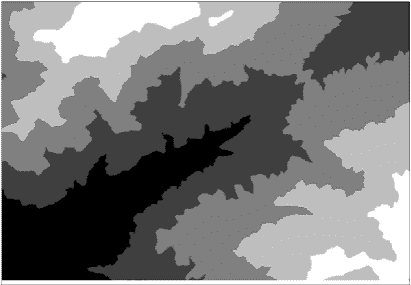

### 另请参阅

- **Processing Toolbox** 菜单包含额外的分类算法，其中大多数基于 SAGA。其中一种采用不同方法的算法是 **Cluster analysis for grids**。它将创建给定数量的类别，使组内的方差最小化，力求使其尽可能同质。这也称为无监督分类。

## 对栅格图层进行监督分类

在之前的教程中，我们看到了如何更改栅格图层的值并创建类别。当您有多个图层时，分类可能并不那么容易，并且定义执行此分类的模式可能并不明显。在这种情况下可以使用不同的技术，即定义具有共同特征的区域，并让相应的算法提取定义它们的统计值，以便之后可以将其应用于执行分类本身。这称为 **Supervised classification**，本教程解释了如何在 QGIS 中执行此操作。

### 准备工作

打开 `classification.qgs` 项目。它包含一个 RGB 图像和一个包含多边形的矢量图层。

### 操作方法...

1. 图像必须分离为单独的波段。使用提供的图像作为输入运行 **Split RGB bands**，您将获得三个名为 R、G 和 B 的图层。
2. 从 **Processing Toolbox** 菜单打开 **Supervised classification** 算法。
3. 填写其参数窗口，如以下屏幕截图所示：

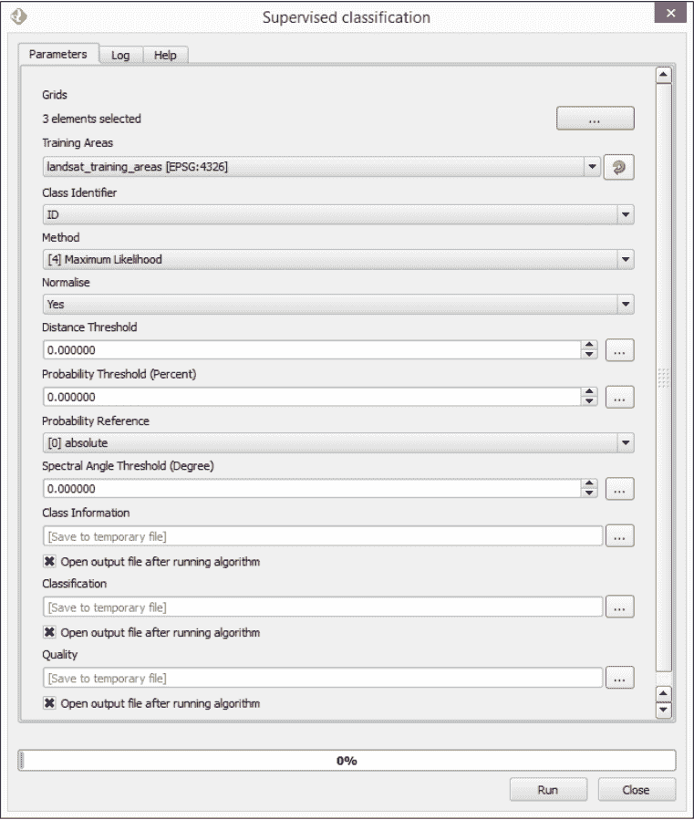

4. 在第一个字段中，您应选择上一步生成的三个图层（R、G 和 B）。
5. 点击 **OK** 运行算法。将创建两个图层和一个表格。名为 **Classification** 的图层包含分类后的栅格图层：

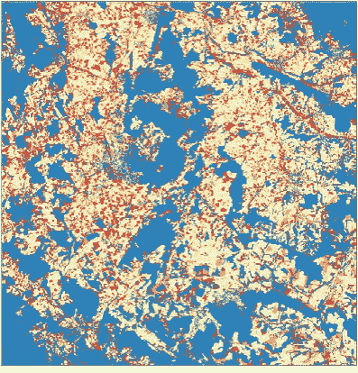

### 工作原理...

监督分类需要一组栅格图层和一个包含定义不同类别的多边形的矢量图层。类别的标识符在属性表中的 **Class** 字段中定义。如果您打开属性表，您会看到它看起来像这样：

| ID | BOTYP |
|---|---|
| 0 | 1 Forest |
| 1 | 2 Wheat |
| 2 | 3 Urban |
| 3 | 4 Crop |
| 4 | 5 Crop-clear |

有五个不同的类别，每个类别都由一个要素表示，并带有文本 ID 和数值 ID。分类算法分析落在每个类别多边形内的像素并为其计算统计数据。利用这些统计数据为图像中的每个像素分配一个类别，尝试分配在矢量图层中定义的类别中最统计相似的类别。数值 ID 用于在生成的栅格图层中标识类别。

### 还有更多...

在 QGIS 中执行监督分类还有其他方法。其中一种允许对过程中的不同元素进行更多控制的方法是使用 **QGIS semi-automatic classification** 插件。

可以从 **Processing Toolbox** 菜单使用其他更复杂的分类方法。它们可以在工具箱的 **Advanced** 界面中找到，在 **Orfeo Toolbox** 组下，如以下屏幕截图所示：

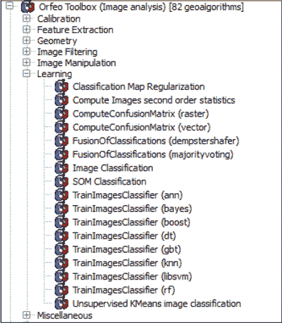

### 另请参阅

- 您可以使用 QGIS 插件管理器下载并安装它。有关如何使用插件的更多信息，您可以查看其页面 `http://fromgistors.blogspot.fr/p/semi-automatic-classification-plugin.html`。
