## 9 QGIS 与 Web

在本章中我们将介绍以下教程：

- 使用网络服务
- 使用 WFS 和 WFS-T
- 搜索 CSW
- 使用 WMS 和 WMS Tiles
- 使用 WCS
- 使用 GDAL
- 使用 QGIS 服务器提供网络地图
- 基于比例的渲染
- 连接网络客户端
- 从 QGIS 管理 GeoServer

### 简介

QGIS 是一个经典的桌面 **地理信息系统 (GIS)**。然而，如今仅处理本地数据是不够的。您希望能够自由使用来自网络的数据，而无需花费数天下载这些数据。同时，您希望能够将地图在线发布给比纸质地图或 PDF 更广泛的受众。这就是网络服务发挥作用的地方。QGIS 既可以作为网络服务客户端，也可以作为网络服务器，为您提供使用和共享地理数据的许多选项。本章介绍使用地理数据开放网络服务的基础知识以及将地图在线发布的一些方法。


# 使用网络服务

有相当多的不同类型的基于网络的地图服务可以在 QGIS 中加载。每种类型的网络服务都提供数据；通常，这是以不同方式提供的相同数据。本教程旨在帮助你确定想要使用哪种类型的网络服务，以及反过来，你可能想要为他人使用而创建哪种类型的网络服务。

## 准备工作

本教程完全是关于思考的，所以你不需要任何特别的东西来开始。如果你有一个项目在考虑中，以及一些你感兴趣使用或创建的数据类型，那就更好了。大多数，如果不是全部，这些方法都需要互联网连接或提供这些服务的本地服务器。当然，如果你有本地数据，你可能最好直接加载它。

为了帮助下面的部分，这里有一个缩写列表：

- **CSW**：这是 **Catalog Service for the Web**
- **WFS**：这是 **Web Feature Service**
- **WFS-T**：这是 **Web Feature Service, Transactional**
- **WCS**：这是 **Web Coverage Service**
- **WMS**：这是 **Web Map Service**
- **WMTS**：这是 **Web Map Tile Service**
- **TMS**：这是 **Tile Map Service**
- **XYZ**：这是一个“X Y Z”服务（这个其实没有正式名称，因为它不是官方标准）

## 如何操作...

1. 首先针对通过网络服务使用数据回答以下问题：
   - 你是否已经知道在哪里找到想要的数据？
   - 你是否需要编辑或对该数据应用自定义样式？
   - 你是否在乎数据是矢量还是栅格？
   - 你是否需要以原始分辨率或质量获取数据？
   - 你是否需要在特定分辨率或特定投影下获取数据？

2. 使用以下决策矩阵来选择适合你使用场景的服务：

| 判定标准 | CSW | WFS | WFS-T | WCS | WMS | 瓦片 (WMTS, XYZ, TMS) |
|---|---|---|---|---|---|---|
| 你是否已经知道在哪里找到想要的数据？ | 否 | 是 | 是 | 是 | 是 | 是 |
| 你是否需要编辑或对数据应用自定义样式？ |  | 是 | 是 | 是 | 否 | 否 |
| 你是否在乎数据是矢量还是栅格？ |  | 矢量 | 矢量 | 栅格 | 栅格 | 栅格 |
| 你是否需要以原始分辨率或质量获取数据？ |  | 是 | 是 | 是 | 否 | 否 |
| 你是否需要在特定分辨率或特定投影下获取数据？ |  | 是 | 是 | 是 | 是 | 否 |
| 本章中的教程编号。 | 3 | 2 | 2 | 5 | 4 | 4, 6 |

现在你已经找到了想要使用的网络服务的合适教程，稍后在本章中跳转到该教程。如果你仍然不确定，请继续阅读以获取更多如何选择正确服务的提示。本教程既适用于你如何使用网络服务，也适用于如何决定提供哪些网络服务（如果你为他人提供网络服务）。

总体而言，从左（WFS）到右（瓦片），服务的速度会增加。瓦片以最少的限制为终端用户提供最快的数据服务。

## 其工作原理...

对于每种服务，都有一个 QGIS 工具（内置或插件）。该工具存储你的网络服务器列表以及每种服务的连接设置。当你去从特定协议的选定网络服务器加载图层时，会从服务器请求最新的图层列表（即 GetCapabilities XML）。然后你就可以从该列表中挑选想要添加到地图画布上的图层（并且根据服务类型、投影和文件类型不同）。

## 还有更多...

矢量通常较慢，因为随着数据的增长，需要传输的数据更多。栅格格式在屏幕上是固定数量的像素，因此每次屏幕加载的数据量大致相同。

WMS、WMTS、WFS 和 WCS 有时被称为 W*S，作为一组行为相似的相关服务的统称。

每个情况都会有额外的考虑。例如，如果你需要特定投影，你可能无法使用瓦片服务，因为这些服务通常只在非常特定的投影中（Web/Spherical Mercator）。或者，也许你想要打印大张纸质地图。那么，你可能希望使用 WFS 或 WCS 以获得整个区域的最大可能分辨率。

最常见的错误之一是认为你需要矢量数据，而实际上你只需要一个包含矢量数据的背景瓦片。一个很好的例子是道路数据。如果你实际上不需要样式化、选择或单独操作道路数据，那么瓦片或 WMS 类型的图层会快得多。

## 另请参阅

- 如需更多信息，请阅读 OGC 网站上的标准，http://opengeospatial.org

# 使用 WFS 和 WFS-T

Web Feature Services（WFS）是 OGC 的标准方法，用于通过互联网访问并在某些情况下编辑（WFS-T）矢量数据。当你需要完整的属性表、本地样式控制或编辑功能时，WFS 是最佳选择。与大多数其他网络服务一样，与本地图层相比最大的优势是你不必一次复制或加载整个图层。

如果你只是需要查看图层，通常 WMS 或瓦片服务（在本章其他教程中描述）更有效。

## 准备工作

你需要一个 WFS 服务的 URL 以及一个可用的互联网连接。我们将使用公共的 Mapserver 演示网站（http://demo.mapserver.org/）。

要尝试涉及编辑的 WFS-T，你需要获得对服务的访问权限（通常受密码保护）或自己搭建一个。你需要一个 WFS-T 测试服务器吗？这是一个 OSGeo-Live 派上用场的好例子，因为你可以在虚拟机中运行自己的 WFS-T 服务器，网址为 http://live.osgeo.org。

## 如何操作...

1. 找到你想要使用的 WFS 服务并复制 GetCapabilities URL。对于本示例，我们将使用 Mapserver 演示网站，`http://demo.mapserver.org/`。

> 与其他网络服务一样，如果你先加载本地图层并缩放至其范围，则更有效。这可以让你避免为超出你感兴趣区域的范围加载网络服务数据而浪费时间。

2. 通过点击以下图标打开添加 WFS 对话框：


3. 创建一个 **New** 连接。

4. 分配你选择的 **Name** 并将 WFS 服务的 **URL** 粘贴到字段中，（`http://demo.mapserver.org/cgi-bin/wfs?SERVICE=WFS&VERSION=1.0.0&REQUEST=GetCapabilities`）；

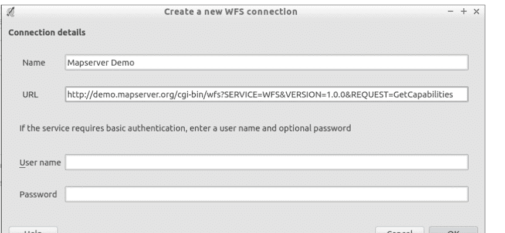

> 在未来再次使用同一服务时，它将已在你的服务列表中，因此你只需添加一次。

5. 通过点击 **OK** 按钮保存你的编辑。

6. 现在从下拉菜单中选择该服务。

7. 通过点击 **Connect** 按钮查询图层列表。

8. 选择你想要添加到地图的图层或图层；对于本示例，`continents` 或 `cities` 都可以：

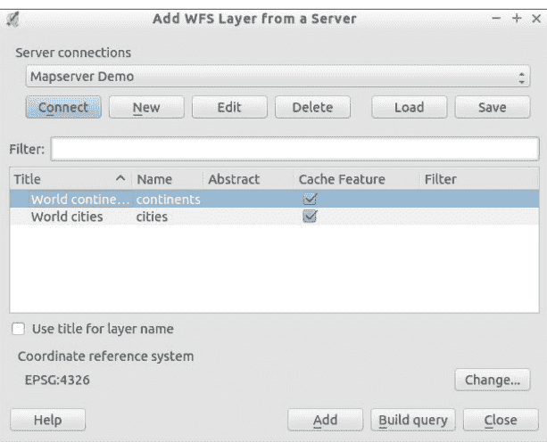

9. 选择完成后，使用 Add 按钮将图层放置到地图中。

10. 通过在列表中上下拖动图层来重新排列地图的渲染顺序。

11. 平移和缩放以对视图加载 WFS 数据发出新的请求。

> WFS 图层可以用标准图层属性重新样式化。此外，信息工具和属性表将像其他矢量图层一样出现。

## 其工作原理...

对于每个网络服务，都有一个主 URL。当你浏览到此 URL 并添加 GetCapabilities 参数（QGIS 会为你完成），返回的结果是一个 XML 文件，其中描述了服务器提供的服务。客户端 QGIS 会为你解析图层列表以供选择，一旦你选择了图层（们），就会使用 XML 中的额外信息在特定 URL 上查找数据。

数据请求仅限于地图画布的可见边界框。这限制了请求的数据量。至少应该是这样工作。然而，超出屏幕的要素可能会完整包含以保持几何完整性。因此，预计通过 WFS 加载大型矢量图层可能会极其缓慢。


## 更多内容...

WFS-T 服务通常需要密码，并设计为通过互联网工作。如果你在本地网络中工作，可以考虑直接使用 PostGIS 图层。无论如何，还应注意版本控制和冲突解决不是自动的，需要将服务后端配置为支持这些功能。

## 搜索 CSW

CSW 是一种目录 Web 服务。其主要功能是提供地理数据的可发现性，并通过下载或本章提到的任何其他 Web 服务链接到可用数据。

## 准备工作

本方法使用 MetaSearch 插件。它需要你的系统 Python 中安装 pycsw 和 owslib 库。如果你不知道如何安装 pycsw 和 owslib，请参阅第 11 章“扩展 QGIS”中的“添加带有 Python 依赖的插件”方法。

## 操作方法...

- 1. 通过导航到 Web | MetaSearch | MetaSearch 打开 MetaSearch 插件。
- 2. 从右侧的下拉菜单中选择一个服务：英国位置目录发布服务（UK Location Catalogue Publishing Service）。
- 3. 在左侧的框中输入搜索词：Park。

> 如果你看不到 Web 菜单，请检查插件管理器并确保 MetaSearch 已启用（勾选）。

> 如果下拉列表中没有显示任何服务，请单击“服务”选项卡，并使用“添加默认服务”按钮。

## QGIS 与 Web

- 4. （可选）设置范围以限制搜索。在这种情况下，使用**地图范围**。

> 全局搜索通常会返回过多结果，或者在等待所有结果时导致连接超时。与其他 Web 服务一样，建议先加载参考图层并缩放到感兴趣区域，然后再尝试搜索它们。第三个选项卡**设置**允许你调整超时时间。如果遇到太多超时错误，请增大此值。

- 5. 单击**搜索**按钮并等待结果：

- 1. 双击任意结果以查看其他详细信息。
- 2. 如果所选结果可作为可加载图层，则屏幕底部的一个或多个服务按钮将启用。要了解更多关于如何使用这些选项的信息，请参阅本章中关于 WMS、WFS 和 WCS 的其他方法：

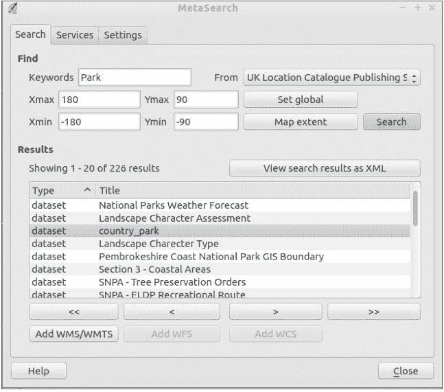

## QGIS 与 Web

## 准备工作

WMS 有多种迭代版本，QGIS 支持其中的大多数。要使用 WMS，你需要向 QGIS 提供要查看数据服务的 GetCapabilities URL。

## 操作方法....

- 1. 找到一个你想要使用的 WMS 服务，并复制 GetCapabilities URL。在本方法中，我们可以使用 Geoserver 演示网站（`http://demo.opengeo.org/geoserver/web/`）。

> 与其他 Web 服务一样，如果你先加载本地图层并缩放到它们的范围，效率会更高。这样你就不会浪费时间从 Web 服务加载感兴趣区域之外的数据。

- 2. 打开**添加 WMS** 对话框。
- 3. 创建一个**新连接**。
- 4. 指定一个你选择的**名称**，并将**URL**（`http://demo.opengeo.org/geoserver/ows?service=wms&version=1.3.0&request=GetCapabilities`）粘贴到其中：

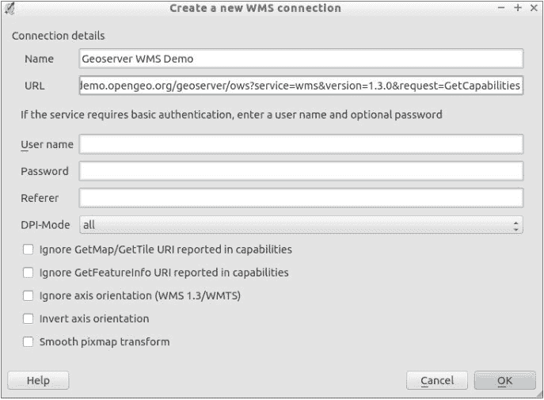

## QGIS 与 Web

- - 选择投影时，如果可以使用数据的原始投影（如果你知道），你会得到最少的重采样。否则，请选择与你计划与 WMS 结合使用的其他数据相匹配的投影。

> 并非所有图像类型和投影都可用；这取决于服务器提供的内容。如果一种图像类型似乎不起作用，请在报告服务器故障之前尝试另一种。

- 10. 当你的选择完成后，使用**添加**按钮将图层放到地图中。
- 11. 通过上下拖动列表中的图层来重新排列地图的渲染顺序。
- 12. 平移和缩放以发出新的请求，将 WMS 数据加载到视图中。

## 工作原理...

当你平移和缩放地图时，一个带有可见范围和比例边界框的请求被发送到服务。然后服务器渲染一个与请求匹配的图像，并将其传回客户端（在本例中为 QGIS）。

## 更多内容...

现在一些 WMS 服务还支持在 **Web 地图瓦片服务（WMTS）** 协议下进行瓦片化。从客户端的角度来看，在使用上与 WMS 没有太大区别。在服务器端，每次请求后结果都会被缓存，所以如果请求相同的范围和比例，可以传递缓存版本，而不是从头创建结果。对你这个最终用户来说，如果服务提供 WMTS，这应该会带来更快的加载速度。

配置 WMTS 时，使用 WMTS URL 而不是 WMS URL。一个例子是 Geoserver 演示网站的 WMTS：

```
http://demo.opengeo.org/geoserver/gwc/service/
wmts?REQUEST=GetCapabilities
```

一旦成功，你将进入**瓦片集**选项卡，在那里可以选择要加载的可用选项中的图层和投影。由于瓦片是预制的或缓存的，你通常无法同时组合多个图层，需要一次加载一个：

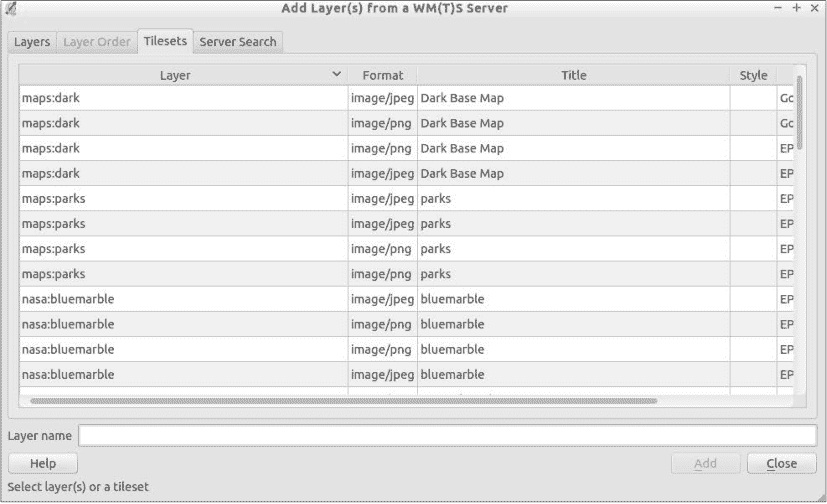

> 💡 WMS-C 是 WMTS 标准的早期版本。在使用上几乎相同，尽管 URL 模式可能看起来更像 WMS。

## 另请参阅

- - 有关 QGIS 的 WMS 功能的更多信息，请参阅 QGIS 文档，网址为 `http://docs.qgis.org/2.8/en/docs/user_manual/working_with_ogc/ogc_client_support.html#ogc-wms`

## 使用 WCS

**Web 覆盖服务（WCS）** 在用例上与其他服务有很大不同，但行为非常相似。WCS 的目标是允许用户从远程托管的大型栅格数据中提取感兴趣区域。与 WMS 或瓦片集不同，WCS 是原始数据的裁剪，具有完整分辨率，通常采用原始投影。如果你需要栅格数据用于分析目的而不仅仅是可视化，这种格式非常理想。

- 7. 现在，你将回到**从 WCS 服务器添加图层**对话框：
  - 1. 单击**连接**按钮。
  - 2. 列表填充后，选择要添加到地图的图层。单击**添加**按钮。尝试使用 Blue Marble 图层。
  - 3. 现在，单击**关闭**按钮返回你的地图：

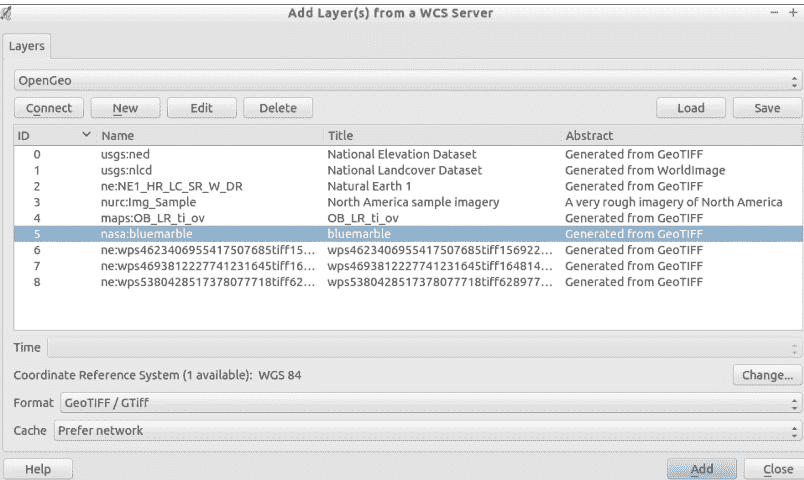

- 8. 你现在应该看到 Blue Marble 图层已加载。

> > 如果你放大到美国州或欧洲国家的级别，你会看到图像开始像素化。Blue Marble 是美国国家航空航天局（NASA）制作的低分辨率图像，大致展示了从太空中看到的无云地球全貌。它旨在提供整个世界的一般视图，不包含精细细节。

- 9. （可选）使用**另存为**选项以完整的原始分辨率下载部分或整个 WCS 图层。

## 工作原理...

WCS 与其他 Web 服务一样，向服务器发送边界框请求，服务器再将栅格数据传递给 QGIS。与 WMS 不同，服务器端不进行渲染，发送的是原始栅格数据。这可能意味着：

- - 图像在发送前没有进行重采样
- - 你可以对传递的数据应用自己的样式

请记住，请求高分辨率栅格的完整范围将导致大量数据传输。这与瓦片或 WMS 不同，后者最多以请求的分辨率返回可视区域中的确切像素数。

> 与其他 Web 服务一样，建议在加载 WCS 之前先缩放到你的感兴趣区域。

## 更多内容...

WCS 相较于 WMS 的另一个好处是，由于 WCS 传递原始数据，它不局限于 3 波段 RGB 图像。你可以使用 WCS 查看和下载多光谱或高光谱数据（4+ 波段，在遥感应用中很常见）。

> 目前，QGIS 仅支持 1.0.x 和 1.1.x，不支持 WCS 2.x；至少目前还不支持！

## 使用 GDAL

正如第 4 章“数据探索”中的“使用 QuickMapServices 插件加载底图”和“使用 OpenLayers 插件加载底图”方法所述，QuickMapsServices 和 OpenLayers 插件非常棒，因为它们会在你的地图会话中放置参考图层。然而，一个缺点是添加新图层很麻烦。所以，如果你遇到或构建自己的瓦片服务并想在 QGIS 中使用它，本方法将让你使用几乎任何瓦片服务。

## 准备工作

你需要一个 Web 浏览器、文本编辑器，以及一个基于 Web 的 XYZ（有时称为 TMS）服务的 URL——一种允许你无需 API 密钥即可发出请求的服务。我们将使用 http://www.opencyclemap.org/ 上的地图。

```
http://www.opencyclemap.org/
```

查看 JavaScript 源码（一个好的工具是 Firebug，或其他浏览器 Web 开发工具），我们可以查看瓦片的源 URL。


## 如何操作...

+   1. 在网页浏览器中打开 http://www.opencyclemap.org/。
+   2. 现在，通过查看源代码来找出瓦片的 URL：
+      1. 查看 map.js，你会看到图层定义：
+      2. 或者，你可以查看浏览器下载的图像文件。如果你将 https://a.tile.thunderforest.com/cycle/13/1325/3143.png 放入浏览器，它会加载那一个瓦片。
+   3. 模式相当直接：
+      <server name>/<layer>/<zoom>/<tile index X>/<tile index Y>.<image format>
+   4. 要将其转换为 QGIS 中的图层，打开一个文本编辑器并粘贴以下定义。此定义告诉 GDAL 使用哪个驱动程序以及带有 z、x 和 y 作为变量的服务器 URL 模式。将文件保存为 opencyclemap.xml：

```
var cycle = new OpenLayers.Layer.OSM("OpenCycleMap",
  ["https://a.tile.thunderforest.com/cycle/${z}/${x}/${y}.png",
  "https://b.tile.thunderforest.com/cycle/${z}/${x}/${y}.png",
  "https://c.tile.thunderforest.com/cycle/${z}/${x}/${y}.png"],
  { displayOutsideMaxExtent: true,
    attribution: cycleattrib, transitionEffect: 'resize'}
);
```

```
https://a.tile.thunderforest.com/cycle/13/1325/3143.png
```

```
<server name>/<layer>/<zoom>/<tile index X>/<tile index Y>.<image format>
```

> 在这种特定情况下，Tile Index 模式是 TMS 样式；请参阅 http://www.maptiler.org/google-maps-coordinates-tile-bounds-projection/。

```
<GDAL_WMS>
  <Service name="TMS">
    <ServerUrl>http://c.tile.thunderforest.com/cycle/${z}/${x}/${y}.png</ServerUrl>
  </Service>
  <DataWindow>
    <UpperLeftX>-20037508.34</UpperLeftX>
    <UpperLeftY>20037508.34</UpperLeftY>
    <LowerRightX>20037508.34</LowerRightX>
    <LowerRightY>-20037508.34</LowerRightY>
    <TileLevel>18</TileLevel>
    <TileCountX>1</TileCountX>
<TileCountY>1</TileCountY>
<YOrigin>top</YOrigin>
</DataWindow>
<Projection>EPSG:3785</Projection>
<BlockSizeX>256</BlockSizeX>
<BlockSizeY>256</BlockSizeY>
<BandsCount>3</BandsCount>
<Cache />
</GDAL_WMS>
```

5. 你现在可以使用栅格对话框或浏览器加载该图层：

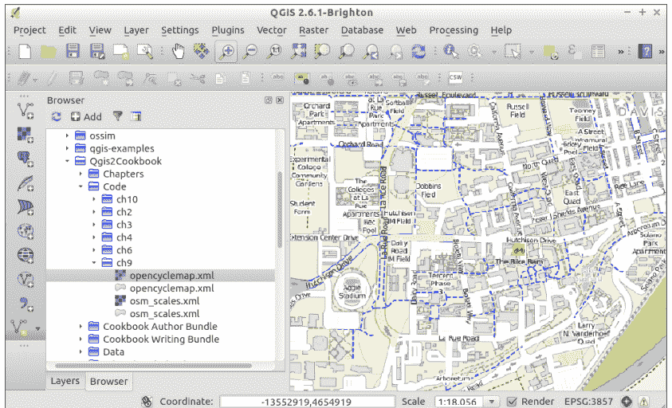

> 注意 opencyclemap.xml 有两个列表；只有带方形图标的那个才有效，即栅格，因为瓦片是栅格格式。

这种技术不仅限于瓦片服务。GDAL 支持的许多其他格式都可以被封装，以便在 QGIS 中更易于使用。这与 *第 2 章 数据管理* 中 *创建栅格概览金字塔* 食谱中提到的 **虚拟栅格表 VRT** 图层的方法类似。

最后，你可能会问为什么不使用这种方法创建一个新插件来取代 OpenLayers 插件。这种想法已经讨论了一段时间；关键的障碍是，使用这种方法访问某些图层，如 Google、Bing 等，可能会违反服务条款，因为它们没有将版权、商标和标志放在正确的位置。此外，缓存和打印此类图层可能不合法。总的来说，尽可能避免使用专有数据以减少许可问题。

## 另见

+   - 本食谱和方法实际上已在许多 QGIS 渠道中为人所知并被讨论过。最常引用的示例可在 http://www.3liz.com/blog/rldhont/index.php?post/2012/07/17/OpenStreetMap-Tiles-in-QGIS 获取。
+   - GDAL 选项的完整说明可在 http://www.gdal.org/frmt_wms.html 找到。

## 使用 QGIS 服务器提供网络地图

QGIS 和网络不仅仅是消费数据，还可以用来通过网络为他人提供数据，以便在线查看或在其他网络客户端中使用，例如 QGIS。请记住，设置自己的网络服务并不是制作网络地图最简单的方法，请参阅本章中的 *连接网络客户端* 食谱。然而，这是一个很好的方法，可以将你投入到 QGIS 项目文件中的大量工作转变为其他人可以查看和使用的东西。

## 准备工作

对于本食谱，你需要一个正在运行的 QGIS 服务器安装。这涉及运行一个标准的网络服务器，例如 Apache 或 Nginx。有许多设置服务器的方法，因此请参阅 http://hub.qgis.org/projects/quantum-gis/wiki/QGIS_Server_Tutorial 上的官方文档。

一旦 QGIS 服务器运行起来，你只需要一个具有本食谱中所述配置的 QGIS 项目即可。

## 如何操作...

+   1. 打开 QGIS。
+   2. 加载并设置样式图层：
+      - 你需要至少一个矢量图层以提供 WFS。
+      - 你需要至少一个栅格图层以提供 WCS。
+      - WMS 可以是任何图层组合，你可以选择将其作为独立图层或组合图层提供。
+   3. 在 **文件 | 项目属性** 中编辑 **项目** 属性：
+      1. 打开 **OWS 服务器** 选项卡。
+      2. 勾选 **服务功能** 框以启用 GetCapabilities。
+      3. 填写一些框，以便最终用户了解你的服务器是关于什么的、谁运行它以及如何联系你：

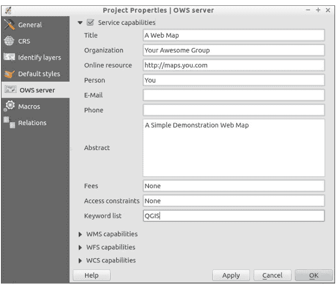

4. 现在检查 WMS 功能部分：

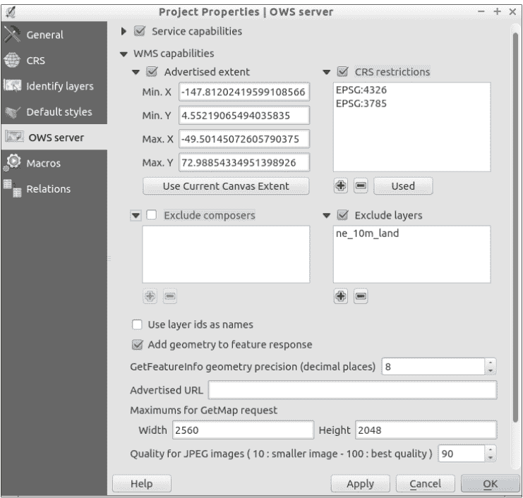

> 这些功能大多是可选的优化。选择适合你需求的功能。

5. 在这里，你可以设置客户端应期望的最大范围。

6. CRS 限制选项让你限制允许的投影。

7. 排除图层允许你在项目中有不显示在网络上的图层。

8. 添加几何到要素响应是一个可选增强功能，如果你正在构建网络地图并且希望能够使用实际的矢量数据。

+   9. **GetFeatureInfo** 精度是指用户查询位置时需要点击的接近程度。如果你有大量数据，你可能希望这个数字很小；但如果你只有几个要素，使其更大可以让最终用户更轻松。
+   10. 如果你想通过限制用户一次可以请求的数据量来减少服务器负载，请设置 **GetMap 请求的最大值**。对于公共服务器来说这是一个好主意。屏幕截图中显示的 2560 x 2048 足够让 HD 分辨率屏幕在一次请求中填满。
+   11. 接下来，查看 **WFS 功能** 部分：

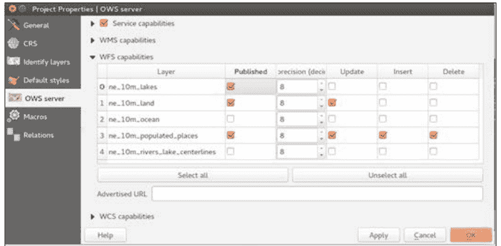

> 只有当你希望用户能够以矢量形式请求矢量数据时才启用 WFS。这可能比 WMS 更消耗你的带宽。此外，除非你将服务器保护为仅允许用户，否则不要启用 WFS-T 功能。

+   1. 勾选你希望通过 WFS 可用的任何矢量图层旁边的 **已发布** 框。
+   2. 要启用 WFS-T，请勾选 **更新**、**插入** 和 **删除** 复选框。由于它们是分开的，你可以选择只允许新数据 **插入**、只允许编辑现有数据 **更新**，或只允许删除数据 **删除**。**插入** 是最安全选项，因为它可防止编辑或删除现有数据。

12. 最后，查看 **WCS 功能**：

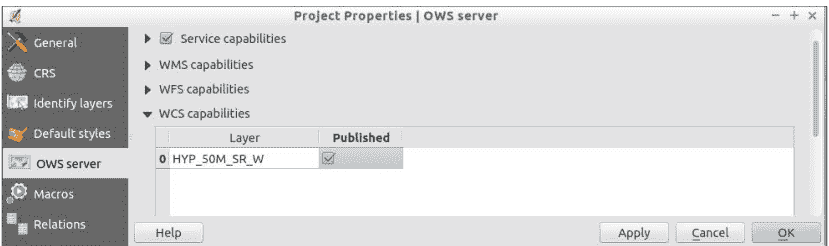

> 这是一个全有或全无的功能。除非你希望用户能够下载原始栅格数据，否则不要启用它。

13. 设置完选项后，单击 **确定** 按钮。

14. 现在，将项目保存在 QGIS 服务器可以访问的位置。

> 在 Apache 中，这通常是像 `/var/www/` 这样的文件夹。

15. 保存后，你可以从任何 OGC 兼容的网络客户端测试访问：

+   1. 对于简单测试，使用一个全新的 QGIS 项目和 **添加 WMS** 对话框。
+   2. GetCapabilities URL 将类似于 `http://localhost/cgi-bin/qgis_mapserv.fcgi?map=/usr/local/share/qgis/QGIS-NaturalEarth-Example.qgs`。

> 该 URL 中有些独特于 QGIS 服务器的关键部分是 map 参数，后面跟随 QGIS 项目文件的完整系统路径。
> 
> 这可能看起来很奇怪，但在 QGIS 中将你的 QGIS 服务器添加为 WMS 是测试它是否正常工作的好方法。

## 它是如何工作的...

QGIS 服务器是一个中间人，它接收网络服务请求并将其翻译为 QGIS 内部调用，返回请求的数据或渲染的图像，通过网络服务器传递给最终用户。


## 更多内容...

QGIS 服务器包含许多选项，允许你控制提供服务器的类型、通过每种服务提供哪些图层，以及如何为这些服务设置样式。QGIS 服务器的替代方案包括 MapServer 和 GeoServer（参见本章的“从 QGIS 管理 GeoServer”部分）。

## 另请参阅

- 更多详细信息，请参阅 QGIS 服务器的主要文档，网址为 http://hub.qgis.org/projects/quantum-gis/wiki/QGIS_Server_Tutorial。
- 创建服务后，通过将服务添加到 QGIS 项目中进行测试。有关如何添加 WMS、WFS 或 WCS 服务，请参阅本章前面的教程。

## 基于比例尺的渲染

尽管这些功能并非专门针对 Web 服务，但根据地图比例尺更改数据的样式和存在性，可以对 Web 服务的速度和可读性产生巨大影响。与打印地图不同，Web 地图以多种比例尺进行查看。这种比例尺的变化通常需要不同的制图方式来保持地图的清晰可用。

## 准备工作

你需要一个 QGIS 项目，最好是数据密度高或包含不同信息级别的项目。一个很好的例子是道路数据，其中有主要道路、次要道路、地方道路和其他类型的道路分类。前一章中从 CAD 转换而来的 `caryStreets.shp` 就是一个很好的例子。

## 操作步骤...

- 1. 打开 QGIS 并加载 `caryStreets.shp`。
- 2. 现在，打开属性表并查找用于过滤的属性。在 `caryStreets.shp` 中，有几个可用的列，例如 `StreetType`、`Major_Road` 和 `Main_Road`。

> `StreetType` 似乎是类别，而其他两列似乎是 True 或 False 标志。这些列中的任何一个都是过滤规则的不错候选。

- 3. 现在，打开图层的**属性**部分：
  - 1. 切换到**样式**选项卡以编辑符号系统。
  - 2. 将右上角的下拉菜单更改为**基于规则的渲染**。
  - 3. 创建一个新规则（绿色加号按钮）。
- 4. 在弹出对话框中，将**标签**设置为**主要道路**，将**过滤器**设置为 `"Major_Road" = 't'`。
- 5. （可选）你可以使用表达式构建器来构建过滤语句并测试它。点击 **...** 按钮打开对话框。

> 你可以创建两个主要道路的副本，并设置不同的比例尺范围，这样当你放大时，主要道路会变粗，同时次要道路会被启用。

这是你创建第一个规则前后图层的样子：

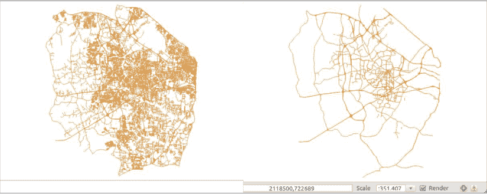

- 6. 现在，通过过滤 `"Major_Road" = 'f'` 为次要道路添加另一个规则。
- 7. 这次，你将启用**比例尺范围**选项。
- 8. 将**最小值（不含）**设置为 **1:100,000**。对于任何大于此比例尺的缩放级别，要素将被隐藏。对于**最大值（含）**，输入 **1:0**，这将禁用**最大**过滤器。

> 你不必打开**编辑规则**对话框；可以直接在**基于规则的渲染**页面中修改规则的各个部分。

11. 返回地图，缩放到 **1:50,000**，然后缩小到 **1:250,000**。当你跨越 **1:100,000** 比例尺时，次要道路应该会出现和消失：

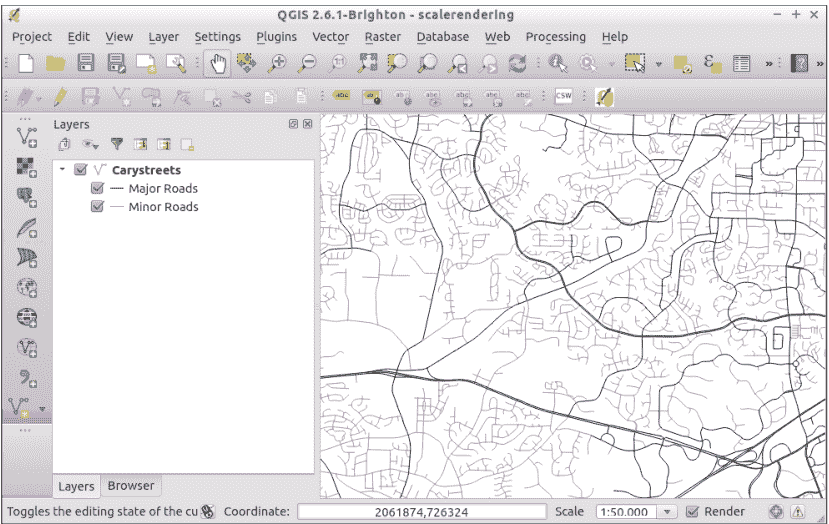

## 工作原理...

基于比例尺的渲染目标通常是使你的地图在许多不同的缩放级别下都能保持可读性。通过为每个图层或图层内的子要素设置**最小**和**最大**比例尺，你可以简化地图以提高可读性。渲染引擎在决定渲染什么之前，会根据每个规则检查比例尺。

## 更多内容...

基于比例尺的渲染可以用多种方式使用。它可以用于根据缩放级别更改样式，或根据缩放级别隐藏或显示数据。然而，它不仅仅限于更改样式或图层。你还可以执行基于比例尺的标注，这是本书第 10 章“制图技巧”中“配置数据定义标注”教程所描述的数据驱动标注的一部分。

比例尺规则也适用于栅格图层；但是，这仅允许你打开或关闭栅格。它不允许你更改其外观。

如果你在本章前面设置了 QGIS 服务器，则缩放规则应该适用于你的 Web 服务（WMS 和 WFS）。

> 你可能不想在 Web 浏览器中通过 WFS 使用像街道图层这样复杂的内容，因为它几乎肯定会崩溃。建议将此类复杂图层作为 Tiles 或 WMS 推送。

## 另请参阅

基于规则的渲染包含许多功能。然而，这还不是对其所有功能的全面指南，因此你需要自行探索并进行网络搜索。

## 连接 Web 客户端

有时，共享地图的最佳方式是构建一个嵌入地图的网站。有许多方法可以实现这一目标，从简单转储几个图层到基于 Web 服务的高度交互式地图。有许多 Web 客户端可以与标准的 OGC 服务配合使用。本教程将演示如何使用 Leaflet（一个用于创建 Web 地图的流行 JavaScript 库）来构建一个简单的 Web 地图。

## 准备工作

你需要 qgis2leaf 插件和一些示例数据。`schools_wake.shp`（点）和 `census_wake_2000.shp` 文件是不错的示例。

## 操作步骤...

- 1. 安装并启用 qgis2leaf 插件。

> 一定要查看 qgis2web 插件，它是一个较新的变体，工作方式类似，但有一些不同的选项。

- 2. 加载一些图层以构建地图组成。

> 复制你的图层，并删除不需要在 Web 地图上显示的多余列。减小属性表的大小将使弹出窗口中的信息更易于阅读，并加快网页加载速度。

- 3. 按照你希望它在线显示的方式设置地图样式。

> 样式设置可能非常棘手。Leaflet 和其他 Web 地图库并不支持 QGIS 中 100% 相同的选项。尝试制作几个地图、更改设置并重新导出这些地图几次，以了解如何获得你想要的效果。在某些情况下，在 QGIS 中看起来可能不好，但在导出后看起来不错。

- 4. （可选）配置标注。在此示例中，标注学校名称。

> 目前仅支持黑色标注。如果你需要不同样式的标注，可能在导出后可以自定义 CSS 和 JavaScript（js）。

- 5. 从工具栏上的图标或“Web”菜单打开 qgis2leaf 插件：
  - 1. 点击“GetLayers”按钮，将地图中的图层添加到导出列表。
  - 2. 这里有很多选项，而且都是可选的。继续勾选“Create Legend”。如果你制作了标注，也勾选“Export Labels”和“labels on hover”。

> 如果你在地图上有许多点，“Create Cluster”是一个很棒的选择。它将点分组到一个带有数字的圆圈中，该数字表示附近有多少个点。当你放大时，它们会分成更小的组，直到在某个缩放级别，所有点都位于其原始位置。

  - 3. 对于框架大小，你可以选择希望地图占用的页面大小（以像素为单位）。但是，如果你只关心地图本身，全屏效果会很好。
  - 4. 继续添加基于瓦片的底图；Stamen Terrain 是一个有趣的选择。请记住，你一次只能激活其中一个，但你可以在它们之间切换。
  - 5. 选择输出文件夹位置，并填写剩余的地图信息，描述你希望它如何在结果中显示。
  - 6. 导出项目：

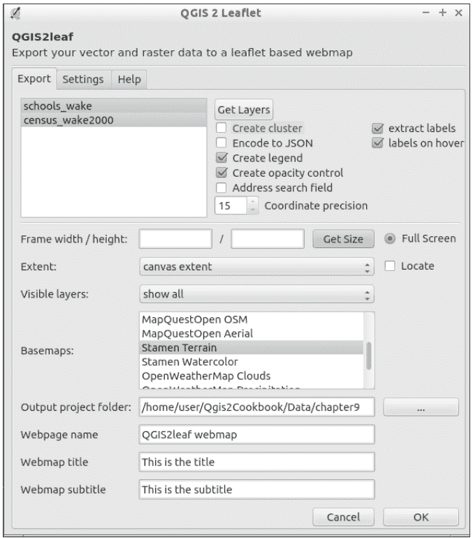

- 6. 导出后，地图应该会在你的 Web 浏览器中打开。如果没有，请打开操作系统文件资源管理器（或 Web 浏览器）并导航到输出文件夹。你应该会看到一个名为 export_年_月_日_时_分_秒 的新文件夹（例如，export_2015_02_19_11_34_05）。此文件夹内是 index.html。使用 Web 浏览器打开此文件以查看你的地图：

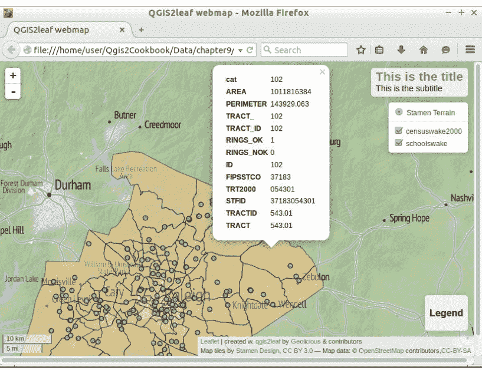

- 7. 请注意，所有矢量都是可点击的，弹出窗口将显示属性表信息。如果你开启了标注和悬停，那么将鼠标悬停在某个点上将显示名称。

## 工作原理...

qgis2leaf 插件将你的地图转换为与 Web 兼容的内容。通常，这意味着将矢量数据转换为 GeoJSON 格式，并生成一个带有一些 JavaScript 的 HTML 页面（网页），以创建并显示地图。


栅格图层处理起来较为棘手，如果可能的话，尽量坚持使用 Tile 或 WMS 服务来提供这些图层。请参考下一节了解如何使用 Tiles 或 WMS。

> 如果你需要在本地托管瓦片，可以尝试使用 QTiles 插件来生成它们。

## 更多内容...

下一步自然是基于 Web 服务使地图动态化。为此，你可以将静态文件替换为 Web 服务：

- 1. 向地图添加一个 WMS 图层（如果你的 QGIS 服务器正在运行，可以使用本章前面的 QGIS 服务器相关教程）。添加一个外部源 WMS，例如 USGS NAIP 航空影像。（这是 GetCapabilities URL：`http://isse.cr.usgs.gov/arcgis/services/Orthom imagery/USGS_EROS_Ortho_NAIP/ImageServer/WMSServer?request=GetCapabilities&service=WMS`）。
- 2. 使用相同的设置重新导出：

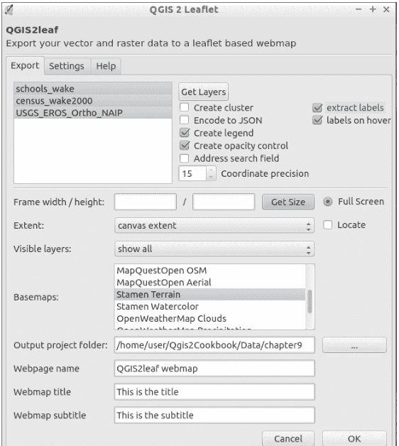

> 既然你已经创建了 Leaflet 地图，如果你想开始 JavaScript 编程，你需要的所有代码都在生成的目录中，要么直接在 `index.html` 中，要么在 `js` 文件夹中。特别是，你可以清楚地看到图层是如何设置样式并添加到地图中的。

栅格图层不一定要使用 Tiles 或 WMS，但这是推荐的做法。如果你确实想使用本地文件，请注意目前存在一个 bug：除非你的栅格被转换为 EPSG:4326 投影下的 `.jpg` 格式图像，否则某些导出会失败。

## 另请参阅

- 别忘了查看 Leaflet JavaScript 库的文档，了解导出后如何自定义结果：http://leafletjs.com/。
- qgis2web 插件旨在结合 qgis2leaflet 和 qgis2ol3 插件（https://plugins.qgis.org/plugins/qgis2web/），这意味着它还包括导出到 OpenLayers 3，OpenLayers 3 与 Leaflet 非常相似，但使用 OpenLayers JavaScript 库。Lizmap（http://www.3liz.com/en/lizmap.html）和 QGIS Web Client（https://github.com/qgis/QGIS-Web-Client）是两个更流行的选项，它们提供了更精细的预构建界面，但需要更多的设置。

## 从 QGIS 管理 GeoServer

QGIS 不仅是 QGIS 服务器的前端，也可以作为其他类似服务器的前端。GeoServer 是最流行的服务器之一，你可以从 QGIS 中配置它、上传图层，甚至可以使用 QGIS 的符号系统工具编辑 GeoServer 图层的样式。

## 准备工作

对于本教程，你需要 GeoServer Explorer 插件。可以通过插件管理器安装它。

你还需要一个正在运行的 GeoServer 实例。我们假设你在本地 8080 端口运行了一个实例，但你可以将相应的 URL 替换为你可用的 GeoServer 实例的 URL，无论是本地还是远程。

## 操作方法...

- 1. 通过导航到 **Web | GeoServer | Geoserver Explorer** 打开 **GeoServer Explorer**。资源管理器将出现在 QGIS 窗口的右侧。
- 2. 单击资源管理器树中的 **GeoServer Catalogs** 项，然后选择 **New catalog** 按钮。
- 3. 在出现的对话框中填写字段以定义新目录，然后单击 **确定**：

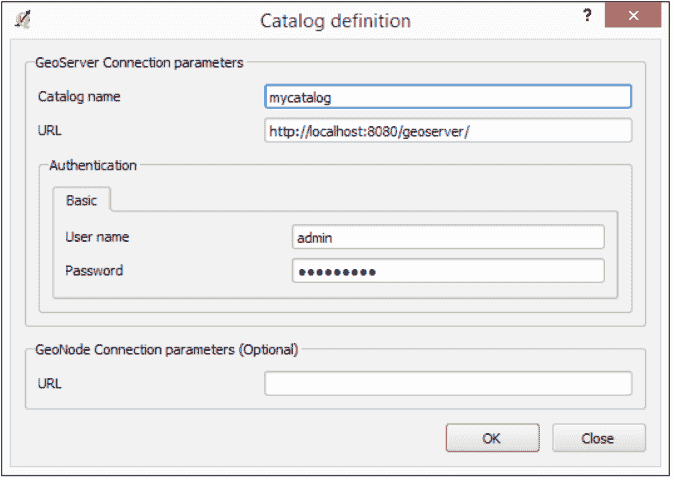

- 4. 新目录将添加到资源管理器树中，你现在可以浏览其内容。
- 5. 打开 `zipcodes_wake.shp` 图层并为其设置样式。
- 6. 在 QGIS 图层列表中，将对应于 `zipcode_wake.shp` 图层的条目拖放到 GeoServer Explorer 中的目录项上。该图层将被上传并添加到目录的默认工作区中。
- 7. 你可以通过打开 Web 浏览器并访问 `http://localhost:8080/geoserver/web/` 上的 GeoServer Web 界面来检查该图层是否已在目录中。

## 工作原理...

GeoServer Suite 插件使用其 REST API 与 GeoServer 通信。通过将 QGIS 与 GeoServer REST API 连接，你可以轻松配置许多本需要手动配置的元素，例如图层的样式。

## 更多内容...

Geoserver Explorer 插件具有许多用于处理 GeoServer 的功能。这里有一些额外的思路供你探索。更多信息，请查看插件帮助：http://boundlessgeo.github.io/qgis-geoserver-plugin/。

## 编辑远程样式

一旦图层位于 GeoServer 目录中，你就可以编辑其样式，而无需重新上传图层。只需在资源管理器树中打开相应目录下的 Styles 分支，然后双击要编辑的样式，或者在右键单击元素时出现的上下文菜单中选择“编辑...”项：

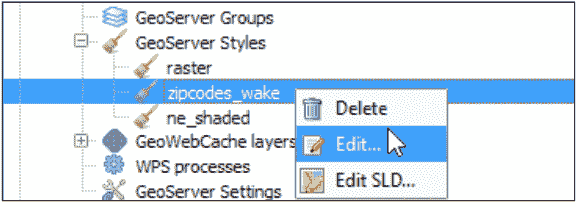

将打开 QGIS 符号系统对话框，你可以在此处编辑样式。关闭对话框后，样式将被上传并更新到目录中。

## 支持多种格式

GeoServer REST API 仅支持 shapefile 格式的矢量图层，但你可以拖放 QGIS 支持的任何格式的图层。如有需要，该插件会在上传前负责进行转换。

## 另请参阅

如果没有 GeoServer 实例，设置一个用于测试非常简单。详情请参见 http://geoserver.org/。
