## 10 个制图技巧

在本章中，我们将介绍以下教程：

- 使用基于规则的渲染
- 处理透明度
- 理解要素和图层混合模式
- 保存和加载样式
- 配置数据定义的标注
- 创建自定义 SVG 图形
- 在任何投影中制作精美的经纬网
- 在打印地图中制作有用的经纬网
- 使用 Atlas 创建地图系列

### 简介

在过去的十年中，制图学发生了相当大的变化，越来越多的人转向在设备或 Web 上使用纯电子地图产品。虽然某些类型的可视化更适合不同的媒介，但许多底层工具和技术实际上可以广泛应用于各种场景。本章涵盖了各种工具，使作为 QGIS 用户的你能够最大限度地提高地图的可读性和美观性。

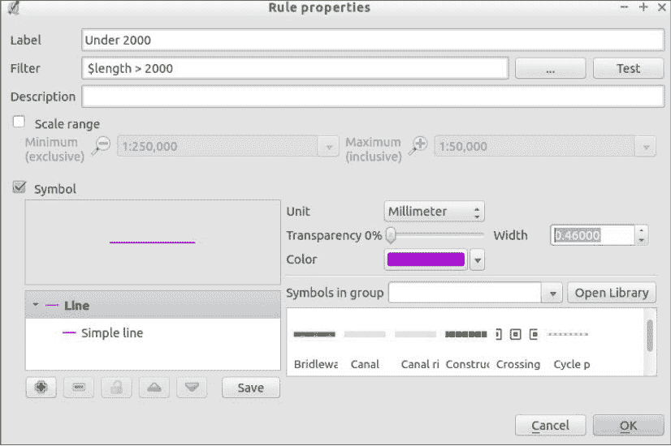

> 💡 你可以对对象应用多条规则，渲染结果是规则和渲染顺序的组合。

- 5. 现在，为了让效果更有趣，让我们添加另一条相反的规则：
  - 1. 使用规则列表下方绿色的 **+** 按钮添加一条新规则。
  - 2. 对于过滤器，使用 `$length > 2000`（别忘了测试一下）。
  - 3. 选择一些差异较大的其他符号，以便容易区分它们（例如不同的线型）。单击 **确定**，然后单击 **应用** 查看两条规则的效果。

## 制图技巧

6. 现在，事情变得非常有趣了。我们可以通过右键单击规则或突出显示规则并单击“细化当前规则”下拉菜单来添加子规则：

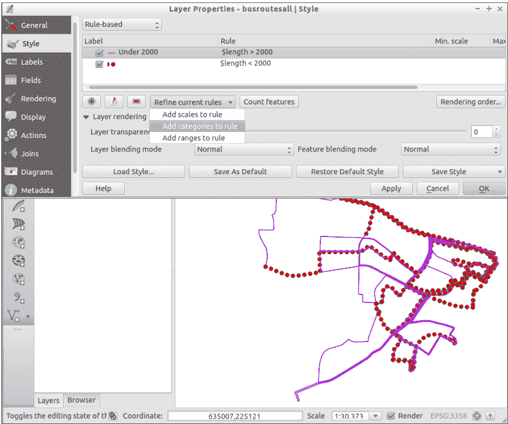

- 7. 选择 **向规则添加类别**：
  - 1. 在子对话框中，选择 **路线**。
  - 2. 选择一种颜色渐变和/或线型，单击 **分类**，然后点击 **确定**。

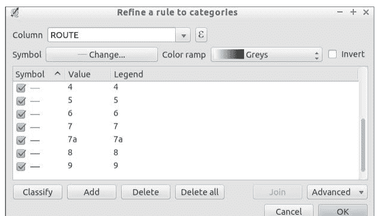

- 3. 在单击 **应用** 之前，编辑主规则并取消选中 **符号** 复选框（否则，**规则** 和 **子规则** 列表将是叠加的，这在某些情况下可能很有用）。
- 8. 现在，当你查看 **规则** 列表时，你会看到父规则下的子规则。

11. 最后，地图看起来如下：

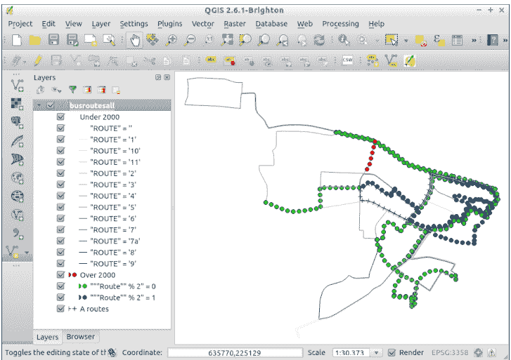

## 工作原理...

每条规则按从上到下指定的渲染顺序处理，最后一条规则最后绘制，因此位于顶部。规则会添加到已应用于要素的任何现有样式中。你可以通过更改规则顺序或应用渲染顺序来更改渲染顺序。过滤器的工作方式与字段计算器或表搜索中的属性过滤器完全相同。所有符号系统选项都可用于矢量，并且可以应用于一条或多条规则。你还可以通过比例渲染规则对规则进行分组。

## 更多内容...

基于规则的渲染的使用方式数不胜数，这里无法一一描述。你可以创建渲染组，继承其父级的规则并应用自己的规则。每个具有唯一 ID 的要素都可以拥有完全不同的外观。与使用传统的单一符号、分类符号或渐变符号相比，最大的改进是你不必编辑所有可能的组，并且可以更轻松地叠加规则，混合搭配所有原始方法。

不过也有一些问题。并非所有使用基于规则的渲染完成的操作都能在 Web 服务中实现；因此，在过于投入之前，请考虑你的输出格式，并在花费太多时间之前测试你的想法。


## 处理透明度

透明度是指缺乏色素或颜色，使得你可以看到一个要素下面的要素。可以将其视为类似于有色或染色玻璃；部分光线被允许穿过并反射内部的事物。当使用得当，透明度可以帮助强调或弱化地图构图中要素。它也可以用于混合两个图层，使其看起来像一个图层。

## 准备工作

本教程演示了矢量和栅格的透明度，因此我们需要各一个示例。lakes.shp 和 elevlid_D782_6.tif 图层非常适合演示目的。在一个全新项目中加载这两个图层，将 lake.shp 置于上方。

## 如何操作...

- 1. 加载一个矢量图层后，打开属性并切换到样式选项卡。
- 2. 在对话框右侧，你会看到透明度滑块，值为 0%（这意味着 100% 实心或不透明）。
- 3. 向右调整滑块并应用更改以在地图中查看效果：

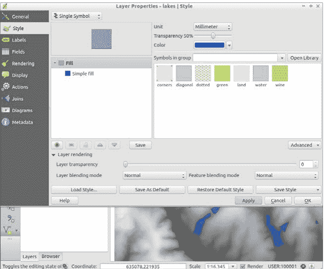

使用粗体或深色会更容易注意到变化。你还会注意到简单填充选项显示原始颜色。

- 4. 现在要在栅格上演示，首先将 lakes 重置为 0%。
- 5. 在图层列表中交换顺序，使 elevlid 置于上方。
- 6. 现在，打开 elevlid 的属性并切换到透明度选项卡。
- 7. 全局透明度选项会均匀改变整个栅格的值。将其设置为 50% 并应用。你现在应该可以看到下方被隐藏的 lakes 图层：

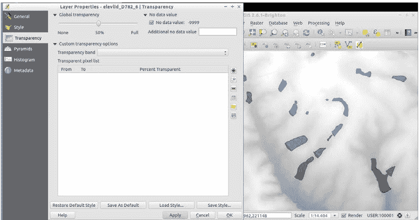

无论全局透明度设置为多少，无数据值始终为 100% 透明。利用此功能可轻松消除你完全不想显示的值。

- 8. （可选）你可能注意到在全局透明度滑块下方有自定义透明度选项。这将允许你使特定值比其他值更透明。你可以为特定透明度分配特定值，或者你可以为栅格添加一个波段（或使用多波段栅格），该波段指定要应用于栅格其余部分的透明度量（某些数据格式，如 GeoTiff，称之为 Alpha 透明度波段）：
  - 将全局透明度重置回 0%（否则，这也会被应用）
  - 使用绿色 + 号添加一些值

## 如何操作...

使用两个栅格图层，我们可以尝试不同的混合模式。当然，这也适用于矢量图层：

- 1. 双击效果图层以打开图层属性。
- 2. 你可以通过进入图层属性 | 样式 | 与亮度、对比度、饱和度等其他有用的控件一起的色彩渲染来找到混合设置，如下图所示：

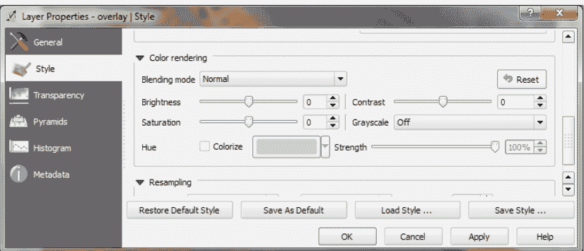

- 3. 更改混合模式并点击应用以查看结果。
- 4. 同样，对于矢量图层，例如我们的混合图层，我们通过进入图层属性 | 样式 | 图层渲染找到混合模式设置，如下图所示：

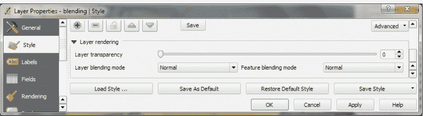

主要区别在于，对于矢量图层，我们可以控制要素如何相互混合，以及结果如何与底层图层混合，分别使用要素混合和图层混合模式。要素混合模式按要素为基础应用。

## 制图技巧

- - **Dodge**：**Dodge** 模式会根据上层图层的亮度提亮并饱和下层图层。这意味着上层图层中较亮的颜色会导致下层图层的饱和度和亮度增加。如果顶部像素不太亮，此效果最佳；否则效果会非常极端。
- - **Addition**：**Addition** 模式将两个图层的像素值相加。如果结果超过 1（在 RGB 的情况下），相应区域将显示为白色。
- - **Darken**：**Darken** 模式创建的结果保留两个图层的最小 RGB 分量。因此，这是 Lighten 模式的相反模式，并且与 Lighten 一样，结果往往是锯齿状和生硬的。
- - **Multiply**：**Multiply** 模式将两个图层的值相乘，从而导致图像变暗。
- - **Burn**：**Burn** 模式会导致上层图层中的较暗颜色使下层图层变暗。**Burn** 可用于调整和着色底层图层。
- - **Overlay**：**Overlay** 模式结合了 **Multiply** 和 **Screen 混合**模式。因此，亮的部分变得更亮，暗的部分变得更暗。
- - **Soft light**：**Soft light** 模式与 **Overlay** 非常相似，但它使用 **Burn** 和 **Dodge** 的组合。这旨在模拟在图像上照射柔和光线。
- - **Hard light**：**Hard light** 模式也与 **Overlay** 非常相似。它旨在模拟在图像上投射非常强烈的光线。
- - **Difference**：**Difference** 模式从下层图层中减去上层图层的值（或反之）以始终得到正值。与黑色（RGB 值为 0,0,0）混合不会产生变化。
- - **Subtract**：**Subtract** 模式从一个图层中减去另一个图层的值。在负值的情况下，显示黑色：

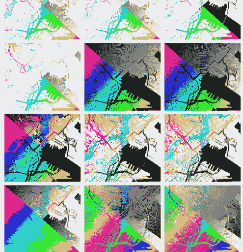

12 种混合模式的概述（背景地图“Watercolor”和“Toner”由 Stamen Design 提供，采用 CC BY 3.0。数据由 OpenStreetMap 提供，采用 CC BY SA）：第一行：Lighten、Screen 和 Dodge；第二行：Addition、Darken 和 Multiply；第三行：Burn、Overlay 和 Soft light；第四行：Hard light、Difference 和 Subtract。

## 保存和加载样式

有什么比为要素图层制作出色的样式更好的呢？能够轻松共享和重用它们。矢量和栅格样式都可以保存和重用——不过方式略有不同。

## 准备工作

对于本教程，你需要两个相似的矢量图层和一组两个相似的栅格图层。在提供的示例数据中，使用两个公交线路 shapefile 和两个高程栅格（例如，elevlid_D782_6.tif）。

```
elevlid_D782_6.tif
```

## 如何操作...

首先我们开始复制和粘贴矢量图层的样式：

- 1. 加载两个公交线路 shapefile 和两个 elevlid 栅格。
- 2. 最简单的方法是复制矢量或栅格的样式。只需在列表中右键单击图层名称并从 **Style** 菜单中选择 **Copy Style**。然后，右键单击你想要应用此样式的图层并从 **Style** 菜单中选择 **Paste Style**。你只能在相同类型的图层之间复制样式（例如，**Point to Point**）：

尝试使用右键菜单将一条公交线路的样式复制并粘贴到第二条公交线路：

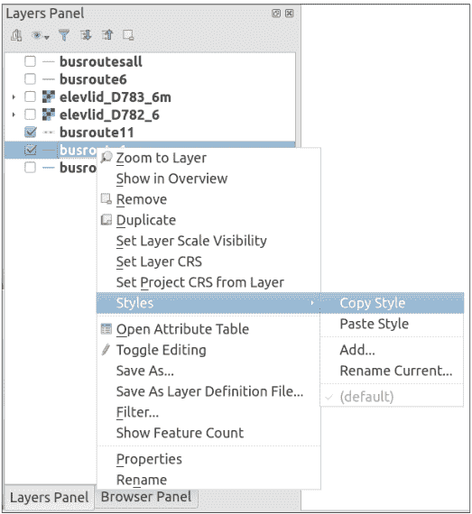

- 3. 现在要导出样式以供以后使用，右键单击一个图层并导航到属性 | 符号系统。
- 4. 在右下角，样式菜单中有保存样式按钮。输出选项为 QGIS 图层样式文件...（即 .qml）或 SLD 文件...。两种格式都是 XML 文本文件，QGIS 图层样式... 推荐用于最大兼容性：

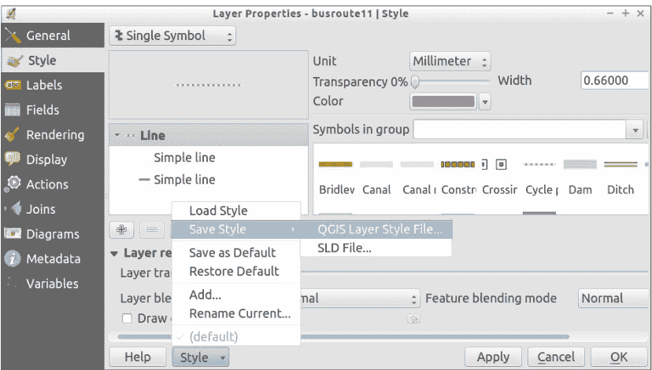

- 5. SLD 与某些其他网络地图系统兼容，但在最简单的情况之外，它不会 100% 捕获你的 QGIS 样式（SLD 中并不存在所有相同的选项）。QML 是原生的 QGIS 样式文件。注意稍后使用的加载样式选项。
- 6. 继续为其中一个公交线路图层应用新样式。
- 7. 然后，将符号系统保存为 QGIS 图层样式文件（qml）。
- 8. 在第二个公交线路文件的属性对话框中，点击加载样式... 并选择你刚刚保存的文件。

> 你可以在文本编辑器中打开此文件进行自定义，或例如批量查找和替换值。


## 制图技巧

栅格稍微复杂一些，因为你可以保存一个符号系统文件，也可以保存一个颜色表。颜色表是一个文本文件，列出了栅格值范围和关联的颜色代码。它是一种比 XML（QGIS 图层样式文件）更简单易于手工编辑的格式，但不保留透明度或分类设置等内容：

1. 随便给其中一个 elevlid 图层应用一个新的颜色渐变。
2. 使用磁盘按钮将颜色表仅保存为 .txt 文件（在按钮行右端的颜色表上方；请参考截图）。
3. 在第二个 elevlid 文件的 属性 中，加载颜色表并选择你刚刚保存的文件。
4. 将更改应用到你的图层样式：

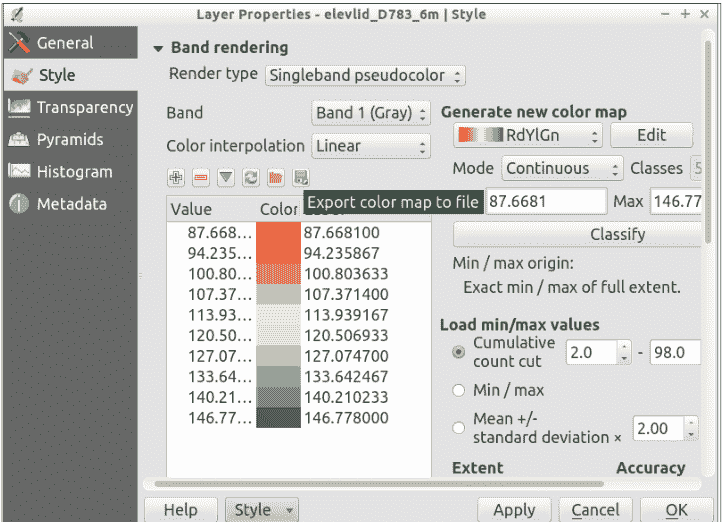

> 请注意，与矢量属性中一样，Style 菜单也可用。你可以用它来保存和加载 QGIS 图层样式文件（.qml），就像我们之前做的那样。

### 它是如何工作的...

通常图层的样式信息保存在 .qgs（如果你保存项目）项目文件中。各种导出方法只是以通用方式将图层的样式信息打包到一个单独的文件中（与原始数据无关）。这让你可以将相似的样式应用到相似的数据源。

矢量符号系统存储在一个以 .qml 扩展名结尾的特殊 XML 文件中。你可以阅读或编辑该文件，如果你愿意的话，它也可以通过脚本生成或复制粘贴来创建多个样式的混合。

栅格符号系统也可以存储在 .qml 文件中。然而，还有一个额外的选项可以将分类范围和颜色导出到一个简单的文本文件，每行一个值或值范围和一个颜色代码。

### 还有更多...

第二种格式 **SLD（Style Layer Descriptor）** 在网络服务中非常常见。虽然 QGIS 样式并非所有功能在 SLD 中都有对应，但它仍然是一个很好的起点，可以在 MapServer 或 GeoServer 等软件平台之间共享你的样式。

### 配置数据定义标签

如果列出 QGIS 的顶级功能，数据定义标签会名列前茅。它们提供了自动标注的便捷性和自由标注的定制性。你可以混合使用自动和自定义编辑，并将值存储在表中以供以后参考。

### 准备工作

有几个有用的插件可用于数据定义标签，它们会为现有图层添加所需的额外属性字段，或仅为标签创建一个新图层。下载并安装 **Layer to labeled layer** 和 **Create labeled layer**。

### 如何操作...

1. 打开 QGIS 并加载 `census_wake2000.shp`。
2. 使用 **Save As** 对话框创建图层的副本，并将图层保存为 `census_wake2000_label.shp`。 （你不一定总是要这样做，但此过程会修改表，因此最好先备份。）
3. 在图层列表中突出显示 `census_wake2000_label.shp`。
4. 运行 **Layer to labeled layer** 插件（**Plugins | Layer to Labeled layer** 插件）：
   1. 将 **Label Field** 设置为 `STFID`。
   2. 点击 **OK**。

   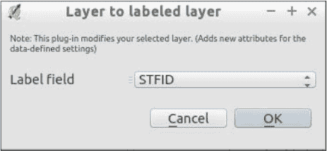
5. 如果你现在查看属性表，你会看到一大堆新的字段，以 **Lbl** 为前缀，它们都是 `NULL`。

   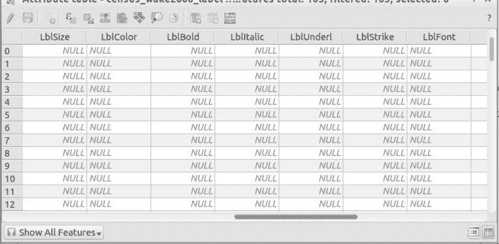
6. 现在，确保你已打开 **Label** 工具栏（**View | Toolbars | Label**）：

   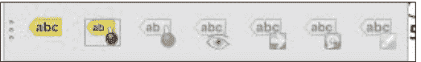
7. 要么在图层属性中（导航到 Properties | Labels）要么使用标签工具栏上的第一个按钮，图层标签选项，打开标签管理对话框。
8. 在整个对话框中，你会看到每个字段旁边的标记。黄色标记表示数据定义属性，白色标记表示所有设置相同：

   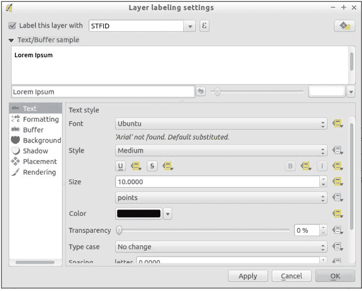

   如果你想在此阶段控制其他属性，请向图层添加一个新字段。然后返回此对话框并选择白色图标以选择要使用的字段名称。
9. 现在，你可以对各种标签进行自定义编辑，并让表格存储设置。根据设置，有几种方法可以进行编辑。请注意，你必须先切换图层的编辑模式，然后才能更改标签：
   - 你可以直接在表中手工编辑字段，或者你可以使用字段计算器来自动化重复模式（例如，给所有主要道路相同的字体和颜色标签）。
   - 对于某些属性，如 X、Y 和旋转，你也可以使用标签工具栏选项在地图上手工编辑。

### 示例：移动和旋转标签

1. 通过点击以下图标切换编辑模式：

   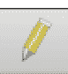

2. 在 **Label Toolbar** 菜单中，选择 **Move Label** 按钮。现在，点击一个标签并将其拖动到新位置，在完成移动标签时释放鼠标按钮。请注意，你必须确保步骤 8 中的 X 和 Y 字段已设置，此工具才可用：

   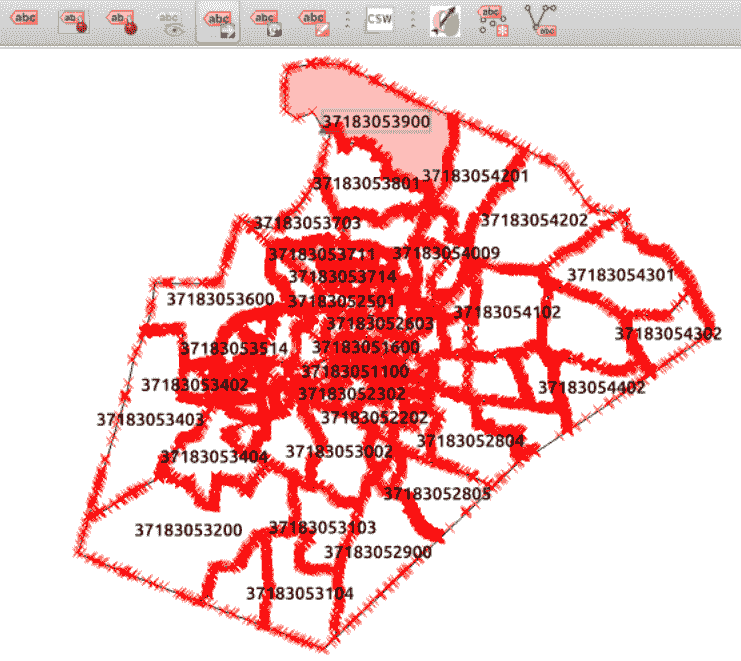

### 它是如何工作的...

基本前提是你在表中保留一套额外的属性，通常作为现有表的附加字段。

> 你可以通过手工方式向属性表添加字段，并将它们分配给标签属性。使用 **Layer to Labeled Layer** 插件会为你完成此操作。

如果设置了这些字段，它们将用于确定给定行的标签位置、大小、字体、颜色、角度等。如果未设置它们，则保留标注引擎的自动设置。

### 还有更多...

数据定义标签的强大之处在于你可以结合自动化、计算和自定义编辑的值。它们由内置的标注引擎自动生成，并使用字段计算器计算以填充数据定义字段（例如，使用 if 语句或基于其他属性的计算）。最后，通过进行这些小幅手工调整，你可以修复几个行为不佳的标签。

请注意，你不必在现有图层上使用数据定义标注。你可以使用 **Create labeled layer** 插件仅创建一个标签图层。在其他软件中，用户定义的标注通常称为注释图层。QGIS 也有注释图层。这些是图层，你可以在地图上点击添加标签，然后随意编写和设置其样式。最大的问题是这些图层与它们标注的数据没有关联。你很难将它们交给其他人，如果标签名称或样式发生变化，你必须追踪并手工编辑每个修复。在 QGIS 中，数据定义标注解决了注释图层的几乎所有缺点，因为它实际上将所有属性作为字段保存到 shapefile 中。

### 创建自定义 SVG 图像

本教程的全部内容是让你通过创建自定义图标、指北针，甚至填充图案使地图独一无二。

### 准备工作

你需要一个矢量插图程序（例如 Inkscape 或 Adobe Illustrator）。

> 没有吗？所有平台上都有多个免费和开源选项可用。许多 QGIS 社区成员使用 Inkscape（http://inkscape.org），但你也可以使用 LibreOffice Draw 或 OpenOffice Draw。最常见的专有软件等价物是 Adobe Illustrator。

你还需要一个文本编辑器，例如 TextEdit（Mac）、Notepad、Notepad++（Windows）。

### 如何操作...

1. 打开你的矢量插图程序。
2. 将画布设置为一个合理的尺寸。方形比例通常效果很好，因为图标最终将在 QGIS 中用于标记点；100x100 像素就足够了。
3. 绘制一个简单的形状，如正方形、圆形或星形。确保你尽可能接近边缘并填满整个页面。

> 请记住，你将在 8-32 像素左右的尺寸下使用此绘图；在创建和编辑插图时以这些比例工作真的很烦人。

4. 将绘图保存为 .svg 文件。
5. 现在，在文本编辑器中打开 .svg 文件，搜索并找到对象的样式行，并将其替换为以下行：

```
stroke-width="param(outline-width) 1"
stroke="param(outline) #000"
fill="param(fill) #FFF"
```

> 如果使用复杂的图标，请将线条设置为与绘图中所有其他颜色都不同的特定颜色代码。记下颜色代码，以便在文本编辑器中用于搜索 .svg 文件。


代码合并后前后场景如下表所示：

| Before | After |
|---|---|
| `<rect` `style="color:#000000;display:inline;overflow:visible;visibility:visible;opacity:1;fill:"param(fill)` `#000000";fill-` `opacity:1;stroke:"param(outline)` `#ff0000";stroke-` `width:"param(outline-width)` `4";stroke-` `miterlimit:4;stroke-` `dasharray:none;stroke-` `opacity:1;marker:none;enable-` `background:accumulate"` `id="rect3336"` `width="301.61023"` `height="308.96658"` `x="30.651445"` `y="725.00476" />` | `<rect` `stroke-width="param(outline-` `width) 1"` `stroke="param(outline)` `#000" fill="param(fill)` `#FFF" id="rect3336"` `width="301.61023"` `height="308.96658"` `x="30.651445"` `y="725.00476" />` |

- 6. 保存你的更改。
- 7. 现在，启动 QGIS 并加载一个点图层。
- 8. 进入 **属性 | 样式**。
- 9. 在符号选项中，有两个层级的对象组成一个符号：标记，然后是组合成它的实际符号的子层级。
- 10. 选择子对象，默认通常标记为 **简单标记**。
- 11. 现在，将右上角的下拉菜单更改为 SVG 标记。
- 12. 在显示符号选项的框下方查找 ... 按钮并选择从文件加载 SVG。使用它来选择你之前创建的 .svg 文件。

- 13. 导入后，如果你执行了步骤 5，你应该能够更改符号的填充颜色：

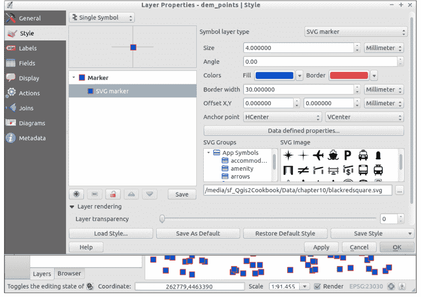

> 你可能需要大幅调整大小和宽度才能使更改明显。善用 **应用** 按钮在地图中查看更改，但保持对话框打开以便轻松调整。

## 如何工作...

你添加到 `.svg` 文件中的特殊文本是一个标记或占位符。QGIS 会查找这些特定单词，然后在 SVG 被读入程序时利用它们即时插入符号更改。

## 还有更多...

虽然本教程演示了一个非常简单的 SVG，但此方法适用于更复杂的符号。

另请注意，在 **设置 | 选项 | 系统** 中，你可以设置 SVG 文件夹的路径，这样它们将始终在符号对话框中可用。

## 另请参阅

QGIS 还允许你使用 SVG 符号自定义填充图案。QGIS *培训手册* 在 http://docs.qgis.org/2.8/en/docs/training_manual/basic_map/symbology.html#hard-fa-creating-a-custom-svg-fill 中对此有一个很好的示例。

## 在任意投影中制作漂亮的经纬线

经纬线是地图上的一组参考线，有助于为地图阅读者提供方向。它们通常按坐标设置并标注。棘手的部分在于使用经纬线时的投影。如果你没有正确制作，经线交点之间的平滑曲线就会变成笨拙的异常形状（大多是直线）。默认的 QGIS 经纬线创建器不利于投影，因此在本教程中，你将看到一个执行此操作的附加处理算法。本教程的重点是确保你获得漂亮、平滑且标注正确的经纬线。

## 准备工作

对于本教程，你只需要一个边界框和你想要间隔线的坐标间隔。通常，这些将是纬度、经度 WGS 84（EPSG:4326），以及十进制度数，因为经纬线的全部目的就是添加有助于用户定向的参考线。

## 如何操作...

- 1. 首先下载一个专门用于此任务的 **处理工具箱** 算法，称为 **Lines Graticule**：
  - 1. 打开 **处理工具箱**。
  - 2. 进入 **脚本 | 工具 | 从在线脚本集合获取脚本**：
- 3. 在 **未安装** 部分，勾选 **Lines Graticule** 算法。
- 4. 点击 **确定** 按钮安装算法。

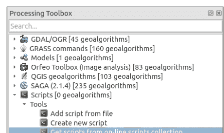

> 每次使用工具时，最好检查更新。

你将看到类似以下截图的内容：

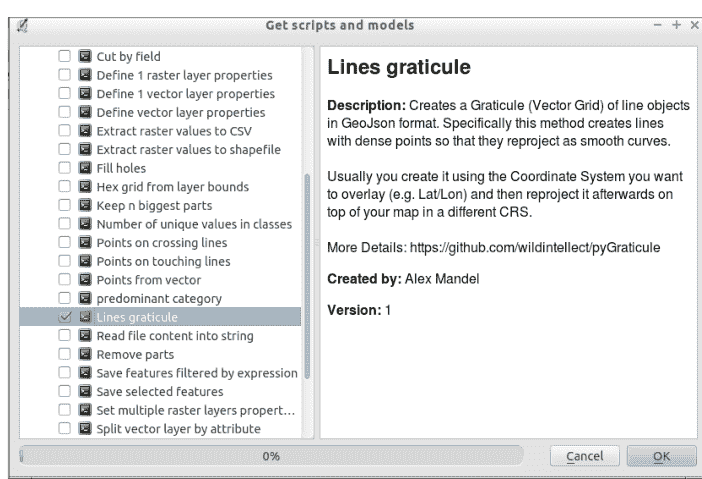

- 下载算法后，通过导航到 **脚本 | 向量** 打开它（它被称为 **Lines graticule**，尽管代码实际上是 pygraticule.py）：

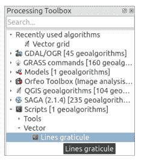

- 你可以手动填写参数，如果你知道它们，或者使用 **...** 按钮从现有项目获取值。
- 目前，你可以使用将为整个世界制作经纬线的默认值。输出由 outfile 和 graticule 决定。这些参数是可选的，你可以选择其一、两者或都不选。如果你想要 GeoJSON 文件，请设置 outfile。如果你想要 shapefile，请设置 graticule（如果你希望结果之后自动加载，请确保第二个输出设置为临时或真实文件，不要留空）。请参考 **帮助** 选项卡了解每个参数的详细信息。有两个非常重要的值可以控制经纬线：
- **spacing** 值表示绘制线的频率（对于世界范围的地图，20 或 30 度效果很好）。
- **density** 值表示放置节点的频率：

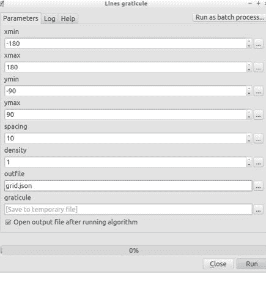

> 节点越多，曲线越平滑；但是文件越大，制作时间越长。选择合适的密度可能需要反复试验，以找到在给定地图比例下线条停止平滑弯曲前的最大密度。

- 5. 选择设置后，点击 **运行**。
- 6. 运行后，应该会加载一个包含结果的矢量图层。这看起来不会很令人兴奋，只是形成网格的直线。
- 7. 真正的魔法是现在启用即时投影，例如使用众多不错的世界投影之一，如“World Robinson（EPSG:54030）：

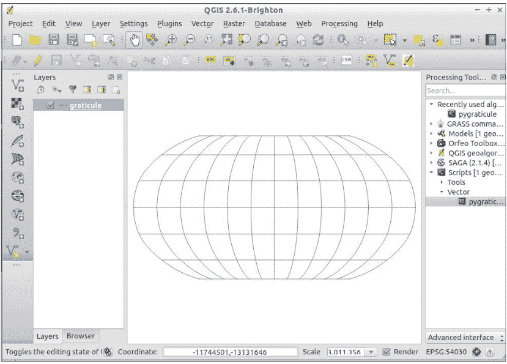

8. （可选）如果它看起来不像图像，而是仍然有间隔异常的直线，你需要禁用 QGIS 渲染简化：
  - 1. 从 属性 | 渲染 中选择图层。
  - 2. 确保已禁用 简化几何：

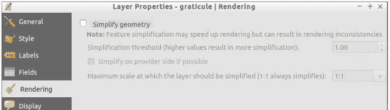

9. （奖励）从 向量 | 研究工具 生成矢量网格。区别如下所示：

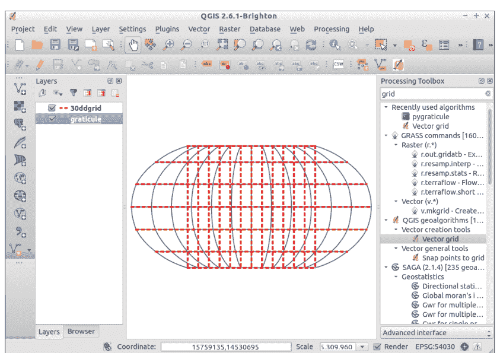

## 如何工作...

经纬线基本上是线图层（有时也是多边形）。如果你只在两条线相交的点绘制网格节点，你可以很容易地看到网格变形会导致块状形状。平滑经纬线的关键是在交点之间添加额外的线节点（即增加节点密度）。

需要注意的是，使用不覆盖整个世界的投影时（例如极地或正射投影），请选择落在投影限制范围内的边界框值；否则，在尝试重新投影时可能会出现错误。

## 还有更多...

经纬线在主地图画布上的主要优势是，你可以在 QGIS 中工作时将其用作参考，将其包含在网络和数字地图中，并完全控制标签和符号。这里使用的方法与 QGIS 中的其他经纬线（网格）工具不同，因为它专注于将具有平滑曲线的纬度/经度线作为参考放入任何投影中。其他网格工具更专注于在地图上制作规则的正方形以细分区域。

打印版面方法（下一个教程）的主要优势是能够轻松制作多个坐标系统，并在地图外部边缘添加刻度线。刻度线是你在导航导向地图上常见看到的，例如 USGS 地形图象限和其他印刷地图。

## 另请参阅

Lines graticule（又名 Pygraticule）也可以用作纯 Python 脚本；有关更新和更多信息，请参阅 https://github.com/wildintellect/pyGraticule。

要学习如何编写自己的处理工具箱算法，请参阅第 11 章《扩展 QGIS》中的 编写处理算法 教程。

## 在印刷地图中制作有用的经纬线

经纬线是地图上的一组参考线，有助于为地图阅读者提供方向。它们通常按坐标设置并标注。对于传统印刷地图，旨在用于导航和测绘任务，在这些任务中你希望在多个坐标系统中标记地理坐标。本教程是关于向版面地图中添加此类参考线。


## 准备工作

你需要一张地图，通常是小范围的（跨度为数英里或公里）。对于本教程，elevlid_D782_6.tif 效果很好。

## 如何操作...

- 1. 加载 elevlid_D782_6.tif。
- 2. 通过选择 UTM Zone 17 N, WGS 84 (EPSG:32617) 打开实时投影。
- 3. 现在创建 新打印布局。
- 4. 在打印布局中，选择 添加新地图，然后在画布上绘制一个矩形。
- 5. 现在有了地图后，在屏幕右侧的对话框中选择 项目属性 选项卡。
- 6. 向下滚动或折叠各部分，直到看到 网格 部分。
- 7. 使用绿色加号 (+) 符号添加一个新的网格。
- 8. 现在，将 间隔 X 和 间隔 Y 编辑为 1,000 地图单位。 （确保切换到下一个字段或点击 Enter 使数值生效。）:

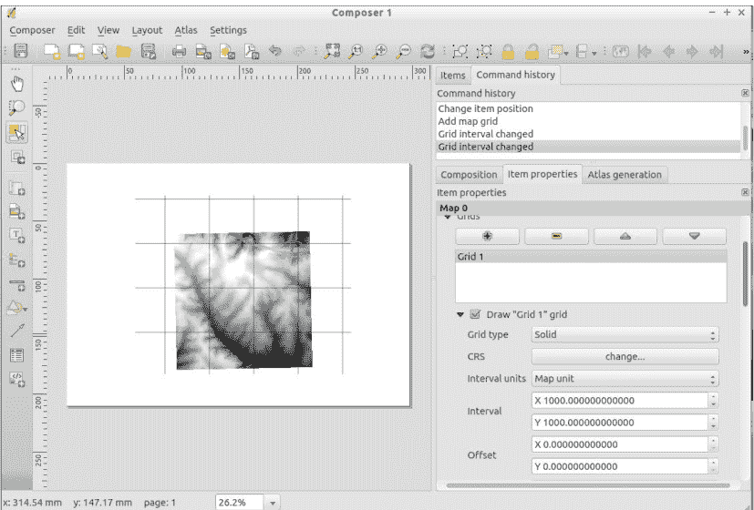

> 当前的地图单位基于 UTM，单位为米，这意味着线条间隔为 1,000 米或 1 公里。

- 9. 在 间隔 部分下方，修改 线样式 并将线条设为红色以便更易于查看。
- 10. 现在，进一步向下滚动到 绘制坐标 部分并勾选启用网格线标签的复选框：

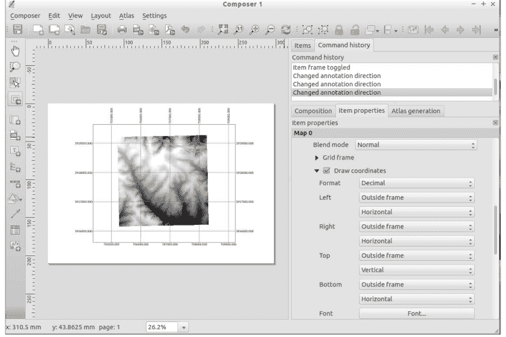

- 11. 启用后，将顶部和底部的方向改为垂直，并将字体颜色改为红色。
- 12. 现在，要创建第二个网格，滚动回 网格 部分并再次点击绿色加号 (+) 添加第二个网格。
- 13. 这次，将 CRS（坐标参考系统）更改为 WGS 84 (EPSG:4326)，这是人们最常用的纬度和经度系统。
- 14. 使此网格间隔为 0.01 地图单位（即本例中的度），并将样式改为蓝色以与另一个网格形成对比。
- 15. 现在，向下滚动并添加 **绘制坐标**。同时，使顶部和底部为垂直方向以避免与第一个网格重叠。你也可以将字体颜色改为与线条一致：

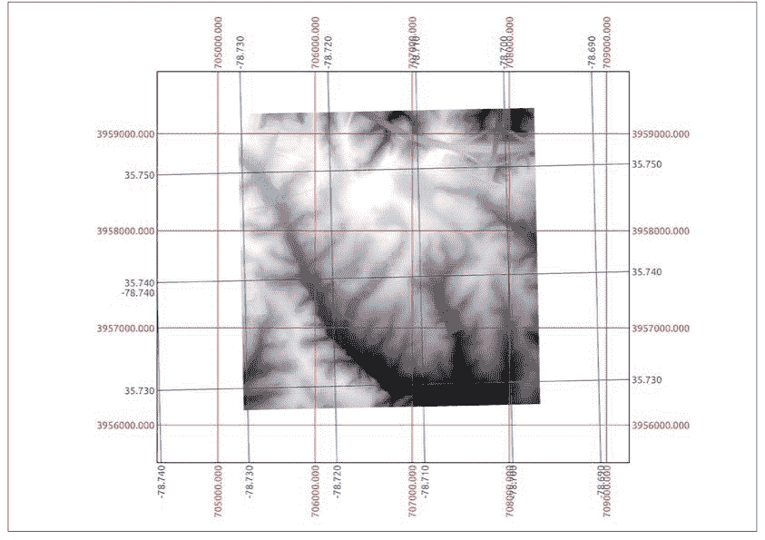

## 其工作原理...

参考格网是等距的带坐标标记的线条。根据你的设置，布局会根据地图数据的坐标计算线条的位置。在打印布局中创建有用的格网的关键在于选择合适的间隔：间隔要足够频繁以提供参考，但又不能过于密集而覆盖地图的大部分区域。选择具有整齐的四舍五入数字的间隔也很重要，这样便于计算两条线之间的中间值。

## 还有更多...

在 QGIS 中制作网格/格网有两种方法：一种是用于印刷地图的打印布局，另一种是作为 QGIS 中的图层用于印刷网络地图的内部使用。

## 制图技巧

- 3. **固定比例尺：** 这可使系列中所有地图保持相同的比例尺；比例尺在地图的 **主属性** 中配置，即以下截图中的 100,000：

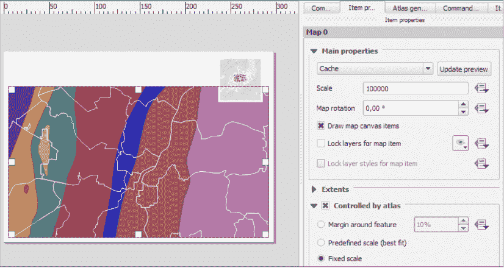

- 4. 接下来，我们使用 **添加新标签** 按钮添加标题标签。此标题标签将显示邮政编码多边形要素的 NAME 值，并将由 Atlas 自动为系列中的每张地图更新。为实现此目的，我们在标签项的 **主属性** 输入字段中插入以下表达式。

```
[%attribute( @atlas_feature, 'NAME' ) %]
```

- 5. 为了完成 Atlas 配置，我们需要进入 **Atlas 生成** 选项卡。在那里，我们首先必须启用 **生成一个图集** 复选框。这会激活 **配置** 部分，我们可以在其中选择 **覆盖** 图层并将其设置为 zipcodes_wake 图层，如以下截图所示。
- 6. 要预览 Atlas 输出，我们现在可以点击 **预览图集** 按钮。此按钮只有在 **Atlas 生成** 选项卡中启用了 **生成一个图集** 复选框时才处于活动状态。预览模式激活后，你可以使用 **预览图集** 按钮旁边的箭头按钮浏览地图系列。
- 7. 当我们对预览满意时，可以导出地图系列。输出行为由 **Atlas 生成** 选项卡的 **输出** 部分中的配置控制，你也可以在以下截图中看到。Atlas 支持导出为单独的图像、SVG 或 PDF 文件。激活 **尽可能单文件导出** 选项以将所有地图合并为一个 PDF，然后点击 **导出图集为 PDF** 按钮，如以下截图所示：

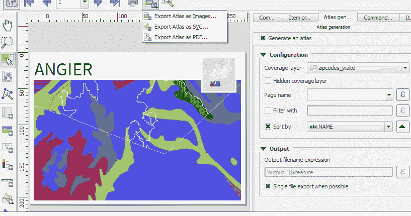

## 其工作原理...

Atlas 功能提供了与当前要素相关的系列变量的访问权限。我们已使用 `{@attribute( @atlas_feature, 'NAME' ) }` 表达式将当前要素的 _NAME_ 值显示在标题标签中。除 `@atlas_feature` 外，你还可以访问以下变量：

- `@atlas_feature`：这是当前 Atlas 要素的要素 ID。这使得可以在规则中使用此信息，例如根据 ID 隐藏或突出显示要素。
- `@atlas_geometry`：这是当前 Atlas 要素的几何，可在规则中使用，例如仅在其他图层的要素几何与 Atlas 要素几何相交时显示。
- `@atlas_featurenumber`：这是当前 Atlas 要素的编号。
- `@atlas_totalfeatures`：这是 Atlas 覆盖图层中的要素总数。

## 还有更多...

概览地图是为更详细的地图提供上下文的绝佳方式。要添加概览地图（如以下截图中构图中右上角所示），你需要在构图中添加第二个地图项。要将此地图项转换为概览地图，请进入 **项目属性** | **概览** 并点击带有绿色加号的按钮。这将添加一个 `Overview 1` 条目并启用 **绘制 "Overview 1" 概览** 配置 GUI：

- **地图框架**：**地图框架** 下拉列表使我们能够定义应由概览地图引用的主地图。默认情况下，地图项按添加到构图中的顺序命名为 `Map 0`、`Map 1`、`Map 2` 等。因此，如果主地图是第一个添加到构图中的项，我们将选择 `Map 0` 条目。
- **框架样式**：**更改 ...** 按钮可用于选择概览框架的样式。通常这将是带透明度的简单填充。
- **混合模式**：概览框架支持这些模式，如 *理解要素和图层混合模式* 教程中详细解释。
- **反转概览**：如果希望将概览框架样式应用于主地图范围之外的区域，请启用 **反转概览** 复选框。
- **以概览为中心**：如果希望概览地图自动平移以居中显示主地图的范围，请启用 **以概览为中心** 复选框。
