## 11
扩展 QGIS

在本章中，我们将涵盖以下主题：

- 定义自定义投影
- 在日期变更线附近工作
- 离线工作
- 使用 QSpatiaLite 插件
- 添加具有 Python 依赖项的插件
- 使用 Python 控制台
- 编写处理算法
- 编写 QGIS 插件
- 使用外部工具

## 引言

QGIS 本身可以做很多事情。然而，与所有软件一样，其默认能力存在局限。好消息是，通过内置的自定义选项、现有的附加插件、创建新的分析算法、创建自己的插件以及使用与 QGIS 互补的外部软件，有许多方法可以扩展 QGIS 的功能。本章涵盖了在其他章节中未提及的一些常见自定义和插件，以及如何开始制作自己的附加组件与他人分享。


## 定义自定义投影

地图投影在 GIS 职业生涯的某个阶段会让几乎每个人都感到困惑，如果不是更频繁的话。如果你幸运的话，你只需坚持使用人人皆知的常用投影，你的生活就会很简单。有时，不过，对于特定位置或自定义地图，你只需要一个在 QGIS 投影数据库中已有的庞大列表中没有的略有不同的投影。（通常，这些也被称为 **坐标参考系统 (CRS)** 或 **空间参考系统 (SRS)**。）

我不会介绍投影、投影坐标系统和坐标系统之间的区别是什么。从 QGIS 的实际角度来看，你可以选择与你的数据或预期输出相匹配的那个。这其中有很多小 caveats，但一本书或课程是更好地掌握它的地方。

### 准备工作

对于本配方，我们将使用一个自定义经纬网，一个每 10 度一条线的网格（`10d_graticule.json.geojson`），以及 Natural Earth 1:1000 万海岸线（`ne_10m_coastline.shp`）。

### 如何操作...

- 1. 确定你的数据当前使用什么投影。在本例中，我们从 EPSG:4326 开始，也称为 Lat/Lon WGS84。
- 2. 确定你想要制作地图的投影。在本示例中，我们将制作以爱尔兰为中心的斜轴等距投影。
- 3. 在现有的 QGIS 投影列表中搜索匹配或相似的投影。如果你打开 **Projection** 对话框并输入 `Stereographic`，这是一个不错的开始。
- 4. 如果你找到了相似的投影并且只想对其进行自定义，请突出显示 `proj4` 字符串并复制信息。**NAD83(CSRS) / Prince Edward Isl. Stereographic (NAD83)** 是一个足够相似的投影。

> 如果你在 QGIS 投影数据库中找不到任何内容，请在网上搜索你想要使用的投影的 proj4 字符串。有时，你会找到投影 WKT。通过一些工作，你可以利用 https://github.com/OSGeo/proj.4/wiki/GenParms 上的文档弄清楚 WKT 参数中的每一个对应 proj4 槽位。本配方的末尾提供了研究投影的一个好地方。


- 5. 在 **Settings** 下，打开 **Custom CRS** 选项。
- 6. 点击 + 符号添加一个新定义。
- 7. 输入名称并粘贴你的投影字符串，在本例中对其进行修改以使中心位于爱尔兰。将 `lat_0` 和 `lon_0` 参数的值更改为以下示例。将此特定类型的投影仅采用一个参考点。对于具有多个标准平行线和子午线的投影，你会看到下划线后的数字递增：

```
+proj=sterea +lat_0=53.5 +lon_0=-7.8 +k=0.999912
+x_0=400000 +y_0=800000 +ellps=GRS80 +towgs84=0,0,0,0,0,0,0
+units=m +no_defs
```

以下屏幕截图显示了屏幕的外观：

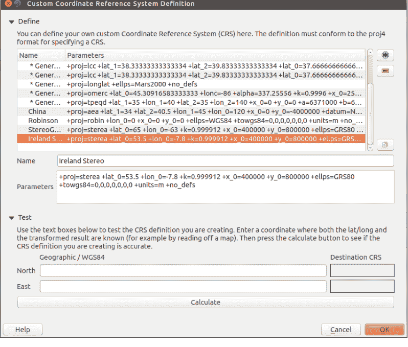

8. 现在，点击自定义投影列表中的另一个投影。目前有一个怪癖，如果你不切换到另一个投影，然后点击 OK，它就不会保存。

9. 现在，前往地图，打开投影管理器并应用你的新投影并打开 OTF 以检查是否正确。你将在第三部分“User Defined Coordinate Systems”中找到你的新投影：

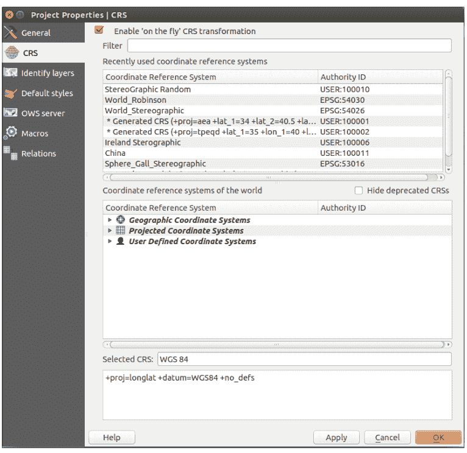

以下屏幕截图显示了该投影：

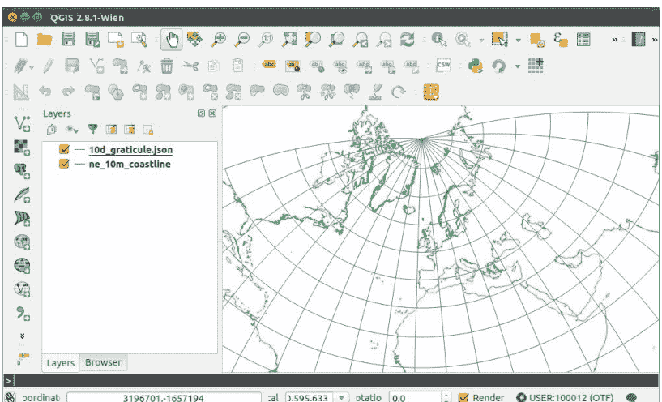

## 其工作原理...

投影信息（在本例中为 proj4 字符串）编码了计算机所需的参数，以选择正确的数学公式（投影类型）和变量（各种参数，例如平行线和中心线）将数据从当前状态转换为所需的平面地图。此信息库包括地球形状的近似值以及将其压平成平面视觉的不同方式。

你可以真正更改大多数参数来改变地图外观，但通常，坚持使用已知定义，以便你的地图与其他以相同方式制作的地图相匹配。

## 还有更多...

QGIS 仅允许正向/反向转换投影。制图正向仅投影（例如，Natural Earth、Winkel Tripel (III) 和 Van der Grinten）目前不在投影列表中；这是因为这些重投影不是纯数学公式，而是从一个到另一个的近似映射，并且逆向并不总是存在。你可以通过使用 ogr2ogr 和 gdal_transform 命令行将数据重投影到所需投影，然后在禁用投影即时转换的情况下将其加载到 QGIS 中来解决此问题。虽然这些投影的 proj4 字符串存在，但如果你尝试输入它们，QGIS 会拒绝它们。

## 扩展 QGIS

> 如果你禁用 **Projection-on-the-fly**，请确保所有图层都在同一投影中；否则，它们将无法对齐。此外，在转换为用于制图的投影之前执行所有分析步骤，因为测量单位可能会变得混乱。

跨越投影外边缘的几何图形并不总是能很好地截断。你经常会将其视为地图上意外的多边形带。在这种情况下，最简单的方法是删除超出预期映射区域的数据。你可以使用裁剪功能或简单地选择要保留的内容并 **Save Selection As** 一个新图层。

还有其他常见的投影描述格式（`prj`、`WKT` 和 `proj4`）。幸运的是，有几个网站可以帮助你进行转换。有几个不错的网站可以查找现有的 Proj4 风格投影信息，网址为 `http://spatialreference.org` 和 `http://epsg.io`。

## 另请参阅

- 需要更多关于如何为你制作的地图类型选择适当投影的信息？请参考 USGS 经典地图投影海报，网址为 `http://egsc.usgs.gov/isb/pubs/MapProjections/projections.html`。其中大部分也用于主题的 Wikipedia 文章，网址为 `http://en.wikipedia.org/wiki/Map_projection`。`https://www.mapthematics.com/ProjectionsList.php` 链接也提供了大量投影列表，包括不寻常的带图片的投影。

## 在日期变更线附近工作

如果你阅读了上一条关于自定义投影的配方，你可能会注意到关于跨越投影边缘的数据以及它通常无法正确渲染的注释。在处理接近 -180 或 180 度经线的数据时，你会遇到这个问题。显示远东俄罗斯、斐济、新西兰和南太平洋等地的地图，举几个例子，通常会遇到这个问题。

所需的解决方案实际上取决于你想要做什么。如果你只需要此类区域的地图，请选择一个在当地合适的投影。如果你有来自其他来源的现有数据，它可能沿边缘被切割，你可能需要将其重新拼接。对于世界地图，有时你必须修剪数据边缘的 .01 度，以免其显示异常。

### 准备工作

要遵循本配方，你需要示例数据中的 `honolulu-flights.shp` 图层和 SpatiaLite 数据库 `new-zealand.sqlite`。

### 如何操作...

在 QGIS 中加载 `honolulu-flights.shp` 图层。该图层代表从檀香山机场出发的大圆飞行线。正如你所见，它以非常奇怪的方式显示，因为一些飞行线跨越了日期变更线子午线：

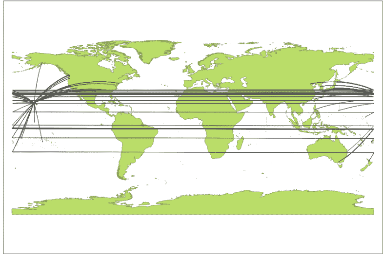

要正确显示该图层，我们可以选择适合你地图的投影。为此，请执行以下步骤：

- 1. 通过点击 *Ctrl + Shift + P* 键盘快捷键或导航到 **Project | Project Properties** 打开 **Project Properties** 对话框。
- 2. 转到 **CRS** 选项卡并激活 **Enable 'on the fly' CRS transformation** 复选框。
- 3. 选择适合位置的投影。在我们的例子中，这是 WGS84/PDC Mercator (EPSG:3832)。

> 请注意，对于不同位置，应使用不同的投影。


4. 点击**确定**按钮保存更改并关闭对话框。现在，我们的数据将正确显示：

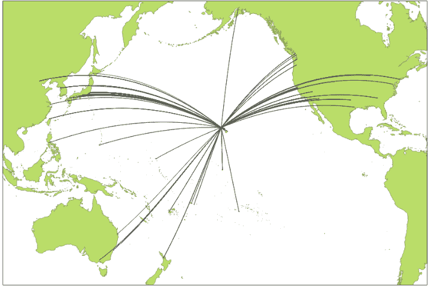

另一种选择是将数据裁剪到日期变更线。这可以使用 GDAL 工具集中的 `ogr2ogr` 工具完成。为此，请执行以下步骤：

- 1. 如果您是 Windows 用户，请打开 OSGeo4W 命令提示符；如果您是 Linux 或 Mac OS 用户，请打开终端窗口。
- 2. 将目录更改为 `honolulu-flights.shp` 所在的文件夹，例如以下目录：

  `cd c:\data`

- 3. 在命令提示符中输入以下命令。注意，我们先指定输出文件，再指定输入文件：

  `ogr2ogr -wrapdateline honolulu-flights-wrapped.shp honolulu-flights.shp`

4. 将新创建的 `honolulu-flights-wrapped.shp` 图层加载到 QGIS 中后，您将看到包裹在日期变更线上的航班正确显示：

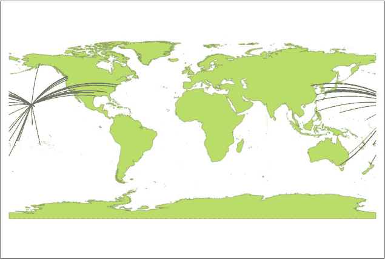

5. 现在从 `new-zealand.sqlite` 数据库加载 `nz-coastlines-and-islands` 图层。您应该会看到两组相距很远的多边形。这就是新西兰岛和查塔姆群岛，它们本应位于附近。


为了正确显示它们，我们可以使用 SpatiaLite 中提供的 `ST_Shift_Longitude` 函数。为此，请执行以下步骤：

- 1. 通过单击工具栏上的按钮或导航到**数据库 | DB Manager | DB Manager**，打开 **DB Manager** 插件。
- 2. 在对话框左侧的连接树中展开 **SpatiaLite** 组，然后选择 `new-zealand` 数据库。
- 3. 打开 **SQL 窗口**并运行以下查询：

```
UPDATE "nz-coastlines-and-islands" SET
Geometry=ST_Shift_Longitude(Geometry)
```

4. 从 QGIS 中移除 `nz-coastlines-and-islands` 图层并重新添加。现在，新西兰岛和查塔姆群岛将正确显示，如下所示：

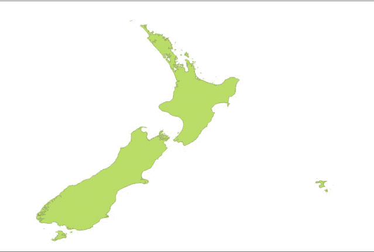

值得一提的是，`ST_Shift_Longitude` 函数在 PostGIS 中也可用。

## 工作原理

当我们启用“即时”CRS 变换时，每个几何图形都会被重新投影到给定的 CRS（在我们的示例中是以太平洋为中心），因此坐标现在具有相同的符号。

带有 `-wrapdateline` 选项的 `ogr2ogr` 工具会将所有跨越日期变更线的几何图形分割并写入输出文件。不跨越日期变更线的几何图形将原样复制。

`ST_Shift_Longitude` 函数将负经度平移 360 度，因此所有数据将位于 0-360 度范围内，并正确显示。

## 另请参阅

- http://docs.qgis.org/2.2/en/docs/user_manual/working_with_vector/supported_data.html#vector-layers-crossing-180-degrees-longitude

## 离线工作

互联网是一种极好的资源，但有时你就是无法访问。对于野外作业、服务不稳定的地区、飞机上，甚至是会议室里，你也许无法获得所需的所有资料。这里的资料指的是文档（用户文档和开发文档），但更重要的是数据库图层（例如 PostGIS）和基于 Web 服务的图层（例如 WMS、WFS、OpenLayers 插件等）。

本方案介绍如何在前往无网络连接的地方之前，将所需文件的本地副本缓存到计算机上。

### 准备工作

对于本方案，您需要打开一个 PostGIS 数据库或 WFS，并启用 QGIS 附带的**离线编辑**插件。

### 操作方法

- 1. 从 PostGIS 或 WFS 加载您的图层。
- 2. 确保激活**离线编辑**选项。
- 3. 在**数据库**菜单中，您应该会看到**离线编辑**，选择**转换为离线项目**：

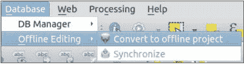

- 4. 选择用于存储数据的本地文件。
- 5. 然后，选择要转换的所有图层（仅限矢量图层）：

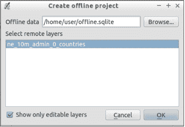

- 6. 现在，您可以在不连接在线数据库的情况下使用您的 PostGIS 图层。请尝试进行一些编辑。（我们建议您在数据库或表的一个副本上执行此操作，直到您完全熟悉为止。）
- 7. 当您重新连接到网络时，您可以通过选择**同步**选项将更改发送到数据库：

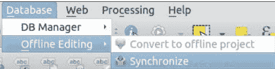

## 工作原理

基本原理很简单：您数据的副本会保存在您计算机本地的 SpatiaLite 数据库中。项目文件会记录更改，一切就绪，因为 SpatiaLite 可以执行 QGIS 中任何其他矢量数据源可以执行的任何操作。

在多用户环境中工作时请务必小心，如果多个用户独立修改同一数据集，此方法不处理编辑冲突。

## 更多内容

此外，还有多种方法可以为栅格数据集（网络文件或 Web 服务）创建离线缓存，包括 `gdalwmscaching` 或 `mbtiles`。如果您计划有一段时间需要在没有互联网的情况下工作，请提前规划，并在真正需要离线之前测试解决方案。再多的插件也无法替代良好的规划。

请记住，在缓存 Web 服务（例如 Google 和 Bing）之前，请检查其合法性。OpenStreetMap 是离线使用的可靠瓦片来源，且不受限制。

## 另请参阅

- GDAL WMS 缓存选项可在 http://www.gdal.org/frmt_wms.html 获取
- 关于 mbtiles 用法的讨论可在 http://blogs.terrorware.com/geoff/2012/11/17/offline-map-tiles-in-qgis/ 获取
- 一个可帮助您进行设置的新插件可在 https://plugins.qgis.org/plugins/MBTiles2img/ 获取

## 使用 QspatiaLite 插件

有时，您可能不需要将整个图层加载到 QGIS 中，而只需要其中的某个子集，或者动态执行一些计算。在这种情况下，运行复杂 SQL 查询并在 QGIS 中显示其结果的能力将非常有用。

本方案介绍如何使用 QspatiaLite 插件执行 SQL 代码并在 QGIS 中加载数据。

### 准备工作

要遵循本方案，您需要创建到 cookbook.db 数据库的连接，该数据库是在第 1 章“数据输入与输出”中的“将矢量图层加载到 SpatiaLite”方案中创建的。或者，您可以使用自己的 SpatiaLite 数据库，但请注意，您可能需要修改下面的一些 SQL 语句以匹配您的表。

此外，从插件管理器安装 QspatiaLite 插件。

### 操作方法

确保您已创建到 cookbook.db 的连接。通过导航到 数据库 | SpatiaLite | QspatiaLite 启动 QspatiaLite 插件：

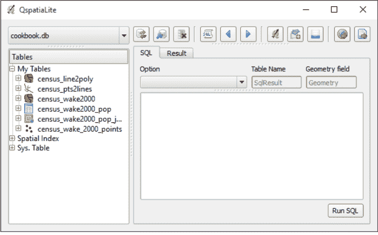

要执行 SQL 查询，请执行以下步骤：

- 1. 从插件对话框左上角的组合框中选择要使用的数据库。
- 2. 在 **SQL** 选项卡中，输入以下查询：

```
SELECT "census_wake2000".'pk' AS id,
"census_wake2000".'geom' AS Geometry,
"census_wake2000".'area', "census_wake2000".'perimeter'
FROM "census_wake2000" WHERE "census_wake2000".'perimeter' > 100000;
```

在对话框左侧的**表**树中双击表名和列名，即可轻松插入它们。

- 3. 单击对话框底部的**运行**按钮执行查询。**结果**选项卡将自动打开，您可以以表格形式查看查询结果，如下所示：

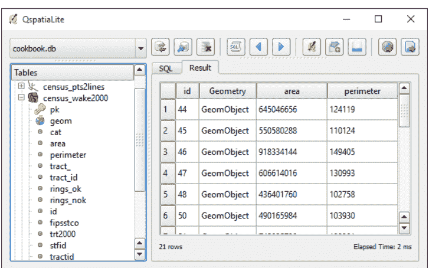

如果查询结果包含几何信息（即所谓的几何列），您可以在 QGIS 中显示它们。为此，请执行以下步骤：

- 1. 切换回 **SQL** 选项卡。
- 2. 在**选项**组合框中，选择要执行的操作，例如**创建空间视图并加载到 QGIS**。
- 3. 在**表**字段中，输入结果视图的名称，例如 `above100k`。


-   4. 确保在 **几何** 字段中输入了几何列的正确名称。
-   5. 单击对话框底部的 **运行** 按钮。
-   6. 将弹出一个对话框，询问源几何表。选择您在查询中使用的表，然后单击 **确定**。
-   7. 将创建一个新视图，并作为新图层添加到 QGIS 中。

## 工作原理...

当我们单击 **运行** 按钮时，查询会被传递给 SpatiaLite 数据库引擎执行，结果会返回到插件并显示在表格中。如果您想永久存储结果，可以使用插件对话框中的相应按钮将结果导出为文本文件或 OGR 兼容格式。

## 更多内容...

您还可以使用 **DB Manager** 插件（随 QGIS 一起提供）直接执行 SQL 查询并将其加载为图层。

## 另请参阅

-   ➤ 关于 SpatiaLite 和 SQL 的一篇很好的介绍可以在这里找到：`https://www.gaia-gis.it/fossil/libspatialite/wiki?name=misc-docs`。此外，受支持的空间 SQL 函数的完整列表可在 `http://www.gaia-gis.it/gaia-sins/spatialite-sql-4.3.0.html` 获取。

## 添加具有 Python 依赖项的插件

虽然最常见的且广泛使用的 Python 包随 QGIS 一起提供，并且插件无需任何额外操作即可使用它们，但有些 QGIS 插件需要第三方 Python 包，而这些包在默认的 QGIS 安装中是不可用的。

本教程将向您展示如何将缺失的 Python 包添加到 QGIS 安装中。

## 准备工作

要遵循本教程，如果您是 Windows 用户并且 QGIS 安装在系统驱动器上，您可能需要管理员权限。

## 操作步骤...

以下步骤将安装 pip——一个 Python 包管理工具：

-   1. 从 https://raw.githubusercontent.com/pypa/pip/master/contrib/get-pip.py 下载 `get-pip.py` 文件，并将其保存到硬盘的某个位置，例如 D:\Downloads。
-   2. 以管理员身份打开 OSGeo4W 命令提示符。右键单击桌面上的 **OSGeo4W Shell** 快捷方式，然后从上下文菜单中选择 **以管理员身份运行**。如果您在桌面上找不到此快捷方式，请在 Windows **开始** 菜单中查找。
-   3. 在 OSGeo4W 命令提示符中，输入 `python D:\Downloads\get-pip.py`。不要忘记将 D:\Downloads 替换为 `get-pip.py` 文件的正确路径。等待命令执行完成。

现在，当 pip 准备好后，您就可以轻松地下载并安装第三方 Python 包。为此，请执行以下步骤：

-   1. 以管理员身份打开 OSGeo4W 命令提示符。右键单击桌面上的 **OSGeo4W Shell** 快捷方式，然后从上下文菜单中选择 **以管理员身份运行**。如果您在桌面上找不到此快捷方式，请在 Windows **开始** 菜单中查找。
-   2. 在 OSGeo4W 命令提示符中，输入 `pip install package_name`。不要忘记将 `package_name` 替换为您要安装的包的名称。例如，如果您想安装 PySAL 包，请使用此命令：`pip install pysal`。

如果您是 Linux 用户，请使用您的包管理器安装 pip。例如，在 Debian 和 Ubuntu 下，使用 `sudo apt-get install python-pip` 命令安装 pip。完成此操作后，您就可以按照上一段所述使用 pip 下载和安装包。

Mac OS 用户可以通过 Homebrew 使用 `brew install pip` 命令安装 pip。

使用 pip，您还可以查看已安装的包、更新它们以及移除它们。有关更多信息，请查看位于 https://pip.pypa.io/en/stable/ 的 pip 文档。

## 工作原理...

pip 会从 Python 包索引（https://pypi.python.org/）下载所请求的包及其所有必要的依赖项，并将它们安装到与 QGIS 捆绑的 Python 中。

## 更多内容...

您还可以将在 Windows 注册表中将与 QGIS 捆绑的 Python 注册为系统默认 Python 版本。之后，您可以使用常规的 Windows 安装程序来安装所需的包。有关此主题的更多信息，请访问 https://trac.osgeo.org/osgeo4w/ticket/114。

## 使用 Python 控制台

QGIS 内置了一个 Python 控制台，您可以在其中输入 Python 编程语言的命令并获得结果。这对于快速数据处理非常有用。

## 准备工作

要遵循本教程，您应该熟悉 Python 编程语言。您可以在 https://docs.python.org/2.7/tutorial/index.html 的官方 Python 文档中找到一份简短但详细的教程。

另外，从示例数据中加载 `poi_names_wake.shp` 文件。

## 操作步骤...

可以通过单击工具栏上的 **Python 控制台** 按钮，或者导航到 **插件 | Python 控制台** 来打开 QGIS Python 控制台。控制台将以非模态浮动窗口的形式打开，如下面的截图所示：

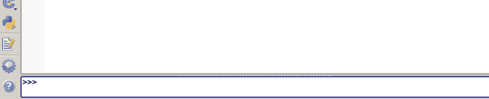

让我们看一下如何使用 QGIS Python 控制台执行一些数据探索：

-   1. 首先，有必要获取对活动图层（在图层树中选中的图层）的引用，并将其存储在变量中，以便后续使用。运行以下命令：
    ```
    layer = iface.activeLayer()
    ```

-   2. 获取到图层的引用后，我们可以检查它的一些属性。例如，要获取图层中的要素数量，请执行以下命令：
    ```
    layer.featureCount()
    ```

> 在任何时候，您都可以使用 dir() 函数列出对象所有可用的方法。尝试执行 dir(layer) 或 dir(QgsFeature)。

-   3. 您还可以使用以下代码片段遍历图层要素并打印它们的属性：
    ```
    for f in layer.getFeatures():
        print f["featurename"], f["elev_m"]
    ```

> 请注意，输入此代码后，您需要按两次 Enter 键以退出循环定义并开始执行命令。

您还可以使用 Python 控制台执行更复杂的任务，例如将具有某些属性的要素导出到文本文件。具体操作如下：

-   1. 使用 Python 控制台左侧的 **显示编辑器** 按钮打开 Python 控制台编辑器。

-   2. 将以下代码粘贴到编辑器中（请确保根据您的系统更改文件路径）：
    ```
    import csv
    layer = iface.activeLayer()
    with open('c:\\temp\\export.csv', 'wb') as outputFile:
        writer = csv.writer(outputFile)
        for feature in layer.getFeatures():
            geom = feature.geometry().exportToWkt()
            writer.writerow([geom, feature["featurename"], feature['elev_m']])
    ```

-   3. 如果您使用的是自己的矢量图层，而不是本书提供的 poi_names_wake.shp，请调整第 8 行中的属性名称。

-   4. 根据您的操作系统更改第 4 行中结果文件的文件路径。
-   5. 保存脚本并运行它。在运行脚本之前，不要忘记在 QGIS 图层树中选择矢量图层。

## 工作原理...

在第 1 行，我们从标准 Python 库中导入了 csv 模块。该模块提供了一种读写逗号分隔文件的便捷方式。在第 3 行，我们获取了当前选中图层的引用，该引用将在后续用于访问图层要素。

在第 3 行，打开了一个输出文件。请注意，这里我们使用了 with 语句，这样之后就不需要显式关闭文件，上下文管理器会为我们完成这项工作。在第 5 行，我们设置了所谓的 writer 对象，它将使用指定的格式设置将数据写入 CSV 文件。

在第 6 行，我们开始遍历活动图层的要素。对于每个要素，我们提取了它的几何图形，并将其转换为 Well-Known Text（WKT）格式（第 7 行）。然后，我们将要素几何图形的这种文本表示形式连同一些属性写入输出文件（第 8 行）。

有必要说明一下，我们的脚本非常简单，仅适用于具有 ASCII 编码的属性。为了处理非拉丁字符，有必要在将输出数据写入文件之前将其转换为 unicode。

## 更多内容...

使用 Python 控制台，您还可以调用处理算法来创建用于自动分析和/或数据准备的复杂脚本。

为了让 Python 控制台更加有用，请查看 Script Runner 插件。有关此插件的详细信息及一些使用示例，请访问 http://spatialgalaxy.net/2012/01/29/script-runner-a-plugin-to-run-python-scripts-in-qgis/。

## 另请参阅

-   如果您是 Python 和 QGIS API 的新手，请不要忘记查看以下文档：
    -   官方 Python 文档和教程可在 https://docs.python.org/2/ 找到
    -   QGIS API 文档可在 http://qgis.org/api/2.8/ 找到
    -   PyQGIS 开发者食谱可在 http://docs.qgis.org/2.8/en/docs/pyqgis_developer_cookbook/ 找到


+   另一个学习使用 QGIS 进行编程的极佳资源是 *《QGIS Python 编程食谱》（Joel Lawhead 著）*，由 Packt Publishing 出版。

## 编写处理算法

您可以通过添加可在 Processing 框架内使用的脚本，来扩展 QGIS 的功能。这将使您能够创建自己的分析算法，然后从工具箱或任何生产力工具（例如批处理界面或图形化建模器）中高效地运行它们。

本节介绍如何创建 Processing 算法的基本概念。

## 准备工作

理解本节需要具备一定的 Python 基础知识。此外，由于本节使用 Processing 框架，在学习之前您应该熟悉该框架。

## 操作步骤...

我们将添加一个新流程，用来筛选图层的多边形，生成一个新图层，其中仅包含面积大于给定值的多边形。具体操作如下：

-   1. 在**处理工具箱**菜单中，转到**脚本/工具**组，然后双击**创建新脚本**项。您将看到以下对话框：

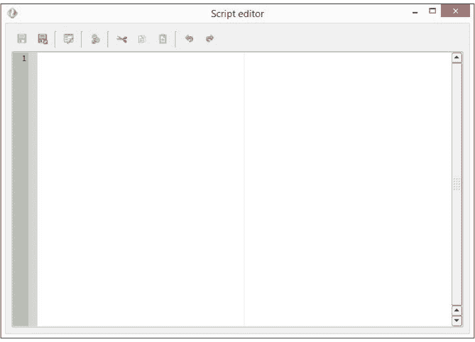

2. 在对话框的文本编辑器中，粘贴以下代码：

```
##Cookbook=group
##Filter polygons by size=name
##Vector_layer=vector
##Area=number 1
##Output=output vector

layer = processing.getObject(Vector_layer)
provider = layer.dataProvider()
writer = processing.VectorWriter(Output, None,
    provider.fields(), provider.geometryType(), layer.crs())
for feature in processing.features(layer):
    print feature.geometry().area()
    if feature.geometry().area() > Area:
        writer.addFeature(feature)
del writer
```

3. 选择“保存”按钮以保存脚本。在出现的文件选择器中，输入扩展名为 .py 的文件名。不要将其移动到其他文件夹。请确保使用文件选择器打开时默认选中的文件夹。

4. 关闭编辑器。

5. 转到工具箱中的“脚本”组，您将看到一个新的名为“Cookbook”的组，其中包含一个名为“Filter polygons by size”的算法。

6. 双击它将其打开，您将看到以下参数对话框，与您在其他任何 Processing 算法中看到的类似：

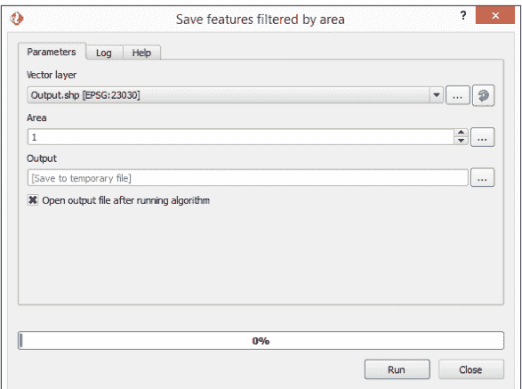

## 工作原理...

该脚本主要包含两部分：

-   一部分用于定义算法的特征。这部分用于定义算法的语义，以及一些附加信息，例如算法的名称和所属组。
-   另一部分接收用户输入的参数，并对其进行处理以生成输出。算法本身的功能就在这里实现。

在我们的示例中，第一部分如下所示：

```
##Cookbook=group
##Filter polygons by size=name
##Vector_layer=vector
##Area=number 1
##Output=output vector
```

我们定义了两个输入（图层和面积值），并声明一个输出（过滤后的图层）。这些元素是使用带有双 Python 注释符（#）的 Python 注释来定义的。

第二部分包含代码本身，如下所示：

```
layer = processing.getObject(Vector_layer)
provider = layer.dataProvider()
writer = processing.VectorWriter(Output, None,
    provider.fields(), provider.geometryType(), layer.crs())
for feature in processing.features(layer):
    print feature.geometry().area()
    if feature.geometry().area() > Area:
        writer.addFeature(feature)
del writer
```

我们在第一部分中定义的输入在这里将可用，我们可以使用它们。对于面积，我们将有一个名为 Area 的变量，包含一个数字。对于矢量图层，我们将有一个 Layer 变量，包含所选图层的源字符串。

利用这些值，我们使用 PyQGIS API 进行计算并创建新图层。该图层保存在 Output 变量所包含的文件路径中，该路径是用户在运行算法时选择的路径。

除了使用常规的 Python 和 PyQGIS 接口外，Processing 还包含一些类和函数，这样更容易编写脚本，并且这些类和函数封装了 QGIS 一些最常见的功能。

特别是 `processing.features(layer)` 方法很重要。它提供了一个图层中要素的迭代器，但只考虑选中的要素。如果没有选中项，它会遍历图层中的所有要素。这是任何 Processing 算法的预期行为，因此必须使用此方法，以便在您的脚本中提供一致的行为。

## 更多内容...

Processing 提供的一些核心算法实际上也是脚本，比如我们刚刚创建的脚本，但它们不会出现在“脚本”部分。相反，它们出现在**QGIS 算法**部分，因为它们是 Processing 的核心组成部分。

其他脚本不属于 Processing 本身，但可以轻松地从工具箱中使用**工具/从在线集合获取脚本**菜单进行安装：

您将看到一个如下所示的窗口：

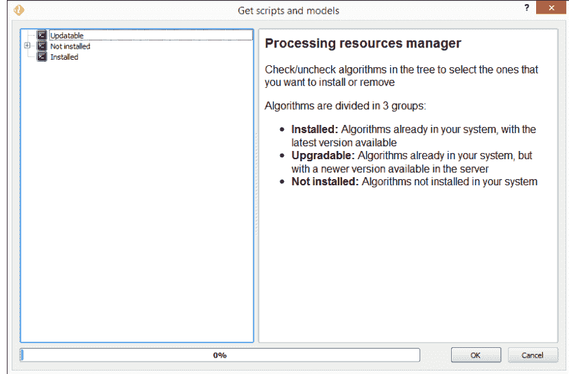

只需选择您要安装的脚本，然后点击**确定**。所选脚本现在会出现在工具箱中。您可以像使用任何其他 Processing 算法一样使用它们。

## 编写 QGIS 插件

QGIS 广受欢迎的主要原因之一是其可扩展性。利用 QGIS API 提供的基本工具和功能，可以实现新的功能并将其作为新插件添加，还可以通过将其贡献到 QGIS 插件库来实现共享。

## 另请参阅

-   - 关于创建脚本和从 QGIS Python 控制台运行 Processing 代码的所有信息，都可以在 QGIS 手册的相应章节中找到。

## 准备工作

要开发新的 QGIS 插件，您应该熟悉 Python 编程语言。如果插件带有图形界面，您还需要具备一些 Qt 框架的知识，因为所有 UI 元素（如对话框）都使用 Qt。要访问 QGIS 功能，您需要了解 QGIS API。

一个非常有用的资源（还有其他一些）是 GeoAPIs 网站，它由 SourcePole 创建，网址为 `http://geoapis.sourcepole.com/`。

为了简化插件的创建，我们将使用一个名为 Plugin Builder 的附加插件。它应该已安装在您的 QGIS 应用程序中。

## 操作步骤...

以下步骤将创建一个新插件，用于打印当前 QGIS 项目中加载的图层的详细信息：

-   1. 通过导航到**插件 | Plugin Builder**打开 Plugin Builder。
-   2. 填写将出现的对话框，如下面的截图所示：

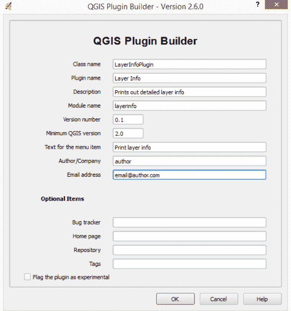

3. 点击“确定”。

4. 在出现的文件夹选择对话框中，选择要存储插件的文件夹。点击“确定”，插件骨架将被创建。在所选文件夹中，您现在会看到一个名为 LayerInfoPlugin 的子文件夹，其中包含以下内容（方括号中的项表示文件夹）：

```
[help]
[i18n]
[scripts]
[test]
icon.png
layerinfo.py
layerinfo_dialog.py
layerinfo_dialog_base.ui
Makefile
metadata.txt
pb_tool.cfg
```

plugin_upload.py
pylintrc
README.html
README.txt
resources.qrc
__init__.py

5. 在文本编辑器中打开 layerinfo.py 文件。在文件末尾，您会找到 run() 方法，代码如下：

```
def run(self):
    """Run method that performs all the real work"""
    # show the dialog
    self.dlg.show()
    # Run the dialog event loop
    result = self.dlg.exec_()
    # See if OK was pressed
    if result: pass
```

6. 将 run 方法替换为以下代码：

```
def run(self):
    layers = self.iface.legendInterface().layers()
    print "---LAYERS INFO---"
    for layer in layers:
        print "Layer name: " + layer.name()
        print "Layer source " + layer.source()
        print "Extent: " + layer.extent().asWktCoordinates()
        print
```

7. 打开终端并运行 easy_install pb_tool 来安装 pb_tool 应用程序（您也可以使用 pip install pb_tool 或任何其他从 PyPI 安装库的方式）。

8. 在包含插件代码的文件夹中打开终端，运行 pb_tool 并编译。然后，运行 pb_tool deploy 以将插件安装到您的本地 QGIS 中。

9. 打开 QGIS。转到插件管理器，确保我们创建的新插件存在并且已启用：

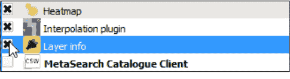


10. 在“插件”菜单中，现在将出现与插件对应的条目：

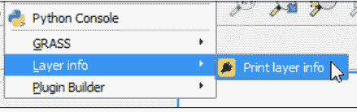

11. 向项目中添加一些图层，以便插件能够显示关于它们的信息。

12. 打开 QGIS Python 控制台。

13. 通过选择其菜单条目来运行插件。项目中各图层的信息将显示在控制台中：

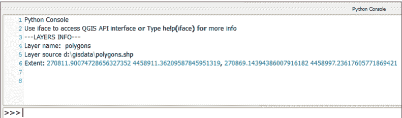

## 工作原理...

Plugin Builder 插件会获取一些关于待创建插件的基本信息，并使用这些信息创建其骨架。默认情况下，它包含一个菜单条目，该条目成为从 QGIS 界面进入插件的入口点。

当选择该菜单项时，插件代码中的相应操作会被执行。在本例中，它运行了我们添加代码的 `run()` 方法。

该插件始终持有对 QGIS 实例（`QgsInterface` 类的对象）的引用，该实例可用于访问 QGIS API 并与当前 QGIS 会话中的元素交互。在我们的案例中，它被用来访问图例（legend），图例中包含当前项目中加载的所有图层列表。通过分别调用这些图层的相应方法，可检索并打印出关于它们的信息。

标准输出被重定向到 QGIS Python 控制台，因此使用 Python 内置的 `print` 命令打印文本时，若控制台已打开，文本将显示在控制台中。

QGIS 将插件存储在当前用户文件夹下的 `.qgis2/python/plugin` 文件夹中。例如，使用 Plugin Manager 下载新插件时就会放到这里。每次启动 QGIS 时，它都会在该文件夹中查找插件并加载它们。复制该文件夹是由我们运行的 deploy 任务完成的，这使得 QGIS 能够发现插件，并在 QGIS 启动时将其添加到可用插件列表中。

## 更多内容...

以下是一些创建更佳插件并管理它们的想法。

## 创建具有更复杂 UI 元素的插件

我们创建的插件没有 UI 元素。不过，在插件生成器创建的文件中，你可以找到一个带有 `.ui` 扩展名的基础对话框文件。你可以对其进行编辑以创建一个对话框，之后在插件代码中调用即可使用。要了解更多关于如何创建和使用 Qt 框架（QGIS 构建于该框架之上）中的 UI 元素，请查阅 PyQt 文档。

## 为你的插件编写文档

插件生成器创建的另一个内容是 Sphinx 文档项目，你可以使用 RestructuredText 编写插件的使用文档。要了解更多关于 Sphinx 的信息，请访问 Sphinx 官方网站：http://www.sphinx-doc.org/en/stable/。

文档项目会在运行 deploy 任务时构建，并生成 HTML 文件放置到插件文件夹中。

## 发布你的插件

当你的插件完成后，将其分享出去供他人使用会是一个好主意。如果将插件上传到 QGIS 插件服务器，所有 QGIS 用户都能轻松地通过 Plugin Manager 获取它，并获得最新更新。

要上传插件，你首先需要创建一个包含其所有代码和资源的 ZIP 文件。有一个 `pb_tool` 任务可以完成此操作，你只需在终端运行 `pb_tool zip`。使用生成的 ZIP 文件，你就可以开始发布流程。更多相关信息可参阅 http://docs.qgis.org/2.6/en/docs/pyqgis_developer_cookbook/releasing.html。

## 使用外部工具

虽然 QGIS 本身是一个优秀且功能丰富的程序，但有时使用更合适的工具来执行一些简单或复杂的操作会更好。本方法向你展示如何使用其中一些第三方工具。

## 准备工作

要遵循本方法，你需要书附数据集中的 `btnmeatrack_2014-05-22_13-35-40.nmea` 文件。我们还将使用在第1章“数据输入与输出”的“将矢量图层加载到 SpatiaLite”一节中创建的 `cookbook.db` SpatiaLite 数据库，以及在第6章“网络分析”中开发的 PostgreSQL 数据库。

此外，别忘了安装 GPSBabel（通常与 QGIS 一起提供）、spatialite-gui 和 pgAdmin（这些需要手动安装）。

## 操作步骤...

首先，我们将使用 GPSBabel 将 NMEA 数据转换为 GPX 格式，然后学习如何使用 SpatiaLite GUI 工具和 pgAdmin 来处理数据库。

## GPSBabel

GPSBabel 是一个命令行工具，用于以不同格式操作、转换和处理 GPS 数据（航点、轨迹和路线）。

要将文件从 NMEA 格式转换为更常见的 GPX 格式，请按以下步骤操作：

- 1. 打开命令提示符，转到 `btnmeatrack_2014-05-22_13-35-40.nmea` 文件所在的目录。通常，可以使用 `cd` 命令完成，例如，如果文件位于 `C:` 盘的 `data` 目录中，请使用以下命令：
- 
- `cd c:\data`

- 2. 在命令提示符中，输入以下命令将 NMEA 文件转换为 GPX 文件：
- 
- `gpsbabel -i nmea -f btnmeatrack_2014-05-22_13-35-40.nmea -o gpx -F 2014-05-22_13_35-40.gpx`

## spatialite-gui

spatialite-gui 是一个支持 SpatiaLite 的 GUI 工具。它非常轻量，当需要快速执行一些查询或只想检查 SQLite/SpatiaLite 数据库的内容时非常有用。

要浏览 SpatiaLite 数据库中的空间表或非空间表，请执行以下步骤：

- 1. 双击 `spatialite-gui` 的可执行文件来启动它。

- 2. 通过导航到 **文件 | 连接现有 SQLite 数据库**，或单击工具栏上的相应按钮，连接到要浏览的数据库。

- 3. 在 spatialite-gui 对话框左侧的表格树中选择要浏览的表，单击鼠标右键打开其上下文菜单，然后选择“编辑表行”菜单项。

- 4. 如果表包含空间数据，则可以查看不同表示的几何图形。在行中选择带有几何信息的字段，单击鼠标右键打开上下文菜单，然后选择“BLOB 浏览”菜单项：

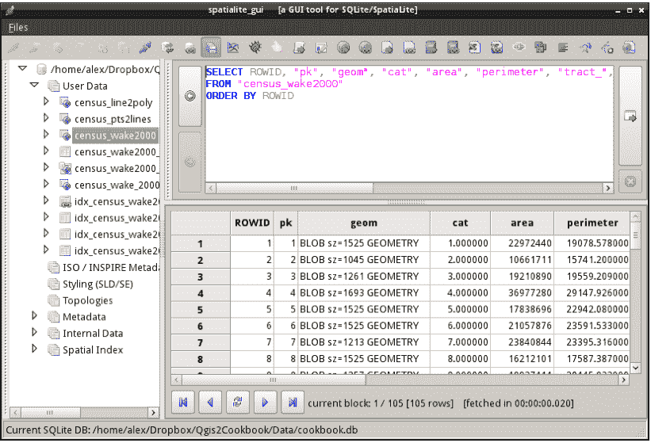

在进行大规模编辑后，尤其是当表被修改或删除时，建议运行 VACUUM 命令来重建数据库。为此，请执行以下步骤：

- 1. 双击 `spatialite-gui` 的可执行文件来启动它。

- 2. 通过导航到 **文件 | 连接现有 SQLite 数据库**，或单击工具栏上的相应按钮，连接到要浏览的数据库。

- 3. 导航到 **文件 | 优化当前 SQLite 数据库 [VACUUM]**，或单击工具栏上的相应按钮。

## pgAdmin

pgAdmin 是一个用于 PostgreSQL 数据库的管理工具和开发平台。它允许你执行管理任务（如备份和恢复）、运行简单查询以及从零开始开发新数据库。

要使用 pgAdmin 创建数据库备份，请按以下步骤操作：

- 1. 通过单击桌面快捷方式或在 **开始** 菜单中找到 pgAdmin 来启动它。

- 2. 如果数据库服务器连接尚不存在，请通过导航到 **文件 | 添加服务器...** 或单击工具栏上的相应按钮来创建连接。

- 3. 在 **pgAdmin** 窗口左侧的 **对象浏览器** 中双击数据库服务器的名称，连接到你的数据库所在的服务器。

- 4. 选择要备份的数据库，单击鼠标右键打开其上下文菜单，然后选择 **备份**。将打开备份设置对话框，如下面的截图所示：

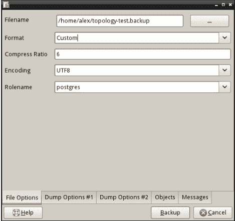

- 5. 选择备份保存的位置，根据需要调整备份选项，然后点击 **备份** 按钮开始备份过程。进度将显示在 **消息** 选项卡中。

要从备份中恢复数据库，请执行以下步骤：

- 1. 通过单击桌面快捷方式或在 **开始** 菜单中找到 pgAdmin 来启动它。

- 2. 如果数据库服务器连接尚不存在，请通过导航到 **文件 | 添加服务器...** 或单击工具栏上的相应按钮来创建连接。

- 3. 连接到要恢复备份的数据库服务器，并在 pgAdmin 窗口左侧的 **对象浏览器** 中双击其名称。

- 4. 选择要恢复的数据库，单击鼠标右键打开其上下文菜单，然后选择 **恢复**。将打开恢复选项对话框，如下面的截图所示：

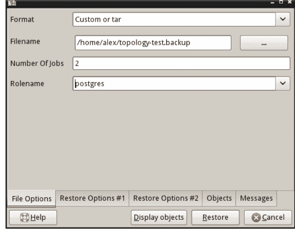

> 值得一提的是，pgAdmin 用于恢复的 pg_restore 工具无法创建需要恢复的数据库。必须先手动创建一个新的空数据库，然后使用这个新创建的数据库开始恢复。


+   5. 选择备份文件的存储位置并根据需要调整恢复选项。


请注意，你可以恢复单个表或模式，只需在选择备份文件后点击 **Display objects** 按钮，并在 **Objects** 选项卡中选择所需对象。

+   6. 点击 **Restore** 按钮开始恢复。进度将在 **Messages** 选项卡中显示。

## How it works...

这里的所有工具都使用与 QGIS 相同的档案格式。这使得在工作时具有更大的灵活性，可以在合适的时间使用最佳工具。

## There's more...

还有许多其他不同的工具在各种情况下可能很有用，例如，exiv2 可用于操作照片的 EXIF 标签，ImageMagick 用于处理栅格，等等。
