## Up and Coming

在本章中，我们将涵盖以下主题：

- Preparing LiDAR data
- Opening File Geodatabases with the OpenFileGDB driver
- Using Geopackages
- The PostGIS Topology Editor plugin
- The Topology Checker plugin
- GRASS Topology tools
- Hunting for bugs
- Reporting bugs

## Introduction

软件环境不断变化，QGIS 也不例外。每周都会添加新功能，并且有一个庞大且不断增长的插件库。本章重点介绍了撰写时期的一些较新功能。这些是我们认为由于其有用性而会存在一段时间的功能。请记住，然而，它们仍在开发中，可能随时发生变化；希望这是朝着更好的方向发展。本章包括对一些较新和额外的格式的处理，这些格式之前未涵盖，例如 LIDAR、File Geodatabases 和 Geopackages。还包括了关于拓扑使用、编辑和修复的多个配方。最后，有几个配方介绍如何成为帮助 QGIS 进化的社区的一员，通过错误查找和报告。

## Preparing LiDAR data

LiDAR 数据变得更加普及，它代表了详细高程数据的基本来源。本章将向你展示如何在 QGIS 中使用 LiDAR 数据。

## Getting ready

我们将使用 Processing 框架，因此你应该熟悉它。

我们还将使用 LAStools，它不包含在 QGIS 中。从 http://lastools.org/download/LAStools.zip 下载 LAStools 二进制文件并将其安装到你的计算机上。

Processing 必须配置为能够找到并执行 LAStools。通过前往 Processing | Options 菜单打开 Processing 配置并移动到 Tools for LiDAR data 部分，如以下屏幕截图所示：

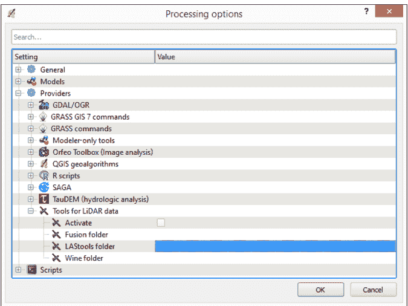

在 LAStools 文件夹字段中，输入你已安装 LAStools 可执行文件的文件夹路径。

## How to do it...

在本配方对应的数据中，你会找到一个包含 LiDAR 数据的 `las` 文件。这无法在 QGIS 中打开，但我们将对其进行转换，使其可以作为普通 QGIS 项目的一部分打开和渲染。

按照以下步骤操作：

+   1. 打开 **Processing Toolbox** 菜单。
+   2. 在 **Tools for LiDAR data/LAStools** 分支中，双击 **las2shp** 算法。算法的参数对话框如下所示：

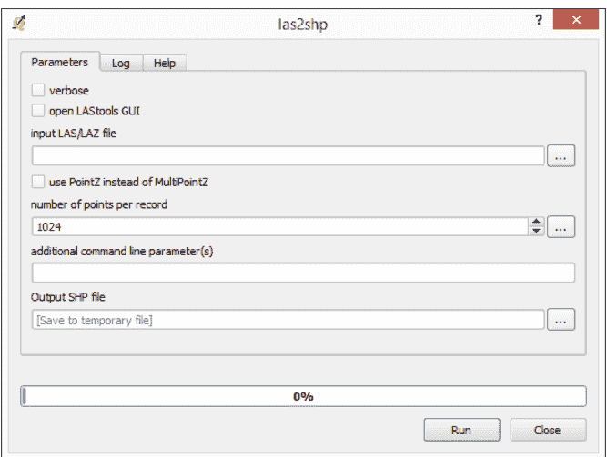

+   3. 在 **Input LAS/LAZ file** 字段中输入本配方提供的示例 LAS 文件的路径。
+   4. 在 **Output SHP file** 字段中输入输出 shapefile 的路径。
+   5. 保持其余参数不变并点击 **OK** 运行算法。
+   6. 包含点云的 resulting shapefile 将被添加到你的 QGIS 项目中。

## How it works...

las2shp 工具将 LAS 文件转换为 SHP 文件。Processing 使用提供的参数调用 las2shp，然后将 resulting 图层加载到你的 QGIS 项目中。

## There's more...

你也可以使用 las2dem 算法将 LAS 文件转换为栅图层。

在 Tools for LiDAR data/LASTools 分支中，双击 las2dem 算法。算法的参数对话框如下所示：

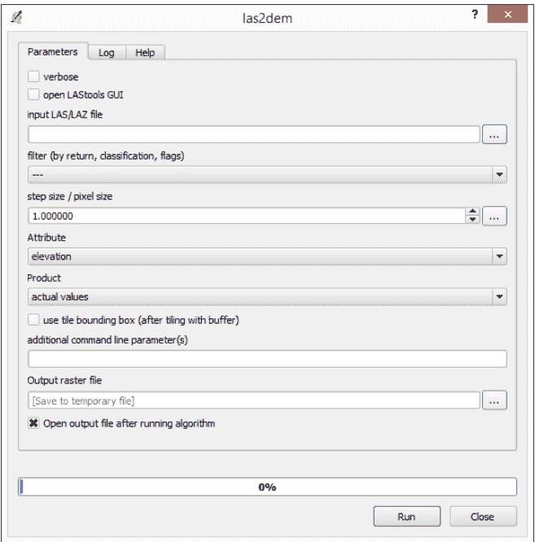

+   1. 在 Input LAS/LAZ file 字段中输入本配方提供的示例 LAS 文件的路径。

+   2. 在 Output file 字段中输入输出 TIFF 文件的路径。

+   3. 在 **step size/pixel size** 字段中输入 `0.005`。
+   4. 保持其余参数不变并点击 **OK** 运行算法。
+   5. resulting 栅格图层将被添加到你的 QGIS 项目中。

## Opening File Geodatabases with the OpenFileGDB driver

File **Geodatabases (GDB)** 相对于 shapefile 来说是一个相对较新的格式，由 Esri 为其 Arc 产品线创建。它们允许在单个数据库中存储多个矢量和栅格图层。一些政府机构以此格式正式发布数据。然而，只有在最近几年才有可能使用开源工具打开这些数据。

### Getting ready

对于本配方，你需要一个 File Geodatabase，`naturalearthsample.gdb.zip`，它包含在示例数据中，以及 GDAL 1.11 或更新版本。

> 通过导航到 **Help | About | About** 检查你的 GDAL 版本。如果你的 GDAL 版本较低，升级 QGIS 应该能获得足够新的版本。有关更多选项，请参阅 `http://qgis.org/en/site/forusers/download.html`，尤其是在 Linux 上，你可能需要第三方存储库来获取更新版本的 GDAL。

File Geodatabases 实际上是包含各种二进制文件的文件夹。通常，你会收到压缩包，需要将其解压到真实的系统文件夹中才能使用。

### How to do it...

+   1. 解压 `naturalearthsample.gdb.zip` 文件，以便你拥有一个名为 `naturalearthsample.gdb` 的文件夹。
+   2. 选择 **Add Vector** 对话框。
+   3. 对于 **Source type** 选项，选择 **Directory** 而不是 **File**。
+   4. 从 **Type** 下拉菜单中选择 **OpenFileGDB**。
+   5. 现在，选择 **Browse** 并导航到 `naturalearthsample.gdb` 文件夹（如果你尚未解压，则需要先执行此操作）。

> 是的，将 `.gdb` 放在文件夹末尾看起来有点奇怪，因为这使其看起来像是一个文件。这似乎只是标准约定。

+   6. 选择该文件夹（而不是其内容），然后选择 **Open**。
+   7. 返回主对话框后，选择 **Open**，如下图所示：

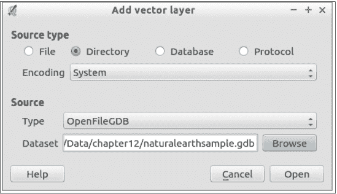

+   8. 你应该会被提示列出可用的图层。选择你想要的图层，然后点击 **OK**。你可以同时选择多个图层以一次性添加：

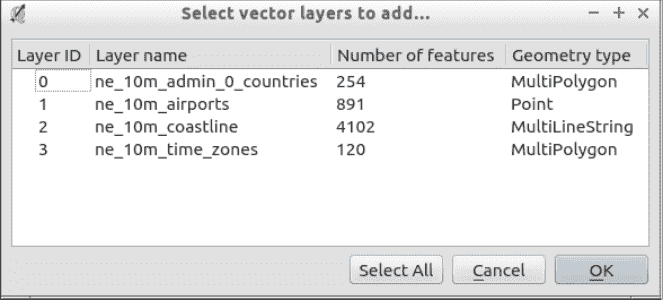

## How it works...

这相当直接。你告诉 QGIS File Geodatabase 的根文件夹，它可以弄清楚如何适当使用文件夹内的所有文件。只要 GDAL 对给定格式有驱动程序，你就应该能够使用 QGIS 打开数据。对额外格式的支持始终在进行中并不断完善。

## There's more...

目前 File Geodatabase 驱动程序的关键限制是栅格图层不受支持，并且矢量的写入能力有限。实际上有两个不同的驱动程序。一个是开源项目，由社区构建，是默认驱动程序。另一个基于 Esri 公开发布的开发库，具有特定的许可限制。

OpenFileGDB，即开源社区构建的驱动程序，可以打开多个版本的 GDB（9 和 10），为只读，并且随大多数 GDAL 1.11+ 版本提供。

ESRIFileGDB 驱动程序可以读写矢量图层（这有一些限制，在“另请参阅”部分的链接中有讨论）。然而，它通常只能打开为其构建的 GDB 版本（例如，最新的版本只能读取更新的 GDB 格式）。有时，你需要从 Esri 提供的 SDK 代码构建 GDAL 驱动程序。（这在 Windows 用户的 osgeo4w 中完成；Linux 和 Mac 用户目前需要使用 FileGDB SDK 1.4 编译 GDAL。）

要使用此驱动程序，在对话框中选择不同的类型为 ESRIFileGDB。如果你看不到它，说明你没有包含此驱动程序的 GDAL 版本，你需要自行编译 GDAL。

如果你收到此格式的数据库，请考虑将其批量转换为 Spatialite，这将保留大部分相同的信息，并在 QGIS 中为你提供完整的读取、写入、查询和编辑功能。你现在需要 ogr2ogr 命令，直到有人编写插件（或者你也可以使用 DB Manager 一次加载一个）：

```
ogr2ogr -f SQLite naturalearthexample.sqlite naturalearthexample.gdb -skip-failures -nlt PROMOTE_TO_MULTI -dsco SPATIALITE=YES
```

## See also

- 有关两种格式的 GDAL/OGR 信息页面可以在 http://gdal.org/drv_filegdb.html vs http://gdal.org/drv_openfilegdb.html 找到

## Using Geopackages

Geopackage 是开放地理空间联盟（OGC）的一个行业标准组织制定的用于地理空间数据交换的新开放标准。它旨在允许用户将各种类型的多个图层捆绑到单个文件中，以便轻松传递给他人。本配方演示如何利用这种新的数据格式以及未来可以期待什么。


## 准备工作

对于本配方，你需要一个 Geopackage 文件，通常扩展名为 `.gpkg`。在提供的示例数据中应有 `naturalearthexample.gpkg` 文件。

你还需要 GDAL 1.11 或更新版本；如果你使用的是 QGIS 2.6 或更新版本，这通常已附带足够新的 GDAL。如果没有足够新的 GDAL，请考虑升级 QGIS，它通常会捆绑更新的版本。

> 想检查你拥有哪些版本？在 QGIS 中，打开 帮助 | 关于 | 关于。

## 如何操作...

- 1. 打开 **添加矢量** 对话框。
- 2. 点击 **浏览** 按钮并选择 `naturalearthexample.gpkg` 文件：
- 3. 现在回到主对话框，点击 **打开**。
- 4. 这应该会提示你，选择要从数据库中添加的图层：

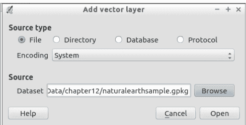

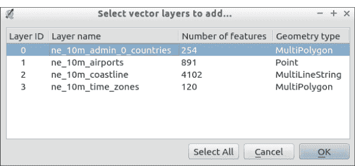

请注意 QGIS 浏览器可以检测并读取 Geopackage 文件。只需导航到该文件并双击即可获得相同的图层选择器，如前面的屏幕截图所示。

## 其工作原理...

将 Geopackage 视为只读格式更为合适。即使它并非如此，其全部目的就是在系统之间交换数据集合，尤其是移动系统，使用单个文件。由于这一点，一旦加载图层，请考虑将其保存到其他格式。请记住，保存为 Shapefile 可能会导致属性表中数据丢失。推荐的格式是 Spatialite 或 PostGIS；请参阅 *第 1 章，数据输入和输出* 中的配方 *将矢量图层加载到 SpatialLite* 和 *将矢量图层加载到 PostGIS*。

## 还有更多...

Geopackage 也是基于 SQLite 的数据库，并且与 Spatialite 兼容。如果你用 Spatialite 工具打开它，应该能够查询表。Geopackage 和 Spatialite 存储几何数据的方式不同，因此并非所有函数或空间索引方法都适用于 Geopackages，但它们非常容易转换。

QGIS 2.10 引入了将单个图层写入 Geopackage 的能力。预计 QGIS 2.12 将添加将多个图层写入同一 Geopackage 的能力（以及 Spatialite）。在此期间，你可以使用命令行上的 ogr2ogr 来管理 Geopackage 中的图层。

如果你想批量将 Geopackage 转换为 SpatiaLite，可以在命令行上完成（Windows 上的 OSGeo4W Shell，Mac 或 Linux 上的终端），如下所示：

```
ogr2ogr -f SQLite naturalearthsample.sqlite naturalearthsample.gpkg
-skipfailures -nlt PROMOTE_TO_MULTI -dsco SPATIALITE=YES
```

你也可以执行相反操作来创建 Geopackage：

```
ogr2ogr -f GPKG naturalearthsample.gpkg naturalearthsample.sqlite
```

请留意未来对栅格支持的实现。Geopackage 规范确实包含有限的栅格支持，主要用于在数据库中包含影像或瓦片，以便在移动设备上使用。

## 另请参阅

- 有关该格式的更多信息，请访问 `http://www.geopackage.org/`

## PostGIS Topology Editor 插件

在矢量图层中维护拓扑非常重要；这会带来更高的数据完整性，并导致更准确的分析结果。本配方展示了如何使用 QGIS 编辑 PostGIS 拓扑图层（换句话说，具有拓扑对象的图层，例如边、面和节点）。

> 这里不会详细介绍 PostGIS 拓扑支持的安装，因为不同操作系统的说明可以在项目网站 http://postgis.net/docs/manual-2.1/postgis_installation.html 上找到。如果你使用 Windows，PostGIS 可以直接从 Stack Builder 应用程序安装，该应用程序由标准的 PostgreSQL 安装提供，如 http://www.bostongis.com/PrinterFriendly.aspx?content_name=postgis_tut01 中所述。

## 准备工作

要跟随此练习，你需要一个启用了拓扑的 PostGIS 数据库。在 QGIS 中，你应该使用 添加 PostGIS 图层 对话框中的 新建 按钮设置与数据库的连接。

此外，还需要安装并激活 PostGIS Topology Editor 插件。

## 如何操作...

以下步骤将在你的 PostGIS 数据库中创建一个启用拓扑的矢量图层：

- 1. 通过导航到 数据库 | DB Manager 打开 DB Manager。
- 2. 在对话框左侧的树中，选择你想要创建拓扑的数据库。

3. 转到 **数据库 | SQL** 窗口以打开 SQL 编辑器，如以下屏幕截图所示：

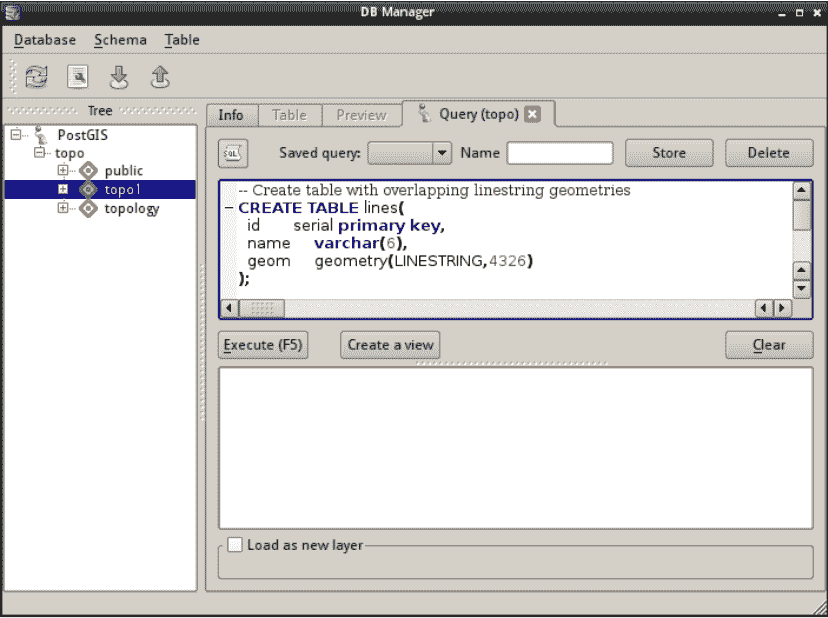

- 4. 在编辑器中粘贴 `topology.sql` 文件的内容并点击 **执行 (F5)** 以运行查询。
- 5. 拓扑创建后，点击 **DB Manager** 工具栏上的 **刷新** 按钮以重新加载可用表的列表。你应该在 **树** 中看到新的 `topo1` 表。

6. 在 **树** 中选择新创建的 `topo1` 表，然后转到 **架构 | TopoViewer** 以将所有拓扑图层加载到 QGIS。结果应如下所示：

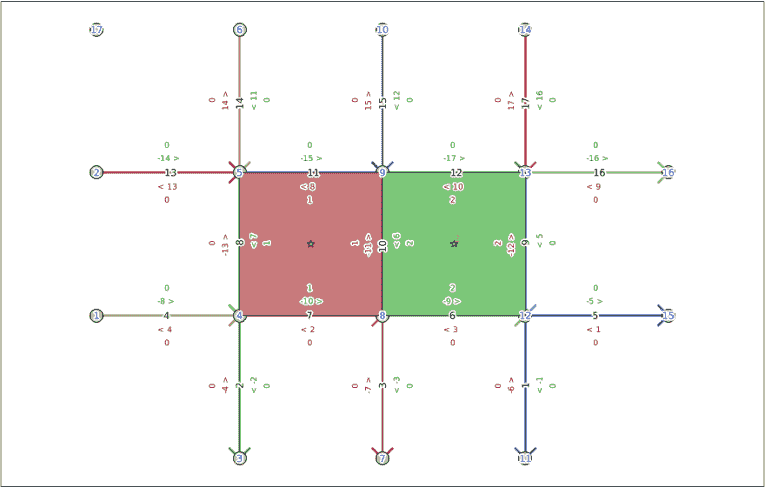

拓扑准备好并加载到 QGIS 后，我们就可以使用 **PostGIS Topology Editor** 插件对其进行编辑。值得一提的是，目前该插件仅允许我们删除节点和边。其他编辑操作不受支持。

要删除节点，请执行以下步骤：

- 1. 在 **图层面板** 中，展开 `Nodes` 组并选择 `topo1.node` 图层。
- 2. 使用 **按区域或单击选择要素** 工具，选择 QGIS 画布上你想要删除的孤立节点，例如节点 17。
- 3. 点击 **删除节点** 按钮，节点将被删除。如果出现任何错误，你将看到错误消息以及可能的原因。

> 请记住，**PostGIS Topology Editor** 插件在数据库级别运行，其执行的所有操作都无法撤消。

要删除边，请执行以下步骤：

- 1. 在 **图层面板** 中，展开 `Edges` 组并选择你想要编辑的边图层，例如 `topo1.edge` 图层。
- 2. 使用 **按区域或单击选择要素** 工具，选择你想要删除的边。
- 3. 点击 **删除边** 按钮以删除边，它们将被删除。如果出现任何错误，你将看到错误消息以及可能的原因。

由于 QGIS 目前不支持拓扑的动态更新，因此有必要使用 TopoViewer 重新加载拓扑图层以反映我们的编辑：

- 1. 通过点击 QGIS 工具栏上的 **新建** 按钮创建一个新项目。
- 2. 通过导航到 **数据库 | DB Manager** 打开 **DB Manager**。
- 3. 在对话框左侧的树中，找到包含你的拓扑图层的数据库。
- 4. 在树中选择 `topo1` 表，然后转到 **架构 | TopoViewer** 以将所有拓扑图层加载到 QGIS：

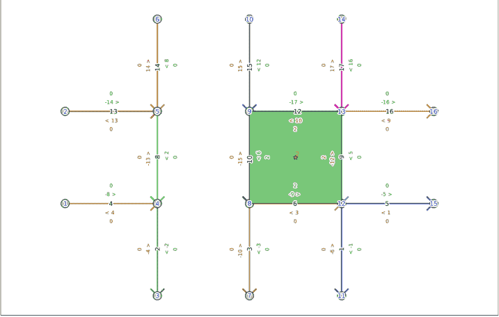

你会看到之前删除的节点和边现在消失了。

## 其工作原理...

PostGIS Topology Editor 插件直接向 PostGIS 数据库中相应的拓扑表中发出 SQL 查询，以删除边和节点。

## 另请参阅

- 有关 PostGIS 拓扑支持的更多信息，可以在官方 PostGIS 文档 http://postgis.net/docs/manual-2.1/Topology.html 中找到

## Topology Checker 插件

拓扑是一组定义相邻要素之间空间关系的规则，它还定义并强制执行数据完整性和有效性。

本配方展示了如何使用内置的 Topology Checker 插件查找矢量图层中的拓扑错误。

## 准备工作

要跟随本配方，请从示例数据中加载 census_wake2000_topology.shp 和 roadsmajor.shp 图层。此外，请确保在插件管理器中启用了 Topology Checker 插件。

## 如何操作...

Topology Checker 插件允许我们测试矢量图层或其部分的不同拓扑错误。在使用之前，我们应该在 QGIS 中加载所有要测试的图层，然后配置拓扑规则：

- 1. 在 视图 | 面板 菜单中启用 Topology Checker 面板。这应该将插件面板添加到用户界面，如以下屏幕截图所示：

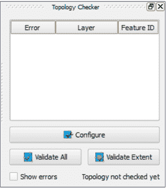


2. 单击插件面板底部的**Configure**（配置）按钮，打开**Topology Rule Settings**（拓扑规则设置）对话框：

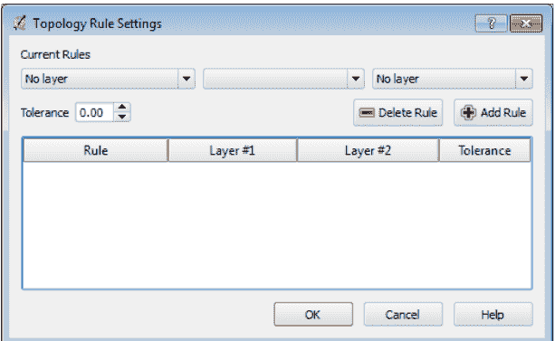

3. 要设置规则，请在第一个组合框中选择一个要检查的图层。选择`roadsmajor`图层。

4. 然后，从第二个组合框中选择规则，例如**must not have dangles**（不得有悬挂端）。由于此规则只需要一个图层，第三个组合框将消失。

5. 请注意，可用规则列表取决于目标图层的几何类型；此外，某些规则允许测试两个图层之间的空间关系。

6. 单击**Add Rule**（添加规则）按钮，将规则添加到当前规则列表中：

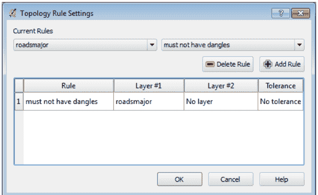

## Up and Coming（后续步骤）

7. 让我们再添加一条规则，这次是检查多边形图层。选择`census_wake2000_topology`作为目标图层。

8. 选择**must not overlap**（不得重叠）作为规则，并单击**Add Rule**（添加规则）按钮以创建新规则。

9. 使用相同的方法，再添加两条规则来检查此图层：**must not have gaps**（不得有间隙）和**must not have duplicates**（不得有重复）：

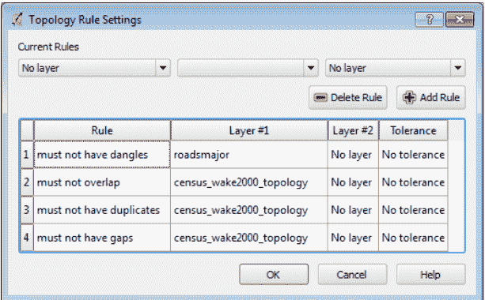

10. 单击**OK**（确定）按钮以保存设置并关闭对话框。

11. 现在，既然我们已定义了规则，我们可以通过单击**Validate All**（验证全部）按钮来检查整个图层的拓扑，或者通过单击**Validate Extent**（验证范围）按钮来仅检查可见区域内的要素。对于本教程，我们将验证所有图层，因此请单击**Validate All**（验证全部）按钮。

12. 过一会儿（这取决于图层中的要素数量以及计算机速度），所有检测到的拓扑错误将显示在插件面板中，如下面的截图所示：

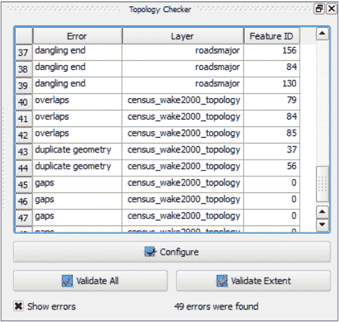

13. 如果**Show errors**（显示错误）复选框被激活（这是默认设置），则可以在地图上可视化的拓扑错误也会在地图上以红色高亮显示：

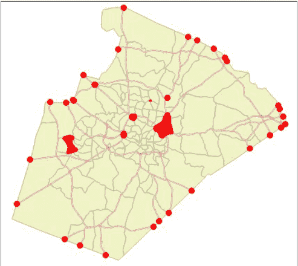

14. 在插件面板中选中某个错误时，QGIS 地图画布将居中显示到有问题的要素上，并尽可能将其高亮显示为绿色。

## How it works...（工作原理...）

Topology Checker 插件使用 GEOS 库及其自身的算法来检查矢量图层中要素之间的空间关系。

## See also（参见）

- 矢量拓扑的简要介绍可以在 Gentle GIS 教程中找到：https://docs.qgis.org/2.2/en/docs/gentle_gis_introduction/topology.html
- 有关 Topology Checker 插件可用规则的更多信息可以在 QGIS 用户指南中找到：http://docs.qgis.org/2.8/en/docs/user_manual/plugins/plugins_topology_checker.html

## GRASS Topology tools（GRASS 拓扑工具）

没有拓扑错误的矢量数据对于进一步分析非常重要，因为这些错误可能会导致结果不正确。

本教程向您展示如何使用内置的 GRASS 工具修复矢量图层中的各种拓扑错误。

## Getting ready（准备工作）

QGIS 与 GRASS GIS 有很好的集成；有一个 GRASS 插件提供了对 GRASS GIS 数据库和功能性的访问。GRASS 算法也可通过 Processing（处理）插件获得。后者更简单，因为你不需要费心去设置 GRASS 位置和图组以及导入和导出数据。

要遵循本教程，请从示例数据中加载 nonbreak.shp、dangles.shp 和 nosnap.shp 图层。此外，请确保在插件管理器中已启用 Processing 插件。

## How to do it...（如何操作...）

以下步骤向您展示了如何使用 Processing 工具箱中的 GRASS v.clean 工具集来修复各种拓扑错误：

首先，我们将学习如何移除悬挂线。悬挂线是指在一端或两端节点处没有其他连线连接的线：

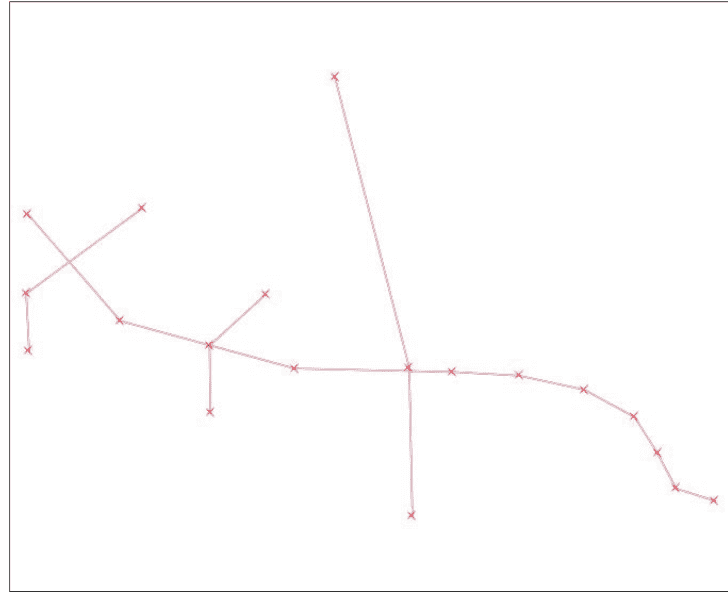

要移除它们，请执行以下步骤：

- 1. 在**Processing Toolbox**（处理工具箱）菜单中，通过在工具箱顶部的**filter**（过滤器）字段中输入其名称来找到`v.clean`算法。双击算法名称以打开其对话框。
- 2. 在**Layer to clean**（要清理的图层）组合框中，选择`dangling`图层。
- 3. 在**Cleaning tool**（清理工具）组合框中，选择`rmdangle`——一个用于移除悬挂端的工具。

4. **Threshold**（阈值）字段用于定义悬挂线的最大长度。对于我们的示例，请输入**6.000000**：

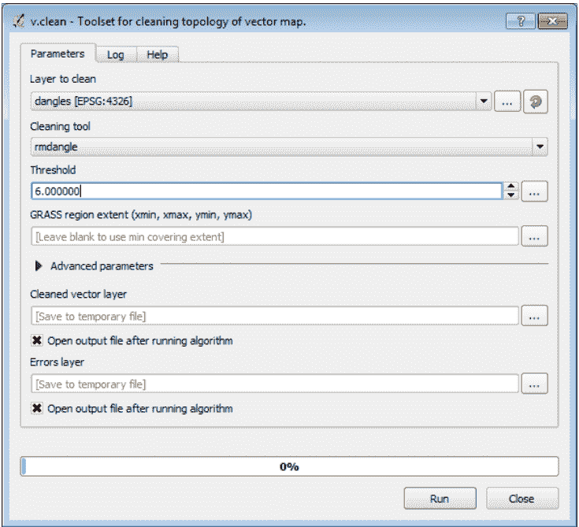

5. 单击**Run**（运行）按钮以移除悬挂端。当算法完成后，QGIS 中将会添加两个新图层：`Cleaned`图层包含清理后的几何图形（显示为绿色），而`Errors`图层包含被移除的悬挂端（显示为红色）：

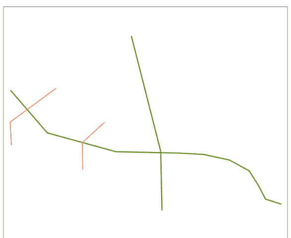

另一个拓扑问题是相交节点处的线断开缺失。要在相交处添加断开，请执行以下步骤：

- 1. 在**Processing Toolbox**（处理工具箱）菜单中，通过在工具箱顶部的**filter**（过滤器）字段中输入其名称来找到**v.clean**算法。双击算法名称以打开其对话框。
- 2. 在**Layer to clean**（要清理的图层）组合框中，选择`nobreaks`图层。
- 3. 在**Cleaning tool**（清理工具）组合框中，选择**break**。
- 4. 保持所有其他参数不变，并单击**Run**（运行）按钮以在相交处断开线条。当算法完成后，QGIS 中将会添加一个新图层。您可以轻松地验证现在线条是否在交点处被分割。

另一个非常常见的拓扑问题是欠截（undershots），即线要素未在交点处与另一条线连接，以及过截（overshoots），即线的末端超出了另一条线而没有与之连接。这类错误通常出现在不准确的数字化之后。要修复它们，请执行以下步骤：

- 1. 在**Processing Toolbox**（处理工具箱）菜单中，通过在工具箱顶部的**filter**（过滤器）字段中输入其名称来找到**v.clean**算法。双击算法名称以打开其对话框。
- 2. 在**Layer to clean**（要清理的图层）组合框中，选择`nosnap`图层。
- 3. 在**Cleaning tool**（清理工具）组合框中，选择**snap**。

- 4. **Threshold**（阈值）字段用于定义地图单位中的吸附容差。对于我们的示例，您可以保持此设置不变。
- 5. 单击**Run**（运行）按钮以移除过截和欠截。当算法完成后，QGIS 中将会添加两个新图层：`Cleaned`图层包含已修复错误的要素，而`Errors`图层包含原始的无效要素。

## How it works...（工作原理...）

rmdangle 工具只是顺序移除所有长度小于给定阈值的悬挂线。如果阈值小于 0，则所有悬挂端都会被移除。

break 工具在相交处断开线条，因此所有线条将具有公共节点。此工具不需要指定阈值。

snap 工具尝试将顶点吸附到给定阈值内的另一个顶点，如果找不到合适的顶点，则不进行吸附。值得提的是，较大的阈值值可能会破坏多边形要素的拓扑结构。

## There's more...（更多内容...）

如果您需要对拓扑清理过程进行更多控制，请尝试使用**Processing Toolbox**（处理工具箱）菜单中的**v.clean.advanced**，或考虑使用 GRASS 插件。

此外，还有其他清理矢量拓扑的方法，例如使用 lwgeom 函数或外部工具，如 prepair 和 pprepair。这两种工具都作为**Processing**（处理）插件提供，可以通过**Plugin Manager**（插件管理器）安装。

## See also（参见）

- 有关 GRASS v.clean 工具集的更多信息可以在这里找到：http://grass.osgeo.org/grass64/manuals/v.clean.html

## Hunting for bugs（排查错误）

虽然 QGIS 开发人员尽力让每个 QGIS 版本都尽可能稳定，但有时您可能会遇到错误甚至崩溃。为了在未来修复这些问题，有必要告知开发人员这些问题。

本教程向您展示如何执行基本调试以及收集有助于开发人员更好地理解问题并帮助修复问题的信息。


## 准备工作

QGIS开发进程非常迅速，旧版本中存在的错误很可能已在最新版本中修复。因此，务必确保你使用的是最新的QGIS版本。如果你使用QGIS的开发版（所谓的“每日构建”），请升级到最新的可用构建。如果你更倾向于稳定版，那么请确保你拥有最新的稳定版本。

## 操作方法...

1. 使用相同的数据和设置重复相同操作，以确保这不是偶然错误。
2. 使用几何检查工具测试你的矢量数据（如果有），确保数据有效且没有几何错误。如果数据存在几何错误，则尝试使用有效数据重现该错误。
3. 检查使用其他数据是否出现相同错误，以确保这与特定数据集无关。
4. 如果错误只发生在某些特定要素上，请将它们提取到单独图层中，并制作一个小的自包含测试数据集，以便能够重现该错误。如果数据集很大，也应采用相同方法。
5. 有时，错误可能由第三方插件引起。禁用所有插件并尝试重现错误。如果禁用插件后无法重现该错误，那么这个错误很可能与某个插件有关。要找出有问题的插件，请逐一激活插件并尝试重现错误。
6. 查看QGIS消息日志，其中可能包含与问题相关的有用调试和/或错误消息：

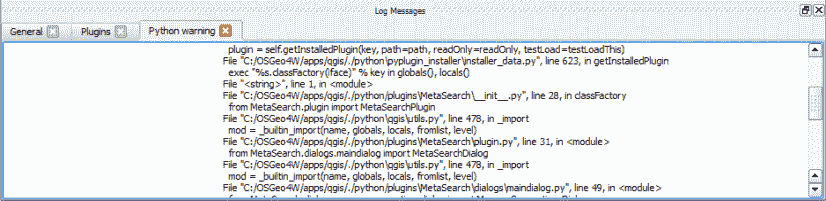

7. 要打开日志消息窗口，请单击QGIS状态栏右下角的“消息”按钮。
8. 如果QGIS崩溃，请尝试创建回溯和/或收集调试消息（参考后续章节）。如果你的错误在开发者的计算机上无法重现，这将非常有帮助。

## 在Linux下创建回溯

在Linux下，当QGIS崩溃时，它会自动尝试使用gdb生成回溯。

> 要查看回溯，必须从终端模拟器启动QGIS。

如果崩溃后没有看到回溯，这可能意味着你的发行版禁用连接到正在运行进程的调试器功能（例如10.10版本之后的Ubuntu）。此行为由`ptrace_scope` sysctl值控制。如果它等于1，则不允许来自外部进程的ptrace调用。等于0的值允许外部进程检查其他进程的内存。

在这种情况下，要启用回溯创建，请临时打开root shell并执行以下命令：

```
echo 0 > /proc/sys/kernel/yama/ptrace_scope
```

如果你想永久启用回溯创建，你需要以root身份编辑`/etc/sysctl.d/10-ptrace.conf`文件，并将值设置为0。然后，以root身份运行以下命令来重新加载sysctl设置：

```
sysctl -p
```

之后，重复步骤重现崩溃，复制回溯，并将其附加到你的错误报告或电子邮件中。

## 在Windows下使用DebugView捕获调试输出

DebugView是一个适用于Windows操作系统的小程序，允许你查看和保存程序的调试输出。借助它，你可以轻松获取QGIS调试输出并将其添加到你的错误报告中。

> 请注意，如果你的QGIS没有启用调试支持进行编译，你将不会看到调试输出。来自OSGeo4W安装程序和QGIS独立安装程序的官方软件包均带有调试输出。

要使用DebugView获取调试输出，请遵循以下步骤：

1. 从微软网站下载DebugView：https://technet.microsoft.com/en-us/sysinternals/bb896647.aspx。
2. 将压缩包解压到硬盘上的某个文件夹，然后启动`Dbgview.exe`。
3. 启动QGIS并执行导致崩溃或错误的操作：

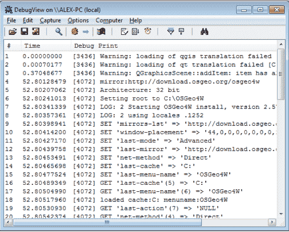

4. 使用**DebugView**工具栏上的**保存**按钮将日志保存到文件。
5. 将保存的文件附加到你的错误报告或电子邮件中。

此外，如果QGIS崩溃，它会生成一个minidump文件（通常这些文件创建在`%Temp%`目录中，扩展名为`*.tmp/*.mdmp`），如下图所示：

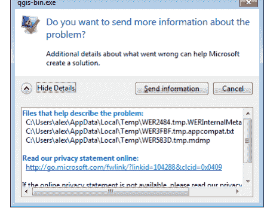

6. 该文件也应附加到错误报告中，因为它能让开发人员更好地理解问题，即使他们无法在自己的计算机上重现崩溃。

## 工作原理...

回溯是仍在活动的程序函数的摘要。换句话说，它显示了从程序开始到崩溃点的所有嵌套函数和调用。借助回溯，开发人员可以定位错误所在的位置。

## 扩展内容...

如果你能使用不同操作系统的计算机，最好检查一下该错误是否在不同环境中重现。

几乎所有现代计算机和笔记本电脑都有足够的性能来运行虚拟机。最流行的虚拟机支持快照功能。你可以拥有一个装有最新QGIS的全新且最新的系统，用于测试和调试。

## 另请参阅

- 有关创建回溯的更多信息，请访问QGIS网站：http://qgis.org/en/site/getinvolved/development/index.html#creating-a-backtrace

## 报告错误

一旦你发现了一个错误，并收集了所有关于其发生的潜在有用信息，就该创建错误报告了。

本指南向你展示如何以正确的方式提交错误报告。

## 准备工作

虽然QGIS项目拥有自己的错误跟踪器，但你仍需要一个OSGeo用户ID才能使用它。如果你没有OSGeo账户，请填写https://www.osgeo.org/cgi-bin/ldap_create_user.py 上的表单来创建一个。

## 操作方法...

前往http://hub.qgis.org/projects/quantum-gis/issues 上的QGIS错误跟踪器，使用你的OSGeo用户ID和密码登录。登录链接位于页面右上角。

在创建新的错误报告之前，有必要确认该错误尚未被报告。为此，请执行以下步骤：

1. 转到**问题**选项卡。
2. 在**筛选器**组中，添加并配置必要的筛选器。例如，以下筛选器：
    - **状态**：配置为仅查找未解决的问题
    - **主题**：配置为在主题字段中查找包含给定子字符串的问题
3. 单击问题列表上方的**应用**链接以应用你的筛选器：

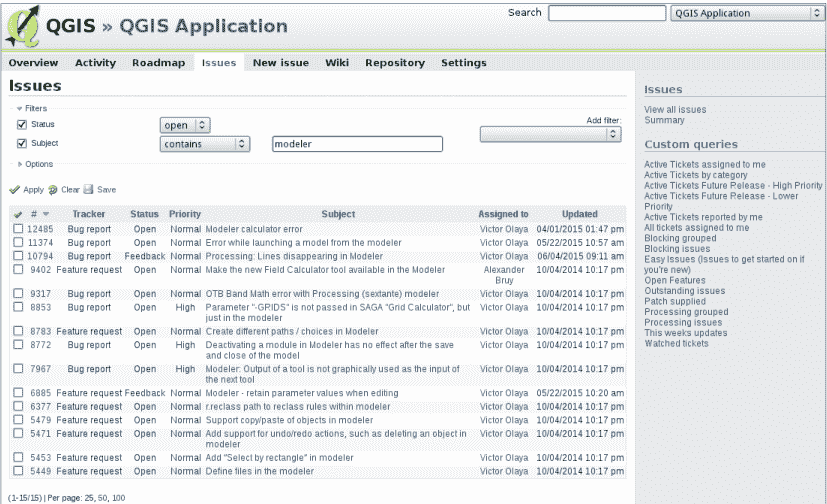

4. 检查结果列表是否包含与你发现的问题类似的问题。

所有符合条件的问题单都将列在表格中。

此外，使用普通搜索功能查找类似问题也是有意义的：

1. 打开搜索页面：https://hub.qgis.org/search/index/quantum-gis
2. 在字段中输入关键字。
3. 从组合框中选择**QGIS应用程序**。
4. 如有必要，通过激活相应的复选框，仅在问题单标题中执行搜索。
5. 停用搜索字段下的所有复选框，仅保留**问题**，以仅查找包含给定关键字的问题。
6. 单击**提交**按钮开始搜索。

结果将显示为所有现有问题单（打开和关闭）的原始列表，这些问题单在标题和描述中包含关键字：

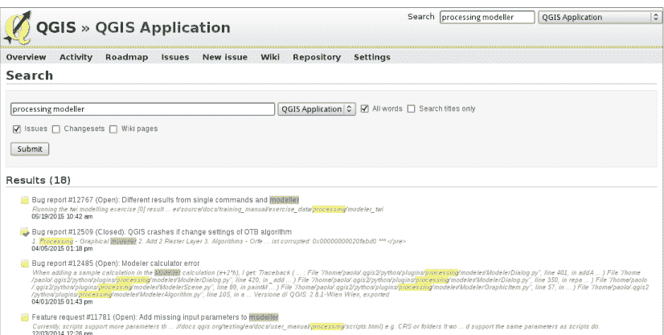

如果你的问题已被报告，请将你的观察结果添加到该报告中。如果你找不到与你的问题相似的内容，那么是时候提交错误报告了。为此，请执行以下步骤：

1. 使用你的OSGeo用户ID和密码登录QGIS错误跟踪器。
2. 前往 http://hub.qgis.org/projects/quantum-gis 上的QGIS应用程序项目。
3. 通过单击菜单中的相应链接打开“新问题”选项卡，并在表单中填写所需信息：

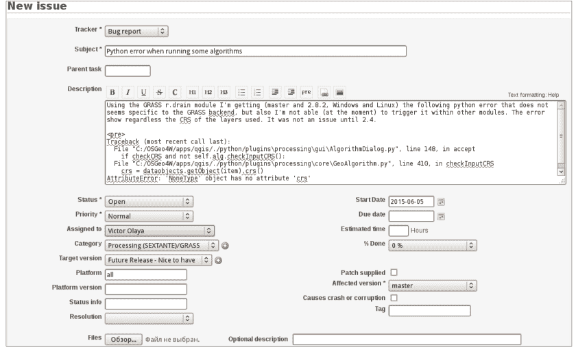

该表单包含许多字段，最重要的字段如下：

- **跟踪器**：这定义了问题单的类型。对于错误报告，请选择“错误报告”。
- **主题**：这是对问题的简短清晰描述。它将用作问题单的标题。
- **描述**：这是对问题的完整描述。详细描述你的问题，并提供重现步骤。如果有任何控制台调试消息、回溯或minidump，请包含或附加它们，以及示例数据集。如果你怀疑该错误与特定平台版本或第三方依赖包（例如GDAL、GEOS、SpatiaLite等）的特定版本有关，也请提供此信息。
- **优先级**：在此设置预期的错误重要性。目前使用以下分类：
    - 低：用于不影响QGIS日常使用的错误
    - 普通：所有新错误报告和功能请求的默认值


## 接下来

- **高：** 此选项用于指在某些情况下对 QGIS 的可用性有显著影响，但同时不会妨碍其他任务中使用 QGIS 的错误。
- **阻碍：** 此选项用于指使 QGIS 完全无法使用、导致数据丢失或损坏，或自先前 QGIS 版本以来出现回归的错误。
- **组件：** 此选项用于选择与问题紧密相关的 QGIS 最合适的子系统。
- **平台和平台版本：** 分别指定操作系统及其版本。
- **导致崩溃或损坏：** 如果错误导致 QGIS 崩溃、数据丢失或损坏，请勾选此复选框。

通过点击底部的**预览**链接来检查错误报告的格式。要提交错误报告，请点击**提交**按钮。

## 工作原理...

错误追踪器是一个包含错误信息的数据库。开发人员会查看错误队列，并根据优先级、可用资源进行安排，然后修复它们。修复通常进入开发版本（即所谓的“master”），但针对回归和重要错误的修复也会进入长期支持分支。

## 更多内容...

使用 QGIS 错误追踪器，您还可以留下功能请求并提交补丁。不过，对于后者，最好在 GitHub 上创建拉取请求（pull-request）。

## 另请参阅

- 有关 OSGeo 用户 ID 的更多信息，请访问 `http://www.osgeo.org/osgeo_userid`。
- 有关使用 QGIS 错误追踪器的更多信息，请访问以下 wiki 页面：`https://hub.qgis.org/wiki/17/Bugreports`。
- 此外，QGIS 源代码树中的 BUGS 文档包含一些有用的提示。您可以在 QGIS GitHub 仓库的 `https://github.com/qgis/QGIS/blob/master/BUGS` 找到它。
