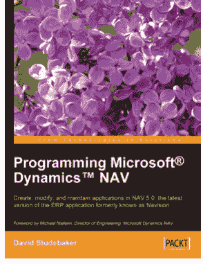
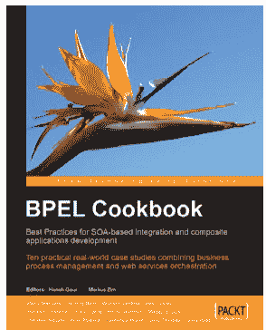

## Index

A
Access Control List. See ACL
访问控制列表。参见 ACL
ACL
about 86
关于 86
tips 86
提示 86
advantages, ERP system
优势，ERP 系统
management control 9
管理控制 9
operational control 9
运营控制 9
strategic planning 10
战略规划 10
AIF. See Application Integration framework
AIF。参见 Application Integration framework
AOT
element 34
元素 34
application design standards, Dynamics AX
应用程序设计标准，Dynamics AX
Auto property settings 53
自动属性设置 53
code placement 39
代码放置 39
field groups using, in table 52
在表中使用字段组 52
performance optimization 43
性能优化 43
Application Integration Framework 15
Application Integration Framework 15
Application Object Tree. See AOT
应用程序对象树。参见 AOT
authorization testing
授权测试
about 102
关于 102
specifications 102, 103
规范 102, 103
SysBPCheckIgnore Macro 137
SysBPCheckIgnore 宏 137
bug
错误
priority 124
优先级 124
security bugs 126
安全错误 126
B
back up and restore testing
备份和恢复测试
about 107
关于 107
specifications 107
规范 107
best practice check tool, Dynamics AX
最佳实践检查工具，Dynamics AX
applicable to all AOT elements 134
适用于所有 AOT 元素 134
applicable to specific AOT elements
适用于特定 AOT 元素
135-137
BP Deviation documented, comment 137
BP 偏差已记录，注释 137
category information 134
类别信息 134
invoking manually 133
手动调用 133
C
caching
缓存
about 44
关于 44
CacheLookup property 45, 46
CacheLookup 属性 45, 46
EntireTable, CacheLookup property 46
EntireTable，CacheLookup 属性 46
Found, CacheLookup property 45
Found，CacheLookup 属性 45
FoundAndEmpty, CacheLookup property 45
FoundAndEmpty，CacheLookup 属性 45
mechanism 45, 46
机制 45, 46
None, CacheLookup property 45
None，CacheLookup 属性 45
NotITTS, CacheLookup property 45
NotITTS，CacheLookup 属性 45
record caching 44
记录缓存 44
record caching, enabling 44
启用记录缓存 44
RecordViewCache 46
RecordViewCache 46
RecordViewCache instantiating, X++ select used 46
RecordViewCache 实例化，使用 X++ select 46
result-set caching 47
结果集缓存 47
result-set caching, limitations 47
结果集缓存，限制 47
types 44
类型 44
characteristics, Dynamics AX 4.0
特性，Dynamics AX 4.0
business processes, coherence 14
业务流程，协调性 14
code documentation 17
代码文档 17
comprehensive functionality 18
全面功能 18
flexibility 12
灵活性 12
integration 15
集成 15
internationalization 16
国际化 16
localization 16
本地化 16
scalable 17
可扩展 17
total cost of ownership (TCO) 12
总拥有成本 (TCO) 12
usability 13
可用性 13

**characteristics, ERP solution**
**特性，ERP 解决方案**
business processes, coherence 7
业务流程，协调性 7
code documentation 8
代码文档 8
flexibility 7
灵活性 7
integration 7
集成 7
internationalization 8
国际化 8
localization 8
本地化 8
modular 7
模块化 7
responsiveness 7
响应性 7
scalability 8
可扩展性 8
total cost of ownership (TCO) 6
总拥有成本 (TCO) 6
trustworthiness 7
可信度 7
usability 7
可用性 7
**classes, AOT object standards**
**类，AOT 对象标准**
about 60
关于 60
categories 60
类别 60
**code placement, application design standards**
**代码放置，应用程序设计标准**
AOT element type, guidelines 42, 43
AOT 元素类型，指南 42, 43
GUI objects 42
GUI 对象 42
methods 41
方法 41
methods, execution place 41
方法，执行位置 41
queries 42
查询 42
QueryRun, queries 42
QueryRun，查询 42
reports 42
报表 42
RunOn property 40
RunOn 属性 40
RunOn property, classes 40
RunOn 属性，类 40
temporary tables 42
临时表 42
three-tier architecture 40
三层架构 40
**code profiler, Dynamics AX**
**代码分析器，Dynamics AX**
call tree form, data viewing 141
调用树表单，数据查看 141
data, analyzing 141
数据，分析 141
data, gathering 140
数据，收集 140
data, viewing 141
数据，查看 141
invoking ways 140
调用方式 140
profile lines form, data viewing 141
分析行表单，数据查看 141
profile summary form, data viewing 143
配置文件摘要表单，数据查看 143
stages 140
阶段 140
totals form, data viewing 142
总计表单，数据查看 142
traverse form, data viewing 141
遍历表单，数据查看 141
uses 140
用途 140
**compare tool, Dynamics AX**
**比较工具，Dynamics AX**
comparison form 138
比较表单 138
comparison ways 138
比较方式 138
different application objects, comparing 140
比较不同的应用程序对象 140
same application object in two layers 138, 139
同一层中的相同应用程序对象 138, 139
version control system 139
版本控制系统 139
versions of same object, comparing 139
比较同一对象的版本 139
**compliance check to coding standards testing**
**符合编码标准检查测试**
about 96
关于 96
specifications 97
规范 97
**compliance check to design and architecture guidelines testing**
**符合设计和架构指南检查测试**
about 97
关于 97
specifications 97
规范 97
**criteria**
**标准**
definition 118
定义 118
entry criteria 114
入口标准 114
exit criteria 114
出口标准 114
resumption criteria 120
恢复标准 120
suspension criteria 119
暂停标准 119
test case, fail criteria 119
测试用例，失败标准 119
test case, pass criteria 119
测试用例，通过标准 119
**D**
**database design, performance optimization**
**数据库设计，性能优化**
caching 44
缓存 44
caching mechanism 45, 46
缓存机制 45, 46
forms, joins used 52
表单，使用连接 52
indexes, advantages 49
索引，优势 49
indexes, disadvantages 49
索引，劣势 49
indexes, types 48
索引，类型 48
indexing, rules 48
索引规则 48
indexing, tips 50
索引提示 50
record caching 44
记录缓存 44
RecordViewCache 46
RecordViewCache 46
RecordViewCache instantiating, X++ select used 46
RecordViewCache 实例化，使用 X++ select 46
result-set caching, about 47
结果集缓存，关于 47
result-set caching, limitations 47
结果集缓存，限制 47
select statement 51
select 语句 51
transactions 51
事务 51
**data dictionary, AOT object standards**
**数据字典，AOT 对象标准**
Base Enum 58
Base Enum 58
EDT 57
EDT 57
**defect**
**缺陷**
defect management system, requirements 129
缺陷管理系统，需求 129
defect management tool, requirements 129, 130
缺陷管理工具，需求 129, 130
defect management tool requirements, by IBI specifications 129
缺陷管理工具需求，按 IBI 规范 129
life cycle 130
生命周期 130
defect, Dynamics AX
缺陷，Dynamics AX
about 123
关于 123
bug priority 124
错误优先级 124
classification 124
分类 124
classification, factors 124
分类，因子 124
definition 123
定义 123
priority levels, in IBI specifications 124
优先级级别，在 IBI 规范中 124
security bugs 126
安全错误 126
severity 125
严重性 125
severity levels, in IBI specifications 125
严重性级别，在 IBI 规范中 125
defect management tool. See defect
缺陷管理工具。参见缺陷
disadvantages, ERP system
劣势，ERP 系统
business processes, reengineering 10
业务流程，重构 10
customization, limitations 10
定制，限制 10
rigidity 10
僵化 10
DoS attacks
DoS 攻击
CPU starvation 127
CPU 饥饿 127
memory starvation 127
内存饥饿 127
network starvation 127
网络饥饿 127
resource starvation 127
资源饥饿 127
types 127
类型 127
DREAD model
DREAD 模型
about 128
关于 128
security threat 128
安全威胁 128
Dynamics AX
Dynamics AX
about 11
关于 11
AOT object standards 57
AOT 对象标准 57
application design standards 39
应用程序设计标准 39
best practice check tool 133
最佳实践检查工具 133
Biztalk integration 15
Biztalk 集成 15
built-in tool 21
内置工具 21
characteristics 11
特性 11
characteristics, as an ideal ERP system 11
特性，作为理想的 ERP 系统 11
code profiler 32
代码分析器 32
code review 121, 122
代码审查 121, 122
compare tool 32
比较工具 32
customization 18
定制 18
customization files 24
定制文件 24
Dynamics AX Benchmark Toolkit 143
Dynamics AX Benchmark Toolkit 143
GUI standards 63
GUI 标准 63
layer system 21
层系统 21
module testing 113
模块测试 113
quality defining 27
质量定义 27
regression testing 114
回归测试 114
release testing 114
发布测试 114
RunOn property 40
RunOn 属性 40
shared standards 53
共享标准 53
stakeholders, responsibilities 120, 121
利益相关者，职责 120, 121
stakeholders, roles 120, 121
利益相关者，角色 120, 121
system testing 114
系统测试 114
testing 95
测试 95
testing, types 113
测试，类型 113
test life cycle 113
测试生命周期 113
trustworthy computing 86
可信计算 86
tools 133
工具 133
unit testing 113
单元测试 113
user-interface standards, objectives 63
用户界面标准，目标 63
user acceptance testing 114
用户验收测试 114
Dynamics AX, quality defining
Dynamics AX，质量定义
about 27
关于 27
back up 35
备份 35
coding standards, factors 27
编码标准，因子 27
coding standards, types 28
编码标准，类型 28
database upgrade script 37
数据库升级脚本 37
Dynamics AX best practice check tool, configuring 28
Dynamics AX 最佳实践检查工具，配置 28
Dynamics AX best practice check tool, deviations 28
Dynamics AX 最佳实践检查工具，偏差 28
Dynamics AX best practice check tool, severity levels 29
Dynamics AX 最佳实践检查工具，严重性级别 29
Dynamics AX best practice check tool, uses 28
Dynamics AX 最佳实践检查工具，用途 28
file versioning, for ActiveX controls 37
文件版本控制，用于 ActiveX 控件 37
file versioning, for DLL 37
文件版本控制，用于 DLL 37
globalization 32
全球化 32
IBI specification 31
IBI 规范 31
installation 34
安装 34
installation, difficulties 34
安装，困难 34
integration points, documentation 36
集成点，文档 36
localization 33
本地化 33
performance optimization 31
性能优化 31
platform compatibility 34
平台兼容性 34
quality assurance standards 29
质量保证标准 29
restore 35
恢复 35
setup 34
设置 34
setup, essential features 35
设置，基本功能 35
testing standards 29
测试标准 29
three-tier architecture 31
三层架构 31
trustworthiness, achieving 32
可信度，实现 32

可信计算，实现 31
卸载，困难 34
用户友好性 30
版本元数据 37
Dynamics AX 定制
  应用程序组件管理 21
  应用程序层 22
  代码，审查 21
  Dynamics AX 最佳实践检查工具 21
  Dynamics AX 层系统 21
  功能键 20
  文件 24
  GUI 19
  IntelliMorph 19
  IntelliMorph 技术 19
  Microsoft Dynamics IDE 21
  MorphX 开发 19
  MorphX 开发工具 19
  补丁层 24
  X++ 编程语言 20

## E

EDT 56
企业资源规划 5
ERP 解决方案
  特征 6
ERP 系统
  关于 6
  优势 8
  特征 6
  劣势 10
  传统 ERP 厂商 11
扩展数据类型。参见 EDT
可扩展性测试
  关于 108
  规范 108

## F

表单，AOT 对象标准
  关于 61
  代码，编写 61
  表单上避免代码 61
  IntelliMorph，最大化使用 62
功能测试
  规范 108

## G

全球化测试
  规范 103
GUI 标准。参见用户界面标准，Dynamics AX

## H

帮助导航（用户协助）测试
  规范 98

## I

索引
  关于 47
  优势 49
  聚簇索引 48
  降序索引 48
  劣势 49
  索引，提示 50
  非聚簇索引 48
  非主键索引 48
  非唯一索引 48
  排序 48
  主键 47
  规则 48
  类型 48
  唯一索引 48
安装测试
  规范 106
IntelliMorph 19

## L

标签标准，共享标准
  关于 56
  标签文件，优势 56
层系统，Dynamics AX
  BUS（业务解决方案）23
  CUS（客户）23
  DIS（分销商）22
  GLS（全球解决方案）22
  LOS（本地解决方案）23
  SYS（系统）22
  USR（用户）23
  VAR（增值经销商）23

本地化测试
  规范 104

否认 126
RunOn 属性 40

## M

Microsoft
  可用性 85
  隐私 85
  质量，定义 85
  安全 85
  安全开发生命周期 88
Microsoft Dynamics AX。另请参见
  Dynamics AX 11
Microsoft Dynamics AX 4.0
  应用程序集成框架 15
Microsoft 安全开发生命周期
  关于 88
  SD3+ 方法论 88
  阶段 89
模块测试
  入口标准 115
  出口标准 115

## P

性能优化，应用程序设计标准
  AOS 性能优化 52
  数据库设计 44
  select distinct，AOS 性能优化 52
性能测试
  规范 100
平台兼容性测试
  关于 104
  规范 105

## R

回归测试
  入口标准 117
  出口标准 117
  规范 109
发布测试
  入口标准 118
  出口标准 118
报表，AOT 对象标准
  关于 62

## S

SD3+ 方法论
  关于 88
  通信 89
  支柱 88
  默认安全 89
  设计安全 88
  部署中安全 89
SDL。参见安全开发生命周期
SDL 验证
  关于 109
  规范 110
安全漏洞
  欺骗 126
安全漏洞
  关于 126
  算术错误 127
  攻击面减少 126
  缓冲区溢出或欠载 126
  规范化错误 128
  分类 126
  分类，基于来源 126, 127
  分类，基于 STRIDE 126
  跨站脚本 127
  加密弱点 127
  拒绝服务 126
  DoS 攻击 127
  DoS 攻击，类型 127
  DREAD 工具 128
  重要性识别，使用 DREAD 模型 128
  不正确的路径名 127
  信息泄露 126
  权限 126
  否认 126
  根本原因分析 126
  秘密，隐藏 127
  SQL/脚本注入 127
  篡改 126
  无限资源消耗 127
  弱认证 127
  弱授权 127

安全开发生命周期
  设计阶段 90
  设计阶段，活动 91
  实现阶段 91
  实现阶段，活动 91
  发布阶段 92
  需求阶段 90
  稳定化阶段 92
  阶段 89
  支持/维护阶段 92
  验证 109
安全测试
  关于 101
  规范 101
欺骗 126
系统测试
  入口标准 116
  出口标准 116

## T

表，AOT 对象标准
  关于 58
  删除操作 59
  字段组 59
  字段 59
  表方法 60
篡改 126
测试
  生命周期 113
  恢复 120
  阶段 113
  暂停 119
测试，Dynamics AX
  关于 95
  授权测试 102
  备份和恢复测试 107
  编码标准合规性检查测试 96
  设计和架构指南合规性检查测试 97
  可扩展性测试 108
  功能测试 108
  全球化测试 103
  帮助导航（用户协助）测试 98
  安装测试 105
  本地化测试 103
  性能测试 100
  平台兼容性测试 104
  回归测试 109
  SDL 验证 109
  安全测试 101
  单元测试 95
  用户体验和可用性测试 99
  商业智能/报表标准验证测试 99
威胁建模
  关于 93
  活动 93
  活动，执行 93
  入口点 93
  文件系统，接口 93
  接口 93
  目标 93
  打开套接字，接口 93
  远程过程调用（RPC），接口 93
  Web 服务，接口 93
工具，Dynamics AX
  关于 133
  最佳实践检查工具 133
  代码分析器 140
  比较工具 138
  Dynamics AX 基准工具包 143
  Dynamics AX 基准工具包，在 Axapta 3.0 中 143
  Microsoft Dynamics AX Wrapper 库，Dynamics AX 基准工具包 143
  编程模型库，Dynamics AX 基准工具包 143
可信计算，Dynamics AX
  组件 86
  隐私 87
  隐私，指南 87
  可靠性 87
  可靠性，实现策略 88
  可靠性，特征 88
  安全 86
  安全，实现策略 86, 87
  安全开发生命周期 88
  威胁建模 93

## U

单元测试
  关于 95
  入口标准 114
  出口标准 114
  规范 96
用户界面标准，Dynamics AX
  按钮 69
  按钮，规范 69
  记录偏差 83
  编辑控件 68
  编辑控件，规范 69
  企业门户 82
  企业门户，规范 82
  收藏夹菜单，导航窗格 64
  收藏夹菜单，规范 65
  表单 67
  表单，规范 67, 68
  功能窗口，规范 75
  帮助 76
  帮助，规范 78, 79
  图标 75
  图标，规范 75
  主菜单，导航窗格 65
  主菜单，规范 65, 66
  消息 79
  消息，规范 80
  导航窗格 64
  导航窗格，规范 64
  其他控件 70
  其他控件，规范 70
  符号 75
  符号，规范 75
  表格 73
  表格，规范 73
  选项卡 70
  选项卡，规范 71, 72
  任务窗格 66
  任务窗格，规范 66
  工具栏 70
  工具栏，规范 70
  树视图，控件 74
  树视图，规范 74
  用户协助 76
  窗口和屏幕布局 63
  窗口和屏幕布局，规范 64
  向导 80
  向导，规范 81
用户体验和可用性测试
  关于 99
  规范 99

## V

商业智能/报表标准验证测试
  关于 99
  规范 100

## X

X++ 标准，共享标准
  分支 55
  代码布局 55
  异常处理 54
  处理日期 56
  方法 55
  原则 53, 54
  系统导向文本，文本常量标准 54
  文本常量标准 54
  用户界面文本，文本常量标准 54

## 感谢购买
质量保证 for
Dynamics AX-Based ERP Solutions

## 关于 Packt Publishing

Packt，读作 'packed'，于 2004 年 4 月出版了其第一本书 "Mastering phpMyAdmin for Effective MySQL Management"，随后继续专注于出版针对特定技术和解决方案的高度聚焦的书籍。

我们的书籍和出版物分享了您同行 IT 专业人士在适应和定制当今系统、应用程序和框架方面的经验。我们的基于解决方案的书籍为您提供了定制您正在使用的软件和技术的知识和能力，以完成工作。与过去看到的 IT 书籍相比，Packt 的书籍更具体、更少泛化。我们的独特商业模式使我们能够为您提供更集中的信息，让您了解更多所需的内容，减少不必要的内容。

Packt 是一家现代而独特的出版公司，专注于为开发者、管理员和新手社区生产优质、前沿的书籍。如需更多信息，请访问我们的网站：www.packtpub.com。

## 为 Packt 撰写

我们欢迎所有有兴趣撰稿的人士的咨询。书稿提案应发送至 authors@packtpub.com。如果您的书稿创意仍处于早期阶段，并且您希望在撰写正式书稿提案之前先进行讨论，请联系我们；我们的签约编辑之一将与您联系。

我们不仅寻找已出版的作者；如果您拥有强大的技术技能但没有写作经验，我们经验丰富的编辑可以帮助您发展写作事业，或为您提供专业知识的额外回报。

## 编程 Microsoft® Dynamics™ NAV

ISBN: 978-1-904811-74-9      平装：480页

创建、修改和维护 NAV 5.0 中的应用程序，NAV 5.0 是以前称为 Navision 的 ERP 应用的最新版本

- 1. 面向经验丰富的程序员，几乎没有或没有 NAV 开发的先前知识
- 2. 尽可能快速地学习创建、修改和维护 NAV 应用程序
- 3. 为 NAV 5.0 版本编写；适用于所有版本

## BPEL 实用手册

ISBN: 1-904811-33-7      平装：188页

十个结合业务流程管理和 Web 服务编排的实用真实案例研究

- 1. 用于 SOA 集成和复合应用程序开发的真实 BPEL 配方
- 2. 结合业务流程管理和 Web 服务编排
- 3. 来自十个真实案例研究的技巧和最佳实践，并附带可下载的代码示例
