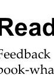

# R 数据挖掘项目

## 关于作者

**Pradeepta Mishra** 是一名数据科学家、预测建模专家、深度学习和机器学习实践者，同时也是一名计量经济学家。目前，他负责印度班加罗尔 Ma Foi Analytics 的数据科学与机器学习业务。Ma Foi Analytics 是 Tomorrow's Cognitive Insights Ecology 的高级分析服务提供商，通过结合尖端人工智能、专有大数据平台和数据科学专业知识，为客户提供服务。他拥有一项关于改进零售行业商品陈列图设计的专利。Pradeepta 曾在印度艾哈迈达巴德印度管理学院发表和展示研究论文。他是多所知名商学院的客座教师，并经常发表有关数据科学和机器学习的演讲。

Pradeepta 在该领域拥有超过 10 年的经验，曾使用文本挖掘流程解决分类、回归、模式识别、时间序列预测和非结构化数据分析等多个项目，涉及医疗保健、保险、零售与电子商务、制造业等领域。

如果你有任何问题，欢迎通过 Twitter 联系我：`@mishra1_PK`。无论何时何地，我都非常乐意帮助同行的网络专业人士。

> *我要感谢我的妻子 Prajna 和女儿 Aarya，感谢她们包容我深夜写作的时光。同时，我也要感谢工作中的朋友和同事，感谢他们一直以来对我写作的鼓励。*
**第 2 章“使用汽车数据进行探索性数据分析”**帮助读者理解探索性数据分析。它包括对数据集中的变量进行数值和图形表示，以便更容易地理解数据集并快速得出结论。了解数据集、分析所涉及的变量类型、不同变量之间的关联等内容非常重要。通过创建交叉列表来理解分类变量之间的关系，并对数据执行经典统计检验，可以验证关于数据的各种不同假设。

**第 3 章“可视化钻石数据集”**介绍了数据可视化的基础知识，以及如何使用 R 编程语言中的现有库创建高级数据可视化。当我们查看数字和统计数据时，按照不同切工观察变量，可能会得到类似的结论；然而，当我们以可视化方式查看变量和因素之间的关系时，往往会发现完全不同的结果。因此，数据可视化能够传达数字和统计数据无法表达的信息。

**第 4 章“使用汽车数据进行回归分析”**帮助你了解使用回归方法进行预测分析的基础知识，包括使用 R 编程实现的各种线性和非线性回归方法。本章将介绍使用回归方法进行预测分析的基础知识，包括使用 R 编程实现的各种线性和非线性回归方法。你将能够理解回归方法的理论背景，并通过 R 实际操作各种回归方法。

**第 5 章“使用杂货数据进行购物篮分析”**介绍第二种产品推荐方法，即广为人知的购物篮分析（Market Basket Analysis，MBA），也称为关联规则。该方法用于关联交易层面购买的商品，找出拥有相似商品的用户子群，并据此推荐产品。MBA 还可以用于制定追加销售和交叉销售策略。

**第 6 章“使用电子商务数据进行聚类”**将教授以下内容：什么是细分、如何应用聚类执行细分、聚类所使用的方法，以及各种细分方法的比较。本章将介绍使用各种聚类方法进行细分的基础知识。

**第 7 章“构建零售推荐引擎”**介绍以下内容及其使用 R 编程语言的实现：什么是推荐以及推荐的工作原理、执行推荐的类型和方法，以及使用 R 实现产品推荐。

**第 8 章“_降维_”**使用实际数据集和 R 实现主成分分析（PCA）、奇异值分解（SVD）以及迭代特征选择方法等降维技术。随着数据规模和数据类型不断增长，数据维度也在持续增加。降维技术在各个行业中都有广泛应用，例如图像处理、语音识别、推荐引擎、文本处理等。

**第 9 章“_将神经网络应用于医疗保健数据_”**将介绍各种类型的神经网络、神经网络方法及其变体，以及用于控制人工神经网络训练的不同函数，从而执行以下标准数据挖掘任务：使用基于回归的方法预测实数输出、在基于分类的任务中预测输出类别、根据历史数据预测数值属性的未来值，以及压缩特征以识别重要特征，从而执行预测或分类。

## 本书所需内容

为了学习本书中的示例和代码，你需要从 `https://cran.r-project.org/` 下载 R 软件（也可以选择从 `https://www.rstudio.com/` 下载 RStudio），并将其安装到计算机上。本书没有特定的硬件要求；任何内存超过 2 GB 的计算机都可以运行，并且支持包括 Mac、Linux 和 Windows 在内的所有平台。

## 本书适用读者

本书适合刚开始从事数据挖掘、数据科学或预测建模工作的读者，也适合具备一定统计知识和编程知识、处于中级水平的读者。要理解本书涵盖的数据挖掘概念，必须具备基础统计知识。不要求读者事先掌握编程知识，因为在最初几章中，我将介绍使用 R 进行数据管理和基础统计分析的方法。本书也适合学生、专业人士以及希望成为数据分析师的有经验人士。

## 排版约定

本书使用多种文本样式来区分不同类型的信息。下面列出了一些样式示例，并解释其含义。


文本中的代码字、数据库表名、文件夹名、文件名、文件扩展名、路径名、虚拟 URL、用户输入和 Twitter 账号采用如下格式显示：“在当前场景中，我们以 `ArtPiece` 数据集为例，试图通过一些与业务相关的变量来预测一件艺术品是否值得购买。”

任何命令行输入或输出都按以下格式写出：

```
> fit <- neuralnet(formula = CurrentAuctionAveragePrice ~ Critic.Ratings + Acq.Cost + CollectorsAveragePrice + Min.Guarantee.Cost, data = train, hidden = 15, err.fct = "sse", linear.output = F)
> fit
Call: neuralnet(formula = CurrentAuctionAveragePrice ~ Critic.Ratings + Acq.Cost + CollectorsAveragePrice + Min.Guarantee.Cost, data = train, hidden = 15, err.fct = "sse", linear.output = F)
1 repetition was calculated.
Error Reached Threshold Steps
1 54179625353167 0.004727494957 23
```


警告或重要说明显示在这样的框中。



技巧和提示的显示样式如下。

## 读者反馈

我们始终欢迎读者的反馈。请告诉我们您对这本书的看法——您喜欢或不喜欢的地方。读者反馈对我们非常重要，因为它有助于我们开发您真正获益的选题。若要发送一般反馈，只需发送电子邮件至 `feedback@packtpub.com`，并在邮件主题中注明书名。如果您在某个主题上有专长，并且有兴趣撰写或参与编写一本书，请参阅 `www.packtpub.com/authors` 上的作者指南。

## 勘误

尽管我们已竭尽全力确保内容的准确性，但错误仍在所难免。如果您在我们的某本书中发现了错误——无论是文字还是代码上的错误——我们将不胜感激，恳请您向我们报告。这样，您可以帮助其他读者免于困惑，并帮助改进本书的后续版本。如果您发现任何勘误，请访问 `http://www.packtpub.com/submit-errata`，选择您的书籍，点击 **勘误提交表** 链接，并输入勘误的详细信息。一旦您的勘误得到核实，您的提交将被接受，勘误将上传到我们的网站，或添加到该书的“勘误”部分下的现有勘误列表中。

要查看之前提交的勘误，请转到 `https://www.packtpub.com/books/content/support` 并在搜索字段中输入书名。所需信息将出现在 **勘误** 部分下方。

## 盗版

在互联网上，盗版受版权保护的材料是所有媒体中持续存在的问题。在 Packt，我们非常严肃地保护我们的版权和许可。如果您在互联网上发现任何形式的非法复制我们的作品，请立即向我们提供位置地址或网站名称，以便我们采取补救措施。

请通过 `copyright@packtpub.com` 联系我们，并附上涉嫌盗版材料的链接。

我们感谢您帮助保护我们的作者以及我们为您提供有价值内容的能力。

## 问题

如果您对本书的任何方面有问题，可以通过 `questions@packtpub.com` 联系我们，我们将尽力解决该问题。
