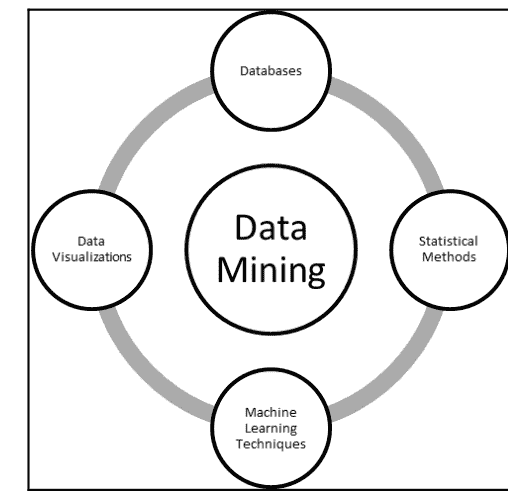
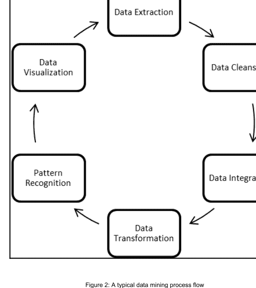
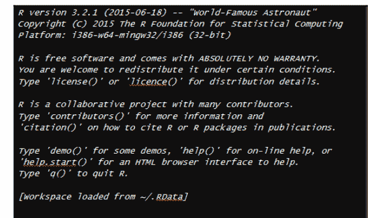

# 1 使用内置 R 数据进行数据操作

本书 *R Data Mining Blueprints* 主要侧重于使用 R 编程语言作为平台执行数据挖掘的学习方法和步骤。由于 R 是一个开源工具，使用 R 学习数据挖掘对各个层次的学习者来说都非常有趣。本书的设计使得用户可以涵盖从数据管理技术、探索性数据分析、数据可视化和建模，一直到构建高级预测模型（如推荐引擎、神经网络模型等）的过程。本章概述了数据挖掘的概念，及其与数据科学、分析、统计建模和可视化之间的各种联系。本章通过一个真实案例研究，简要介绍了使用 R 的编程基础知识、如何读写数据、编程符号和语法理解。本章包含用于练习的 R 脚本，以便读者获得对概念、术语以及执行某些任务背后原因的实践经验。本章的设计使得即使只有少量编程知识的读者也能够执行 R 命令来完成各种数据挖掘任务。

在本章中，我们将简要讨论数据挖掘的含义及其与数据科学、分析学和统计建模等其他领域的关系；除此之外，我们将使用 R 开始学习数据管理主题，以便您实现以下目标：

- 了解 R 中使用的各种数据类型，包括向量及其运算
- 数据框和因子序列的索引
- 对数据框进行排序和合并以及数据类型转换
- 字符串处理和日期对象格式化
- 处理缺失值和 NA，以及缺失值插补技术
- 流程控制、循环结构以及 apply 函数的使用

### 什么是数据挖掘？

数据挖掘可以定义为从现有数据库中解读有意义的见解，并分析结果以供业务用户使用的过程。分析来自不同来源的数据，并将其总结为有意义的信息和见解，是统计知识发现的一部分，这不仅有助于业务用户，也有助于统计分析师、顾问和数据科学家等多个群体。大多数时候，从数据库中发现知识的过程是不可预见的，结果可以以多种方式解释。

越来越多的设备、平板电脑、智能手机、计算机、传感器以及其他各种数字设备，使得数据的生成和收集速度比以往任何时候都快。借助现代计算机的能力，增加的数据可以被预处理和建模，以回答与任何业务决策过程相关的各种问题。数据挖掘也可以定义为一种知识密集型搜索，它使用统计方法、机器学习技术、可视化和模式识别技术，在离散的数据库和信息库中进行搜索。

结构化数据和非结构化数据的增长，例如零售店中所有产品上的条形码、制造工厂所有资产上附着基于 RFID 的标签、Twitter 推送、Facebook 帖子、遍布整个城市的用于监测不断变化的天气状况的集成传感器、视频分析、基于观看统计的视频推荐等，为各种工具、技术和方法论的发展创造了有利的生态系统。将数据挖掘技术应用于前面讨论的各种数据，不仅提供了关于数据结构的有效信息，还推荐了企业在未来可能采取的行动。



图 1：数据挖掘——一门多学科交叉学科

数据挖掘的过程涉及以下几个步骤：

1. 从数据库和数据仓库中提取所需数据。
2. 对数据执行合理性检查，以删除冗余字符和不相关信息。
3. 有时，结合来自其他各种互不相交的数据库的信息非常重要。因此，寻找共同属性来合并数据库。
4. 应用数据转换技术。有时，需要在模型中包含一些属性和特征。
5. 输入特征之间的模式识别，可以应用任何模式识别方法。
6. 知识表示。这包括将从数据库中挖掘的知识以可视化形式呈现给各业务利益相关者。



图 2：典型的数据挖掘流程

在讨论了数据挖掘的流程和核心组件之后，还需要关注人们在数据挖掘中可能遇到的一些挑战，例如计算效率、非结构化数据库及其与结构化数据库的融合、高维数据可视化等。这些问题可以通过创新方法来解决。在本书中，我们将在项目实践中探讨一些解决方案。


## 它与数据科学、分析和统计建模有何关系？

数据科学是一个更广泛的主题，数据挖掘概念就包含在其中。按照上述数据挖掘的定义，它是一个识别数据中隐藏模式以及一些有趣相关性的过程，这些相关性可以提供有用的见解。数据挖掘是数据科学项目中的一个子集，涉及模式识别、特征选择、聚类、监督分类等技术。分析和统计建模涉及广泛的预测模型——基于分类的模型，用于应用于数据集以解决现实世界的业务问题。这三个术语——数据科学、分析、统计建模和数据挖掘——之间存在明显的重叠。这三个术语不应孤立地看待。根据项目需求和业务问题的类型，重叠的位置可能会发生变化，但从广义上讲，所有概念都是紧密关联的。数据挖掘过程还包括基于统计和机器学习的方法来提取数据、自动化规则，并使用良好的可视化来呈现数据。

## R 编程语言简介

在本章中，我们将从使用 R 进行数据管理和数据操作的基础编程开始；我们还将介绍一些编程技巧。R 可以从 https://cran.r-project.org/ 下载。根据操作系统的不同，任何人都可以在其系统上下载并安装 R 二进制文件。R 编程语言是 S 语言的扩展，是一个统计计算平台。它提供了高级预测建模能力、机器学习算法实现能力以及更好的图形可视化。R 还有各种其他插件，如 R.Net、rJava、SparkR 和 RHadoop，这些插件增强了 R 在大数据场景中的可用性。用户可以将 R 脚本与其他编程平台集成。有关 R 的详细信息可以通过以下链接访问：

```
https://cran.r-project.org/.
```



## R 入门

启动 R 时的打开消息将如前面的截图所示。在 R 控制台中输入的所有内容都是一个对象，在活动的 R 会话中创建的许多对象具有不同的关联属性，与对象关联的一个常见属性称为其类。R 中有两种流行的面向对象编程方法，即 S3 类和 S4 类。S3 和 S4 方法之间的基本区别在于，前者是一种更灵活的方法；然而，后者是一种更结构化的面向对象编程方法。S3 和 S4 方法都将任何符号、字符和数字识别为 R 会话中的对象，并提供对象可用于进一步计算的功能。

## 数据类型、向量、数组和矩阵

有两大数据类型集合：原子向量和复合向量。R 编程中的原子向量类别下基本上有五种数据类型：数值或数字、字符或字符串、因子、逻辑和复数。还有四种复合数据类型：数据框、列表、数组和矩阵。R 中的主要数据对象是向量；即使我们将一个单位数字分配给任何字母，它在 R 中也是一个单元素向量。所有数据对象都包含一个模式（mode）和一个长度（length）。模式决定了存储在对象中的数据种类，长度决定了该对象包含的元素数量。R 中的 `c()` 函数表示将向量中的各个元素连接起来。

```
2 13 FALSE      DataMining
3 24 TRUE  MachineLearning
4 54 FALSE        Projects
5 29 TRUE        Statistics
```

数据框是 R 编程语言中另一种流行的数据类型形式，它包含所有不同的数据类型。数据框是一个列表，包含多个长度相同但数据类型不同的向量。如果你只是从电子表格中导入数据集，默认的数据类型就是数据框。之后，可以更改各个变量的数据类型。因此，数据框可以定义为包含不同数据类型列的矩阵。在前面的脚本中，数据框 x 包含三种不同的数据类型：数值、逻辑和字符。大多数现实世界的数据集包含不同的数据类型；例如，在零售店中，客户信息存储在数据库中。这包括客户 ID、购买日期、购买金额、是否属于任何忠诚度计划等等。

关于向量有一点很重要：向量的所有元素应该是相同类型的。如果不是，R 将通过强制转换来强制转换。例如，在一个数值向量中，如果一个元素包含一个字符值，向量类型将从数值变为字符。脚本如下：

```
> x1<-c(2.5,1.4,6.3,4.6,9.0)
> class(x1)
[1] "numeric"
> x1<-c(2.5,1.4,6.3,4.6,9.0,"cat")
> class(x1)
[1] "character"
```

R 区分大小写，因此“cat”与“Cat”不同。因此，在给向量分配对象名称时请务必小心。有时，记住对象名称会很困难：

```
> ls()
  [1] "a"         "centers"   "df"        "distances"
  [5] "dt2"       "i"         "indexes"   "km"
  [9] "kmd"       "kmeans.results" "log_model" "mtcars"
 [13] "outliers"  "pred"      "predict.kmeans" "probs"
 [17] "Smarket"   "start"     "sumsq"     "t"
 [21] "test"      "Titanic"   "train"     "x"
 [25] "x1"        "x2"        "x3"        "x4"
 [29] "x5"        "y"         "z"
```

```
```text
> mylist
      mylist1             mylist2
custid  112233              443322
custname "John R"           "Frank S"
mobile  "989-101-1011"     "781-101-6211"
email   "JohnR@gmail.com"   "SFranks@hotmail.com"
```
```

因子可以定义为分类或名义变量中以一定频率出现的各个水平。换句话说，分类变量中重复出现的水平称为因子。在以下示例脚本中，字符向量“domains”包含许多水平；使用 `factor` 命令，可以估计每个水平的频率。

序列是重复的迭代次数，可以是数值，也可以是分类或名义值，它们可以是数据集的一部分。可以使用冒号运算符创建数值序列。要使用因子变量生成序列，可以使用 `gl()` 函数。在计算分位数和图形函数时，这是一个非常有用的函数。此外，还有其他各种可能的情况可以使用该函数：

```
```r
> seq(from=1,to=5,length=4)
[1] 1.000000 2.333333 3.666667 5.000000
> seq(length=10,from=-2,by=.2)
[1] -2.0 -1.8 -1.6 -1.4 -1.2 -1.0 -0.8 -0.6 -0.4 -0.2
> rep(15,10)
[1] 15 15 15 15 15 15 15 15 15 15
> gl(2,5,labels=c('Buy','DontBuy'))
[1] Buy Buy Buy Buy Buy DontBuy DontBuy DontBuy
DontBuy
[10] DontBuy
Levels: Buy DontBuy
```
```

第一行代码按升序生成序列，第二行创建反向序列，最后一行创建因子数据类型的序列。

## 数据类型的导入和导出

如果设置了 Windows 目录路径，要将文件导入 R 系统，则无需写入文件所在的完整路径。如果 Windows 目录路径设置为系统中的其他位置，而你仍然想要访问该文件，则需要给出完整路径才能读取该文件：

```
```r
> getwd()
[1] "C:/Users/Documents"
> setwd("C:/Users/Documents")
```
```

```
```r
> library(Hmisc)
> mydata <- spss.get("E:/Datasets/wage.sav", use.value.labels=TRUE)
> head(mydata)
      HRS  RATE  ERSP  ERNO  NEIN  ASSET   AGE    DEP  RACE  SCHOOL
1  2157  2.905 1121   291   380   7250  38.5  2.340  32.1   10.5
2  2174  2.970 1128   301   398   7744  39.3  2.335  31.2   10.5
3  2062  2.350 1214   326   185   3068  40.1  2.851    NA    8.9
4  2111  2.511 1203    49   117   1632  22.4  1.159  27.5   11.5
5  2134  2.791 1013   594   730  12710  57.7  1.229  32.5    8.8
6  2185  3.040 1135   287   382   7706  38.6  2.602  31.4   10.7
> library(sas7bdat)
> mydata <- read.sas7bdat("E:/Datasets/sales.sas7bdat")
> head(mydata)
  YEAR NET_SALES PROFIT
1 1990       900    123
2 1991       800    400
3 1992       700    300
4 1993       455     56
5 1994       799    299
6 1995       666    199
```
```

将数据集从 R 导出到任何外部位置可以通过将读取命令更改为写入命令并更改要存储文件的目录路径来完成。

## 数据类型转换

有各种类型的数据，如数值、因子、字符、逻辑等。使用 R，如果格式化不当，将一种数据类型转换为另一种数据类型并不困难。在更改变量类型之前，必须查看它当前的数据类型。为此，可以使用以下命令：

```
```r
> is.numeric(x1)
[1] TRUE
> is.character(x3)
[1] TRUE
> is.vector(x1)
[1] TRUE
> is.matrix(x)
[1] FALSE
> is.data.frame(x)
[1] TRUE
```
```


## 使用 R 内置数据进行数据处理

```r
> # Sorting and Merging Data
> ArtPiece<-read.csv("ArtPiece.csv")
> names(ArtPiece)
       [1] "Cid"                        "Critic.Ratings"             "Acq.Cost"                   
       [4] "Art.Category"               "Art.Piece.Size"             "Border.of.art.piece"        
       [7] "Art.Type"                   "Prominent.Color"            "CurrentAuctionAveragePrice"  
      [10] "Brush"                      "Brush.Size"                 "Brush.Finesse"              
      [13] "Art.Nationality"            "Top.3.artists"              "CollectorsAverageprice"     
      [16] "Min.Guarantee.Cost"
> attach(ArtPiece)
```

在 `ArtPiece` 数据集中，共有 16 个变量：10 个数值型变量，6 个类别型变量。使用 `names` 命令可以打印出数据集中所有变量的名称。`attach` 函数有助于将全部变量名称保留在当前 R 会话中，这样用户就不必每次在代码中的变量名前都输入数据集名称：

```r
> sort(Critic.Ratings)
     [1] 4.9921 5.0227 5.2106 5.2774 5.4586 5.5711 5.6300 5.7723 5.9789
5.9858 6.5078 6.5328
    [13] 6.5393 6.5403 6.5617 6.5663 6.5805 6.5925 6.6536 6.8990 6.9367
7.1254 7.2132 7.2191
    [25] 7.3291 7.3807 7.4722 7.5156 7.5419 7.6173 7.6304 7.6586 7.7694
7.8241 7.8434 7.9315
    [37] 7.9576 8.0064 8.0080 8.0736 8.0949 8.1054 8.2944 8.4498 8.4872
8.6889 8.8958 8.9046
    [49] 9.3593 9.8130
```

默认情况下，排序按升序进行。若要按降序对向量排序，需要在变量名前加上负号。`Critic.Ratings` 变量也可以按降序排序，如下所示。要按降序排序，将 `decreasing` 设为 `TRUE`，该参数可在命令中设置：

```r
> sort(Critic.Ratings, decreasing = T)
     [1] 9.8130 9.3593 8.9046 8.8958 8.6889 8.4872 8.4498 8.2944 8.1054
8.0949 8.0736 8.0080
    [13] 8.0064 7.9576 7.9315 7.8434 7.8241 7.7694 7.6586 7.6304 7.6173
7.5419 7.5156 7.4722
    [25] 7.3807 7.3291 7.2191 7.2132 7.1254 6.9367 6.8990 6.6536 6.5925
6.5805 6.5663 6.5617
    [37] 6.5403 6.5393 6.5328 6.5078 5.9858 5.9789 5.7723 5.6300 5.5711
5.4586 5.2774 5.2106
    [49] 5.0227 4.9921
```

大多数情况下，我们需要根据数据框中的某些输入变量或属性对数据集进行排序，而不是对单个数值向量排序。对单个变量排序与对数据框排序截然不同。以下脚本展示了如何使用 `order` 函数对数据框进行排序：

```r
> i2<-ArtPiece[order(Critic.Ratings,Acq.Cost),1:5]
> head(i2)
```

|    | Cid | Critic.Ratings | Acq.Cost | Art.Category | Art.Piece.Size |
|----|-----|---------------|----------|--------------|----------------|
| 9  | 9   | 4.9921        | 39200    | Vintage I    | 26in. X 18in.  |
| 50 | 50  | 5.0227        | 52500    | Portrait Art II | 26in. X 24in. |
| 26 | 26  | 5.2106        | 31500    | Dark Art II   | 1in. X 7in.    |
| 45 | 45  | 5.2774        | 79345    | Gothic II     | 9in. X 29in.   |
| 21 | 21  | 5.4586        | 33600    | Abstract Art Type II | 29in. X 29in. |
| 38 | 38  | 5.5711        | 35700    | Abstract Art Type III | 9in. X 12in. |

上述代码展示了评论家评分和购置成本按升序排列的结果。这里使用的是 `order` 命令而不是 `sort` 命令。`head` 命令默认从排序后的数据集中打印前六条观测值。`order` 命令后的第二个参数 `1:5` 表示我们希望从 `ArtPiece` 数据集中打印前六条观测值和五个变量。如果需要从开头打印 10 条观测值，可以执行 `head(i2, 10)`。该数据集没有任何缺失值；然而，任何实际数据集都不能排除存在 NA 或缺失值的可能。因此，当存在 NA 或缺失值时，对数据框排序可能会变得棘手。下面的例子通过在数据集中加入一些任意的 NA 值，展示 `order` 命令产生的结果：

```r
> i2<-ArtPiece[order(Border.of.art.piece, na.last = F),2:6]
> head(i2)
              Critic.Ratings Acq.Cost          Art.Category Art.Piece.Size
Border.of.art.piece
18                    7.5156    34300          Vintage III   29in. X 6in.
43                    6.8990    59500     Abstract Art Type II 23in. X 21in.
1                     8.9046    49700      Abstract Art Type I 17in. X 27in.
Border 1
12                    7.5419    37100          Silhouette III  28in. X 9in.
Border 10
14                    7.1254    54600          Vintage II       9in. X 12in.
Border 11
16                    7.2132    23100          Dark Art I       10in. X 22in.
Border 11
```

`na.last` 命令用于将缺失值和 NA 从数据集中单独分离出来。它们可以通过 `na.last = TRUE` 放在数据集底部，或者通过 `na.last = FALSE` 放在数据集开头。通过将 NA 在 `order` 函数中单独处理，可以保持数据的完整性。

`merge` 函数有助于合并两个数据框。要合并两个数据框，至少有一个列名是相同的。这两个数据框也可以通过一个称为按列合并（column bind）的函数来连接。为了展示按列合并与 `merge` 函数之间的区别，我们使用了 audit.csv 数据集。从 audit 数据集中准备了两个小型数据集 A 和 B：

```r
> A<-audit[,c(1,2,3,7,9)]
> names(A)
[1] "ID"      "Age"     "Employment" "Income"   "Deductions"
> B<-audit[,c(1,3,4,5,6)]
> names(B)
[1] "ID"        "Employment" "Education"  "Marital"    "Occupation"
```

在数据集 A 和 B 中，有两个公共列：`ID` 和 `Employment`，它们可以用作合并两个数据框的主键。使用 `merge` 命令时，公共列在结果数据集中只保留一次。合并后的数据框包含两个数据框中都具有完整记录的所有行：

```r
> head(merge(A,B),3)
```

|   | ID      | Employment | Age | Income   | Deductions | Education | Marital  | Occupation |
|---|---------|------------|-----|----------|------------|-----------|----------|------------|
| 1 | 1004641 | Private    | 38  | 81838.0  | 0          | College   | Unmarried| Service    |
| 2 | 1010229 | Private    | 35  | 72099.0  | 0          | Associate | Absent   | Transport  |
| 3 | 1024587 | Private    | 32  | 154676.7 | 0          | HSgrad    | Divorced | Clerical   |

`merge` 函数提供了四种不同的数据组合方式：自然连接、全外连接、左外连接和右外连接。除了这些连接方式外，两个数据框还可以通过特定的单个列或多个列进行合并。自然连接只保留两个数据框中匹配的行，可以通过 `all=F` 参数指定：

```r
> head(merge(A,B, all=F),3)
```

|   | ID      | Employment | Age | Income   | Deductions | Education | Marital | Occupation |
|---|---------|------------|-----|----------|------------|-----------|---------|------------|
| 1 | 1044221 | Private    | 60  | 7568.23  | 0          | College   | Married | Executive  |
| 2 | 1047095 | Private    | 74  | 33144.40 | 0          | HSgrad    | Married | Service    |
| 3 | 1047698 | Private    | 43  | 43391.17 | 0          | Bachelor  | Married | Executive  |

全外连接允许我们保留两个数据框中的所有行，这可以通过 `all=T` 命令指定。它执行完整合并，并在两个数据框中没有匹配数据的位置用 NA 值填充列。`merge` 函数的默认设置是丢弃两个数据框中所有不匹配的案例；要保留新数据框中的所有案例，我们需要指定 `all=T`：

```r
> head(merge(A,B, all=T),3)
```

|   | ID      | Employment | Age | Income   | Deductions | Education | Marital | Occupation |
|---|---------|------------|-----|----------|------------|-----------|---------|------------|
| 1 | 1004641 | Private    | 38  | 81838.0  | 0          | NA        | NA      | NA         |
| 2 | 1010229 | Private    | 35  | 72099.0  | 0          | NA        | NA      | NA         |
| 3 | 1024587 | Private    | 32  | 154676.7 | 0          | NA        | NA      | NA         |

左外连接允许我们包含数据框一（A）中的所有行，以及数据框二（B）中匹配的行；要执行此操作，我们需要指定 `all.x=T`：

```r
> head(merge(A,B, all.x = T),3)
```

|   | ID      | Employment | Age | Income   | Deductions | Education | Marital | Occupation |
|---|---------|------------|-----|----------|------------|-----------|---------|------------|
| 1 | 1004641 | Private    | 38  | 81838.0  | 0          | NA        | NA      | NA         |
| 2 | 1010229 | Private    | 35  | 72099.0  | 0          | NA        | NA      | NA         |
| 3 | 1024587 | Private    | 32  | 154676.7 | 0          | NA        | NA      | NA         |

右外连接允许我们包含数据框 B 中的所有行，以及 A 中匹配的行；指定 `all.y=T`：

```r
> head(merge(A,B, all.y = T),3)
```

|   | ID      | Employment | Age | Income   | Deductions | Education | Marital | Occupation |
|---|---------|------------|-----|----------|------------|-----------|---------|------------|
| 1 | 1044221 | Private    | 60  | 7568.23  | 0          | College   | Married | Executive  |
| 2 | 1047095 | Private    | 74  | 33144.40 | 0          | HSgrad    | Married | Service    |
| 3 | 1047698 | Private    | 43  | 43391.17 | 0          | Bachelor  | Married | Executive  |

在数据框 A 和 B 中，有两个公共列：`ID` 和 `Employment`。使用 `merge` 命令时，如果我们只按一个公共变量作为合并依据，另一个公共变量会出现在结果数据框中。如果我们选择多个公共变量作为合并条件，那么结果数据框中所有重复的列都会消失。


> head(merge(A,B,by="ID"),3)
        ID Age Employment.x  Income Deductions Employment.y Education Marital Occupation
    1 1044221 60 Private 7568.23 0 Private College Married Executive
    2 1047095 74 Private 33144.40 0 Private HSgrad Married Service
    3 1047698 43 Private 43391.17 0 Private Bachelor Married Executive

> head(merge(A,B,by=c("ID","Employment")),3)
        ID Employment Age  Income Deductions Education Marital Occupation
    1 1044221 Private 60 7568.23 0 College Married Executive
    2 1047095 Private 74 33144.40 0 HSgrad Married Service
    3 1047698 Private 43 43391.17 0 Bachelor Married Executive

当两个数据框至少包含一个共同列时，merge 函数即可发挥作用。如果两个数据框包含的列完全不同，或者两者之间没有共同列，那么要合并这两个数据框，可以使用列绑定函数。列绑定函数会打印数据框 A 和数据框 B 中的所有列，并将它们并排放置：

> A<-audit[,c(2,7,9)]
> names(A)
[1] "Age"      "Income"   "Deductions"
> B<-audit[,c(4,5,6)]
> names(B)
[1] "Education" "Marital"   "Occupation"
> head(cbind(A,B),3)
  Age Income Deductions Education  Marital Occupation
1  38 81838.0         0 College Unmarried Service
2  35 72099.0         0 Associate Absent Transport
3  32 154676.7         0 HSgrad Divorced Clerical

## 数据框的索引或子集

在处理包含大量观测值的客户数据集时，需要根据某些选择标准对数据进行子集划分，并进行有放回或无放回的抽样。索引是根据某些逻辑条件从数据框中提取数据子集的过程。subset 函数可以像索引一样从数据框中提取元素：

> newdata <- audit[ which(audit$Gender=="Female" & audit$Age > 65), ]
> rownames(newdata)
[1] "49"  "537" "552" "561" "586" "590" "899" "1200" "1598" "1719"

上述代码说明：从 audit 数据集中选择性别为女性且年龄大于 65 岁的观测值。which 命令用于根据上述两个标准选择 audit 数据的子集。满足上述条件的观测值有 10 个，数据框的行号已打印出来。使用 subset 函数也可以获得类似的结果。应该使用 subset 函数而不是 which 函数，因为前者在传递多个条件时效率更高。让我们看看 subset 函数的使用方式：

> newdata <- subset(audit, Gender=="Female" & Age > 65,
select=Employment:Income)
> rownames(newdata)
[1] "49"  "537" "552" "561" "586" "590" "899" "1200" "1598" "1719"

subset 函数中的额外参数使该函数更加高效，因为它提供了额外的好处：可以从满足逻辑条件的数据框中选择特定的列。

## 日期和时间格式化

日期函数返回一个 Date 类，表示自 1970 年 1 月 1 日以来的天数。as.numeric() 函数可用于创建一个数值变量，其值为自 1970 年 1 月 1 日以来的天数。as.Date() 的返回值是一个 Date 类对象：

> Sys.time()
[1] "2015-11-10 00:43:22 IST"
> dt<-as.Date(Sys.time())
> class(dt)
[1] "Date"

系统时间函数会捕获包含时区的日期和时间。当我们使用 as.Date 函数转换系统时间并将其存储为 R 中的新对象时，我们会发现该对象的类是 Date。weekdays 函数返回星期几的名称，如"Monday"或"Wednesday"。months 函数从日期变量中返回月份的名称。quarters 函数返回日期对象的季度名称，也可以使用 substr() 命令提取年份值：

> weekdays(as.Date(Sys.time()))
[1] "Monday"
> months(as.Date(Sys.time()))
[1] "November"
> quarters(as.Date(Sys.time()))
[1] "Q4"
> substr(as.POSIXct(as.Date(Sys.time())),1,4)
[1] "2015"

如果数据集中给定的日期变量格式不适合进一步计算，可以使用 format 函数对其进行格式化：

> format(Sys.time(),format = "%m %d %y")
[1] "11 10 15"

根据用户需求，可以传递给 format 参数的各种选项如下：

| 选项 | 作用 |
|---|---|
| #%d | 表示日期为数字（0-31）01-31 |
| #%a | 表示缩写的星期几，如 Mon |
| #%A | A 表示未缩写的星期几，如 Monday |
| #%m | 月份（00-12） |
| #%b | 缩写的月份 |
| #%B | 未缩写的月份，如 January |
| #%y | 两位数的年份（13） |
| #%Y | 四位数的年份（2013） |

表 1：日期格式化选项

实际数据集包含日期字段，如零售中的交易日期、医疗保健中的就诊日期、BFSI 中的处理日期；任何时间序列数据都至少包含一个时间元素。要将日期变量纳入任何统计模型，需要进行数据转换，例如在零售场景中计算客户的新近度（vintage）。可以使用上述选项进行数据转换。

## 创建新函数

R 中有两种不同类型的函数：用户自定义函数和内置函数。

| cos(x), sin(x), tan(x) | 还有 acos(x), cosh(x), acosh(x) 等 |
|---|---|
| log(x) | 自然对数 |
| log10(x) | 常用对数 |
| exp(x) | e^x |

表 2：一些内置函数

## 循环概念——for 循环

for 循环是 R 中最常用的循环结构。使用 for 循环，可以迭代地多次执行类似的任务，让我们看一个应用 for 循环概念的示例。在以下代码中，创建了一个从 10 到 25 的数字序列。空向量 v 充当存储单元。如果以下代码中提到的条件不满足，则循环永远不会执行：

x<-100:200
y <- NULL # NULL vector as placeholder
for(i in seq(along=x)) {
  if(x[i] < 150) {
    y <- c(y, x[i] - 50)
  } else {
    y <- c(y, x[i] + 50)
  }
}
print(y)

## 循环概念——repeat 循环

repeat 循环用于在向量或数据框上迭代执行某个计算。它没有检查退出循环条件的机制；通常使用 break 语句来退出循环。如果未能在 repeat 循环中提供任何 break 条件，则 repeat 循环将无限运行。让我们看看如何编写 repeat 循环的代码。以下代码中使用的 break 条件是 if x > 2.6：

x <- 100
repeat {
  print(x)
  x = sqrt(x)+10
  if (x > 2.6) {
    break
  }
}

apply 函数族中还有其他函数，例如：
- eapply：在环境中对值应用函数
- mapply：对多个列表或向量参数应用函数
- rapply：递归地对列表应用函数

## 字符串处理

字符串处理或字符处理是任何数据管理系统的重要方面。在典型的现实世界数据集中，例如客户姓名，会有不同的写法，如 J H Smith、John h Smith、John h smith 等。经过验证，可以发现这三个名字都属于同一个人。在典型的数据管理中，标准化数据集中的文本列或变量非常重要，因为 R 区分大小写，它会将任何差异视为新的数据点。还可能有其他变量，如车辆的名称/型号、产品描述等。让我们看看如何使用一些函数来标准化文本：

> x<-"data Mining is not a difficult subject, anyone can master the subject"
> class(x)
[1] "character"
> substr(x, 1, 12)
[1] "data Mining "

上述脚本中的对象 x 是一个字符串或字符对象。substr 命令用于从字符串中提取子字符串，位置由函数中定义。如果需要更改或替换某些模式或文本，可以使用 sub 命令。用户需要传递四个重要的参数：需要搜索模式的字符串、模式、需要替换的修改后模式，以及是否接受区分大小写。让我们看一个示例脚本：

> sub("data mining", "The Data Mining", x, ignore.case =T, fixed=FALSE)
[1] "The Data Mining is not a difficult subject, anyone can master the subject"
> strsplit(x, "")
[[1]]
[1] "d" "a" "t" "a" " " "M" "i" "n" "i" "n" "g" " " "i" "s" " " "n"
"o" "t" " " "a" " "
[22] "d" "i" "f" "f" "i" "c" "u" "l" "t" " " "s" "u" "b" "j" "e" "c"
"t" "," " " "a" "n"
[43] "y" "o" "n" "e" " " "c" "a" "n" " " "m" "a" "s" "t" "e" "r" " "
"t" "h" "e" " " "s"
[64] "u" "b" "j" "e" "c" "t"


`strsplit` 函数有助于从字符串中展开字母。`sub` 命令用于更改字符串中不正确的模式。`ignore.case` 选项使用户在搜索定义字符串中的模式时能够打开或关闭大小写敏感性。

## NA 和缺失值管理

缺失值处理是标准数据挖掘文献中的重要任务。在 R 编程语言中，缺失值表示为 NA。NA 不是字符串或数值值；它们被视为缺失值的指示符。将数据集导入 R 编程平台后，检查任何变量是否存在缺失值非常重要。为此，使用了 `is.na()` 命令。请参阅此处给出的示例：

```r
> x <- c(12, 13, 14, 21, 23, 24, NA, 25, NA, 0, NA)
> is.na(x)
[1] FALSE FALSE FALSE FALSE FALSE FALSE TRUE FALSE TRUE FALSE TRUE
> mean(x, na.rm = TRUE)
[1] 16.5
> mean(x)
[1] NA
```

对象 `x` 是一个包含一些 NA 值的数值向量。为此，可以使用 `is.na()`；在条件满足的地方，结果将为 TRUE。如果在存在 NA 的情况下计算任何内容，我们最终会得到错误或无结果。或者，我们可以通过更改 NA 值来替换数据集，也可以在执行任何计算时删除这些 NA 值。如前面的脚本所示，用于从对象 `x` 的均值计算中删除 NA 的是 `na.rm = T`。

## 缺失值插补技术

要从数据集中删除缺失值，可以使用 `na.omit()`。即使只有一个变量的数据缺失，它也会删除整行。存在各种缺失值插补方法：

- **均值插补**：数据向量中的缺失值被该向量（不包括 NA）的均值或中位数值替换。
- **局部平均法**：通过考虑 3 或 5 期的移动平均来计算缺失值的局部平均值；也就是说，对于 3 期平均值，缺失数据的先前和后继值可以帮助确定缺失值应为多少。
- **保持其单独**：有时插补根本不可能，客户可能有兴趣将缺失值分开，以单独了解缺失行为。
- **基于模型**：有一些基于模型的缺失值插补技术，例如基于回归的缺失值预测方法。
- **聚类**：与基于回归的缺失值插补预测类似，k-means 聚类可用于对数据集中的缺失值进行插补。

## 总结

根据前面的讨论，可以总结如下：数据操作和数据管理是在各种实时项目上执行数据挖掘的重要步骤。由于 R 提供了更好的统计编程平台和可视化，使用 R 向读者解释各种数据挖掘概念是有意义的。在本章中，我们介绍了数据挖掘和 R 的介绍以及概念、一些编程基础、R 数据类型等。我们还介绍了使用 R 导入和导出各种外部文件格式、排序和合并概念以及缺失数据管理技术。

在下一章中，我们将学习更多关于使用 R 执行探索性数据分析的内容，以及如何理解单变量、双变量和多变量数据集。首先，我们将了解概念和实际解释，然后是 R 实现，以获得有关探索性数据分析的知识。
