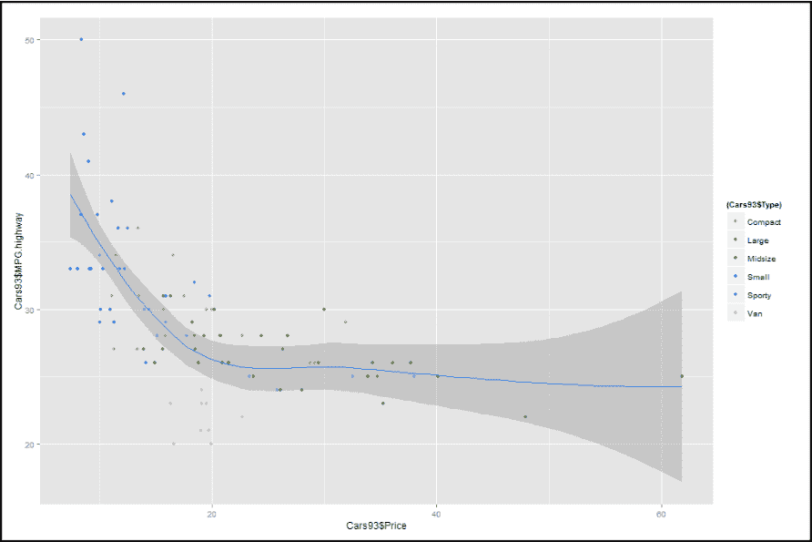
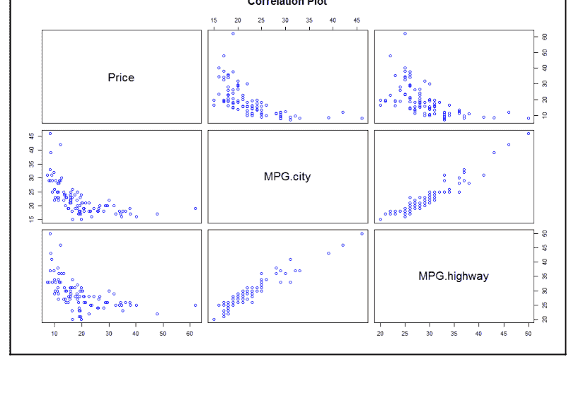
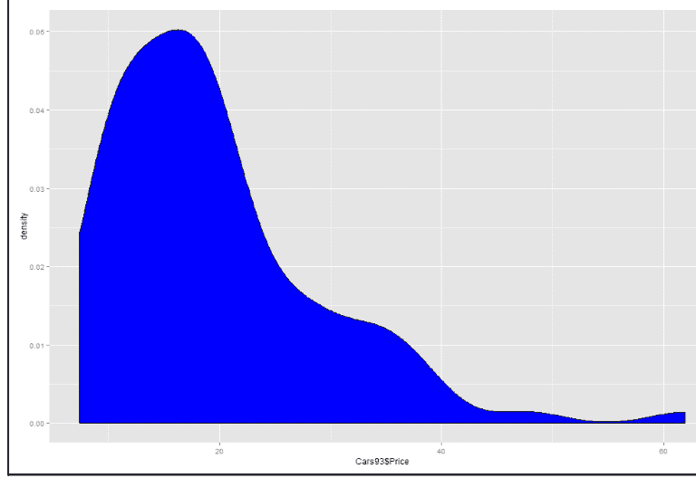
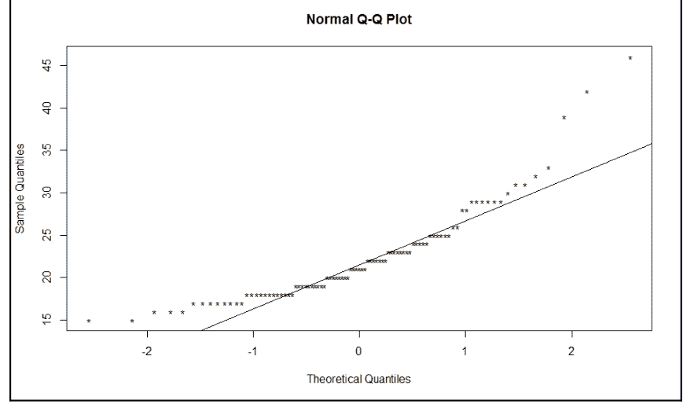
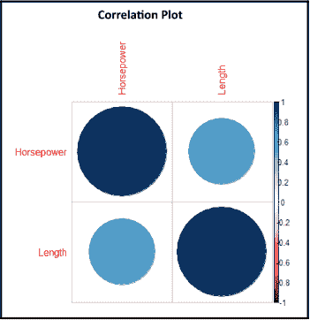
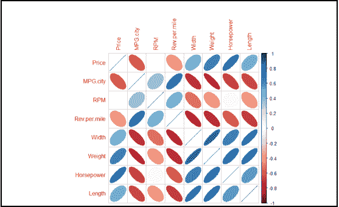
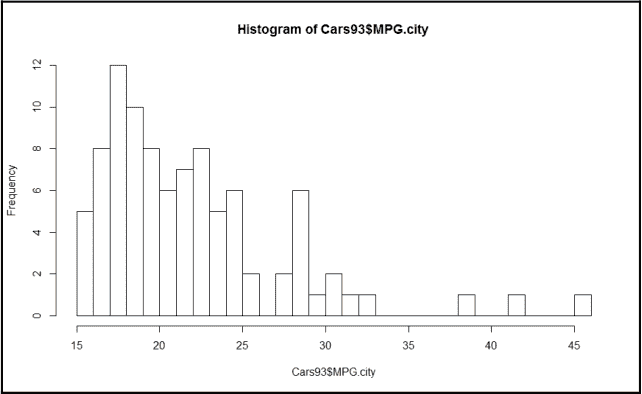
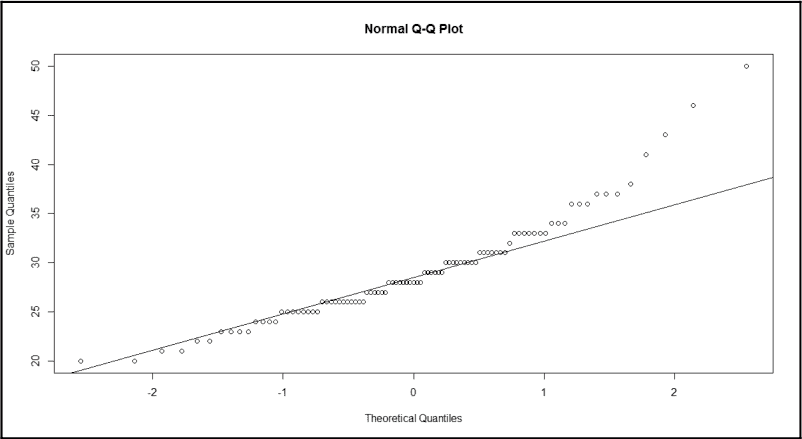

# 2 使用汽车数据进行探索性数据分析

## 使用汽车数据进行探索性数据分析

探索性数据分析是数据挖掘不可或缺的一部分。它涉及对数据集中变量的数值和图形表示，以便于理解并快速得出关于数据集的结论。了解数据集、用于分析的变量类型、各种变量之间的关联等非常重要。

创建交叉表以了解分类变量之间的关系并对数据执行经典统计检验以验证数据关于数据的各种假设可能是有用的。

您现在将了解以下内容：

- 如何使用基本统计数据了解单个和多个变量的属性
- 如何计算两个或多个变量之间的相关性和关联
- 执行多变量数据分析
- 任何数据集的各种概率函数的统计属性
- 对数据应用统计检验以得出假设
- 比较两个或多个样本

```r
$ Manufacturer : Factor w/ 32 levels "Acura","Audi",...: 1 1 2 2 3 4 4 4 4 5 ...
$ Model : Factor w/ 93 levels "100","190E","240",...: 49 56 9 1 6 24 54 74 73 35 ...
$ Type : Factor w/ 6 levels "Compact","Large",...: 4 3 1 3 3 3 2 2 3 2 ...
$ Min.Price : num 12.9 29.2 25.9 30.8 23.7 14.2 19.9 22.6 26.3 33 ...
$ Price : num 15.9 33.9 29.1 37.7 30 15.7 20.8 23.7 26.3 34.7 ...
$ Max.Price : num 18.8 38.7 32.3 44.6 36.2 17.3 21.7 24.9 26.3 36.3 ...
$ MPG.city : int 25 18 20 19 22 22 19 16 16 ...
$ MPG.highway : int 31 25 26 26 30 31 28 25 27 25 ...
$ AirBags : Factor w/ 3 levels "Driver & Passenger",...: 3 1 2 1 2 2 2 2 2 2 ...
$ DriveTrain : Factor w/ 3 levels "4WD","Front",...: 2 2 2 2 3 2 2 3 2 2 ...
$ Cylinders : Factor w/ 6 levels "3","4","5","6",...: 2 4 4 4 2 2 4 4 4 5 ...
$ EngineSize : num 1.8 3.2 2.8 2.8 3.5 2.2 3.8 5.7 3.8 4.9 ...
$ Horsepower : int 140 200 172 172 208 110 170 180 170 200 ...
$ RPM : int 6300 5500 5500 5500 5700 5200 4800 4000 4800 4100 ...
$ Rev.per.mile : int 2890 2335 2280 2535 2545 2565 1570 1320 1690 1510 ...
$ Man.trans.avail : Factor w/ 2 levels "No","Yes": 2 2 2 2 2 1 1 1 1 1 ...
$ Fuel.tank.capacity: num 13.2 18 16.9 21.1 21.1 16.4 18 23 18.8 18 ...
$ Passengers : int 5 5 5 6 4 6 6 6 5 6 ...
$ Length : int 177 195 180 193 186 189 200 216 198 206 ...
$ Wheelbase : int 102 115 102 106 109 105 111 116 108 114 ...
$ Width : int 68 71 67 70 69 69 74 78 73 73 ...
$ Turn.circle : int 37 38 37 37 39 41 42 45 41 43 ...
$ Rear.seat.room : num 26.5 30 28 31 27 28 30.5 30.5 26.5 35 ...
$ Luggage.room : int 11 15 14 17 13 16 17 21 14 18 ...
$ Weight : int 2705 3560 3375 3405 3640 2880 3470 4105 3495 3620 ...
$ Origin : Factor w/ 2 levels "USA","non-USA": 2 2 2 2 2 1 1 1 1 1 ...
$ Make : Factor w/ 93 levels "Acura Integra",...: 1 2 4 3 5 6 7 9 8 10 ...
```

可以显示对一些连续变量（Price、MPG.city 和 MPG.highway）和离散变量（Type、AirBags 和手动变速箱可用性）的单变量统计计算。您可以练习其余变量以全面了解数据集。

`max()` 命令估计变量的最大值。`min()` 计算最小值。`sum()` 计算所有值的总和。`mean()` 函数计算值的算术平均值，`median()` 函数计算中值，`range()` 计算 `min()` 和 `max()` 的向量。`var()` 计算样本方差，`cor()` 计算两个向量之间的相关性。`rank()` 计算向量中值的秩向量。`quantile()` 函数计算包含向量的最小值、下四分位数、中位数、上四分位数和最大值的向量。

使用 `summary()` 函数进行单变量分析：

```r
> summary(Cars93$Price)
Min. 1st Qu. Median Mean 3rd Qu. Max.
7.40 12.20 17.70 19.51 23.30 61.90
> summary(Cars93$MPG.city)
Min. 1st Qu. Median Mean 3rd Qu. Max.
15.00 18.00 21.00 22.37 25.00 46.00
> summary(Cars93$MPG.highway)
Min. 1st Qu. Median Mean 3rd Qu. Max.
20.00 26.00 28.00 29.09 31.00 50.00
> summary(Cars93$Type)
Compact Large Midsize Small Sporty Van
16 11 22 21 14 9
> summary(Cars93$AirBags)
Driver & Passenger Driver only None
16 43 34
> summary(Cars93$Man.trans.avail)
No Yes
32 61
```

现在让我们查看 `summary()` 函数在数据框上的结果。对于连续变量，计算中心趋势的数值度量，对于分类变量，计算类别频率：

```r
> summary(Cars93)
Manufacturer Model Type Min.Price
Chevrolet: 8 100 : 1 Compact:16 Min. : 6.70
Ford : 8 190E : 1 Large :11 1st Qu.:10.80
Dodge : 6 240 : 1 Midsize:22 Median :14.70
Mazda : 5 300E : 1 Small :21 Mean :17.13
Pontiac : 5 323 : 1 Sporty :14 3rd Qu.:20.30
Buick : 4 535i : 1 Van : 9 Max. :45.40
(Other) :57 (Other):87
Price Max.Price MPG.city MPG.highway
Min. : 7.40 Min. : 7.9 Min. :15.00 Min. :20.00
1st Qu.:12.20 1st Qu.:14.7 1st Qu.:18.00 1st Qu.:26.00
Median :17.70 Median :19.6 Median :21.00 Median :28.00
Mean :19.51 Mean :21.9 Mean :22.37 Mean :29.09
3rd Qu.:23.30 3rd Qu.:25.3 3rd Qu.:25.00 3rd Qu.:31.00
Max. :61.90 Max. :80.0 Max. :46.00 Max. :50.00
AirBags DriveTrain Cylinders EngineSize
Driver & Passenger:16 4WD :10 3 : 3 Min. :1.000
Driver only :43 Front:67 4 :49 1st Qu.:1.800
None :34 Rear :16 5 : 2 Median :2.400
6 :31 Mean :2.668
8 : 7 3rd Qu.:3.300
rotary: 1 Max. :5.700
```


Horsepower RPM Rev.per.mile Man.trans.avail
Min. : 55.0 Min. :3800 Min. :1320 No :32
1st Qu.:103.0 1st Qu.:4800 1st Qu.:1985 Yes:61
Median :140.0 Median :5200 Median :2340
Mean :143.8 Mean :5281 Mean :2332
3rd Qu.:170.0 3rd Qu.:5750 3rd Qu.:2565
Max. :300.0 Max. :6500 Max. :3755
Fuel.tank.capacity Passengers Length Wheelbase
Min. : 9.20 Min. :2.000 Min. :141.0 Min. : 90.0
1st Qu.:14.50 1st Qu.:4.000 1st Qu.:174.0 1st Qu.: 98.0
Median :16.40 Median :5.000 Median :183.0 Median :103.0
Mean :16.66 Mean :5.086 Mean :183.2 Mean :103.9
3rd Qu.:18.80 3rd Qu.:6.000 3rd Qu.:192.0 3rd Qu.:110.0
Max. :27.00 Max. :8.000 Max. :219.0 Max. :119.0
Width Turn.circle Rear.seat.room Luggage.room
Min. :60.00 Min. :32.00 Min. :19.00 Min. : 6.00
1st Qu.:67.00 1st Qu.:37.00 1st Qu.:26.00 1st Qu.:12.00
Median :69.00 Median :39.00 Median :27.50 Median :14.00
Mean :69.38 Mean :38.96 Mean :27.83 Mean :13.89
3rd Qu.:72.00 3rd Qu.:41.00 3rd Qu.:30.00 3rd Qu.:15.00
Max. :78.00 Max. :45.00 Max. :36.00 Max. :22.00
NA's :2 NA's :11
Weight Origin Make
Min. :1695 USA :48 Acura Integra: 1
1st Qu.:2620 non-USA:45 Acura Legend : 1
Median :3040 Audi 100 : 1
Mean :3073 Audi 90 : 1
3rd Qu.:3525 BMW 535i : 1
Max. :4105 Buick Century: 1
(Other) :87

对于连续变量（如 RPM、马力等），summary 命令显示最小值、第一四分位数、均值、中位数、第三四分位数和最大值。对于分类变量（如汽车类型、安全气囊、手动变速箱可用性等），其单变量统计以频数表的形式表示。频数最高的类别被视为众数类别。

使用 fivenum() 和 describe() 等函数也可以生成类似的汇总统计信息，它们比 summary 函数提供的信息更多：

```
> fivenum(Cars93$Price)
[1] 7.4 12.2 17.7 23.3 61.9
> fivenum(Cars93$MPG.city)
[1] 15 18 21 25 46
> fivenum(Cars93$MPG.highway)
[1] 20 26 28 31 50
```

来自 Hmisc 库的 describe() 函数可用于更好地理解数据描述：

```
> library(Hmisc)
> describe(Cars93)
Cars93
27 Variables 93 Observations
Price
n missing unique Info Mean .05 .10 .25 .50 .75 .90
93 0 81 1 19.51 8.52 9.84 12.20 17.70 23.30 33.62
.95
36.74
lowest : 7.4 8.0 8.3 8.4 8.6, highest: 37.7 38.0 40.1 47.9 61.9
MPG.city
n missing unique Info Mean .05 .10 .25 .50 .75 .90
93 0 21 0.99 22.37 16.6 17.0 18.0 21.0 25.0 29.0
.95
31.4
lowest : 15 16 17 18 19, highest: 32 33 39 42 46
--------------------------------------------------
----------------
MPG.highway
n missing unique Info Mean .05 .10 .25 .50 .75 .90
93 0 22 0.99 29.09 22.0 23.2 26.0 28.0 31.0 36.0
.95
37.4
lowest : 20 21 22 23 24, highest: 38 41 43 46 50
--------------------------------------------------
----------------
AirBags
n missing unique
93 0 3
Driver & Passenger (16, 17%), Driver only (43, 46%)
None (34, 37%)
--------------------------------------------------
----------------
Man.trans.avail
n missing unique
93 0 2
No (32, 34%), Yes (61, 66%)
```

类似地，价格与高速公路里程之间的关系也可以用散点图来表示：

```r
> library(ggplot2)
> library(gridExtra)
> ggplot(Cars93,
 aes(Cars93$Price,Cars93$MPG.highway))+geom_point(aes(colour=(Cars93$Type)))
 +geom_smooth()
```



图 2：价格与高速公路里程之间的关系

数值-分类关系和两个分类变量之间的关系将在第 3 章 *可视化钻石数据集* 中详细说明。

## 多变量分析

多变量关系是考察多个因变量和自变量及其关系的一种统计方法。在本章中，我们将简要讨论超过两个变量之间的多变量关系，但将在后续章节中详细讨论多变量分析。可以通过相关性方法以及交叉列表来了解各变量之间的多变量关系：

```
> pairs(n_cars93,main="Correlation Plot", col="blue")
```





从前面的图像中，我们可以得出结论：价格变量呈正偏态，因为分布右侧存在一些异常值。价格变量的均值因极端波动而被夸大，且大于众数。

现在让我们尝试理解一个可以使用正态分布来回答某个假设的例子。

假设高速公路上的每加仑英里数变量服从均值为 29.08、标准差为 5.33 的正态分布。那么一辆新车提供 35 英里/加仑里程的概率是多少？

```
> pnorm(35,mean(Cars93$MPG.highway),sd(Cars93$MPG.highway),lower.tail = F)
[1] 0.1336708
```

因此，一辆新车提供 35 英里/加仑里程所需的概率为 13.36%，由于期望均值高于实际均值，lower.tail 相当于 FALSE。

## 二项概率分布

二项分布被称为离散概率分布。它描述一次实验的结果。每次试验被认为只有两种结果：成功或失败，是或否。例如，在 Cars93 数据集的变量中，手动变速箱是否可用用“是”或“否”表示。

让我们举一个例子来说明二项分布的用途。在特定部件无法正常工作的情况下，汽车有缺陷的概率是 0.1%。你制造了 93 辆汽车。在当前这批 93 辆汽车中至少检测出 1 辆缺陷车的概率是多少：

```
> pbinom(1,93,prob = 0.1)
[1] 0.0006293772
```

因此，在 93 辆汽车的一批中识别出一辆缺陷汽车的概率为 0.0006，考虑到缺陷部件的概率为 0.10，这个概率非常小。

## 泊松概率分布

泊松分布适用于计数数据，在给定数据以及事件相关信息的情况下，你可以使用泊松概率分布预测该范围内任意数字出现的概率。

让我们举个例子。假设平均每分钟有 200 位顾客访问某个电子商务网站门户。那么求一分钟后有 250 位顾客访问同一网站的概率：

```
> ppois(250,200,lower.tail = F)
[1] 0.0002846214
```

因此，所需概率为 0.0002，这非常罕见。除了前面提到的经常使用的常见概率分布之外，还有许多其他分布可以在罕见情况下使用。

```
mean sd
0.5498938 0.3888336
> x$vcov
mean sd
mean 0.3023831 0.0000000
sd 0.0000000 0.1511916
> x$loglik
[1] -287.1104
> x$n
[1] 93
```

现在我们将了解如何以图形方式表示变量的正态性：

```
> qqnorm(Cars93$MPG.highway)
> qqline(Cars93$MPG.highway)
```



以圆圈表示的数据点偏离了直线 t。

解释离散数据：其中所有类别如下：

```
> table(Cars93$Type)
Compact Large Midsize Small Sporty Van
16 11 22 21 14 9
```

```
Midsize 5 6 1
Small 0 3 11
Sporty 1 3 2
Van 0 1 3
```

用于检验所有因子独立性的 summary 命令可用于检验原假设：

```
> summary(contTable)
Number of cases in table: 93
Number of factors: 3
Test for independence of all factors:
Chisq = 65, df = 27, p-value = 5e-05
Chi-squared approximation may be incorrect
```

除了前面讨论的图形方法之外，还有一些数值统计检验可用于判断变量是否服从正态分布。有一个名为 norm.test 的库用于执行数据正态性检验，下面列出了该库中一些有助于评估数据正态性的函数：

| ajb.norm.test | 调整后的 Jarque-Bera 正态性检验 |
| frosini.norm.test | Frosini 正态性检验 |
| geary.norm.test | Geary 正态性检验 |
| hegazy1.norm.test | Hegazy-Green 正态性检验 |
| hegazy2.norm.test | Hegazy-Green 正态性检验 |
| jb.norm.test | Jarque-Bera 正态性检验 |
| kurtosis.norm.test | 峰度正态性检验 |
| skewness.norm.test | 偏度正态性检验 |
| spiegelhalter.norm.test | Spiegelhalter 正态性检验 |
| wb.norm.test | Weisberg-Bingham 正态性检验 |

| ad.test | Anderson-Darling 正态性检验 |
| cvm.test | Cramér-von Mises 正态性检验 |
| lillie.test | Lilliefors（Kolmogorov-Smirnov）正态性检验 |
| pearson.test | Pearson 卡方正态性检验 |
| sf.test | Shapiro-Francia 正态性检验 |


让我们对`Cars93`数据集中的`Price`变量进行正态性检验：

```
> library(nortest)
> ad.test(Cars93$Price) # 安德森-达林检验
Anderson-Darling normality test
data: Cars93$Price
A = 3, p-value = 9e-07
> cvm.test(Cars93$Price) # 克拉默-冯·米塞斯检验
Cramer-von Mises normality test
data: Cars93$Price
W = 0.5, p-value = 6e-06
> lillie.test(Cars93$Price) # 利利福斯（KS）检验
Lilliefors (Kolmogorov-Smirnov) normality test
data: Cars93$Price
D = 0.2, p-value = 1e-05
> pearson.test(Cars93$Price) # 皮尔逊卡方检验
Pearson chi-square normality test
data: Cars93$Price
P = 30, p-value = 3e-04
> sf.test(Cars93$Price) # 夏皮罗-弗朗西亚检验
Shapiro-Francia normality test
data: Cars93$Price
```

从上述检验可以看出，`Price`变量不服从正态分布，因为所有统计检验的p值均小于0.05。如果我们在双变量关系中增加更多维度，就变成了多元分析。让我们尝试理解`Cars93`数据集中汽车马力与长度之间的关系：

```
> library(corrplot)
> o<-cor(Cars93[,c("Horsepower","Length")])
> corrplot(o,method = "circle",main="相关性图")
```



当我们纳入更多变量时，就变成了多元关系。让我们尝试绘制`Cars93`数据集中多个变量之间的多元关系图。

```
```r
> library(corrplot)
> t<-
  cor(Cars93[,c("Price","MPG.city","RPM","Rev.per.mile","Width","Weight","Horsepower","Length")])
> corrplot(t,method = "ellipse")
```
```



有多种方法可以作为参数传递给相关性图，分别是"circle"（圆形）、"square"（方形）、"ellipse"（椭圆）、"number"（数字）、"shade"（阴影）、"color"（颜色）和"pie"（饼图）。

## 假设检验

零假设表明什么都没发生，均值保持不变等等。而备择假设则表明发生了某些不同的事情，总体的均值存在差异。执行假设检验需要以下几个步骤：

- 1. **提出零假设**：对总体做出一个假设陈述；例如，城市内汽车的平均油耗为40。
- 2. **提出备择假设**：如果零假设被证明是错误的，那么还存在什么其他可能性？例如，如果城市内油耗不是40，那么是大于40还是小于40？如果它不等于40，则属于非方向性备择假设。
- 3. **计算样本检验统计量**：检验统计量可以是t检验、f检验、z检验等等。根据数据可得性和先前声明的假设选择合适的检验统计量。
- 4. **确定置信区间**：根据特定业务问题所需的精确程度，有三个不同的置信水平：90%、95%和99%。由研究人员/分析师自行决定选择哪个置信区间水平。
- 5. **定义阿尔法值**：如果选择的置信水平是95%，则阿尔法值为5%。因此，确定阿尔法值有助于计算检验的p值。
- 6. **决策**：如果所选的p值小于阿尔法水平，则有证据表明可以拒绝零假设；如果不是，则我们接受零假设。

## 总体均值检验

运用假设检验流程，让我们以`Cars93`数据集为例来检验总体均值。

## 已知方差下均值的单尾检验

假设研究人员声称样本中收集的所有汽车的平均油耗超过35。在93辆汽车的样本中，观察到所有汽车的平均油耗为29。你应该接受还是拒绝研究人员的说法？

这就是我们在已知方差的情况下，对样本数据进行的总体均值单尾和双尾检验分析方式。

## 比例的单尾和双尾检验

使用`Cars93`数据集，假设美国制造的汽车中有40%的RPM超过5000。从样本数据中，我们发现57辆汽车中有17辆的RPM高于5000。你从这个情境中能得出什么解读？

```
> mileage<-subset(Cars93,Cars93$RPM > 5000)
> table(mileage$Origin)
美国 非美国
17 40
> p1<-17/57
> p0<- 0.4
> n <- length(mileage)
> z <- (p1-p0)/sqrt(p0*(1-p0)/n)
> z
[1] -1.079
> #计算5%阿尔法水平下的临界值
> alpha = .05
> z1 = qnorm(1-alpha)
> z1
[1] 1.645
> ifelse(z > z1,"拒绝零假设","接受零假设")
[1] "接受零假设"
```

如果备择假设不是方向性的，则属于比例的双尾检验情形；除了临界值的计算方式不同之外，前面的计算没有任何变化。详细的脚本如下：

```
> mileage<-subset(Cars93,Cars93$RPM > 5000)
> table(mileage$Origin)
美国 非美国
17 40
> p1<-17/57
> p0<- 0.4
> n <- length(mileage)
> z <- (p1-p0)/sqrt(p0*(1-p0)/n)
> z
[1] -1.079
> #计算5%阿尔法水平下的临界值
> alpha = .05
> z1 = qnorm(1-alpha/2)
> c(-z1,z1)
[1] -1.96 1.96
```

```
> ifelse(z > z1 | z < -z1,"拒绝零假设","接受零假设")
[1] "接受零假设"
```

- - **连续数据的双样本配对检验：**双样本配对检验中所检验的零假设是，某个处理对受试者没有影响、该治疗方法对受试者没有效果等等。备择假设则是，某个处理、治疗方法或药物对受试者具有统计学上显著的影响。

虽然`Cars93`数据集中没有这样的变量，但我们仍然可以假设不同品牌汽车的最低价格与最高价格之间存在配对关系。

- - **双样本t检验的零假设：**平均价格没有差异。
- - **备择假设：**平均价格存在差异：

```
> t.test(Cars93$Min.Price, Cars93$Max.Price, paired = T)
配对t检验
data: Cars93$Min.Price and Cars93$Max.Price
t = -9.6, df = 92, p-value = 2e-15
alternative hypothesis: true difference in means is not equal to 0
95 percent confidence interval:
-5.765 -3.781
sample estimates:
mean of the differences
-4.773
```

p值小于0.05。因此，可以得出结论，平均最低价格与平均最高价格之间的差异在95%置信水平下具有统计学显著性。

- - **连续数据的双样本非配对检验：**从`Cars93`数据集来看，高速公路上的油耗与城市内的油耗被假定为不同的。这种差异是否具有统计学显著性，可以通过使用独立样本t检验来比较均值进行检验。
- - **零假设：**高速公路上的MPG与城市内的MPG没有差异。
- - **备择假设：**高速公路上的MPG与城市内的MPG存在差异：

```
韦尔奇双样本t检验
data: Cars93$MPG.city and Cars93$MPG.highway
```

```
t = -8.4, df = 180, p-value = 1e-14
alternative hypothesis: true difference in means is not equal to 0
95 percent confidence interval:
-8.305 -5.136
sample estimates:
mean of x mean of y
22.37 29.09
```

从双样本t检验可以看出，当两个样本独立时，p值小于0.05；因此，我们可以拒绝“高速公路与城市内的平均油耗没有差异”的零假设。城市内与高速公路上的平均油耗之间存在统计学上显著的差异。这可以用稍微不同的方式来表述，比如设定一个零假设：手动挡与自动挡汽车在城市内的平均油耗差异是不同的：

```
, data=Cars93)
韦尔奇双样本t检验
data: Cars93$MPG.city by Cars93$Man.trans.avail
t = -6, df = 84, p-value = 4e-08
alternative hypothesis: true difference in means is not equal to 0
95 percent confidence interval:
-6.949 -3.504
sample estimates:
mean in group No mean in group Yes
18.94 24.16
```

因此，上述检验的结论是：自动挡与手动挡车型之间的平均油耗存在统计学上显著的差异；这是因为p值小于0.05。

在应用t检验之前，检查数据的正态性是很重要的；可以使用Shapiro检验函数来评估变量的正态性：

```
> shapiro.test(Cars93$MPG.city)
Shapiro-Wilk正态性检验
data: Cars93$MPG.city
W = 0.86, p-value = 6e-08
)
> qqline(Cars93$MPG.city)
```






观察城市内每加仑英里数的QQ图和直方图，可以得出结论：该变量不服从正态分布。由于英里数变量不服从正态分布，需要应用非参数方法，如Wilcoxon符号秩检验或Kolmogorov-Smirnov检验。

```
> summary(aov(Cars93$RPM~Cars93$Cylinders))
Df Sum Sq Mean Sq F value Pr(>F)
Cars93$Cylinders 5 6763791 1352758 4.53 0.001 **
Residuals 87 25996370 298809
---
Signif. codes: 0 '***' 0.001 '**' 0.01 '*' 0.05 '.' 0.1 ' ' 1
```

从上述方差分析可以看出，p值小于0.05，因此可以拒绝原假设。这意味着至少有一种气缸类型的平均转速在统计上存在显著差异。为了确定哪一种气缸类型存在差异，可以对方差分析模型的结果进行事后检验：

```
> TukeyHSD(aov(Cars93$RPM~Cars93$Cylinders))
Tukey multiple comparisons of means
95% family-wise confidence level
Fit: aov(formula = Cars93$RPM ~ Cars93$Cylinders)
$`Cars93$Cylinders`
diff lwr upr p adj
4-3 -321.8 -1269.23 625.69 0.9201
5-3 -416.7 -1870.88 1037.54 0.9601
6-3 -744.1 -1707.28 219.11 0.2256
8-3 -895.2 -1994.52 204.04 0.1772
rotary-3 733.3 -1106.11 2572.78 0.8535
5-4 -94.9 -1244.08 1054.29 0.9999
6-4 -422.3 -787.90 -56.74 0.0140
8-4 -573.5 -1217.14 70.20 0.1091
rotary-4 1055.1 -554.08 2664.28 0.4027
6-5 -327.4 -1489.61 834.77 0.9629
8-5 -478.6 -1755.82 798.67 0.8834
rotary-5 1150.0 -801.03 3101.03 0.5240
8-6 -151.2 -817.77 515.47 0.9857
rotary-6 1477.4 -141.08 3095.92 0.0941
rotary-8 1628.6 -74.42 3331.57 0.0692
```

当p调整值小于0.05时，该转速均值与其他组的差异在统计上显著。

带事后检验的双因素方差分析：所考虑的因素是产地和安全气囊。需要检验的假设是：这两个分类变量对转速变量是否有影响？

```
> aov(Cars93$RPM~Cars93$Origin + Cars93$AirBags)
Call:
aov(formula = Cars93$RPM ~ Cars93$Origin + Cars93$AirBags)
Terms:
Cars93$Origin Cars93$AirBags Residuals
Sum of Squares 8343880 330799 24085482
```

```
Deg. of Freedom 1 2 89
Residual standard error: 520.2
Estimated effects may be unbalanced
> summary(aov(Cars93$RPM~Cars93$Origin + Cars93$AirBags))
Df Sum Sq Mean Sq F value Pr(>F)
Cars93$Origin 1 8343880 8343880 30.83 2.9e-07 ***
Cars93$AirBags 2 330799 165400 0.61 0.54
Residuals 89 24085482 270623
---
Signif. codes: 0 '***' 0.001 '**' 0.01 '*' 0.05 '.' 0.1 ' ' 1
> TukeyHSD(aov(Cars93$RPM~Cars93$Origin + Cars93$AirBags))
Tukey multiple comparisons of means
95% family-wise confidence level
Fit: aov(formula = Cars93$RPM ~ Cars93$Origin + Cars93$AirBags)
$`Cars93$Origin`
diff lwr upr p adj
non-USA-USA 599.4 384.9 813.9 0
$`Cars93$AirBags`
diff lwr upr p adj
Driver only-Driver & Passenger -135.74 -498.8 227.4 0.6474
None-Driver & Passenger -25.68 -401.6 350.2 0.9855
None-Driver only 110.06 -174.5 394.6 0.6280
```

## 非参数方法

当训练数据集因不符合特定概率分布的假设而不服从任何特定概率分布时，分析数据的唯一选择就是使用非参数方法。非参数方法不遵循有关概率分布的任何假设。使用非参数方法，可以在不遵循任何假设的情况下进行推断和假设检验。现在，我们来看一组非参数检验，当数据集不符合任何特定概率分布的假设时，可以使用这些检验。

### Wilcoxon符号秩检验

如果不满足正态性假设，则需要应用非参数方法来回答诸如此类的问题：自动挡和手动挡汽车在城市内的平均油耗里程是否存在差异？

```
> wilcox.test(Cars93$MPG.city~Cars93$Man.trans.avail, correct = F)
Wilcoxon rank sum test

data: Cars93$MPG.city by Cars93$Man.trans.avail
W = 380, p-value = 1e-06
```

```

alternative hypothesis: true location shift is not equal to 0
```

如果两个样本恰好是配对样本，且样本不满足正态性假设，可以使用`paired`参数：

```
> wilcox.test(Cars93$MPG.city, Cars93$MPG.highway, paired = T)
Wilcoxon signed rank test with continuity correction

data: Cars93$MPG.city and Cars93$MPG.highway
V = 0, p-value <2e-16
alternative hypothesis: true location shift is not equal to 0
```

### Mann-Whitney-Wilcoxon检验

如果两个样本不匹配、相互独立，且不服从正态分布，则需要使用Mann-Whitney-Wilcoxon检验来检验两个样本的均值差异在统计上是否显著不同：

```
> wilcox.test(Cars93$MPG.city~Cars93$Man.trans.avail, data=Cars93)
Wilcoxon rank sum test with continuity correction

data: Cars93$MPG.city by Cars93$Man.trans.avail
W = 380, p-value = 1e-06
alternative hypothesis: true location shift is not equal to 0
```

### Kruskal-Wallis检验

要比较两个以上组的均值，也就是方差分析的非参数版本，可以使用Kruskal-Wallis检验。它也被称为无分布假设的统计检验：

```
> kruskal.test(Cars93$MPG.city~Cars93$Cylinders, data= Cars93)
Kruskal-Wallis rank sum test

data: Cars93$MPG.city by Cars93$Cylinders
Kruskal-Wallis chi-squared = 68, df = 5, p-value = 3e-13
```
