# 3 可视化钻石数据集

# 可视化钻石数据集

如果没有适当的数据可视化，任何数据挖掘项目都是不完整的。仅看数字和统计数据时，或许也能看出不同切工下这些变量的相似规律，但当我们以可视化方式观察变量与因素之间的关系时，呈现的却完全是另一番景象。因此，数据可视化传达出数字和统计无法传达的信息。从数据挖掘的角度来看，数据可视化有许多优点，可以概括为以下三个要点：

- 数据可视化在数据与数据使用者之间建立了强有力的沟通
- 它能留下持久的印象，因为人们可能记不住数字，但会记住图表和形状
- 当数据扩展到更高维度时，用数字表示没有意义，但可视化表示却有意义

在本章中，读者将了解数据可视化的基础知识，以及如何使用R编程语言中的现有库创建高级数据可视化。通常，数据可视化方法可以从两个不同的角度来考虑：

- 你想向受众展示什么？是比较、关系还是其他功能？
- 你想如何展示这些洞察？哪种图表或图形方式最适合直观地展示这些洞察？

基于上述两点，我们先来看看数据可视化的规则以及每种可视化背后的理论，然后再来看使用R脚本实现图形和图表的具体实践。

## 可视化钻石数据集

考虑到前面提到的十个要点，可以根据你想要表示的内容制定数据可视化规则，来选择最佳表示方式：

- 两个变量之间的关系可以用散点图表示
- 两个以上变量之间的关系可以用气泡图表示
- 为了理解样本量较小的单个变量的分布，可以使用直方图
- 为了理解样本量较大的单个变量的分布，可以使用密度图
- 两个变量的分布可以用散点图表示
- 3个变量之间的分布关系可以使用3D散点图表示
- 任何带有时间戳的变量，如日、周、月、年等，都可以用折线图表示
- 时间应始终位于水平轴上，要度量的指标应始终位于垂直轴上
- 每个图形都应有名称和标签，这样用户不必再回到数据中才能理解它表示什么

在本章中，我们将主要关注`ggplot2`库和`plotly`库。当然，我们还会介绍一些更有趣的库来创建数据可视化。R中的图形包可以按以下顺序进行组织：

- 绘图
- 图形应用（例如效应排序、大型数据集和树、以及图形）
- 图形系统
- 设备
- 颜色
- 交互式图形
- 开发

有关支持上述功能的各种库的详细说明，可以参阅链接`https://cran.r-project.org/web/views/Graphics.html`。为了获得良好的可视化效果，我们需要更多的数据点，以便提高图形的密度。在本节中，我们将使用两个数据集`diamonds.csv`和`cars93.csv`来展示数据可视化。


## 钻石数据集可视化

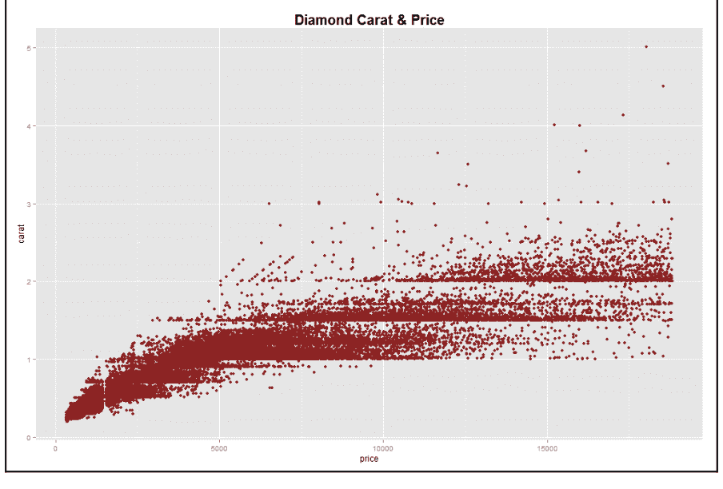

目前，图形看起来有些拥挤。为了使图形更直观，我们需要为 x 轴和 y 轴添加标签，并移除任意轴上的刻度线和文本，以使图形更加清晰。当行名或列名中包含文本或难以完整读取的大数字时，需要旋转相应轴上的文本：

```r
> #adding labels to the graph
> gg<-gg+labs(x="Price in Dollar", y="Carat", )
> gg
> #removing text and ticks from an axis
> gg<-gg+theme(axis.ticks.y=element_blank(),axis.text.y=element_blank())
> gg
> gg<-gg + theme(axis.text.x=element_text(angle=50, size=10, vjust=0.5))
> gg
> gg<-gg + theme(axis.text.x=element_text(color = "chocolate", vjust=0.45),
+ axis.text.y=element_text(color = "brown1", vjust=0.45))
> gg
```

```r
> gg<-ggplot(diamonds,aes(price,carat,color=factor(clarity)))+geom_point()
> gg
> gg<-gg+theme(legend.title=element_blank())
> gg
```

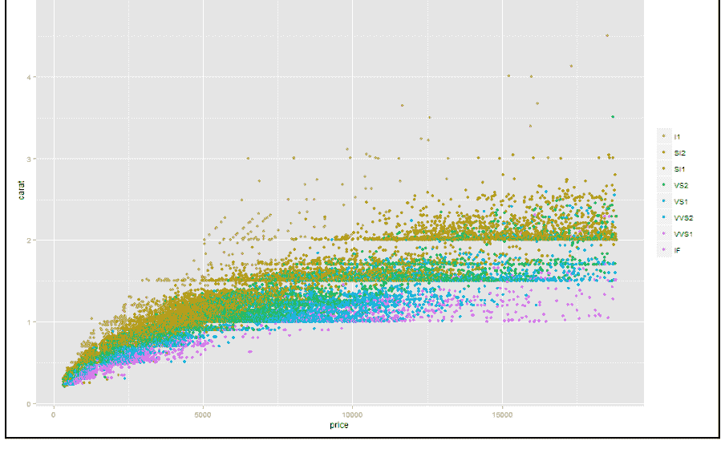

```r
> gg<-gg+theme(legend.title = element_text(colour="darkblue", size=16,
+ face="bold"))+scale_color_discrete(name="By Different Grids of Clarity")
> #changing the background boxes in legend
> gg<-gg+theme(legend.key=element_rect(fill='dodgerblue1'))
> gg
> #changing the size of the symbols used in legend
> gg<-gg+guides(colour = guide_legend(override.aes = list(size=4)))
> gg
> #changing the size of the symbols used in legend
> gg<-gg+guides(colour = guide_legend(override.aes = list(size=4)))
> gg
```

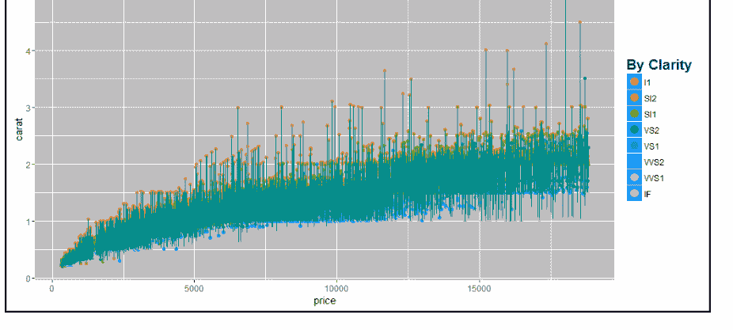

数据可视化的另一个重要方面是如何在绘图中展示多维切分。例如，在 diamonds 数据集中，我们目前关注的是钻石价格与其克拉数之间的关系。还有三个变量：切工（cut）、颜色（color）和净度（clarity）。了解这一关系在这三个变量中是否保持一致是很有意义的。也就是说，要了解我们是否可以按不同的切工、不同的颜色和不同的净度类别来绘制钻石克拉数与价格之间的关系。让我们看一下这三个分类变量的分布：

```r
> table(diamonds$cut);table(diamonds$clarity);table(diamonds$color)
Fair Good Very Good Premium Ideal
1610 4906 12082 13791 21551
I1 SI2 SI1 VS2 VS1 VVS2 VVS1 IF
741 9194 13065 12258 8171 5066 3655 1790
D E F G H I J
6775 9797 9542 11292 8304 5422 2808
> #adding a multi-variable cut to the graph
> gg<-gg+facet_wrap(~cut, nrow=4)
> gg
```

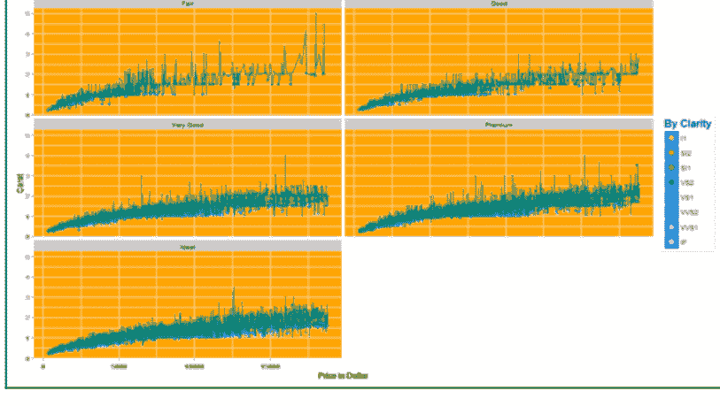

在上图中，`cut` 变量用于展示克拉数与价格之间的关系。选择的行数为四行，以便清晰呈现图形。如果我们向 `cut` 变量中再添加一个变量，即 `clarity`，图形将更加直观且更具洞察力：

```r
> #adding two variables as cut to display the relationship
> gg<-gg+facet_wrap(~cut+clarity, nrow=4)
> gg
```

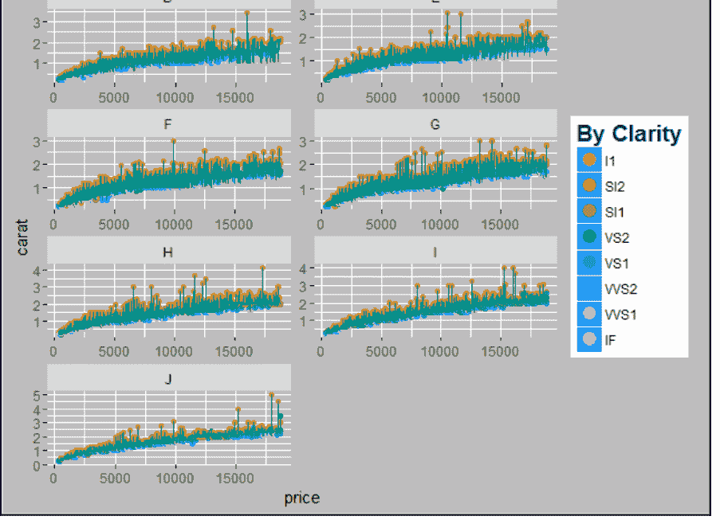

使用 `facet_grid()` 选项，我们可以借助 ggplot2 库展示两个分类变量之间的双变量关系：

```r
> #bi-variate plotting using ggplot2
> gg<-gg+facet_grid(color~cut)
> gg
```

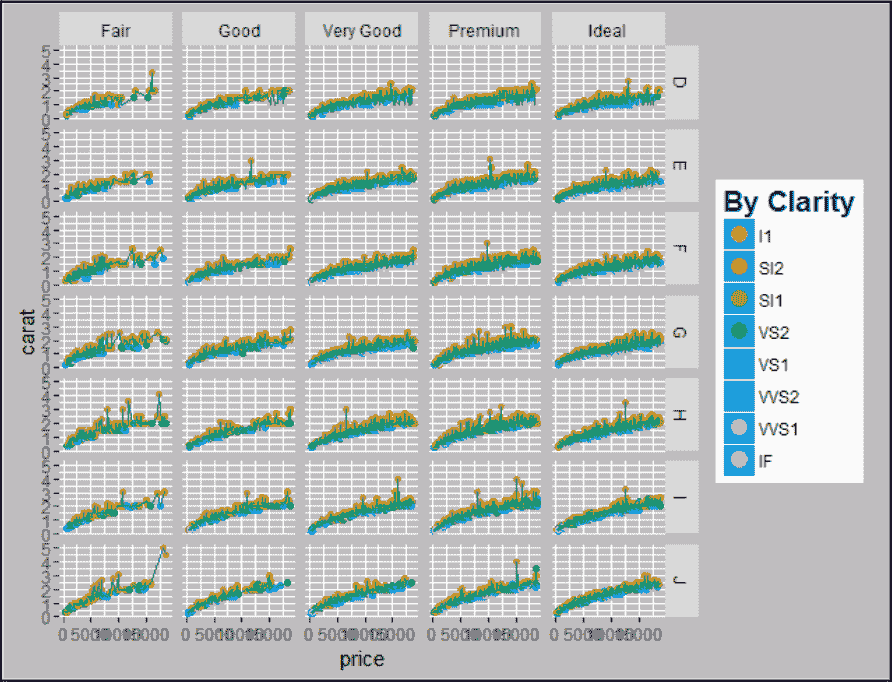

有一些外部图形主题可以导入到 ggplot2 函数中用于可视化，例如 `library(ggthemes)`。Tableau 是一个以数据可视化、配色和主题而闻名的工具，也可以与 ggplot 一起使用：

```r
> #Changing discrete category colors
> ggplot(diamonds, aes(price, carat, color=factor(cut)))+
+ geom_point() +
+ scale_color_brewer(palette="Set1")
> #Using tableau colors
> library(ggthemes)
> ggplot(diamonds, aes(price, carat, color=factor(cut)))+
+ geom_point() +
+ scale_color_tableau()
```

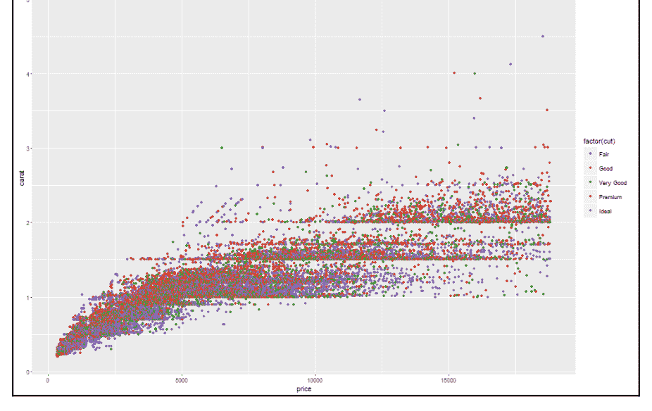

可以利用颜色渐变，并在图形本身上绘制分布，对创建的图形进行细微调整：

```r
> #using color gradient
> ggplot(diamonds, aes(price, carat))+
+ geom_point() +
+ scale_color_gradient(low = "blue", high = "red")
> #plotting a distribution on a graph
> mid<-mean(diamonds$price)
> ggplot(diamonds, aes(price, carat, color=depth))+geom_point()+
+ scale_color_gradient2(midpoint=mid,
+ low="blue", mid="white", high="red" )
```

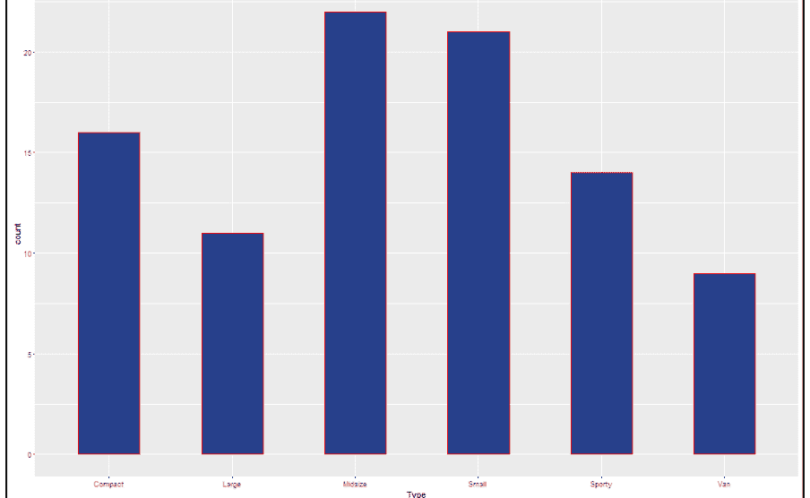

## 箱线图

使用 ggplot 包不仅易于解读箱线图，也易于自定义图形。人们可以轻松识别叠加在每个对应箱线图上的离群值：

```r
> #creating boxplot
> boxplot <- ggplot(Cars93,aes(Type,Price))+
+ geom_boxplot(width = 0.5,fill="firebrick",color="cadetblue2",
+ outlier.colour = "purple",outlier.shape = 2)+
+ ggtitle("Boxplot of Price by Car Type")
> boxplot
```

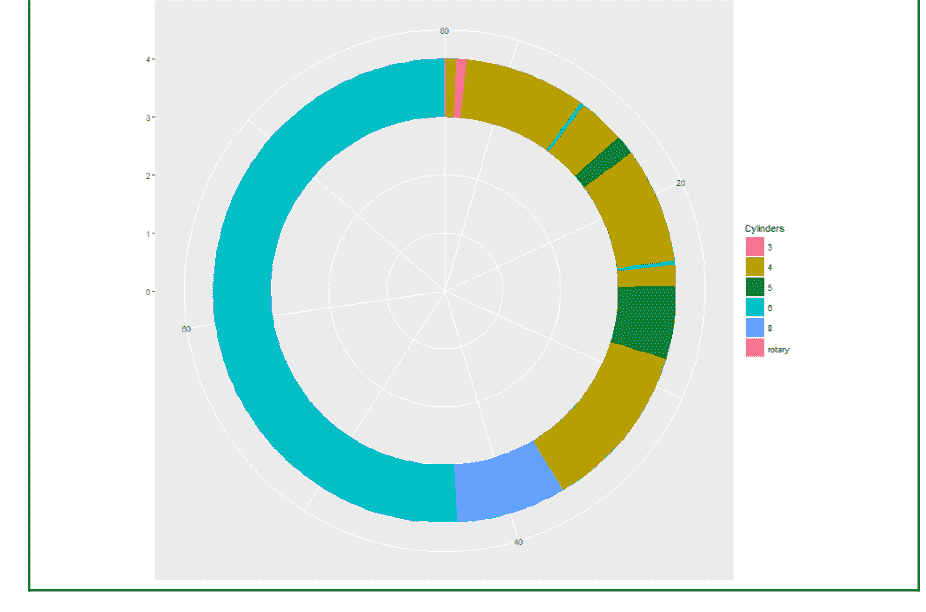

## 地理映射

任何包含城市名、州名或国家名的数据集，都可以使用 R 中的 Google Visualization 库绘制在地理地图上。利用另一个开源数据集——R 内置的 state.x77，我们可以展示地理地图的样子。Google Visualization 库使用 Google Maps API，尝试将地理位置与业务数据一起绘制在图上。它会在浏览器中发布输出，可以将其保存为图像以便进一步使用：

```r
> library(googleVis)
> head(state.x77)
```

| 州 | 人口 | 收入 | 文盲率 | 预期寿命 | 谋杀率 | 高中毕业率 | 霜冻天数 | 面积 |
|---|---:|---:|---:|---:|---:|---:|---:|---:|
| 阿拉巴马 | 3615 | 3624 | 2.1 | 69.05 | 15.1 | 41.3 | 20 | 50708 |
| 阿拉斯加 | 365 | 6315 | 1.5 | 69.31 | 11.3 | 66.7 | 152 | 566432 |
| 亚利桑那 | 2212 | 4530 | 1.8 | 70.55 | 7.8 | 58.1 | 15 | 113417 |
| 阿肯色 | 2110 | 3378 | 1.9 | 70.66 | 10.1 | 39.9 | 65 | 51945 |
| 加利福尼亚 | 21198 | 5114 | 1.1 | 71.71 | 10.3 | 62.6 | 20 | 156361 |
| 科罗拉多 | 2541 | 4884 | 0.7 | 72.06 | 6.8 | 63.9 | 166 | 103766 |

```r
> states <- data.frame(state.name, state.x77)
> gmap <- gvisGeoMap(states, "state.name", "Area",
+ options=list(region="US", dataMode="regions",
+ width=900, height=600))
> plot(gmap)
```

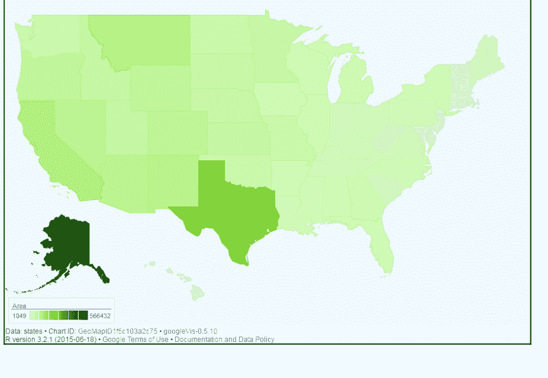

## 直方图

这可能是每个数据挖掘从业者都必须掌握的最简单的图形。以下代码说明了如何使用 ggplot 库创建直方图：

```r
#creating histograms
histog <- ggplot(Cars93, aes(RPM)) +
  geom_histogram(width = 0.5, fill="firebrick", color="cadetblue2",
  bins = 20) +
  ggtitle("Histogram")
histog
```

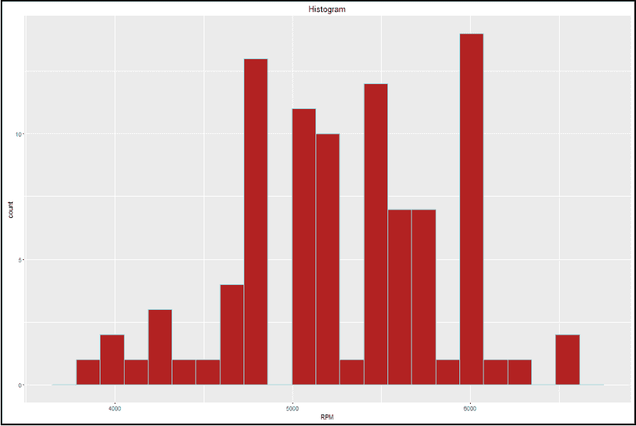

## 折线图

折线图在展示原始数据时不是首选图表。然而，在展示与某个指标相关的不同类别之间的一些变化时，它非常重要。虽然不是首选图表，但如何展示并向读者讲述一个故事，取决于从业者本人：

```r
> #creating line charts
> linechart <- ggplot(Cars93, aes(RPM, Price)) +
+ geom_line(color="cadetblue4") +
+ ggtitle("Line Charts")
> 
> linechart
```

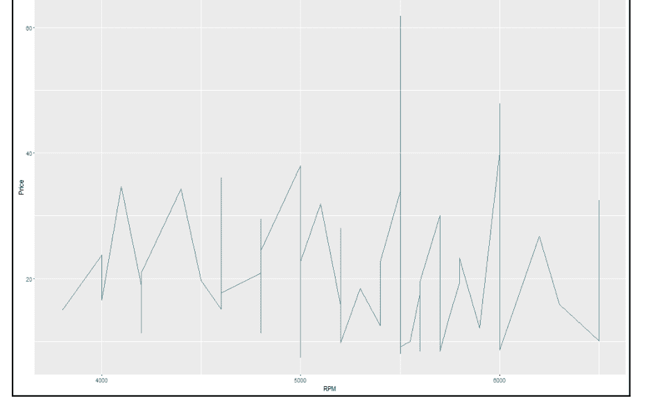

## 饼图

当每个分类变量的标签少于 10 个时，饼图是分类变量的一种表示方式。如果超过 10 个，则建议使用直方图或条形图进行比较。使用 ggplot 库可以创建饼图。脚本如下：

```r
> #creating pie charts
> pp <- ggplot(Cars93, aes(x = factor(1), fill = factor(Type))) +
+ geom_bar(width = 1)
> pp + coord_polar(theta = "y")
```

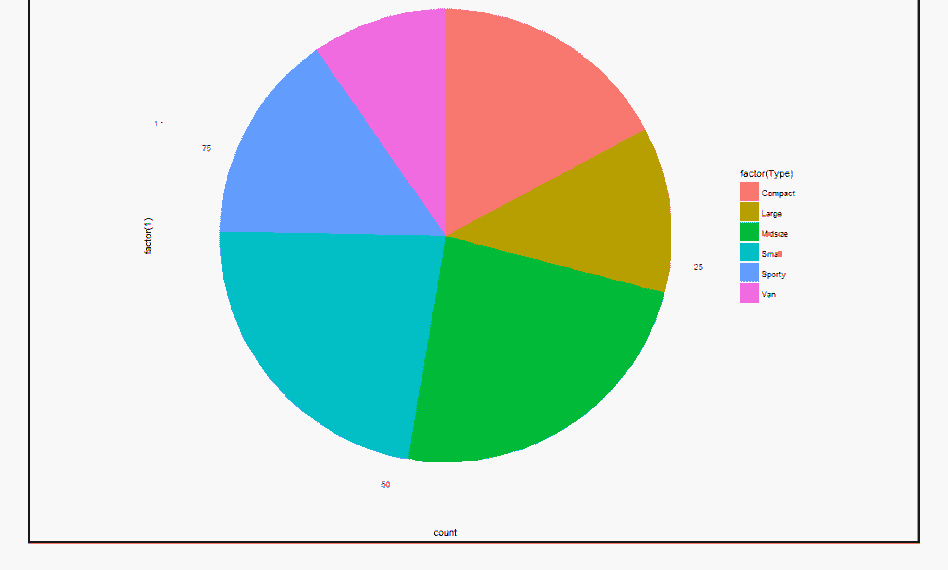

```r
> # 3D Pie Chart from data frame
> library(plotrix)
> t <- table(Cars93$Type);par(mfrow=c(1,2))
> pct <- paste(names(t), "\n", t, sep="")
> pie(t, labels = pct, main="Pie Chart of Type of cars")
> pie3D(t,labels=pct,main="Pie Chart of Type of cars")
```


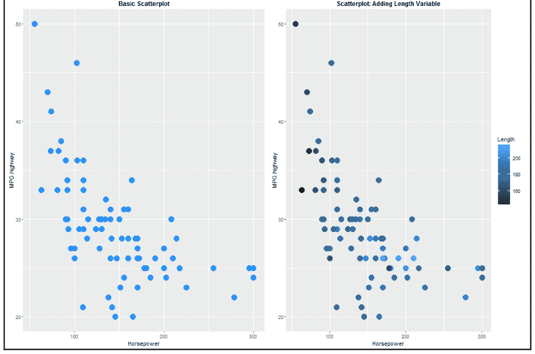

在前面图表的第二个图中，连续的长度变量决定了马力与每加仑高速公路行驶里程之间的关系。浅蓝色的点表示车身较长的汽车，而颜色较深的点表示车身较小的汽车。如果不使用连续变量，而是使用因子变量来缩放两个变量之间的关系，我们将能够看到如下图所示的第一个图：

```
> #adding a factor variable Origin to scale the scatterplot points
> sp3<-sp+geom_point(aes(color=factor(Origin)),size=5)+
+ ggtitle("Scatterplot: Adding Origin Variable")+
+ theme(plot.title= element_text(size = 12, face = "bold"))
> sp3
> #adding custom color to the scatterplot
> sp4<-sp+geom_point(aes(color=factor(Origin)),size=5)+
+ scale_color_manual(values = c("red","blue"))+
+ ggtitle("Scatterplot: Adding Custom Color")+
+ theme(plot.title= element_text(size = 12, face = "bold"))
> sp4
> grid.arrange(sp3,sp4,nrow=1)
```

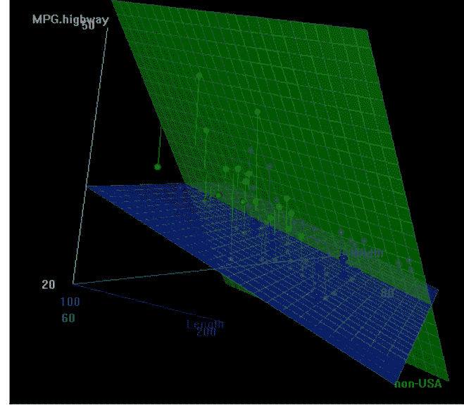

## 堆叠条形图

堆叠条形图只是条形图的另一种变体，可以通过不同的颜色组合绘制两个以上的变量。以下示例代码展示了堆叠条形图的一些变体：

```
> qplot(factor(Type), data=Cars93, geom="bar", fill=factor(Origin))
> 
> #or
> 
> ggplot(Cars93, aes(Type, fill=Origin)) + geom_bar()
```

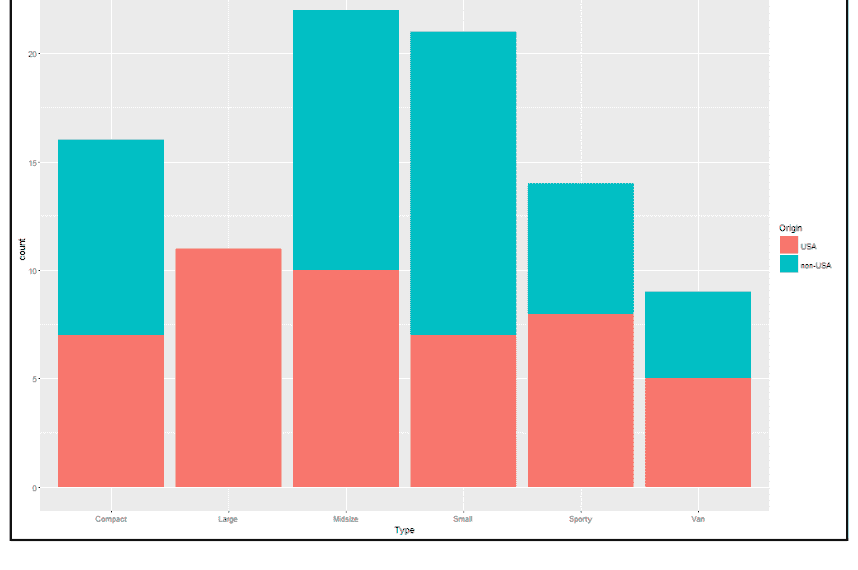

## 茎叶图

茎叶图是定量变量的一种文本表示形式，它会根据数值中最重要的数字位对数据进行分段。例如，Cars93.csv 数据集中的城市道路行驶里程变量的茎叶图表示如下：

```
> stem(Cars93$MPG.city)
The decimal point is 1 digit(s) to the right of the |
1 | 55666777777778888888888889999999999
2 | 0000000011111122222223333333344444
2 | 5555556688999999
3 | 01123
3 | 9
4 | 2
4 | 6
```

要解释茎叶图的结果：如果我们需要知道有多少个观测值大于 30，答案是 8。竖线左侧的数字表示十位，右侧的数字表示个位，因此相应的数值为 30、31、31、32、33、39、42 和 46。

## 词云

词云是一种数据可视化方法，适用于表示文本数据。例如，一组文本文件中某些词语频繁出现在多个文档中，词云可以概括这组文档所讨论的主题。因此，词云是对文本非结构化数据的一种可视化总结。词云主要用于表示社交媒体帖子，例如 Twitter 推文、Facebook 帖子等。在创建词云之前，需要执行各种预处理任务；文本挖掘处理的最终输出将是一个包含词语及其对应频率的数据框：

```
```r
#Word cloud representation
library(wordcloud)
words<-c("data","data mining","analytics","statistics","graphs",
"visualization","predictive analytics","modeling","data science",
"R","Python","Shiny","ggplot2","data analytics")
freq<-c(123,234,213,423,142,145,156,176,214,218,213,234,256,324)
d<-data.frame(words,freq)
set.seed(1234)
wordcloud(words = d$words, freq = d$freq, min.freq = 1,c(8,.3),
max.words=200, random.order=F, rot.per=0.35,
colors=brewer.pal(7, "Dark2"))
```
```

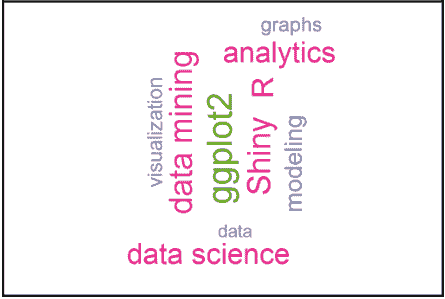

## 气泡图

气泡图是一种很好的可视化方法，其中气泡的大小表示数据集中每个变量的权重。下面来看一下示例图：

```
> #Bubble plot using plotly
> plot_ly(Cars93, x = Length, y = Width, text = paste("Type: ", Type),
+ mode = "markers", color = Length, size = Length)
```

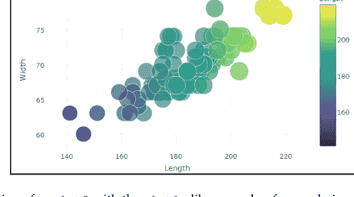

将 ggplot2 与 plotly 库结合起来可以实现良好的可视化效果，因为两个库的功能都嵌入在 ggplotly 库中：

```
> #GGPLOTLY: ggplot plus plotly
> p <- ggplot(data = Cars93, aes(x = Horsepower, y = Price)) +
+ geom_point(aes(text = paste("Type:", Type)), size = 2,
color="darkorchid4") +
+ geom_smooth(aes(colour = Origin, fill = Origin)) + facet_wrap(~ Origin)
> 
> (gg <- ggplotly(p))
```

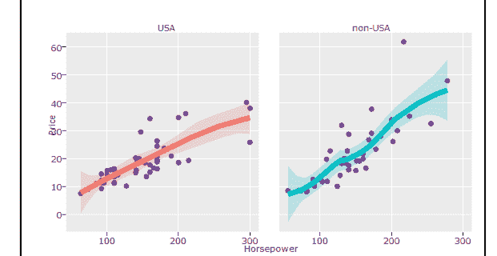

## 使用 plotly 绘制条形图

使用 plotly 绘制的条形图看起来比 R 中作为基础功能提供的普通条形图更加智能。下面来看一下示例图：

```
> p <- plot_ly(
+ x = Type,
+ y = Price,
+ name = "Price by Type",
+ type = "bar")
> p
```

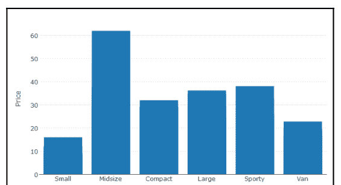

## 使用 plotly 绘制散点图

两个连续变量之间的关系可以使用散点图表示。下面来看一下数据表示：

```
> # Simple scatterplot
> library(plotly)
> plot_ly(data = Cars93, x = Horsepower, y = MPG.highway, mode = "markers")
> #Scatter Plot with Qualitative Colorscale
> plot_ly(data = Cars93, x = Horsepower, y = MPG.city, mode = "markers",
+ color = Type)
```

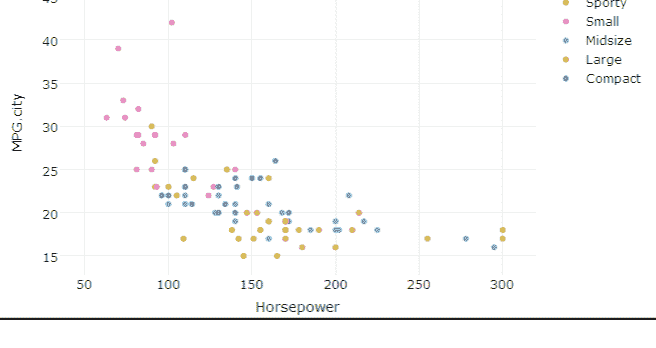

## 使用 plotly 绘制箱线图

以下是使用 plotly 库创建一些有趣箱线图的示例：

```
> #Box Plots
> library(plotly)
> ### basic boxplot
> plot_ly(y = MPG.highway, type = "box") %>%
+ add_trace(y = MPG.highway)
```

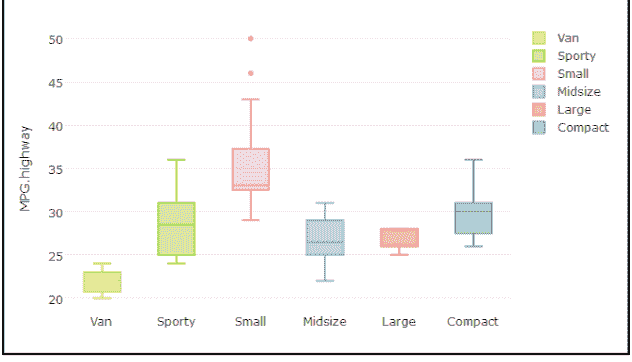

```
> ### grouped box plots
> plot_ly(Cars93, x = Type, y = MPG.city, color = AirBags, type = "box")
%>%
+ layout(boxmode = "group")
```

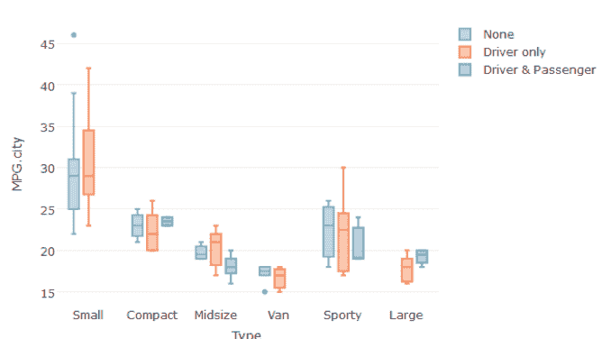

## 使用 plotly 绘制极坐标图

使用 plotly 进行极坐标图可视化更加有趣。这是因为将光标悬停在图表上时，数据值会显示出来，从而可以识别模式之间的差异。下面来看一下示例代码：

```
> #Polar Charts in R
> library(plotly)
pc <- plot_ly(Cars93, r = Price, t = RPM, color = AirBags,
mode = "lines",colors='Set1')
layout(pc, title = "Cars Price by RPM", orientation = -90,
font='bold')
```

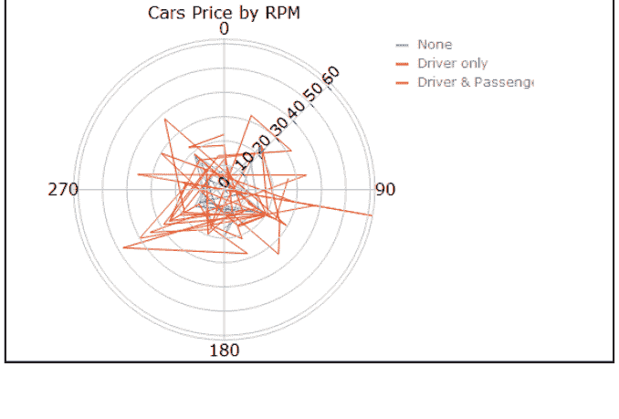

## 使用 plotly 绘制极坐标散点图

使用 plotly 库，用户还可以创建一种额外的图表类型，称为极坐标散点图。与二维散点图不同，其中的点以圆形方式绘制：

## 总结

本章介绍了各种类型的图表。我们简要讨论了创建这些图表的语法，也简要讨论了每种图表适用的场景。创建可视化展示来向受众解释洞察和信息是一项技能，需要投入时间，并通过实践逐渐完善。本章只介绍了数据挖掘领域中最重要的数据可视化方法。然而，可供选择的图形和图表非常丰富，可以用于创建富有创新性的演示文稿。因此，本章的核心收获是：读者现在了解了数据可视化规则，以及数据挖掘中用于展示各种变量之间关系的图表和图形类型，并且理解了各种变量的分布。同时，读者还通过对两个重要的数据可视化库 `ggplot2` 和 `plotly` 进行同步实践，获得了实际操作经验。在下一章中，我们将学习各种回归技术的应用、回归结果的解释，以及回归结果的可视化，从而理解各种变量之间的关系。


