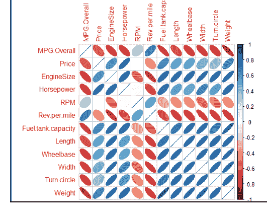
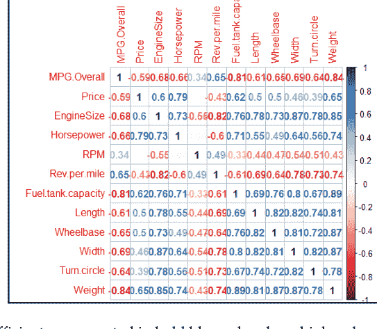
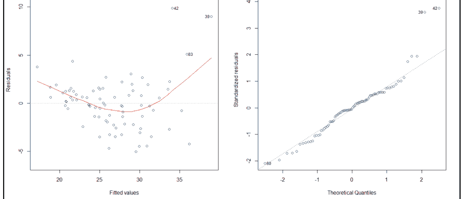
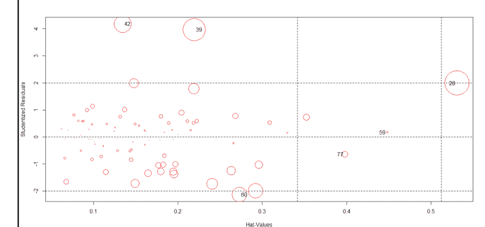
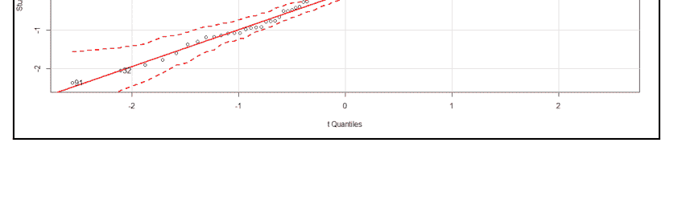
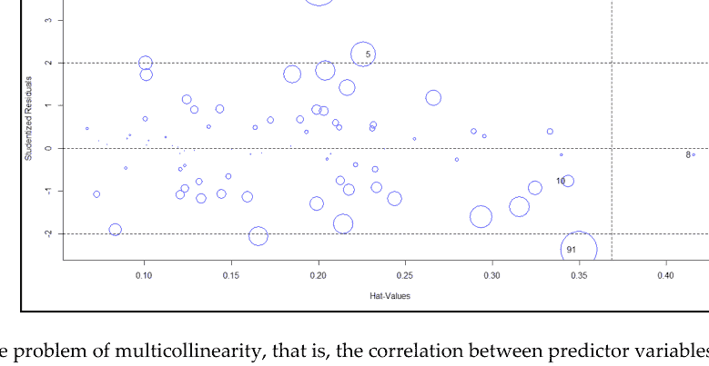
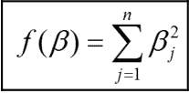
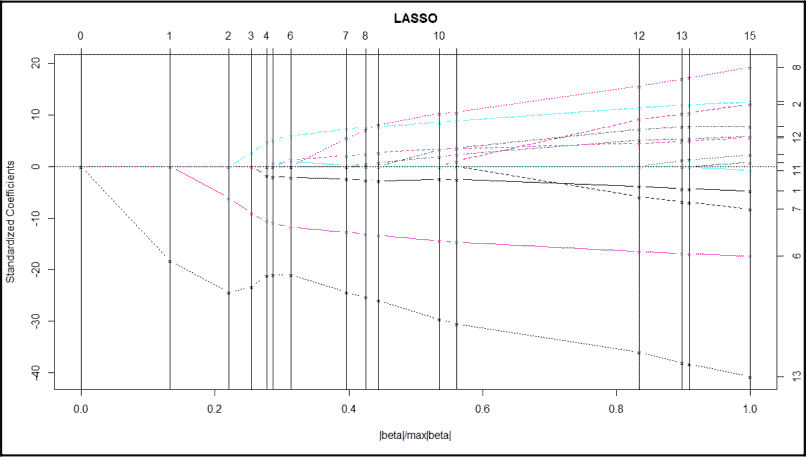

# 4 使用汽车数据进行回归

# 使用汽车数据进行回归

数据挖掘项目的主要目标之一是理解各变量之间的关系，并在感兴趣的变量与其他解释变量之间建立因果关系。在数据挖掘项目中，执行预测分析不仅能洞察数据集中隐藏的信息，还有助于做出可能影响业务成果的未来决策。在本章中，读者将了解使用回归方法进行预测分析的基础知识，包括使用 R 编程的各种线性和非线性回归方法。读者将能够理解理论背景，并通过 R 编程语言获得所有回归方法的实际操作经验。

在本章中，我们将涵盖以下主题：

- 回归问题的构建
- 线性回归
- 逻辑回归
- 三次回归
- 逐步回归
- 惩罚回归

## 回归简介

回归方法有助于预测目标变量的未来结果。以下是一些业务案例：

- 在销售和市场营销领域，企业如何实现销售额的显著提升？如果我们对销售驱动因素进行必要的调整，能否成功预测？
- 在零售领域，我们能否预测网站访问者数量，以便调配必要的技术支持来更好地运营网站？
- 零售/电子商务所有者如何预测其门店在月/周/年内的客流量？
- 在银行领域，银行如何预测申请住房贷款、汽车贷款和个人贷款的人数，以维持足够的流动资金来满足需求？
- 在银行领域，可以使用回归方法估计违约概率，以便银行决定是否批准客户的贷款/信用卡申请。
- 在汽车制造领域，汽车的销量与汽车价格成反比，而汽车价格由许多因素决定，例如不同金属/零部件的使用情况，以及转速、里程、长度、宽度等各种车辆特征。制造商如何预测销量？

执行回归的方法有多种，包括线性和非线性。基于回归的预测分析正以不同方式应用于不同行业。回归方法支持预测连续变量、预测变量成功或失败的概率、基于特征预测事件等。

## 回归问题的构建

回归问题的构建对于创建良好的基于回归的预测模型非常重要。构建良好预测模型的典型方法遵循以下过程：将业务问题转化为统计问题，再将统计问题转化为统计解决方案，最后将统计解决方案转化为业务解决方案。使用基于回归的方法构建良好的预测模型需要以下步骤：

```
Y = f(X) + ε.....( 1 )
Y = f(X₁, X₂....... Xₙ) + ε.....( 2 )
```

公式1展示了简单线性回归方程的构建，公式2展示了可包含多个自变量的多元线性方程。因变量必须是连续变量，自变量可以是连续变量或分类变量。我们将以 `Cars93_1.csv` 数据集为例解释多元线性回归分析，其中因变量是汽车价格，所有其他变量是解释变量。回归分析包括：

- 给定自变量的值，预测因变量的未来值
- 评估模型拟合统计量并比较不同模型
- 解释系数以理解因变量变化的杠杆
- 自变量的相对重要性

回归模型的主要目标是估计 beta 参数并最小化误差项 epsilon：

```
Y = β₀ + β₁X₁ + β₂X₂ + β₃X₃.....βₙXₙ ) + ε.....(3)
```

让我们使用相关性图来查看各变量之间的关系：

```
#Scatterplot showing all the variables in the dataset
library(car);attach(Cars93_1)
> #12-"Rear.seat.room",13-"Luggage.room" has NA values need to remove them
> m<-cor(Cars93_1[,-c(12,13)])
> corrplot(m, method = "ellipse")
```



上图显示了各变量之间的关系。从每个椭圆中我们可以了解该关系：是正相关还是负相关，是强相关、中等相关还是弱相关？相关性图有助于决定保留哪些变量以进一步研究，以及从后续分析中移除哪些变量。深棕色椭圆表示完全负相关，深蓝色椭圆表示完全正相关。椭圆越窄，相关程度越高。

考虑到数据集中的变量数量，阅读散点图相当困难。因此，所有变量之间的相关性可以使用相关性图来表示，如下所示：



以粗体蓝色表示的相关性系数显示较高程度的正相关，而以红色显示的则显示较高程度的负相关。

线性回归的假设如下：

- **正态性**：估计模型中的误差项应服从正态分布
- **线性**：待估计的参数应是线性的
- **独立性**：误差项应是独立的，因此不存在自相关
- **等方差**：误差项应是同方差的
- **多重共线性**：自变量之间的相关性应为零或最小

在拟合多元线性回归模型时，注意上述假设非常重要。让我们查看多元线性回归分析的汇总统计量并解释这些假设：

```
> #multiple linear regression model
> fit<-lm(MPG.Overall~.,data=Cars93_1)
> #model summary
> summary(fit)
Call:
lm(formula = MPG.Overall ~ ., data = Cars93_1)
```

模型的估计 beta 系数：

```
> #estimated coefficients
> fit$coefficients
(Intercept) Price EngineSize Horsepower
2.808772930 -0.053419142 1.334180881 0.005005690
RPM Rev.per.mile Fuel.tank.capacity Length
0.001107897 0.002806093 -0.639270186 -0.059861997
Wheelbase Width Turn.circle Rear.seat.room
0.330572119 0.233123382 0.026694571 -0.031404262
Luggage.room Weight
0.206757968 -0.008001444
#residual values
fit$residuals
#fitted values from the model
fit$fitted.values
#what happened to NA
fit$na.action
> #ANOVA table from the model
> summary.aov(fit)
Df Sum Sq Mean Sq F value Pr(>F)
Price 1 885.7 885.7 110.224 7.20e-16 ***
EngineSize 1 369.3 369.3 45.959 3.54e-09 ***
Horsepower 1 37.4 37.4 4.656 0.03449 *
RPM 1 38.8 38.8 4.827 0.03143 *
Rev.per.mile 1 71.3 71.3 8.877 0.00400 **
Fuel.tank.capacity 1 147.0 147.0 18.295 6.05e-05 ***
Length 1 1.6 1.6 0.203 0.65392
Wheelbase 1 35.0 35.0 4.354 0.04066 *
Width 1 9.1 9.1 1.139 0.28969
Turn.circle 1 0.5 0.5 0.060 0.80774
Rear.seat.room 1 0.6 0.6 0.071 0.79032
Luggage.room 1 9.1 9.1 1.129 0.29170
Weight 1 63.4 63.4 7.890 0.00648 **
Residuals 68 546.4 8.0
---
Signif. codes: 0 '***' 0.001 '**' 0.01 '*' 0.05 '.' 0.1 ' ' 1
11 observations deleted due to missingness
```

从上述方差分析（ANOVA）表中可以观察到，变量 Length、Width、turn circle、rear seat room 和 luggage room 在 5% 的显著性水平下不具有统计显著性。ANOVA 显示了因变量来自任何自变量的变异来源。在回归模型之后应用 ANOVA 非常重要，以了解哪个自变量对因变量有显著贡献：


```r
> #visualizing the model statistics
> par(mfrow=c(1,2))
> plot(fit, col="dodgerblue4")
```



残差与拟合值图显示了残差值在沿着拟合线移动时的随机性。如果残差值相对于拟合值显示出任何模式，则误差项可能不是正态的。残差与拟合图表明残差项之间不存在模式；残差近似正态分布。残差基本上是模型中无法被模型解释的那部分。有几个有影响的数据点，例如第 42 个、第 39 个和第 83 个，如前面的图中所示。正态分位数-分位数图表明，除了几个有影响的数据点外，所有其他标准化残差点都遵循正态分布。直线是零残差线，红色线是残差与拟合关系的模式。尺度与位置图和残差与杠杆图也验证了相同的观察结果，即残差项没有趋势。尺度与位置图取标准化残差的平方根并将其与拟合值作图。

通常，这些是数据中远离其他点的数据点，无论是因变量还是一个或多个自变量：

```r
> # A user friendly representation of the above
> influencePlot(fit, id.n=3, col="red")
```

|   | StudRes | Hat | CookD |
|---|---:|---:|---:|
| 28 | 1.9902054 | 0.5308467 | 0.55386748 |
| 39 | 3.9711522 | 0.2193583 | 0.50994280 |
| 42 | 4.1792327 | 0.1344866 | 0.39504695 |
| 59 | 0.1676009 | 0.4481441 | 0.04065691 |
| 60 | -2.1358078 | 0.2730012 | 0.34097909 |
| 77 | -0.6448891 | 0.3980043 | 0.14074778 |



如果我们从模型中删除这些有影响的数据点，我们可以看到模型拟合优度有所改善，模型整体误差可以降低。一次删除所有有影响的点并不是一个好主意；因此我们将采用逐步的方法删除这些有影响的数据点，并监控模型统计数据的改善情况：

```r
> ## Regression after deleting the 28th observation
> fit.1<-lm(MPG.Overall~., data=Cars93_1[-28,])
> summary(fit.1)
Call:
lm(formula = MPG.Overall ~ ., data = Cars93_1[-28, ])
Residuals:
    Min      1Q  Median      3Q     Max 
-5.0996 -1.7005  0.4617  1.4478  9.4168 
```

Coefficients:

| Variable | Estimate | Std. Error | t value | Pr(>|t|) |
|---|---:|---:|---:|---:|
| ... | ... | ... | ... | ... |
| Turn.circle | 0.0347603 | 0.1513314 | 0.230 | 0.81908 |
| Rear.seat.room | -0.2869723 | 0.1466918 | -1.956 | 0.05494 . |
| Luggage.room | 0.1828483 | 0.1427936 | 1.281 | 0.20514 |
| Weight | -0.0044714 | 0.0021914 | -2.040 | 0.04557 * |

---
Signif. codes: 0 '***' 0.001 '**' 0.01 '*' 0.05 '.' 0.1 ' ' 1

Residual standard error: 2.073 on 62 degrees of freedom
(11 observations deleted due to missingness)
Multiple R-squared: 0.8065, Adjusted R-squared: 0.7659
F-statistic: 19.88 on 13 and 62 DF, p-value: < 2.2e-16

查看前面的输出，我们可以得出结论，删除异常值或有影响的数据点会增加 R 平方值的稳健性。现在我们可以得出结论，80.65% 的因变量变化正是由模型中的所有自变量解释的。

现在，使用学生化残差对 t 分位数进行 Q-Q 图，我们可以识别出更多可能的异常数据点，以提高模型准确性：

```r
> # QQ plots of studentized residuals, helps identify outliers
> qqPlot(fit.2, id.n=5)
91 32 55 5 83
1 2 74 75 76
```



从前面的 Q-Q 图来看，似乎数据总体上呈正态分布，除了少数异常值，例如第 83 个、第 91 个、第 32 个、第 55 个和第 5 个数据点：

```r
> ## Diagnostic Plots ###
> influenceIndexPlot(fit.2, id.n=3)
> influencePlot(fit.2, id.n=3, col="blue")
```

|   | StudRes | Hat | CookD |
|---|---:|---:|---:|
| 5 | 2.1986298 | 0.2258133 | 0.30797166 |
| 8 | -0.1448259 | 0.4156467 | 0.03290507 |
| 10 | -0.7655338 | 0.3434515 | 0.14847534 |
| 83 | 3.7650470 | 0.2005160 | 0.45764995 |
| 91 | -2.3672942 | 0.3497672 | 0.44770173 |



多重共线性问题，即预测变量之间的相关性，需要对最终回归模型进行验证。方差膨胀因子 VIF 是通常用来估计多重共线性的度量。计算 VIF 的公式为 1/ (1-R²)。任何自变量的 VIF 值大于 10 表明存在多重共线性；因此此类变量需要从模型中删除。一次删除一个变量然后再次检查模型的 VIF 是做到这一点的最好方法：

```r
> ### Variance Inflation Factors
> vif(fit.2)
```

| Variable | VIF |
|---|---:|
| Price | 4.799678 |
| EngineSize | 20.450596 |
| Horsepower | 18.872498 |
| RPM | 5.788160 |
| Rev.per.mile | 3.736889 |
| Fuel.tank.capacity | 5.805824 |
| Length | 15.200301 |
| Wheelbase | 11.850645 |
| Width | 10.2432223 |
| Turn.circle | 4.006895 |
| Rear.seat.room | 2.566413 |
| Luggage.room | 2.935853 |
| Weight | 24.977015 |

变量 weight 的 VIF 最大，因此删除该变量是有意义的。删除变量后，让我们重新运行模型并计算 VIF：

```r
## Regression after deleting the weight variable
fit.3<-lm(MPG.Overall~ Price+EngineSize+Horsepower+RPM+Rev.per.mile+
Fuel.tank.capacity+Length+Wheelbase+Width+Turn.circle+
Rear.seat.room+Luggage.room, data=Cars93_1[-c(28,42,39,59,60,77),])
summary(fit.3)
> vif(fit.3)
```

| Variable | VIF |
|---|---:|
| Price | 4.575792 |
| EngineSize | 20.337181 |
| Horsepower | 15.962349 |
| RPM | 5.372388 |
| Rev.per.mile | 3.514992 |
| Fuel.tank.capacity | 4.863944 |
| Length | 14.574352 |
| Wheelbase | 11.013850 |
| Width | 10.240036 |
| Turn.circle | 3.965132 |
| Rear.seat.room | 2.561947 |
| Luggage.room | 2.935690 |

```r
## Regression after deleting the EngineSize variable
fit.4<-lm(MPG.Overall~ Price+Horsepower+RPM+Rev.per.mile+
Fuel.tank.capacity+Length+Wheelbase+Width+Turn.circle+
Rear.seat.room+Luggage.room, data=Cars93_1[-c(28,42,39,59,60,77),])
summary(fit.4)
vif(fit.4)

## Regression after deleting the Length variable
fit.5<-lm(MPG.Overall~ Price+Horsepower+RPM+Rev.per.mile+
Fuel.tank.capacity+Wheelbase+Width+Turn.circle+
Rear.seat.room+Luggage.room, data=Cars93_1[-c(28,42,39,59,60,77),])
summary(fit.5)
> vif(fit.5)
```

| Variable | VIF |
|---|---:|
| Price | 4.419799 |
| Horsepower | 8.099750 |
| RPM | 2.595250 |
| Rev.per.mile | 3.232048 |
| Fuel.tank.capacity | 4.679088 |
| Wheelbase | 8.231261 |
| Width | 7.953452 |
| Turn.circle | 3.357780 |
| Rear.seat.room | 2.393630 |
| Luggage.room | 2.894959 |

最终回归模型的系数：

```r
> coefficients(fit.5)
```

| Coefficient | Estimate |
|---|---:|
| (Intercept) | 29.029107454 |
| Price | -0.089498236 |
| Horsepower | -0.014248077 |
| RPM | 0.001071072 |
| Rev.per.mile | 0.001591582 |
| Fuel.tank.capacity | -0.769447316 |
| Wheelbase | 0.130876817 |
| Width | -0.047053999 |
| Turn.circle | -0.072030390 |
| Rear.seat.room | -0.240332275 |
| Luggage.room | 0.216155256 |

现在我们可以得出结论，前述回归模型中不存在多重共线性。我们可以写出最终的多元线性回归方程如下：

$$
\mathrm{MPG.Overall}=29.03-0.09\times\mathrm{Price}-0.014\times\mathrm{Horsepower}+0.001\times\mathrm{RPM}+0.001\times\mathrm{Rev.per.mile}-0.769\times\mathrm{Fuel.tank.capacity}+0.131\times\mathrm{Wheelbase}-0.047\times\mathrm{Width}
$$

估计的模型参数可以解释为，价格变量每变化一个单位，MPG 综合预测变化 0.09 个单位。同样，其他所有自变量的估计模型系数也可以进行解释。如果我们知道这些自变量的值，我们就可以使用前面的方程预测因变量 MPG 综合的可能值。

## Stepwise regression method for variable selection

在逐步回归方法中，使用 OLS 估计方法形成一个基础回归模型。此后，根据 **Akaike Information Criteria (AIC)** 值将变量添加到或从基础模型中减去。标准规则是最小的 AIC 可保证与其他方法相比的最佳拟合。取 `Cars93_1.csv` 文件，让我们使用逐步方法创建一个多元线性回归模型。有三种不同的方法来测试最佳模型使用 step 公式：

- Forward method
- Backward method
- Both

在向前选择方法中，最初创建一个空模型并添加一个变量以查看 AIC 值是否有任何改善。独立变量被添加到空模型中，直到 AIC 值有所改善。在向后选择方法中，完整模型被认为是基础模型。从模型中扣除一个独立变量并检查 AIC 值。如果 AIC 有所改善，该变量将被删除；该过程将继续进行，直到 AIC 值最小。在两者方法中，交替使用向前和向后选择来识别最相关的模型。让我们先看一下第一次迭代的模型结果：

```r
> #base model
> fit<-lm(MPG.Overall~.,data=Cars93_1)
> #stepwise regression
> model<-step(fit,method="both")
```


开始：AIC=183.52  
MPG.Overall ~ Price + EngineSize + Horsepower + RPM + Rev.per.mile + Fuel.tank.capacity + Length + Wheelbase + Width + Turn.circle + Rear.seat.room + Luggage.room + Weight

| 变量 | 自由度 | 平方和 | RSS | AIC |
| --- | --- | --- | --- | --- |
| - Turn.circle | 1 | 0.147 | 546.54 | 181.54 |
| - Rear.seat.room | 1 | 0.239 | 546.64 | 181.56 |
| - Horsepower | 1 | 0.323 | 546.72 | 181.57 |
| - Price | 1 | 6.055 | 552.45 | 182.43 |
| - Width | 1 | 6.185 | 552.58 | 182.45 |
| - RPM | 1 | 6.686 | 553.08 | 182.52 |
| - Length | 1 | 6.695 | 553.09 | 182.52 |
| - EngineSize | 1 | 8.186 | 554.58 | 182.74 |
| - Luggage.room | 1 | 9.673 | 556.07 | 182.96 |
| <none> |  |  | 546.40 | 183.52 |
| - Wheelbase | 1 | 35.799 | 582.20 | 186.73 |
| - Rev.per.mile | 1 | 40.565 | 586.96 | 187.40 |
| - Fuel.tank.capacity | 1 | 47.646 | 594.04 | 188.38 |
| - Weight | 1 | 63.400 | 609.80 | 190.53 |

开始时，AIC 为 183.52。在最终模型中，AIC 为 175.51，并且包含六个自变量，如下所示：

步骤：AIC=175.51  
MPG.Overall ~ EngineSize + RPM + Rev.per.mile + Fuel.tank.capacity + Wheelbase + Width + Luggage.room + Weight

| 变量 | 自由度 | 平方和 | RSS | AIC |
| --- | --- | --- | --- | --- |
| - Luggage.room | 1 | 8.976 | 568.78 | 174.82 |
| - Width | 1 | 12.654 | 572.46 | 175.34 |
| <none> |  |  | 559.81 | 175.51 |
| - EngineSize | 1 | 14.022 | 573.83 | 175.54 |
| - RPM | 1 | 19.422 | 579.23 | 176.31 |
| - Wheelbase | 1 | 28.477 | 588.28 | 177.58 |
| - Rev.per.mile | 1 | 37.873 | 597.68 | 178.88 |
| - Fuel.tank.capacity | 1 | 52.516 | 612.32 | 180.86 |
| - Weight | 1 | 135.462 | 695.27 | 191.28 |

在上表中，“none”项表示最终模型所在的阶段，此时无法进一步调整模型或减少变量。因此，在该节点之后继续删除变量是没有意义的。

## 逻辑回归

基于普通最小二乘法的线性回归模型假设因变量与自变量之间存在线性关系；而逻辑回归模型则假设二者之间存在对数关系。在现实生活中，有许多感兴趣的变量本质上是分类变量，例如是否购买某种产品、是否批准信用卡、肿瘤是否为癌性肿瘤等。逻辑回归不仅可以预测因变量所属的类别，还可以预测某个案例属于因变量某一水平的概率。自变量不必服从正态分布，也不必具有相等的方差。逻辑回归属于广义线性回归模型的一类。如果因变量有两个水平，则可以应用逻辑回归；但如果因变量有两个以上的水平，例如高、中、低，则可以应用多项逻辑回归模型。所有自变量都可以是连续变量、分类变量或名义变量。

逻辑回归模型可以使用以下公式进行解释：

ln [ P(Y) / (1 - P(Y)) ] = β₀ + β₁X₁ + β₂X₂ + β₃X₃ + ... + βₙXₙ + ε ......(6)

Ln(P(Y)/(1-P(Y))) 表示结果的对数优势比。上式中的 beta 系数说明：解释变量每增加或减少一个单位，结果变量的对数优势比会增加还是减少，以及变化幅度。

我们以 `Artpiece.csv` 数据集为例，根据自变量预测因变量“是否为一次好的购买”。

对于逻辑回归模型，因变量必须是具有两个水平的二元变量。如果不是二元变量，首先需要将因变量转换为二元变量。对于自变量，检查变量类型及其水平同样十分重要。如果某些自变量是分类变量，则需要进行二元转换（为每个类别创建哑变量）。因此，下面对数据进行转换，使其符合逻辑回归模型的要求：

```
> #data conversion
> Artpiece$IsGood.Purchase<-as.factor(Artpiece$IsGood.Purchase)
> Artpiece$Is.It.Online.Sale<-as.factor(Artpiece$Is.It.Online.Sale)
> #removing NA, Missing values from the data
> Artpiece<-na.omit(Artpiece)
> ## 75% of the sample size
> smp_size <- floor(0.75 * nrow(Artpiece))
```

右侧表达式，即模型系数：

```
> # 95% CI for exponentiated coefficients
> exp(confint(model1))
```

正在等待剖面分析完成……

|  | 2.5 % | 97.5 % |
| --- | --- | --- |
| (Intercept) | 0.02301865 | 5.5660594 |
| Critic.Ratings | 1.12226719 | 1.1725835 |
| Acq.Cost | 0.99998833 | 0.9999957 |
| CurrentAuctionAveragePrice | 0.99998274 | 0.9999881 |
| Brush.Size1 | 0.02326462 | 5.5558138 |
| Brush.Size2 | 0.01714345 | 4.0948557 |
| Brush.Size3 | 0.02953703 | 7.1850301 |
| Brush.SizeNULL | 0.45631813 | 109.1655370 |
| CollectorsAverageprice | 0.99996666 | 0.9999850 |
| Is.It.Online.Sale1 | 0.69545357 | 1.0142229 |
| Min.Guarantee.Cost | 1.00000327 | 1.0000163 |

```
> confint(model1)
```

|  | 2.5 % | 97.5 % |
| --- | --- | --- |
| (Intercept) | -3.771450e+00 | 1.716687e+00 |
| Critic.Ratings | 1.153509e-01 | 1.592094e-01 |
| Acq.Cost | -1.166650e-05 | -4.348562e-06 |
| CurrentAuctionAveragePrice | -1.726348e-05 | -1.193180e-05 |
| Brush.Size1 | -3.760822e+00 | 1.714845e+00 |
| Brush.Size2 | -4.066139e+00 | 1.409731e+00 |
| Brush.Size3 | -3.522110e+00 | 1.972000e+00 |
| Brush.SizeNULL | -7.845651e-01 | 4.692865e+00 |
| CollectorsAverageprice | -3.333576e-05 | -1.500118e-05 |
| Is.It.Online.Sale1 | -3.631910e-01 | 1.412267e-02 |
| Min.Guarantee.Cost | 3.268054e-06 | 1.631710e-05 |

可以使用卡方检验统计量对逻辑回归模型的结果执行 ANOVA。根据这里展示逻辑回归偏差分析的 ANOVA，我们可以得出结论：当向模型中加入更多自变量时，模型偏差的变化具有统计显著性。自变量按顺序逐个加入模型，并在每次迭代中将误差项的偏差与上一次迭代进行比较，以判断增加或删除某个变量是否有助于降低模型误差：

```
> #ANOVA
> anova(model1,test="Chisq")
```

偏差分析表  
模型：二项分布，链接函数：logit  
响应变量：IsGood.Purchase  
按顺序添加项（从第一个到最后一个）

| 自由度 | 偏差 | 残差自由度 | 残差偏差 | Pr(>Chi) |
| --- | --- | --- | --- | --- |
| NULL |  | 54500 | 40601 |  |

- **后向选择法**：所有自变量都属于初始模型的一部分。使用 Wald 卡方显著性检验，删除卡方值最低或 p 值最高且超过 0.05 的变量（假设模型使用 95% 置信区间）。当无法再找到符合 Wald 检验标准的变量时，后向选择过程停止。
- **前向选择法**：模型从空模型开始。根据最低 p 值或最高卡方检验统计量值，将变量加入模型。当找不到符合条件的变量时，选择过程停止。
- **两者结合**：第三种方法是同时应用后向选择和前向选择：

```
> #auto detection of model
> fit_step<-stepAIC(model1,method="both")
```

开始：AIC=34893.93  
IsGood.Purchase ~ Critic.Ratings + Acq.Cost + CurrentAuctionAveragePrice +
Brush.Size + CollectorsAverageprice + Is.It.Online.Sale +
Min.Guarantee.Cost

| 变量 | 自由度 | 偏差 | AIC |
| --- | --- | --- | --- |
| <none> |  | 34872 | 34894 |
| - Is.It.Online.Sale | 1 | 34875 | 34895 |
| - Min.Guarantee.Cost | 1 | 34880 | 34900 |
| - Acq.Cost | 1 | 34890 | 34910 |
| - CollectorsAverageprice | 1 | 34898 | 34918 |
| - CurrentAuctionAveragePrice | 1 | 34988 | 35008 |
| - Critic.Ratings | 1 | 35025 | 35045 |
| - Brush.Size | 4 | 39554 | 39568 |

用于变量选择的方法是前向选择与后向选择相结合。例如，在第一步中使用前向选择，同时也应用后向选择，以检查所述变量是否可以从模型中删除。

应用逐步模型选择过程时，务必牢记逐步法的局限性。有时会发生模型过拟合；有时当预测变量数量较多且大多数预测变量高度相关时，逐步回归会产生更高的变异性和较低的准确性。为解决这一问题，可以应用惩罚回归方法，下一节将对此进行讨论：

```
> summary(fit_step)
Call:
glm(formula = IsGood.Purchase ~ Critic.Ratings + Acq.Cost +
CurrentAuctionAveragePrice +
Brush.Size + CollectorsAverageprice + Is.It.Online.Sale +
```


Min.Guarantee.Cost, family = binomial(logit), data = train)
偏离残差：
Min 1Q Median 3Q Max
-2.1596 -0.4849 -0.4096 -0.3401 3.8760
系数：
Estimate Std. Error z value Pr(>|z|)
(Intercept) -6.734e-01 1.250e+00 -0.539 0.58995
Critic.Ratings 1.372e-01 1.119e-02 12.267 < 2e-16 ***
Acq.Cost -7.998e-06 1.867e-06 -4.284 1.83e-05 ***
CurrentAuctionAveragePrice -1.460e-05 1.360e-06 -10.731 < 2e-16 ***
Brush.Size1 -1.378e+00 1.246e+00 -1.107 0.26840
Brush.Size2 -1.684e+00 1.246e+00 -1.352 0.17647
Brush.Size3 -1.128e+00 1.252e+00 -0.902 0.36730
Brush.SizeNULL 1.599e+00 1.246e+00 1.283 0.19946
CollectorsAverageprice -2.420e-05 4.677e-06 -5.175 2.28e-07 ***
Is.It.Online.Sale1 -1.710e-01 9.621e-02 -1.777 0.07552 .
Min.Guarantee.Cost 9.830e-06 3.329e-06 2.953 0.00314 **
---
Signif. codes: 0 '***' 0.001 '**' 0.01 '*' 0.05 '.' 0.1 ' ' 1
(Dispersion parameter for binomial family taken to be 1)
Null deviance: 40601 on 54500 degrees of freedom
Residual deviance: 34872 on 54490 degrees of freedom
AIC: 34894
Number of Fisher Scoring iterations: 5

为检查自变量之间的多重共线性，使用了 VIF 衡量。针对基于逐步 AIC 的最终模型计算的 VIF 如下：

```
> library(MASS);library(plyr);library(car)
> 
> vif(fit_step)
GVIF Df GVIF^(1/(2*Df))
Critic.Ratings 1.204411 1 1.097457
Acq.Cost 2.582229 1 1.606932
CurrentAuctionAveragePrice 2.527691 1 1.589871
Brush.Size 1.094967 4 1.011405
CollectorsAverageprice 1.084788 1 1.041532
Is.It.Online.Sale 1.007080 1 1.003534
Min.Guarantee.Cost 1.163249 1 1.078540
```

使用响应选项计算训练数据集的概率分数，该概率分数可用于在 AUC 曲线上显示分类结果，也称为接收器操作特征 ROC 曲线：

```
> train$prob=predict(fit_step,type=c("response"))
> library(pROC)
> g <- roc(IsGood.Purchase ~ prob, data = train)
> g
```

分类表的阈值为 0.50（50%）概率。如果有人想改变正确分类对象的百分比，则可以通过对概率分数设置过滤器来实现。以下代码用于使用不同的概率值创建混淆矩阵。从之前的分类表可以得出结论，90% 的人被正确分类。

## Cubic regression

三次回归是回归的另一种形式，其中线性回归模型中的参数增加到一到两个级别的多项式计算。使用 Cars93_1.csv 数据集，让我们了解三次回归：

```
> fit.6<-lm(MPG.Overall~ I(Price)^3+I(Horsepower)^3+I(RPM)^3+
+ Wheelbase+Width+Turn.circle, data=Cars93_1[-c(28,42,39,59,60,77),])
> summary(fit.6)
Call:
lm(formula = MPG.Overall ~ I(Price)^3 + I(Horsepower)^3 + I(RPM)^3 +
Wheelbase + Width + Turn.circle, data = Cars93_1[-c(28, 42,
39, 59, 60, 77), ])
Residuals:
Min 1Q Median 3Q Max
-5.279 -1.901 -0.006 1.590 8.433
Coefficients:
Estimate Std. Error t value Pr(>|t|)
(Intercept) 57.078025 12.349300 4.622 1.44e-05 ***
I(Price) -0.108436 0.065659 -1.652 0.1026
I(Horsepower) -0.024621 0.015102 -1.630 0.1070
I(RPM) 0.001122 0.000727 1.543 0.1268
Wheelbase -0.201836 0.079948 -2.525 0.0136 *
Width -0.104108 0.198396 -0.525 0.6012
Turn.circle -0.095739 0.158298 -0.605 0.5470
---
Signif. codes: 0 '***' 0.001 '**' 0.01 '*' 0.05 '.' 0.1 ' ' 1
Residual standard error: 2.609 on 80 degrees of freedom
Multiple R-squared: 0.6974, Adjusted R-squared: 0.6747
F-statistic: 30.73 on 6 and 80 DF, p-value: < 2.2e-16
> vif(fit.6)
I(Price) I(Horsepower) I(RPM) Wheelbase Width Turn.circle
4.121923 7.048971 2.418494 3.701812 7.054405 3.284228
> coefficients(fit.6)
(Intercept) I(Price) I(Horsepower) I(RPM) Wheelbase Width
57.07802478 -0.10843594 -0.02462074 0.00112168 -0.20183606 -0.10410833
Turn.circle
-0.09573848
```

在其他所有参数保持不变的情况下，自变量的一个单位变化会使因变量产生乘性变化，而乘法因子是贝塔系数的立方。

## Penalized regression

当回归模型中包含大量预测变量或高度相关的预测变量或两者兼有时的最大似然估计问题出现了，其无法在回归问题中提供更高的准确性，从而导致数据挖掘中引入惩罚回归。最大似然的特性由于高变异性和不适当的解释而无法满足回归程序。为解决该问题，最相关的子集选择出现了。然而，子集选择程序有一些缺点。为再次解决该问题，可以引入一种新方法，即众所周知的惩罚最大似然估计方法。我们将讨论两种不同的惩罚回归变体：

- **Ridge regression:** 岭回归被称为 L2 二次惩罚，其方程可表示如下：



与最大似然估计相比，L1 和 L2 估计方法将贝塔系数收缩至零。为了避免多重共线性问题和预测变量数量较多或两者兼有，通常在观测值较少的情况下，收缩方法可降低过拟合的贝塔系数数值。

以 `Cars93_1.csv` 数据集为例，我们可以测试模型及其结果。lambda 参数基本上在对数似然函数的惩罚和拟合之间取得平衡。lambda 值的选择对模型至关重要；如果其为较小值，则模型可能对数据过拟合，高方差将变得明显，而如果选择的 lambda 值为很大值，则可能导致有偏结果。

```
```r
> #installing the library
> library(glmnet)
```
```

```
> #removing the missing values from the dataset
> Cars93_2<-na.omit(Cars93_1)
> #independent variables matrix
> x<-as.matrix(Cars93_2[,-1])
> #dependent variale matrix
> y<-as.matrix(Cars93_2[,1])
> #fitting the regression model
> mod<-glmnet(x,y,family = "gaussian",alpha = 0,lambda = 0.001)
> #summary of the model
> summary(mod)
Length Class Mode
a0 1 -none- numeric
beta 13 dgCMatrix S4
df 1 -none- numeric
dim 2 -none- numeric
lambda 1 -none- numeric
dev.ratio 1 -none- numeric
nulldev 1 -none- numeric
npasses 1 -none- numeric
jerr 1 -none- numeric
offset 1 -none- logical
call 6 -none- call
nobs 1 -none- numeric
#Making predictions
pred<-predict(mod,x,type = "link")
#estimating the error for the model.
mean((y-pred)^2)
> #Making predictions
> pred<-predict(mod,x,type = "link")
> #estimating the error for the model.
> mean((y-pred)^2)
[1] 6.663406
```

鉴于前述背景，回归模型能够显示出 6.66% 的误差，这意味着模型给出 93.34% 的准确率。这不是最终迭代。模型需要测试几次，并且需要使用袋外多个子样本来得出模型的最终准确性。

- **Least Absolute Shrinkage Operator (LASSO)**: LASSO 回归被称为 L1 绝对值惩罚（Tibshirani, 1997）。LASSO 回归的方程可表示如下：

```
f(β) = Σ_{j=1}^{n} |β|
```

以 Cars93_1.csv 数据集为例，我们可以测试模型及其结果。lambda 参数基本上在对数似然函数的惩罚和拟合之间取得平衡。lambda 值的选择对模型至关重要；如果其为较小值，则模型可能对数据过拟合，高方差将变得明显，而如果选择的 lambda 值为很大值，则可能导致有偏结果。让我们尝试实现模型并验证结果：

```
> #installing the library
> library(lars)
> #removing the missing values from the dataset
> Cars93_2<-na.omit(Cars93_1)
> #independent variables matrix
> x<-as.matrix(Cars93_2[,-1])
> #dependent variale matrix
> y<-as.matrix(Cars93_2[,1])
> #fitting the LASSO regression model
> model<-lars(x,y,type = "lasso")
> #summary of the model
> summary(model)
LARS/LASSO
Call: lars(x = x, y = y, type = "lasso")
Df Rss Cp
0 1 2215.17 195.6822
1 2 1138.71 63.7148
2 3 786.48 21.8784
3 4 724.26 16.1356
4 5 699.39 15.0400
5 6 692.49 16.1821
6 7 675.16 16.0246
7 8 634.59 12.9762
8 9 623.74 13.6260
9 8 617.24 10.8164
10 9 592.76 9.7695
11 10 587.43 11.1064
12 11 551.46 8.6302
13 12 548.22 10.2275
14 13 547.85 12.1805
15 14 546.40 14.0000
```


**Least Angle Regression**（LARS）中的 type 选项提供了应用 lars 模型各种变体的机会，例如 "lasso"、"lar"、"forward.stagewise" 或 "stepwise"。利用这些选项我们可以创建各种模型并比较结果。

从模型的前述输出中，我们可以看到在每次迭代中 RSS 和 CP 以及自由度，因此我们需要找到 RSS 最小的最佳模型步：

```
```r
> #select best step with a minim error
> best_model<-model$df[which.min(model$RSS)]
> best_model
14
> #Making predictions
> pred<-predict(model,x,s=best_model,type = "fit")$fit
> #estimating the error for the model.
> mean((y-pred)^2)
[1] 6.685669
```
```

最佳模型出现在第 14 步，此时 RSS 最小，因此使用该最佳步我们可以进行预测。使用 predict 函数在该步进行预测，可以生成预测值，所选模型的误差为 6.68%。拟合模型的视觉化可以如接下来所示进行显示。垂直轴显示标准化系数，水平轴显示因变量的模型系数进展。*x* 轴显示 beta 系数绝对值与 beta 系数绝对值最大值之比。分子是当前估计的 beta 系数，分母是 OLS 模型的 beta 系数。当 LASSO 中的收缩参数取值为零时，模型将对应于 OLS 回归方法。随着惩罚参数的增加，beta 系数的绝对值之和被拉向零：



在前述图中，垂直条表示变量何时被拉向零。对应于 15 的垂直条显示有 15 个预测变量需要被缩减为零，这对应于较高的惩罚参数 lambda 值 1.0。当 lambda 惩罚参数非常小时，LASSO 将接近 OLS 回归，并且随着 lambda 的增加，你的模型中变量会变少。因此，在 lambda 值 1.0 之后，模型中不再有变量。

*L1* 和 *L2* 被称为正则化回归方法。*L1* 不能将回归系数归零；要么得到所有系数，要么一个都没有。然而，*L2* 会自动进行参数收缩和变量选择。

## Summary

在本章中，我们讨论了如何创建线性回归、逻辑回归以及其他基于非线性回归的方法来预测业务场景中变量的结果。回归方法在数据挖掘项目中基本上非常重要，以便创建预测模型来了解未知自变量的未来值。我们研究了各种场景，了解了在何处可以应用何种类型的模型。在下一章中，我们将讨论关联规则或市场篮子分析，以了解隐藏在交易数据库中的重要模式。
