# 5 Market Basket Analysis with Groceries Data

# Market Basket Analysis with Groceries Data

设想一下零售商或电子商务商店经理在为客户推荐合适的产品时面临的场景。产品推荐是数据挖掘实践中的一个重要领域。产品推荐可以通过三种不同的方式实现：通过将客户行为与其购买历史关联，通过将每次访问中购买的商品关联，最后通过查看各类别的毛销售额然后利用零售商的过往经验。在本章中，我们将研究第二种产品推荐方法，广为人知的市场篮子分析（MBA），也称为关联规则，即通过关联交易层级购买的商品并找出具有相似产品的用户子细分，从而推荐产品。

在本章中，我们将涵盖以下主题：

- What is MBA
- Where to apply MBA
- Assumptions/prerequisites
- Modeling techniques
- Limitations
- Practical project

Support of X = number of transactions involving X / total number of transactions

- **Confidence**：Confidence 总是指规则的置信度。它可以定义为 x => y 的置信度。因此，support (x U y) 表示数据库中同时包含项目集 x 和项目 y 的交易数量：
  
  Confidence of X => Y = support of (X U Y) / support of (X)
- **Lift**：Lift 可以定义为观察到的支持与期望支持的比例：
  
  Lift of a rule X => Y = support of (X U Y) / support of (X) * support of (Y)

如果关联规则满足最小支持度和最小置信度标准，则该规则在交易数据库中得到支持。

让我们举一个例子来理解这些概念。

以下是一个来自 R 中 arules 库的 Groceries.csv 数据集的示例：

| Transaction ID | Items |
|---|---|
| 001 | Bread, banana, milk, butter |
| 002 | Milk, butter, banana |
| 003 | Curd, milk, banana |
| 004 | Curd, bread, butter |
| 005 | Milk, curd, butter, banana |
| 006 | Milk, curd, bread |

项目集 X 的支持度，其中 X = {milk, banana} = 牛奶和香蕉一起购买的交易比例；4/6 = 0.67，因此 X 项目集的支持度为 0.67。

假设 Y 为 curd；X => Y，即 {milk, banana} => {curd} 的置信度，是 support (X U Y) / support(X) 的比例；三种产品——牛奶、香蕉和酸奶——一起购买 2 次。因此规则的置信度 = (2/6)/0.67 = 0.5。这意味着包含牛奶和香蕉的交易中 50% 的规则是正确的。

规则的置信度可以解释为在已购买项目集 X 的条件下购买 Y 的条件概率。

当我们在交易数据库中创建太多规则时，我们需要一个度量来对规则进行排序；lift 是对规则进行排序的度量。从前述示例中，我们可以计算规则 $X$ 到 $Y$ 的 lift。Lift of $X \Rightarrow Y = support\ of\ (X \cup Y) / support\ of\ (X) * support\ of\ (Y) = 0.33/0.66*0.66 = 0.33/0.4356 = 0.7575$。

## Where to apply MBA?

为了理解大型数据库中各种变量之间的关系，需要应用市场篮子分析或关联规则。这是理解关联的最简单方法。虽然我们解释了可以应用关联规则概念的各种行业，但实际实施取决于可用的数据集类型和数据的长度。例如，如果你想研究集成在发电厂的各种传感器之间的关系，以了解在特定温度水平（非常高）下哪些传感器被激活，你可能找不到足够的数据点。这是因为非常高的温度是罕见事件，要理解各种传感器之间的关系，需要在该温度水平下捕获大量数据。

## Data requirement

产品推荐规则是从关联规则模型的结果中生成的。例如，如果客户已经添加了一罐可乐、一包薯片和一根蜡烛，他/她接下来会买什么？为了生成产品推荐规则，我们需要频繁项目集，因此零售商可以交叉销售产品。因此输入数据的格式应为交易格式，这在实际项目中有时会发生，有时不会。如果数据不是交易形式，则需要进行转换。在 R 中，dataframe 是混合数据的表示。我们能否将 dataframe 转换为交易数据，以便我们可以对转换后的数据集应用关联规则？这是因为算法要求输入数据格式为交易格式。让我们看看从 dataframe 读取交易的方法。

R 中的 `arules` 库提供了一个从 dataframe 读取交易的功能。该函数提供两个选项，single 和 basket。在 single 格式中，每一行代表一个单一项目；然而在 basket 格式中，每一行代表一个包含项目级别的交易，并以逗号、空格或制表符分隔。例如：

```
```r
> ## create a basket format
> data <- paste(
+ "Bread, Butter, Jam",
+ "Bread, Butter",
+ "Bread",
```
```

```
+ "Butter, Banana",
+ sep="\n")
> cat(data)
Bread, Butter, Jam
Bread, Butter
Bread
Butter, Banana
> write(data, file = "basket_format")
>
> ## read data
> library(arules)
> tr <- read.transactions("basket_format", format = "basket", sep=",")
> inspect(tr)
items
1 {Bread,Butter,Jam}
2 {Bread,Butter}
3 {Bread}
4 {Banana,Butter}
```

现在让我们看一下如何从数据框创建单一格式的事务数据：

```
> ## create single format
> data <- paste(
+ "trans1 Bread",
+ "trans2 Bread",
+ "trans2 Butter",
+ "trans3 Jam",
+ sep="\n")
> cat(data)
trans1 Bread
trans2 Bread
trans2 Butter
trans3 Jam
> write(data, file = "single_format")
>
> ## read data
> tr <- read.transactions("single_format", format = "single", cols = c(1,2))
> inspect(tr)
items transactionID
1 {Bread} trans1
2 {Bread,Butter} trans2
3 {Jam} trans3
```

前面的代码解释了如何将以表格格式接收的典型事务数据（就像 R 数据框对应的电子表格格式）转换为 arules 输入数据格式所需的事务数据格式。

## 假设/前提条件

实施关联规则以进行购物篮分析基于一些假设。以下是这些假设：

- 假设所有数据都是分类数据。
- 不应存在任何稀疏数据；稀疏百分比应最小。稀疏意味着数据集中有很多单元格没有值（空白单元格）。
- 发现不同产品之间有趣关系所需的事务数量是数据库中涵盖的项目或产品数量的函数。换句话说，如果您包含更多产品而事务数量较少，数据集中的稀疏度就会更高，反之亦然。
- 您希望在分析中包含的项目数量越多，验证规则所需的事务数量就越多。

## 建模技术

有两种算法在查找零售事务数据库中存在的频繁项集方面非常流行：

- **Apriori 算法：**由 Agrawal 和 Srikant（1994）提出。它采用广度优先搜索，并提供事务计数。
- **Eclat 算法：**由 Zaki 等人（1997b）提出。它采用深度优先搜索；提供事务的交集，而非事务计数。

在本章中，我们将使用 Groceries.csv 数据集，该数据集将用于这两种算法。

## 局限性

尽管在处理大型事务数据库中的关系时，关联规则是从业者的首选，但它们存在某些固有的局限性：

- 关联规则挖掘是一种概率方法，因为它计算某产品被购买的条件的概率，即客户已经购买/将一组其他商品加入购物车。它只是估计购买该产品的可能性。规则的确切准确性可能为真，也可能不为真。
- 关联规则是一种条件概率估计方法，使用简单的项目计数作为度量。
- 即使具有较高的支持度、置信度和提升度，关联规则在实践中也可能没有用；这是因为在大多数情况下，琐碎的规则可能听起来很合理。没有机制可以从全局规则集中过滤掉琐碎的规则，除非使用机器学习框架（这超出了本书的范围）。
- 该算法会提供大量规则；然而，其中只有少数是重要的，并且没有自动方法来识别有用规则的数量。

## 实践项目

我们将要使用的 Groceries.csv 数据集包含来自一家杂货店 1 个月的真实销售点（POS）交易数据。该数据集包含 9,835 笔交易，共有 169 个类别。项集被定义为顾客在同一次购物中购买的物品或产品 P_i {i =1....n} 的组合。简而言之，项集基本上就是我们在零售店购物时通常得到的小票。小票编号被视为交易编号，小票中提到的物品被视为购物篮。数据集的一个快照如下所示：

|    |    |    |    |    |    |
|----|----|----|----|----|----|
| 全麦面包 | 汽水 | 果蔬汁 | 罐装啤酒 | 报纸 | 购物袋 |
| 酸奶 | 饮料 | 瓶装水 | 特色棒 |  |  |
| 汉堡肉 | 其他蔬菜 | 面包卷/小圆面包 | 香料 | 瓶装水 | 卫生用品 |
| 根茎类蔬菜 | 其他蔬菜 | 全脂牛奶 | 饮料 | 糖 |  |
| 猪肉 | 浆果 | 其他蔬菜 | 全脂牛奶 | 掼奶油/酸奶油 | 人工甜味剂 |
| 牛肉 | 葡萄 | 清洁剂 |  |  |  |

在上方显示的快照中，列代表物品，行代表交易。让我们探索该数据集以了解其特征：

```
> # Load the libraries
> library(arules)
> library(arulesViz)
> # Load the data set
> data(Groceries) #directly reading from library
> Groceries<-read.transactions("groceries.csv",sep=",") #reading from local computer
```

事务数据框包含三列。第一列代表产品/物品的名称，第二列代表产品的二级分类（共 55 个级别），第三个变量是产品的三级细分（共 10 个类别）。下面的截图可以更清楚地说明这一点：

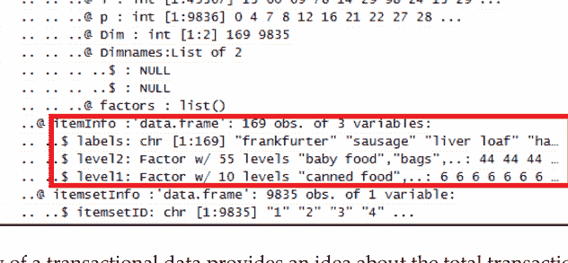

事务数据的摘要可以让人了解数据库中存在的总交易数、构成数据库的项目数、数据的稀疏度，以及事务数据库中最突出的一些项目的频率：

```
summary(Groceries)
transactions as itemMatrix in sparse format with
9835 rows (elements/itemsets/transactions) and
169 columns (items) and a density of 0.02609146
most frequent items:
whole milk other vegetables rolls/buns soda yogurt
2513 1903 1809 1715 1372
(Other)
34055
```

数据集中有 9,835 笔交易；在 169 个物品中，最频繁的物品及其对应频率已在上面显示。在 9,835 × 169 的矩阵中，只有 0.0261（即 2.61%）的单元格有值；其余为空。这 2.61% 就是数据集的稀疏度。

### 元素（项集/事务）长度分布：

```
sizes
1 2 3 4 5 6 7 8 9 10 11 12 13 14 15 16 17
2159 1643 1299 1005 855 645 545 438 350 246 182 117 78 77 55 46 29
18 19 20 21 22 23 24 26 27 28 29 32
14 14 9 11 4 6 1 1 1 1 3 1
Min. 1st Qu. Median Mean 3rd Qu. Max.
1.000 2.000 3.000 4.409 6.000 32.000
includes extended item information - examples:
labels
1 abrasive cleaner
2 artif. sweetener
3 baby cosmetics
```

从前面的项集长度分布可以看出，有一笔交易同时购买了 32 种产品。有 3 笔交易同时购买了 29 个物品。同样，我们可以解释数据集中其他项集的频率。通过项目频率图可以更好地理解这一点。要了解数据集中的前三笔交易，可以使用以下命令：

```
> inspect(Groceries[1:3])
items
1 {citrus fruit,semi-finished bread,margarine,ready soups}
2 {tropical fruit,yogurt,coffee}
3 {whole milk}
```

要了解杂货数据库中包含每个物品的交易比例，可以使用以下命令。第一个物品 frankfurter（法兰克福香肠）出现在 5.89% 的交易中；sausage（香肠）出现在 9.39% 的交易中；以此类推：

```
> cbind(itemFrequency(Groceries[,1:10])*100)
[,1]
frankfurter 5.8973055
sausage 9.3950178
liver loaf 0.5083884
ham 2.6029487
meat 2.5826131
finished products 0.6507372
organic sausage 0.2236909
chicken 4.2907982
turkey 0.8134215
pork 5.7651246
```

在事务数据集中，有两个重要参数决定频繁项集：支持度和置信度。支持度越高，数据集中的规则数量就越少，并且您可能会错过各个变量之间有趣的关系，反之亦然。有时即使具有较高的支持度、置信度和提升度值，也不能保证获得有用的规则。因此，在实践中，用户可以尝试不同水平的支持度和置信度，以获得有意义的规则。即使最小支持度和最小置信度水平足够高，规则也似乎相当琐碎。


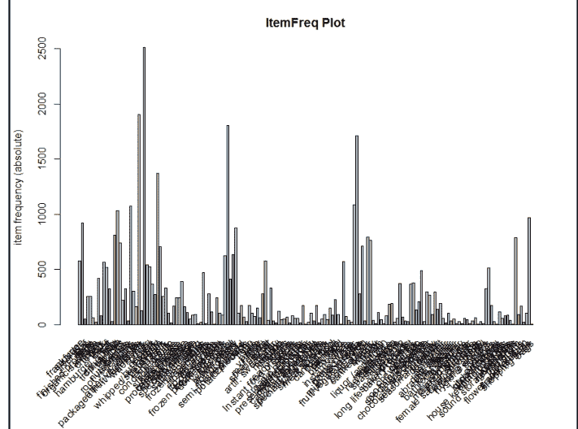

## Apriori 算法

Apriori 算法利用向下封闭性，该性质表明频繁项集的任何子集也是频繁项集。Apriori 算法采用逐层搜索来寻找频繁项集。该算法仅生成等式右侧（RHS）只有一个项的规则，RHS 被称为后件；等式左侧（LHS）被称为前件。这意味着 RHS 中有一个项而 LHS 为空的规则也可能被视为有效规则；为了避免这些空白规则，需要将最小长度参数从 1 改为 2：

```r
> # Get the association rules based on apriori algo
> rules <- apriori(Groceries, parameter = list(supp = 0.01, conf = 0.10))
```

参数规范：

| confidence | minval | smax | arem | aval | originalSupport | support | minlen | maxlen | target | ext |
|---|---|---|---|---|---|---|---|---|---|---|
| 0.1 | 0.1 | 1 | none | FALSE | TRUE | 0.01 | 1 | 10 | rules | FALSE |

算法控制：

| filter | tree | heap | memopt | load | sort | verbose |
|---|---|---|---|---|---|---|
| 0.1 | TRUE | TRUE | FALSE | TRUE | 2 | TRUE |

```r
apriori - find association rules with the apriori algorithm
version 4.21 (2004.05.09) (c) 1996-2004 Christian Borgelt
set item appearances ...[0 item(s)] done [0.00s].
set transactions ...[169 item(s), 9835 transaction(s)] done [0.00s].
sorting and recoding items ... [88 item(s)] done [0.00s].
creating transaction tree ... done [0.00s].
checking subsets of size 1 2 3 4 done [0.00s].
writing ... [435 rule(s)] done [0.00s].
creating S4 object ... done [0.00s].
```

使用 Apriori 算法，在支持度为 1%（即规则创建中纳入的项比例最低为 1%）和置信度为 10% 的条件下，共得到 435 条规则。代表这 435 条规则的项共有 88 个。通过 summary 命令，我们可以了解规则的长度和规则的分布：

```r
> summary(rules)
```

规则集合包含 435 条规则

规则长度分布（lhs + rhs）：大小

| 长度 | 1 | 2 | 3 |
|---|---|---|---|
| 计数 | 8 | 331 | 96 |

| 度量 | 最小值 | 第一四分位数 | 中位数 | 平均值 | 第三四分位数 | 最大值 |
|---|---|---|---|---|---|---|
| 数值 | 1.000 | 2.000 | 2.000 | 2.202 | 2.000 | 3.000 |

质量度量摘要：

| 度量 | 支持度 | 置信度 | 提升度 |
|---|---|---|---|
| 最小值 | 0.01007 | 0.1007 | 0.7899 |
| 第一四分位数 | 0.01149 | 0.1440 | 1.3486 |
| 中位数 | 0.01454 | 0.2138 | 1.6077 |
| 平均值 | 0.02051 | 0.2455 | 1.6868 |
| 第三四分位数 | 0.02115 | 0.3251 | 1.9415 |
| 最大值 | 0.25552 | 0.5862 | 3.3723 |

挖掘信息：

| 数据 | 事务数 | 支持度 | 置信度 |
|---|---|---|---|
| Groceries | 9835 | 0.01 | 0.1 |

从规则摘要可以看出，有 8 条规则仅包含 1 个项（包括 LHS 和 RHS），这些不是有效规则。如下所示；为避免空白规则，最小长度需要设为 2。使用最小长度为 2 后，规则总数减少到 427：

```r
> inspect(rules[1:8])
```

| # | 规则 | 支持度 | 置信度 | 提升度 |
|---|---|---|---|---|
| 1 | {} => {bottled water} | 0.1105236 | 0.1105236 | 1 |
| 2 | {} => {tropical fruit} | 0.1049314 | 0.1049314 | 1 |
| 3 | {} => {root vegetables} | 0.1089985 | 0.1089985 | 1 |
| 4 | {} => {soda} | 0.1743772 | 0.1743772 | 1 |
| 5 | {} => {yogurt} | 0.1395018 | 0.1395018 | 1 |
| 6 | {} => {rolls/buns} | 0.1839349 | 0.1839349 | 1 |
| 7 | {} => {other vegetables} | 0.1934926 | 0.1934926 | 1 |
| 8 | {} => {whole milk} | 0.2555160 | 0.2555160 | 1 |

```r
> rules <- apriori(Groceries, parameter = list(supp = 0.01, conf = 0.10, minlen=2))
```

参数规范：

| confidence | minval | smax | arem | aval | originalSupport | support | minlen | maxlen | target | ext |
|---|---|---|---|---|---|---|---|---|---|---|
| 0.1 | 0.1 | 1 | none | FALSE | TRUE | 0.01 | 2 | 10 | rules | FALSE |

算法控制：

| filter | tree | heap | memopt | load | sort | verbose |
|---|---|---|---|---|---|---|
| 0.1 | TRUE | TRUE | FALSE | TRUE | 2 | TRUE |

```r
apriori - find association rules with the apriori algorithm
version 4.21 (2004.05.09) (c) 1996-2004 Christian Borgelt
set item appearances ... [0 item(s)] done [0.00s].
set transactions ... [169 item(s), 9835 transaction(s)] done [0.00s].
sorting and recoding items ... [88 item(s)] done [0.00s].
creating transaction tree ... done [0.00s].
checking subsets of size 1 2 3 4 done [0.00s].
writing ... [427 rule(s)] done [0.00s].
creating S4 object ... done [0.00s].
```

```r
> summary(rules)
```

规则集合包含 427 条规则

规则长度分布（lhs + rhs）：大小

| 长度 | 2 | 3 |
|---|---|---|
| 计数 | 331 | 96 |

我们如何识别正确的规则集？在压缩置信度水平后，可以减少有效规则的数量。将置信度保持在 10%，并改变支持度水平，可以看到规则数量如何变化。如果规则太多，则难以实施；如果规则太少，则无法正确表示各项之间的隐藏关系。因此，拥有正确的有效规则集是在支持度和置信度之间进行权衡。下面的碎石图显示了在置信度保持 10% 不变时，支持度水平变化对应的规则数量：

```r
> support<-seq(0.01,0.1,0.01)
> support
[1] 0.01 0.02 0.03 0.04 0.05 0.06 0.07 0.08 0.09 0.10
> rules_count<-c(435,128,46,26,14, 10, 10,8,8,8)
> rules_count
[1] 435 128 46 26 14 10 10 8 8 8
> plot(support,rules_count,type = "l",main="Number of rules at different support %",
+ col="darkred",lwd=3)
```

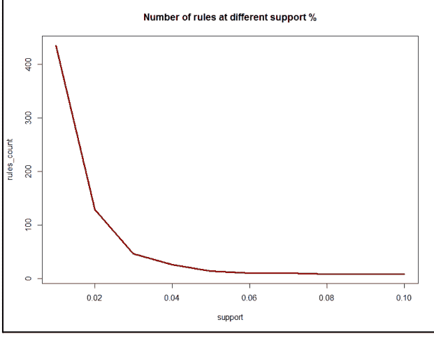

根据碎石图结果，在支持度为 0.04、置信度为 10% 时，该数据集的合理有效规则数应为 26。反过来，也可以采取相同的方法来识别相关规则；保持支持度不变，改变置信度，我们可以绘制另一个碎石图：

```r
> conf<-seq(0.10,1.0,0.10)
> conf
[1] 0.1 0.2 0.3 0.4 0.5 0.6 0.7 0.8 0.9 1.0
> rules_count<-c(427,231,125,62,15,0,0,0,0,0)
> rules_count
[1] 427 231 125 62 15 0 0 0 0 0
> plot(conf,rules_count,type = "l",main="Number of rules at different confidence %",
+ col="darkred",lwd=3)
```

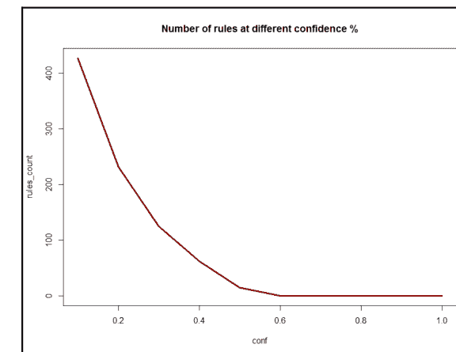

根据碎石图结果，在置信度为 0.5（置信度以 10% 为步长变化）时，适用于 groceries 数据集的合理有效规则数为 15。

## Eclat 算法

Eclat 算法采用自底向上的方法，利用简单的交集运算进行同质类聚类。可以在 R 中使用 eclat 函数重新运行相同的代码并获取结果。eclat 函数接受两个参数：支持度和最大长度：

```r
> rules_ec <- eclat(Groceries, parameter = list(supp = 0.05))
```

参数规范：

| tidLists | support | minlen | maxlen | target | ext |
|---|---|---|---|---|---|
| FALSE | 0.05 | 1 | 10 | frequent itemsets | FALSE |

算法控制：

| sparse | sort | verbose |
|---|---|---|
| 7 | -2 | TRUE |

```r
eclat - find frequent item sets with the eclat algorithm
version 2.6 (2004.08.16) (c) 2002-2004 Christian Borgelt
create itemset ...
set transactions ...[169 item(s), 9835 transaction(s)] done [0.00s].
sorting and recoding items ... [28 item(s)] done [0.00s].
creating sparse bit matrix ... [28 row(s), 9835 column(s)] done [0.00s].
writing ... [31 set(s)] done [0.00s].
Creating S4 object ... done [0.00s].
```

```r
> summary(rules_ec)
```

集合包含 31 个项集

最频繁出现的项：

| 项 | 计数 |
|---|---|
| whole milk | 4 |
| other vegetables | 2 |
| yogurt | 2 |
| rolls/buns | 2 |
| frankfurter | 1 |
| (Other) | 23 |

元素（项集/事务）长度分布：大小

| 长度 | 1 | 2 |
|---|---|---|
| 计数 | 28 | 3 |

| 度量 | 最小值 | 第一四分位数 | 中位数 | 平均值 | 第三四分位数 | 最大值 |
|---|---|---|---|---|---|---|
| 数值 | 1.000 | 1.000 | 1.000 | 1.097 | 1.000 | 2.000 |

质量度量摘要：

| 度量 | 支持度 |
|---|---|
| 最小值 | 0.05236 |
| 第一四分位数 | 0.05831 |
| 中位数 | 0.07565 |
| 平均值 | 0.09212 |
| 第三四分位数 | 0.10173 |
| 最大值 | 0.25552 |

包含事务 ID 列表：FALSE

挖掘信息：

| 数据 | 事务数 | 支持度 |
|---|---|---|
| Groceries | 9835 | 0.05 |

使用 eclat 算法，在支持度为 5% 的情况下，共有 31 条规则可以解释不同项之间的关系。这些规则包含的项至少在 5% 的事务中出现过。

在生成商品推荐时，重要的是推荐那些具有高置信度水平的规则，而不论其支持度比例如何。基于置信度，可以得出排名前 5 的规则如下：

```r
> #sorting out the most relevant rules
> rules<-sort(rules, by="confidence", decreasing=TRUE)
> inspect(rules[1:5])
```

| # | 规则 | 支持度 | 置信度 | 提升度 |
|---|---|---|---|---|
| 36 | {other vegetables,yogurt} => {whole milk} | 0.02226741 | 0.5128806 | 2.007235 |
| 10 | {butter} => {whole milk} | 0.02755465 | 0.4972477 | 1.946053 |
| 3 | {curd} => {whole milk} | 0.02613116 | 0.4904580 | 1.919481 |
| 33 | {root vegetables,other vegetables} => {whole milk} | 0.02318251 | 0.4892704 | 1.914833 |
| 34 | {root vegetables,whole milk} => {other vegetables} | 0.02318251 | 0.4740125 | 2.449770 |


规则也可以根据提升度和支持度比例进行排序，通过更改 sort 函数中的参数。基于提升度计算的前 5 条规则如下：

```r
> rules<-sort(rules, by="lift", decreasing=TRUE)
> inspect(rules[1:5])
```

| rule | lhs | rhs | support | confidence | lift |
|------|-----|-----|---------|------------|------|
| 35 | {other vegetables,whole milk} | {root vegetables} | 0.02318251 | 0.3097826 | 2.842082 |
| 34 | {root vegetables,whole milk} | {other vegetables} | 0.02318251 | 0.4740125 | 2.449770 |
| 27 | {root vegetables} | {other vegetables} | 0.04738180 | 0.4347015 | 2.246605 |
| 15 | {whipped/sour cream} | {other vegetables} | 0.02887646 | 0.4028369 | 2.081924 |
| 37 | {whole milk,yogurt} | {other vegetables} | 0.02226741 | 0.3974592 | 2.054131 |

## Visualizing association rules

项目之间的关联以及规则如何被可视化展示，与创建规则本身一样重要：

```r
> # visualizing the rules
> plot(rules, method='graph', interactive = T, shading = T)
```

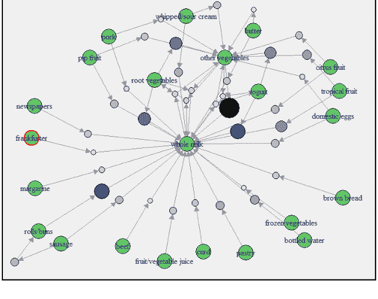

前面的图使用 apriori 算法创建。在最大数量的规则中，你至少会发现 whole milk 或 other vegetables，因为这两项商品通过节点与其他商品紧密相连。

使用 eclat 算法对同一数据集进行处理，我们创建了另一组规则；以下图表展示了规则的可视化：

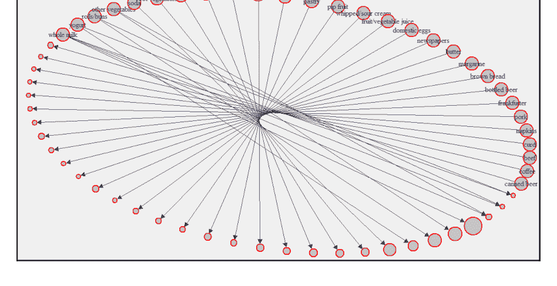

## Implementation of arules

一旦建立了良好的市场篮子分析或 arules 模型，下一步任务就是集成该模型。arules 提供了 PMML 接口，即预测建模标记语言接口，以便与其他应用程序集成。其他应用程序可以是其他统计软件，如 SAS、SPSS 等；也可以是 Java、PHP 和 Android 为基础的应用程序。PMML 接口使模型集成变得更容易。在规则实施方面，零售商希望得到答案的两个重要问题是：

- 客户在购买某件商品之前可能购买什么？
- 如果客户已经购买了某些商品，他们可能还会购买什么？

让我们以产品 yogurt 为例，零售商希望向客户推荐此产品。哪些规则可以帮助零售商？因此前 5 条规则如下：

```r
> rules<-apriori(data=Groceries, parameter=list(supp=0.001,conf = 0.8),
+ appearance = list(default="lhs",rhs="yogurt"),
+ control = list(verbose=F))
> rules<-sort(rules, decreasing=TRUE,by="confidence")
> inspect(rules[1:5])
```

| rule | lhs | rhs | support | confidence | lift |
|------|-----|-----|---------|------------|------|
| 4 | {root vegetables,butter,cream cheese} | {yogurt} | 0.001016777 | 0.9090909 | 6.516698 |
| 10 | {tropical fruit,whole milk,butter,sliced cheese} | {yogurt} | 0.001016777 | 0.9090909 | 6.516698 |
| 11 | {other vegetables,curd,whipped/sour cream,cream cheese} | {yogurt} | 0.001016777 | 0.9090909 | 6.516698 |
| 13 | {tropical fruit,other vegetables,butter,white bread} | {yogurt} | 0.001016777 | 0.9090909 | 6.516698 |
| 2 | {sausage,pip fruit,sliced cheese} | {yogurt} | 0.001220132 | 0.8571429 | 6.144315 |

```r
> rules<-apriori(data=Groceries, parameter=list(supp=0.001,conf = 0.10,minlen=2),
+ appearance = list(default="rhs",lhs="yogurt"),
+ control = list(verbose=F))
> rules<-sort(rules, decreasing=TRUE,by="confidence")
> inspect(rules[1:5])
```

| rule | lhs | rhs | support | confidence | lift |
|------|-----|-----|---------|------------|------|
| 20 | {yogurt} | {whole milk} | 0.05602440 | 0.4016035 | 1.571735 |
| 19 | {yogurt} | {other vegetables} | 0.04341637 | 0.3112245 | 1.608457 |
| 18 | {yogurt} | {rolls/buns} | 0.03436706 | 0.2463557 | 1.339363 |
| 15 | {yogurt} | {tropical fruit} | 0.02928317 | 0.2099125 | 2.000475 |
| 17 | {yogurt} | {soda} | 0.02735130 | 0.1960641 | 1.124368 |

使用提升度标准也可以设计产品推荐，向客户提供：

```r
> # sorting grocery rules by lift
> inspect(sort(rules, by = "lift")[1:5])
```

| rule | lhs | rhs | support | confidence | lift |
|------|-----|-----|---------|------------|------|
| 1 | {yogurt} | {curd} | 0.01728521 | 0.1239067 | 2.325615 |
| 8 | {yogurt} | {whipped/sour cream} | 0.02074225 | 0.1486880 | 2.074251 |
| 15 | {yogurt} | {tropical fruit} | 0.02928317 | 0.2099125 | 2.000475 |
| 4 | {yogurt} | {butter} | 0.01464159 | 0.1049563 | 1.894027 |
| 11 | {yogurt} | {citrus fruit} | 0.02165735 | 0.1552478 | 1.875752 |

- 在电信行业，基站的定位以优化用户体验为驱动，由细分练习决定。电信套餐的设计，如定制优惠（尤其是针对学生、老年人、专业人士等），基于服务使用情况，也采用聚类方法制定。
- 在医疗行业，为不同部门如急诊护理、急性护理等决定医院床位规模，聚类练习有所帮助。此外，不同州各种疾病的报告可用于创建相似区域或地点的聚类，在这些区域可采用一套程序。
- 在治理方面，执法机构加强在犯罪证据/事件较多的地区存在。因此聚类技术被用来创建城市群，如高、中、低犯罪地区。根据数据，他们可以相应地调配力量。
- 在保险行业，聚类用于通过基于人口统计信息、地理位置和风险区域等参数对不同城市进行分组来决定差异化保费。

## Understanding customer segmentation

在标准的数据挖掘实践中，客户细分是将所有客户划分为与业务和业务问题相关的各个子群的一种方式。该子群的创建可以通过主观方法完成，也可以通过考虑业务目标来完成。在不同行业，客户细分具有不同的应用；例如，在零售业，了解客户的购买行为很重要，而显示独特购买行为的不同子群与业务相关。

## Why understanding customer segmentation is important

在零售和电子商务行业，优惠、活动、忠诚度计划和折扣策略都基于客户子群的购买行为。在其他行业，销售、营销策略和业务计划都是以客户行为为依据进行的，而行为驱动销售。通过对数据进行细分，可以理解这种独特的客户行为。

## How to perform customer segmentation?

在讨论了执行客户细分的好处后，了解如何执行客户细分很重要。执行客户细分使用的两种主要方法如下：

- 基于聚类方法的客户细分
- 使用最近购买、购买频率和货币价值（RFM）模型的客户细分

在本章中，我们将讨论基于聚类的方法来执行客户细分；第二种方法不在本章范围内。

## Various clustering methods available

所有聚类算法都可以分为四组，如下所示：

- **Hierarchical clustering**：使用此方法，从数据集中准备多个聚类，形成层次结构，并使用树结构对聚类进行分组，以便整个数据集可以表示为单个树结构。这种方法的优点是与基于划分的聚类不同，我们不需要指定要从数据集中创建的聚类数量。
- **Partitioning clustering**：在此方法中，数据集基于距离函数划分为有限的聚类组，使得簇内相似性最大且簇间相似性最小。K-means 是数据挖掘实践中流行的一个方法，属于此类。
- **Model-based clustering**：使用数据模型，从数据集中创建一组聚类；模型化聚类方法中使用的方法可分为两组：
  - 最大似然估计
  - 贝叶斯估计
- **Other clustering algorithms**：还有其他聚类技术，如模糊聚类、装袋聚类等。模糊聚类在数据上使用模糊逻辑，使得同一数据点可以成为多个聚类的一部分。换句话说，聚类成员资格没有排他性。这种方法基本上不同于其他三种聚类形式，其中数据点属于单个聚类。属于这一组的另一个算法被称为自组织映射（SOM）。


现在，让我们以医疗保健数据集（`PimaIndiansDiabetes.csv [ref: 1]`）和零售/电子商务数据集（`Wholesalecustomers.csv [ref: 1]`）为例，开始使用各种聚类方法对数据集进行分割。在运行聚类分析之前，需要检查数据充分性条件。

## K-means 聚类

K-means聚类是一种无监督学习算法，它试图将相似的对象组合成一个组，使得组内相似性最大，组间对象相似性最小。这里的“对象”指输入到算法中的数据点。组内相似性基于称为质心（算术平均值）的中心性度量和一个距离函数来计算，该距离函数度量组内对象与中心的接近程度。K-means中的“K”表示用户可能感兴趣的簇数。K-means聚类需要遵循以下步骤。由于使用均值作为估计质心的度量，它无法避免极端观测值或异常值的影响。因此，在运行K-means聚类之前，需要检查数据集中是否存在异常值。

### 1. 检查是否存在异常值

让我们使用箱线图方法识别`Wholesalecustomers.csv`数据集中是否存在任何异常值：

```r
> r_df<-read.csv("Wholesalecustomers.csv")
> ####Data Pre-processing
> par(mfrow=c(2,3))
> apply(r_df[,c(-1,-2)],2,boxplot)
```

前面每个变量的箱线图中，须线之后的散点表明数据集中存在大量异常值。实践者通常使用封顶方法从数据集中去除异常值。如果任何数据点超过每个变量的分位数（90%分位数、95%分位数或99%分位数），则需要在相应的分位数处对这些数据点进行封顶：

```r
> #computing quantiles
> quant<-function(x){quantile(x,probs=c(0.95,0.90,0.99))}
> out1<-sapply(r_df[,c(-1,-2)],quant)
```

### 2. 缩放数据集

在K-means聚类分析中仅包含连续变量并不能保证所有变量都处于同一尺度。例如，客户的年龄范围是0-100，而客户的收入范围是0-100,000。由于两者的度量单位不同，它们可能落入不同的簇，当需要表示更多数据点时，这会变得更加复杂。为了在聚类过程中比较各分组，所有变量都需要在同一尺度上进行标准化；这里我们对所有变量应用了标准正态变换（Z变换）：

```r
> r_df_scaled<-as.matrix(scale(r_df[ ,c(-1,-2)]))
> head(r_df_scaled)
Fresh Milk Grocery Frozen Detergents_Paper Delicassen
[1,]  0.2351056 1.2829174 0.11321460 -0.96232799 0.1722993 0.1570550
[2,] -0.4151579 1.3233470 0.45658819 -0.30652122 0.4120701 0.6313698
[3,] -0.4967305 1.0597962 0.13425842 -0.03373355 0.4984496 1.8982669
[4,]  0.3041643 -0.9430315 -0.45821928 1.66113143 -0.6670924 0.6443648
[5,]  1.3875506 0.1657331 0.05110966 0.60623797 -0.1751554 1.8928669
[6,] -0.1421677 0.9153464 -0.30338465 -0.77070636 -0.1681831 0.2974239
```

### 3. 选择初始簇种子

初始随机种子的选择决定了模型收敛所需的迭代次数。通常，随机选择的初始簇种子是簇的临时均值。根据距离函数度量，距离质心更近的对象被分配为该簇的成员。随着新成员加入簇，再次计算质心，并将每个种子值替换为相应的簇质心。在K-means聚类中，这种向组中添加更多对象并因此更新质心的过程会持续进行，直到质心不再移动且对象不再改变所属簇。

### 4. 确定簇数 K

在R语言中，有Rcmdr（R Commander）和stats两个库支持K-means聚类，它们使用两种不同的方法。运行该算法需要加载Rcmdr库，而stats已内置在基础R中。使用K-means算法表示数据所需的簇数由碎石图根据以下公式确定：

```r
> library(Rcmdr)
> sumsq<-NULL
> #Method 1
> par(mfrow=c(1,2))
> for (i in 1:15) sumsq[i] <-
+ sum(KMeans(r_df_scaled, centers=i, iter.max=500,
+ num.seeds=50)$withinss)
>
> plot(1:15, sumsq, type="b", xlab="Number of Clusters",
+ ylab="Within groups sum of squares", main="Screeplot using Rcmdr")
>
> #Method 2
> for (i in 1:15) sumsq[i] <-
+ sum(kmeans(r_df_scaled, centers=i, iter.max=5000,
+     algorithm = "Forgy")$withinss)
>
> plot(1:15, sumsq, type="b", xlab="Number of Clusters",
+ ylab="Within groups sum of squares", main="Screeplot using Stats")
```

下图解释了碎石图。使用两种方法，通过观察碎石图上的“肘部”点，确定理想簇数为4。纵轴显示组内平方和随着横轴上簇数的增加而下降：

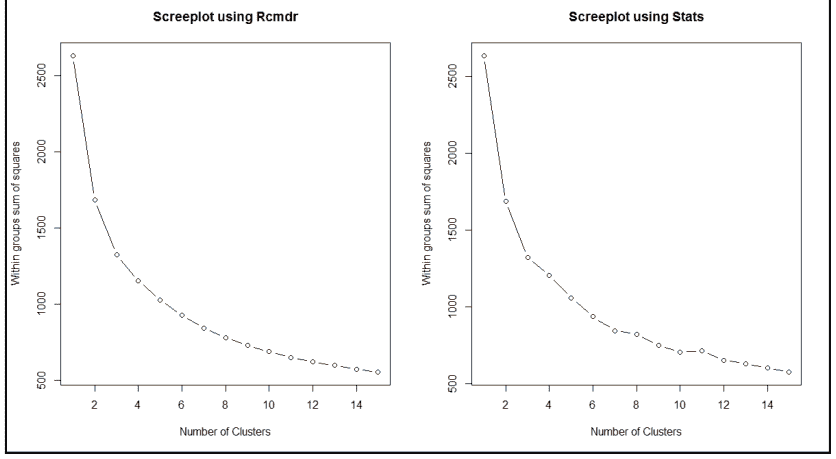

一旦确定了簇数，就可以计算簇中心和距离，下面的代码解释了K-means聚类中要使用的函数。此处的目标是对对象进行分类，使一个组与另一个组之间的对象尽可能不同，而每组内部的对象尽可能相似。可以使用以下函数计算从簇中心到各个对象的组内平方和：

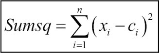

计算每个簇的平方和，然后相加得到数据集的组内平方和总计。此处的目标是最小化组内平方和总计。

### 5. 基于最小距离分组

K-means语法及参数说明如下：

```r
kmeans(x, centers, iter.max = 10, nstart = 1,
       algorithm = c("Hartigan-Wong", "Lloyd", "Forgy",
       "MacQueen"), trace=FALSE)
```

| 参数 | 描述 |
|---|---|
| `x` | **数据的数值矩阵，或可被强制转换为此类矩阵的对象（例如数值向量或所有列均为数值型的数据框）** |
| `centers` | 簇的数量，比如 *k*，或一组初始（不同的）簇中心。如果是一个数字，则从 *x* 中随机选择一组（不同的）行作为初始中心。 |
| `iter.max` | 允许的最大迭代次数。 |
| `nstart` | 如果中心是一个数字，应选择多少个随机集合？ |
| `algorithm` | 字符型。可缩写。注意，“Lloyd”和“Forgy”是同一算法的替代名称。 |

*表1：K-means语法说明*

```r
> #Kmeans Clustering
> library(cluster);library(cclust)
> set.seed(121)
> km<-kmeans(r_df_scaled, centers=4, nstart=17, iter.max=50000, algorithm = "Forgy", trace = T)
```

使用缩放后的数据集创建簇，共4个簇和17个初始起点。在Forgy算法下进行50,000次迭代后，从模型中获得以下结果：

```r
> #checking results
> summary(km)
```

对于同一数据集，我们可以预测簇成员关系，实际簇成员关系与预测簇成员关系可以用下表表示：

```r
> #predicting cluster membership
> Cluster$Predicted<-predict.kmeans(km,r_df_scaled)
> table(Cluster$Membership,Cluster$Predicted)
1 2 3 4
1 84 0 0 0
2 0 188 0 0
3 0 0 65 0
4 0 0 0 103
```

### 6. 在实际应用中实现K-means

为了在其他统计软件和Web应用中实现K-means聚类，可以使用PMML脚本。**PMML**代表**预测模型标记语言（Predictive Model Markup Language）**，它被公认为部署预测模型的行业标准：

```r
> #pmml code
> library(pmml);
> library(XML);
> pmml(km)
```

当我们以PMML格式保存模型时，它会为模型准备一个XML脚本，模型参数嵌入在脚本中。其编写方式使得任何其他外部统计软件都可以读取该模型。

## 层次聚类

实现层次聚类算法有两种不同的方式，但有一点是共同的：两者都使用距离度量来估计聚类成员之间的相似性：

- **凝聚法：** 自底向上的方法
- **分裂法：** 自顶向下的方法


要进行层次聚类，输入数据必须是距离矩阵形式。所选方法必须是 `"single"`、`"complete"`、`"average"`、`"mcquitty"`、`"ward.D"`、`"ward.D2"`、`"centroid"` 或 `"median"` 之一。

层次聚类算法遵循以下步骤：

1. 从 N 个单例簇（节点）开始，标记为 -1, ..., -N，代表初始的输入点集合。
2. 使用距离函数，在所有成对距离中找到距离最小的一对节点/簇。
3. 将两个节点合并为一个新节点，并移除两个旧节点。新节点依次标记为 1, 2, ...
4. 新节点到所有其他节点的距离由 `method` 参数决定。
5. 从步骤 2 开始重复 N - 1 次，直到剩下一个包含所有原始输入点的大节点。

如果选择用于执行层次聚类的方法是 `ward`，则用于聚类的距离度量应为欧氏距离。以下代码展示了如何执行凝聚层次聚类：

```r
> hfit<-hclust(dist(r_df_scaled,method = "euclidean"),method="ward.D2")
> par(mfrow=c(1,2))
> plot(hfit,hang=-0.005,cex=0.7)
> hfit<-hclust(dist(r_df_scaled,method = "manhattan"),method="mcquitty")
> plot(hfit,hang=-0.005,cex=0.7)
> hfit<-hclust(dist(r_df_scaled,method = "minkowski"))
> plot(hfit,hang=-0.005,cex=0.7)
> hfit<-hclust(dist(r_df_scaled,method = "canberra"))
> plot(hfit,hang=-0.005,cex=0.7)
```

这是第一个树状图：

Complete、average、mcquitty、centroid、median、ward.D、ward.D2。每种方法都不同。Single linkage 使用最小的最小成对距离来合并两个簇。Complete linkage 使用两个不同簇中差异最大的对象之间的相似度。同样，每种方法都有其独特的计算不同簇之间相似度的方法：

```r
> summary(hfit)
Length Class Mode
merge 878 -none- numeric
height 439 -none- numeric
order 440 -none- numeric
labels 0 -none- NULL
method 1 -none- character
call 3 -none- call
dist.method 1 -none- character
```

可以使用 `cluster` 库中的 `diana` 函数执行分裂层次聚类。语法如下所示：

```r
diana(x, diss = inherits(x, "dist"), metric = "euclidean", stand = FALSE, keep.diss = n < 100, keep.data = !diss, trace.lev = 0)
```

要应用 `diana` 函数，输入数据应为矩阵或数据框类型。`diana` 函数既接受距离矩阵也接受数据框作为输入。有一个逻辑标志参数用于控制函数的输入结构。`metric` 参数是一个字符串，指定用于计算距离的度量方式；它有两个选项：`"euclidean"` 和 `"manhattan"`。欧氏距离是差值平方和的平方根，曼哈顿距离是绝对差值之和，其数学公式已在本章前面解释过。如果输入数据集 `x` 已经是一个不相似度矩阵，那么 `diss` 参数将在执行时被忽略。参数 `stand` 如果取值为 `TRUE`，则表示使用原始数据集，并且需要进一步创建距离矩阵。

`diana` 函数顾名思义，构建簇的层次结构，从一个包含所有观测值的大簇开始。不断划分簇，直到每个簇只包含一个观测值。在每一层，选择具有最大直径的簇，该直径基于距离函数测得的从簇中心到最外层数据点的距离：

```r
dfit<-diana(r_df,diss=F,metric = "euclidean",stand=T,keep.data = F)
summary(dfit)
plot(dfit)
```

## 使用*电子商务*数据进行聚类

对分裂聚类执行 `plot` 命令会提供两种图形选项：一个指示分裂系数的横幅图，以及一个显示树状结构的树状图：

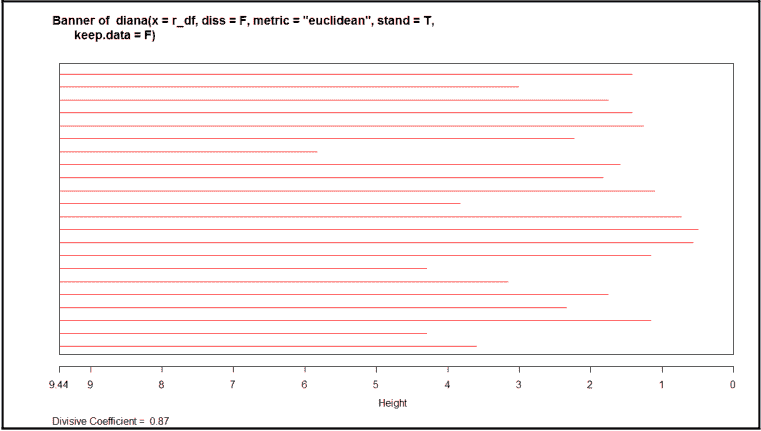

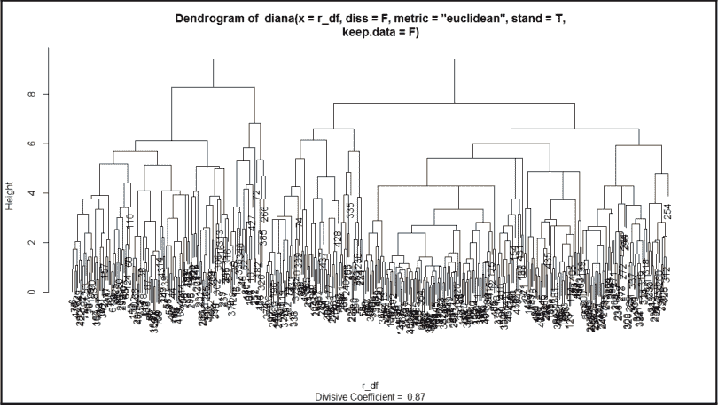

对于层次聚类算法，一个额外的步骤是将树状图结构切割成有限的簇组，以便比较不同聚类方法的结果。以下函数用于切割树状结构：

```r
> #cutting the tree into groups
> g_hfit<-cutree(hfit,k=4)
> plot(hfit)
> table(g_hfit)
g_hfit
1 2 3 4
77 163 119 81
> rect.hclust(hfit,k=4,border = "blue")
```

该图展示了树状结构：

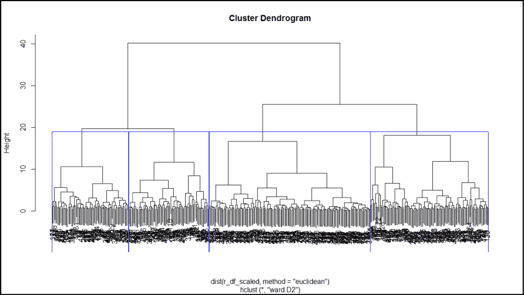

## 基于模型的聚类

R 中有一个名为 `mclust` 的库，它提供通过 EM 算法拟合的高斯有限混合模型，用于基于模型的聚类，包括贝叶斯正则化。在本节中，我们讨论 `Mclust` 的语法和输出结果，其余结果可以使用剖析信息进行分析。基于模型的方法应用一组数据模型、最大似然估计方法和贝叶斯准则来识别簇，`Mclust` 函数通过期望最大化算法估计参数。

`Mclust` 包基于三个参数提供各种数据模型：*E*、*V* 和 *I*。模型标识符使用这三个字母 *E*、*V* 和 *I* 来编码簇的几何特征，如体积、形状和方向。*E* 表示相等，*I* 在指定形状时表示单位矩阵，*V* 表示变化的方差。记住这三个字母，有一组模型默认使用 `mclust` 库运行，这些模型可以分为三类：球形、对角和椭球形。详细信息如下表所示：

| 模型代码 | 描述 |
| --- | --- |
| EII | 球形，等体积 |
| VII | 球形，不等体积 |
| EEI | 对角，等体积和等形状 |
| VEI | 对角，变体积，等形状 |
| EVI | 对角，等体积，变形状 |
| VVI | 对角，变体积和形状 |
| EEE | 椭球形，等体积、形状和方向 |
| EEV | 椭球形，等体积和等形状 |
| VEV | 椭球形，等形状 |
| VVV | 椭球形，变体积、形状和方向 |

表 2：使用有限混合方法的模型描述

现在让我们使用 `Mclust` 方法，基于 *E*、*V* 和 *I* 参数对观测值进行聚类和分组：

```r
> clus <- Mclust(x_df[, -c(1,2)])
> summary(clus)
------------------------------------------------------------
Gaussian finite mixture model fitted by EM algorithm
------------------------------------------------------------
Mclust VEI (diagonal, equal shape) model with 9 components:
log.likelihood n df BIC ICL
-23843.48 440 76 -48149.56 -48223.43
Clustering table:
1 2 3 4 5 6 7 8 9
165 21 40 44 15 49 27 41 38
```

从上述汇总结果可以看出，使用 VEI 模型规范创建了九个簇，并且该模型的 BIC 最低。我们也可以绘制所有其他模型规范：

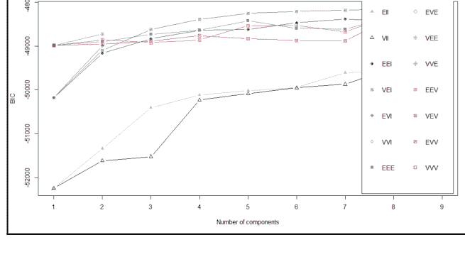

从上述图形可以清楚地看出，VEI 模型规范是最佳的。使用以下代码，我们可以打印簇成员关系以及每个簇中的行数：

```r
# The clustering vector:
clus_vec <- clus$classification
clus_vec
clust <- lapply(1:3, function(nc) row.names(r_df)[clus_vec==nc])
clust # printing the clusters
```

使用带有 `parameters = TRUE` 的 `summary` 命令，我们可以计算每个变量的均值、方差和概率：

```r
summary(clus, parameters = T)
```

## 其他聚类算法

**自组织映射（SOM）** 是另一种聚类方法；它使用可视化方法来表示数据。SOM 基本上用于衍生出唯一的节点。SOM 创建一种网络结构，其中数据对象通过节点和边连接。利用这些节点，可以得出不同对象之间的相似性，从而创建聚类解决方案。`kohonen` 库包含 `som` 函数：

```r
> library(kohonen)
> som_grid <- somgrid(xdim = 20, ydim=20, topo="hexagonal")
> som_model <- som(r_df_scaled,
+ grid=som_grid,
+ rlen=100,
+ alpha=c(0.05,0.01),
+ keep.data = TRUE,
+ n.hood="circular")
> plot(som_model, type="changes",col="blue")
```

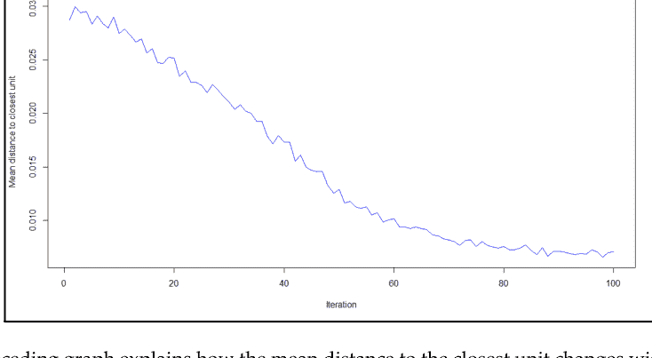

上述图形说明了平均到最近单元的距离如何随着迭代级别的增加而变化：

```r
> plot(som_model, type="count")
```


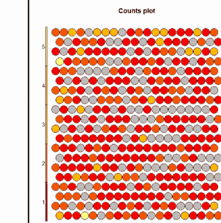

上图展示了使用SOM方法的计数图。下图展示了邻居距离图。地图由不同变量着色，带颜色的圆圈表示这些输入变量在n维空间中的位置。当绘图类型为计数时，显示映射到各个单元的对象数量。灰色单元表示空单元。当类型为距离邻居时，显示到所有直接邻居的距离之和。如下图所示：

```r
> plot(som_model, type="dist.neighbours")
```

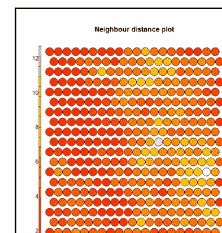

```r
> plot(som_model, type="codes")
```

最后，下一张图展示了使用所有变量的码本图：

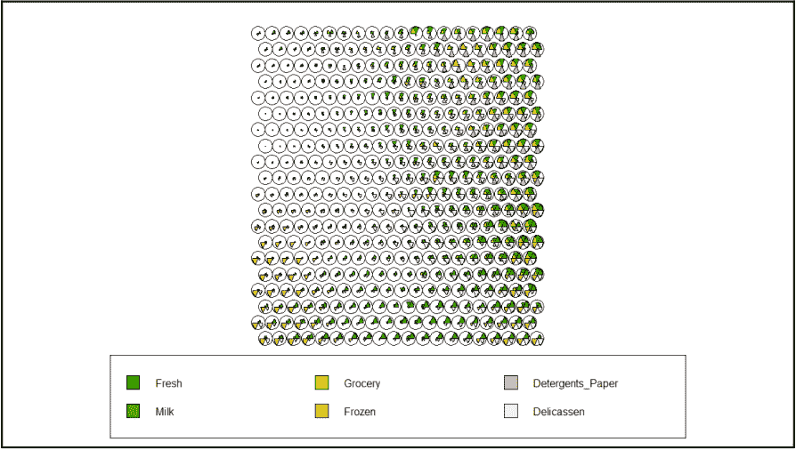

在R中，kohonen库用于通过层次聚类创建自组织映射。当图形类型为codes（如前面的图所示）时，它显示码本向量；每种颜色表示输入数据集的一个特征。前面的结果和图形展示了如何创建聚类解决方案，以及如何使用SOM绘图函数可视化聚类。SOM是一种数据可视化过程，用于基于输入数据向量显示数据集中的相似对象。因此，从结果中得出的结论是如何通过目视检查创建聚类或细分。

## 比较聚类方法

以下是各种聚类方法的一些优点和缺点：

### 对于K-means聚类：

K-means聚类的优点和缺点：

| 优点 | 缺点 |
|---|---|
| 简单易理解，易于解释 | 不是基于稳健的方法论。主要问题在于初始随机点 |
| 与其他聚类算法相比更灵活 | 不同的随机点会显示不同的结果。因此，需要更多迭代。 |
| 在大量输入特征上表现良好 | 由于需要更多迭代，从计算效率角度来看，对于大型数据集可能效率不高。处理时需要更多内存。 |

### 对于SOM：

SOM的优点和缺点：

| 优点 | 缺点 |
|---|---|
| 视觉上易于理解 | 仅适用于连续数据 |
| 新数据点可以通过视觉预测 | 当维度增加时难以表示 |

### 参考文献

Lichman, M. (2013). UCI机器学习库 (http://archive.ics.uci.edu/ml). 加州尔湾：加利福尼亚大学信息与计算机科学学院。

### 总结

在本章中，我们讨论了无监督数据挖掘问题的各种细分方法及其实现。聚类是一种主观的细分方法，需要进一步研究，例如按聚类进行特征分析，并计算不同变量的均值和中位数等不同度量。如果某个聚类与另一个聚类表现出接近性，并且从业务角度来看有意义，那么可以将它们合并。我们讨论了在何种情况下使用哪种模型，以及每种模型的数据要求。在本章中，我们特别强调了数据可视化在表示聚类解决方案时的重要性。
