# 7 构建零售推荐引擎

在这个互联网时代，互联网上的一切并非对每个人都有用。不同的公司和实体使用不同的方法来为受众找到相关内容。人们开始构建算法来构造相关性分数，基于该分数可以生成推荐并推荐给用户。在我的日常生活中，每次我在Google上看到一张图片，Google会向我推荐另外3-4张图片；每次我在YouTube上寻找视频，会给我推荐另外10个视频；每次我访问Amazon购买产品，会给我推荐5-6个产品；每次我阅读一篇博客或文章，会给我推荐更多文章和博客。这证明了算法力量在起作用，基于用户的偏好或选择来推荐某些内容，因为用户的时间宝贵，而互联网上的内容是无限的。因此，推荐引擎帮助组织根据用户偏好定制产品，这样用户就不必花时间去探索需要什么。

在本章中，读者将学习以下内容及其使用R编程语言的实现：

- 什么是推荐，它是如何工作的
- 执行推荐的类型和方法
- 使用R实现产品推荐

### 什么是推荐？

推荐是一种方法或技术，通过它算法检测用户正在看什么。推荐可以是产品、服务、食品、视频、音频、图片、新闻文章等。如果我们环顾四周，注意我们日复一日在互联网上观察到的东西，推荐的含义就会变得更加清晰。例如，考虑新闻聚合网站如何向用户推荐文章。它们查看文章的标签、文章发布到互联网的时间、该文章的评论数、点赞数和分享数，当然还有地理位置等细节，然后对元数据信息建模，得出一个分数。基于该分数，它们开始向新用户推荐文章。当我们在YouTube上观看视频时也会发生同样的事情。同样，啤酒推荐系统也是这样工作的；用户必须随机选择一种啤酒，基于选择的第一种产品，算法根据相似用户的历史购买信息推荐其他啤酒。当我们从在线电子商务门户购买产品时，也会发生同样的事情。

### 产品推荐的类型

从广义上讲，存在四种不同类型的推荐系统：

- 基于内容的推荐方法
- 基于协同过滤的推荐方法
- 基于人口统计细分的推荐方法
- 基于关联规则的推荐方法

在基于内容的方法中，术语、概念（也称为关键词）定义了相关性。如果用户当前阅读的任何页面中的匹配关键词在互联网上可用的任何其他内容中被找到，那么就开始计算词频并分配一个分数，基于该分数，将最接近的内容呈现给用户。基本上，在基于内容的方法中，文本被用于找到两个文档之间的匹配，从而生成推荐。

在协同过滤中，有两种变体：基于用户的协同过滤和基于物品的协同过滤。

在基于用户的协同过滤方法中，算法计算用户与用户之间的相似度，然后根据他们的偏好生成推荐。在基于物品的协同过滤中，考虑物品与物品之间的相似度来生成推荐。

在基于人口统计细分的类别中，会考虑用户的年龄、性别、婚姻状况和位置，以及他们的收入、工作或任何其他可用特征，以创建客户细分。一旦创建了细分，就会在细分层面识别最受欢迎的产品，并推荐给属于相应细分的新用户。

### 执行推荐的技术

过滤掉网上可用的丰富信息，并第一时间向用户推荐有用信息，是创建推荐引擎的主要动机。那么协同过滤是如何工作的？协同过滤算法基于与当前用户最相似的一组用户来生成推荐。每次请求推荐时，算法需要根据用户共同评分的物品，计算当前用户与所有其他用户之间的相似度，从而选择行为相似的用户。随后，算法将那些被与其最相似的用户给予高评分的物品推荐给当前用户。

为了计算用户之间的相似度，已经提出了各种相似度度量，如皮尔逊相关系数、余弦向量相似度、斯皮尔曼相关系数、基于熵的不确定性度量和均方差。让我们看看计算和R实现背后的数学公式。

协同过滤算法的目标是根据用户以前的喜好和其他志同道合用户的意见，向特定用户推荐新物品或预测某个物品的效用。

基于内存的算法利用整个用户-物品数据库来生成预测。这些系统采用统计技术来找到一组与目标用户有相似历史偏好的用户，称为邻居（即他们对相同物品的评分相似，或者他们倾向于购买相似的物品集）。一旦形成了用户邻域，这些系统使用不同的算法来组合邻居的偏好，为当前用户产生预测或Top-N推荐。这些技术也称为最近邻或基于用户的协同过滤，在实践中非常流行且被广泛使用。

基于模型的协同过滤算法首先开发用户评分模型，然后提供物品推荐。这类算法采用概率方法，将协同过滤过程视为在给定用户对其他物品的评分的情况下，计算用户预测的期望值。模型构建过程由不同的机器学习算法执行，如贝叶斯网络、聚类和基于规则的方法。


基于物品的协同过滤算法中的一个关键步骤是计算物品之间的相似度，然后选择最相似的物品。两个物品 $i$ 和 $j$ 之间相似度计算的基本思想是，首先分离出对这两个物品都进行了评分的用户，然后应用相似度计算技术来确定相似度 $S(i,j)$。

计算物品之间相似度的方法有很多种。这里我们介绍三种这样的方法。这些是基于余弦的相似度、基于相关的相似度和调整余弦相似度：

- **基于余弦的相似度：** 两个物品被视为 $m$ 维用户空间中的两个向量。它们之间的相似度是通过计算这两个向量之间角度的余弦来衡量的：

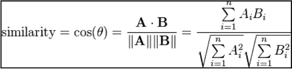

以下是计算两个向量之间余弦相似度的公式。让我们通过一个数值示例来计算余弦相似度：

Cos (d1, d2) = 0.44

| d1 | d2 | d1*d2 | ||d1|| | ||d2|| | ||d1||*||d2|| |
|---|---:|---:|---:|---:|---:|
| 6 | 1 | 6 | 36 | 1 | 36 |
| 4 | 0 | 0 | 16 | 0 | 0 |
| 5 | 3 | 15 | 25 | 9 | 225 |
| 1 | 2 | 2 | 1 | 4 | 4 |
| 0 | 5 | 0 | 0 | 25 | 0 |
| 2 | 0 | 0 | 4 | 0 | 0 |
| 4 | 6 | 24 | 16 | 36 | 576 |
| 0 | 5 | 0 | 0 | 25 | 0 |
| 3 | 0 | 0 | 9 | 0 | 0 |
| 6 | 1 | 6 | 36 | 1 | 36 |

如果为一组物品或产品明确给出了评分或评论，则有意义应用基于用户的协同过滤。如果某些物品的某些评分缺失，数据仍可以被插补，一旦缺失评分被预测，用户相似度就可以被计算，从而生成推荐。对于基于用户的协同过滤，数据将如下所示：

| User | Item1 | Item2 | Item3 | Item4 | Item5 | Item6 |
|------|------:|------:|------:|------:|------:|------:|
| user1 | -7.82 | 8.79 | -9.66 | -8.16 | -7.52 | -8.5 |
| user2 | 4.08 | -0.29 | 6.36 | 4.37 | -2.38 | -9.66 |
| user3 |  |  |  |  | 9.03 | 9.27 |
| user4 |  | 8.35 |  |  | 1.8 | 8.16 |
| user5 | 8.5 | 4.61 | -4.17 | -5.39 | 1.36 | 1.6 |
| user6 | -6.17 | -3.54 | 0.44 | -8.5 | -7.09 | -4.32 |
| user7 |  |  |  |  | 8.59 | -9.85 |
| user8 | 6.84 | 3.16 | 9.17 | -6.21 | -8.16 | -1.7 |
| user9 | -3.79 | -3.54 | -9.42 | -6.89 | -8.74 | -0.29 |
| user10 | 3.01 | 5.15 | 5.15 | 3.01 | 6.41 | 5.15 |

表 1：基于用户的物品样本数据集

如果二进制矩阵作为输入给出，其中级别表示产品是否被购买，则建议应用基于物品的协同过滤。样本数据集如下所示：

| User | Item1 | Item2 | Item3 | Item4 | Item5 | Item6 |
|------|------:|------:|------:|------:|------:|------:|
| user1 | 1 | 1 | 1 | 1 | 1 | 0 |
| user2 | 1 | 1 | 0 | 0 | 1 |  |
| user3 | 0 | 0 |  | 1 | 0 | 0 |
| user4 | 0 | 1 | 1 |  | 1 | 1 |
| user5 | 1 | 0 |  | 1 | 0 |  |
| user6 | 0 | 0 | 1 |  |  | 0 |
| user7 |  | 1 | 0 | 0 | 1 | 1 |
| user8 | 1 | 0 | 1 | 1 | 0 |  |

- **可扩展性**：最近邻算法需要随着用户数量和物品数量的增加而增长的计算量。拥有数百万用户和物品时，运行现有算法的典型基于 Web 的推荐系统将遭受严重的扩展性问题。

## 实践项目

数据集包含来自 1999 年 4 月至 2003 年 5 月收集的 Jester 在线笑话推荐系统匿名评分数据的 5000 个用户样本（Goldberg, Roeder, Gupta, and Perkins 2001）。数据集包含对 100 个笑话在 -10 到 10 之间的评分。数据集中所有用户都对 36 个或更多笑话进行了评分。让我们加载 recommenderlab 库和 Jester5K 数据集：

```
> library("recommenderlab")
> data(Jester5k)
> Jester5k@data@Dimnames[2]
[[1]]
[1]  "j1"  "j2"  "j3"  "j4"  "j5"  "j6"  "j7"  "j8"  "j9"
[10] "j10" "j11" "j12" "j13" "j14" "j15" "j16" "j17" "j18"
[19] "j19" "j20" "j21" "j22" "j23" "j24" "j25" "j26" "j27"
[28] "j28" "j29" "j30" "j31" "j32" "j33" "j34" "j35" "j36"
[37] "j37" "j38" "j39" "j40" "j41" "j42" "j43" "j44" "j45"
[46] "j46" "j47" "j48" "j49" "j50" "j51" "j52" "j53" "j54"
[55] "j55" "j56" "j57" "j58" "j59" "j60" "j61" "j62" "j63"
[64] "j64" "j65" "j66" "j67" "j68" "j69" "j70" "j71" "j72"
[73] "j73" "j74" "j75" "j76" "j77" "j78" "j79" "j80" "j81"
[82] "j82" "j83" "j84" "j85" "j86" "j87" "j88" "j89" "j90"
[91] "j91" "j92" "j93" "j94" "j95" "j96" "j97" "j98" "j99"
[100] "j100"
```

以下图像显示了 2000 名用户给出的真实评分的分布：

```
> data<-sample(Jester5k,2000)
> hist(getRatings(data),breaks=100,col="blue")
```

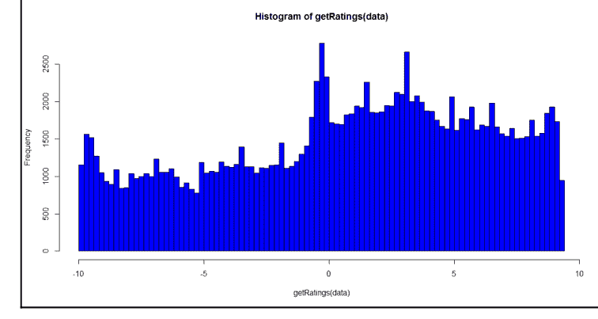

输入数据集包含个人评分；归一化函数通过居中行来减少个人评分偏差，这是一种标准的 z-score 变换。减去均值然后除以标准差。以下图表显示了前述数据集的归一化评分：

```
> hist(getRatings(normalize(data)),breaks=100,col="blue4")
```

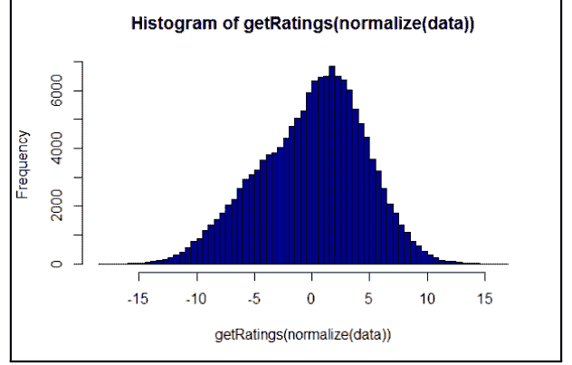

前面的 R 命令有助于识别 recommenderlab 中可用的方法、模型的<|message|>参数。

实现推荐系统有六种不同的方法：popular、item-based、user based、PCA、random 和 SVD。让我们使用 popular 方法启动推荐引擎：

```
> rc <- Recommender(Jester5k, method = "POPULAR")
> rc
Recommender of type 'POPULAR' for 'realRatingMatrix'
learned using 5000 users.
> names(getModel(rc))
[1] "topN" "ratings"
[3] "minRating" "normalize"
[5] "aggregationRatings" "aggregationPopularity"
[7] "minRating" "verbose"
> getModel(rc)$topN
Recommendations as 'topNList' with n = 100 for 1 users.
```

诸如 top N、verbose、aggregation popularity 等对象可以使用 getModel() 命令的名称打印。

```
recom <- predict(rc, Jester5k, n=5)
recom
```

为了生成推荐，我们可以使用 predict 函数对同一数据集进行操作并验证预测模型的准确性。这里我们为每个用户生成 top 5 推荐笑话。预测结果如下：

```
> head(as(recom,"list"))
$u2841
[1] "j89" "j72" "j76" "j88" "j83"
$u15547
[1] "j89" "j93" "j76" "j88" "j91"
$u15221
character(0)
$u15573
character(0)
$u21505
[1] "j89" "j72" "j93" "j76" "j88"
$u15994
character(0)
```

对于相同的 Jester5K 数据集，让我们尝试实现基于物品的协同过滤（IBCF）：

```
> rc <- Recommender(Jester5k, method = "IBCF")
> rc
Recommender of type 'IBCF' for 'realRatingMatrix'
learned using 5000 users.
> recom <- predict(rc, Jester5k, n=5)
> recom
Recommendations as 'topNList' with n = 5 for 5000 users.
> head(as(recom,"list"))
$u2841
[1] "j85" "j86" "j74" "j84" "j80"
$u15547
[1] "j91" "j87" "j88" "j89" "j93"
$u15221
character(0)
$u15573
character(0)
$u21505
[1] "j78" "j80" "j73" "j77" "j92"
$u15994
character(0)
```

主成分分析（PCA）方法不适用于基于真实评分的数据集，因为获取相关矩阵以及随后的特征向量和特征值计算不会准确。因此，我们将不展示其应用。接下来我们将展示随机方法的工作原理：

```
> rc <- Recommender(Jester5k, method = "RANDOM")
> rc
Recommender of type 'RANDOM' for 'ratingMatrix'
learned using 5000 users.
> recom <- predict(rc, Jester5k, n=5)
> recom
Recommendations as 'topNList' with n = 5 for 5000 users.
> head(as(recom,"list"))
[[1]]
[1] "j90" "j74" "j86" "j78" "j85"
[[2]]
[1] "j87" "j88" "j74" "j92" "j79"
[[3]]
character(0)
[[4]]
character(0)
[[5]]
[1] "j95" "j86" "j93" "j78" "j83"
[[6]]
character(0)
```

以下脚本用于构建协同过滤模型，将其应用于新数据集以预测评分，然后计算预测准确度，误差矩阵显示如下：

```
> #User based collaborative filtering
> r1 <- Recommender(getData(e, "train"), "UBCF")
> #Item based collaborative filtering
> r2 <- Recommender(getData(e, "train"), "IBCF")
> #PCA based collaborative filtering
> r3 <- Recommender(getData(e, "train"), "PCA")
> #POPULAR based collaborative filtering
> r4 <- Recommender(getData(e, "train"), "POPULAR")
> #RANDOM based collaborative filtering
> r5 <- Recommender(getData(e, "train"), "RANDOM")
> #SVD based collaborative filtering
> r6 <- Recommender(getData(e, "train"), "SVD")
> #Predicted Ratings
> p1 <- predict(r1, getData(e, "known"), type="ratings")
> p2 <- predict(r2, getData(e, "known"), type="ratings")
> p3 <- predict(r3, getData(e, "known"), type="ratings")
> p4 <- predict(r4, getData(e, "known"), type="ratings")
> p5 <- predict(r5, getData(e, "known"), type="ratings")
> p6 <- predict(r6, getData(e, "known"), type="ratings")
> #calculate the error between the prediction and
> #the unknown part of the test data
> error <- rbind(
+ calcPredictionAccuracy(p1, getData(e, "unknown")),
+ calcPredictionAccuracy(p2, getData(e, "unknown")),
+ #calcPredictionAccuracy(p3, getData(e, "unknown")),
+ calcPredictionAccuracy(p4, getData(e, "unknown")),
+ calcPredictionAccuracy(p5, getData(e, "unknown")),
+ calcPredictionAccuracy(p6, getData(e, "unknown"))
+ )
> rownames(error) <- c("UBCF", "IBCF", "POPULAR", "RANDOM", "SVD")
> error
```

| Method | RMSE | MSE | MAE |
|--------|-----:|----:|----:|
| UBCF | 4.485571 | 20.12034 | 3.511709 |
| IBCF | 4.606355 | 21.21851 | 3.466738 |
| POPULAR | 4.509973 | 20.33985 | 3.548478 |
| RANDOM | 7.917373 | 62.68480 | 6.464369 |
| SVD | 4.653111 | 21.65144 | 3.679550 |

从前面的结果来看，与其他推荐方法相比，UBCF 的误差最低。这里，为了评估预测模型的结果，我们使用 k 折交叉验证方法；k 假定取为 4：

```
> #Evaluation of a top-N recommender algorithm
```


## 可用于降维的技术

降维技术可以分为两大类：参数或基于模型的特征约简，以及非参数特征约简。在非参数特征约简技术中，首先降低数据的维度，然后得到的数据可用于创建任何分类或预测模型，监督或非监督。然而，基于参数的方法强调通过改变特征来监控模型的整体性能和准确性，从而决定需要多少个特征来表示模型。以下是在数据挖掘文献中通常用于降低数据维度的技术：

- 非参数：
  - PCA 方法
  - 参数方法
  - 前向特征选择
  - 后向特征选择

我们将借助 R 编程语言使用一个数据集详细讨论这些方法。除了前面提到的这些技术外，还有一些不太流行的方法，例如删除方差低的变量，因为它们对目标变量没有太多信息贡献，以及删除缺失值较多的变量。后者属于缺失值处理方法，但仍可用于减少高维数据集中的特征。在 R 中有两种方法，`prcomp()` 和 `princomp()`，但它们使用两种略有不同的方法；`princomp()` 使用特征向量，而 `prcomp()` 使用 SVD 方法。一些研究人员更倾向于使用 `prcomp()` 而非 `princomp()` 方法。我们在这里将使用两种不同的方法。

## 应用何种技术？

技术的实际使用取决于研究人员；他从数据中关注什么。如果你关注隐藏特征并希望将数据表示在低维空间中，PCA 是应选择的方法。如果你关注构建良好的分类或预测模型，那么先执行 PCA 并不是一个好主意；你理想情况下应包含所有特征并通过任何参数方法，如前向或后向，选择去除冗余特征。技术选择取决于数据可用性、问题陈述以及某人计划执行的任务。

```
cov(x, y) = (∑_{i=1}^{n} (x_i - x̄)(y_i - ȳ)) / (n - 1)
```

协方差的符号比其值更重要；正的协方差值表示两个维度一起增加，反之亦然。同样，协方差的负值表示一个维度增加时，另一个维度减少。如果协方差值为零，则表明两个维度彼此独立且没有关系。

- 4. 从协方差矩阵计算特征向量和特征值。所有特征向量始终来自方阵，但并非所有方阵都能生成特征向量。矩阵的所有特征向量彼此正交。
- 5. 通过按从大到小的顺序取特征值创建特征向量。具有最高特征值的特征向量是数据集的主成分。从协方差矩阵中识别出特征向量，并将特征值按从大到小排序：
- 6. 使用特征向量的转置版本和归一化数据的转置版本创建低维数据。为了得到转置数据集，我们将把特征向量的转置与归一化数据的转置相乘。

```
Feature Vector = (Eigen1, Eigen2.....Eigen 14)
```

让我们在以下部分应用这些步骤。

## 围绕降维的实践项目

我们将对数据集应用降维程序，既有基于模型的方法，也有基于主成分的方法，以得出较少的特征数量，以便我们可以使用这些特征将客户分类为违约者和非违约者。

## 降维

对于实践项目，我们考虑了一个信用卡客户数据集 `clients.csv`，其中包含 30,000 个样本和 24 个属性或维度。我们将应用两种不同的特征约简方法：传统方法以及现代机器学习方法。

## 属性描述

以下是数据集中属性的描述：

- **X1:** 已授予的信用额度金额（新台币）。包括个人消费者信用及其家庭（附属）信用。
- **X2:** 性别（`1 = male; 2 = female`）。
- **X3:** 教育程度（`1 = graduate school; 2 = university; 3 = high school; 4 = others`）。
- **X4:** 婚姻状况（`1 = married; 2 = single; 3 = others`）。
- **X5:** 年龄（岁）。
- **X6–X11:** 过去付款历史。我们追踪了 2005 年 4 月至 9 月的过去月度付款记录，如下：
  - X6 = 2005 年 9 月的还款状态
  - X7 = 2005 年 8 月的还款状态； . . .
  - X11 = 2005 年 4 月的还款状态。还款状态的测量尺度为：-1 = 按时支付；1 = 延迟一个月付款；2 = 延迟两个月付款； . . .；8 = 延迟八个月付款；9 = 延迟九个月付款，等等。
- **X12–X17:** 账单金额（新台币）。
  - X12 = 2005 年 9 月的账单金额；
  - X13 = 2005 年 8 月的账单金额； . . .
  - X17 = 2005 年 4 月的账单金额。
- **X18–X23:** 上期付款金额（新台币）。
  - X18 = 2005 年 9 月支付的金额；
  - X19 = 2005 年 8 月支付的金额； . . .
  - X23 = 2005 年 4 月支付的金额。

## 降维

让我们获取数据集并进行必要的归一化和转换：

```
```r
> setwd("select the working directory")
> default<-read.csv("default.csv")
corrplot::corrplot(cor(df),method="ellipse")
```
```

从前面的相关矩阵可以看出，X12 到 X17 之间存在一些较强的相关性，可能可以利用 PCA 作为线性组合合并在一起。以下图表显示了不同变量之间的相关性：

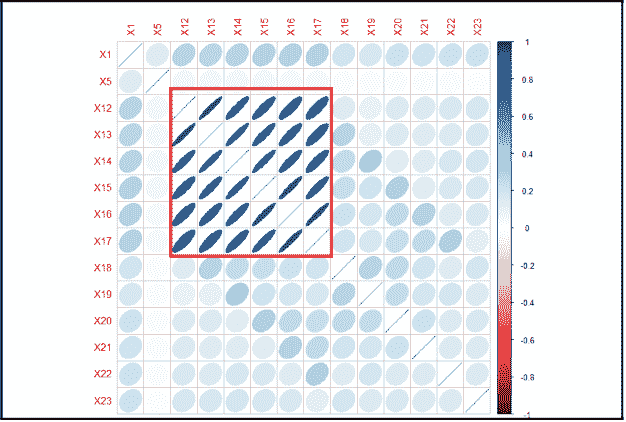

在之前的相关图表中，相关性的强度由椭圆的大小反映，颜色从红色到蓝色变化。蓝色椭圆表示正相关，而白色则表示无相关。变量 X12 与变量 X13 至 X17 具有高度正相关，相关值超过 80%。

第 1 行包含变量描述，并且有一些列是分类的；我们需要从数据集中删除这些列。其他一些变量显示为分类的，因此需要转换回数值模式：

```
```r
> df<-default[-1,-c(1,3:5,7:12,25)]
> func1<-function(x){
+ as.numeric(x)
+ }
> df<-as.data.frame(apply(df,2,func1))
> normalize=function(x){
```

主成分（PC）1 解释了数据集中 42% 的变化，主成分 2 解释了数据集中 12% 的变化。这意味着第一个 PC 与 n 维空间中约 42% 的总数据点接近。从前面的结果可以看出，前 8 个主成分捕获了数据集中 91.9% 的变化。剩余 8% 的变化由另外 6 个主成分解释。现在问题是如何选择主成分。一般经验法则是 80-20，如果 20% 的主成分可以解释数据中 80% 的变化。有 14 个变量；我们需要查看累积起来解释数据中 80% 变化的成分数量。因此，根据 80:20 的帕累托原则，建议取 6 个主成分，它们累积解释 81% 的变化。

在多元数据集中，成分与原始变量之间的相关性称为成分载荷。主成分的载荷如下：

```
> #Loadings of Principal Components
> pca1$loadings
Loadings:
Comp.1 Comp.2 Comp.3 Comp.4 Comp.5 Comp.6 Comp.7 Comp.8 Comp.9 Comp.10
Comp.11 Comp.12 Comp.13 Comp.14
X1 -0.165 0.301 0.379 0.200 0.111 0.822
X5 0.870 -0.338 -0.331
X12 -0.372 -0.191 0.567 0.416 0.433 0.184 -0.316
X13 -0.383 -0.175 0.136 0.387 -0.345 -0.330 0.645
X14 -0.388 -0.127 -0.114 -0.121 0.123 -0.485 -0.496 -0.528
X15 -0.392 -0.120 0.126 -0.205 -0.523 0.490 0.362 0.346
X16 -0.388 -0.106 0.107 -0.420 0.250 -0.718 -0.227
X17 -0.381 0.165 -0.489 0.513 -0.339 0.428
X18 -0.135 0.383 -0.173 -0.362 -0.226 -0.201 0.749
X19 -0.117 0.408 -0.201 -0.346 -0.150 0.407 -0.280 -0.578 0.110 0.147 0.125
X20 -0.128 0.392 -0.122 -0.245 0.239 -0.108 0.785 -0.153 0.145 -0.125
X21 -0.117 0.349 0.579 -0.499 -0.462 0.124 -0.116
X22 -0.114 0.304 0.609 0.193 0.604 0.164 -0.253
X23 -0.106 0.323 0.367 -0.658 -0.411 -0.181 -0.316
Comp.1 Comp.2 Comp.3 Comp.4 Comp.5 Comp.6 Comp.7 Comp.8 Comp.9 Comp.10
Comp.11 Comp.12 Comp.13 Comp.14
SS loadings 1.000 1.000 1.000 1.000 1.000 1.000 1.000 1.000 1.000 1.000
1.000 1.000 1.000 1.000
Proportion Var 0.071 0.071 0.071 0.071 0.071 0.071 0.071 0.071 0.071 0.071
0.071 0.071 0.071 0.071
Cumulative Var 0.071 0.143 0.214 0.286 0.357 0.429 0.500 0.571 0.643 0.714
0.786 0.857 0.929 1.000
> pca1
Call:
princomp(x = df, cor = T, scores = T)
Standard deviations:
Comp.1 Comp.2 Comp.3 Comp.4 Comp.5 Comp.6 Comp.7 Comp.8 Comp.9 Comp.10
```


# 降维

```
2.43 1.31 1.02 0.96 0.94 0.93 0.88 0.85 0.84 0.51
Comp.11 Comp.12 Comp.13 Comp.14
0.27 0.20 0.16 0.15
14 variables and 30000 observations.
```

以下图表表示主成分解释的百分比方差：

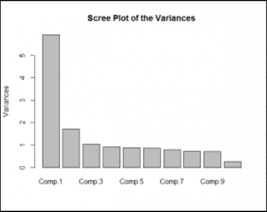

以下碎石图显示了我们应该为该数据集保留多少个主成分：

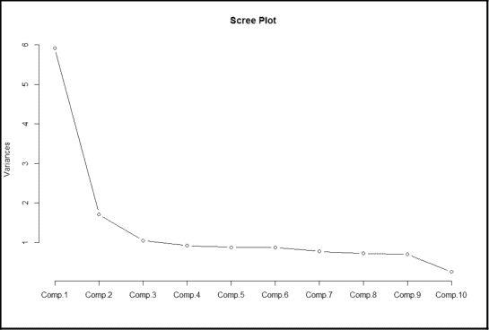

从前面的碎石图可以得出，第一主成分具有最高的方差，其次是第二和第三。从图中可以看出，三个主成分的方差高于其他主成分。

以下双标图表示 n 维空间中主成分的存在：

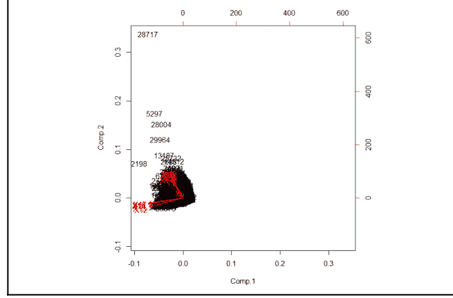

协方差矩阵的对角元素是变量的方差；非对角变量是不同变量之间的协方差：

```
> diag(cov(df))
X1 X5 X12 X13 X14 X15 X16 X17 X18 X19 X20
1.7e+10 8.5e+01 5.4e+09 5.1e+09 4.8e+09 4.1e+09 3.7e+09 3.5e+09 2.7e+08
5.3e+08 3.1e+08
X21 X22 X23
2.5e+08 2.3e+08 3.2e+08
```

分数的解释有点棘手，因为除非你将它们用于沿特征向量定义的直线上作图，否则它们没有任何意义。PC 分数是每个点相对于主轴的坐标。利用特征值你可以提取特征向量，这些特征向量描述了一条直线来解释 PCs。PCA 是一种多维缩放形式，因为它在不丢失变量太多信息的情况下将数据表示在较低维度。成分分数基本上是载荷与均值中心化缩放数据集的线性组合。

当我们处理多元数据时，可视化和围绕其构建模型非常困难。为了减少特征，使用 PCA；它减少维度，以便我们可以在较低维度中绘图、可视化并预测未来。主成分彼此正交，这意味着它们是不相关的。在数据预处理阶段，缩放函数决定了需要哪种类型的输入数据矩阵。如果使用均值中心化方法作为变换，则协方差矩阵应作为 PCA 的输入数据使用。如果缩放函数执行标准 z 分数变换，假设标准差等于 1，则应使用相关矩阵作为 PCA 的输入数据。

现在问题是应用哪种变换。如果变量高度偏斜，则应使用 z 分数变换和基于相关性的 PCA。如果输入数据近似对称，则应应用均值中心化方法和基于协方差的 PCA。

现在，让我们来看一下主成分分数：

```
> #scores of the components
> pca1$scores[1:10,]
Comp.1 Comp.2 Comp.3 Comp.4 Comp.5 Comp.6 Comp.7 Comp.8 Comp.9 Comp.10
Comp.11 Comp.12 Comp.13 Comp.14
[1,] 1.96 -0.54 -1.330 0.1758 -0.0175 0.0029 0.013 -0.057 -0.22 0.020
0.0169 0.0032 -0.0082 0.00985
[2,] 1.74 -0.22 -0.864 0.2806 -0.0486 -0.1177 0.099 -0.075 0.29 -0.073
-0.0055 -0.0122 0.0040 0.00072
[3,] 1.22 -0.28 -0.213 0.0082 -0.1269 -0.0627 -0.014 -0.084 -0.28 -0.016
0.1125 0.0805 0.0413 -0.05711
[4,] 0.54 -0.67 -0.097 -0.2924 -0.0097 0.1086 -0.134 -0.063 -0.60 0.144
0.0017 -0.1381 -0.0183 -0.05794
[5,] 0.85 0.74 1.392 -1.6589 0.3178 0.5846 -0.543 -1.113 -1.24 -0.038
-0.0195 -0.0560 0.0370 -0.01208
[6,] 0.54 -0.71 -0.081 -0.2880 -0.0924 0.1145 -0.194 -0.015 -0.58 0.505
0.0276 -0.1848 -0.0114 -0.14273
[7,] -15.88 -0.96 -1.371 -1.1334 0.3062 0.0641 0.514 0.771 0.99 -2.890
-0.4219 0.4631 0.3738 0.32748
[8,] 1.80 -0.29 -1.182 0.4394 -0.0620 -0.0440 0.076 -0.013 0.26 0.046
0.0484 0.0584 0.0268 -0.04504
[9,] 1.41 -0.21 -0.648 0.1902 -0.0653 -0.0658 0.040 0.122 0.33 -0.028
-0.0818 0.0296 -0.0605 0.00106
[10,] 1.69 -0.18 -0.347 -0.0891 0.5969 -0.2973 -0.453 -0.140 -0.74 -0.137
0.0248 -0.0218 0.0028 0.00423
```

较大的特征值表示维度中较大的变化。以下脚本显示了如何从相关矩阵计算特征值和特征向量：

```
> eigen(cor(df),TRUE)$values
```

```
7.5e-03 6.4e-03 5.8e-03 3.0e-03 2.4e-03 1.7e-03 1.5e-03 1.8e-09
Cumulative Proportion 6.1e-01 9.1e-01 9.4e-01 9.5e-01 9.6e-01 9.7e-01
9.8e-01 9.9e-01 9.9e-01 9.9e-01 1.0e+00 1.0e+00 1.0e+00 1.0e+00
```

下一个屏幕图表明三个主成分构成了数据集中大部分的变化。x 轴显示主成分，y 轴显示标准差（方差 = 标准差的平方）。

以下脚本显示了正在创建的绘图：

```
> result<-round(summary(pca2)[1]$sdev,0)
> #scree plot
> plot(result, main = "Standard Deviation by Principal Components",
+ xlab="Principal Components",ylab="Standard Deviation",type='o')
```

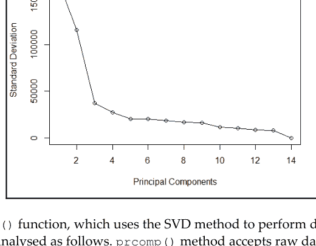

使用 prcomp() 函数，该函数使用 SVD 方法执行降维，可以分析如下。prcomp() 方法接受原始数据集作为输入，并且它有一个内置参数，要求将缩放设为 true：

```
> pca<-prcomp(df,scale. = T)
> summary(pca)
Importance of components:
PC1 PC2 PC3 PC4 PC5 PC6 PC7 PC8 PC9 PC10
Standard deviation 2.433 1.310 1.0223 0.9617 0.9400 0.9342 0.8829 0.8524
0.8409 0.5142
Proportion of Variance 0.423 0.123 0.0746 0.0661 0.0631 0.0623 0.0557
```

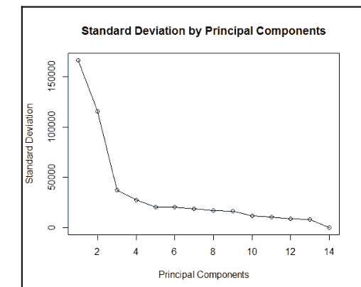

正交的红色线条表示解释整个数据集的主成分。

在讨论了各种变量缩减方法之后，输出会是什么；输出应该是一个新的数据集，其中所有主成分彼此不相关。该数据集可用于任何任务，例如分类、回归或聚类等。从主成分分析的结果我们如何得到新的数据集；让我们看一下以下脚本：

```
> #calculating Eigen vectors
> eig<-eigen(cor(df))
> #Compute the new dataset
> eigvec<-t(eig$vectors) #transpose the eigen vectors
> df_scaled<-t(dn) #transpose the adjusted data
> df_new<-eigvec %*% df_scaled
> df_new<-t(df_new)
> colnames(df_new)<-c("PC1", "PC2", "PC3", "PC4",
+ "PC5", "PC6", "PC7", "PC8",
+ "PC9", "PC10", "PC11", "PC12",
+ "PC13", "PC14")
> head(df_new)
PC1 PC2 PC3 PC4 PC5 PC6 PC7 PC8 PC9 PC10 PC11 PC12
[1,] 128773 -19470 -49984 -27479 7224 10905 -14647 -4881 -113084 -2291 1655 2337
[2,] 108081 11293 -12670 -7308 3959 2002 -3016 -1662 -32002 -9819 -295 920
[3,] 80050 -7979 -24607 -11803 2385 3411 -6805 -3154 -59324 -1202 7596 7501
[4,] 37080 -39164 -41935 -23539 2095 9931 -15015 -4291 -92461 12488 -11 -7943
```

```
[5,] 77548 356 -50654 -38425 7801 20782 -19707 -28953 -88730 -12624 -9028 -4467
[6,] 34793 -42350 -40802 -22729 -2772 9948 -17731 -2654 -91543 37090 2685 -10960
PC13 PC14
[1,] -862 501
[2,] -238 -97
[3,] 2522 -4342
[4,] -1499 -4224
[5,] 3331 -9412
[6,] -1047 -10120
```

## 降维的参数方法

在一定程度上，我们在第 4 章《汽车数据的回归》中触及了基于模型降维，在该章中我们尝试实现回归建模，并在该过程中尝试通过应用赤池信息准则（AIC）来减少数据维度。贝叶斯信息准则（BIC）等 AIC 也可用于减少数据维度。就基于模型的方法而言，有两种方法：

- **向前选择法**：在向前选择法中，一次向模型中添加一个变量，并计算模型拟合优度统计量和误差。如果新维度的添加减少了误差并增加了模型拟合优度，则该维度将被模型保留，否则该维度将被从模型中移除。这适用于不同的监督算法，例如随机森林、逻辑回归、神经网络和基于支持向量机的实现。特征选择过程一直持续到所有变量都经过测试。
- **向后选择法**：在向后选择法中，模型从所有变量一起开始。然后从模型中删除一个变量并计算模型拟合优度统计量和误差（任何预定义的损失函数）。如果新维度的删除减少了误差并增加了模型拟合优度，则该维度将被从模型中删除，否则该维度将被模型保留。


我们在本章讨论的问题是监督学习分类的一个案例，其中因变量是违约或未违约。正如我们在第4章“使用汽车数据进行回归”中的逻辑回归部分所讨论的，逻辑回归方法使用逐步降维过程从模型中移除不需要的变量。同样的操作也可以在我们本章讨论的数据集上进行。

除了标准的数据降维方法之外，还有一些不太重要但可以考虑的方法，例如缺失值估计方法。在具有许多维度的庞大数据集中，稀疏性问题将是一种常见情况。在应用任何正式的降维过程之前，如果我们能在数据集上应用缺失值百分比计算方法，就可以剔除许多变量。剔除未达到最低缺失百分比的变量的阈值必须由分析师来决定。

## 参考文献

Yeh, I. C., & Lien, C. H. (2009). 数据挖掘技术对信用卡客户违约概率预测准确性的比较。Expert Systems with Applications, 36(2), 2473-2480.

## 小结

在本章中，我们讨论了在样本数据集中执行降维的各种方法。移除冗余特征不仅提高了模型精度，还节省了计算工作量和时间。从业务用户的角度来看，维度数量较少时，构建策略比关注大量特征更直观。我们讨论了在何处使用哪种技术，以及每种方法的数据要求。降维还为大型数据集提供了有意义的洞察。在下一章中，我们将学习用于分类、回归和时间序列预测的神经网络方法。

## 神经网络简介

大脑的生物网络为现实场景中的信息处理和洞察生成提供了连接元素的基础。它是一个通过层连接的神经元层级结构，其中一层的输出成为另一层的输入；信息以权重形式从一层传递到另一层。与每个神经元相关的权重包含洞察，使得下一层的识别和推理变得更加容易。人工神经网络是一种非常流行且有效的方法，由与权重关联的层组成。不同层之间的关联由数学方程控制，将信息从一层传递到另一层。事实上，一个人工神经网络模型内部有一系列数学方程在起作用。下图展示了基于神经网络的模型的一般架构：

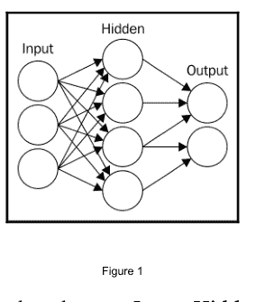

图1

在上图中，有三个层——输入层、隐藏层和输出层——它们是任何基于神经网络的架构的核心。人工神经网络是一种强大的技术，可用于解决许多现实世界问题，如分类、回归和特征选择。人工神经网络能够以新输入数据的形式从新经验中学习，以改进基于分类或回归任务的性能，并适应输入环境的变化。上图中的每个圆圈代表一个神经元。

神经网络有多种不同的变体，用于多种不同的场景；我们将在本章从概念上解释其中几种，以及它们在实际应用中的用法：

- **单隐藏层神经网络**：这是最简单的神经网络形式，如上图所示。其中只有一个隐藏层。
- **多隐藏层神经网络**：在这种形式中，多个隐藏层将连接输入数据和输出数据。计算的复杂性。

### 理解神经网络背后的数学

如图1所示，不同层（输入层、隐藏层和输出层）中的神经元通过称为激活函数的数学函数相互连接。激活函数有不同的变体，如下所述。理解激活函数将有助于实现神经网络模型以获得更高的精度：

- **Sigmoid函数**：这种函数经常被数据挖掘和分析领域的专业人士使用，因为它更容易解释和实现。其方程如下：

  $$f(x) = \frac{1}{1 + e^{-\beta x}}$$

  Sigmoid函数，也称为逻辑函数，主要用于将输入层的数据转换到映射层或隐藏层。
- **线性函数**：这是通常用于将信息从解映射层传递到输出层的简单函数之一。公式如下：

  $$f(x)=x$$
- **高斯函数**：高斯函数是钟形曲线，适用于连续变量，其目标是将输出分类为多个类别：

  $$f(x) = \frac{1}{\sqrt{2\pi}\sigma} e^{\frac{-(x-\mu)^2}{2\sigma^2}}$$
- **双曲正切函数**：这是变换函数的另一种变体；用于将信息从映射层转换到隐藏层：

  $$\tanh(x) = \frac{e^{x} - e^{-x}}{e^{x} + e^{-x}}$$
- **对数Sigmoid传递函数**：以下公式解释用于将输入层映射到隐藏层的对数Sigmoid传递函数：

  $$f(x) = \log\left(\frac{1}{1 + e^{-\beta x}}\right)$$
- **径向基函数**：这是另一种激活函数；用于将信息从解映射层传递到输出层：

  $$f(x) = \sum_{j=1}^{m} w_{j} h_{j}(x)$$

如前所述，不同类型的传递函数在神经网络架构中可以互换。它们可以用于不同的阶段，例如从输入到隐藏、从隐藏到输出等，以提高模型精度。

### 在R中实现神经网络

用于统计计算的R编程提供了三个不同的库来执行各种任务的神经网络模型。这三个库是 `nnet`、`neuralnet` 和 `rsnns`。在本章中，我们将使用 `ArtPiece_1.csv` 以及 `nnet` 和 `neuralnet` 这两个库来执行各种任务。这两个库中神经网络的语法如下所述。

`neuralnet` 库依赖于另外两个库 `grid` 和 `MASS`；在安装 `neuralnet` 库时，必须确保这两个依赖库已正确安装。在拟合神经网络模型时，模型所需的精度水平决定了隐藏层的数量及其中的神经元数量；隐藏层的数量随着复杂度的增加而增加。该库提供了使用反向传播、带权重回溯的弹性反向传播（Riedmiller, 1994）或不带权重回溯的弹性反向传播（Riedmiller and Braun, 1993），或由 Anastasiadis 等人（2005）提出的修正全局收敛版本进行神经网络训练的选项。该包允许通过自定义选择误差函数和激活函数进行灵活设置。现在，让我们看一下语法以及其中决定模型精度的组件：

| 公式 | 定义输入和输出关系 |
| --- | --- |
| `Data` | 包含输入和输出变量的数据集。 |
| `Hidden` | 指定隐藏层数量的向量。例如，(10, 5, 2) 表示第一层有 10 个隐藏神经元，第二层有 5 个，第三层有 2 个。 |
| `Stepmax` | 要使用的最大步数。 |
| `Rep` | 迭代次数。 |
| `Startweights` | 连接的随机权重。 |
| `Algorithm` | 用于拟合神经网络对象的算法。`'backprop'` 指反向传播。`'rprop+'` 和 `'rprop-'` 分别指带权重回溯和不带权重回溯的弹性反向传播，而 `'sag'` 和 `'slr'` 分别指最小绝对梯度和最小学习率。 |
| `Err.fct` | 两种方法：用于基于回归的预测的**平方和误差（SSE）**和用于基于分类的问题的**交叉熵（CE）**。 |
| `Act.fct` | `"logistic"` 和 `"tanh"` 分别对应逻辑函数和双曲正切函数。 |
| `Linear.output` | 如果对输出层不应用激活函数，则该值为 TRUE。 |
| `Likelihood` | 如果误差函数等于负对数似然函数，将计算信息准则 AIC 和 BIC。 |

**表1：neuralnet 语法说明**


```
$ Critic.Ratings : num 8.9 9.36 7.38 6.56 6.94 ...
$ Buyer.No : int 21973 19638 19638 19638 19638 19638 19638 19638 21973 21973 ...
$ Zip.Code : int 33619 33619 33619 33619 33619 33619 33619 33619 33619 33619 ...
$ Art.Purchase.Date : Factor w/ 517 levels "1/10/2012","1/10/2013",...: 386 386 386 386 386 386 386 386 386 ...
$ Year.of.art.piece : Factor w/ 10 levels "01-01-1947","01-01-1948",...: 6 4 5 4 4 5 7 7 ...
$ Acq.Cost : num 49700 53200 34300 28700 28000 39200 29400 31500 39200 53900 ...
$ Art.Category : Factor w/ 33 levels "Abstract Art Type I",...: 1 13 13 13 30 24 31 30 31 30 ...
$ Art.Piece.Size : Factor w/ 864 levels "10in. x 10in.",...: 212 581 68 837 785 384 485 725 485 794 ...
$ Border.of.art.piece : Factor w/ 133 levels " ","Border 1",...: 2 40 48 48 56 64 74 85 74 97 ...
$ Art.Type : Factor w/ 1063 levels "Type 1","Type 10",...: 1 176 287 398 509 620 731 842 731 953 ...
$ Prominent.Color : Factor w/ 17 levels "Beige","Black",...: 14 16 8 15 15 16 2 16 2 14 ...
$ CurrentAuctionAveragePrice: int 52157 52192 28245 12908 22729 32963 20860 25991 44919 64169 ...
$ Brush : Factor w/ 4 levels "","Camel Hair Brush",...: 2 2 2 2 4 2 2 2 2 2 ...
$ Brush.Size : Factor w/ 5 levels "0","1","2","3",...: 2 2 3 2 3 3 3 3 3 2 ...
$ Brush.Finesse : Factor w/ 4 levels "Coarse","Fine",...: 2 2 1 2 1 1 1 1 2 ...
$ Art.Nationality : Factor w/ 5 levels "American","Asian",...: 3 1 1 1 1 3 3 1 3 1 ...
$ Top.3.artists : Factor w/ 5 levels "MF Hussain","NULL",...: 3 1 1 1 4 3 3 4 3 4 ...
$ CollectorsAverageprice : Factor w/ 13193 levels "#VALUE!","0",...: 11433 11808 7802 4776 7034 8536 7707 7355 9836 483 ...
$ GoodArt.Check : Factor w/ 3 levels "NO","NULL","YES": 2 2 2 2 2 2 2 2 2 ...
$ AuctionHouseGuarantee : Factor w/ 3 levels "GREEN","NULL",...: 2 2 2 2 2 2 2 2 2 ...
$ Vnst : Factor w/ 37 levels "AL","AR","AZ",...: 6 6 6 6 6 6 6 6 6 ...
$ Is.It.Online.Sale : int 0 0 0 0 0 0 0 0 0 0 ...
$ Min.Guarantee.Cost : int 7791 7371 9723 4410 7140 4158 3731 5775 3374 11431 ...
```

## 神经网络预测

使用神经网络进行预测要求目标（因变量/输出）变量为数值型，而所有输入（自变量/特征）变量可以是任意类型。我们将基于 ArtPiece 数据集中的所有可用参数，预测当前的拍卖平均价格。在应用基于神经网络的模型之前，对数据进行预处理非常重要，包括排除缺失值以及进行必要的转换；因此，让我们对数据进行预处理：

```
library(neuralnet)
art<- read.csv("ArtPiece_1.csv")
str(art)
#data conversion for categorical features
art$Art.Auction.House<-as.factor(art$Art.Auction.House)
art$IsGood.Purchase<-as.factor(art$IsGood.Purchase)
art$Art.Category<-as.factor(art$Art.Category)
art$Prominent.Color<-as.factor(art$Prominent.Color)
art$Brush<-as.factor(art$Brush)
art$Brush.Size<-as.factor(art$Brush.Size)
art$Brush.Finesse<-as.factor(art$Brush.Finesse)
art$Art.Nationality<-as.factor(art$Art.Nationality)
art$Top.3.artists<-as.factor(art$Top.3.artists)
art$GoodArt.check<-as.factor(art$GoodArt.check)
art$AuctionHouseGuarantee<-as.factor(art$AuctionHouseGuarantee)
art$Is.It.Online.Sale<-as.factor(art$Is.It.Online.Sale)
#data conversion for numeric features
art$Critic.Ratings<-as.numeric(art$Critic.Ratings)
art$Acq.Cost<-as.numeric(art$Acq.Cost)
art$CurrentAuctionAveragePrice<-as.numeric(art$CurrentAuctionAveragePrice)
art$CollectorsAverageprice<-as.numeric(art$CollectorsAverageprice)
art$Min.Guarantee.Cost<-as.numeric(art$Min.Guarantee.Cost)
#removing NA, Missing values from the data
fun1<-function(x){
ifelse(x=="#VALUE!",NA,x)
}
art<-as.data.frame(apply(art,2,fun1))
art<-na.omit(art)
#keeping only relevant variables for prediction
art<-art[,c("Art.Auction.House","IsGood.Purchase","Art.Category",
"Prominent.Color","Brush","Brush.Size","Brush.Finesse",
"Art.Nationality","Top.3.artists","GoodArt.check",
"AuctionHouseGuarantee","Is.It.Online.Sale","Critic.Ratings",
"Acq.Cost","CurrentAuctionAveragePrice","CollectorsAverageprice",
"Min.Guarantee.Cost")]
#creating dummy variables for the categorical variables
library(dummy)
art_dummy<-
```

```
dummy(art[,c("Art.Auction.House","IsGood.Purchase","Art.Category",
"Prominent.Color","Brush","Brush.Size","Brush.Finesse",
"Art.Nationality","Top.3.artists","GoodArt.check",
"AuctionHouseGuarantee","Is.It.Online.Sale")],int=F)
art_num<-art[,c("Critic.Ratings",
"Acq.Cost","CurrentAuctionAveragePrice","CollectorsAverageprice",
"Min.Guarantee.Cost")]
art<-cbind(art_num,art_dummy)
## 70% of the sample size
smp_size <- floor(0.70 * nrow(art))
## set the seed to make your partition reproducible
set.seed(123)
train_ind <- sample(seq_len(nrow(art)), size = smp_size)
train <- art[train_ind, ]
test <- art[-train_ind, ]
fun2<-function(x){
  as.numeric(x)
}
train<-as.data.frame(apply(train,2,fun2))
test<-as.data.frame(apply(test,2,fun2))
```

在训练数据集中，有 50,867 个观测值和 17 个变量；在测试数据集中，有 21,801 个观测值和 17 个变量。当前的拍卖平均价格作为预测的因变量，仅使用另外四个数值变量作为特征：

```
>fit<- neuralnet(formula = CurrentAuctionAveragePrice ~ Critic.Ratings +
Acq.Cost + CollectorsAverageprice + Min.Guarantee.Cost, data = train,
hidden = 15, err.fct = "sse", linear.output = F)
> fit
Call: neuralnet(formula = CurrentAuctionAveragePrice ~ Critic.Ratings +
Acq.Cost + CollectorsAverageprice + Min.Guarantee.Cost, data = train,
hidden = 15, err.fct = "sse", linear.output = F)
1 repetition was calculated.
Error Reached Threshold Steps
1 54179625353167 0.004727494957 23
```

模型主要结果的摘要由 result.matrix 提供。result.matrix 的一个快照如下所示：

```
> fit$result.matrix
1
error 54179625353167.000000000000
reached.threshold 0.004727494957
steps 23.000000000000
Intercept.to.1layhid1 -0.100084491816
Critic.Ratings.to.1layhid1 0.686332945444
Acq.Cost.to.1layhid1 0.196864454378
CollectorsAverageprice.to.1layhid1 -0.793174429352
```

```
Min.Guarantee.Cost.to.1layhid1 0.528046199494
Intercept.to.1layhid2 0.973616842194
Critic.Ratings.to.1layhid2 0.839826678316
Acq.Cost.to.1layhid2 0.077798897157
CollectorsAverageprice.to.1layhid2 0.988149246218
Min.Guarantee.Cost.to.1layhid2 -0.385031389636
Intercept.to.1layhid3 -0.008367359937
Critic.Ratings.to.1layhid3 -1.409715725621
Acq.Cost.to.1layhid3 -0.384200569485
CollectorsAverageprice.to.1layhid3 -1.019243809714
Min.Guarantee.Cost.to.1layhid3 0.699876747202
Intercept.to.1layhid4 2.085203047278
Critic.Ratings.to.1layhid4 0.406934874266
Acq.Cost.to.1layhid4 1.121189503896
CollectorsAverageprice.to.1layhid4 1.405748076570
Min.Guarantee.Cost.to.1layhid4 -1.043884892202
Intercept.to.1layhid5 0.862634752109
Critic.Ratings.to.1layhid5 0.814364667751
Acq.Cost.to.1layhid5 0.502879862694
```

如果误差函数等于负对数似然函数，则误差指的是用于计算赤池信息准则（AIC）的似然值。我们可以将协变量和响应数据存储在一个矩阵中：

```
> output<-cbind(fit$covariate,fit$result.matrix[[1]])
> head(output)
[,1] [,2] [,3] [,4] [,5]
[1,] 14953 49000 10727 5775 54179625353167
[2,] 35735 38850 9494 12418 54179625353167
[3,] 34751 43750 8738 9611 54179625353167
[4,] 31599 41615 5955 4158 54179625353167
[5,] 10437 34755 8390 4697 54179625353167
[6,] 13177 54670 13024 11921 54179625353167
```

为了比较神经网络模型的结果，我们可以使用不同的调节因素，例如改变算法、隐藏层和学习率。作为示例，我们仅使用了四个数值特征来生成预测；而我们本可以使用全部 91 个特征来预测当前拍卖平均价格变量。我们还可以使用 nnet 库中的不同算法，如下所示：

```
> fit<-nnet(CurrentAuctionAveragePrice~Critic.Ratings+Acq.Cost+
+ CollectorsAverageprice+Min.Guarantee.Cost,data=train,
+ size=100)
# weights: 601
initial value 108359809492660.125000
final value 108359250706334.000000
converged
```


> fit
a 4~100~1 network with 601 weights
inputs: Critic.Ratings Acq.Cost CollectorsAverageprice Min.Guarantee.Cost
output(s): CurrentAuctionAveragePrice
options were -

Both the libraries provide equal results; there is no difference in the model result, but to tune the results further, it is important to look at the model tuning parameters such as learning rate, hidden neurons, and so on. The following graph shows the neural network architecture:

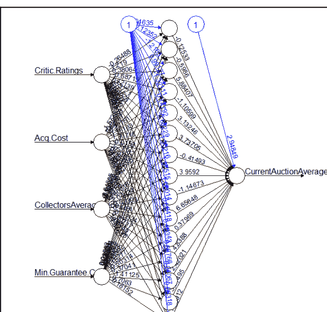

The model for predicting the unseen data points can be implemented using the compute function available in the neuralnet library, and the predict function available in the nnet library.

## Neural networks for classification

For classification-based projects, the dependent variable can be binary or can have multiple levels, such as credit card fraud detection, classification of customers into different clusters as far as the marketing is concerned, and so on. In the current scenario from the ArtPiece dataset, we are trying to predict whether a work of art is a good purchase, or not, by taking a few business-relevant variables. For demo purposes, we have considered only a few features, but other features present in the dataset can be used to generate a better result:

```
> fit<-neuralnet(IsGood.Purchase_1~Brush.Size_1+Brush.Size_2+Brush.Size_3+
+ Brush.Finesse_Coarse+Brush.Finesse_Fine+
+ Art.Nationality_American+Art.Nationality_Asian+
+ Art.Nationality_European+GoodArt.check_YES,data=train[1:2000,],
+ hidden = 25,err.fct = "ce",linear.output = F)
> fit
Call: neuralnet(formula = IsGood.Purchase_1 ~ Brush.Size_1 + Brush.Size_2 +
    Brush.Size_3 + Brush.Finesse_Coarse + Brush.Finesse_Fine +
    Art.Nationality_American + Art.Nationality_Asian + Art.Nationality_European
    + GoodArt.check_YES, data = train[1:2000, ], hidden = 25, err.fct = "ce",
    linear.output = F)
1 repetition was calculated.
Error Reached Threshold Steps
1 666.1522488 0.009864324362 8254
> output<-cbind(fit$covariate,fit$result.matrix[[1]])
> head(output)
     [,1] [,2] [,3] [,4] [,5] [,6] [,7] [,8] [,9] [,10]
[1,] 1 0 0 0 1 0 0 1 0 666.1522488
[2,] 1 0 0 1 1 0 0 0 0 666.1522488
[3,] 1 0 0 1 0 0 1 0 0 666.1522488
[4,] 0 1 0 1 0 0 0 1 0 666.1522488
[5,] 0 1 0 1 0 1 0 0 0 666.1522488
[6,] 1 0 0 1 1 0 0 0 0 666.1522488
```

The actual time series looks as follows:

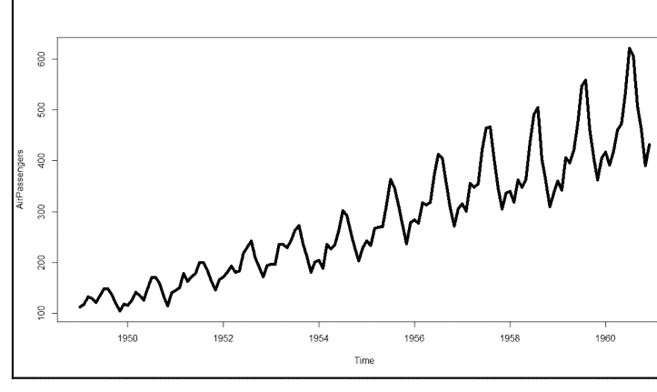

```
> fit<-nnetar(AirPassengers, p=9,P=,size = 10, repeats = 50,lambda = 0)>
plot(forecast(fit,10))
```

A neural-network-based forecasting model generates the following results as an output:

```
> summary(fit)
Length Class Mode
x 144 ts numeric
m 1 -none- numeric
p 1 -none- numeric
P 1 -none- numeric
scale 1 -none- numeric
size 1 -none- numeric
lambda 1 -none- numeric
model 50 nnetarmodels list
fitted 144 ts numeric
residuals 144 ts numeric
lags 10 -none- numeric
series 1 -none- character
method 1 -none- character
call 6 -none- call
```

With a forecast of the next 10 periods, the graph looks as follows:

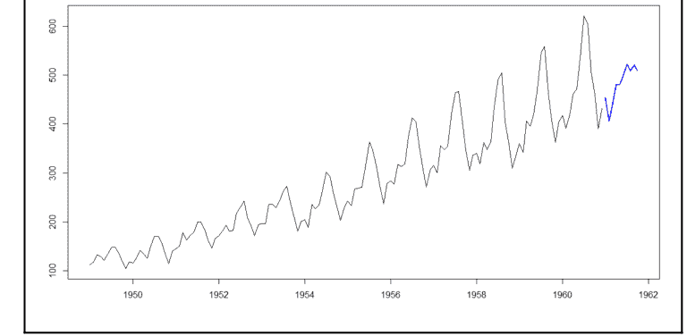

## Merits and demerits of neural networks

The neural network method for performing classification, prediction, and forecasting is still recognized as a black box methodology in different industries. People still provide more importance to logistic regression than neural network because of its complexity in explaining the relationship between the dependent and independent variable.

The limitations of the neural network model can be stated as follows:

- In contrast to decision trees and rule extraction techniques, the knowledge (patterns) “discovered” by neural networks is not represented in a form understandable by humans.
- Knowledge in a trained neural network (NN) is encoded in its connection weights; hence, NN cannot be used for descriptive data mining (exploration).
- If NN are used for decision making, it is impossible to explain their decisions. Often other techniques have to be combined with NN for explanation.

Here are the merits of neural networks:

- Though it is a bit complex to understand and interpret the results, still it is considered a powerful technique for classification and regression
- It is considered a powerful machine learning technique for automatic predictive modeling
- It captures complex relationships in datasets, which a traditional algorithm such as linear regression or logistic regression fails to understand and interpret

## References

Lichman, M. (2013). *UCI Machine Learning Repository* (http://archive.ics.uci.edu/m 1). Irvine, CA: University of California, School of Information and Computer Science

## Summary

In this chapter, we discussed various methods of performing classification, regression, and forecasting using the neural network model. Be it supervised or unsupervised data mining problems, neural-network-based implementations are popular not only among users but also among business stakeholders. We discussed which model to use where and the data requirement for each of the models. In this chapter, we specifically highlighted the importance of a powerful technique with better accuracy always for classification- and regression-based scenarios.
