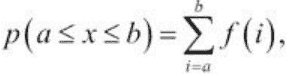
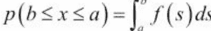
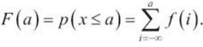
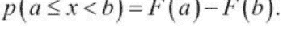
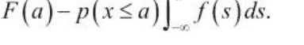
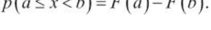

## 第 3 章 保存数据与打印结果

本章将广泛介绍将信息输入 R 环境以及从 R 环境输出信息的方法。虽然有许多包可用且与此重要功能相关，但我们将把重点放在一部分基础的内置函数上。本章分为以下五个部分：

- **文件和目录信息：** 本节简要介绍 R 环境中文件和目录的组织方式。
- **输入：** 本节概述可用于将数据导入 R 环境的方法。
- **输出：** 本节概述可用于将数据从 R 环境导出的方法。
- **原始输入/输出：** 本节概述可用于以预定义格式写入二进制或字符数据的方法。
- **网络选项：** 本节简要介绍与创建和操作套接字相关的方法。

### 输入数据

在讨论了与目录和文件相关的概念之后，我们现在可以讨论如何读取数据。这里，我们将概述从文件中获取信息的不同方法。我们首先简要介绍如何从命令行输入数据，然后举例说明如何读取文本文件（表格形式）、csv 文件和固定宽度文件。最后，我们将讨论从二进制文件读取数据的更原始的方法。

需要注意的是，我们将依赖于[第 1 章](#)（数据类型）和[第 2 章](#)（组织数据）中讨论的主题。我假设你已经熟悉[第 1 章](#)（数据类型）中给出的各种数据类型，以及[第 2 章](#)（组织数据）中讨论的数据结构。在本章中，我们将探讨将数据读取到 R 中的少数几种方法。目前有大量可用的库，能够读取多种格式的数据，如 JSON、XML、SAS、Excel 及其他文件格式。在基础 R 发行版中也有更多选项。要查看更多选项，请键入 `read` 并按 *TAB* 键（在字母 *read* 之后不要有空格）以查看其他选项的部分列表。

pine, 34.8
oak, 25.3

第一列是字符数据，第二列是数值数据。每行中的信息以逗号分隔。scan 命令默认假定信息使用空白（空格和制表符）分隔，因此在这种情况下，我们必须指定文件中使用逗号作为分隔符。在以下示例中，读取文件并通过 `what` 参数指定格式：

```
> x <- scan("trees.csv",what=list("character","double"),sep=",")
Read 5 records
> x
[[1]]
[1] "pine" "pine" "oak" "pine" "oak"

[[2]]
[1] "28.8" "27.3" "45.8" "34.8" "25.3"
```

另一种输入数据的方法是使用 `data.entry` 命令。如果系统上存在图形界面，该命令将打开一个图形界面。具体细节可能因操作系统和你所使用的图形界面而异。

### CSV 文件

`read.table` 命令提供了一种从已知结构中读取数据文件的通用方法。一种常见的文件结构是值之间以逗号分隔的文件，即 csv 文件。读取 csv 文件的命令是 `read.csv`。该命令还有一个替代版本 `read.csv2`，其默认参数有所不同。区别在于，`read.csv2` 的默认值被定义为允许简单读取以下文件：小数分隔符为逗号，值之间以分号分隔，这种格式在一些欧洲国家更为常见。

`read.csv` 命令与 `read.table` 命令类似。主要区别在于前者返回的结果是数据框，并且能够识别更多类型的列数据类型。

在前面的示例中，`trialTable.csv` 文件被读取到工作区中。同样的文件也可以使用 `read.csv` 命令读取。`trialTable.csv` 文件没有表头，数字之间用空格分隔：

```
```r
> trial <- read.csv("trialTable.csv",header=FALSE,sep=' ')
> trial
   V1 V2 V3
1  1  2  3
2  3  5  6
> typeof(trial)
[1] "list"
```
```

在下一个示例中，我们有一个数据文件，其中每行具有相同的列数，数据字段以逗号分隔。该文件下载自 [http://www.bea.gov/](http://www.bea.gov/)。该文件的前六行用于以人类可读的形式标识有关数据的信息，但 `read.csv` 函数应忽略这些信息。另外需要注意，第七行是表头，其中包含用于定义列标签的信息。最后要注意的是，数字以逗号分隔。如果我们想使用 `read.csv` 命令读取该文件，必须指定所有这些细节。第二个文件 `inventories.csv` 可以使用 `read.csv` 命令读取，如下所示：

```
```r
inventories <- read.csv("inventories.csv", + skip=6,header=TRUE,sep=",")
> typeof(inventories)
[1] "list"
> names(inventories)
[1] "Line"     "X"        "X1994.1" "X1994.2" "X1994.3" "X1994.4" "X1995.1"
[8] "X1995.2"  "X1995.3"  "X1995.4"  "X1996.1"  "X1996.2"  "X1996.3"  "X1996.4"
```
```

### 打印结果与保存数据

我们将探讨可用的选项，以获取存储在 R 环境中的信息，并将这些信息表示为人类可读或机器可读的形式。我们首先简要讨论如何在 R 环境中保存工作区。接下来，我们将讨论可用于将信息打印到屏幕或文件的各种命令。最后，我们将讨论可用于基本文件操作的原始命令。

### 保存工作区

有两个命令可用来保存当前工作区中的信息。第一个是 save 命令，它允许你保存特定的变量。第二个是 `save.image` 命令，它允许你保存工作区中的所有变量。

save 命令需要一组要保存的变量，以及一个用于保存这些变量的文件名。虽然有很多选项，但在最基本的形式中，你只需保存当前工作区中的特定变量。在这里，我们首先使用 `ls` 命令列出当前工作区中的变量，然后使用 save 命令保存 `inventories` 和 `trees` 这两个变量：

```
```r
> dir()
[1] "diameters.csv"  "inventories.csv" "network.csv" "trees.csv"
[5] "trialFWF.dat"   "trialTable.csv"
> ls()
[1] "a"          "d"          "f"          "inventories" "trees"
[6] "trial"      "x"          "y"
> save(inventories,trees,file="theInventories.RData")
> dir()
[1] "diameters.csv"        "inventories.csv"       "network.csv"
[4] "theInventories.RData" "trees.csv"              "trialFWF.dat"
[7] "trialTable.csv"
```
```

`save.image` 命令只需要一个参数：用于保存信息的文件名：

```
```r
> dir()
[1] "diameters.csv"        "inventories.csv"       "network.csv"
[4] "theInventories.RData" "trees.csv"              "trialFWF.dat"
[7] "trialTable.csv"
> save.image("wholeShebang.RData")
> dir()
[1] "diameters.csv"        "inventories.csv"       "network.csv"
[4] "theInventories.RData" "trees.csv"              "trialFWF.dat"
[7] "trialTable.csv"       "wholeShebang.RData"
```
```

如果你启动一个新的 R 会话，可以使用 `load` 命令读取通过 save 或 `save.image` 命令保存的信息：

```
```r
> ls()
character(0)
> dir()
[1] "diameters.csv"        "inventories.csv"       "network.csv"
[4] "theInventories.RData" "trees.csv"              "trialFWF.dat"
[7] "trialTable.csv"       "wholeShebang.RData"
> load("theInventories.RData")
> ls()
[1] "inventories" "trees"
```
```


### cat 命令

cat 命令可用于获取变量列表，将其转换为文本形式，并连接结果。如果未指定文件或连接器，结果将打印到屏幕上；否则，将使用连接器来确定如何处理结果。请注意，还有一组附加命令，即各种写入命令，但这些命令是便捷例程，允许使用简写符号来访问 cat 命令。这些命令主要用于脚本中：

```r
> one <- "A"
> two <- "B"
> cat(one,two,"\n")
A B
```

cat 命令允许你指定许多选项。例如，你可以指定变量之间的分隔符、要使用的标签，或者是否追加到给定文件：

```r
> cat(one,two,"\n",sep=" - ")
A - B -
```

命令可以一次将整行作为字符写出。

### 网络选项

另一种读取信息的方式是通过使用套接字的网络连接。本节将简要探讨操作套接字的方法。我们首先探索高级套接字命令，这些命令利用 `socketConnection` 命令创建连接器。接下来，简要说明一些更基本的选项。这是一个高级主题，超出了本书的范围，但出于完整性的考虑，此处提供此内容。

#### 打开套接字

`socketConnection` 命令将使用端口号创建到给定主机的网络连接。该命令返回一个连接器，其处理方式与文件连接器相同。在以下示例中，使用标准 HTTP 端口 80 打开到 [waterdata.usgs.gov](https://waterdata.usgs.gov) 网站的连接。然后，它发送必要的 HTTP 头，以请求纽约州北部 Raquette 河上 South Colton 站的日流量数据：

```r
> usgs <- socketConnection(host = "waterdata.usgs.gov",80)
> writeLines("GET /ny/nwis/dv?cb_00060=on&format=rdb&site_no=04267500&referred_module=sw&period=&begin_date=2013-05-08&end_date=2014-05-08 HTTP/1.1",con=usgs)
> writeLines("Host: waterdata.usgs.gov",con=usgs)
> writeLines("\n\n",con=usgs)
> lines <- readLines(usgs)
> lines
 [1] "HTTP/1.1 200 OK"
 [2] "Date: Fri, 09 May 2014 16:28:26 GMT"
 [3] "Server: Apache"
 [4] "AMF-Ver: 4.02"
 [5] "Connection: close"
 [6] "Transfer-Encoding: chunked"
 [7] "Content-Type: text/plain"
 [8] ""
 [9] "3bc"
[10] "# ------------------------------ WARNING ------------------------------"
[11] "# The data you have obtained from this automated U.S. Geological Survey database"
[12] "# have not received Director's approval and as such are provisional and subject to"
[13] "# revision. The data are released on the condition that neither the USGS nor the"
[14] "# United States Government may be held liable for any damages resulting from its use."
[15] "# Additional info: http://waterdata.usgs.gov/ny/nwis/?provisional"
[16] "#"
[17] "# File-format description:  http://waterdata.usgs.gov/nwis/?tab_delimited_format_info"
[18] "# Automated-retrieval info: http://help.waterdata.usgs.gov/faq/automated-retrievals"
[19] "#"
[20] "# Contact:    gs-w_support_nwisweb@usgs.gov"
[21] "# retrieved: 2014-05-09 12:28:35 EDT      (vaww01)"
[22] "#"
[23] "# Data for the following 1 site(s) are contained in this file"
[24] "#    USGS 04267500 RAQUETTE RIVER AT SOUTH COLTON NY"

...

[425] "USGS\t04267500\t2014-05-07\t5810\tP"
[426] "USGS\t04267500\t2014-05-08\t5640\tP"
[427] ""
[428] "0"
[429] ""
> close(usgs)
```

在此示例中，创建了一个套接字连接。它用于建立到具有给定端口的 URL 的连接。然后使用套接字连接器发送 HTTP 头，以从给定主机请求特定页面。使用 `readLines` 命令读取生成的页面。`readLines` 命令用于将每一行作为字符串读取，向量中的信息将需要解析以将其转换为可用形式。

#### 基本套接字操作

除了上一节中给出的较高级别选项之外，还有一些更原始的命令用于创建和使用套接字。所检查的命令是 `make.socket`、`read.socket`、`write.socket` 和 `close.socket` 命令。套接字是稀缺资源，需要设置检查以确保在出现问题时释放它们。因此，通常会在带有额外检查的函数内创建套接字。此处的示例是基本的，仅用于演示这些命令。你应该查看套接字命令的帮助页面以获取更全面的示例。

要复制前面的示例，请打开套接字并提交 HTTP 请求：

```r
> socketRead <- make.socket("waterdata.usgs.gov",80)
> write.socket(socketRead,"GET /ny/nwis/dv?cb_00060=on&format=rdb&site_no=04267500&referred_module=sw&period=&begin_date=2013-05-08&end_date=2014-05-08 HTTP/1.1\n");
> write.socket(socketRead,"Host: waterdata.usgs.gov\n\n\n");
> incoming <- read.socket(socketRead);
> close.socket(socketRead)
[1] FALSE
```

`incoming` 变量现在将包含操作的结果。

### 总结

在本章中，我们探讨了可用于将信息读写到文件的一些工具，以及从命令行输入数据的方法。我们研究了在目录之间切换和获取目录信息的方法。

在研究了读取数据的方法之后，我们探讨了显示信息的一些方式。我们首先研究了如何在命令行上打印信息，然后探讨了如何将数据保存到本地文件。我们还探讨了如何保存当前工作空间并在以后的会话中召回使用。

探讨的一个重要主题是如何处理不符合基本格式的文件。我们研究了读取数据所需的命令，包括文本和二进制形式，其中数据文件遵循预定义的结构。

最后探讨的主题是如何使用网络连接读取信息。这包括使用套接字连接器来访问结构相对良好的信息。我们还探讨了更原始选项，这些选项允许我们以更基本的形式创建和操作套接字。

在前面的章节中，我们研究了存储数据的基本方法。在下一章 [第 4 章](#)，*计算概率与随机数* 中，我们将初步了解可帮助我们理解如何解释数据的函数。我们将探讨一些可用于处理各种预定义概率分布的选项。

| 分布 | 后缀 | 分布 | 后缀 |
| --- | --- | --- | --- |
| 负二项分布 | `nbinom` | 学生 t 分布 | `t` |
| 泊松分布 | `pois` | 均匀分布 | `unif` |
|  |  | 威布尔分布 | `weibull` |

*表 1 – 分布列表及 R 中用于引用它们的后缀*

### 分布函数

我们首先讨论如何在 R 中计算分布函数的值。然后我们将讨论离散分布，接着是连续分布。分布函数用于确定特定事件发生的概率。对于离散分布，该函数称为概率质量函数；对于连续分布，则称为概率分布函数。对于离散分布，概率使用求和来计算，其中 *f(i)* 是概率质量函数：



每个分布都有与其关联的参数，强烈建议明智地使用帮助命令。例如，要获取有关泊松分布的更多信息，可以使用 `help(dpois)` 命令。对于泊松分布，`dpois` 命令需要两个参数。第一个是 x，第二个是 lambda。该函数返回具有 lambda 参数的泊松随机变量返回 x 给定值的概率。

例如，要绘制参数为 10 的泊松分布的概率，使用以下命令生成可以返回的值（称为 x），并使用条形图显示它们：

```r
> x <- 0:20
> probabilities <- dpois(x,10.0)
> barplot(probabilities,names.arg=x,xlab="x",ylab="p",main="Poisson Dist, l=10.0")
```

对于连续分布，随机变量可以取一系列值，并且我们不使用加法，而是找到曲线 *f(s)* 下的面积，该曲线称为概率密度函数：



在下一个示例中，我们使用 X² 分布。X² 分布背后的思想是，你采样 *n* 个遵循标准正态分布的独立随机变量。然后对采样的值进行平方并将它们相加。结果被定义为 X² 分布。请注意，有一个参数 *n*，通常通过给出 *自由度* 来指定，其定义为 *n-1*。自由度通常称为 *df*。

对于此示例，获取概率密度函数近似值的命令是 `dchisq`，它接受两个参数 x 和 df。在这里，我们绘制概率


两个具有不同参数的 $X^2$ 分布的密度函数。首先定义一个数值范围 x，然后绘制自由度为 30 的 $X^2$ 分布的概率密度函数高度。接下来，使用 `points` 命令在同一张图上绘制另一个自由度为 35 的 $X^2$ 分布：

```r
> x <- seq(0.0,100.0,by=0.1)
> prob <- dchisq(x,df=30)
> plot(x,prob,main="Chi Squared Dist.",xlab='x',ylab='p',col=2,type="l")
> probTwo <- dchisq(x,df=35)
> points(x,probTwo,col=3,type="l")
```

### 累积分布函数

另一个用于近似概率的重要工具是累积分布函数。在许多情况下，我们需要确定随机变量在某个给定值范围内取值的概率。累积分布使我们能够用快捷方式计算最终概率。与上一节一样，我们分别讨论离散分布和连续分布。我们将研究定义并查看两种情况的示例。

对于离散分布，累积分布函数定义为以下等式：



根据这个定义，随机变量介于两个数之间的概率可以通过以下等式确定：



请注意不等式中的细节。对于离散分布，使用*小于等于*还是*小于*是有区别的。

对于泊松分布，确定累积分布函数的命令是 `ppois`，其参数与前面讨论的 `dpois` 命令相同。下面的示例与上一节的示例对应，绘制了参数为 10.0 的泊松分布的累积分布函数：

```r
> x <- 0:20
> cdf <- ppois(x,10.0)
> barplot(cdf,names.arg=x)
```

连续随机变量的累积分布函数的定义方式与离散随机变量相同。唯一的区别是，我们使用积分而不是求和，如下所示：



这个定义得到的结果与之前相同，随机变量介于两个数之间的概率可以通过以下等式确定：



以下示例比较了两个 $X^2$ 分布的累积分布函数，其中第一个分布的自由度为 30，第二个分布的自由度为 35：

```r
> x <- seq(0.0,100.0,by=0.1)
> cdf <- pchisq(x,df=30)
> plot(x,cdf,main="Chi Squared Dist.",xlab='x',ylab='p',col=2,
+      type="l")
> cdfTwo <- pchisq(x,df=35)
> points(x,cdfTwo,col=3,type="l")
```

### 逆累积分布函数

累积分布函数通常用于计算概率，但在其他情况下，目标是在给定概率的情况下找到一系列值。在这种情况下，可以使用逆累积分布函数来确定与给定概率对应的随机变量值。其思想是，给定概率后，你需要求解表达式中的 $a$ 值：

$p = p(x \leq a) = F(a)$

例如，假设我们有一个参数为 10.0 的泊松随机变量，希望找到 $a$ 的值，使得随机变量小于 $a$ 的概率为 0.5。使用 `qpois` 命令，我们可以确定该值：

```r
> a <- qpois(0.5,10.0)
> a
[1] 10
```

这一结果表明，参数为 10.0 的泊松随机变量小于 10.0 的概率为 0.5，换句话说，中位数为 10.0。由于这也是该随机变量的均值，我们可以看到该分布不存在偏斜。

现在我们对自由度为 30 的 $X^2$ 分布执行同样的操作。`qchisq` 命令可用于确定该分布的中位数：

```r
> a <- qchisq(0.5,df=30)
> a
[1] 29.33603
```

在这种情况下，我们看到中位数小于均值（即 30），因此自由度为 30 的 $X^2$ 分布向左偏斜，因为中位数位于均值的左侧。

### 生成伪随机数

模拟中的一个常见任务是生成服从给定分布的随机数。我们将探讨这个重要主题，但关于随机数生成，有必要先说明几点。首先，也是最重要的，尽管名称如此，这些数字并不是随机的，因为它们是由确定性算法生成的。其次，在调试和比较用于模拟随机过程的代码时，能够以可重复的方式生成数字以确保结果一致是非常重要的。

在讨论生成随机数之前，我们先提供一些关于 R 如何生成随机数的最小背景信息。这是一个复杂的主题，你可以使用 `help(RNG)` 命令找到更多细节。需要注意的一点是，`.Random.seed` 变量保存当前种子的值，但在你显式设置它或调用需要生成随机数的命令之前，它都是未定义的。你可以直接设置该变量，但最好使用 `set.seed` 命令来更改它。此外，用于生成随机数的算法可以通过 `RNGkind` 命令设置或获取。请注意，如果你在修改既有代码时需要保持结果的可重复性，`save` 命令可以方便地保存种子。

随机数生成可能是一个令人生畏的话题，但我们主要关注如何根据给定分布生成随机数。与之前一样，我们首先考察一个离散分布：参数为 10.0 的泊松分布。然后我们考察一个自由度为 30 的 $X^2$ 分布。在每种情况下，我们生成一百个随机数并创建结果的直方图。

首先我们考察离散分布。可以使用 `rpois` 命令生成这些数字。它接受两个参数：要近似的点数和与分布相关的参数：

```r
> numbers <- rpois(100,10.0)
> hist(numbers,main="100 Samples of a Poisson Dist.",xlab="x")
```

同样，也可以对 $X^2$ 分布进行抽样，并使用直方图绘制结果：

```r
> numbers <- rchisq(100,df=30)
> hist(numbers,main="100 Samples from a Chi-Squared Dist.",xlab="x")
```

### 抽样

我们将讨论的最后一个主题是抽样。这也可以是一个复杂的话题，它常用于自助法（bootstrapping）以及各种其他技术中。由于其普遍性，我们将其作为单独一节进行介绍。

本节唯一关注的是 `sample` 命令。对单个命令给予如此关注可能看起来很奇怪，但抽样是一个复杂的话题，与其相关的观点比统计学家还要多。`sample` 命令至少需要一个参数，即一个向量或一个数字，它返回一组随机选择的值。该命令的选项允许你指定抽样次数、是否使用放回抽样，以及如果你不想使用均匀质量函数，还可以指定一个概率分布。

`sample` 函数的行为取决于你传入的是向量还是数字。如果你向它传入一个数字（即长度为 1 的向量），它将从小于或等于该数字的正整数集合中进行抽样：

```r
> sample(3)
[1] 3 2 1
> sample(5)
[1] 2 3 1 4 5
> sample(5.6)
[1] 5 1 4 3 2
```

如果你传入一个长度大于 1 的向量，它将从向量中的元素进行抽样：

```r
> x <- c(1,3,5,7)
> sample(x)
[1] 7 1 5 3
```

如果你不指定抽样次数，它将使用传入的对象数量。`size` 参数允许你指定不同的抽样次数：

```r
> x <- c(1,3,5,7)
> sample(x,size=2)
[1] 1 7
> sample(x,size=3)
[1] 1 3 5
> sample(x,size=8)
Error in sample.int(length(x), size, replace, prob) :
    cannot take a sample larger than the population when 'replace = FALSE'
```

在前面的示例中，抽样次数大于可用元素的数量。为了避免错误，你必须指定使用放回抽样：

```r
> x <- c(1,3,5,7)
> sample(x,size=8,replace=TRUE)
[1] 3 5 5 5 3 7 5 1
```

在前面的示例中，样本是通过默认算法得到的。默认使用均匀概率质量函数，这意味着每个元素具有相同的


