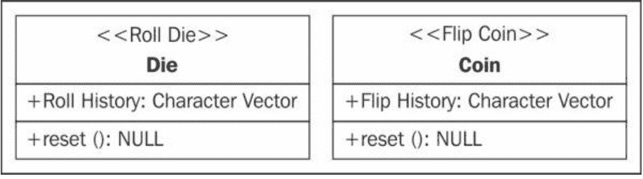
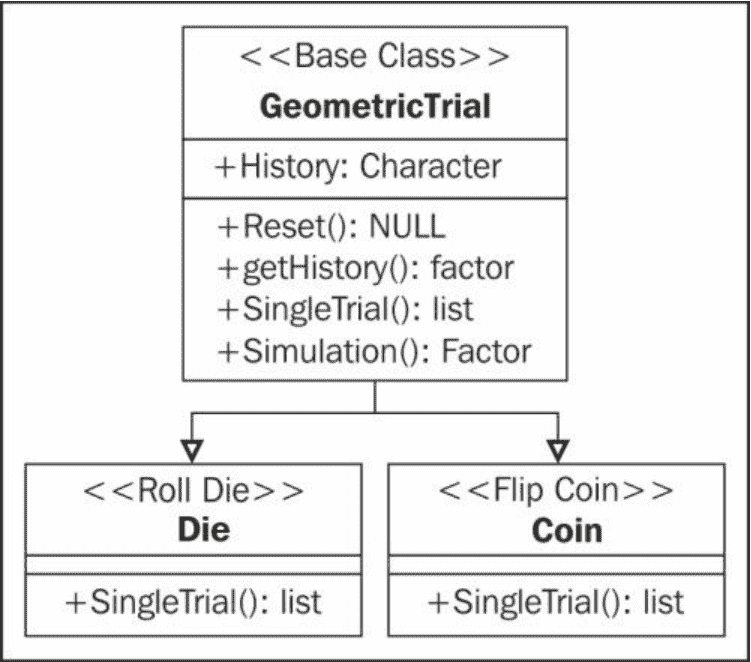

## 第 8 章 S3 类

这是我们编程介绍中的第二章。在前一章中，我们探讨了有助于定义要执行代码的基本控制结构，并初次接触了对象。现在我们将基于面向对象编程的思想，重点讨论 S3 类。有两种方法：S3 类和 S4 类。有些人只使用其中一种是很常见的。

本章分为三个部分：

- **定义类和方法**：本节将概述如何定义方法，这些方法的函数行为取决于主要参数的类名。
- **对象与继承**：在本节中，我们将讨论如何定义给定类的对象；我们还将介绍 S3 类中的继承概念。
- **封装**：在本节中，我们将讨论封装对于类的重要性，以及在 R 类中如何处理封装。

乍一看，S3 对象的行为方式似乎与其他语言中定义的对象不同。与 Java 或 C++ 相比，这种定义是一种奇怪的实现。但好的一面是，S3 对象相对简单，并提供一种强大的方式来处理各种不同情形。

我们已经见过各种数据结构和函数，在本章中，我们将看到如何使用类属性来规定当列表传递给函数时函数的响应方式。其思想是，对象的类属性是一个名称向量，该向量表示一组有序的名称，用于在决定函数应采取何种操作时进行搜索。我们将在本章中构建并扩展一个示例。其思想是，我们希望创建一组类，用于模拟遵循几何分布的随机变量。会有两个类。第一个类用于公平硬币，我们抛硬币直到出现 *正面*。第二个类用于公平的六面骰子，我们掷骰子直到掷出 *1*。

### 定义类和方法

`class` 命令与其他属性命令类似，可用于设置或获取对象类的信息。对象的类是一个向量，向量中的每一项是一个类的名称。类向量中的第一个元素是对象的基类，当你从左到右阅读时，它会从其他类继承。

我们首先关注对象只有一个类的情况，并在接下来的部分中考察继承。本章中使用的示例用于模拟一个遵循几何分布的实验。其思想是重复某个实验，直到第一次成功时停止。首先，我们考察两个类，并构造一个根据类名采取行动的函数。第一个类用于表示公平的六面骰子。掷骰子会给出一个介于 1 到 6（含）之间的整数，当返回 1 时实验停止。第二个类表示公平硬币。抛硬币返回 H 或 T，当返回 H 时实验停止。

下面的图说明了这两个类的定义。每个类跟踪试验，结果保存在一个向量中。这两个方法包括一个重置历史的方法，但当我们考察继承时会添加更多方法。在这个示例中，我们并不是在传统意义上创建方法，而是创建一些基于传递给它们的参数的类名采取适当行动的函数。请看下图：



*与骰子和硬币类相关联的方法*

首先，我们定义这两个类。每个类由一个列表组成，类名分别设置为 `Die` 和 `Coin`。（这些名称是我们自定义的字符串。）每个类由一个包含单个数值向量的列表组成，该向量初始长度为 0。在下面的每种情况中，列表都是手动创建的，并定义了一个类名。我们本可以使用向量，但我们使用了列表，以便示例与我们稍后扩展类的方式保持一致：

```
```r
> oneDie <- list(trials=character(0))
> class(oneDie) <- "Die"

> oneCoin <- list(trials=character(0))
> class(oneCoin) <- "Coin"
```
```

首先，我们定义两组函数。第一组函数重置历史记录，第二组函数执行一次伯努利试验。我们首先关注一个重置和初始化历史的例程，并定义一个名为 reset 的函数。reset 函数使用了三个不同的函数。第一个使用 UseMethod 命令，它告诉 R 搜索要调用的适当函数。该决定基于传递给它的第一个对象的类名。UseMethod 命令会查找名称形如 resetTrial.class_name 的其他函数，其中 class_name 后缀必须与类的名称完全匹配。例外情况是 default 后缀，如果没有找到其他函数，将执行默认后缀：

```
reset <- function(theObject)
{
    UseMethod("reset",theObject)
    print("Reset the Trials")
}

reset.default <- function(theObject)
{
    print("Uh oh, not sure what to do here!\n")
    return(theObject)
}

reset.Die <- function(theObject)
{
    theObject$trials <- character(0)
    print("Reset the die\n")
    return(theObject)
}

reset.Coin <- function(theObject)
{
    theObject$trials <- character(0)
    print("Reset the coin\n")
    return(theObject)
}
```

请注意，这些函数会返回传递给它们的对象。回想一下，R 是按值传递参数的。你对变量所做的任何更改都是函数内部的局部更改，因此必须返回新值。现在我们可以调用 resetTrial 函数，它会根据传递给它的参数决定调用哪个函数。请看下面的代码：

```
> oneDie$trials = c("3","4","1")
> oneDie$trials
[1] "3" "4" "1"

> oneDie <- reset(oneDie)
Reset the die

> oneDie
$trials
character(0)

attr(, "class")
```

```
[1] "Die"

> oneCoin$trials = c("H","H","T")
> oneCoin <- reset(oneCoin)
Reset the coin

> oneDie$trials
character(0)
> # Look at an example that will fail and use the default function.
> v <- c(1,2,3)
> v <- reset(v)
[1] "Uh oh, not sure what to do here!\n"
> v
[1] 1 2 3
```

请注意，在 resetTrial 函数中，UseMethod 命令之后的 print 命令不会被执行。当调用 return 函数时，UseMethod 命令之后的任何命令都不会被执行。


你调用 UseMethod 命令时，R 会搜索一个其类与向量中第一个元素匹配的函数。如果找不到该函数，它会继续查找与第二个元素匹配的函数，并依次进行直到达到向量中的最后一个元素。如果仍然找不到任何函数，它就会调用默认函数。基于这一点，我们现在来考察这些类的新定义。我们不再手动创建类，而是定义一些函数：这些函数会创建一个表示该类的列表，向 class 属性追加一个类名，然后返回该列表。这里共有三个类，我们将为每个类定义一个函数。第一个函数用于定义 GeometricTrial 类的对象的构造函数：

```r
GeometricTrial <- function()
{
    # Create the basic data structure - a list that keeps track of
    # a set of trials.

    # Create the basic methods as part of a list to be returned.
    me = list(
        # Define the history to keep track of the trials.
        history = character(0)
    )

    # Define my class identifier and return the list.
    class(me) <- append(class(me),"GeometricTrial")
    return(me)
}
```

在返回列表之前，append 函数用于将新的类名添加到当前 class 属性的末尾。这一思路也用于从 GeometricTrial 类派生的类中。现在可以定义 Die 和 Coin 类的构造函数，这两个构造函数都显式调用父类的构造函数，执行与当前类相关的任何操作，然后将当前类名追加到 class 属性：

```r
Die <- function()
{
    # Define the object by first calling the constructor for the base class
    me <- GeometricTrial()
    # Add the class name to the end of the list of class names
    class(me) <- append(class(me),"Die")
    return(me)
}

Coin <- function()
{
    # Define the object by calling the constructor for the base class
    me <- GeometricTrial()

    # Add the class name to the end of the list of class names
    class(me) <- append(class(me),"Coin")
    return(me)
}
```

GeometricTrial 类包含四个方法。reset 方法与上一节讨论的 reset 方法行为完全一致。`getHistory` 方法是某个数据元素的访问器，将在下一节讨论。我们现在来讨论 `simulation` 方法，随后将讨论 `singleTrial` 方法。

`simulation` 方法用于模拟一次单一实验。首先清空历史记录，然后反复调用 `singleTrial` 方法，直到返回成功结果。我们首先定义基础 simulation 函数、默认 simulation 函数，然后是 `GeometricTrial` 类所使用的 simulation 函数，如下所示：

```r
simulation <- function(theObject)
{
    UseMethod("simulation",theObject)
}

simulation.default <- function(theObject)
{
    warning("Default simulation method called on unrecognized object.")
    return(theObject)
}

## Define a method to run a simulation of a geometric trial.
simulation.GeometricTrial = function(theObject)
{
    theObject <- reset(theObject)   # Reset the history
                                     # before the trial.
    repeat
    {
        ## perform a single trial and add it to the history
        thisTrial <- singleTrial(theObject)
        theObject <- appendEvent(theObject,thisTrial$result)
        if(thisTrial$success)
        {
            break   # The trial resulted in a success. Time
                    # to stop!
        } # The trial was not a success. Keep going.

    return(theObject)
}
```

定义一个默认函数的工作看似并非值得付出的努力。然而，这种做法通常是为了确保当你定义的方法被误调用时，系统能够负责任地做出反应。

最后一步是定义 `singleTrial` 方法。该方法由子类 Die 和 Coin 执行。同样，我们需要创建基础方法和默认方法。不过在这种情况下，三个类各自也有对应的方法。基础函数调用 `UseMethod` 函数，该函数在 `class` 属性中逐个查找，以确定第一个要调用的函数。我们使用 `GeometricTrial` 类的方法来演示调用顺序以及 `NextMethod` 函数。`NextMethod` 函数会继续在 `class` 属性中搜索，并根据当前类之后的类名调用下一个函数：

### 封装

现在定义 `getHistory` 类的最后一个方法。将它单独放在一节中是为了强调一个重要观点。S3 对象通常是一个基本数据结构，例如一个向量或列表，并额外定义了 class 属性。为类定义的函数会以可预期的方式对 `class` 属性作出反应。

一个副作用是，某个给定类的对象中的每个元素都是公有数据。对象中包含的元素始终可以被访问。因此，在 R 中编程时，我们必须采取额外步骤来规范对对象所维护数据元素的访问。直接访问对象内部数据元素的代码在刚编写时可能可以工作，但对类构造函数的任何更改都可能导致该类的其他方法中代码出错。

就我们之前的示例而言，我们有一个访问器 `getHistory` 方法。如果我们有一个来自 Die 类的对象 oneDie，我们可以通过 `oneDie$history` 轻松获取历史记录。如果稍后我们决定更改用于存储历史记录的数据结构，那么任何直接访问该变量的代码都很可能失败。

相反，我们编写一个访问器方法 `getHistory`，它旨在返回一个向量，其中历史记录以因子向量的形式存在。保持纪律并仅使用此方法来获取历史记录的副本非常重要。请看以下代码：

```
getHistory <- function(theObject)
{
    UseMethod("getHistory",theObject)
}

getHistory.default <- function(theObject)
{
    return(factor()) # Just return an empty vector of factors
}

getHistory.GeometricTrial <- function(theObject)
{
    return(as.factor(theObject$history))
}
```

### 最后一点说明

关于 S3 类，还有最后一点需要分享。如果你使用过 R，那么你很可能已经用过它们。许多函数被定义为根据其第一个参数的类名来作出反应。请看下面的示意图：



一个常见的例子是 `plot` 命令。如果你不带参数地输入 `plot` 命令，可以看到它的定义，如下所示：

```r
> plot
function (x, y, ...)
UseMethod("plot")
<bytecode: 0x32fdd50>
<environment: namespace:graphics>
>
```

`plot` 命令会根据你传递给它的对象类型而作出不同的反应。如果你想查看 `plot` 命令可以处理哪些类，可以使用 `methods` 命令列出它们：

```r
> methods(plot)
[1] plot.HoltWinters*   plot.TukeyHSD*       plot.acf*
[4] plot.data.frame*    plot.decomposed.ts*  plot.default
[7] plot.dendrogram*    plot.density*         plot.ecdf
[10] plot.factor*        plot.formula*         plot.function
[13] plot.hclust*        plot.histogram*       plot.isoreg*
[16] plot.lm*            plot.medpolish*       plot.mlm*
[19] plot.ppr*           plot.prcomp*          plot.princomp*
```

+   [22] `plot.profile.nls*`  `plot.spec*`  `plot.stepfun`
+   [25] `plot.stl*`    `plot.table*`  `plot.ts`
+   [28] `plot.tskernel*`

**带星号的函数为不可见函数**

> >

S3 类定义的最大优点之一是，在现有基础上进行扩展非常简单。在上一节的示例中，我希望 `plot` 命令能根据我传入的是 `Die` 类还是 `Coin` 类对象而作出相应的反应。假设我已经定义了前面的 `Die` 和 `Coin` 类，那么我只需要定义两个新的 plot 函数，如下所示：

```r
> plot.Die <- function(theDie,theTitle)
+     {
+         plot(theDie$getHistory(),
+              xlab="Value After A Die Roll",ylab="Frequency",
+              main=theTitle)
+     }
>
> plot.Coin <- function(theCoin,theTitle)
+     {
+         plot(theCoin$getHistory(),
+              xlab="Value After Coin Flip",ylab="Frequency",
+              main=theTitle)
+     }
> plot(aCoin,"This Here Trial")
> plot(aDie,"A More Better Trial")
```

利用这一思路来扩展许多命令是很常见的。一些常见的例子包括 `print` 和 `format` 函数。


### 总结

我们已经探讨了如何创建 S3 类，并在两个示例的背景下进行了说明。第一个示例侧重于如何定义函数，使其根据传递给函数的第一个参数的类名做出反应。第一个示例并未充分利用基本的面向对象原则，因为它只是试图简单地介绍 S3 类的概念。第二个示例在第一个示例的基础上扩展，提供了一个简单的继承实现示例。它演示了在 S3 类的上下文中如何实现继承。它还提供了在 S3 类框架下如何实现封装的演示。

这种方法的一个缺点是类型检查很少。可能对对象进行更改，使其与原始定义不一致。当对对象进行更改时，不会实施任何检查来确保对象具有对其预期的属性。

避免此问题的一种方法是使用 S4 类。下一章将研究与 S4 类相关的方法。另一个优点是，对于已经熟悉面向对象编程方法的人来说，S4 方法看起来会更熟悉。
