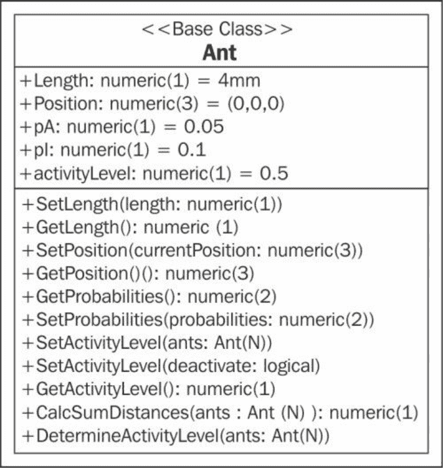
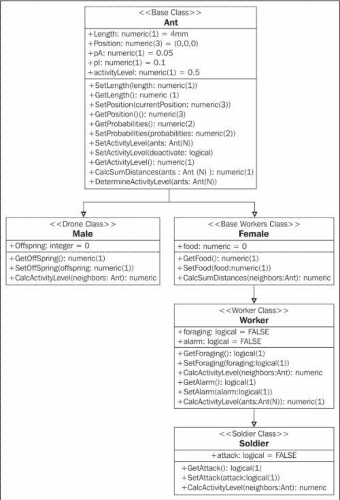

## 第9章 S4类

本章是我们编程入门的第三部分。我们在上一章中研究了 S3 类。现在我们将研究 S4 类。与 S3 类相关的方法更灵活，而与 S4 类相关的方法则是更正式和结构化的定义。

本章大致分为四个部分：

- **Class definition:** 本节为您概述了如何定义一个类以及如何指定与该类相关的数据（slots）
- **Class methods:** 本节为您概述了如何定义与类相关的方法
- **Inheritance:** 本节为您概述了如何定义基于父类定义的子类
- **Miscellaneous commands:** 本节解释了四个可用于探索给定对象或类的命令

### Ant 类简介

我们在 [Chapter 7](#)，*Basic Programming* 中定义了控制流结构的概念，并在 [Chapter 8](#)，*S3 Classes* 中介绍了 S3 类的概念。现在我们将介绍 S4 类的概念，这是在 R 中以更正式的方式实现类的方法。S4 类的一个奇怪怪癖是，你首先定义类及其数据，然后再单独定义方法。

由于类定义方式上的这种分离，我们将首先讨论如何定义类及其数据的一般思路。然后我们将讨论如何向现有类添加方法。接下来，我们将讨论继承是如何实现的。最后，我们将提供一些关于其他不适合前面提到的类别的选项的说明。

在上一章中，我们采用了一个示例然后对其进行修改。与 S4 类相关的方法不太灵活，需要在类定义方面做更多的前瞻性思考。我们将在本章中采用不同的方法，从头开始创建一个完整的类。在这种情况下，我们将基于 Cole 和 Cheshire 提出的一个想法。作者提出了一个细胞自动机模拟，以模仿蚂蚁在蚁群中的移动方式。

作为模拟的一部分，我们假设我们需要一个 Ant 类。我们将偏离论文并假设蚂蚁不是同质的。我们然后假设有雄性（工蜂）和雌性蚂蚁，而雌性可以是工蚁或士兵。我们需要一个蚂蚁基类，这在本书的头两节中进行了讨论，作为演示如何创建 S4 类的手段。在第三部分，我们将基于原始的 Ant 类定义一个类层次结构。该层次结构包括雄性和雌性类。工蚁类将从雌性类继承，而士兵类将从工蚁类继承。

### 定义 S4 类

我们将定义名为 Ant 的基 Ant 类。该类在下图中表示。该类用于表示我们需要跟踪蚂蚁的基本方面，我们专注于创建类和数据。方法在单独的步骤中构建，并在下一节中进行检查。



类是使用 setClass 命令创建的。在创建类时，我们使用 slots 参数以字符向量指定数据。slots 参数是字符对象的向量，表示数据元素的名称。这些元素通常被称为类中的 slots。

我们在这里讨论的一些参数是可选的，但使用它们是一个很好的做法。特别是，我们将指定一组默认值（原型）和一个用于检查数据是否一致的函数（有效性函数）。此外，将创建类所需的所有步骤放在同一个文件中是一个很好的做法。为此，我们假设你不会从命令行输入命令。它们都位于单个文件中，因此示例的格式将反映 R 工作区标记的缺失。

第一步是使用 setClass 命令定义类。此命令定义一个

通过此定义，有两种方法可以创建 Ant 对象：一种是使用 new 命令，另一种是使用在成功执行 setClass 命令后创建的 Ant 生成器。请注意，在以下示例中，默认值可以在创建新对象时被覆盖：

```
```r
> ant1 <- new("Ant")
> ant1
An object of class "Ant"
Slot "Length":
[1] 4

Slot "Position":
[1] 0 0 0

Slot "pA":
[1] 0.05

Slot "pI":
[1] 0.1

Slot "ActivityLevel":
[1] 0.5
```
```

我们可以在创建新对象时指定默认值。

```
```r
> ant2 <- new("Ant",Length=4.5)
> ant2
An object of class "Ant"
Slot "Length":
[1] 4.5

Slot "Position":
[1] 0 0 0

Slot "pA":
[1] 0.05

Slot "pI":
[1] 0.1

Slot "ActivityLevel":
[1] 0.5
```
```

对象也可以使用在创建类时使用 setClass 命令定义的生成器创建。

```
```r
> ant3 <- Ant(Length=5.0,Position=c(3.0,2.0,1.0))
> ant3
An object of class "Ant"
Slot "Length":
[1] 5

Slot "Position":
```
```

```
```r
[1] 5
> adomAnt@Position
[1] -1  2  1
> adomAnt@ActivityLevel = -5.0
> adomAnt@ActivityLevel
[1] -5
```
```

请注意，在前面的示例中，我们为活动水平设置了一个值，根据有效性函数是不允许的。由于它是在对象创建后设置的，因此不会执行检查。有效性函数仅在对象创建期间执行，或者在调用 validObject 函数时执行。

最后一点说明：直接处理对象内的元素通常是不好的形式，更好的做法是创建获取或更改对象内单个元素的方法。小心对象的 slots 的封装是一个最佳实践。R 环境不识别私有与公共数据的概念，维护对这一重要原则的纪律的责任在于程序员。

### 定义新方法

创建新方法的第一步是保留名称。一些函数默认包含，例如 `initialize`、`print` 或 `show` 命令，我们稍后将看到如何扩展它们。要保留新名称，你必须首先使用 `setGeneric` 命令。至少，你需要给此命令提供函数名称作为字符字符串。与上一节一样，我们将使用更多选项作为安全编程的练习。

要创建的方法如前图所示。有许多方法，但我们只在这里定义四种。所有方法都是访问器；它们用于获取或设置数据组件的值。我们只在本文本中定义与 length slot 相关的方法，你可以在网站上提供的示例中看到其余代码。其他方法与 length slot 使用的代码非常相似。有两种方法来设置活动水平，这些代码是分开检查的，以提供方法如何被重载的示例。

首先，我们将定义获取和设置长度的方法。我们将首先创建获取长度的方法，因为它更直接。第一步是告诉 R 将定义一个新函数，并且名称使用 `setGeneric` 命令保留。当 Ant 对象传递给命令时调用的方法使用 `setMethod` 命令定义：

```
```r
setGeneric(name="GetLength",
           def=function(antie)
           {
                 standardGeneric("GetLength")
           }

setMethod(f="GetLength",
          signature="Ant",
          definition=function(antie)
          {
                 return(antie@length)
          }
)
```
```

现在 GetLength 函数已定义，它可用于获取 Ant 对象的长度组件：

```
```r
> ant2 <- new("Ant",length=4.5)
> GetLength(ant2)
[1] 4.5
```
```

设置长度的方法类似，但有一个区别。该方法必须返回传递给它的对象的副本，并且需要一个额外的参数：

```
```r
setGeneric(name="SetLength",
           def=function(antie,newLength)
           {
                 standardGeneric("SetLength")
```
```


```r
}
)
...
```

在设置长度时，必须使用函数返回的对象来设置新对象：

```r
> ant2 <- new("Ant",Length=4.5)
> ant2@Length
[1] 4.5
> ant2 <- SetLength(ant2,6.25)
> ant2@Length
[1] 6.25
```

### 多态

S4类的定义允许方法重载。也就是说，可以定义多个同名的函数，而实际执行的函数由参数类型决定。现在我们通过定义用于设置Ant类活动级别的方法来考察这一思想。

两个或多个函数可以同名，但传递给它们的参数类型不同。有两种用于设置活动级别的方法。一种接受浮点数，并根据传递给它的值设置活动级别；另一种接受逻辑值，如果参数为FALSE，则将活动级别设置为零；否则将其设置为默认值。

其思想是使用setMethod命令中的签名选项。它被设为一个类名向量，类名的顺序用于确定对于给定的参数集应调用哪个函数。不过需要注意的重要一点是，setGeneric命令中定义的prototype决定了参数名，并且两个方法中的参数名必须完全相同且顺序一致：

```r
setGeneric(name="SetActivityLevel",
           def=function(antie,activity)
           {
               standardGeneric("SetActivityLevel")
           }
)

setMethod(f="SetActivityLevel",
          signature=c("Ant","logical"),
          definition=function(antie,activity)
          {
              if(activity) {
                  antie@ActivityLevel = 0.1
              } else {
                  antie@ActivityLevel = 0.0
              }
              return(antie)
          }
)

setMethod(f="SetActivityLevel",
          signature=c("Ant","numeric"),
          definition=function(antie,activity)
          {
              if(activity>=0.0) {
                  antie@ActivityLevel = activity
              } else {
                  warning("The activity level cannot be negative")
              }
              return(antie)
          }
)
```

一旦定义了这两个方法，R将使用参数的类名来确定在给定上下文中调用哪个函数：

```r
> ant2 <- SetActivityLevel(ant2,0.1)
> ant2@ActivityLevel
[1] 0.1
> ant2 <- SetActivityLevel(ant2,FALSE)
> ant2@ActivityLevel
[1] 0
```

签名选项还识别另外两种数据类型：ANY和missing。它们可用于匹配任意数据类型或缺失值。另请注意，在前面的示例中，我们省略了参数中的省略号（...）。...参数必须是最后一个参数，用于指示任何剩余参数都按其在原始函数调用中的形式传递。省略号可以使重载函数的使用方式比所示更加灵活。更多信息可通过`help(dotsMethods)`命令获取。

### 扩展现有方法

在基本的R会话中定义了许多泛型函数，我们将考察如何扩展现有函数。例如，show命令是一个泛型函数，其行为取决于传递给它的对象的类名。由于该函数名已被保留，因此不需要使用setGeneric命令来保留函数名。

show命令是一个标准示例。该命令接受一个对象并将其转换为要显示的字符值。该命令定义了其他命令如何打印和表达一个对象。在前面的示例中，定义了一个名为coordinate的新类；它跟踪一个坐标的两个值x和y，我们将添加一个方法来设置坐标的值：

```r
# Define the base coordinates class.
Coordinate <- setClass(
    # Set the name of the class
    "Coordinate",

    # Name the data types (slots) that the class will track
    slots = c(
        x="numeric",  # the x position
        y="numeric"   # the y position
    ),

    # Set the default values for the slots. (optional)
    prototype=list(
        x=0.0,
        y=0.0
    ),

    # Make a function that can test to see if the data is consistent.
    # (optional)
    # This is not called if you have an initialize function defined!
    validity=function(object)
    {
        # Check to see if the coordinate is outside of a circle of
        # radius 100
        print("Checking the validity of the point")
        if(object@x*object@x+object@y*object@y>100.0*100.0) {
            return(paste("Error: The point is too far ",
                "away from the origin."))
        }
        return(TRUE)
    }
)

# Add a method to set the value of a coordinate
setGeneric(name="SetPoint",
    def=function(coord,x,y)
    {
        standardGeneric("SetPoint")
    }
)

setMethod(f="SetPoint",
    signature="Coordinate",
    def=function(coord,x,y)
    {
        print("Setting the point")
        coord@x = x
        coord@y = y
        return(coord)
    }
)
```

现在我们将扩展show方法，使其能够正确响应coordinate对象。由于它是保留函数，我们不必使用setGeneric命令，而可以直接定义它：

```r
setMethod(f="show",
    signature="Coordinate",
    def=function(object)
    {
        cat("The coordinate is X: ",object@x," Y: ",object@y,"\n")
    }
)
```

如前所述，签名选项必须与你要扩展的函数原始定义匹配。你可以使用`getMethod('show')`命令查看该函数的签名。有了新方法后，show命令在打印坐标对象时会将其转换为字符串：

```r
> point <- Coordinate(x=1,y=5)
[1] "Checking the validity of the point"
> print(point)
The coordinate is X:  1  Y:  5
> point
The coordinate is X:  1  Y:  5
```

另一个重要的预定义方法是initialize命令。如果为某个类创建了initialize命令，则在创建新对象时会调用它。也就是说，你可以定义initialize函数来充当构造函数。如果为某个类定义了initialize函数，则不会调用验证器。你必须使用validObject命令手动调用验证器。另请注意，initialize命令的prototype要求第一个参数名为object，并为其余参数提供默认值，以防在创建新对象时未为任何槽指定值：

```r
setMethod(f="initialize",
    signature="Coordinate",
    def=function(.Object,x=0.0,y=0.0)
    {
        print("Checking the point")
        .Object = SetPoint(.Object,x,y)
        validObject(.Object) # you must explicitly call the
                            # inspector
        return(.Object)
    }
)
```

现在，当你创建一个新对象时，新的`initialize`函数会立即被调用：

```r
> point <- Coordinate(x=2,y=3)
[1] "Checking the point"
[1] "Setting the point"
[1] "Checking the validity of the point"
> point
The coordinate is X:  2 Y:  3
```

同时使用initialize和validity函数可能会导致意想不到的代码路径。当从一个类继承并在子类中调用父类的initialize函数时尤其如此。务必测试代码，以确保代码按你期望的顺序执行。就个人而言，我会尽量使用验证器或构造函数中的一种，而不是两者都用。


### 继承

本章第一部分讨论的 Ant 类提供了一个如何定义类然后定义与该类相关联的方法的示例。我们现在将通过创建继承自基类的新类来扩展该类。原始的 Ant 类如前图所示，现在，我们将提出四个继承自基类的类。两个继承自 Ant 的新类是 Male 类和 Female 类。Worker 类继承自 Female 类，而 Soldier 类继承自 Worker 类。关系如下图所示。所有新类的代码都包含在我们网站提供的示例代码中，但为了使讨论更集中，我们在正文中只关注其中两个新类。



继承自基类 Ant 的类之间的关系

当创建新类时，可以通过设置 `contains` 参数从现有类继承。该参数可以设置为类的向量以实现多重继承。然而，这里我们将专注于单继承，以避免讨论 R 在发生冲突时如何查找方法相关的复杂性。假设第一部分给出的 Ant 基类已在当前会话中定义，则可以定义子类。下面讨论了两个类 Female 和 Worker 的细节。

首先，定义 FemaleAnt 类。它添加了一个新的槽 Food，并继承自 Ant 类。在定义 FemaleAnt 类之前，我们先对 Ant 类做一个说明。基类 Ant 本应是一个虚拟类。我们通常不会创建 Ant 类的对象。我们没有将其设为虚拟类是为了简化介绍。现在我们更有经验了，希望演示如何定义虚拟类。FemaleAnt 类将作为虚拟类来演示这一思想。我们将通过在 contains 参数中包含 VIRTUAL 字符来使其成为虚拟类，并且将无法创建 FemaleAnt 类的对象：

```r
# Define the female ant class.
FemaleAnt <- setClass(
    # Set the name of the class
    "FemaleAnt",

    # Name the data types (slots) that the class will track
    slots = c(
        Food = "numeric"    # The number of food units carried
    ),

    # Set the default values for the slots. (optional)
    prototype=list(
        Food=0
    ),

    # Make a function that can test to see if the data is consistent.
    # (optional)
    # This is not called if you have an initialize function defined!
    validity=function(object)
    {
        print("Validity: FemaleAnt")
        # Check to see if the number of offspring is non-negative.
        if(object@Food<0) {
            return("Error: The number of food units is negative")
        }
        return(TRUE)
    },

    # This class inherits from the Ant class
    contains=c("Ant","VIRTUAL")
)
```

现在，我们将定义一个继承自 FemaleAnt 类的 WorkerAnt 类：

```r
# Define the worker ant class.
WorkerAnt <- setClass(
    # Set the name of the class
    "WorkerAnt",

    # Name the data types (slots) that the class will track
    slots = c(
        Foraging = "logical",    # Whether or not the ant is actively
                                  # looking for food

        Alarm = "logical"        # Whether or not the ant is actively
                                  # announcing an alarm.
    ),

    # Set the default values for the slots. (optional)
    prototype=list(
        Foraging = FALSE,
        Alarm    = FALSE
    ),

    # Make a function that can test to see if the data is consistent.
    # (optional)
    # This is not called if you have an initialize function defined!
    validity=function(object)
    {
        print("Validity: WorkerAnt")
        return(TRUE)
    },

    # This class inherits from the FemaleAnt class
    contains="FemaleAnt"
)
```

当创建新的 worker 时，它继承自 FemaleAnt 类：

```r
> worker <- WorkerAnt(Position=c(-1,3,5),Length=2.5)
> worker
An object of class "WorkerAnt"
Slot "Foraging":
[1] FALSE

Slot "Alarm":
[1] FALSE

Slot "Food":
[1] 0

Slot "Length":
[1] 2.5

Slot "Position":
[1] -1  3  5

Slot "pA":
[1] 0.05

Slot "pI":
[1] 0.1

Slot "ActivityLevel":
[1] 0.5

> worker <- SetLength(worker,3.5)
> GetLength(worker)
[1] 3.5
```

我们尚未在前面的示例中定义相关方法。代码可在我们的示例集中获得，我们将不讨论其中大部分内容以保持讨论更集中。我们将检查 `initialize` 方法。原因是要探索 `callNextMethod` 命令。callNextMethod 命令用于请求 R 搜索并执行父类中同名的方法。

我们选择 initialize 方法是因为一个常见任务是构建构造函数链，为每个构造函数关联的类初始化数据。我们尚未创建任何 initialize 方法，从基类 Ant 开始：

```r
setMethod(f="initialize",
         signature="Ant",
         def=function(.Object,Length=4,Position=c(0.0,0.0,0.0))
         {
             print("Ant initialize")
             .Object = SetLength(.Object,Length)
             .Object = SetPosition(.Object,Position)
             #validObject(.Object) # you must explicitly call the
                                  # inspector
             return(.Object)
         }
)
```

构造函数接受三个参数：对象本身（`.Object`）、长度和蚂蚁的位置，并在创建新对象时未提供时给出默认值。validObject 命令被注释掉了。你应该尝试取消注释该行并创建新对象，以查看验证器是否反过来调用 initialize 方法。另一个重要特性是 initialize 方法返回对象的副本。

为 FemaleAnt 类创建 initialize 命令，并且在请求调用 callNextMethod 调用下一个函数时应尊重 initialize 命令的参数：

```r
setMethod(f="initialize",
         signature="FemaleAnt",
         def=function(.Object,Length=4,Position=c(0.0,0.0,0.0))
         {
             print("FemaleAnt initialize ")
             .Object <- callNextMethod(.Object,Length,Position)
             #validObject(.Object)  # you must explicitly call the
                                     # inspector
             return(.Object)
         }
)
```

callNextMethod 命令用于调用与 Ant 类关联的 initialize 方法。参数排列以匹配 Ant 类的定义，并返回当前对象的副本。

最后，创建 WorkerAnt 类的 initialize 函数。它也使用 callNextMethod 以确保也调用父类关联的同名方法：

```r
setMethod(f="initialize",
          signature="WorkerAnt",
          def=function(.Object,Length=4,Position=c(0.0,0.0,0.0))
          {
              print("WorkerAnt initialize")
              .Object <- callNextMethod(.Object,Length,Position)
              #validObject(.Object) # you must explicitly call the
                                      # inspector
              return(.Object)
          }
)
```

现在，当创建 WorkerAnt 类的新对象时，将调用 WorkerAnt 类关联的 initialize 方法，并且依次调用每个父类关联的方法：

```r
> worker <- WorkerAnt(Position=c(-1,3,5),Length=2.5)
[1] "WorkerAnt initialize"
[1] "FemaleAnt initialize"
[1] "Ant initialize"
```

```r
[1] 0.5

> getClass("WorkerAnt")
Class "WorkerAnt" [in ".GlobalEnv"]
Slots:

Name:        Foraging         Alarm           Food          Length
Position
Class:       logical          logical         numeric       numeric

Name:             pA             pI ActivityLevel
Class:          numeric        numeric        numeric

Extends:
Class "FemaleAnt", directly
Class "Ant", by class "FemaleAnt", distance 2

Known Subclasses: "SoldierAnt"
```

最后，我们将检查 `slot` 命令。`slot` 命令用于根据槽的名称检索给定对象的槽值：

```r
> worker <- WorkerAnt(Position=c(1,2,3),Length=5.6)
> slot(worker,"Position")
[1] 1 2 3
```


### 总结

我们介绍了 S4 类的概念并提供了若干示例。S4 类至少分两个阶段构建。第一阶段是定义类的名称和相关的数据组件。然后在单独的步骤中定义与该类相关的方法。

除了定义类及其方法之外，还探讨了继承的思想。本章给出了一个部分示例；它基于本章第一部分中定义的基础类。此外，还探讨了调用父类中相关方法的方法，并且示例使用了构造函数（或初始化方法）来演示如何构建构造函数链。

最后，解释了四个有用的命令。这四个命令提供了获取有关类或给定类对象的不同方式的信息。

如需了解更多信息，您可以参考 *Mobile Cellular Automata Models of Ant Behavior: Movement Activity of Leptothorax allardycei, Blaine J. Cole and David Cheshire, The American Naturalist.*
